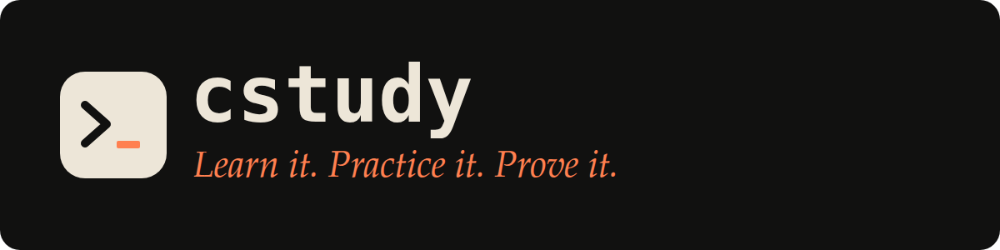
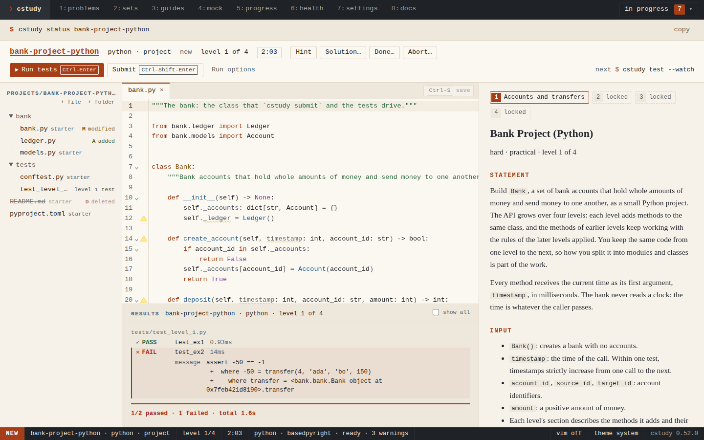

[](https://coding-study.com/?utm_source=github&utm_medium=readme&utm_campaign=coding-study&utm_content=header)

[](https://github.com/bkuberek/coding-study/actions/workflows/ci.yml)
[](https://github.com/bkuberek/coding-study/releases/latest)
[](LICENSE)
[](https://github.com/bkuberek/homebrew-tap)

# coding-study

coding-study is a local, IDE-first study tool for everyone who writes code, from beginners to experts, covering algorithms, backend design, interview practice, and security and AI problems. You solve original problems in your own editor in Python, TypeScript, Java, Kotlin, Go, or Rust, and the `cstudy` command line tests your code, checks whether it is optimal, shows reference solutions, and schedules reviews with spaced repetition. Everything runs on your machine; there is no account and no service.

The website, [coding-study.com](https://coding-study.com/?utm_source=github&utm_medium=readme&utm_campaign=coding-study&utm_content=intro), has the [install guide](https://coding-study.com/install?utm_source=github&utm_medium=readme&utm_campaign=coding-study&utm_content=intro) and the [usage docs](https://coding-study.com/docs?utm_source=github&utm_medium=readme&utm_campaign=coding-study&utm_content=intro).

- **Your editor, real toolchains.** Each language is an ordinary project (uv, pnpm, Gradle) that your editor and its language server open directly.
- **More than algorithms.** Data structures and algorithms, multi-level practical problems, low-level design, concurrency, debugging, system design, and code review.
- **Optimality, not only correctness.** `cstudy bench` measures how your solution grows with input size and compares it with the reference approaches.
- **Spaced repetition.** `cstudy next` resumes what you have open, brings back what is due and picks new problems from your weakest pattern.
- **Code intelligence in the browser, when you want it.** The practice page can show errors as you type, documentation on hover, go to definition and completion for Python, TypeScript, Java, Go and Rust from language servers on your computer. Each is a setting, off by default, so you can also practise without any help.

## Install

```bash
brew install bkuberek/tap/cstudy
cstudy --version
```

Or `uv tool install git+https://github.com/bkuberek/coding-study` (or the same with `pipx install`). `cstudy` runs your code with each language's own toolchain, which you install yourself: uv and Python 3.13 are required, the others only for the languages you use ([install the language toolchains](user-docs/toolchains.md)).

Upgrading from an earlier 0.x? [UPGRADING.md](UPGRADING.md) lists what changed on the way to 1.0 and what to do about each change.

## Quickstart

```bash
cstudy init ~/cstudy-workspace --git   # your workspace: solutions, notes and progress
cd ~/cstudy-workspace
cstudy doctor --fix                    # checks the toolchains and sets up the projects
cstudy next                            # suggests a problem
cstudy start two-sum                   # writes the stub and the statement, opens your editor
cstudy test --watch                    # runs the tests on every save
cstudy done --rating ok                # finishes the attempt and schedules the review
```

Or practise in your browser, on the same workspace: `cstudy serve --open`.



## Documentation

The user docs ship with `cstudy`: `cstudy docs` lists them in the terminal, `cstudy docs <topic>` prints one, and the web UI's Docs view shows them with a search. They are the Markdown pages of [`user-docs/`](user-docs/):

| Page | Covers |
|------|--------|
| [Getting started](user-docs/getting-started.md) | Install, your first workspace and problem, the main commands |
| [Install the language toolchains](user-docs/toolchains.md) | uv and Python, Node.js and pnpm, a JDK, Go, Rust and Docker on macOS and Linux |
| [Check your setup with cstudy doctor](user-docs/doctor.md) | Every check, and how `--fix` sets up a workspace |
| [Your workspace](user-docs/workspace.md) | What the folder holds and version control |
| [Upgrading cstudy](user-docs/upgrading.md) | Upgrading, what `cstudy doctor --fix` refreshes, and moving to a new machine |
| [Work on a problem](user-docs/practice.md) | Start, test, hints, solutions, benchmarks and grades |
| [Kinds of problems](user-docs/problem-kinds.md) | The tracks, the kinds, how each is checked, and the labels |
| [Progressive levels and projects](user-docs/levels.md) | Problems that grow over levels, and `cstudy submit` |
| [Service projects and the dev stack](user-docs/service-projects.md) | Apps in a Docker sandbox with mock servers, and `cstudy dev` |
| [Your IDE and the debugger](user-docs/ide-and-debugging.md) | VS Code and IntelliJ IDEA files, and `cstudy test --debug` |
| [Guides and learning paths](user-docs/guides.md) | Reading guides and following paths with `cstudy learn` |
| [Plan your practice](user-docs/planning.md) | `cstudy next`, problem sets, mock interviews and statistics |
| [Write your own problems](user-docs/own-problems.md) | `cstudy new`, checking a problem with `cstudy verify`, and making it ready |
| [Practise in your browser](user-docs/web-ui.md) | `cstudy serve`: the views and the keyboard |
| [The editor and code intelligence](user-docs/editor.md) | Live errors, hover documentation, go to definition and autocomplete |
| [Settings and preferences](user-docs/settings.md) | `config.toml`, the preferences, backups and reset |
| [Command reference](user-docs/commands.md) | Every command and its flags, and the exit codes |
| [Troubleshooting](user-docs/troubleshooting.md) | What to do when something fails |

To change `cstudy` itself: [the developer docs](docs/README.md) (the PRD, architecture, specs and decision records), the [CLI reference](docs/specs/cli.md), the [authoring guide](docs/specs/authoring.md) for problems of your own, [contributing](CONTRIBUTING.md), and the [changelog](CHANGELOG.md).

## Content catalog

All problem statements, tests and solutions are original ([ADR 0004](docs/decisions/0004-original-problem-wording.md)); LeetCode references only link to the well-known problem a statement is modeled on. The catalog holds 400 problems:

| Track | Problems | Graded by | Format |
|-------|---------:|-----------|--------|
| `dsa` | 210 | Tests, in all 6 languages | Functions and data-structure designs across 24 patterns |
| `practical` | 137 | Tests, level by level where a problem has levels | One class whose API grows over 4 levels, a business task with money and dates, a security or AI/LLM task in Python and TypeScript, a small service to extend, or a service project in Docker with mock servers and backing services |
| `lld` | 8 | Tests, then a design rubric | Object-oriented design |
| `concurrency` | 6 | Stress tests against invariants | Thread-safe classes, per-language models |
| `debugging` | 23 | Tests | Buggy code to fix, including Go- and Rust-only bugs and JavaScript traps |
| `system-design` | 10 | Self-graded with a rubric | Prompt, notes template, reference design |
| `code-review` | 6 | Self-graded with a rubric | A change to review |
| `behavioral` | none | Not tracked | Guidance for your own story bank |

Track details: [content](docs/specs/content.md). Every problem: [catalog](docs/specs/catalog.md).

## License

[MIT](LICENSE), covering both the code and the original problem content.
