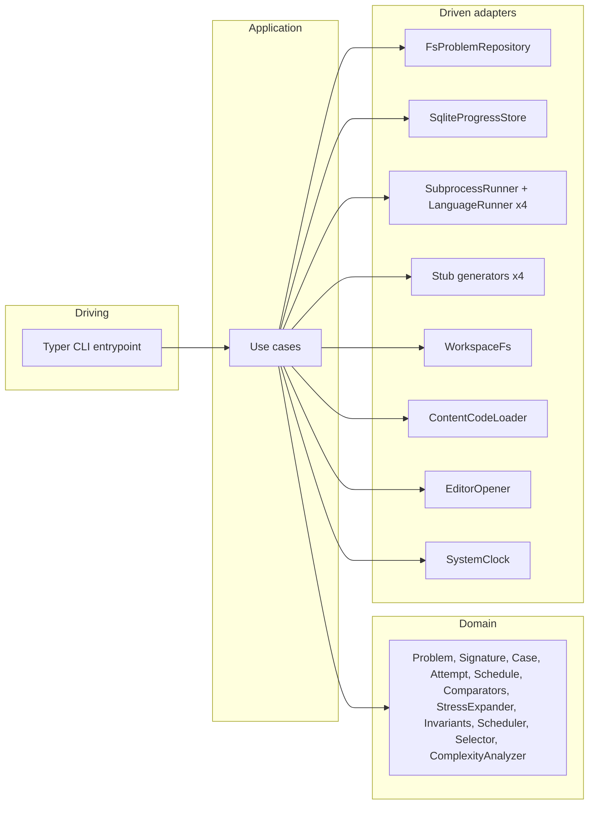
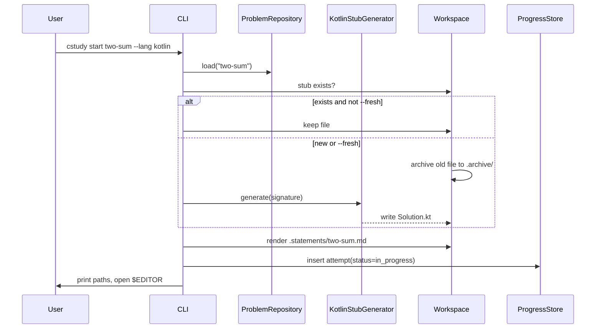
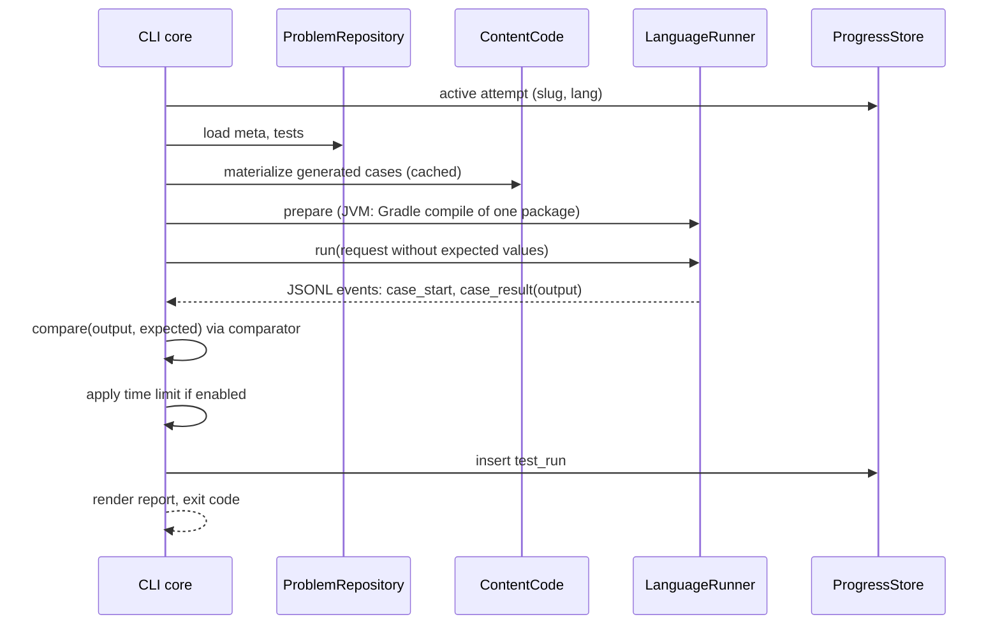

# Architecture

The CLI is a hexagonal application: a pure domain core (problems, attempts, scheduling, comparison, complexity analysis) surrounded by adapters for the filesystem, SQLite, editors and one subprocess runner per runtime. Runners are deliberately dumb: they deserialize inputs, call user code and serialize outputs. All judging happens in the core, written once in Python.

## Components

| Component | Path | Language | Responsibility |
|-----------|------|----------|----------------|
| CLI | `cli/` | Python 3.13, uv | Commands, domain core, adapters, codegen, comparators, scheduling, bench analysis |
| Python runner | `runners/python/` | Python | Packages `cs_runner` (runner) and `cs_support` (`ListNode`, `TreeNode`, `GraphNode`) |
| TypeScript runner | `runners/typescript/` | TypeScript on Node 24 | `runner.ts` and `support.ts` (the node classes and `Decimal`); erasable syntax only |
| JVM runner | `runners/jvm/` | Java 21, Gradle included build | `cs.runner.Main` and `cs.support.*`; serves Java and Kotlin |
| Content | `problems/`, `tracks/` | YAML, JSON, Markdown, code | Problems, tests, references, explanations, generators |
| Schemas | `schemas/` | JSON Schema | `meta.schema.json`, `tests.schema.json`, `item.schema.json`, `conformance.schema.json`; hand-maintained source of truth for validation (`jsonschema`) and editor completion |
| Workspace templates | `cli/src/coding_study/adapters/workspace_template/` | 3 real projects | What `cstudy init` copies into a workspace |
| Workspace | anywhere, outside this repository ([installation-and-workspaces](specs/installation-and-workspaces.md)) | 4 real projects | The user's code, notes and own problems, versioned on their own |
| Progress | `<workspace>/progress.db` | SQLite | Attempts, test runs, schedule, bench runs |
| Cache | `<workspace>/.cs/` | mixed | Index, generated cases, calibration, build scratch, runner runtime |

## Hexagonal boundaries



Dependencies point inward. Ports are Python `Protocol` classes in `cli/src/coding_study/application/ports.py`; adapters implement them; each command module in `entrypoints/commands/` wires them, and `entrypoints/cli.py` registers the commands. Shared pure rules live in the domain: `naming` (per-language symbol names), `layout` (stub, statement, archive and reference paths, run targets) and `runs` (runner request and per-case outcomes).

| Port | Adapter | Notes |
|------|---------|-------|
| `ProblemRepository` | `FsProblemRepository` | Reads `problems/`, validates with JSON Schema, caches the validated `meta.yaml` documents in `.cs/index.json` ([index](#index-cache)) |
| `ItemRepository` | `FsItemRepository` | Reads the non-autograded items in `tracks/<track>/<slug>/` and validates `item.yaml` with JSON Schema, through the same `.cs/index.json` |
| `StudyGuides` | `FsStudyGuides` | Locates the user's own study guides under config `study_guides.root` for item statements ([study guides](specs/content.md#study-guides)) |
| `ProgressStore` | `SqliteProgressStore` | Schema in [progress-and-scheduling](specs/progress-and-scheduling.md) |
| `LanguageRunner` | one per language (`adapters/languages/<python,typescript,jvm,go,rust>/`; the JVM adapter serves Java and Kotlin) | `prepare(scope, notify)` returns `Prepared` (launch command) or `BuildFailed`, building when needed; scope `BenchCode` prepares the user's code and the references for one bench process. Several `cstudy` processes may share a workspace: the JVM, Go and Rust adapters build under a file lock and launch from a private copy of the build output, which `RunnerProcess` removes when the run ends (`RunnerLaunch.scratch`). The JVM adapter copies its class output ([JVM build details](specs/runners.md#jvm-build-details)); Go and Rust share `adapters/languages/compiled_builds.py` (lock, write-on-change generated files, abandoned-run cleanup) and each run gets its own scratch directory `.cs/build/<lang>/run/<pid>-<random>/` holding a copy of the binary ([Go](specs/runners.md#go-build-details), [Rust](specs/runners.md#rust-build-details)) |
| `RunnerProcess` | `SubprocessRunner` (one for every language) | `run(launch, request) -> RunReport` and `bench(launch, request) -> BenchReport`: request file, event file, hang guard, restarts; protocol in [runners](specs/runners.md) |
| `MachineProbe` | `SystemMachine` | CPU model, power source, load average and core count for a bench run's environment record |
| `StubGenerator` | one per language | `generate(meta) -> text`; mapping table in [problem-format](specs/problem-format.md#type-dsl) |
| `Workspace` | `WorkspaceFs` | Stub paths, archive, statement rendering |
| `ContentCode` | `ContentCodeLoader` | Imports `generator.py`, `checker.py` and `stress_checker.py` in-process (stdlib-only content code) |
| `EditorOpener` | `EnvEditorOpener` | Runs `$VISUAL` or `$EDITOR` |
| `WorkspaceSetup` | `FsWorkspaceSetup` | The workspace template, the marker, the runner runtime (`RunnerRuntime`) and `git init`, for `cstudy init` and `cstudy doctor` |
| `Clock`, `Random` | system implementations | Injected for deterministic tests |

| Layer | Package | May import |
|-------|---------|------------|
| Domain | `coding_study.domain` | stdlib only (no `os`, `subprocess`, `sqlite3`, `pathlib` I/O) |
| Application | `coding_study.application` | domain, ports |
| Adapters | `coding_study.adapters` | application, domain, third-party libs |
| Entrypoints | `coding_study.entrypoints` | everything |

An `import-linter` contract in `cli/.importlinter` enforces the table (NFR-8).

### Languages

`Language` has six members. `ALL_LANGUAGES` is what a problem lists by default and what every "all languages" default, coverage line and IDE action means; a problem lists fewer only where a language cannot express it (check S13) or on the concurrency and debugging tracks (`LANGUAGE_SUBSET_TRACKS`). `CORE_LANGUAGES` (Python, TypeScript, Java, Kotlin) are the languages whose toolchains every workspace needs: `cstudy doctor` fails without them, and only warns about Go and Rust ([ADR 0012](decisions/0012-go-and-rust.md)). Code that branches on a language uses an exhaustive `match` ending in `assert_never`, and `tests/test_language_tables.py` fails when a table keyed by `Language` lacks a row.

The adapter registry holds one stub generator and one runner per language that has an adapter package. Every language has its adapters now. A language without them would raise `LanguageNotSetUpError`, which the CLI reports as `error: rust stub generator is not set up yet` with exit code 4, as it does for any part that is not built yet; `cstudy start --lang rust` has already rejected any problem that does not list Rust with exit code 3. `cstudy doctor` handshakes the runners of the core languages only; for Go and Rust it checks the toolchains and debuggers and warns when one is missing.

### Use cases

| Use case | Command |
|----------|---------|
| `PickNext` | `cstudy next` |
| `StartAttempt` | `cstudy start` |
| `RunTests` | `cstudy test` |
| `RevealHint`, `RevealSolution` | `cstudy hint`, `cstudy solution` |
| `CompleteAttempt` | `cstudy done` |
| `RunBench` | `cstudy bench`, `cstudy test --perf` |
| `ListProblems`, `ShowStats` | `cstudy list`, `cstudy stats` |
| `VerifyContent`, `ScaffoldProblem` | `cstudy verify`, `cstudy new` |
| `StartMock` | `cstudy mock` |
| `ExportProgress`, `ImportProgress` | `cstudy export`, `cstudy import` |
| `InitWorkspace` | `cstudy init` |

### CLI libraries

| Need | Library |
|------|---------|
| Commands | Typer |
| Terminal output | Rich |
| YAML | PyYAML (`safe_load`) |
| Schema validation | `jsonschema` |
| File watching | `watchfiles` |
| Tests, lint, types | pytest, ruff, pyright, import-linter |

## Data flow: `cstudy start two-sum --lang kotlin`



## Data flow: `cstudy test`



The runner never receives expected values. Comparison, time-limit verdicts and reporting are core logic.

## Repository layout

```text
coding-study/
  pyproject.toml, uv.lock   # the installable `coding-study` package (hatchling): cli/src plus the content
  .python-version           # 3.13
  cli/                      # the CLI's sources, tests and tool settings, entry point `cstudy`
    src/coding_study/{domain,application,adapters,entrypoints}/
    src/coding_study/adapters/templates/            # `cstudy new` templates
    src/coding_study/adapters/workspace_template/   # what `cstudy init` copies
    src/coding_study/adapters/ide/                  # VS Code and IntelliJ renderers, generated-file store, launcher jar
    tests/
  runners/
    python/                 # uv project: cs_runner, cs_support
    typescript/             # runner.ts, support.ts
    jvm/                    # Gradle included build: support + runner (Java)
    conformance/            # fixture problems for every DSL type and error path, expectations.json
  schemas/                  # meta, tests and item JSON Schemas
  tools/ide-launcher/       # source and reproducible build of the IntelliJ open-file launcher (its jar ships in adapters/ide/)
  problems/<id>-<slug>/     # autograded content (format: specs/problem-format.md)
  tracks/                   # non-autograded content (system design, code review, behavioral)
```

The repository holds no workspace. A workspace, created by `cstudy init` anywhere else, holds the practice projects, `notes/`, `.archive/`, `.statements/`, its own `problems/`, `.cs/` and `progress.db` ([layout](specs/installation-and-workspaces.md#layout)).

### Workspace decisions

| Decision | Choice | Reason |
|----------|--------|--------|
| Where is the workspace? | **Outside this repository**, in its own directory and optionally its own git repository ([ADR 0008](decisions/0008-installable-tool-and-separate-workspaces.md)) | Solutions must never be committed with the public content; the workspace moves between machines on its own |
| Commit practice files? | **Tracked in the workspace** | Attempt history in git is valuable and the user owns the workspace. Tradeoff: noisier history; mitigated by committing only when the user chooses (Q3 in the PRD). |
| Repeat attempts | `cstudy start --fresh` (and review attempts by default) move the old file to `.archive/<slug>/<attempt_id>-<lang>/` before writing a new stub | Re-solving from scratch is the point of spaced repetition; nothing is lost |
| `progress.db` | Ignored by the workspace's `.gitignore` | Binary churn; `cstudy export` covers backup (PRD Q2) |
| Hiding references | References live only in the content's `problems/*/solutions/` | Open a workspace project (`python/`, `typescript/`, `jvm/`) as the editor root so file pickers never index references |
| Statements | Rendered to `.statements/<slug>.md` | Excludes hints and locked progressive levels |

### Per-language workspace projects

| Language | Project root | User file | Tooling |
|----------|--------------|-----------|---------|
| Python | `python/` | `practice/<snake_slug>.py` | `pyproject.toml` (requires-python >= 3.13), `.venv` via `uv sync`, `cs-support` as editable path dependency on `../.cs/runtime/runners/python`, ruff and pyright configured |
| TypeScript | `typescript/` | `practice/<slug>.ts` | `package.json` with `"type": "module"` and `"imports": {"#support": "./support.ts"}`; `support.ts` re-exports `../.cs/runtime/runners/typescript/support.ts`; `tsconfig.json` with `noEmit`, `allowImportingTsExtensions`, `erasableSyntaxOnly`, `verbatimModuleSyntax`, `strict`; dev deps `typescript`, `@types/node` via pnpm |
| Java | `jvm/java/` | `src/main/java/practice/<snake_slug>/Solution.java` (or `<ClassName>.java`) | Gradle subproject; Java toolchain 21 |
| Kotlin | `jvm/kotlin/` | `src/main/kotlin/practice/<snake_slug>/Solution.kt` (or `<ClassName>.kt`) | Gradle subproject; Kotlin JVM plugin, JVM target 21 |
| Go | `go/` | `practice/<snake_slug>/<snake_slug>.go` | `go.mod` (module `workspace`, Go 1.24) with one package per problem; `replace cstudy => ../.cs/runtime/runners/go` provides `cstudy/support`. The root `go.work` uses `./go`. Built offline ([ADR 0012](decisions/0012-go-and-rust.md)) |
| Rust | `rust/` | `practice/<snake_slug>.rs` | `Cargo.toml` (package `practice`, edition 2021) with one `[[example]]` built as a library per started problem, which `cstudy start` adds, `cs_support` from `../.cs/runtime/runners/rust/cs_support` as a dev-dependency, and an empty `lib.rs`. For the editor only: `cstudy` builds solutions offline in `.cs/build/rust` ([ADR 0012](decisions/0012-go-and-rust.md)) |

Project roots are relative to the workspace. `jvm/settings.gradle.kts` uses `includeBuild("../.cs/runtime/runners/jvm")`; both subprojects depend on the runner and support artifacts. IntelliJ opens `jvm/` as one Gradle project. Every path into the runners is relative and points at the workspace's [runner runtime](specs/installation-and-workspaces.md#runner-runtime), so a workspace survives a move or a clone on another machine.

## Toolchain

| Tool | Version | Role | Needed by |
|------|---------|------|-----------|
| Python | 3.13 | CLI, Python runner | Everyone (`uv python install 3.13`) |
| uv | 0.10 or newer | CLI install (`uv tool install git+https://github.com/bkuberek/coding-study`, or `--editable .` in a checkout), venvs | Everyone |
| Node | 24 or newer | TypeScript runner via type stripping | TypeScript practice |
| pnpm | 9 or newer | TypeScript workspace dev deps | TypeScript practice |
| OpenJDK | 21 | Java and Kotlin compile and run | Java and Kotlin practice |
| Gradle | Homebrew, used once | Generates the wrapper in the workspace template's `jvm/` | Maintainers regenerating the wrapper (`brew install gradle`) |
| Gradle wrapper | pinned in `gradle-wrapper.properties` | All JVM builds | Nobody: it ships in the workspace template, and `cstudy init` copies it |
| Kotlin compiler | pinned Kotlin Gradle plugin in `gradle/libs.versions.toml` | Fetched by Gradle; no global `kotlinc` | Nobody: Gradle fetches it |
| Go | 1.24 or newer | Go runner and the `go/` practice project, built offline | Go practice (optional; `cstudy doctor` warns when missing) |
| Rust | `rustc` 1.80 or newer, through rustup | Rust runner and the `rust/` practice project, built offline | Rust practice (optional; `cstudy doctor` warns when missing) |

`cstudy doctor` checks every row and `cstudy doctor --fix` restores missing workspace files, refreshes the runner runtime, then runs `uv sync`, `pnpm install` and a Gradle warm-up build.

## Cache directory `.cs/`

The workspace's `.cs/` (ignored by its `.gitignore`, except the `workspace.toml` marker). Outside a workspace, `cstudy list` and `cstudy show` cache in `$XDG_CACHE_HOME/coding-study/catalog/` instead.

| Path | Content | Invalidation |
|------|---------|--------------|
| `.cs/index.json` | Parsed and validated `meta.yaml` and `item.yaml` documents ([index](#index-cache)) | Per file: modification time (ns) and size of the file and of its schema |
| `.cs/cases/<slug>/<hash>.json` | Generated cases with expected values | Hash of generator, tests, expected-source approach |
| `.cs/calibration/<lang>/<slug>.json` | Reference per-case timings for time limits | Hash of reference file, tests, runtime version, machine id |
| `.cs/build/<lang>/` | Materialized references for verify and bench; in Go and Rust also the generated build and its runner binaries ([Go](specs/runners.md#go-build-details), [Rust](specs/runners.md#rust-build-details)) | Rebuilt on change |
| `.cs/runs/<run_id>/` | Request and result files | Keep last 20 |
| `.cs/runtime/` | The runner runtime: a copy of the content's `runners/{python,typescript,jvm,go}` with its build output, and `stamp.json` | Digest of the copied sources; refreshed before the first runner of a command, by `cstudy init` and by `cstudy doctor --fix` |

### Index cache

`cstudy list`, `cstudy next` and `cstudy stats` read every `meta.yaml` and `item.yaml`; parsing and schema-validating them dominated their time (about 0.8 s with 207 problems, against NFR-2's 500 ms). The index stores each file's validated document so a warm run only stats the files.

```json
{
  "version": 2,
  "entries": {
    "/home/me/coding-study/problems/0001-two-sum/meta.yaml": {"stamp": [1761350000123456789, 1520, 1761340000000000000, 9480], "document": {"id": "0001", "slug": "two-sum"}}
  }
}
```

| Rule | Detail |
|------|--------|
| Key | Absolute path of the YAML file, so the catalog and a workspace's own `problems/` share one index |
| `stamp` | `[file mtime ns, file size, schema mtime ns, schema size]`: an entry is a hit only when all four equal the current values, so editing a file or its schema is a miss. Nothing is hashed |
| Stored | Only documents with no schema violation, so invalid content is reported on every run |
| Not stored | `tests.json`, solutions and statements: `cstudy start`, `cstudy test` and `cstudy verify` read what they need directly. The reference languages of a problem still come from a directory listing each run |
| Housekeeping | A full listing drops the entries of files that no longer exist under its directory (`problems/` or `tracks/`) and rewrites the index only when it changed (write to a temporary file, then rename) |
| Failure | A missing, corrupt or other-version index, or one that cannot be written, is a cold read: never an error |
| Loader | `yaml.CSafeLoader` when PyYAML has libyaml, else `yaml.SafeLoader`; the schema validators are built on first use |
