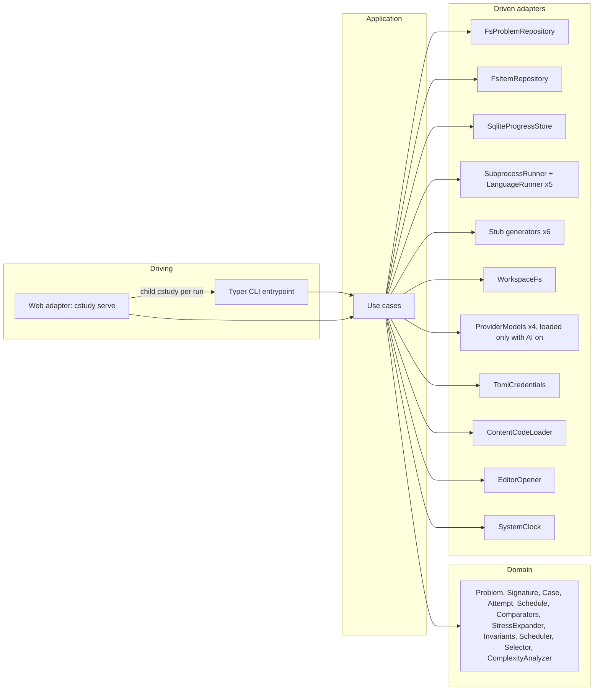
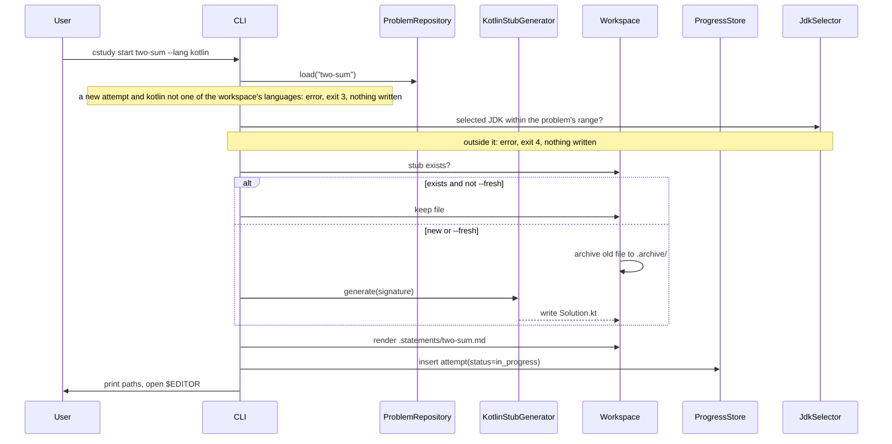
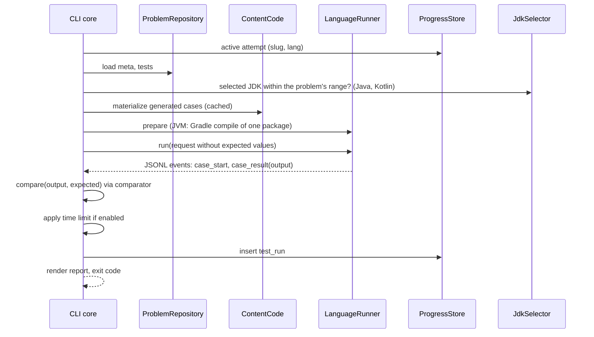

# Architecture

The CLI is a hexagonal application: a pure domain core (problems, attempts, scheduling, comparison, complexity analysis) surrounded by adapters for the filesystem, SQLite, editors and one subprocess runner per runtime. Runners are deliberately dumb: they deserialize inputs, call user code and serialize outputs. All judging happens in the core, written once in Python.

## Components

| Component | Path | Language | Responsibility |
|-----------|------|----------|----------------|
| CLI | `cli/` | Python 3.13, uv | Commands, domain core, adapters, codegen, comparators, scheduling, bench analysis |
| Python runner | `runners/python/` | Python | Packages `cs_runner` (runner) and `cs_support` (`ListNode`, `TreeNode`, `GraphNode`) |
| TypeScript runner | `runners/typescript/` | TypeScript on Node 24 | `runner.ts` and `support.ts` (the node classes and `Decimal`); erasable syntax only |
| JVM runner | `runners/jvm/` | Java, compiled at release 21; Gradle included build | `cs.runner.Main` and `cs.support.*`; serves Java and Kotlin. The module `cs.coroutines`, in Kotlin, is the bridge to the coroutine test scheduler that grades Kotlin projects on the virtual clock |
| Content | `problems/`, `guides/`, `user-docs/` | YAML, JSON, Markdown, code | Problems, autograded and rubric-checked, with their tests, references, explanations and generators; concept guides and learning paths; the user docs |
| Web UI | `cli/src/coding_study/entrypoints/web/`, sources in `tools/web-ui/` | Python (Starlette on uvicorn); TypeScript and CodeMirror 6, built and committed | `cstudy serve`: the local page, a second driving adapter ([below](#web-adapter), [web-ui](specs/web-ui.md)) |
| Schemas | `schemas/` | JSON Schema | `meta.schema.json`, `tests.schema.json`, `conformance.schema.json`; hand-maintained source of truth for validation (`jsonschema`) and editor completion. `events.schema.json` describes the lines of `cstudy test --events` and `cstudy submit --events` ([event stream](specs/cli.md#event-stream)) for programs that read them, and `web-api.schema.json` the web API's own documents. `schemas/cli/` holds one schema per `--json` document and the progress export ([compatibility](specs/compatibility.md#json-documents)); `guide.schema.json`, `path.schema.json`, `user-doc.schema.json`, `sets.schema.json`, `mock.schema.json` and `dev-events.schema.json` describe the guides, the paths, the user docs' front matter, `sets.yaml`, the mock servers of service projects and `cstudy dev --events` |
| Workspace templates | `cli/src/coding_study/adapters/workspace_template/` | 5 real projects | What `cstudy init` copies into a workspace |
| Workspace | anywhere, outside this repository ([installation-and-workspaces](specs/installation-and-workspaces.md)) | 5 real projects | The user's code, notes and own problems, versioned on their own |
| Progress | `<workspace>/progress.db` | SQLite | Attempts, test runs, schedule, bench runs, submissions, level unlocks, guide reads, and the AI preview's reviews, requests and consents; backed up to `.cs/backups/` before each migration |
| AI keys | `credentials.toml`, beside `config.toml` | TOML | The AI providers' keys, outside every workspace, read only by AI work ([ai](specs/ai.md#keys)) |
| Cache | `<workspace>/.cs/` | mixed | Index, generated cases, calibration, build scratch, runner runtime, `progress.db` backups |

## Hexagonal boundaries



Dependencies point inward. Ports are Python `Protocol` classes in `cli/src/coding_study/application/ports.py`; adapters implement them; each command module in `entrypoints/commands/` wires them, and `entrypoints/cli.py` registers the commands. Shared pure rules live in the domain: `naming` (per-language symbol names), `layout` (stub, statement, archive and reference paths, run targets), `runs` (runner request and per-case outcomes) and `jdk` (the supported JDK range, a problem's effective range and whether the selected JDK can run it, [ADR 0016](decisions/0016-jdk-range.md)).

| Port | Adapter | Notes |
|------|---------|-------|
| `ProblemRepository` | `FsProblemRepository` | Reads `problems/`, validates with JSON Schema, caches the validated `meta.yaml` documents in `.cs/index.json` ([index](#index-cache)) |
| `ItemRepository` | `FsItemRepository` | Reads the rubric-checked problems of `problems/<slug>/`, the folders whose `kind` is `system-design` or `code-review`, and validates their `meta.yaml` with JSON Schema, through the same `.cs/index.json`; `FsProblemRepository` reads the other folders and treats these as absent |
| `StudyGuides` | `FsStudyGuides` | Locates the user's own study guides under config `study_guides.root` for rubric problem statements ([study guides](specs/content.md#study-guides)) |
| `ProblemFiles` | `FsProblemFiles`, `OverlayProblemFiles` | The raw files of every folder of a `problems/` directory, keyed by slug, valid or not, for `cstudy verify`; `misnamed()` names the directories whose name is not a slug ([problem folders](specs/compatibility.md#problem-folders)) |
| `ProgressStore` | `SqliteProgressStore` | Schema in [progress-and-scheduling](specs/progress-and-scheduling.md); the first use migrates an older database after a backup to `.cs/backups/` ([migrations](specs/compatibility.md#migrations)) |
| `ProgressDatabase` | `SqliteProgressDatabase` | The `progress.db` file for `cstudy doctor`: its schema without migrating, and `--fix`'s migration with the same backup |
| `LanguageRunner` | one per language (`adapters/languages/<python,typescript,jvm,go,rust>/`; the JVM adapter serves Java and Kotlin) | `prepare(scope, notify)` returns `Prepared` (launch command) or `BuildFailed`, building when needed; scope `BenchCode` prepares the user's code and the references for one bench process. Several `cstudy` processes may share a workspace: the JVM, Go and Rust adapters build under a file lock and launch from a private copy of the build output, which `RunnerProcess` removes when the run ends (`RunnerLaunch.scratch`). The JVM adapter copies its class output ([JVM build details](specs/runners.md#jvm-build-details)); Go and Rust share `adapters/languages/compiled_builds.py` (lock, write-on-change generated files, abandoned-run cleanup) and each run gets its own scratch directory `.cs/build/<lang>/run/<pid>-<random>/` holding a copy of the binary ([Go](specs/runners.md#go-build-details), [Rust](specs/runners.md#rust-build-details)) |
| `RunnerProcess` | `SubprocessRunner` (one for every language) | `run(launch, request) -> RunReport` and `bench(launch, request) -> BenchReport`: request file, event file, hang guard, restarts; protocol in [runners](specs/runners.md) |
| `JdkSelector` | `EnvJdkSelector` | `selected() -> SelectedJdk \| None`: the JDK that `JAVA_HOME` names, else the JDK of the first `java` on `PATH`, with its version read from the `release` file in the JDK's home, so listing problems starts no JVM ([the selected JDK](specs/cli.md#the-selected-jdk)); `unusable_java_home() -> str \| None`: the `JAVA_HOME` as it is set when it holds no JDK, in which case nothing is selected (the selection does not fall back to `PATH`); `selected_home() -> Path \| None`: the selected JDK's home, which `doctor --fix` passes to Gradle. `Environment.jdk` holds it: the use cases that start, test, submit, bench, list, pick or verify a problem ask it and apply the domain's range rules (`domain/jdk_fit.py`); the JVM adapter builds and launches with the same JDK |
| `ToolchainCheck` | `PathToolchainCheck` (`adapters/path_toolchain_check.py`) | `missing(language) -> str \| None`: why a language's program is not there (`cargo was not found on PATH`), or None; `node`, `go` and `cargo` are looked up on `PATH`, Python is the workspace's interpreter, Java and Kotlin are the JDK's and are never missing here. `Environment.toolchain_check` holds it: `cstudy verify` skips such a language with the reason (`application/toolchain_requirement.py`, with the JDK's skip) instead of ending the run ([skipped languages](specs/cli.md#cstudy-verify)) |
| `MachineProbe` | `SystemMachine` | CPU model, power source, load average and core count for a bench run's environment record |
| `StubGenerator` | one per language | `generate(meta) -> text`; mapping table in [problem-format](specs/problem-format.md#type-dsl) |
| `Workspace` | `WorkspaceFs` | Stub paths, archive, statement rendering |
| `SandboxEngine` | `DockerSandbox` (`adapters/docker_sandbox.py`) | The container engine of [service projects](specs/service-projects.md#sandbox): its state, images, stacks that a guard takes down however `cstudy` ends, and leftovers by label. Only a service project reaches it |
| `GradedStack`, `OpenStackClients` | `SandboxGradedStack` (`application/graded_stack.py`), `open_stack_clients` (`adapters/http_grader/clients.py`) | What the [HTTP grader](specs/service-projects.md#http-grading) asks of a ready stack and of the network: restarts, the app's exit and output, and where each [origin](specs/service-projects.md#reaching-an-origin) a case names answers |
| `ContentCode` | `ContentCodeLoader` | Imports `generator.py`, `checker.py` and `stress_checker.py` in-process (stdlib-only content code) |
| `EditorOpener` | `EnvEditorOpener` | Runs `$VISUAL` or `$EDITOR` |
| `LanguageServerLocator` | `LspDirectory` (`adapters/language_servers/`) | For each server of the code-intelligence catalog (`domain/code_intelligence.py`), whether `.cs/lsp/` holds it, or `PATH` for rust-analyzer, and the version its version command prints, or, for JDT LS, whether the core plugin of its pinned milestone is unpacked, and for the Kotlin LSP the version, last day and license that the record of its fetched build names; today's date, for that last day; whether the workspace's marker records a server's license as accepted; and the selected Go's release, which pins gopls ([web-ui](specs/web-ui.md#language-servers)) |
| `LanguageServerInstaller` | `LspDirectory` | Copies the shipped `package.json` and `pnpm-lock.yaml` into `.cs/lsp/` and runs `pnpm install --frozen-lockfile --ignore-scripts` there; downloads an archive server such as JDT LS, checks its SHA-256 and unpacks it, a tar or a zip with its Unix modes and links, in place of its directory; finds the Kotlin LSP's newest build for this machine in its GitHub releases, with the SHA-256 JetBrains publishes beside it and the license at its tag, then downloads it the same way, asks it its last day and records it; builds a server that Go builds, gopls, with `go install` into `.cs/lsp/bin/`; records an accepted license in the workspace's marker; and runs a server's warm-up, the Kotlin LSP's `bin/warmup.py` under cstudy's Python ([layout](specs/installation-and-workspaces.md#layout)) |
| `PreferencesStore` | `FsPreferencesStore` (`adapters/preferences_fs.py`) | The web UI's `.cs/serve/preferences.json`; `cstudy doctor` reads `code_intelligence` from it |
| `ProblemSetStore` | `YamlProblemSets` (`adapters/yaml_problem_sets.py`) | The workspace's `sets.yaml`: read and validated, and changed by the lines a change needs, keeping the user's comments ([ADR 0023](decisions/0023-problem-sets.md)) |
| `GuideCatalog` | `FsGuideCatalog` (`adapters/fs_guide_catalog.py`) | The [concept guides and learning paths](specs/guides.md) in `guides/`: `meta.yaml` and path files validated with JSON Schema, `guide.md` and the example files ([ADR 0025](decisions/0025-concept-guides-and-learning-paths.md)) |
| `UserDocs` | `FsUserDocs` (`adapters/fs_user_docs.py`) | The [user docs](specs/user-docs.md) in `user-docs/`: one Markdown page per topic, its front matter validated with JSON Schema ([ADR 0026](decisions/0026-user-docs.md)) |
| `WorkspaceSetup` | `FsWorkspaceSetup` | The workspace template, the marker, the runner runtime (`RunnerRuntime`) and `git init`, for `cstudy init` and `cstudy doctor`; the template files it writes or reports missing are those of the workspace's [languages](#workspace-languages) and the shared ones |
| `WorkspaceLanguageStore` | `FsWorkspaceLanguageStore` (`adapters/workspace_setup.py`) | The marker's `languages`, rewritten keeping its comments, and the missing template files of added languages, never overwriting one, for `cstudy lang` and the Settings view |
| `LanguageFolders` | `FsLanguageFolders` (`adapters/language_folders.py`) | The template folders that `cstudy lang remove --delete-folder` deletes: whether one is there, whether it is a link or resolves outside the workspace, and its deletion, a link inside it deleted as a link |
| `RunActivity` | `ProcessRunActivity` (`adapters/run_activity.py`) | Whether a run or a job is active, which `cstudy reset` and `cstudy lang remove --delete-folder` wait for |
| `LanguageModels` | `ProviderModels` (`adapters/ai/models.py`), behind a loader in `adapters/environment_factory.py`; `NoLanguageModels` with AI off | `complete(request, key)` and `list_models(provider, key, deadline_s)`: the AI preview's one door to a provider, one adapter per provider under `adapters/ai/` over `http_json.py` ([below](#ai-preview)) |
| `Credentials` | `TomlCredentials` (`adapters/toml_credentials.py`) | `credentials.toml` beside `config.toml`: the keys as `ApiKey` values, written whole with mode `0600`, refused inside the workspace ([keys](specs/ai.md#keys)) |
| `AiStore` | `SqliteAiStore` (`adapters/sqlite/ai_rows.py`) | The tables `ai_reviews`, `ai_calls` and `ai_consents` of `progress.db`, on the connection it shares with `SqliteProgressStore` (`adapters/sqlite/progress_connection.py`) |
| `Clock`, `Random` | system implementations | Injected for deterministic tests |

| Layer | Package | May import |
|-------|---------|------------|
| Domain | `coding_study.domain` | stdlib only (no `os`, `subprocess`, `sqlite3`, `pathlib` I/O) |
| Application | `coding_study.application` | domain, ports |
| Adapters | `coding_study.adapters` | application, domain, third-party libs |
| Entrypoints | `coding_study.entrypoints` | everything |

An `import-linter` contract in `cli/.importlinter` enforces the table (NFR-8). Two more contracts guard the AI preview: the domain and application layers import none of `http`, `socket` and `ssl`, and the entrypoints import nothing of `coding_study.adapters.ai` directly.

### Web adapter

`cstudy serve` is a second driving adapter beside the Typer CLI ([ADR 0015](decisions/0015-local-web-ui.md), [web-ui](specs/web-ui.md)). It reaches the application in two ways: reads and small writes call use cases in-process, through one worker thread; runs and long jobs start a child `python -m coding_study …` and relay its output, so the terminal and the page run the same command.

| Rule | Detail |
|------|--------|
| Package | `coding_study.entrypoints.web`, beside `entrypoints.commands`; it may import every layer, as entrypoints do |
| Lazy import | `entrypoints/commands/serve.py` imports `entrypoints.web` inside the command function only, so no other command loads Starlette or uvicorn (NFR-2); a test checks `sys.modules` after importing `coding_study.entrypoints.cli` |
| Import contracts | `starlette`, `uvicorn` and `wsproto` join the forbidden modules of the domain and application contracts, and a new contract forbids them to `coding_study.adapters` |
| One WebSocket | `GET /api/v1/code-intelligence?attempt_id=N`, for language-server sessions only, on uvicorn's wsproto implementation; every other client action stays an ordinary request ([ADR 0018](decisions/0018-editor-code-intelligence.md), [web-ui](specs/web-ui.md#code-intelligence-sessions)). The route, its sessions, its server processes and its broker live in `entrypoints/web/` (`api_code_intelligence.py`, `code_intelligence.py`, `language_server.py`, `language_broker.py`, `documentation.py`, `library_files.py`), where runs already start child processes: each session runs one language server as a child, in a session of its own, at most four at once |
| Code intelligence | The catalog of servers is domain data (`domain/code_intelligence.py`: per language the command, version command, root rule, initialization options, client capabilities, settings and idle time). `application/code_intelligence.py` holds `language_server_states`, for the doctor rows and the Settings view, and `install_language_servers`, `download_language_server` and `install_language_server_with_go`, for `cstudy doctor --fix`, behind `LanguageServerLocator`, `LanguageServerInstaller` and `PreferencesStore`. Like highlighting, it grades nothing and records nothing |
| New use cases | `application/attempt_files.py` (an attempt's files: tree, read, save, create, move, delete), `application/attempt_changes.py` (what the notifications watch, and what changed between two snapshots of it) and `application/problem_history.py` (shared with `cstudy history`); `project_status` grows into `attempt_status` for every kind |
| New port methods | `Workspace.read_within`, `delete_within` and `move_within`, beside `write_within`, none following a link; `Workspace.locked_with_deadline`, the project lock that gives up after a deadline, so a page change answers 409 `locked` instead of waiting; `ProgressStore.attempt`, an attempt by its id |
| No new judging | The adapter never runs user code and never compares an output; it relays `--events` lines unchanged |

### Languages

`Language` has six members. `ALL_LANGUAGES` is what a problem lists by default and what every "all languages" default, coverage line and IDE action means; a problem lists fewer only where a language cannot express it (check S13), on the concurrency and debugging tracks (`LANGUAGE_SUBSET_TRACKS`) or in the security, identity and AI domains (`LANGUAGE_SUBSET_DOMAINS`, [ADR 0020](decisions/0020-catalog-labels.md)); a project problem lists exactly one ([ADR 0014](decisions/0014-project-problems.md)), and code that branches on `ProblemKind` uses the same exhaustive `match`. `CORE_LANGUAGES` (Python, TypeScript, Java, Kotlin) are the languages whose toolchains a workspace that has not chosen its languages needs: there `cstudy doctor` fails without them, and only warns about Go and Rust ([ADR 0012](decisions/0012-go-and-rust.md)). Code that branches on a language uses an exhaustive `match` ending in `assert_never`, and `tests/test_language_tables.py` fails when a table keyed by `Language` lacks a row.

The adapter registry holds one stub generator and one runner per language that has an adapter package. Every language has its adapters now. A language without them would raise `LanguageNotSetUpError`, which the CLI reports as `error: rust stub generator is not set up yet` with exit code 4, as it does for any part that is not built yet; `cstudy start --lang rust` has already rejected any problem that does not list Rust with exit code 3. `cstudy doctor` handshakes the runners of the core languages only; for Go and Rust it checks the toolchains and debuggers.

#### Workspace languages

A workspace's languages are the marker's `languages`, one or more of the six; a marker without the key has all six and has chosen none ([workspace languages](specs/installation-and-workspaces.md#workspace-languages), [ADR 0028](decisions/0028-learner-profile.md)). They decide which practice folders exist, which toolchains `cstudy doctor` requires, which IDE files are written and which languages a new attempt starts in.

| Piece | Path | Role |
|-------|------|------|
| The language table | `domain/workspace_languages.py` | Each language's template paths (`template_paths`, an exhaustive `match`: Java and Kotlin share `jvm/`, Go owns `go/` and `go.work`), the workspace order, parsing of `--lang` values and of the marker's value, and the folder names the output prints (`go/ and go.work`) |
| The marker | `adapters/workspace_marker.py` | `read_marker` validates `languages`, so a bad value makes the marker unreadable; `write_languages` rewrites it with tomlkit, keeping comments and other keys |
| The environment | `Environment.workspace_languages` | The marker's languages, or None when the workspace chose none; every use case reads them from here |
| Template files | `WorkspaceSetup`, `WorkspaceLanguageStore` | `cstudy init --lang` and `cstudy doctor --fix` write the template files of the workspace's languages and the shared ones only; `cstudy lang add` writes an added language's |
| New attempts | `application/language_requirement.py` | `require_workspace_language` refuses a new attempt outside the workspace's languages with exit 3 and the `cstudy lang add` hint, before anything is written; a service project uses no language folder and is exempt |
| Default language | `domain/precedence.py` | `resolve_language` takes the workspace's languages: `--lang`, else `default_lang` when it is one of them, else the first of them |
| Verify | `application/toolchain_requirement.py` | `split_by_toolchain` skips a language the workspace does not list, with its reason, before the JDK range and the missing toolchains |
| Doctor | `application/doctor.py` | Toolchain rows, workspace rows and `--fix` steps of the workspace's languages only, each chosen language required, Go and Rust included, and the `languages` row ([rows by language](specs/cli.md#rows-by-language)) |
| IDE files | `domain/ide.py`, `domain/ide_actions.py` | `IdeWorkspace.languages` and `IdeAction.applies_to` leave out the settings, extensions, debug configurations and actions of the languages the workspace does not list |
| Adding and removing | `application/workspace_languages.py`, `entrypoints/commands/lang.py` | `change_languages` writes the marker, then the added languages' template files, then, when asked, deletes the removed languages' folders; `language_removal_preview` runs every check that can refuse a deletion and says what goes and what stays, changing nothing. The entrypoint refreshes the IDE files cstudy wrote (`refresh_written_ides`). `cstudy lang` and the Settings view call the same use cases |

### Learner profile

The learner profile is the default filter of `cstudy list`, `next`, `mock` and `learn` and of the page's Problems, Guides and Mock views ([the learner profile](specs/cli.md#the-learner-profile), [ADR 0028](decisions/0028-learner-profile.md)). It has three dimensions, each defaulting to all of its values: the workspace's languages, and the job roles and domains of `profile.job_roles` and `profile.domains` in `config.toml` (`ProfileSettings` in `domain/config.py`).

| Piece | Path | Role |
|-------|------|------|
| The rule | `domain/profile.py` | `learner_profile` builds a `Profile` from the config's settings and the workspace's languages. `Profile.matches` is the one matching rule of every list: a role profile keeps `general` entries, a language profile keeps rubric problems, and an entry without a dimension is kept. `Widening` holds the dimensions a run ignores the profile in (`--widen`, and the dimension of each explicit `--lang`, `--role` or `--domain`). `ProfileEffect` counts what the profile hid, and `profile_line` words the dim line that ends the command's output |
| Use cases | `application/list_problems.py`, `application/next_problem.py` with `domain/next_selection.py`, `application/mock_interview.py`, `application/learn.py` | Each takes a `Profile` and a `Widening`, narrows its rows or its pick's scope, and returns the `ProfileEffect`: the shown and total counts, and the values that narrowed. `mock_scope` gives the Mock view the same counts before a mock starts |
| CLI | `entrypoints/commands/list_problems.py`, `next_problem.py`, `mock.py`, `learn.py` | Build the profile, parse `--widen`, print the profile line on standard output while the profile hid an entry, and write `profile` with its `hidden` counts in `--json` |
| Web | `entrypoints/web/documents.py`, `api_browsing.py`, `api_guides.py`, `api_mock.py`, `api_languages.py` | The session document carries the profile the page's filters start from; the list, next, guide and mock routes take `widen`, `domain` and `role` and call the same use cases; the languages routes serve `cstudy lang`'s use cases and the removal preview |

Neither these use cases nor these routes write the profile: widening is per run, and only `cstudy init --lang`, `cstudy lang`, `cstudy config edit` and the Settings view change it.

### AI preview

The optional AI features, with the user's own key ([ai](specs/ai.md), [ADR 0029](decisions/0029-ai-foundation.md)). They are off by default, and with them off nothing leaves the machine.

| Piece | Path | Role |
|-------|------|------|
| Vocabulary | `domain/ai.py`, `domain/ai_models.py`, `domain/ai_records.py` | `Provider`, `ModelRef` (`<provider>:<model id>`), `Routing`, `Tier`, `AiTask`, `ApiKey`, whose text is `<key>` and which only an adapter unwraps; the request and reply, `ProviderError` and its kinds; the consent, request and review records. `AiSettings` in `domain/config.py` holds the six `[ai]` keys |
| Rules | `domain/ai_routing.py`, `domain/ai_usage.py`, `domain/ai_review.py` | The task table (purpose, tiers, output limit, deadline) and the model a task uses; the estimate and the daily cap; the review's versioned instructions, numbered criteria, reply schema, the checks on a reply and the record |
| The send path | `application/ai_send.py` | The one path every request takes: AI on, the routing's models, their keys, the cap, the consent (through a `ConsentAsker`: the terminal, a refusal, or consents a page job recorded), the request, then one `ai_calls` row |
| Use cases | `application/ai_status.py`, `ai_usage.py`, `ai_keys.py`, `ai_consent.py`, `ai_check.py`, `ai_models.py`, `ai_review.py` | `cstudy ai status`, `usage`, `key`, `consent`, `check`, `models` and `review`, which the page's AI endpoints and jobs share |
| Providers | `adapters/ai/` | `http_json.py` (`urllib.request` with its own opener, system TLS, proxies, deadlines, a 4 MiB limit, no redirects and no retries, the key scrubbed from provider text, and the loopback-only `CSTUDY_AI_ENDPOINT` of the tests); `anthropic.py`, `openai.py`, `google.py`, `openrouter.py`, each mapping its API's request, structured output, usage, endings and errors; `reply_json.py`; `models.py`, the port by provider |
| Wiring | `adapters/environment_factory.py` | `Environment` gains `credentials`, `ai_store` and `models`. With `ai.enabled` false, `models` is `NoLanguageModels`, which refuses every request; with it true, a loader imports `coding_study.adapters.ai` at the first request, so no other command imports it, and a test checks `sys.modules` after importing `coding_study.entrypoints.cli` |
| CLI | `entrypoints/commands/ai.py`, `ai_check.py`, `ai_review.py`, `ai_consent_prompt.py`, `ai_report.py`, `ai_review_report.py` | The `cstudy ai` group; the terminal's consent question; model text printed without markup or control characters |
| Web | `entrypoints/web/api_ai.py`, the AI jobs of `run_options.py` | Status, usage, keys, consents and reviews in-process; every request to a provider is a job, a child `cstudy ai …` started after in-process checks and the consent 409, so the server process never sends. The page's Settings AI section and AI review panel are chunks of the front end |
| `cstudy doctor` | `application/doctor.py` | The `ai` row, while AI is on or `credentials.toml` exists; it reads the config and the file only |

The fast tests run under a network guard in `cli/tests/conftest.py` that refuses connections and name lookups off the loopback, and `tests/test_ai_off.py` proves that with AI off nothing is sent ([with AI off](specs/ai.md#with-ai-off)).

### Use cases

| Use case | Command |
|----------|---------|
| `PickNext` | `cstudy next` |
| `StartAttempt` | `cstudy start` |
| `RunTests` | `cstudy test` |
| `RevealHint`, `RevealSolution` | `cstudy hint`, `cstudy solution` |
| `CompleteAttempt` | `cstudy done` |
| `RunBench` | `cstudy bench`, `cstudy test --perf` |
| `ListProblems`, `ShowStats` | `cstudy list`, `cstudy stats` |
| `VerifyContent`, `ScaffoldProblem` | `cstudy verify`, `cstudy new` |
| `StartMock` | `cstudy mock` |
| `ExportProgress`, `ImportProgress` | `cstudy export`, `cstudy import` |
| `InitWorkspace` | `cstudy init` |
| `workspace_languages`, `change_languages`, `language_removal_preview` | `cstudy lang`, the Settings view's languages |
| `mock_scope` | The Mock view's profile counts |
| `AttemptStatus`, `ProblemHistory` | `cstudy status`, `cstudy history` |
| `AttemptFiles` | The web UI's editor and file tree |
| `ai_status`, `usage_report`, `save_key`, `remove_key`, `grant`, `revoke` | `cstudy ai status`, `usage`, `key`, `consent` |
| `run_check`, `list_provider_models` | `cstudy ai check`, `cstudy ai models` |
| `plan_review`, `dry_run_review`, `prepare_review`, `run_review`, `list_reviews`, `show_review`, `dismiss_review` | `cstudy ai review` and its flags, the page's AI review |

### CLI libraries

| Need | Library |
|------|---------|
| Commands | Typer |
| Terminal output | Rich |
| YAML | PyYAML (`safe_load`) |
| Schema validation | `jsonschema` |
| File watching | `watchfiles` |
| Web server (`cstudy serve` only) | Starlette on uvicorn, without uvicorn's `standard` extra; wsproto for the code-intelligence WebSocket |
| Markdown to HTML (`cstudy serve` only) | markdown-it-py and Pygments, declared directly although Rich installs them too |
| HTTP to AI providers (AI preview only) | The standard library's `urllib.request` and `ssl`; no provider SDK ([ADR 0029](decisions/0029-ai-foundation.md)) |
| Tests, lint, types | pytest, ruff, pyright, import-linter; httpx2 for Starlette's test client and Playwright in an optional group, for the web UI |

## Data flow: `cstudy start two-sum --lang kotlin`



## Data flow: `cstudy test`



The runner never receives expected values. Comparison, time-limit verdicts and reporting are core logic.

## Data flow: a test run from the page

```mermaid
sequenceDiagram
  participant T as Browser tab
  participant S as cstudy serve
  participant C as Child cstudy
  participant R as Runner
  T->>S: POST /api/v1/runs (attempt, test, options)
  S->>S: Pre-checks in-process; take the attempt's run slot
  S->>C: python -m coding_study test SLUG --lang L --events
  S-->>T: 201 with the run id
  T->>S: GET /api/v1/runs/ID/events
  C->>R: The job, as cstudy test runs it
  R-->>C: case_start, case_result
  C-->>S: One event line per start and judged result
  S-->>T: One server-sent event per line, data unchanged
  C-->>S: run_end, then exit
  S-->>T: closed, with the exit code; the slot frees
```

Cancel sends the child SIGINT, which ends the run as Ctrl-C does ([web-ui](specs/web-ui.md#cancel)).

## Repository layout

```text
coding-study/
  pyproject.toml, uv.lock   # the installable `coding-study` package (hatchling): cli/src plus the content
  .python-version           # 3.13
  cli/                      # the CLI's sources, tests and tool settings, entry point `cstudy`
    src/coding_study/{domain,application,adapters,entrypoints}/
    src/coding_study/adapters/templates/            # `cstudy new` templates
    src/coding_study/adapters/workspace_template/   # what `cstudy init` copies
    src/coding_study/adapters/ide/                  # VS Code and IntelliJ renderers, generated-file store, launcher jar
    tests/
  runners/
    python/                 # uv project: cs_runner, cs_support
    typescript/             # runner.ts, support.ts
    jvm/                    # Gradle included build: support + runner (Java)
    conformance/            # fixture problems for every DSL type and error path, expectations.json
  schemas/                  # JSON Schemas: meta, tests, conformance, events, web API, guides, paths, user docs, sets, mocks
  schemas/cli/              # one JSON Schema per --json document and the progress export
  tools/ide-launcher/       # source and reproducible build of the IntelliJ open-file launcher (its jar ships in adapters/ide/)
  tools/web-ui/             # sources, lockfile and build of the web UI front end (its bundle ships in entrypoints/web/static/)
  problems/<slug>/          # every problem: autograded (specs/problem-format.md) or rubric-checked (specs/content.md#rubric-checked-problems)
  guides/                   # concept guides and learning paths (specs/guides.md)
  user-docs/                # the user docs, read with `cstudy docs` (specs/user-docs.md)
```

The repository holds no workspace. A workspace, created by `cstudy init` anywhere else, holds the practice projects, the project problems' folders in `projects/`, `notes/`, `.archive/`, `.statements/`, its own `problems/`, `.cs/` and `progress.db` ([layout](specs/installation-and-workspaces.md#layout)).

### Workspace decisions

| Decision | Choice | Reason |
|----------|--------|--------|
| Where is the workspace? | **Outside this repository**, in its own directory and optionally its own git repository ([ADR 0008](decisions/0008-installable-tool-and-separate-workspaces.md)) | Solutions must never be committed with the public content; the workspace moves between machines on its own |
| Commit practice files? | **Tracked in the workspace** | Attempt history in git is valuable and the user owns the workspace. Tradeoff: noisier history; mitigated by committing only when the user chooses (Q3 in the PRD). |
| Repeat attempts | `cstudy start --fresh` (and review attempts by default) move the old file to `.archive/<slug>/<attempt_id>-<lang>/` before writing a new stub | Re-solving from scratch is the point of spaced repetition; nothing is lost |
| `progress.db` | Ignored by the workspace's `.gitignore` | Binary churn; `cstudy export` covers backup (PRD Q2) |
| Hiding references | References live only in the content's `problems/*/solutions/` | Open a workspace project (`python/`, `typescript/`, `jvm/`) as the editor root so file pickers never index references |
| Statements | Rendered to `.statements/<slug>.md` | Excludes hints and locked progressive levels |

### Per-language workspace projects

A workspace holds the projects of its [languages](#workspace-languages) only; one that has not chosen them holds all of these.

| Language | Project root | User file | Tooling |
|----------|--------------|-----------|---------|
| Python | `python/` | `practice/<snake_slug>.py` | `pyproject.toml` (requires-python >= 3.13), `.venv` via `uv sync`, `cs-support` as editable path dependency on `../.cs/runtime/runners/python`, ruff and pyright configured |
| TypeScript | `typescript/` | `practice/<slug>.ts` | `package.json` with `"type": "module"` and `"imports": {"#support": "./support.ts"}`; `support.ts` re-exports `../.cs/runtime/runners/typescript/support.ts`; `tsconfig.json` with `noEmit`, `allowImportingTsExtensions`, `erasableSyntaxOnly`, `verbatimModuleSyntax`, `strict`; dev deps `typescript`, `@types/node` via pnpm |
| Java | `jvm/java/` | `src/main/java/practice/<snake_slug>/Solution.java` (or `<ClassName>.java`) | Gradle subproject; no toolchain: compiles with the selected JDK at its release level, capped at 26 ([runners](specs/runners.md#the-jdk-and-the-release-level)) |
| Kotlin | `jvm/kotlin/` | `src/main/kotlin/practice/<snake_slug>/Solution.kt` (or `<ClassName>.kt`) | Gradle subproject; Kotlin JVM plugin; `jvmTarget` and `-Xjdk-release` at the same release level as Java |
| Go | `go/` | `practice/<snake_slug>/<snake_slug>.go` | `go.mod` (module `workspace`, Go 1.24) with one package per problem; `replace cstudy => ../.cs/runtime/runners/go` provides `cstudy/support`. The root `go.work` uses `./go`. Built offline ([ADR 0012](decisions/0012-go-and-rust.md)) |
| Rust | `rust/` | `practice/<snake_slug>.rs` | `Cargo.toml` (package `practice`, edition 2021) with one `[[example]]` built as a library per started problem, which `cstudy start` adds, `cs_support` from `../.cs/runtime/runners/rust/cs_support` as a dev-dependency, and an empty `lib.rs`. For the editor only: `cstudy` builds solutions offline in `.cs/build/rust` ([ADR 0012](decisions/0012-go-and-rust.md)) |

Project roots are relative to the workspace. `jvm/settings.gradle.kts` uses `includeBuild("../.cs/runtime/runners/jvm")`; both subprojects depend on the runner and support artifacts. IntelliJ opens `jvm/` as one Gradle project. Every path into the runners is relative and points at the workspace's [runner runtime](specs/installation-and-workspaces.md#runner-runtime), so a workspace survives a move or a clone on another machine.

## Toolchain

| Tool | Version | Role | Needed by |
|------|---------|------|-----------|
| Python | 3.13 | CLI, Python runner | Everyone (`uv python install 3.13`) |
| uv | 0.10 or newer | CLI install (`uv tool install git+https://github.com/bkuberek/coding-study`, or `--editable .` in a checkout), venvs | Everyone |
| Node | 24 or newer | TypeScript runner via type stripping | TypeScript practice |
| pnpm | 9 or newer | TypeScript workspace dev deps | TypeScript practice |
| OpenJDK | 21 to 26; 25 is the one to install | Java and Kotlin compile and run, on the JDK that `JAVA_HOME` or `PATH` selects | Java and Kotlin practice |
| Gradle | Homebrew, used once | Generates the wrapper in the workspace template's `jvm/` | Maintainers regenerating the wrapper (`brew install gradle`) |
| Gradle wrapper | pinned in `gradle-wrapper.properties` | All JVM builds | Nobody: it ships in the workspace template, and `cstudy init` copies it |
| Kotlin compiler | pinned Kotlin Gradle plugin in `gradle/libs.versions.toml` | Fetched by Gradle; no global `kotlinc` | Nobody: Gradle fetches it |
| Go | 1.25 or newer | Go runner and the `go/` practice project, built offline | Go practice (optional, `cstudy doctor` warning when missing, unless the workspace chose Go) |
| Rust | `rustc` 1.80 or newer, through rustup | Rust runner and the `rust/` practice project, built offline | Rust practice (optional, `cstudy doctor` warning when missing, unless the workspace chose Rust) |

`cstudy doctor` checks every row and `cstudy doctor --fix` restores missing workspace files, refreshes the runner runtime, then runs `uv sync`, `pnpm install` and a Gradle warm-up build. In a workspace that chose its languages, both keep to those languages' rows and steps, and each chosen language's toolchain is required ([rows by language](specs/cli.md#rows-by-language)).

## Cache directory `.cs/`

The workspace's `.cs/` (ignored by its `.gitignore`, except the `workspace.toml` marker). Outside a workspace, `cstudy list` and `cstudy show` cache in `$XDG_CACHE_HOME/coding-study/catalog/` instead.

| Path | Content | Invalidation |
|------|---------|--------------|
| `.cs/index.json` | Parsed and validated `meta.yaml` documents ([index](#index-cache)) | Per file: modification time (ns) and size of the file and of its schema |
| `.cs/cases/<slug>/<hash>.json` | Generated cases with expected values | Hash of generator, tests, expected-source approach |
| `.cs/calibration/<lang>/<slug>.json` | Reference per-case timings for time limits | Hash of reference file, tests, runtime version, machine id |
| `.cs/build/<lang>/` | Materialized references for verify and bench; in Go and Rust also the generated build and its runner binaries ([Go](specs/runners.md#go-build-details), [Rust](specs/runners.md#rust-build-details)) | Rebuilt on change |
| `.cs/runs/<run_id>/` | Request and result files; `<run_id>` holds the pid of the `cstudy` process that made it | Each process keeps its last 20; another process's run goes once that process has ended or the run is over a day old ([runners](specs/runners.md#invocation)) |
| `.cs/backups/` | `progress.db` as it was before each migration, `<db stem>-schema-<N>-<UTC time>.db` ([migrations](specs/compatibility.md#migrations)) | Never: kept, never pruned, and kept by `cstudy reset` |
| `.cs/serve/` | The web UI's `preferences.json`, and the redirect file `<port>.html` that `cstudy serve --open` writes ([web-ui](specs/web-ui.md#preferences)) | Preferences kept; the redirect file removed when the server stops |
| `.cs/lsp/` | The web UI's language servers: `package.json` and `pnpm-lock.yaml` from cstudy's package data, and `node_modules/`; JDT LS in `jdtls/` and its data, per root and session, in `jdtls-data/`; the Kotlin LSP in `kotlin-lsp/` and its data in `kotlin-lsp-data/`; gopls in `bin/` ([layout](specs/installation-and-workspaces.md#layout)) | Rewritten and reinstalled by `cstudy doctor --fix` while the `code_intelligence` preference is on, when the shipped manifest differs |
| `.cs/runtime/` | The runner runtime: a copy of the content's `runners/{python,typescript,jvm,go,rust}` with its build output, and `stamp.json` | Digest of the copied sources; refreshed before the first runner of a command, by `cstudy init` and by `cstudy doctor --fix` |

### Index cache

`cstudy list`, `cstudy next` and `cstudy stats` read every `meta.yaml`; parsing and schema-validating them dominated their time (about 0.8 s with 207 problems, against NFR-2's 500 ms). The index stores each file's validated document so a warm run only stats the files.

```json
{
  "version": 2,
  "entries": {
    "/home/me/coding-study/problems/two-sum/meta.yaml": {"stamp": [1761350000123456789, 1520, 1761340000000000000, 9480], "document": {"slug": "two-sum"}}
  }
}
```

| Rule | Detail |
|------|--------|
| Key | Absolute path of the YAML file, so the catalog and a workspace's own `problems/` share one index |
| `stamp` | `[file mtime ns, file size, schema mtime ns, schema size]`: an entry is a hit only when all four equal the current values, so editing a file or its schema is a miss. Nothing is hashed |
| Stored | Only documents with no schema violation, so invalid content is reported on every run |
| Not stored | `tests.json`, solutions and statements: `cstudy start`, `cstudy test` and `cstudy verify` read what they need directly. The reference languages of a problem still come from a directory listing each run |
| Housekeeping | A full listing drops the entries of files that no longer exist under `problems/` and rewrites the index only when it changed (write to a temporary file, then rename) |
| Failure | A missing, corrupt or other-version index, or one that cannot be written, is a cold read: never an error |
| Loader | `yaml.CSafeLoader` when PyYAML has libyaml, else `yaml.SafeLoader`; the schema validators are built on first use |
