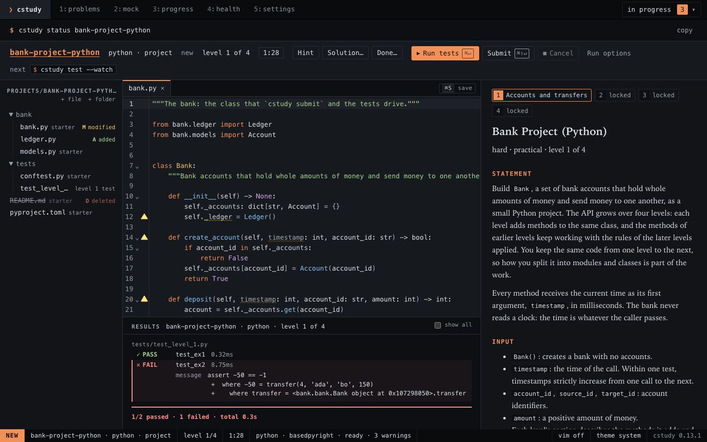
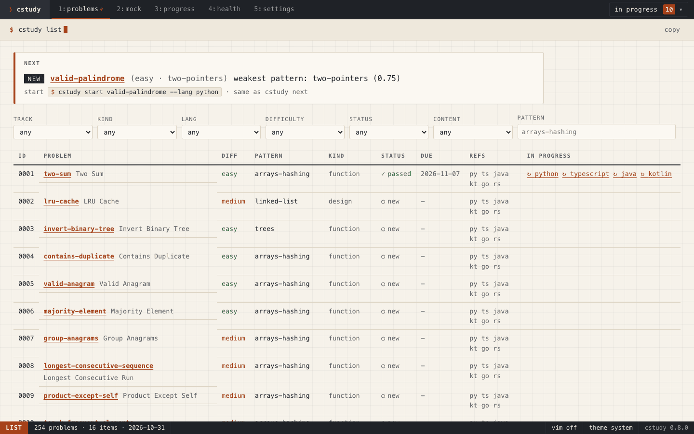
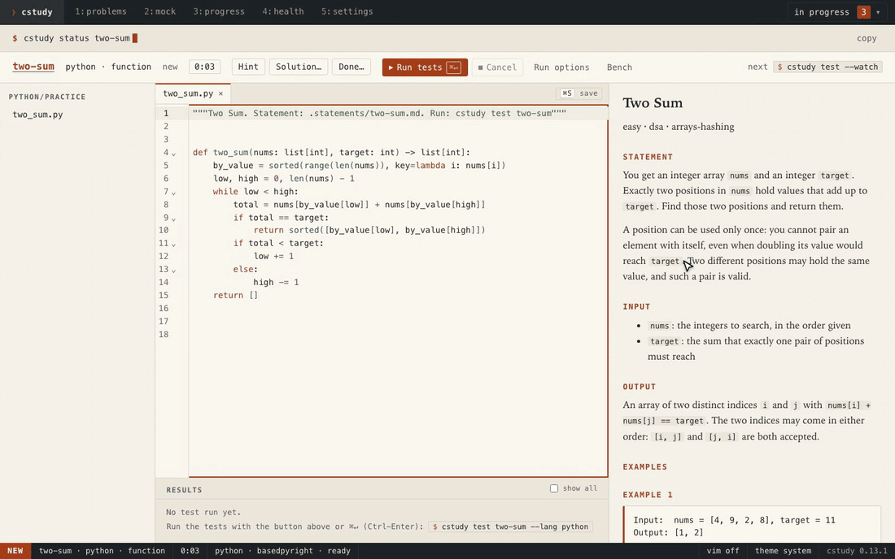
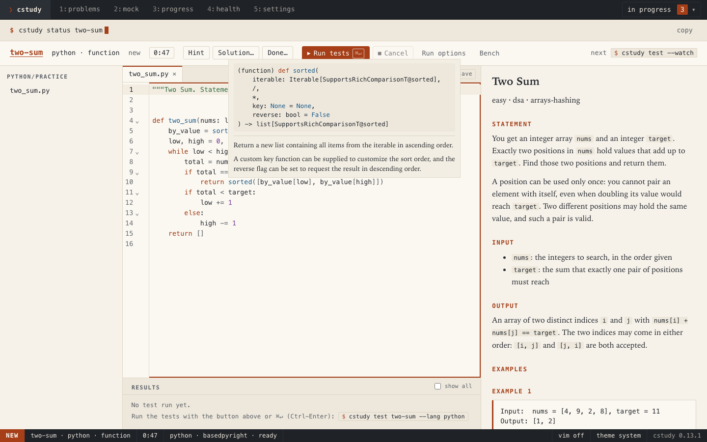
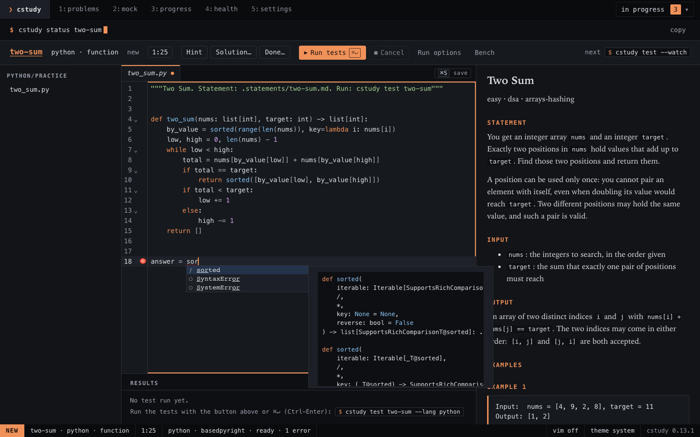

# Practise in your browser with `cstudy serve`

`cstudy serve` opens a page on your own computer where the whole practice loop happens: pick a problem, read the statement, edit the code, run the tests and submit with results arriving as they run, take hints, reveal solutions, finish the attempt, run mock interviews, and check your progress and your setup. It is another way to use `cstudy`, not a separate app: the page works on the same workspace files and the same `progress.db` as the terminal and your IDE, and every run is the same `cstudy test` or `cstudy submit` command.



## Quick path

1. In your workspace, start the server and let it open the page:

   ```bash
   cd ~/cstudy-workspace
   cstudy serve --open
   ```

2. Pick a problem in the list, choose **Start…**, and open a file from the tree.
3. Edit, save with <kbd>Cmd</kbd>+<kbd>S</kbd> (<kbd>Ctrl</kbd>+<kbd>S</kbd> on Linux), and run the tests with <kbd>Cmd</kbd>+<kbd>Enter</kbd>.
4. Choose **Done…** when you finish, then stop the server with <kbd>Ctrl</kbd>+<kbd>C</kbd> in its terminal.

## Start the server

```text
$ cstudy serve --open
cstudy serve 0.9.0 · workspace ~/cstudy-workspace
open       http://127.0.0.1:53817/?token=QmFua1Byb2plY3Q...
run        test two-sum · kotlin · passed · 14/14 · 2.1s
stop       Ctrl-C
```

| Step | What to know |
|------|--------------|
| Run it | `cstudy serve` in your workspace, or anywhere with `--workspace PATH`, as for every command. It needs a workspace: run `cstudy init` first |
| Open the page | `--open` opens your default browser. Without it, open the `open` URL the server prints, in any browser on this computer |
| Pick a port | `--port N` listens on port N; by default the system picks a free port each time |
| While it runs | The terminal prints one line per finished run or job, and nothing else |
| Stop it | <kbd>Ctrl</kbd>+<kbd>C</kbd>. Runs in progress stop as Ctrl-C stops them in the terminal, and record nothing |

The page is made for current Chrome, Edge, Firefox and Safari. Its tests run in the engines of all of them, through Playwright: Chromium, Firefox, and WebKit, the engine of Safari. A check in the Safari app itself is still pending.

## The views

The top bar holds the views, the attempts in progress while one is open, and the mock banner while a mock runs; it stays at the top of the window when you scroll, and so do the header rows of the tables. Under it, a command line shows the `cstudy` command that the view mirrors, with a button that copies it. The status bar at the bottom switches Vim keybindings and the theme, and its version, `cstudy 0.24.0`, opens the About view.

| View | Opens with | Shows |
|------|------------|-------|
| Problems | <kbd>Alt</kbd>+<kbd>1</kbd> | The `cstudy next` pick (an attempt you have open first, with links to the others, then a due review or a new problem) with a **Start…** or **Resume** button, a search by title or slug that narrows as you type (<kbd>/</kbd> focuses it), one slim row of the filters of `cstudy list` (status, difficulty, domain and language, and under **more** track, kind, role, scope, pattern, content status and set), a removable chip per active filter with a live count and **clear**, and every problem with its status (`in progress` while you have an attempt open) and due date. Each row has a button to add the problem to a set. The `columns` menu chooses what the table shows, and adds its kind, scope, domain and role |
| Problem | A click on a row of the list | The statement, Start or Resume, Solution, and the problem's history: its review schedule, attempts, runs and submissions, and the code of each attempt that is over. For a problem with levels, it also shows your best level in each language and, when you stopped below the last level, the level to try next. A problem whose reviews keep reaching level 2 of 4 reads *mastered through level 2 of 4*: each level is mastered on its own reviews, so a level you have just reached starts over |
| Attempt | Start, Resume, or the in-progress menu | The file tree, the editor, the results of the latest run, and the statement with its levels and hints |
| Sets | <kbd>Alt</kbd>+<kbd>2</kbd> | [Your own lists of problems](#problem-sets), with passed of total; one open shows its pick and its rows, to start, resume or reorder |
| Guides | <kbd>Alt</kbd>+<kbd>3</kbd> | [Short readings that teach an idea](#learn-with-guides) before you practise it, and the paths that order them with problems, with how far you have come |
| Mock | <kbd>Alt</kbd>+<kbd>4</kbd> | The start form, or the running mock's countdown and problems |
| Progress | <kbd>Alt</kbd>+<kbd>5</kbd> | `cstudy stats`, the reviews due, export and import |
| Health | <kbd>Alt</kbd>+<kbd>6</kbd> | The `cstudy doctor` checks, a **Fix** button on each row that `cstudy doctor --fix` repairs, and Verify for your own problems |
| Settings | <kbd>Alt</kbd>+<kbd>7</kbd> | This workspace's preferences, and your `config.toml`, which every workspace reads |
| About | The version in the status bar | Who made cstudy, with a link to his site, and below it two plain links that say where to sponsor cstudy if you want to; then the version, the license, the website and project links, and the credits, with the full license texts one click away. `cstudy about` prints the same, in the same order. It is not in the top bar, and has no number key |



## Edit and save

Open a file by choosing it in the tree; each opens in a tab of its own.

- **Saving.** <kbd>Cmd</kbd>+<kbd>S</kbd>, the **save** button at the end of the tab bar, or `:w` with Vim on saves the active tab. A run saves every tab with unsaved edits first, so it always tests what you see; the page saves at no other time. A tab with unsaved edits shows a dot in place of its close button.
- **Changes from elsewhere show up.** When your IDE or the terminal changes a file, a tab without unsaved edits takes the new version in place and keeps your cursor. A tab with unsaved edits shows a banner instead: **Reload theirs** drops your edits, **Overwrite** saves yours over the file.
- **Leaving asks first.** Closing a tab, leaving the view or closing the page with unsaved edits asks before anything is lost.
- **Generated test files** of a project are editable, as in the terminal, but editing one never changes a grade.
- **Indentation follows the language.** Four spaces in Python, Java, Kotlin and Rust, a tab in Go, two spaces in TypeScript and everything else. <kbd>Enter</kbd> lands on the right column, one level in after `def f():` or a `{`, and at the previous line's indentation where the language has no rule. <kbd>Tab</kbd> indents the line by one level.

The editor highlights Python, TypeScript, Java, Kotlin, Go, Rust, JSON, TOML and Markdown. Errors from a run show as underlines and gutter markers on the lines they name. Turn on [code intelligence and autocomplete](#code-intelligence-and-autocomplete) for live errors, documentation on hover, go to definition and completion; until you do, the editor offers no completion list at all.

## Code intelligence and autocomplete

Two settings give the editor what an IDE gives: errors as you type, documentation, jumps to definitions, and completion. They use language servers that run on your computer, and both are off by default, so the editor stays as plain as a notepad until you turn them on.

| Setting | What it does |
|---------|--------------|
| Code intelligence | Live errors, warnings and unused code; documentation when you hover; go to definition into your files and into read-only library sources |
| Autocomplete | Completion as you type or with <kbd>Ctrl</kbd>+<kbd>Space</kbd>, and signature help when you open a call |

**Autocomplete controls all completion.** With it off, the editor offers no completion list and no signature help, not even the basic completion of earlier versions of the page. That is the reason for the setting: you can practise recalling names and signatures with nothing to prompt you, and turn the help on when you want it. Closing brackets as you type is not completion and stays.



### Turn them on

1. Choose **Settings**, check **Code intelligence** and choose **Save**. **Autocomplete** is greyed out with `Turn on code intelligence first` until you check it; it keeps its choice if you turn code intelligence off, and does nothing until both are on.
2. Install the language servers once. In the terminal, run:

   ```bash
   cstudy doctor --fix
   ```

   (or choose **Fix** in the Health view, on the row of each language or at the top). This installs about 46 MB into `.cs/lsp/` in your workspace, a download of about 7 MB, plus Eclipse JDT LS for Java, a 51 MB download checked by its SHA-256, and gopls for Go, built with your Go, and needs the network that one time. Kotlin's server comes from JetBrains under a license you accept first ([Kotlin](#kotlin)). rust-analyzer comes with your Rust toolchain instead ([Rust](#rust)). After that practice needs no internet: nothing else is downloaded and no server reaches the network. Deleting `.cs/lsp/` is safe; `--fix` installs it again. With **Code intelligence** off, `--fix` installs nothing for the editor and says so (`skipped the language servers: code intelligence is off; turn it on in Settings…`), unless the servers are installed already.
3. Check the result. `cstudy doctor` shows a row per language while code intelligence is on, and the Settings view lists each language's state:

   ```text
   ok    code intelligence python basedpyright 1.40.2
   ok    code intelligence typescript typescript-language-server 6.0.3
   ok    code intelligence java jdtls 1.63.0
   ok    code intelligence kotlin kotlin-lsp 263.7084.0, runs until 2026-11-12
   ok    code intelligence go gopls 0.24.0
   ok    code intelligence rust rust-analyzer 1.91.0
   ```

4. Open a file. The status bar under the editor shows `python · basedpyright · ready` when its server is up, and **Restart** if it stopped.

If a server is not installed, or starts slowly, the editor works as it does without code intelligence, and with Autocomplete on it falls back to the editor's own basic completion until the server is ready.

While code intelligence is on, `cstudy serve` starts the server of your default language (Settings, **Default language**) as it starts, so the first practice file you open in that language has its server ready, which matters most for Java and Kotlin. It starts no other language's, and it stops after about ten minutes if no editor takes it over.

### What you see

- **Errors and warnings.** They are underlined about half a second after you stop typing in Python and Go and about a second in TypeScript (Rust's compiler errors after each save), with a marker in the gutter and counts in the status bar. Unused code fades, deprecated code is struck through, and hints get no underline. The errors of your last run stay, marked `last run`, and a run error that the server repeats shows once.
- **Hover documentation.** Rest the pointer on a name, or press the keys below, to read its type and documentation. An error on that name shows above the documentation. A link in the documentation to a library file, as Go's documentation has, opens that file in a library tab at the line it names.
- **Go to definition.** A name in your own file jumps within it; a name from another file of the attempt opens that file's tab; a name from the standard library or a package opens a **library** tab, read-only, with the file's path beside the code. A library tab cannot be saved, and closing it loses nothing. <kbd>Ctrl</kbd>+<kbd>-</kbd> goes back to where the jump started.
- **Reference solutions stay hidden.** A definition never opens a reference solution, and the servers cannot read the folders that hold them: an import of one fails as an import of a missing file. You see a solution only through **Solution…**, and its question.



### Autocomplete in the editor

- **Completion.** The list opens as you type a name or a `.`, and with <kbd>Ctrl</kbd>+<kbd>Space</kbd>. Move with the arrows, accept with <kbd>Enter</kbd> or <kbd>Tab</kbd>, close with <kbd>Escape</kbd>. The selected item's documentation shows beside the list. Accepting inserts plain text: no snippets with placeholders, and no imports added for you.
- **Signature help.** Typing `(` or `,` in a call shows the signature with the current parameter in bold. <kbd>Cmd</kbd>+<kbd>Shift</kbd>+<kbd>Space</kbd> opens it inside a call.



### Keys and mouse

Read <kbd>Ctrl</kbd> for <kbd>Cmd</kbd> on Linux and Windows. These work while code intelligence applies to the file, except where the last column says otherwise.

| Do | Keys or mouse | With Vim, in normal mode |
|----|---------------|--------------------------|
| Go to definition | <kbd>Cmd</kbd>-click on macOS, <kbd>Ctrl</kbd>-click elsewhere, or <kbd>F12</kbd> | <kbd>g</kbd><kbd>d</kbd>, <kbd>Ctrl</kbd>+<kbd>]</kbd>; the click and <kbd>F12</kbd> work too |
| Back to where the jump started | <kbd>Ctrl</kbd>+<kbd>-</kbd> | <kbd>Ctrl</kbd>+<kbd>o</kbd> |
| Hover documentation | Rest the pointer; or <kbd>Cmd</kbd>+<kbd>K</kbd> then <kbd>Cmd</kbd>+<kbd>I</kbd>; <kbd>Escape</kbd> closes it | <kbd>K</kbd> |
| Next and previous error | <kbd>F8</kbd> and <kbd>Shift</kbd>+<kbd>F8</kbd>, skipping hints | <kbd>]</kbd><kbd>d</kbd> and <kbd>[</kbd><kbd>d</kbd> |
| List the file's errors | <kbd>Cmd</kbd>+<kbd>Shift</kbd>+<kbd>M</kbd> | The same |
| Completion (Autocomplete on) | Type, or <kbd>Ctrl</kbd>+<kbd>Space</kbd>; on macOS also <kbd>Option</kbd>+<kbd>`</kbd> and <kbd>Option</kbd>+<kbd>I</kbd>, since macOS may take <kbd>Ctrl</kbd>+<kbd>Space</kbd> for its input sources | In insert mode the same; <kbd>Escape</kbd> closes the list and leaves insert mode |
| Signature help (Autocomplete on) | <kbd>(</kbd> or <kbd>,</kbd> in a call, or <kbd>Cmd</kbd>+<kbd>Shift</kbd>+<kbd>Space</kbd> | In insert mode the same |
| Add a second cursor, with the settings on or off | <kbd>Alt</kbd>+<kbd>Shift</kbd>-click (<kbd>Option</kbd>+<kbd>Shift</kbd>-click on macOS) | The same |

<kbd>Cmd</kbd>-click and <kbd>Ctrl</kbd>-click never add a cursor any more: with code intelligence on they go to the definition, and with it off they are a plain click. Adding a cursor is <kbd>Alt</kbd>+<kbd>Shift</kbd>-click in both modes, so turning a setting on or off never changes what a click does to your selection.

### Languages

| Language | Server | State |
|----------|--------|-------|
| Python | basedpyright | Available |
| TypeScript | typescript-language-server | Available |
| Java | Eclipse JDT LS | Available, on JDK 25 or 26 |
| Kotlin | JetBrains' Kotlin LSP | Available once you accept its license, with a JDK from 21 to 26 |
| Go | gopls | Available, built by `cstudy doctor --fix` with your Go |
| Rust | rust-analyzer | Available, once you run `rustup component add rust-analyzer` |

A file in a language without a server shows a one-line notice in the status bar and works as it does without code intelligence. A language's state also shows in Settings.

### Java

Java's server, Eclipse JDT LS, is a Java program: it runs on the JDK that `cstudy` selects (`JAVA_HOME`, or the `java` on your `PATH`), and only when that JDK is 25 or 26. JDK 25 is the one to install. With another JDK, the status bar says `no code intelligence for Java: needs JDK 25 or 26 · Health`, Settings says `needs JDK 25 or 26`, and `cstudy doctor` names the JDK it found and how to select another:

```text
WARN  code intelligence java jdtls needs JDK 25 or 26, not 21.0.5
      fix: select a JDK 25 to 26 with JAVA_HOME, or install JDK 25: …
```

`cstudy doctor --fix` downloads JDT LS whatever JDK you have, so installing JDK 25 later needs no network.

- **The first start takes a while.** JDT LS imports the `jvm/` Gradle build, or your project folder's, before it reports: about 6 seconds when a Gradle daemon is running, and up to half a minute when it has to start one. The status bar says `java · jdtls · ready` meanwhile, and errors show once the import is done, then about a second after you stop typing. A tab you close keeps its server 5 minutes, so coming back is quick.
- **It works offline,** over what `cstudy doctor --fix` warmed up: the Gradle import runs offline and nothing is downloaded, not even the checksums of the Gradle wrapper, which JDT LS would otherwise fetch.
- **It leaves your folders as they were.** No `.project`, `.classpath`, `.settings/` or `bin/` appears in `jvm/` or a project folder: JDT LS checks your files as you type without building them, and keeps its index in `.cs/lsp/jdtls-data/` (50 to 150 MB per folder).
- **Memory.** A Java session takes 0.5 to 1.2 GB, under a 1 GB heap, and its first import may start a Gradle daemon (about 400 MB) that stays idle afterwards, as the one `cstudy test` starts does.
- **Definitions into the JDK.** A class of the JDK or of a library, such as `ArrayList`, has no file of its own: a Cmd-click on it shows a note, `java.base/java.util/ArrayList.java:169 · not a file: URI`, and hover still shows its documentation. Your project's files and the runner's support code open in tabs, as in Python.

### Kotlin

Kotlin's server is JetBrains' Kotlin LSP, IntelliJ IDEA's Kotlin analysis behind the same protocol. It is partly closed source, and JetBrains ships it under the [JetBrains Free Plugin License Agreement](https://github.com/Kotlin/kotlin-lsp/blob/main/kotlin-vscode/LICENSE.txt), so `cstudy doctor --fix` downloads it only once you accept that license. It fetches JetBrains' newest build each time it runs, checked against the SHA-256 JetBrains publishes beside it, and downloads nothing when the newest is the one you have. Read it, then either answer `y` when `--fix` asks at a terminal, or say so up front:

```bash
cstudy doctor --fix --accept-license kotlin-lsp
```

Your acceptance is recorded in the workspace's `.cs/workspace.toml`, so `--fix` asks again in this workspace only if a newer build comes under a new version of the agreement. Until you accept, `--fix` downloads nothing for Kotlin and says how to accept (the Health view's **Fix** never accepts for you), the status bar says `no code intelligence for Kotlin: kotlin-lsp's license is not accepted · Health`, and `cstudy doctor` shows:

```text
WARN  code intelligence kotlin kotlin-lsp needs you to accept the JetBrains Free Plugin License Agreement 1.0
      fix: cstudy doctor --fix --accept-license kotlin-lsp
```

- **The download is large.** The archive for your machine is 360 MB, with its own Java runtime, and takes 1.1 GB in `.cs/lsp/kotlin-lsp/`. Its index takes about 575 MB more per folder in `.cs/lsp/kotlin-lsp-data/`.
- **`--fix` warms it up once, online.** After the Gradle warm-up, `--fix` runs the server on `jvm/` until its index is built, about a minute: the import fetches the sources of the Kotlin standard library and the other libraries into Gradle's cache, which hover documentation and definitions read later. After that it works offline: no update check, no data shared with JetBrains.
- **The first start takes a while.** It imports the `jvm/` Gradle build, or your project folder's, and indexes it before it reports: up to a minute and a half on a busy machine. The status bar says `kotlin · kotlin-lsp · ready` meanwhile; errors show once it is done. A tab you close keeps its server 5 minutes.
- **It needs a JDK.** The server runs on its own runtime, but imports your build with the JDK that `cstudy` selects, which must be one cstudy supports, 21 to 26.
- **Memory.** A Kotlin session takes about 1.9 GB, under a 1 GB heap, the most of any language, plus the Gradle daemon its import may start.
- **Definitions into the standard library.** A function such as `mutableListOf` lives in a sources jar: a Cmd-click on it shows a note naming the jar and the file, and hover shows its documentation. Your project's files open in tabs.
- **It leaves your folders as they were,** apart from Gradle's own `.gradle/`, as `cstudy test` leaves it.
- **Each build stops after about a month.** JetBrains ships the Kotlin LSP as early-access builds that stop working once their built-in license ends, and publishes a new one every few weeks. `cstudy doctor` shows the last day of yours, and warns in its last week:

  ```text
  WARN  code intelligence kotlin kotlin-lsp 263.7084.0 runs until 2026-11-12 (4 days left), as JetBrains' early-access builds stop; cstudy doctor --fix fetches a newer one once there is
        fix: cstudy doctor --fix
  ```

  Run `cstudy doctor --fix` with the network then: it fetches the newest build if JetBrains has published one, and says the one you have is the newest otherwise. Once a build has stopped, `cstudy doctor`, Settings and the status bar say `expired on 2026-11-13: run cstudy doctor --fix`, and Kotlin files work as without code intelligence until `--fix` fetches a newer one.

### Go

Go's server is gopls. `cstudy doctor --fix` builds it once with `go install` into `.cs/lsp/bin/` (about 40 MB, built in 10 to 20 seconds with the network), with the Go you selected and no other: the gopls version follows your Go, v0.21.1 on Go 1.25, v0.23.0 on 1.26 and v0.24.0 on 1.27. After you upgrade Go, `cstudy doctor` says so and `--fix` builds the matching gopls:

```text
WARN  code intelligence go gopls 0.23.0 installed; cstudy needs 0.24.0
      fix: cstudy doctor --fix
```

- **Errors show about half a second after you stop typing,** with unused imports and variables faded: Go refuses to build them, so gopls marks them as errors too.
- **It works offline.** gopls loads your packages with `GOTOOLCHAIN=local` and `GOPROXY=off`, as `cstudy test` builds them, and shows no links to pkg.go.dev.
- **Links in the documentation open the standard library.** Hovering `strings.Split` shows its documentation, and a name in it, such as `Cut`, is a link: choose it to open GOROOT's source in a library tab at that function.

### Rust

Rust's server is rust-analyzer, which comes with your Rust toolchain. `cstudy doctor --fix` never changes the toolchain, so add it yourself once:

```bash
rustup component add rust-analyzer
```

Until you do, the status bar says `no code intelligence for Rust: rust-analyzer is not installed · Health`, and `cstudy doctor` names the command. Any `rust-analyzer` on your `PATH` whose `--version` runs is used, whichever version it is.

- **Two kinds of errors.** rust-analyzer's own, such as a syntax error, show as you type. The compiler's, from `cargo check`, such as an unknown name or a type error, show once the project is loaded and after each save, with unused variables faded. `cargo check` runs offline, into `target/rust-analyzer/`, so it never waits for your IDE's.
- **The first seconds.** rust-analyzer loads your project first, about a second for practice, longer the first time; the page asks for its errors again until it is ready.
- **The standard library opens from `.cs/lsp/rust-library/`.** A Cmd-click on `Vec` or `len` opens the toolchain's source through links cstudy makes there, so rust-analyzer reads it offline whatever the workspace's vendored crates say.
- **It runs your build scripts.** Like `cargo test`, rust-analyzer runs build scripts and procedural macros of the code you open.

## Run the tests and submit

| Action | Button | Keys | Same as |
|--------|--------|------|---------|
| Run the tests | Run tests | <kbd>Cmd</kbd>+<kbd>Enter</kbd> | `cstudy test` |
| Submit a project level | Submit | <kbd>Cmd</kbd>+<kbd>Shift</kbd>+<kbd>Enter</kbd> | `cstudy submit` |
| Cancel a run | The button that started it, which reads Cancel while the run is active | <kbd>Escape</kbd> in the results; both ask a question first | Ctrl-C in the terminal |
| Go to the next error | | <kbd>F8</kbd> | |

Results arrive as the run goes: one row per case or test, the build line, errors with a link to their line, and the summary. **Run options** sets what `cstudy test` takes as flags: chosen cases, a level, stress runs and a seed, the time limit, `--perf`, and type-checking for TypeScript. A submission that passes a level opens the next one: the statement, the tree and the header follow at once.

Run tests, Submit and Bench save every tab with unsaved edits first. If a file changed or was deleted on disk, or a save is refused, nothing runs: the results name the file and why, and its tab's banner offers the way on. Only one run per attempt runs at a time. A run started in another tab shows in this one too, and either tab can cancel it.

## Project files

For a project problem, the tree shows every file of the project folder with its origin (starter, level N test, yours) and its state: `modified`, `added` or `deleted`.

| Do | How |
|----|-----|
| Open a file's actions | Its ⋯ button, a right click, <kbd>Shift</kbd>+<kbd>F10</kbd> or the context-menu key |
| New file, new folder | The `+ file` and `+ folder` buttons above the tree |
| Rename or move | <kbd>F2</kbd>, or the file's actions |
| Delete | <kbd>Delete</kbd>, or the file's actions; the question says whether Restore can bring it back |
| Restore a starter or test file | The file's actions, as `cstudy start --restore`; a modified file asks first |

For other problems the tree shows the files you may edit: the stub `cstudy start` wrote, and for Java, Kotlin and Go any other file in the problem's package.

## Service projects in the page

A [service project](../specs/service-projects.md) runs your app in a Docker sandbox, with mock servers for the APIs it calls. The page runs the same commands as the terminal, and shows the stack as it starts, runs and stops.

| Item | What you see |
|------|--------------|
| Before you start | The Problems view, the Problem view and the Start dialog list what the project needs: Docker, its images, the size of its install and the memory it takes. Start downloads nothing: the first run, or the first dev stack, pulls the images and installs the dependencies |
| Docker messages | A Docker that is missing or refuses you is said in the words of `cstudy start`: in the Start dialog, in the Attempt view before any run, at the end of a run that Docker stopped, and in the Health view. A stopped Docker is no problem: the first run starts it |
| Run tests and Submit | `cstudy test` and `cstudy submit`, with progress as they go. The results panel's `stack` line follows the stack: `starting Docker`, `pulling images`, `installing dependencies`, `starting`, then `ready after 2.4 s, not counted`. The startup never counts toward a time limit or a result. `commands.test` is one test row, and the visible cases follow it. **Run options** offers only the level, for Submit |
| Cancel | Stops the run, as for any run. `cstudy` takes the stack down before it exits, so the `stack` line ends on `down` |
| The dev stack | The panel above the results starts `cstudy dev` only when you choose **Start dev stack**, since a stack holds memory. It shows the stack's stage, your app's address on this computer as a link (`http://127.0.0.1:<port>`), a scenario picker per mock server that switches it while the stack runs, and your app's last 200 lines. **Stop** takes the stack down and keeps its data; leaving the Attempt view or the page stops it too. If a terminal already runs `cstudy dev` for the project, the panel says so and starts no second one |
| Code intelligence | For TypeScript, Python, Java, Kotlin and Go, the language server runs in a sandboxed container of its own, with no network, and reads the packages the install put in the project. Java's runs on the project's own image, so it needs no JDK 25 on your computer, and starts afresh with each session: its first errors take about 20 seconds. Go's gopls is built into the project's install cache by the install, about 40 MB, once code intelligence is on: turn it on, then run the tests once. Kotlin's needs JetBrains' Linux build of the Kotlin LSP, which `cstudy doctor --fix` fetches once you start a Kotlin service project (367.5 MB to download, 1.1 GB on disk), and the image `gradle:9.8.2-jdk25` (375 MB to download, 1.25 GB on disk), which you pull once yourself with the command the status bar names; its first errors take about half a minute ([where each server runs](../specs/web-ui.md#where-each-server-runs)). While Docker does not answer, or the container's image is missing, the status bar says so with **Restart**, and the editor works without it |

The flags of `cstudy dev` that serve your own IDE, `--no-run`, `--debug`, `--reset-data` and `--exec`, stay in the terminal ([Your own IDE](../specs/service-projects.md#your-own-ide)).

## Read an earlier attempt

An attempt you finished is not lost when you start the review: its files stay in your workspace, and the Problem view's **History** opens them. Expand an attempt's row, then choose **View** to read its code in a dialog, with the same highlighting as the editor and no way to change it.

| What the row says | Where the files are read from |
|-------------------|-------------------------------|
| `archived` | `.archive/<slug>/<attempt id>-<language>/`, where the next start moved them. A review attempt and `--fresh` both do that; nothing is deleted |
| `current files` | Your practice file, project folder or notes, where the attempt left them. Only the latest attempt of a problem and language can read from there, and you may have edited them since it ended |
| `not available` | An older attempt whose files were never archived, or that you deleted |

An attempt still in progress links to its Attempt view instead, where its files are editable.

## Hints, solutions, Done and Abort

| Button | What happens |
|--------|--------------|
| Hint | Shows the next hint under the statement. Any hint caps the review grade at `ok` |
| Solution… | Asks first when an unsolved attempt is in progress, since the attempt is then graded as `again`; the reference opens in a read-only pane, never in your files |
| Done… | Finishes the attempt with a rating (`easy`, `ok`, `hard`) or as given up, and optional notes; it shows the lines `cstudy done` prints, with the next review date. It grades the latest run, so it refuses while a tab has unsaved edits: save and run first. For a problem with levels, passing level 1 is enough for a rating: the attempt passes through the highest level you passed (`passed · through level 2 of 4`) and comes back on its normal review schedule. A mock still needs every level |
| Abort… | Stops working on the problem, as `cstudy abort` does, after a question: the attempt ends as abandoned, leaves the menu of attempts in progress, and the page opens the problem. Your files stay, and your progress and review schedule do not change; a new Start begins a fresh attempt in the same file (for a problem with a review due, the file first moves to `.archive/`). It refuses while a run is active and while a tab has unsaved edits |

## Problem sets

A set is a list you choose, in the order you want to study it: make one for an upcoming interview, add problems and items to it, and study from it without searching. A problem can be in several sets.

Open **Sets** (<kbd>Alt</kbd>+<kbd>2</kbd>) and choose **New set…**, or start from a problem: each row of the Problems view, and the Problem view, has a button that shows the sets the problem is in and opens a dialog to tick others or name a new one.

An open set lists its rows in order with their status and a **Start…** or **Resume** on each, and **Up**, **Down** and **Remove** to change it. It shows passed of total, and the pick `cstudy next --set` makes: an attempt you have open in the set, then the first entry you have not passed, then a due review. The Set filter of the Problems view shows the same rows in the same order, and its Next card follows the filter.

The terminal does the same:

```bash
cstudy set create backend-loop --description "The backend loop on the 12th"
cstudy set add backend-loop two-sum lru-cache url-shortener
cstudy next --set backend-loop
cstudy list --set backend-loop
```

Sets live in `sets.yaml` at the root of your workspace, so you can read it, edit it by hand and commit it. A change from `cstudy` or the page touches only the lines it must, so your comments stay. `cstudy reset` keeps your sets, with `--files` and `--archive` too. A problem the catalog no longer has shows as `missing` and stops nothing, and a file that does not parse shows as an error and is never overwritten. For a problem with levels, an entry may aim lower than every level: write `- {slug: tamper-evident-ledger, level: 2}` in the file, or run `cstudy set add <set> tamper-evident-ledger --level 2`, and the set counts it once you pass level 2; the row says `through level 2 (target)`. Every command: [`cstudy set`](../specs/cli.md#cstudy-set).

## Learn with guides

A guide is a short reading that teaches one idea before you practise it: the idea in plain words, a worked example, when to use it, the common traps, the cost, notes for experts, the problems that practise it and where to read more. A path puts guides and problems in order, from a topic's first idea to an expert's. The page is the recommended place to read them, since it draws the diagrams; the terminal reads every guide too, with `cstudy learn`.

Open **Guides** (<kbd>Alt</kbd>+<kbd>3</kbd>), or start from the terminal, which serves the page and opens it on the guide or the path:

```bash
cstudy learn hash-functions --open
cstudy learn --path hashing --open
```

| Where | What you see |
|-------|--------------|
| The list | Each path with its progress, `3 of 21 steps done`, then every guide with its level and whether you have read it |
| A guide | The guide with its diagrams drawn in the page's light or dark theme, its code highlighted, what to read first, the problems that practise it and what to read next. **Mark as read** at the end records it, as `cstudy learn <guide> --done` does |
| A path | Each step in order, a check once it is done: a guide once you mark it read, a problem once it passes, or, with a target such as `through level 2`, once that level passes. **Read** opens a guide and **Start** a problem's page, where you start it. `next:` names the first step not done |
| A problem | Under **read first**, the guides that teach what it practises |

Each diagram is a picture that ships with cstudy, in the page's light or dark colours, and it switches with the theme. It comes from `cstudy serve` itself: nothing is fetched from the internet. Under it, a caption says what the diagram shows, and a screen reader reads the diagram's title with it. Every command: [`cstudy learn`](../specs/cli.md#cstudy-learn).

## Mock interviews

The Mock view starts a mock as `cstudy mock` does: new medium and hard problems, a shared timer, and hints and solutions locked until the timer ends or every problem is done. Each problem opens as an ordinary attempt. A mock started in the terminal shows in the page too.

## Preferences

Preferences are stored in `.cs/serve/preferences.json` in the workspace, so they follow the workspace, not the browser. Nothing in **Settings** applies until you choose **Save** in the bar at the top, which stays on screen as you scroll: it shows how many changes you have, and **Reset** undoes all of them. The theme previews as you pick it. Leaving with unsaved changes asks first. The `vim` and `theme` switches in the status bar still apply at once.

| Preference | Default | Effect |
|------------|---------|--------|
| Vim keybindings | off | Vim keys in every editor; `:w` saves |
| Run on save | off | Each save, from the page or from your IDE, runs the tests again, as `cstudy test --watch` does |
| Type-check TypeScript | on | TypeScript runs type-check, so type errors show in the editor |
| Theme | system | Light or dark, or follow your system |
| Code intelligence | off | Live errors, hover documentation and go to definition from a language server on your computer; needs `cstudy doctor --fix` once ([details](#code-intelligence-and-autocomplete)) |
| Autocomplete | off | Completion and signature help, while code intelligence is also on. Off, the editor offers no completion at all |

## Your configuration

Beside the preferences, or below them in a narrow window, **Settings** edits `config.toml`, the file every `cstudy` command reads, for all your workspaces. Each key shows a friendly label with its name in the file beside it, so a search of the page finds either, its value, its default and when a change applies. **Save** writes only what you changed and keeps your comments; empty a field to return it to its default. A value `cstudy` would refuse is refused here too, by the key's name, and nothing is written to that file. Save covers both places, and if one fails it says which and keeps those changes unsaved, while the other's stay saved.

In the terminal, `cstudy config edit` opens the same file in your editor, making it from a commented template if you have none, and `cstudy config path` prints where it is.

Changing `progress_db` moves nothing: your data stays in the old file, and `cstudy` uses the file at the new path, or starts an empty one there. Settings asks first and says whether a database exists at the new path, and `cstudy config edit` says so once you close your editor.

The review intervals are here too, under `schedule`. A new interval applies to reviews scheduled from then on: dates already set do not move.

## Start over

**Reset progress…**, the red button in the **danger** section of Settings, which the bar's **Reset** never touches, or `cstudy reset` in the terminal, deletes your progress in this workspace: attempts, scheduled reviews, bench runs, run folders and rendered statements. You see what goes, with counts, before anything does. It can't be undone, so you type `reset` to confirm. It refuses while a run or a job is active. Run `cstudy export` first if you may want your progress back.

Your practice files, project folders and notes stay unless you tick that box, or pass `--files`. `.archive/` stays unless you tick its own, or pass `--archive`. Your settings, toolchains, language servers, your own problems and your [sets](#problem-sets) always stay. A reset ends an open attempt along with the rest: the attempts menu empties at once, and a tab that was showing that attempt says it ended and turns read-only.

## Keyboard

Every view works with the keyboard alone. On Linux, read <kbd>Ctrl</kbd> for <kbd>Cmd</kbd>.

| Keys | Do |
|------|----|
| <kbd>Alt</kbd>+<kbd>1</kbd> to <kbd>7</kbd> | Problems, Sets, Guides, Mock, Progress, Health, Settings |
| <kbd>Cmd</kbd>+<kbd>S</kbd> | Save the active tab |
| <kbd>Cmd</kbd>+<kbd>Enter</kbd> | Run the tests |
| <kbd>Cmd</kbd>+<kbd>Shift</kbd>+<kbd>Enter</kbd> | Submit a project level |
| <kbd>Escape</kbd> in the results | Cancel the run, after a question |
| <kbd>F8</kbd>, <kbd>Shift</kbd>+<kbd>F8</kbd> | Go to the next and the previous error in the editor |
| <kbd>F12</kbd>, <kbd>Cmd</kbd>-click, <kbd>Ctrl</kbd>+<kbd>-</kbd> | Go to a definition, and back: [code intelligence](#code-intelligence-and-autocomplete) |
| <kbd>Alt</kbd>+<kbd>Shift</kbd>-click in the editor | Add a second cursor |
| <kbd>Tab</kbd> in the editor | Accept the selected completion when the list is open, otherwise indent; <kbd>Escape</kbd> then <kbd>Tab</kbd> moves on to the next control |
| <kbd>Alt</kbd>+<kbd>Shift</kbd>+<kbd>M</kbd> (<kbd>Ctrl</kbd>+<kbd>M</kbd> on Linux) | Make <kbd>Tab</kbd> move the focus out of the editor until pressed again |
| <kbd>Shift</kbd>+<kbd>F10</kbd>, <kbd>F2</kbd>, <kbd>Delete</kbd> in the tree | A file's actions, rename, delete |
| <kbd>Escape</kbd> in a dialog | Close it; the focus returns where it was |

Each button names its keys and the `cstudy` command it runs when you point at it. With "Reduce motion" on in your system, the page shows no animation.

## With the terminal and your IDE

The page, the terminal and your IDE always agree, because they share the workspace and its progress. Start an attempt in the terminal and it appears in the page's in-progress menu; submit in the terminal and the page opens the new level; edit in your IDE and the open tab follows. The command line under the top bar names the `cstudy` command each view mirrors, so you can switch to the terminal at any point.

A few things stay in the terminal: `cstudy init`, `cstudy ide`, `cstudy new`, `cstudy verify` on catalog problems, `cstudy test --debug`, which needs your IDE's debugger, and the flags of `cstudy dev` beyond its scenarios. `cstudy test --watch` becomes the Run on save preference.

## Troubleshooting

| You see | Do |
|---------|----|
| "This browser has no session with this server" | Open the URL the server printed. The token in it is new every time the server starts |
| `port … is already in use` | Another program holds the port: pick another with `--port`, or leave it out to get a free one |
| `reconnecting…` in the top bar | The page lost the server for a moment and tries again |
| `disconnected` in the top bar | The server stopped or restarted: start it again and open the new URL |
| `cstudy serve` exits 4, or `cstudy doctor` warns on `web ui assets` or `web server` | The page's files or the web server libraries are missing or damaged: reinstall `cstudy` with the command `cstudy doctor` prints, which names the install that runs; if it also warns on `installs`, keep one install first |
| A language fails in the Health view | Install its toolchain ([toolchains](toolchains.md)), then use **Fix**, on its row or at the top of the view, which runs `cstudy doctor --fix` |
| The first Java or Kotlin run is slow | Gradle warms up on the first build, as in the terminal |
| `not installed: run cstudy doctor --fix` in Settings, or `not installed` in the status bar | Run `cstudy doctor --fix` once, with the network on, then open the file again |
| `stopped: exit 1` in the status bar | The language server ended: choose **Restart**, or run `cstudy doctor` to check the install |
| `Docker is not running` in the status bar, on a service project | Start Docker, or run the tests once, which starts it; then choose **Restart** |
| The dev stack panel says `cstudy dev` is already running in a process | A terminal holds the project's dev stack: stop it there with <kbd>Ctrl</kbd>+<kbd>C</kbd>, or use that one |
| Ctrl-Space shows nothing | Autocomplete is off, or code intelligence is: turn both on in Settings. With Autocomplete off the editor offers no completion at all |
| <kbd>Tab</kbd> skips buttons and links in Safari | Use <kbd>Option</kbd>+<kbd>Tab</kbd>, or turn on "Press Tab to highlight each item on a webpage" in Safari's Advanced settings |

## Security, in plain words

- **Only your computer can reach it.** The server listens on `127.0.0.1`, which other machines cannot connect to.
- **The URL is a password.** Its token is new each time the server starts; anyone with the URL can use the page while it runs, so do not share it. The browser keeps a session cookie after the first visit.
- **Other websites cannot use it.** The page refuses requests that come from other sites, even from tabs in the same browser.
- **It runs your code, as `cstudy test` does.** Saving a file and running it executes that code as you, which is why the page asks for the token.
- **It touches only your attempt's files.** The page edits the files of the attempts in progress and nothing else, and never follows a link out of them.
- **Language servers stay on your computer.** With code intelligence on, the servers run as you, one per tab and project, and read only what a definition names, as read-only text. They cannot reach the network or the folders that hold reference solutions. A service project's server runs in a sandboxed container on your own Docker instead, with no network.
- **Nothing leaves your machine.** The page loads everything from the server and sends nothing elsewhere.
