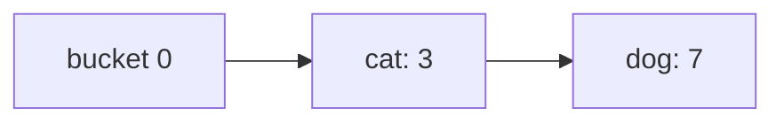

# Spec: Concept guides and learning paths

A **guide** is a short, original reading page that teaches one idea before you practise it: the plain idea, a worked example, when to use it, the traps, the complexity, notes for experts, the problems that practise it, and where to read more. A **path** orders guides and problems into a track, from a topic's first idea to an expert's. Both are content: they ship with `cstudy` like the problems, and [`cstudy learn`](cli.md#cstudy-learn) reads them ([ADR 0025](../decisions/0025-concept-guides-and-learning-paths.md)).

The web UI is the recommended place to read them: the [Guides page](#guides-page) of `cstudy serve` shows the diagrams, links the guides to each other and shows a path's progress beside its steps. The terminal is fully supported: `cstudy learn` renders a guide's Markdown with Rich, shows each diagram as its [text drawing](#text-drawings), and has `--json` for scripts.

A guide is written for everyone from beginner to expert, where a beginner is new to the topic, not to programming: it assumes the reader can write a function in one language and nothing about the topic. It starts plainly and goes deep.

## Layout

```text
guides/
  hash-functions/
    meta.yaml            # title, summary, level, links
    guide.md             # the guide
    examples/            # runnable programs, each embedded in guide.md
      buckets.py
    diagrams/            # the SVG drawings of its diagrams, which tools/guides/ makes
      1-light.svg
      1-dark.svg
  paths/
    hashing.yaml         # a path
```

`guides/` sits at the [content root](installation-and-workspaces.md#content-root) beside `problems/` and `tracks/`; the wheel ships it as `coding_study/content/guides/`, the SVG drawings with it. A content root without it has no guides, and `cstudy learn` says so. A guide folder holds `meta.yaml`, `guide.md`, when it has examples `examples/` with files only, and when it has diagrams `diagrams/` with their [SVG drawings](#svg-drawings) only; nothing else. A diagram's source is [Mermaid](#diagrams) in `guide.md`; its text drawing and its SVG drawings are made from it.

A guide's slug is its folder's name and a path's is its file's name without `.yaml`: lowercase letters, digits and single hyphens, a letter first, at most 64 characters. `paths` is not a guide slug. Guide and path slugs are their own namespace: a guide may share a slug with a problem.

## meta.yaml

Validated by `schemas/guide.schema.json`.

```yaml
# yaml-language-server: $schema=../../schemas/guide.schema.json
title: Hash maps and sets
summary: Why a lookup takes constant time on average, how collisions are resolved, and when it all goes wrong.
level: intro
prerequisites: [hash-functions]
related: [counting-and-frequency]
problems: [contains-duplicate, two-sum, valid-anagram]
```

| Key | Type | Required | Rules |
|-----|------|----------|-------|
| `title` | string, 1 to 80 characters | yes | The guide's `# ` heading repeats it |
| `summary` | string, 1 to 240 characters | yes | One or two sentences, shown in lists |
| `level` | `intro`, `core` or `advanced` | yes | `intro`: the first idea of a topic; `core`: what working engineers use daily; `advanced`: designs and guarantees beyond the basics |
| `prerequisites` | list of guide slugs | no | Guides to read first. They form no cycle |
| `related` | list of guide slugs | no | Guides worth reading next, in no order |
| `problems` | list of problem slugs | no | The problems that practise the guide, in the order to try them; each is named in `## Practice` |
| `shell` | boolean, default false | no | true for a guide whose topic is the shell, such as `using-the-terminal`: a [shell guide](#shell-guides), whose examples may have a bash variant |

## guide.md

### Sections

The first line is `# <title>`. These `##` sections follow, non-empty and in this order; other `##` sections may come between them, for a guide that teaches several things:

| Section | Holds |
|---------|-------|
| `## The idea` | The idea in plain words, with no jargon left undefined |
| `## A worked example` | One example traced step by step |
| `## When to use it` | The signs in a problem that call for it, and what to use instead |
| `## Common traps` | The mistakes people make, each with why it happens |
| `## Complexity` | Time and space, with their conditions: average against worst case, amortized, and what is assumed of the hash function or the input |
| `## Expert notes` | Depth: implementations, guarantees, attacks, history, the facts of specific languages |
| `## Practice` | Each problem of `problems`, by slug, with what it practises |
| `## Further reading` | At least one link; the official documentation for every fact about a language or library |

No `TODO` anywhere. A fact about a language or library names the version it holds from when that matters, and cites the official documentation in `## Further reading`; a fact that cannot be checked there is left out.

### Examples

An example is a program in `examples/` that prints what it shows. `guide.md` embeds each one byte for byte in a fenced block whose info string is the language and the example's path, and follows it with an `output` block holding exactly what it prints:

````markdown
```python examples/buckets.py
print(hash(7) % 4)
```

```output examples/buckets.py
3
```
````

| Rule | Detail |
|------|--------|
| Languages | By the file's extension, in the table below |
| Determinism | The output never depends on hash seeds, map iteration order, time or the machine. An example about a randomized order shows it through something stable, such as a sorted list or a comparison |
| Self-contained | The standard library only, and for bash the builtins and the utilities POSIX defines, with only the options it defines; no network or arguments, and no files but those it makes in a directory of its own (`mktemp -d`) and removes before it ends |
| Test | `cli/tests/content/test_guide_examples.py` runs every example from a copy in a folder of its own and compares its standard output with its `output` block, exit 0 and an empty standard error required. Python, TypeScript, JavaScript and bash run in the fast suite; Go, Rust, Java and Kotlin are `slow`, Java and Kotlin also `jvm`. A language whose tool is missing is skipped, and so is a Python example that calls `os.fork` where the platform has none |

| Extension | Fence | Language | Runs as |
|-----------|-------|----------|---------|
| `.sh` | `bash` | Bash 3.2 or later, the bash of macOS; only in a [shell guide](#shell-guides) | `bash <file>` |
| `.py` | `python` | Python 3.13 or later | `python -I -B <file>` |
| `.ts` | `typescript` | TypeScript that Node.js 24 runs by stripping its types: no `enum`, `namespace` or parameter properties | `node <file>` |
| `.java` | `java` | One file, run as a single-file source program, so its name need not match its class | `java <file>` |
| `.kt` | `kotlin` | One file with a top-level `main` | `kotlinc <file> -include-runtime -d <file>.jar`, then `java -jar <file>.jar` |
| `.go` | `go` | One `package main` file | `go run <file>` |
| `.rs` | `rust` | One file with a `main`, edition 2021 | `rustc --edition 2021 -o <program> <file>`, then the program |
| `.js`, `.mjs` | `javascript` | Node.js 24 or later | `node <file>` |

Only these fences are examples: a fenced block that names no file in `examples/` is an illustration, and is never run, as are [pseudocode](#pseudocode) and terminal sessions in ```` ```console ```` blocks.

#### Variants

One example can come in several languages, its **variants**. The [Guides page](#guides-page) shows them as tabs, one language at a time, and [`cstudy learn`](#in-the-terminal) prints one of them.

The variants are files of `examples/` that share a base name, the file name without its extension: `examples/chaining.py`, `examples/chaining.ts`, `examples/chaining.java`. `guide.md` embeds them one after another, each as an example is, with its own `output` block right after it and nothing but blank lines between the blocks:

````markdown
```python examples/chaining.py
print("get('zed') =", table.get("zed"))
```

```output examples/chaining.py
get('zed') = None
```

```typescript examples/chaining.ts
console.log("get('zed') =", table.get("zed"));
```

```output examples/chaining.ts
get('zed') = null
```
````

| Rule | Detail |
|------|--------|
| One example | Such a run of two or more blocks of one base name is one example with variants. A file of the same base name elsewhere in the guide is a separate example, in one language |
| One per language | No two variants of one example are in the same language, such as a `.js` and a `.mjs` |
| Order | The variants come in the tab order: Bash, Python, TypeScript, Java, Kotlin, Go, Rust, then JavaScript. It is fixed, so a language keeps its place from one example and one guide to the next |
| Output | Each variant has its own `output` block, and its test compares what it prints with that block. The variants show the same thing and print the same lines, each in its own language's words: `None`, `null` or `nil`, a list as `[1, 2]` or `[1 2]`. The prose around the example is true of every variant; what one language does differently is a separate example with prose of its own |
| One language | An example of one file is one block, as before. An example that shows a fact of one language, such as Python's `hash()` of a `str` or the order of a Go map, stays in that language and is never translated |
| Target | Every runnable example of a guide aims for the six languages of cstudy: Python, TypeScript, Java, Kotlin, Go and Rust; an example of a shell guide aims for bash and the six. [G11](#guides) warns of the languages an example with variants lacks. An example in one language is not warned of, since it may show a fact of that language, and the guides gain their variants in waves |

#### The language shown

One rule picks the variant the Guides page shows first and the one `cstudy learn` prints. It takes the first of these that the example has:

1. The language the reader chose: on the page, the last tab chosen since the page was opened; in the terminal, `--lang`.
2. Bash: only a shell guide has bash variants, and the shell is its topic.
3. `default_lang` of the [configuration](cli.md#configuration), the language the reader practises in.
4. Python.
5. The first variant in the tab order.

On the page, choosing a tab chooses that language for every example: each example that has it switches to it, and every other one shows what the rule gives without it. The choice holds for every guide read until the page is reloaded or closed. It is not stored: `default_lang`, which the Settings view changes, stays the one lasting choice.

#### Pseudocode

Pseudocode is language-neutral: it is never run, never translated and never has tabs. It is a ```` ```pseudocode ```` block that names no file, shown as one block, as GitHub shows it as plain text. A `pseudocode` fence that names a file in `examples/` fails G6, so an example and pseudocode are never mistaken for each other. A guide may hold pseudocode and examples with variants side by side, and the checks never count pseudocode, or any other illustration, as an example missing a variant.

#### Shell guides

A guide with `shell: true` in `meta.yaml` teaches the shell; `using-the-terminal` is one. Only a shell guide's examples may have a bash variant, a `.sh` file in a `bash` fence, and an example that has one starts on it. Its terminal sessions stay ```` ```console ```` illustrations, a `$ ` before each command.

#### In the terminal

`cstudy learn <guide>` prints each example with variants in the [language shown](#the-language-shown), then `It prints:` and its output, since the prose around the example has no place between them, then one line that names the other languages and how to pick one:

```text
Also in bash: cstudy learn using-the-terminal --lang <language>
```

`--lang <language>` is one of `bash`, `python`, `typescript`, `java`, `kotlin`, `go`, `rust` and `javascript`, and is step 1 of the rule for every example. `--json` gives `markdown` as written, with every variant.

### Diagrams

A diagram is a fenced `mermaid` block in `guide.md`, and its source is the only source: there are no `.mmd` files, and no image is drawn by hand. GitHub draws it, the page's [Guides view](#guides-page) shows its [SVG drawings](#svg-drawings), and the terminal shows its [text drawing](#text-drawings); both drawings are made from the source when the guide is written.

| Rule | Detail |
|------|--------|
| Types | `flowchart` or `graph` (with a direction: `TD`, `TB`, `BT`, `LR` or `RL`), `sequenceDiagram`, `stateDiagram` or `stateDiagram-v2`, `classDiagram` and `erDiagram`: the types the text renderer draws. A bucket array, a chain or a probe sequence is a `flowchart LR` |
| First line | The type, as its first non-blank line |
| Accessibility | An `accTitle: <title>` line and an `accDescr: <description>` line |
| Prose | A guide makes sense with its diagrams shown as source, as a terminal without the text drawing would show them: the prose says what each diagram shows |

`cstudy verify` checks the type, the first line and the accessibility lines. It does not parse the rest: the renderers of `tools/guides/` do when they draw the text and the SVG drawings.

### Text drawings

Right after each `mermaid` block comes a marker and a `text` block holding the diagram drawn in box-drawing characters:

````markdown


<!-- text-of-mermaid sha256:4c1f…(64 hex digits) -->
```text
┌──────────┐    ┌────────┐    ┌────────┐
│ bucket 0 ├───►│ cat: 3 ├───►│ dog: 7 │
└──────────┘    └────────┘    └────────┘
```
````

| Rule | Detail |
|------|--------|
| Marker | `<!-- text-of-mermaid sha256:<hex> -->` on its own line, after one blank line, where `<hex>` is the SHA-256, in lowercase hex, of the `mermaid` block's content: its lines between the fences, each ended by a line feed, in UTF-8 |
| Drawing | A ```` ```text ```` block on the line after the marker. No line is wider than 100 characters; a diagram whose drawing is wider is simplified |
| Made by | `tools/guides/`: `pnpm install`, then `pnpm render`, which redraws every diagram of every `guides/*/guide.md` whose marker is missing or stale and leaves the rest byte for byte; `pnpm render:all` redraws every one, after a change to the renderer or its options, and `pnpm check` writes nothing and exits 1 when a drawing is missing, stale or too wide. It drops the `accTitle` and `accDescr` lines before drawing, since the drawing has no place for them |
| Checked | `cstudy verify` recomputes each hash. A missing or stale drawing fails, telling the author to run `pnpm render` in `tools/guides/` |

The renderer is [beautiful-mermaid](https://github.com/lukilabs/beautiful-mermaid) 1.1.3 (MIT), pinned in `tools/guides/package.json` and `pnpm-lock.yaml` as a development dependency. It is never shipped: a user reads the drawings, made when the guide was written, and installs nothing. GitHub shows both the diagram and its drawing, which is accepted for one source of truth and no wrapper markup.

### SVG drawings

Each diagram also has two SVG files in the guide's `diagrams/`, one per theme of the [web UI](web-ui.md#guides-view): `<n>-light.svg` and `<n>-dark.svg`, where `<n>` counts the guide's `mermaid` blocks from 1 in their order.

```text
<!-- svg-of-mermaid sha256:4c1f…(64 hex digits) -->
<svg width="611" height="240" viewBox="0 0 610.69 239.57" xmlns="http://www.w3.org/2000/svg" fill="#24272d" font-family="Helvetica, Arial, sans-serif" font-size="15px">…</svg>
```

| Rule | Detail |
|------|--------|
| Marker | The first line, `<!-- svg-of-mermaid sha256:<hex> -->`, with the same hash as the text drawing's marker: the SHA-256 of the block's content |
| Drawing | Mermaid's drawing of the block in the web UI's palette for the theme (`tools/web-ui/src/page/app.css`): nodes in the accent's soft tint bordered by the accent, text in the ink, lines in the soft ink. Text is SVG text in Helvetica, Arial or a sans-serif, which share their metrics. The root has `width` and `height` in pixels and a `viewBox` |
| Self-contained | Every style is a presentation attribute. No stylesheet, `class`, `style` attribute, script, font, external reference or HTML label; no `title` or `desc`, since the page's alt text and caption carry the accessibility lines; ids only where a marker is referred to; numbers to two decimals. In all, the 15 diagrams of the hashing guides take 30 files and 145 KB |
| Made by | `pnpm render` in `tools/guides/`, after the text drawings: Mermaid 11.17.2 (MIT) draws in headless Chromium, driven by playwright-core 1.64.1 (Apache-2.0), both development dependencies there. A drawing whose marker matches is kept byte for byte, and a file of `diagrams/` that belongs to no diagram is removed; `pnpm render:all` draws every one again, and `pnpm check` reports what is missing, stale or orphaned and exits 1 |
| Checked | `cstudy verify --static`, [G10](#guides) |
| Shown | The Guides view shows the drawing of the page's theme as an ``, with `accTitle` as its alt text and `accDescr` as its caption; a diagram without both drawings up to date shows its text drawing instead |

The drawings are made when the guide is written, as the text drawings are, so the page runs no diagram code and a reader installs nothing ([ADR 0025](../decisions/0025-concept-guides-and-learning-paths.md)).

## Paths

A path is `guides/paths/<slug>.yaml`, validated by `schemas/path.schema.json`:

```yaml
# yaml-language-server: $schema=../../schemas/path.schema.json
title: "Hashing: from your first hash map to content-addressed storage"
summary: From what a hash function is to Merkle proofs, through the problems that practise each idea.
steps:
  - guide: hash-functions
  - guide: hash-maps-and-sets
  - problem: contains-duplicate
  - problem: tamper-evident-ledger
    level: 2
```

| Key | Type | Required | Rules |
|-----|------|----------|-------|
| `title` | string, 1 to 100 characters | yes | |
| `summary` | string, 1 to 240 characters | yes | |
| `steps` | list, at least 1 | yes | In order. Each step is `{guide: <slug>}` or `{problem: <slug>}`, a problem step optionally with `level: <n>` |
| `level` | integer, at least 1 | no | Only on a progressive or project problem, at most its number of levels: the step is done once that level passes. Without it, the step is done when the problem passes, through every level it has |

The same problem may come twice with different levels, so a path can return to it once it has taught what the later levels need.

## Static checks

`cstudy verify` runs these after the problems' and items' checks, with or without `--static`, when it verifies the whole catalog: no slugs, no `--changed` and no `--track`. Each guide and each path is one line of its report (`hash-functions  static ok`), and a failure fails the run with exit 5 like a problem's static failure. A warning, G11's, shows under its guide's line and fails nothing.

### Guides

| Id | Check |
|----|-------|
| G1 | `meta.yaml` valid against `schemas/guide.schema.json` |
| G2 | The folder's name is a valid slug and not `paths`; it holds `meta.yaml`, `guide.md`, an optional `examples/` of files and an optional `diagrams/` of files, and nothing else |
| G3 | `guide.md`: `# <title>` with the title of `meta.yaml`, the [sections](#sections) non-empty and in order, no `TODO` |
| G4 | `prerequisites` and `related` name other guides that exist; `problems` name problems that exist, each named in `## Practice` |
| G5 | Prerequisites form no cycle, across every guide |
| G6 | Every example fence names a file in `examples/` with a supported extension, in the fence of its language, holds that file's text exactly and is followed by exactly one `output` block for it; every file in `examples/` is embedded exactly once. A `.sh` file is in a shell guide only. The [variants](#variants) of one example are in different languages and in the tab order. A `pseudocode` fence names no file |
| G7 | Every `mermaid` block starts with a supported type and has `accTitle` and `accDescr` lines |
| G8 | Every `mermaid` block is followed by a text drawing whose marker hash matches its source, no line of it wider than 100 characters; no marker stands without its block |
| G9 | `## Further reading` holds at least one `https://` link |
| G10 | The n-th `mermaid` block has `diagrams/<n>-light.svg` and `diagrams/<n>-dark.svg`, each starting with a marker whose hash matches its source; every file in `diagrams/` is one of them. A missing or stale drawing, and a file that belongs to no diagram, fail with the hint to run `pnpm render` in `tools/guides/`, which removes such a file |
| G11 | A warning, which fails nothing: an example with variants that lacks a language of its [target](#variants), on one line, such as `examples/chaining has no rust variant yet; an example with variants aims for python, typescript, java, kotlin, go and rust` |

### Paths

| Id | Check |
|----|-------|
| P1 | The file is valid against `schemas/path.schema.json` and its name is a valid slug |
| P2 | Every guide step names a guide, and every problem step a problem, that exists |
| P3 | A `level` is on a progressive or project problem, at most its number of levels |
| P4 | No step comes twice: the same guide, or the same problem with the same level |
| P5 | Every prerequisite of a guide step is an earlier step of the path |

### Problems

| Id | Check |
|----|-------|
| S25 | A problem's `guides` ([meta.yaml](problem-format.md#metayaml)) names guides that exist |

## Reading progress

A guide is read once you say so: `cstudy learn <guide> --done` records it, and printing a guide records nothing, since printing is not reading. The first time is kept; marking it again changes nothing and says when it was marked. The record is a row of `guide_reads` in [`progress.db`](progress-and-scheduling.md#schema), so [`cstudy reset`](cli.md#cstudy-reset) empties it and [`cstudy export`](cli.md#cstudy-export) carries it.

A path's progress is computed each time, never stored:

| Step | Done when |
|------|-----------|
| A guide | It is marked read |
| A problem | It has a passed attempt, through every level for a problem with levels, whatever its review schedule says now, as for a [set](cli.md#cstudy-set) |
| A problem with `level: n` | A passed attempt passed through level n or beyond ([level passes](progress-and-scheduling.md#level-passes)), or an attempt in any status has unlocked level n + 1, so it passed levels 1 to n |

The path's next step is its first step that is not done.

## Writing a guide

1. Read the problems the guide will link, their `problem.md` and `solutions/explanation.md`, so the guide matches the catalog. Teach the idea with other examples: a guide never gives away a linked problem's solution.
2. Write `meta.yaml` and `guide.md` in your own words ([ADR 0004](../decisions/0004-original-problem-wording.md)). State every complexity with its conditions, and check every fact about a language against its official documentation, citing it.
3. Write the examples, run them, and paste each one's output into its `output` block. Give a runnable example its [variants](#variants) in the languages of its target, in the tab order; keep an example that shows a fact of one language, and pseudocode, as one block.
4. Draw the diagrams in Mermaid, then `pnpm install` and `pnpm render` in `tools/guides/`, which writes the text drawings and the SVG drawings; look at the SVGs, light and dark, in the Guides view of `cstudy serve`.
5. `cstudy verify --static`, then `uv run pytest tests/content/test_guide_examples.py` in `cli/`.
6. List every fact about a language, library or standard with its source in a review page, as [the hashing guides' review](../reviews/guides-hashing.md) does, so that an independent review can check it.

## Guides page

The [Guides view](web-ui.md#guides-view) of [`cstudy serve`](web-ui.md) is the recommended way to read: the guides and the paths with their progress, a guide rendered from its Markdown with its code highlighted, each `mermaid` block shown as the image of its [SVG drawing](#svg-drawings) in the page's light or dark theme, with `accTitle` as alt text and `accDescr` as caption, each example with [variants](#variants) as tabs that change language together, starting on the [language shown](#the-language-shown), links between guides and to the problems that practise them, and **Mark as read**, which marks a guide read through `mark_read`, the use case of `--done`. A path shows its steps in order, each done or not, with its level target and a link to read the guide or start the problem; the Problem view lists the guides a problem's `guides` names. The page runs no diagram code, and the text drawings, which a screen reader would read as box-drawing characters, are not in it; a diagram whose SVG drawings are missing or stale shows its text drawing instead.

`cstudy learn <guide> --open` and `cstudy learn --path <path> --open` run `cstudy serve --open` landing on the guide or the path ([cli](cli.md#cstudy-learn)). The terminal still reads every guide in full.
