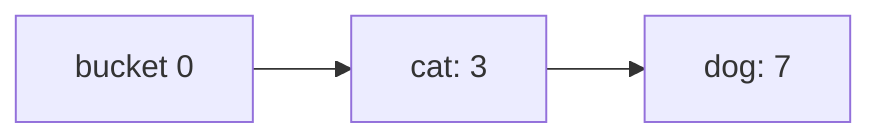

# Spec: Concept guides and learning paths

A **guide** is a short, original reading page that teaches one idea before you practise it: the plain idea, a worked example, when to use it, the traps, the complexity, notes for experts, the problems that practise it, and where to read more. A **path** orders guides and problems into a track, from a topic's first idea to an expert's. Both are content: they ship with `cstudy` like the problems, and [`cstudy learn`](cli.md#cstudy-learn) reads them ([ADR 0024](../decisions/0024-concept-guides-and-learning-paths.md)).

The web UI is the recommended place to read them: the [Guides page](#guides-page-next) of `cstudy serve` draws the diagrams, links the guides to each other and shows a path's progress beside its steps. The terminal is fully supported: `cstudy learn` renders a guide's Markdown with Rich, shows each diagram as its [text drawing](#text-drawings), and has `--json` for scripts.

A guide is written for everyone from beginner to expert, where a beginner is new to the topic, not to programming: it assumes the reader can write a function in one language and nothing about the topic. It starts plainly and goes deep.

## Layout

```text
guides/
  hash-functions/
    meta.yaml            # title, summary, level, links
    guide.md             # the guide
    examples/            # runnable programs, each embedded in guide.md
      buckets.py
  paths/
    hashing.yaml         # a path
```

`guides/` sits at the [content root](installation-and-workspaces.md#content-root) beside `problems/` and `tracks/`; the wheel ships it as `coding_study/content/guides/`. A content root without it has no guides, and `cstudy learn` says so. A guide folder holds `meta.yaml`, `guide.md` and, when it has examples, `examples/` with files only; nothing else. There are no image files: diagrams are [Mermaid](#diagrams) in `guide.md`.

A guide's slug is its folder's name and a path's is its file's name without `.yaml`: lowercase letters, digits and single hyphens, a letter first, at most 64 characters. `paths` is not a guide slug. Guide and path slugs are their own namespace: a guide may share a slug with a problem.

## meta.yaml

Validated by `schemas/guide.schema.json`.

```yaml
# yaml-language-server: $schema=../../schemas/guide.schema.json
title: Hash maps and sets
summary: Why a lookup takes constant time on average, how collisions are resolved, and when it all goes wrong.
level: intro
prerequisites: [hash-functions]
related: [counting-and-frequency]
problems: [contains-duplicate, two-sum, valid-anagram]
```

| Key | Type | Required | Rules |
|-----|------|----------|-------|
| `title` | string, 1 to 80 characters | yes | The guide's `# ` heading repeats it |
| `summary` | string, 1 to 240 characters | yes | One or two sentences, shown in lists |
| `level` | `intro`, `core` or `advanced` | yes | `intro`: the first idea of a topic; `core`: what working engineers use daily; `advanced`: designs and guarantees beyond the basics |
| `prerequisites` | list of guide slugs | no | Guides to read first. They form no cycle |
| `related` | list of guide slugs | no | Guides worth reading next, in no order |
| `problems` | list of problem slugs | no | The problems that practise the guide, in the order to try them; each is named in `## Practice` |

## guide.md

### Sections

The first line is `# <title>`. These `##` sections follow, non-empty and in this order; other `##` sections may come between them, for a guide that teaches several things:

| Section | Holds |
|---------|-------|
| `## The idea` | The idea in plain words, with no jargon left undefined |
| `## A worked example` | One example traced step by step |
| `## When to use it` | The signs in a problem that call for it, and what to use instead |
| `## Common traps` | The mistakes people make, each with why it happens |
| `## Complexity` | Time and space, with their conditions: average against worst case, amortized, and what is assumed of the hash function or the input |
| `## Expert notes` | Depth: implementations, guarantees, attacks, history, the facts of specific languages |
| `## Practice` | Each problem of `problems`, by slug, with what it practises |
| `## Further reading` | At least one link; the official documentation for every fact about a language or library |

No `TODO` anywhere. A fact about a language or library names the version it holds from when that matters, and cites the official documentation in `## Further reading`; a fact that cannot be checked there is left out.

### Examples

An example is a program in `examples/` that prints what it shows. `guide.md` embeds each one byte for byte in a fenced block whose info string is the language and the example's path, and follows it with an `output` block holding exactly what it prints:

````markdown
```python examples/buckets.py
print(hash(7) % 4)
```

```output examples/buckets.py
3
```
````

| Rule | Detail |
|------|--------|
| Languages | `.py` (Python 3.13+), `.js` and `.mjs` (Node.js 24+), `.go` (one `package main` file), `.java` (one file, run as a single-file source program). Python always; a second language where it shows something Python can't |
| Determinism | The output never depends on hash seeds, map iteration order, time or the machine. An example about a randomized order shows it through something stable, such as a sorted list or a comparison |
| Self-contained | The standard library only; no files, network or arguments |
| Test | `cli/tests/content/test_guide_examples.py` runs every example from its folder and compares its standard output with its `output` block, exit 0 required. Python and JavaScript run in the fast suite, Go and Java are `slow` (Java also `jvm`); a language whose toolchain is missing is skipped |

Only these fences are examples: a plain ```` ```python ```` block without a path is an illustration, and is not run.

### Diagrams

A diagram is a fenced `mermaid` block in `guide.md`, and its source is the only source: there are no `.mmd` or image files. GitHub draws it, the page's [Guides view](#guides-page-next) will draw it, and the terminal shows its [text drawing](#text-drawings).

| Rule | Detail |
|------|--------|
| Types | `flowchart` or `graph` (with a direction: `TD`, `TB`, `BT`, `LR` or `RL`), `sequenceDiagram`, `stateDiagram` or `stateDiagram-v2`, `classDiagram` and `erDiagram`: the types the text renderer draws. A bucket array, a chain or a probe sequence is a `flowchart LR` |
| First line | The type, as its first non-blank line |
| Accessibility | An `accTitle: <title>` line and an `accDescr: <description>` line |
| Prose | A guide makes sense with its diagrams shown as source, as a terminal without the text drawing would show them: the prose says what each diagram shows |

`cstudy verify` checks the type, the first line and the accessibility lines. It does not parse the rest: the renderer of `tools/guides/` does when it draws the text, and the page's tests will when the Guides view draws Mermaid.

### Text drawings

Right after each `mermaid` block comes a marker and a `text` block holding the diagram drawn in box-drawing characters:

````markdown


<!-- text-of-mermaid sha256:4c1f…(64 hex digits) -->
```text
┌──────────┐    ┌────────┐    ┌────────┐
│ bucket 0 ├───►│ cat: 3 ├───►│ dog: 7 │
└──────────┘    └────────┘    └────────┘
```
````

| Rule | Detail |
|------|--------|
| Marker | `<!-- text-of-mermaid sha256:<hex> -->` on its own line, after one blank line, where `<hex>` is the SHA-256, in lowercase hex, of the `mermaid` block's content: its lines between the fences, each ended by a line feed, in UTF-8 |
| Drawing | A ```` ```text ```` block on the line after the marker. No line is wider than 100 characters; a diagram whose drawing is wider is simplified |
| Made by | `tools/guides/`: `pnpm install`, then `pnpm render`, which redraws every diagram of every `guides/*/guide.md` whose marker is missing or stale and leaves the rest byte for byte; `pnpm render:all` redraws every one, after a change to the renderer or its options, and `pnpm check` writes nothing and exits 1 when a drawing is missing, stale or too wide. It drops the `accTitle` and `accDescr` lines before drawing, since the drawing has no place for them |
| Checked | `cstudy verify` recomputes each hash. A missing or stale drawing fails, telling the author to run `pnpm render` in `tools/guides/` |

The renderer is [beautiful-mermaid](https://github.com/lukilabs/beautiful-mermaid) 1.1.3 (MIT), pinned in `tools/guides/package.json` and `pnpm-lock.yaml` as a development dependency. It is never shipped: a user reads the drawings, made when the guide was written, and installs nothing. GitHub shows both the diagram and its drawing, which is accepted for one source of truth and no wrapper markup.

## Paths

A path is `guides/paths/<slug>.yaml`, validated by `schemas/path.schema.json`:

```yaml
# yaml-language-server: $schema=../../schemas/path.schema.json
title: "Hashing: from your first hash map to tamper-evident ledgers"
summary: From what a hash function is to Merkle proofs, through the problems that practise each idea.
steps:
  - guide: hash-functions
  - guide: hash-maps-and-sets
  - problem: contains-duplicate
  - problem: tamper-evident-ledger
    level: 2
```

| Key | Type | Required | Rules |
|-----|------|----------|-------|
| `title` | string, 1 to 100 characters | yes | |
| `summary` | string, 1 to 240 characters | yes | |
| `steps` | list, at least 1 | yes | In order. Each step is `{guide: <slug>}` or `{problem: <slug>}`, a problem step optionally with `level: <n>` |
| `level` | integer, at least 1 | no | Only on a progressive or project problem, at most its number of levels: the step is done once that level passes. Without it, the step is done when the problem passes |

The same problem may come twice with different levels, so a path can return to it once it has taught what the later levels need.

## Static checks

`cstudy verify` runs these after the problems' and items' checks, with or without `--static`, when it verifies the whole catalog: no slugs, no `--changed` and no `--track`. Each guide and each path is one line of its report (`hash-functions  static ok`), and a failure fails the run with exit 5 like a problem's static failure.

### Guides

| Id | Check |
|----|-------|
| G1 | `meta.yaml` valid against `schemas/guide.schema.json` |
| G2 | The folder's name is a valid slug and not `paths`; it holds `meta.yaml`, `guide.md` and an optional `examples/` of files, and nothing else |
| G3 | `guide.md`: `# <title>` with the title of `meta.yaml`, the [sections](#sections) non-empty and in order, no `TODO` |
| G4 | `prerequisites` and `related` name other guides that exist; `problems` name problems that exist, each named in `## Practice` |
| G5 | Prerequisites form no cycle, across every guide |
| G6 | Every example fence names a file in `examples/` with a supported extension, holds that file's text exactly and is followed by exactly one `output` block for it; every file in `examples/` is embedded exactly once |
| G7 | Every `mermaid` block starts with a supported type and has `accTitle` and `accDescr` lines |
| G8 | Every `mermaid` block is followed by a text drawing whose marker hash matches its source, no line of it wider than 100 characters; no marker stands without its block |
| G9 | `## Further reading` holds at least one `https://` link |

### Paths

| Id | Check |
|----|-------|
| P1 | The file is valid against `schemas/path.schema.json` and its name is a valid slug |
| P2 | Every guide step names a guide, and every problem step a problem, that exists |
| P3 | A `level` is on a progressive or project problem, at most its number of levels |
| P4 | No step comes twice: the same guide, or the same problem with the same level |
| P5 | Every prerequisite of a guide step is an earlier step of the path |

### Problems

| Id | Check |
|----|-------|
| S25 | A problem's `guides` ([meta.yaml](problem-format.md#metayaml)) names guides that exist |

## Reading progress

A guide is read once you say so: `cstudy learn <guide> --done` records it, and printing a guide records nothing, since printing is not reading. The first time is kept; marking it again changes nothing and says when it was marked. The record is a row of `guide_reads` in [`progress.db`](progress-and-scheduling.md#schema), so [`cstudy reset`](cli.md#cstudy-reset) empties it and [`cstudy export`](cli.md#cstudy-export) carries it.

A path's progress is computed each time, never stored:

| Step | Done when |
|------|-----------|
| A guide | It is marked read |
| A problem | It has a passed attempt, whatever its review schedule says now, as for a [set](cli.md#cstudy-set) |
| A problem with `level: n` | It has a passed attempt, or an attempt in any status has unlocked level n + 1, so it passed levels 1 to n |

The path's next step is its first step that is not done.

## Writing a guide

1. Read the problems the guide will link, their `problem.md` and `solutions/explanation.md`, so the guide matches the catalog. Teach the idea with other examples: a guide never gives away a linked problem's solution.
2. Write `meta.yaml` and `guide.md` in your own words ([ADR 0004](../decisions/0004-original-problem-wording.md)). State every complexity with its conditions, and check every fact about a language against its official documentation, citing it.
3. Write the examples, run them, and paste each one's output into its `output` block.
4. Draw the diagrams in Mermaid, then `pnpm install` and `pnpm render` in `tools/guides/`.
5. `cstudy verify --static`, then `uv run pytest tests/content/test_guide_examples.py` in `cli/`.

## Guides page (next)

The page of [`cstudy serve`](web-ui.md) will gain a Guides view, the recommended way to read: the guides and the paths with their progress, a guide drawn from its Markdown with its `mermaid` blocks drawn by a lazily loaded, locally bundled Mermaid chunk that follows the page's light or dark theme, the text drawings hidden, links between guides, and a control that marks a guide read through the same use case as `--done`. `cstudy learn <guide> --open` will open a guide there, as `cstudy serve --open` opens the page. It is not built yet, and will come after the page's current changes land; until then `--open` says so in one line and exits 0, and the terminal reads every guide in full.
