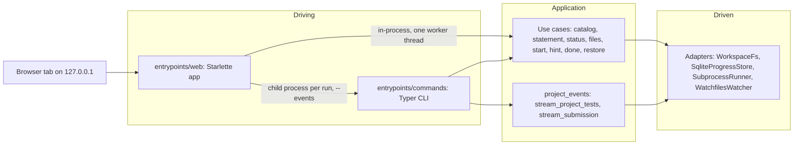
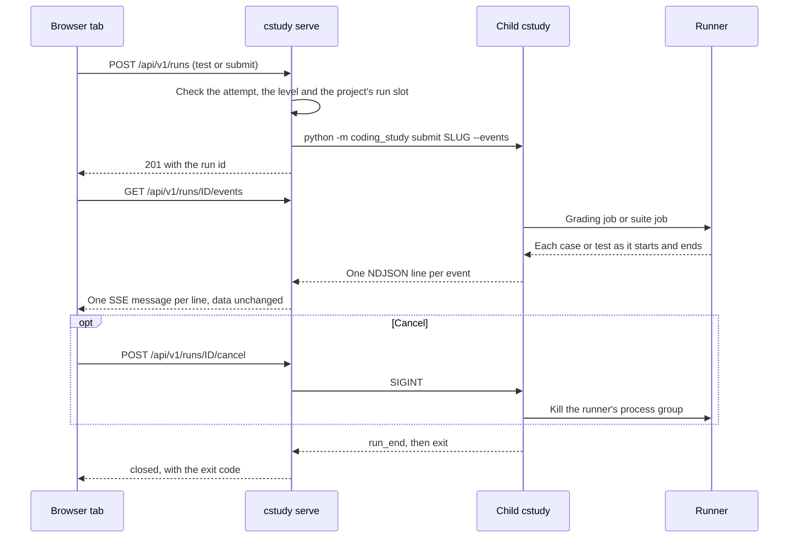

# Proposal: a local web UI served by `cstudy serve`

| Field | Value |
|-------|-------|
| Status | Proposed. Non-normative: nothing here changes how `cstudy` behaves until the owner accepts it |
| Date | 2026-10-31 |
| On acceptance | Becomes ADR 0015 and the spec changes listed in [What changes on acceptance](#what-changes-on-acceptance) |
| Builds on | [ADR 0008](../decisions/0008-installable-tool-and-separate-workspaces.md), [ADR 0010](../decisions/0010-ide-integration.md), [ADR 0013](../decisions/0013-homebrew-distribution.md), [ADR 0014](../decisions/0014-project-problems.md) |

`cstudy serve` would serve a browser interface on your own machine for practicing [project problems](problem-format.md#project-problems): the statement and its levels, the project folder's files in an editor, and `cstudy test` and `cstudy submit` with live results, inline diagnostics, file states, restore, a timer, hints and `cstudy done`. The page is a second driving adapter beside the terminal: every grade still comes from `cstudy`, through the same use cases and the same `--events` stream. This document records the design, the spikes behind it, a phased plan with task ids, and the decisions left to the owner. Paths and line numbers cite the code and docs at commit `c688fb8`; code paths are relative to `cli/src/coding_study/`.

## Recommended design

A Starlette app on uvicorn, in a new package `coding_study.entrypoints.web`, binds 127.0.0.1 and serves a vendored front end built with esbuild around CodeMirror 6. Reads and small writes call the application use cases in-process, the way each command module does. Each run starts a child `cstudy test --events` or `cstudy submit --events` and relays its lines to the browser as server-sent events, unchanged; cancelling a run sends the child SIGINT, which the CLI already turns into `run_end` with outcome `interrupted`. A session token, exchanged for an `HttpOnly` `SameSite=Strict` cookie, plus Host and Origin allow-lists, a CSRF header and a strict Content Security Policy guard every request, and the file API never leaves the project folder or follows a link. Version 1 covers project problems only; the single-file kinds stay in the editor and terminal flow unless the owner decides otherwise ([O1](#owner-decisions)).

| Question | Recommendation |
|----------|----------------|
| Server | Starlette 1.10 on uvicorn 0.54: three pure-Python wheels, about 200 KB, in the package `coding_study.entrypoints.web` |
| Runs | One child `python -m coding_study test\|submit … --events` per run; its stream is relayed line by line |
| Transport | Server-sent events (SSE) for runs and change notifications; plain HTTP requests for every action |
| Editor | CodeMirror 6, with each language loaded the first time a file needs it: 737.5 KB raw and 262.9 KB gzip in all, 468.8 KB raw for a Python session |
| Front-end build | Sources and a pinned lockfile in `tools/web-ui/`; the built bundle is committed under the package, as the IntelliJ launcher jar is ([ADR 0010](../decisions/0010-ide-integration.md)) |
| Security | 127.0.0.1 only, session token and cookie, Host and Origin checks, CSRF header, CSP with a per-page nonce, no CORS, a file API confined to the folder |
| API | `/api/v1/`, reusing the `--json` documents and `schemas/events.schema.json` unchanged |
| Scope | Project problems: statement and levels, file tree, editor tabs, runs with diagnostics, timer, hints, restore, `done` |

## What this builds on

The project-problem work already built the boundary a browser needs, and ADR 0014 names it as such.

| Piece | Where | What the UI uses it for |
|-------|-------|-------------------------|
| The boundary | [ADR 0014](../decisions/0014-project-problems.md) line 95; [cli](cli.md#event-stream) line 506 | The project folder, `cstudy submit --json`, `cstudy status --json` and the event stream are "the boundary a web interface builds on" |
| Event stream | `application/project_events.py:111-157`, `entrypoints/commands/_events.py:57-132`, `schemas/events.schema.json` | `run_start`, `test_start`, `test_result`, `case_start`, `case_result`, `diagnostic`, `level_result`, `level_unlocked`, `run_end`, version 1 with additive changes only ([cli](cli.md#event-stream) line 520) |
| Diagnostics | [cli](cli.md#diagnostics) lines 555-573; `domain/diagnostics_tsc.py` | File, 1-based line and column, severity, code: inline markers and jump-to-line |
| File states | [cli](cli.md#cstudy-status) lines 604-612; `application/project_manifest.py:99-110` | `files.entries` with `origin`, `level` and `state` for the tree |
| Restore | [cli](cli.md#restoring-a-file) lines 204-215; `application/project_start.py:221-240` | Restore a starter or generated test file |
| Lock | [installation-and-workspaces](installation-and-workspaces.md#project-folders) line 155; `adapters/file_lock.py:16-48` | Written for "an interface racing the CLI": start, unlock and restore take it, test and grading do not |
| Path rules | `domain/project_manifest.py:86-107`, `domain/project.py:141-158`, `domain/workspace_projects.py:220-222`, `adapters/workspace_fs.py:73-102` | Normalize a path, refuse one that leaves the folder, refuse `.venv` and caches, never write through a link |
| Watcher | `adapters/watchfiles_watcher.py:30-57`; `watchfiles` is already a dependency (`pyproject.toml:17`) | Notice edits made outside the page |

ADR 0014's revisit trigger for the web interface ([ADR 0014](../decisions/0014-project-problems.md) line 106) names two questions. The PRD non-goal ([PRD](../prd.md) line 61 lists a web UI and a browser editor) is amended by ADR 0015. The absence of a sandbox for user code is unchanged: the page runs only your own project, through the same `cstudy` commands and runners, as you, exactly as `cstudy test` does ([PRD](../prd.md) line 118). What the page adds is an HTTP surface that must stay closed to other web pages and other programs; [Security on localhost](#security-on-localhost) covers it.

## Server stack

This section chooses the HTTP stack, places it in the hexagonal layers, and keeps it away from every other command.

### Choice

Four stacks were weighed by what they add to the install, how they stream, and how they test.

| Option | Weight | Async and streaming | Testing | Verdict |
|--------|--------|---------------------|---------|---------|
| Standard library `http.server` with hand-written SSE | None | A thread per connection; routing, parsing, streaming and stream shutdown are ours to write | Real sockets only | Rejected: the security checks and SSE would be custom code with no test client |
| **Starlette 1.10 on uvicorn 0.54** | starlette 78.7 KB, uvicorn 85.4 KB, h11 36.6 KB wheels, all `py3-none-any`; anyio, idna and click are already installed through watchfiles and Typer (`uv.lock` lines 24-30, 170, 1115-1120) | asyncio through anyio; `StreamingResponse` for SSE; `watchfiles.awatch` runs on the same loop | `TestClient` (httpx, development only) runs the app in-process, streams included | **Recommended** |
| aiohttp | Compiled extensions (multidict, yarl, frozenlist, propcache) | asyncio | Own test client | Rejected: more platform wheels for the Homebrew formula ([ADR 0013](../decisions/0013-homebrew-distribution.md) lines 17 and 33) |
| FastAPI | Starlette plus pydantic-core, a compiled extension | As Starlette | As Starlette | Rejected: validation the API does in a few lines |

uvicorn is installed without its `standard` extra, which would add compiled `uvloop` and `httptools`. Importing Starlette and uvicorn took 102 ms on the loaded test machine, against 45 ms for `http.server`; only `cstudy serve` pays it.

### Hexagonal placement

The server is a driving adapter, like the Typer CLI, so it lives in `entrypoints/`, which may import every layer (`docs/architecture.md` lines 65-72, `cli/.importlinter` lines 5-12).



| Module | Holds |
|--------|-------|
| `coding_study/__main__.py` | `python -m coding_study`, the console script's `main`, so a run's child is the same install as the server |
| `entrypoints/commands/serve.py` | The `cstudy serve` command; imports `entrypoints.web` inside the command function only |
| `entrypoints/web/app.py` | The app factory: routes, the security middleware, startup and shutdown |
| `entrypoints/web/security.py` | Session token, cookie, Host, Origin and CSRF checks, CSP with a nonce, response headers |
| `entrypoints/web/runs.py` | The run registry: child processes, buffered events, the run slot per project, cancel |
| `entrypoints/web/notifications.py` | `watchfiles.awatch` on open project folders, as SSE |
| `entrypoints/web/api_*.py` | Route handlers; JSON documents come from the existing builders, such as `status_document` (`entrypoints/commands/status.py:66`) |
| `entrypoints/web/static/` | The vendored front end, with a digest manifest and the third-party license notice |
| `application/project_files.py` | New use cases on a project folder's files: tree, read, save, create, move, delete |
| `adapters/workspace_fs.py` | New `Workspace` methods `read_within`, `delete_within` and `move_within`, beside `write_within` |

| Rule | Detail |
|------|--------|
| Import contracts | Add `starlette` and `uvicorn` to the forbidden modules of the domain and application contracts (`cli/.importlinter` lines 14-42), and a contract forbidding them to `coding_study.adapters` |
| NFR-2 | Every command module is imported at startup (`entrypoints/commands/__init__.py:7-28`), so `serve.py` imports the web stack lazily; a test asserts that importing `coding_study.entrypoints.cli` loads neither library |
| In-process calls | Handlers run use cases through one worker thread (an anyio `CapacityLimiter` of 1), each with a fresh `Environment`; the SQLite store already opens a connection per operation (`adapters/sqlite/progress_store.py:260-272`), and serializing the calls avoids auditing every adapter for thread safety |

## Runs and the transport

This section covers how a run starts, reaches the browser, shares the project with the CLI, and stops.

### A run is a child `cstudy` process

The web adapter does not call `stream_submission` in a thread. It starts `python -m coding_study --workspace <root> test|submit <slug> --events` and relays each line. The [IDE files](../decisions/0010-ide-integration.md) set the precedent: they run `cstudy` commands and never run user code themselves, so `cstudy` stays the judge (ADR 0010 line 22).

| | Child process per run (recommended) | In-process, in a worker thread |
|--|--|--|
| Reuse | The command as it is; its stream is the documented boundary | The application functions as they are, serialized with `event_value` |
| Cancel | SIGINT: the CLI's Ctrl-C path writes `run_end` `interrupted`, kills the runner's process group and stores nothing (`entrypoints/commands/_events.py:69-71`, `adapters/subprocess_runner.py:689-705`) | `KeyboardInterrupt` never reaches a worker thread: a new cancellation port through `RunnerProcess` and every build step (Gradle, `go build`, `cargo`, `tsc`) |
| Isolation | A run that crashes or leaks ends one child | A failing run can take the server down |
| Concurrency | As two CLI processes, which the lock and SQLite already handle | Thread safety of the run path to audit |
| Latency | One CLI start per run, which a terminal run pays too | Saves that start |

A page run costs what a terminal run costs, the CLI's start included, so it meets NFR-1 ([PRD](../prd.md) line 98) exactly when `cstudy test` does. The loaded machine could not show that, so U11 measures it on a quiet one; in-process runs with a cancellation port are the fallback if it fails.

Before starting a child, the server runs the checks the stream makes before `run_start` (an attempt in progress, a project problem, an unlocked level) in-process, so those errors return an HTTP error with the CLI's message instead of an empty stream.

### Server-sent events

SSE fits: every event flows from the server, `EventSource` reconnects by itself with `Last-Event-ID`, and the browser sends its actions as ordinary requests that carry the CSRF header. A WebSocket would add an implementation to uvicorn (wsproto or websockets) and our own reconnect and replay.



```text
id: 3
event: case_result
data: {"type": "case_result", "version": 1, "id": "ex1", "visible": true, "generated": false, "status": "pass", "duration_ns": 41000, "level": 1}

```

| Rule | Detail |
|------|--------|
| Message | `event` is the line's `type`, `data` the line unchanged, `id` its 0-based index in the run. Ordering is the CLI's ([cli](cli.md#ordering) lines 544-551) |
| `closed` | The server's own message after the child exits: `{"exit_code": n}`, plus the last lines of standard error when no `run_end` came. The run slot frees at the same moment; in the spike the child exited 107 to 660 ms after its `run_end` |
| Replay | A run's lines stay in memory until ten newer runs of the project exist; a reconnect with `Last-Event-ID` resumes after that id |
| Notifications | `GET /api/v1/events` carries `file_changed`, `attempt_changed` and `run_started`, so a second tab can attach to a run another tab started |
| Connections | Over HTTP/1.1 a browser opens at most six connections per host, across all tabs. A tab holds one notification stream, plus one run stream while a run goes on, and closes both while it is hidden (Page Visibility API), resuming with `Last-Event-ID` |

### Concurrency with the CLI and the lock

The page and the terminal share one workspace, so the page follows the lock rules the CLI already has and adds one of its own: one page run per project at a time.

| Situation | Behavior |
|-----------|----------|
| Two runs of one project from the page | The server allows one run per project; a second `POST /api/v1/runs` gets 409 with the active run's id, and the tab attaches to it |
| A page run and a terminal run at once | Allowed, as two terminal runs are; both are stored. Of two passing submissions only one opens the level: the unlock re-reads the attempt under the lock (`application/submit_project.py:161` and `:179-196`) |
| Level unlock, restore, start | The child or the use case takes `.cs/projects/<slug>.lock`, as in the terminal |
| Page saves, creates, moves and deletes | Take the same lock for the write itself, so they never interleave with a restore or an unlock. `exclusive_lock` waits without a deadline (`adapters/file_lock.py:16-25`), so the web adapter uses a variant that gives up after 5 s and answers 409 `locked` |

### Cancelling a run

`POST /api/v1/runs/{id}/cancel` sends SIGINT to the child. In the spike, cancelled during a slow test: `run_end` with outcome `interrupted` and exit code 130 arrived 2 ms after the signal, the child exited 58 to 63 ms after it, no runner process was left, and `test_runs` gained no row. If the child is still alive 10 s later, the server kills it. A child killed that way cannot kill its runner, which runs in a session of its own (`adapters/subprocess_runner.py:729`); [risk 6](#risks) covers it.

## Editor and front end

This section picks the editor, measures the bundle, and says how it ships with no network at runtime and no Node at install.

### CodeMirror 6

Both editors were bundled offline for the six project languages and measured with the same script.

| | CodeMirror 6 (recommended) | Monaco 0.57.0 |
|--|--|--|
| Size, measured | 737.5 KB raw, 262.9 KB gzip, 223.8 KB brotli, split into 12 files | 3,927 KB JavaScript, 300 KB worker, 171 KB CSS and a 150 KB font: 4,548 KB raw, 1,141.5 KB gzip without the font. Six times the raw size, four times the gzip size |
| What was bundled | The editor with its basic setup, lint markers, a dark theme, Python, TypeScript, Java, Kotlin, Go, Rust, JSON and TOML | Every editor feature `editor.main.js` imports, Monarch highlighting for the six languages, no language service |
| Loading | Each language is a chunk loaded on first use | One bundle and a web worker |
| Six languages | Lezer grammars for Python, TypeScript, Java, Go and Rust; Kotlin and TOML from `@codemirror/legacy-modes` | Monarch tokenizers for all six |
| Diagnostics | `@codemirror/lint` `setDiagnostics`: underline, gutter marker, tooltip | `setModelMarkers` |
| CSP | Works under `style-src 'self' 'nonce-…'` with `EditorView.cspNonce` (verified); blocked without the nonce (verified) | Not tried: it starts a worker and adds styles at runtime, so the policy needs both allowed |
| License | MIT | MIT |

Without a language service, neither editor knows more than the syntax of the six languages: Monaco's TypeScript service would add several megabytes, and CodeMirror has none. The page relies on the CLI's diagnostics instead. Monaco's advantage is the feel of a desktop IDE, which is the substance of owner decision [O2](#owner-decisions).

| Chunk | Raw KB | Gzip KB |
|-------|-------:|--------:|
| Editor entry: commands, search, lint, theme | 60.1 | 20.1 |
| Shared core: view, state, language, Lezer runtime | 303.7 | 99.0 |
| Autocomplete, shared by the basic setup and some grammars | 34.5 | 12.3 |
| `@lezer/lr`, shared by the Lezer grammars | 26.4 | 8.7 |
| Python | 44.1 | 18.7 |
| TypeScript | 85.0 | 33.7 |
| Java | 46.6 | 18.9 |
| Kotlin | 21.8 | 7.7 |
| Go | 30.1 | 12.3 |
| Rust | 81.8 | 29.6 |
| JSON and TOML | 3.5 | 2.0 |
| Vim keybindings, the `codemirror-vim` package 6.4.0, optional ([O4](#owner-decisions)) | 120.2 | 38.3 |

A Python session loads 468.8 KB raw before the page's own code. Proposed budget: the whole bundle, application code included, at most 1 MB raw and 350 KB gzip, with at most 600 KB raw loaded for one language.

### Shipping the bundle offline

`uv tool install git+…` and pipx build the wheel straight from the repository ([ADR 0008](../decisions/0008-installable-tool-and-separate-workspaces.md) line 18), and the release workflow runs only `uv build --wheel` (`.github/workflows/version.yml:118`). The built bundle must therefore be in the repository, the way the IntelliJ launcher jar is: built reproducibly from `tools/ide-launcher/`, committed, and checked by a slow test that rebuilds it and compares the bytes (ADR 0010 line 33).

| Item | Rule |
|------|------|
| Sources | `tools/web-ui/`: `package.json`, `package-lock.json` with integrity hashes, `src/*.ts`, `build.sh`. Outside `cli/src`, so the wheel and sdist leave it out (`pyproject.toml:55-59`) |
| Build | `npm ci --ignore-scripts`, then esbuild: minified ES modules, content-hashed chunk names, legal comments gathered into `THIRD_PARTY_LICENSES.txt` |
| Output | `cli/src/coding_study/entrypoints/web/static/`, committed. Not a directory named `build`, which `pyproject.toml:44` excludes from the wheel |
| Check | `static/manifest.json` records each file's SHA-256; a slow test rebuilds and compares, and a fast test asserts the wheel holds every file the manifest names |
| Runtime | No CDN and no network request: the CSP's `default-src 'self'` enforces NFR-6 ([PRD](../prd.md) line 103) |
| Application code | TypeScript compiled by the same esbuild run, without a UI framework; Preact is the fallback if the views grow |
| Statement | Rendered to HTML on the server with markdown-it-py and Pygments, which Rich already installs (`uv.lock` lines 496, 744, 894-900), with raw HTML disabled; no Markdown library in the bundle |

### Keyboard and accessibility

The PRD's persona prefers keyboard-driven tools ([PRD](../prd.md) line 33), so every action has a key, and the editor never traps focus.

| Area | Behavior |
|------|----------|
| Tab | Tab indents (`indentWithTab`). Escape, bound to `temporarilySetTabFocusMode`, then Tab leaves the editor, and Ctrl-M, or Alt-Shift-M on macOS, toggles tab focus mode (`@codemirror/commands` default keymap). With Vim keybindings on, only the toggle applies |
| Shortcuts | Cmd or Ctrl-S saves, Cmd or Ctrl-Enter runs the tests, Cmd or Ctrl-Shift-Enter submits, F8 goes to the next diagnostic; each button names its shortcut and the CLI command it runs |
| Screen readers | The editor content has an `aria-label` naming the file; a polite live region announces a run's start and summary, not every test; statuses are text and icon, never color alone |
| Focus | A run never moves focus; jump-to-line moves it to the editor on purpose |
| Display | Light and dark follow `prefers-color-scheme`; motion follows `prefers-reduced-motion` |

## Security on localhost

The file API and the run API together execute code: whoever can save a file and start a run runs that code as you. Every control below exists so that no other web page and no other program on the machine can reach them.

| Threat | Control |
|--------|---------|
| Another machine on the network | The server binds 127.0.0.1 only and has no option to bind another address |
| Another program on this machine | A 256-bit session token, new on every start, required before anything but the login redirect is served |
| A web page in your browser sending requests | The session cookie is `SameSite=Strict`; unsafe methods also need the CSRF token in an `X-Cstudy-CSRF` header and an allowed `Origin`; no response carries CORS headers, so a cross-origin request with that header fails its preflight |
| DNS rebinding | Requests whose `Host` is not `127.0.0.1:<port>` or `localhost:<port>` get 403 |
| A page reading responses or framing the app | No CORS headers, so no other origin can read a response; `Cross-Origin-Resource-Policy: same-origin` and `frame-ancestors 'none'` |
| Script injection | `Content-Security-Policy: default-src 'self'; script-src 'self'; style-src 'self' 'nonce-<per page>'; img-src 'self' data:; connect-src 'self'; object-src 'none'; base-uri 'none'; frame-ancestors 'none'; form-action 'self'`, plus `X-Content-Type-Options: nosniff`, `Referrer-Policy: no-referrer` and `Cache-Control: no-store` on the API. File content is shown only in the editor, never as HTML |
| Leaving the project folder | Paths go through `folder_path` and `relative_path_issue`, untracked paths (`.venv`, `node_modules`, caches) are refused, and no segment may be a link ([File API rules](#file-api-rules)) |
| Running other commands | The run API takes a command from the set `test`, `submit` and options by name and type; the child's argument list is built by the server with no shell |

| Session rule | Detail |
|--------------|--------|
| Token | `secrets.token_urlsafe(32)`, printed in the URL `http://127.0.0.1:<port>/?token=…`. The first request with it gets the cookie and a 303 redirect to `/`, which removes the token from the address bar. The URL works again until the server stops, so a closed browser needs only the printed link |
| Cookie | `cstudy-<port>`, a second random value, `HttpOnly`, `SameSite=Strict`, `Path=/`, no expiry. Cookies ignore ports, so the name carries the port: two servers for two workspaces keep their own |
| `--open` | Writes `.cs/serve/<port>.html` with mode 0600, a redirect to the URL, and opens that file, so the token never appears in another process's arguments |
| Logging | No access log; the token never reaches a log line |

The spike verified the cookie exchange, the Host and Origin checks, the CSRF header and the CSP in headless Chromium ([Spike results](#spike-results)).

### File API rules

The file API reuses the path rules that `cstudy start --restore` and the manifest already apply ([cli](cli.md#restoring-a-file) lines 210 and 213), and adds the ones an editor needs.

| Rule | Detail |
|------|--------|
| Scope | The folder of the attempt in progress, `projects/<slug>/`; nothing else in the workspace is served |
| Paths | Relative and `/`-separated; `folder_path` resolves `.` and `..` and refuses a path that leaves the folder, an absolute path or a `\` (`domain/project_manifest.py:86-107`); the result must pass `relative_path_issue` (`domain/project.py:141-158`) |
| Untracked | A path `is_untracked` names is refused (`domain/workspace_projects.py:220-222`), as `cstudy status` leaves it out |
| Links | No segment may be a symbolic link, as `write_within` checks (`adapters/workspace_fs.py:93-102`). The new methods walk the path with `os.open(…, O_DIRECTORY \| O_NOFOLLOW, dir_fd=…)` per segment and open the file with `O_NOFOLLOW`, which closes the window between the check and the write |
| Content | UTF-8 text up to 1 MiB; other files appear in the tree but open read-only with a note |
| Writes | Atomic: a temporary file in the same directory, then `os.replace`, keeping the file's mode |
| Conflicts | Reads return the content's SHA-256 as the `ETag`. Saving an existing file needs `If-Match`, and a stale one gets 412; creating needs `If-None-Match: *`, and an existing file gets 412 |
| Generated test files | Editable, as in the terminal; the page notes that editing one never changes a grade ([ADR 0014](../decisions/0014-project-problems.md) line 29) |

## API v1

All endpoints sit under `/api/v1/`. The version changes only when a response changes incompatibly, by the rule of the event stream ([cli](cli.md#event-stream) line 520): new endpoints, fields and SSE event names keep it. Documents that the CLI already prints are returned unchanged, so one schema serves both; new documents get JSON Schemas in `schemas/web-api.schema.json`, and the API tests validate every response against them.

| Method and path | Does | Reuses |
|-----------------|------|--------|
| `GET /` | The page, with the CSRF token and a CSP nonce; `?token=` is exchanged for the cookie | |
| `GET /assets/{file}` | The vendored bundle | |
| `GET /api/v1/session` | `api` 1, the `cstudy` version, the workspace, the events version | |
| `GET /api/v1/problems?kind=project` | Problems with difficulty, language, status and attempt in progress | `list_problems` |
| `GET /api/v1/problems/{slug}/statement[?level=N]` | The statement of the unlocked levels, as Markdown and HTML, without hints | `show_statement` ([cli](cli.md#cstudy-show) line 713) |
| `POST /api/v1/attempts` | Start or resume: `slug`, `fresh`, `timer_minutes`; never opens `$EDITOR` | `start_attempt` (`application/start_attempt.py:27-72`) |
| `GET /api/v1/attempts/current?slug=` | The `cstudy status --json` document | `project_status`, `status_document` |
| `POST /api/v1/attempts/current/hints` | The next hint, `{"locked_until_level": N}` or `{"exhausted": true}` | `reveal_hint` (`application/reveal_hint.py:38-65`) |
| `POST /api/v1/attempts/current/done` | `{"rating": "easy\|ok\|hard"}` or `{"gave_up": true}`, with `notes` | `complete_attempt` |
| `POST /api/v1/projects/{slug}/restore` | `{"path": …}`: a starter or generated test file back as `cstudy` provides it | `restore_project_file` |
| `GET /api/v1/projects/{slug}/files` | The tree: each entry of `files.entries` plus `size` and `editable` | `folder_states` |
| `GET /api/v1/projects/{slug}/files/{path}` | `path`, `text`, `sha256`, `origin`, `level`, `state` | new `project_files` |
| `PUT /api/v1/projects/{slug}/files/{path}` | Save or create, by `If-Match` or `If-None-Match: *` | new |
| `POST /api/v1/projects/{slug}/files/{path}/move` | `{"to": …}`; an existing target gets 409 | new |
| `DELETE /api/v1/projects/{slug}/files/{path}` | Delete, with `If-Match`; a starter or generated file then shows `deleted` and can be restored | new |
| `POST /api/v1/runs` | `slug`, `command` (`test` or `submit`), `level`, `cases`, `typecheck` → 201 `{"id": …}` | child `cstudy` |
| `GET /api/v1/runs/{id}` | `state` (`running` or `ended`), `exit_code`, and `summary`, the `--json` document `run_end` carried | |
| `GET /api/v1/runs/{id}/events` | The run as SSE, then `closed` | `schemas/events.schema.json` |
| `POST /api/v1/runs/{id}/cancel` | SIGINT to the run → 202 | The CLI's Ctrl-C path |
| `GET /api/v1/events` | Notifications: `file_changed`, `attempt_changed`, `run_started` | |

`typecheck` defaults to true for TypeScript projects in the page: it is how type errors reach the editor as markers ([cli](cli.md#project-problems) line 320).

A file read, with its text cut short here:

```json
{"path": "bank/bank.py", "text": "from bank.models import Account\n", "sha256": "9c1f0e6a...", "origin": "starter", "level": null, "state": "modified"}
```

Errors share one document; where the terminal has a message for the same error, the page gets that text:

```json
{"error": {"code": "conflict", "message": "a run of bank-project-python is in progress", "run": "c8a4df906a913818"}}
```

| Code | Status | When |
|------|--------|------|
| `usage` | 422 | What exits 3 in the terminal: a locked level, no attempt in progress, a path the rules refuse |
| `not_found` | 404 | An unknown problem, run or file |
| `conflict` | 409 | A run in progress, an existing target |
| `locked` | 409 | The project's lock stayed busy for 5 s |
| `precondition_failed` | 412 | A stale `If-Match`, or `If-None-Match: *` on an existing file |
| `environment` | 503 | What exits 4: a missing toolchain, with the CLI's `fix:` hint |
| `unauthorized`, `forbidden` | 401, 403 | No session cookie; a bad Host, Origin or CSRF header |

## UI scope for v1

Version 1 is one page for one project attempt at a time.

| Area | Content |
|------|---------|
| Header | Problem, language, `level 2 of 4`, the timer (elapsed of the time box, shown as over once past it), Run tests, Submit, Cancel |
| Statement pane | The unlocked levels' sections, the level-unlock banner with the methods to add, Reveal hint with the grade-cap notice ([progress-and-scheduling](progress-and-scheduling.md) line 131), Done |
| File tree | Every tracked file with its state (`modified`, `added`, `deleted`) and origin (starter, level N test, yours); new, rename, delete and restore actions |
| Editor tabs | One CodeMirror view per open file, unsaved markers, diagnostics as underlines and gutter markers |
| Results panel | Tests or cases as they stream, with message, expected, actual, input and standard output when present; level tallies; diagnostics with jump-to-line; `run_end`'s outcome |
| Start | A problem list of project problems, then start or resume with an optional time box |

| Flow | In the page | Stays in the terminal |
|------|-------------|------------------------|
| `start`, `show`, `status`, `test`, `submit`, `hint`, `start --restore`, `done` | Yes, for project problems | Also, unchanged |
| `test --debug` | No: debugging stays in the IDE ([ADR 0010](../decisions/0010-ide-integration.md)) | Yes |
| `solution`, `next`, `mock`, `list`, `stats`, `bench`, `verify`, `new`, `doctor` | The page shows the command to run, such as `cstudy doctor --fix` after an environment error | Yes |

The page stores no state of its own: files live in the folder and progress in `progress.db`, so the terminal, the IDE and the page always agree.

| Change from elsewhere | Page behavior |
|-----------------------|---------------|
| A file changed on disk, the tab has no unsaved edits | The tab reloads and keeps the cursor |
| A file changed on disk, the tab has unsaved edits | A banner: Reload, or Keep mine, which saves over the disk version on purpose |
| A save with a stale `If-Match` | 412, and the same banner |
| A file added or deleted | The tree refreshes |
| A level opened or the attempt changed in the terminal | The watcher sees the manifest or the statement change (`.cs/projects/<slug>.json`, `.statements/<slug>.md`), and the page refetches status, statement and tree |
| A second tab | Each tab has its own notification stream; a run another tab started appears through `run_started` |

The page's own saves come back as `file_changed` with the SHA-256 it already has, and it ignores them.

## Packaging and UX

`cstudy serve` is the only new command.

```text
cstudy serve [--port N] [--open]
```

| Flag | Effect |
|------|--------|
| `--port N` | Listen on 127.0.0.1:N; default 0, a free port the system picks. A port in use exits 4 |
| `--open` | Open the page in the default browser through the redirect file |

```text
$ cstudy serve --open
cstudy serve · workspace ~/cstudy-workspace
open       http://127.0.0.1:53817/?token=QmFua1Byb2plY3Q...
run        submit bank-project-python · failed · 9/10 · 1.4s
stop       Ctrl-C
```

| Rule | Detail |
|------|--------|
| Workspace | Needed, as for every practice command: exit 3 without one |
| Output | The URL once, then one line per run; no request log |
| Stop | Ctrl-C sends SIGINT to every run in progress, closes the streams and exits 130, as `cstudy test --watch` does (`entrypoints/commands/test.py:300-305`) |
| `cstudy doctor` | `ok    web ui assets 0.8 MB, digest matches` and `ok    web server starlette 1.10.0, uvicorn 0.54.0`. Both WARN, never FAIL, since practice in the terminal does not need them; `cstudy serve` exits 4 when either is missing |

| Effect | Size |
|--------|------|
| Wheel | 6.4 MB today (16.83 MB unpacked, 5,687 files). The editor adds about 0.26 MB compressed, and the page's own code and styles a little more: about 6.7 MB |
| Runtime dependencies | starlette, uvicorn and h11: three pure-Python wheels, 200.7 KB |
| Homebrew formula | No template change: the three wheels arrive through `requirements.txt` (`packaging/homebrew/cstudy.rb.template:29-33`), as binary wheels like the others ([ADR 0013](../decisions/0013-homebrew-distribution.md) line 25) |
| Development | httpx for Starlette's `TestClient`; Playwright in an optional group ([O6](#owner-decisions)); Node 24 for `tools/web-ui/build.sh`, already a toolchain for TypeScript practice |

## Testing strategy

Most of the UI is tested without a browser; one smoke test drives a real one.

| Layer | What it proves | How | Marker |
|-------|----------------|-----|--------|
| Application | `project_files`: path rules (`..`, absolute, `\`, untracked, a link at any segment, a directory at the file's path), preconditions, the lock's deadline | Fakes, as in `tests/application/` | fast |
| Adapter | The new `Workspace` methods never follow a link, with real links in `tmp_path` | Real files | fast |
| API | Each endpoint's status and document; documents equal to the CLI's (`status_document`); the security matrix: Host, Origin, cookie, CSRF, CSP present, no CORS headers | `TestClient` with a test `Environment` | fast |
| Streaming | SSE framing, ordering, `Last-Event-ID`, `closed`, the 409 slot, cancel to `run_end` `interrupted` | A scripted child that replays golden NDJSON and waits for SIGINT, behind the run launcher seam | fast |
| End to end | A real `python -m coding_study test` and `submit --events` on the Python pilot in a temporary workspace: a level unlock, a cancel, a real file event | The existing slow workspace fixtures (`cli/tests/e2e.py`, `cli/tests/workspaces.py`) | slow |
| Browser | Login, the editor under the CSP, a streamed run, cancel, a diagnostic marker, no console error | Playwright, skipped when it is not installed | slow |
| Bundle | The rebuild matches `manifest.json`; the wheel holds every asset | npm and esbuild; `uv build` | slow |
| Import cost | `import coding_study.entrypoints.cli` loads neither Starlette nor uvicorn | A subprocess checks `sys.modules` | fast |

The repository has no test workflow: `.github/workflows/` holds only `version.yml`, and every check runs locally before a commit (`CONTRIBUTING.md` lines 35-46). The UI's tests join that routine through the existing `slow` marker (`cli/pytest.ini:5-6`). The release job builds the wheel with `uv build` and needs no Node, because the bundle is committed. Owner decision [O8](#owner-decisions) asks whether to add a workflow.

## Spike results

The spikes lived in a scratch directory and are not committed. The test machine was heavily loaded (load average 30 to 59 on 11 cores), so the times below show orders of magnitude, not NFR evidence.

| Spike | Result |
|-------|--------|
| CodeMirror 6, one bundle | esbuild 0.28.2, `@codemirror/view` 6.43.15: 732.0 KB raw, 257.1 KB gzip, 208.8 KB brotli |
| CodeMirror 6, languages split | 737.5 KB raw and 262.9 KB gzip over 12 files; 398.3 KB raw and 131.4 KB gzip before any language ([table](#codemirror-6)) |
| Monaco 0.57.0 | 4,548 KB raw with the font, 1,141.5 KB gzip without it, and a worker |
| Vim keybindings | 120.2 KB raw, 38.3 KB gzip as a chunk of its own; MIT |
| Current wheel | `coding_study-0.8.0-py3-none-any.whl`: 6.4 MB; `content/problems` is 10.76 MB of its 16.83 MB unpacked |
| Server libraries | starlette 1.10.0 78.7 KB, uvicorn 0.54.0 85.4 KB, h11 0.16.0 36.6 KB; import 88 ms, 105 ms, 102 ms together, against 45 ms for `http.server` |
| Cancel | SIGINT to `cstudy test --events` during a slow test: `run_end` `interrupted` 2 ms later, exit 130 after 58 to 63 ms, no runner left, no `test_runs` row |
| Child runs under load | `cstudy --version` 0.70 to 1.84 s; `test --events` on the Python pilot, median 3.5 s to exit; `submit --events`, median 1.4 s |
| Starlette server and headless Chromium | Passed: no cookie 401; a rebinding `Host` 403; token login redirects and sets an `HttpOnly` `SameSite=Strict` cookie; the editor renders the file with an `aria-label`; no CSP violation; a cross-origin POST 403; a POST without the CSRF header 403; cancel ends the stream as `interrupted`; a load error is marked on its line and in the gutter |
| CSP without a nonce | Chromium blocked CodeMirror's style element (`style-src-elem`), leaving the editor unstyled; `EditorView.cspNonce` fixed it |
| Run slot | A second run requested right after a cancel got 409 until the first child exited: the slot must follow the process, not `run_end`, hence `closed` |

## Risks

The risks are ordered by consequence; the first is the reason the security section exists.

| # | Risk | Mitigation |
|---|------|------------|
| 1 | A gap in the session checks lets a web page or another program save a file and run it as you | The layered checks in [Security on localhost](#security-on-localhost), a test per check, a review of U3 before the write API (U6) ships |
| 2 | Edits in the page and on disk diverge, from an external editor or a second tab | `If-Match` on every write, the watcher, the conflict banner; no autosave in v1 |
| 3 | The vendored front end: npm supply chain, and a bundle that drifts from its sources | A lockfile with integrity hashes, `--ignore-scripts`, the digest manifest and its slow rebuild test, the license notice |
| 4 | Six HTTP/1.1 connections per host across all tabs | One notification stream per tab, a run stream only while a run goes on, streams closed in hidden tabs |
| 5 | One CLI start per run makes the page slower than in-process calls would | Measure on a quiet machine in U11; in-process runs with a cancellation port are the fallback |
| 6 | A child killed after the 10 s grace leaves its runner, whose hang guard lived in the child | Treat SIGTERM like SIGINT in `--events` runs, as debug runs already do (`adapters/subprocess_runner.py:669`), and send it before SIGKILL |
| 7 | Build errors in Java, Kotlin, Go and Rust carry no file or line: `tsc` has the only parser (`domain/diagnostics_tsc.py`) | They show in the results panel without markers until U13 adds parsers |
| 8 | An upgrade replaces the code under a running server, so a child may be newer | Check `version` 1 on every event; the page reloads after a restart; `cstudy serve` prints its version |
| 9 | Only headless Chromium is tested | Manual checks in Safari and Firefox at U11 |

## Alternatives considered

Each alternative was weighed against the recommendation of the section it belongs to.

| Alternative | Why not |
|-------------|---------|
| Runs in-process, in a worker thread | Saves one CLI start per run, but needs a cancellation port through the runner and every build step, shares state across threads, and lets a failing run take the server down |
| WebSocket | Needs a WebSocket implementation for uvicorn and our own reconnect and replay; every client action is an ordinary request anyway |
| Long polling | More requests and code for what SSE does |
| Monaco | Six times the raw size, a worker, CSS and a font, for highlighting the same six languages |
| Build the bundle at install time, in a hatch hook | Every install from git would need Node and the network ([ADR 0008](../decisions/0008-installable-tool-and-separate-workspaces.md) line 18, NFR-6) |
| Build the bundle only in the release workflow | `uv tool install git+…` builds the default branch, which would lack it |
| Load the editor from a CDN | Breaks NFR-6 |
| Render Markdown in the browser | One more library in the bundle; markdown-it-py and Pygments are already installed |
| A UI framework (React, Svelte) | A larger bundle and a framework build for a handful of views |
| The token on every request, no cookie | `EventSource` cannot send headers, and the token would sit in every request line |
| A read-only page, editing in the IDE | Misses the goal: edit, run and submit in one page |

## Phased plan

Each task closes with tests and docs in the same commit, as `CONTRIBUTING.md` asks (line 84). Sizes follow the ODD heuristic of about 400 authored changed lines: S is well under it, M near it, L above it.

| ID | Task | Route | Size | After |
|----|------|-------|------|-------|
| U2 | ADR 0015 and the spec changes in [What changes on acceptance](#what-changes-on-acceptance) | delegated writer (docs) | M | U1 |
| U3 | Server skeleton: `coding_study/__main__.py`, `cstudy serve` (lazy import, `--port`, `--open`, the URL, Ctrl-C), app factory, security middleware, token login, `/api/v1/session`, static files, dependencies, import contracts, `cstudy doctor` rows; API security tests | delegated writer | L | U2 |
| U4 | Front-end toolchain: `tools/web-ui/` with lockfile and `build.sh`, the editor module (six languages, JSON, TOML, lint, nonce, tab focus), committed output with `manifest.json` and license notice, wheel-content test, slow rebuild test | delegated writer | M | U2 |
| U5 | Read API and page shell: project list, statement (markdown-it-py), status, tree, file read; layout, editor tabs, timer | delegated writer | L | U3, U4 |
| U6 | Saving: `application/project_files.py` save, `Workspace` methods without link following, atomic write, `If-Match`, the lock with a deadline; unsaved markers and the conflict banner | delegated writer | M | U5 |
| U7 | Runs: run registry, pre-checks, run slot, SSE with `Last-Event-ID` and `closed`, cancel, results panel, diagnostics markers and jump-to-line, refresh after a level unlock; streaming tests with a scripted child; slow test with the real CLI | delegated writer | L | U5 |
| U8 | File management: create, move, delete, restore | delegated writer | M | U6 |
| U9 | Attempt flows: start or resume with a time box, hints by level, the `done` dialog | delegated writer | M | U5 |
| U10 | Notifications: watching folder, manifest and statement, `/api/v1/events`, reload or flag open tabs, a second tab, hidden tabs | delegated writer | M | U6 |
| U11 | Browser smoke test, accessibility pass, quiet-machine timings against NFR-1 for all six pilots, Safari and Firefox checks, user guide `docs/guides/web-ui.md` | delegated writer, parent checks | M | U7 to U10 |
| U12 | What O1, O3 and O4 decide: single-file problems, starting a mock, Vim keybindings | per decision | M to L | U1 |
| U13 | Diagnostic parsers for `javac`, `kotlinc`, `go` and `cargo`, so their build errors mark lines as `tsc`'s do | delegated writer | M | U7 |

**First runnable slice: U3 to U7, on `bank-project-python`.** `cstudy serve --open` opens the page; you read level 1, edit `bank/bank.py` and save it, run the tests and submit with results streaming in, cancel a run, see an import error marked on its line, and watch level 2 open with its new test file in the tree. The other five pilots run through the same CLI, so U11 checks rather than builds them.

## Owner decisions

Ordered by impact. Each is open; the recommendation is this proposal's, not a decision.

| # | Decision | Options | Recommendation |
|---|----------|---------|----------------|
| O1 | Which problem kinds version 1 covers | (a) Project problems only. (b) Also the single-file kinds (function, design, progressive, concurrent), shown and tested through `cstudy test --json`, with no live results. (c) Every kind with live results, which first needs `cstudy test --events` for every kind ([cli](cli.md#event-stream) line 522 limits it to projects) and the UI states of progressive levels, stress runs, time limits and `--perf` | (a): the event stream, manifest, file states, lock and `status` exist only for projects, and the single-file loop already works in the editor and terminal. Reconsider (b) after the first slice |
| O2 | Editor | (a) CodeMirror 6: 0.74 MB raw, works under the strict CSP, accessible. (b) Monaco: the feel of a desktop IDE, about six times the raw size, a worker | (a) |
| O3 | Timer and mock interviews in version 1 | (a) Show an attempt's time box and let the start dialog set one; attempts that `cstudy mock` started work in the page, which never starts a mock. (b) Also start a mock from the page. (c) No timer | (a): a mock may pick single-file problems, which O1 (a) leaves out |
| O4 | Vim keybindings | (a) An opt-in setting, loaded only when on: 120 KB raw. (b) None in version 1 | (a): the PRD persona works in Neovim ([PRD](../prd.md) line 33) |
| O5 | Opening the browser | (a) Only with `--open`. (b) By default, with `--no-open`, as `open_on_start` does for the editor | (a): predictable over SSH and in scripts |
| O6 | Browser smoke test | (a) Playwright in an optional dependency group, run with the slow tests when installed. (b) No browser test; API and streaming tests only | (a): only a browser proves the CSP, the editor and the stream together, as the spike showed |
| O7 | Reference solutions in the page | (a) Stay in the terminal (`cstudy solution`). (b) A page view behind the CLI's confirmation, which grades the attempt `again` | (a) |
| O8 | A test workflow | (a) Keep running the checks locally, as today. (b) Add a workflow for lint, types, contracts and fast tests on push | (a) for this feature; (b) is a separate decision about the whole repository |

## What changes on acceptance

The repository records only accepted decisions, so once the owner accepts this proposal, task U2 turns it into these changes and removes it: `docs/specs/` holds normative specs ([docs index](../README.md) line 56).

| Document | Change |
|----------|--------|
| `docs/decisions/0015-local-web-ui.md` | New ADR: context, the decisions above, consequences, alternatives, and revisit triggers: page runs that miss NFR-1, streams that hit the connection limit, a need the editor cannot meet |
| `docs/prd.md` | Remove the web UI and the browser editor from the non-goals (line 61); a functional requirement for the page; an NFR for `cstudy serve`: 127.0.0.1 only, the session checks, the asset budget, no network request |
| `docs/specs/web-ui.md` | New normative spec: the API, SSE, security and page behavior above |
| `docs/specs/cli.md` | A `cstudy serve` section; the `cstudy doctor` rows; line 3 ("`cstudy` is the only interface") reworded to include the page `cstudy serve` serves |
| `docs/architecture.md` | The driving adapter, a data flow for a page run, the libraries table, the import contracts |
| `docs/specs/installation-and-workspaces.md` | The assets in the wheel, `tools/web-ui/`, `.cs/serve/` |
| `docs/README.md`, `docs/roadmap.md`, `CONTRIBUTING.md` | Index rows; a Phase 9 with exit criteria; the front-end build and the browser tests |
