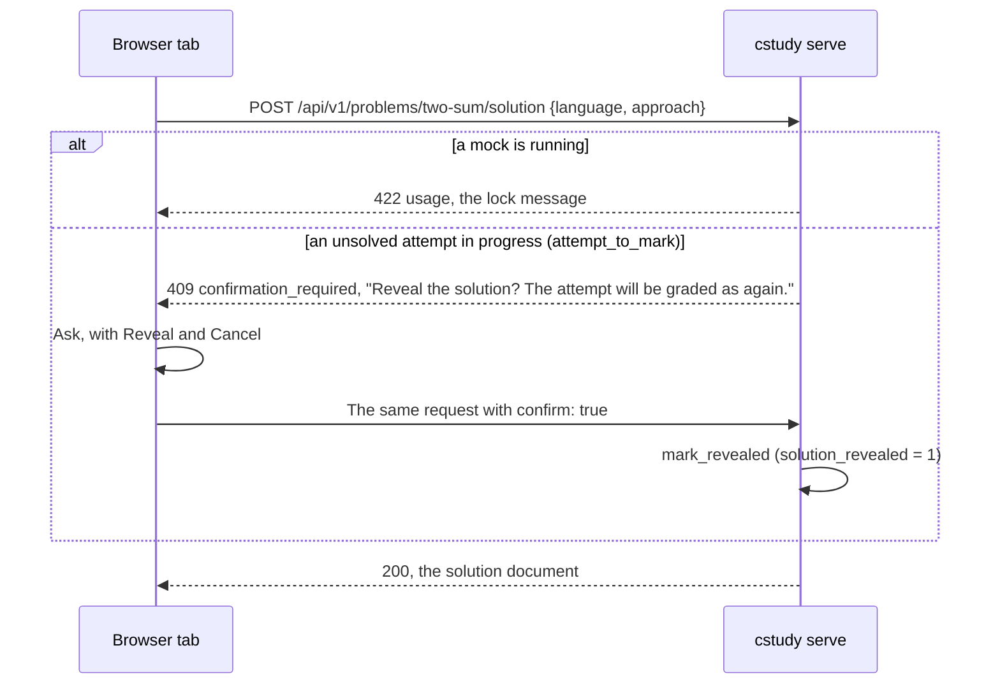

# Spec: Local web UI (`cstudy serve`)

`cstudy serve` serves a page on `127.0.0.1` where the whole practice loop happens in a browser on your own machine: browse and pick problems, start an attempt, read the statement, edit the code, run the tests and submit with results arriving live, take hints, reveal solutions, finish, run mock interviews, and see progress and workspace health. It is a second driving adapter beside the terminal ([ADR 0015](../decisions/0015-local-web-ui.md)): every value it shows and every change it makes goes through the application use case the matching `cstudy` command calls, and every grade still comes from `cstudy`. Code paths are relative to `cli/src/coding_study/`.

## Principles

| Rule | Detail |
|------|--------|
| Parity, never more | The page never gets behaviour the CLI lacks. When the page needs a value no command prints, the CLI gains it first, in the same or an earlier change ([cli](cli.md)) |
| One judge | Runs are child `cstudy` processes; the page never runs user code itself and never judges an output |
| Same documents | An endpoint that has a matching `--json` document returns it unchanged, so one JSON Schema serves both |
| No state of its own | Files live in the workspace and progress in `progress.db`; the terminal, the IDE and the page always agree. The only page-owned file is the preferences file ([Preferences](#preferences)) |
| Local | The server binds `127.0.0.1` only and makes no network request; the page loads nothing from anywhere but the server |

## Command parity

Each practice command maps to one page area, one endpoint and the use case the command calls. "Child" means the endpoint starts the command as a child process ([Runs](#runs), [Jobs](#jobs)).

| Command | Page | Endpoint | Use case |
|---------|------|----------|----------|
| `cstudy list` | Problems view | `GET /api/v1/problems` | `list_problems`, `list_items` |
| `cstudy next` | Next card | `GET /api/v1/next` | `next_problem` |
| `cstudy show` | Statement pane | `GET /api/v1/problems/{slug}/statement` | `show_statement` |
| `cstudy history` | Problem view, History | `GET /api/v1/problems/{slug}/history` | `problem_history` (new with `cstudy history`) |
| `cstudy start` | Start dialog | `POST /api/v1/attempts` | `start_attempt`, `start_item_attempt` |
| `cstudy start --restore` | File tree, Restore | `POST /api/v1/attempts/{id}/restore` | `restore_project_file` |
| `cstudy status` | Attempt header | `GET /api/v1/attempts/{id}` | `attempt_status` (`project_status` extended to every kind) |
| `cstudy test` | Run tests | `POST /api/v1/runs`, `command: test` | Child `cstudy test --events`: `stream_tests` (task U14) or `stream_project_tests` |
| `cstudy submit` | Submit | `POST /api/v1/runs`, `command: submit` | Child `cstudy submit --events`: `stream_submission` |
| `cstudy hint` | Hint button | `POST /api/v1/attempts/{id}/hints` | `reveal_hint` |
| `cstudy solution` | Solution pane | `POST /api/v1/problems/{slug}/solution` | `show_solution`, `attempt_to_mark`, `mark_revealed`; items `reveal_item_solution` |
| `cstudy done` | Done dialog | `POST /api/v1/attempts/{id}/done` | `complete_attempt` |
| `cstudy mock` | Mock view | `POST /api/v1/mock`, `GET /api/v1/mock` | `start_mock`; the state from `running_mock`, as `require_no_running_mock` reads it |
| `cstudy stats` | Progress view | `GET /api/v1/stats` | `show_stats` |
| `cstudy export` | Progress view, Export | `GET /api/v1/progress/export` | `export_progress` |
| `cstudy import` | Progress view, Import | `POST /api/v1/progress/import` | `import_progress` |
| `cstudy doctor` | Health view | `GET /api/v1/doctor` | Child `cstudy doctor --json`: `run_doctor` |
| `cstudy doctor --fix` | Health view, Fix | `POST /api/v1/jobs`, `command: doctor_fix` | Child `cstudy doctor --fix`: `fix_workspace` |
| `cstudy verify` | Health view, your problems | `POST /api/v1/jobs`, `command: verify` | Child `cstudy verify`: `verify_content` |
| `cstudy bench` | Problem and attempt views, Bench | `POST /api/v1/jobs`, `command: bench` | Child `cstudy bench`: `run_bench` |
| Your editor | Editor tabs, file tree | `/api/v1/attempts/{id}/files…` | `attempt_files` (new): tree, read, save, create, move, delete |

`cstudy init`, `cstudy ide`, `cstudy serve`, `cstudy new`, `cstudy verify` on catalog problems, `cstudy test --debug` and `--watch`, and the path arguments of `export` and `import` stay in the terminal, for the reasons [ADR 0015](../decisions/0015-local-web-ui.md#commands-that-stay-in-the-terminal) gives. The page names the command to run where it meets one, such as `cstudy init` when the server's workspace is gone.

## Server

### Process

| Item | Rule |
|------|------|
| Command | [`cstudy serve [--port N] [--open]`](cli.md#cstudy-serve) |
| Stack | Starlette on uvicorn (without the `standard` extra), in `entrypoints/web/`; `entrypoints/commands/serve.py` imports it inside the command function only |
| In-process calls | Handlers call use cases through one worker thread (an anyio `CapacityLimiter` of 1), each call with a fresh `Environment`, so use cases never run concurrently inside the server |
| Child processes | `sys.executable -m coding_study --workspace <root> [--content <root>] <command> …`, the argument list built by the server with no shell. `--content` is passed when the server was started with it. Each child starts in a session of its own, with standard input from `/dev/null`, the workspace root as its current directory, and `NO_COLOR=1` and `COLUMNS=120` added to the server's environment |
| `python -m coding_study` | `coding_study/__main__.py` calls the console script's `main`, so a child is always the same install as the server |
| Logging | No access log. Standard output holds the startup lines, one line per finished run and job, and the `stop` line ([`cstudy serve`](cli.md#cstudy-serve)); an internal error prints its traceback to standard error. The session token never reaches a log line |

### Modules

| Module | Holds |
|--------|-------|
| `entrypoints/commands/serve.py` | The `cstudy serve` command |
| `entrypoints/web/app.py` | The app factory: routes, middleware, startup and shutdown |
| `entrypoints/web/page.html` | The page template: the server fills in the CSRF token and the CSP nonce of each response (`{{csrf}}`, `{{nonce}}`) |
| `entrypoints/web/security.py` | Token, cookie, Host, Origin and CSRF checks, the CSP nonce, response headers |
| `entrypoints/web/runs.py` | The registry of runs and jobs: child processes, buffered lines, slots, cancel |
| `entrypoints/web/run_options.py` | The [run options](#run-options) and [job options](#jobs), checked by name and type, and the child's argument list they become |
| `entrypoints/web/notifications.py` | The [notification](#notifications) streams, the run and job notices, and the watch of the workspace that feeds them |
| `entrypoints/web/api_*.py` | Route handlers, one module per group of the [endpoint tables](#endpoints) |
| `entrypoints/web/documents.py` | Builders of the documents no command prints; the others come from the command modules' builders, such as `status_document` |
| `entrypoints/web/solution_document.py` | The [solution document](#solutions): what `cstudy solution` pages, as Markdown |
| `entrypoints/web/bodies.py` | The JSON bodies of writes, read by field name and type ([API conventions](#api-conventions)) |
| `entrypoints/web/static/` | The vendored front end, `manifest.json` and `THIRD_PARTY_LICENSES.txt` ([Front-end assets](#front-end-assets)) |
| `application/attempt_files.py` | Tree, read, save, create, move and delete within an attempt's [file scope](#file-scope) |
| `application/problem_history.py` | The history of one problem, shared with `cstudy history` |
| `application/attempt_changes.py` | Snapshots of what the [notifications](#notifications) watch, and the changes between two |
| `adapters/watchfiles_watcher.py` | `folder_changes`, beside the watch of `cstudy test --watch`: one burst signal over several folders, some with their subfolders and some without |
| `application/run_checks.py` | The [pre-checks](#lifecycle) of a run, and the scope check of `verify` jobs |
| `adapters/workspace_fs.py` | New `Workspace` methods `read_within`, `delete_within` and `move_within` beside `write_within`, none following a link, and `locked_with_deadline`, the project lock that gives up after a deadline ([Lock](#file-scope)) |

### Shutdown

Ctrl-C (SIGINT) or SIGTERM stops the server: it sends SIGINT to every run and job in progress, closes every stream (each tab's notification stream ends at once, the watch of the workspace stops, and each run's stream ends once its child exits), waits for the children as [Cancel](#cancel) does, deletes its `--open` redirect file, and exits 130 (143 after SIGTERM). The children are stopped first, before the server waits for its open responses, since a run's stream stays open until its child exits; from then on a new run or job gets 409 `conflict` (`cstudy serve is stopping`).

## Security

The file API and the run API together execute code: whoever can save a file and start a run runs that code as you. Every control below keeps other web pages and other programs on the machine away from them.

| Threat | Control |
|--------|---------|
| Another machine on the network | The server binds `127.0.0.1` only; no option binds another address |
| Another program on this machine | A 256-bit session token, new on every start, required before anything but the login page is served |
| A web page in your browser sending requests | The session cookie is `SameSite=Strict`; every `POST`, `PUT` and `DELETE` also needs the CSRF token in an `X-Cstudy-CSRF` header and an `Origin` equal to `http://127.0.0.1:<port>` or `http://localhost:<port>`. No response carries CORS headers, so a cross-origin request with that header fails its preflight |
| DNS rebinding | A request whose `Host` is not `127.0.0.1:<port>` or `localhost:<port>` gets 403 `forbidden` |
| Reading responses, framing the page | No CORS headers; `Cross-Origin-Resource-Policy: same-origin`; `frame-ancestors 'none'` |
| Script injection | `Content-Security-Policy: default-src 'self'; script-src 'self'; style-src 'self' 'nonce-<per page>'; img-src 'self' data:; connect-src 'self'; object-src 'none'; base-uri 'none'; frame-ancestors 'none'; form-action 'self'` on the page; `X-Content-Type-Options: nosniff` and `Referrer-Policy: no-referrer` on every response; `Cache-Control: no-store` on the API. File content is shown only in the editor, never as HTML. Markdown is rendered on the server with raw HTML disabled and no `style` attribute: code blocks carry Pygments classes (`tok-k`) and aligned table cells a class (`align-right`) |
| Leaving the attempt's files | The [file API rules](#file-api-rules) |
| Running other commands | Runs and jobs take a command from a fixed set and options by name and type; the server builds the child's argument list, with no shell |

| Session rule | Detail |
|--------------|--------|
| Token | `secrets.token_urlsafe(32)`, printed in the URL `http://127.0.0.1:<port>/?token=<token>`. A request to `/` with the right token gets the cookie and a 200 page, never stored (`Cache-Control: no-store`), that sends the browser on to `/` at once (`<meta http-equiv="refresh" content="0; url=/">`, with a link for a browser that ignores it), which removes the token from the address bar. Not a 303: after a navigation that another site started, such as the `--open` file, browsers withhold a `SameSite=Strict` cookie from the redirect they follow, so the page would answer 401; the page's own navigation to `/` sends it, in every engine the [browser tests](#browser-support) cover. A wrong token gets 401. The URL keeps working until the server stops |
| Cookie | Named `cstudy-<port>` (cookies ignore ports, so two servers keep their own), a second random value of 256 bits, `HttpOnly`, `SameSite=Strict`, `Path=/`, no expiry |
| Without the cookie | `/` answers 401 with a short HTML page saying to open the URL `cstudy serve` printed; the API answers 401 `unauthorized` |
| CSRF token | A third random value, embedded in the page as `<meta name="cstudy-csrf">`, compared in constant time |
| `--open` | Writes `.cs/serve/<port>.html` with mode 0600, a page that redirects to the URL, and opens that file in the default browser, so the token never appears in another process's arguments; the server deletes the file when it stops |
| Body size | At most 2 MiB per request body, 64 MiB for `POST /api/v1/progress/import`; larger gets 413 `too_large` |

## API conventions

| Item | Rule |
|------|------|
| Base | `/api/v1/`. JSON in and out (`application/json; charset=utf-8`), except the export download, file reads with `?raw` and the SSE streams (`text/event-stream`) |
| Version | `api` 1 changes only when a response changes incompatibly: a field removed, renamed or given another type. New endpoints, fields, error codes and SSE message types keep it |
| Schemas | Documents that a command prints are described where the command is ([cli](cli.md)); the others in `schemas/web-api.schema.json`, one definition each under `$defs`: the session, the preferences, the error document, a problem's additions to its list entry, the statement, a hint, Done's values, a solution, the file tree, a file, a save, a restore, a started run or job, a run, a job, the `closed` and `line` events, the mock's state and a started mock, an import's counts, and the data of each notification. A fast test validates real responses of every definition against it; the tests of each endpoint compare the documents a command also prints with that command's output |
| Attempts | An attempt is addressed by its id. A request on an attempt that is no longer `in_progress`, or that another attempt of the same problem and language replaced, gets 409 `attempt_ended`. The server calls the use case with the attempt's slug and language |
| Refusals | Where the CLI refuses, the API refuses with the CLI's message: a use case's usage error is 422 `usage` with the same text |
| Bodies | A write's body is a JSON object; one that is not, a missing required field (`the request needs slug`), or a value of another type or outside its range (`invalid timer_minutes 0: use an integer from 1 to 600`) gets 422 `usage`. A boolean left out or null is false |
| Confirmations | An action the CLI or [ADR 0015](../decisions/0015-local-web-ui.md) guards with a question takes `"confirm": true`. Without it the server changes nothing and answers 409 `confirmation_required` with the question as `message`; the page asks it and repeats the request with `confirm` |

Errors share one document:

```json
{"error": {"code": "usage", "message": "level 3 is locked; pass level 2 with cstudy submit first", "fix": null}}
```

| Code | Status | When |
|------|--------|------|
| `usage` | 422 | What exits 3 in the terminal: a locked level, an unknown case, a path the rules refuse, a hint or solution during a mock |
| `not_found` | 404 | An unknown problem, attempt, run, job or file, or a path the API does not have |
| `method_not_allowed` | 405 | A method the path does not take, such as `DELETE /api/v1/session`; the `Allow` header names the ones it takes |
| `attempt_ended` | 409 | The attempt is no longer in progress |
| `conflict` | 409 | A run of the attempt is in progress (the document adds `run`, its id), a job is in progress (`job`), a move target exists, `doctor --fix` is running |
| `locked` | 409 | The project's lock stayed busy for 5 s |
| `confirmation_required` | 409 | The action needs `"confirm": true` |
| `precondition_failed` | 412 | A stale `If-Match`, or `If-None-Match: *` on an existing file. The document adds `sha256`, the SHA-256 of the file's content now (null when no file is there), which is also the response's `ETag` |
| `precondition_required` | 428 | A save, move or delete without `If-Match`, or a `PUT` with neither `If-Match` nor `If-None-Match: *` |
| `too_large` | 413 | A body over the limit, or a file over 1 MiB |
| `environment` | 503 | What exits 4: a missing toolchain or library; `fix` holds the CLI's `fix:` hint when it has one |
| `content` | 500 | What exits 5: a problem file that fails its schema |
| `internal` | 500 | What exits 70, or a bug in the server; the message never holds a traceback |
| `unauthorized` | 401 | No session cookie |
| `forbidden` | 403 | A bad Host, Origin or CSRF header |

## Endpoints

### Session and preferences

| Method and path | Request | Response |
|-----------------|---------|----------|
| `GET /` | `?token=` on the first visit | The page, with the CSRF token and a CSP nonce |
| `GET /assets/{file}` | | A file of the vendored bundle, with `Cache-Control: max-age=31536000, immutable` for content-hashed names |
| `GET /api/v1/session` | | `{"api": 1, "cstudy": "0.9.0", "events_version": 1, "workspace": "/home/me/ws", "port": 53817, "default_lang": "python", "languages": [...], "tracks": [...], "kinds": [...]}` |
| `GET /api/v1/preferences` | | The [preferences](#preferences) |
| `PUT /api/v1/preferences` | The whole preferences document | The stored document; unknown keys get 422 |

### Browsing

| Method and path | Request | Response and use case |
|-----------------|---------|-----------------------|
| `GET /api/v1/problems` | `track`, `kind`, `lang`, `difficulty`, `status`, `pattern`, `content`, each optional, with the values of `cstudy list` | [`cstudy list --json`](cli.md#cstudy-list) |
| `GET /api/v1/problems/{slug}` | | The problem's entry of `cstudy list --json`, with `languages` the languages `cstudy start` accepts instead of the reference languages, plus `approaches` (`id`, `name`, `role`), `broken` (the broken reference ids, or empty), `levels` (`last`, or null), `hints_total`, `bench` (whether `cstudy bench` applies) and `oracle` (whether `--stress N` adds oracle inputs). For an item: `languages`, `approaches` and `broken` empty, `levels` null, `hints_total` 0, `bench` and `oracle` false |
| `GET /api/v1/problems/{slug}/statement` | `level` (optional, as `cstudy show --level`) | `{"markdown": …, "html": …}`: the text `cstudy show` prints, and its HTML; `show_statement` |
| `GET /api/v1/problems/{slug}/history` | | [`cstudy history --json`](cli.md#cstudy-history) |
| `GET /api/v1/next` | `track` (repeatable), `pattern`, `difficulty`, `lang`, `new` or `review` (booleans) | [`cstudy next --json`](cli.md#cstudy-next) |

### Attempts

| Method and path | Request | Response and use case |
|-----------------|---------|-----------------------|
| `POST /api/v1/attempts` | `slug`, `language` (null: `default_lang`, or the problem's one language; null for an item), `fresh` (boolean), `timer_minutes` (an integer from 1 to 600, or null) | 201 with the attempt's [`cstudy status --json`](cli.md#cstudy-status) document. As `cstudy start <slug> --no-open [--lang] [--fresh] [--timer <n>m]`: it resumes an attempt in progress, never opens an editor, a review attempt archives as `--fresh` does, and a new Rust project folder joins VS Code's linked projects as it does in the terminal. An item with a `language` gets the CLI's 422 (`url-shortener is not autograded; --lang applies to problems`) |
| `GET /api/v1/attempts/{id}` | | `cstudy status --json` of the attempt |
| `POST /api/v1/attempts/{id}/hints` | | `{"hint": {"number": 1, "total": 2, "markdown": …, "html": …}}`, `{"locked_until_level": 2}` or `{"exhausted": true}`; `reveal_hint`. During a mock: 422 `usage` with the lock message |
| `POST /api/v1/attempts/{id}/done` | `rating` (`easy`, `ok`, `hard`) or `gave_up: true`, and `notes` (optional) | What `cstudy done` prints, as `{"slug", "language", "status", "levels_finished", "solve_s", "rating", "grade", "caps", "hints_used", "next_review": {"due_on", "in_days", "ease"}}`, where `levels_finished` is a project's (else null) and `caps` names, in this order, each cap that held the grade below the rating (`hint`, `time_box`, `suboptimal`, `levels`, `solution`), so it is empty after `gave_up`; `complete_attempt`. The wrong one of `rating` and `gave_up` gets the CLI's 422. The page shows the two lines `cstudy done` prints, built from these values |
| `POST /api/v1/attempts/{id}/restore` | `path` | `{"path", "origin", "level"}`; `restore_project_file`, the use case of `cstudy start --restore`, waiting at most 5 s for the project's lock; projects only, others get 422 with `--restore is for project problems` |
| `GET /api/v1/attempts/{id}/files` | | The [tree](#file-scope): `{"root", "entries"}`, `root` relative to the workspace root |
| `GET /api/v1/attempts/{id}/files/{path}` | `?raw` for the bytes | `{"path", "text", "sha256", "origin", "level", "state", "editable"}`, `ETag` the SHA-256 in quotes, for the JSON and for `?raw` (`application/octet-stream`); a file that is not UTF-8 text or exceeds 1 MiB has `text` null and `editable` false |
| `PUT /api/v1/attempts/{id}/files/{path}` | `{"text": …}`, with `If-Match` (save) or `If-None-Match: *` (create) | 200 (save) or 201 (create) with `{"path", "sha256"}`, `path` without `.` and `..` segments and `ETag` the new SHA-256; `AttemptFileChanges.save` and `create` |
| `POST /api/v1/attempts/{id}/files/{path}/move` | `{"to": …}`, with `If-Match` | `{"path", "sha256"}`, the new path; an existing target gets 409 `conflict`, the same path 422; `AttemptFileChanges.move` |
| `DELETE /api/v1/attempts/{id}/files/{path}` | `If-Match` | 204; a starter or generated file then shows `deleted` and can be restored; `AttemptFileChanges.delete` |
| `POST /api/v1/problems/{slug}/solution` | `language`, `approach`, `all`, `broken` (an id, or `true` for the default), `explanation_only`, `confirm` | The [solution document](#solutions) |

### Runs and jobs

| Method and path | Request | Response |
|-----------------|---------|----------|
| `POST /api/v1/runs` | [Run options](#run-options) | 201 `{"id": "c8a4df906a913818"}` |
| `GET /api/v1/runs?attempt_id=N` | | The attempt's retained runs, newest first, each as below |
| `GET /api/v1/runs/{id}` | | `{"id", "attempt_id", "command", "options", "state", "started_at", "exit_code", "summary"}`: `options` the run options but `attempt_id` and `command`, with `typecheck` as the run applied it; `state` `running` or `ended`, `summary` the `run_end` summary or null |
| `GET /api/v1/runs/{id}/events` | `Last-Event-ID` | The run as [SSE](#server-sent-events) |
| `POST /api/v1/runs/{id}/cancel` | | 202 `{"id"}`; an ended run gets 409 `conflict` |
| `POST /api/v1/jobs` | [Job options](#jobs) | 201 `{"id": …}` |
| `GET /api/v1/jobs/{id}` | | `{"id", "command", "options", "state", "started_at", "exit_code"}` |
| `GET /api/v1/jobs/{id}/events` | `Last-Event-ID` | The job's lines as SSE |
| `POST /api/v1/jobs/{id}/cancel` | | 202 `{"id"}`; an ended job gets 409 `conflict` |

A 409 `conflict` for a taken slot names what holds it inside the error document: `{"error": {"code": "conflict", "message": "a run of this attempt is in progress: test two-sum · python", "fix": null, "run": "c8a4df906a913818"}}`, or `"job": …` for a job.

### Mock, progress and health

| Method and path | Request | Response and use case |
|-----------------|---------|-----------------------|
| `GET /api/v1/mock` | | `{"running": false}`, or `{"running": true, "ends_at", "remaining_s", "attempts": [{"attempt_id", "slug", "title", "difficulty", "kind", "language"}], "locked": ["hint", "solution", "mock"]}`; `current_mock`, from `running_mock` over the attempts in progress. `attempts` are the [mock's attempts](#mock-view): those the lock names |
| `POST /api/v1/mock` | `minutes` (1 to 600, default 45), `count` (1 to 20, default 2), `tracks` (a list, default `next.tracks`), `language` (default `default_lang`) | 201 with the started session: `{"minutes", "count", "language", "ends_at", "problems": [{"slug", "title", "difficulty", "group", "reason", "attempt_id", "kind", "file", "statement"}], "message": null}`, each problem as `cstudy mock` lists it (`reason` as in `cstudy next --json`, `file` the stub, project folder or notes); `start_mock`. Nothing in scope: 200 with `problems` empty, `ends_at` null and `message` `no new medium or hard problems in scope`. A running mock: 422 with the lock message |
| `GET /api/v1/stats` | `by`, `since` | [`cstudy stats --json`](cli.md#cstudy-stats) |
| `GET /api/v1/progress/export` | | The document `cstudy export` writes, as a download (`Content-Disposition: attachment; filename="progress-export.json"`); `export_progress`. Nothing is written in the workspace |
| `POST /api/v1/progress/import` | `{"confirm": true, "export": <the document>}` | `{"imported": {"attempts": 6, …}}`, the rows per table `cstudy import` reports; `import_progress_document`, the part of `import_progress` after reading the file. Every refusal of `cstudy import` is 422 with its message; a body without `export` is 422 `the request needs export`. Without `confirm`: 409 with `Import this file into progress.db? cstudy imports only into a database that holds no progress yet.`, before the document is checked |
| `GET /api/v1/doctor` | | [`cstudy doctor --json`](cli.md#cstudy-doctor), from a child process with a 180 s deadline (503 `environment` past it). Exit 0 and 4 answer the document; a child that prints none gets the error of its exit code with its `error:` line as the message |
| `GET /api/v1/events` | `Last-Event-ID` | [Notifications](#notifications) as SSE |

## Runs

A run is a child `cstudy test --events` or `cstudy submit --events`, relayed unchanged ([event stream](cli.md#event-stream)).

### Run options

| Field | Type | Becomes | For |
|-------|------|---------|-----|
| `attempt_id` | integer, required | `<slug> --lang <language>` of the attempt (no `--lang` for a project) | every run |
| `command` | `test` or `submit` | the command | `submit` for project problems only |
| `level` | integer or null | `--level=N` | progressive and project problems |
| `cases` | list of strings | `--case=ID` per entry | `test` |
| `typecheck` | boolean or null | `--typecheck` | TypeScript, and left out for any other language; null or absent: the `typecheck` preference |
| `stress` | integer 1 to 100, or null | `--stress=N` | concurrent problems, and function and design problems with `oracle` |
| `seed` | integer or null | `--seed=S` | with `stress` |
| `time_limit` | null (the configuration's), `true`, `false`, or a value such as `"5x"` or `"1500ms"` | nothing, `--time-limit`, `--no-time-limit`, `--time-limit=<value>` | single-file problems but concurrent stress runs |
| `perf` | boolean | `--perf` | function and design problems, without `cases` |

The page offers only the options the attempt's kind accepts. The server checks names, types and ranges and runs the pre-checks below; any other refusal comes from the child as exit 3, reported in `closed`. An unknown field gets 422 `usage`, and so does a `submit` with a `test` option set (`cstudy submit takes no cases`). A value from the request becomes one `--option=value` token, so it never reads as another option: `test two-sum --lang python --events --case=ex1 --stress=30`.

### Lifecycle

| Step | Rule |
|------|------|
| Pre-checks | In-process, before a child starts: the attempt is in progress, its kind accepts the command (`test` on an item, `submit` on another kind: 422 with the CLI's message), and `level` is not locked. Their errors are HTTP errors, not streams |
| Slot | One run per attempt at a time: a second `POST /api/v1/runs` for the attempt gets 409 `conflict` with the active run's id, and the page attaches to it. Runs of different attempts may overlap, as two terminal runs may. While a `doctor_fix` job runs, every run gets 409 |
| Start | 201 as soon as the child is spawned; `run_started` goes to every notification stream |
| Free | The slot frees when the child exits, not at `run_end`, and `closed` is sent at that moment |
| End | One line on the server's standard output, from `run_end`: `run   test two-sum · python · passed · 14/14 · 0.9s` (`interrupted` or `error` alone without a summary); a child that wrote no `run_end` shows its exit code or signal instead (`run   test two-sum · python · exit 3`); `run_ended` on every notification stream |
| Retention | A run's lines stay in memory while it runs and until ten newer runs of the same attempt exist |

### Server-sent events

```text
id: 3
event: case_result
data: {"type": "case_result", "version": 1, "id": "ex1", "visible": true, "generated": false, "status": "pass", "duration_ns": 41000, "level": null}

```

| Rule | Detail |
|------|--------|
| Message | `event` is the line's `type`, `data` the line unchanged, `id` its 0-based index in the run. Ordering is the CLI's ([ordering](cli.md#ordering)). A line that is not a JSON object with a `type` is dropped and reported on the server's standard error |
| `closed` | The server's own last message, after the child exits, without an `id`: `{"exit_code": n, "signal": null, "stderr": [...]}`. `signal` names the signal that ended the child (`SIGKILL`) or is null, and `exit_code` is then 128 + its number, as a shell reports it (137); `stderr` holds the last 20 lines of standard error when no `run_end` came, else is empty. The server then ends the response. The output a child wrote before it exited is relayed first; a process it left behind holding its standard output open delays `closed` by at most 1 s |
| Replay | A request with `Last-Event-ID: n` gets the lines after `n`, then the live ones; an ended run replays and closes at once |
| Keep-alive | A comment line (`: keep-alive`) every 15 s while nothing else is sent |
| Connections | A browser opens at most six HTTP/1.1 connections per host across all tabs. A tab holds one notification stream, plus one run or job stream while one is in progress, and closes both while hidden (Page Visibility API), so two visible tabs hold at most four and hidden ones none. `EventSource` sends `Last-Event-ID` on its own reconnects only, so a tab that comes back opens the run's stream again from its start and redraws the results from the replay, and opens its notification stream from the next notice and reads again what it shows |

### Cancel

`POST /api/v1/runs/{id}/cancel` sends SIGINT to the child, which writes `run_end` with outcome `interrupted`, kills its runner's process group and stores nothing, as Ctrl-C does in the terminal. A child still alive 10 s later gets SIGTERM, which an `--events` run treats as SIGINT ([cli](cli.md#rules)); one still alive 5 s after that gets SIGKILL, with every process still in its process group, and `closed` names the signal. SIGINT and SIGTERM go to the child alone, as its own handlers stop its runner; a second cancel while the first is under way changes nothing.

### Feedback

NFR-11 holds a page run to the terminal's time plus 0.1 s. It is measured as the p50 of 7 warm runs, after one warm-up run each: `cstudy test --events` from its start to its `run_end` line in the terminal, and Run tests from the click to `run_end` reaching the page (an `EventSource` listener), in headless Chromium, with the page at rest for a second before each click, as a person clicks. TypeScript runs in the terminal take `--typecheck`, as the page's runs do by default. Every pre-check loads the problem, so the process keeps each schema's validator: `POST /api/v1/runs` answers in about 16 ms.

Measured 2026-10-31 on an Apple Silicon Mac, load average 4.0 to 5.6 (other work running), the projects at their starter code and two-sum at its reference:

| Problem | Language | Terminal p50 | Page p50 | Page minus terminal |
|---------|----------|-------------:|---------:|--------------------:|
| `bank-project-python` | Python | 0.661 s | 0.698 s | +0.038 s |
| `bank-project-typescript` | TypeScript | 0.983 s | 1.028 s | +0.046 s |
| `bank-project-java` | Java | 1.137 s | 1.211 s | +0.074 s |
| `bank-project-kotlin` | Kotlin | 1.179 s | 1.291 s | +0.112 s (+0.088 s measured again) |
| `bank-project-go` | Go | 1.667 s | 1.726 s | +0.059 s |
| `bank-project-rust` | Rust | 0.958 s | 0.974 s | +0.016 s |
| `two-sum` | Python | 0.618 s | 0.628 s | +0.010 s |
| `two-sum` | TypeScript | 1.048 s | 1.068 s | +0.020 s |
| `two-sum` | Java | 1.212 s | 1.217 s | +0.006 s |
| `two-sum` | Kotlin | 1.280 s | 1.361 s | +0.082 s |
| `two-sum` | Go | 0.777 s | 0.801 s | +0.024 s |
| `two-sum` | Rust | 0.820 s | 0.856 s | +0.036 s |

The Go project's terminal run itself took 1.67 s against NFR-1's 1.5 s at that load, so its page run misses NFR-11's absolute target with it; every page run is within 0.1 s of its terminal run but the Kotlin project's first measurement, 12 ms over and inside the JVM's run-to-run spread of about 0.15 s.

## Jobs

A job is a child `cstudy` command whose text report is relayed line by line: commands with no event stream, shown as their terminal output.

| `command` | Options | Child |
|-----------|---------|-------|
| `doctor_fix` | `confirm` (required) | `cstudy doctor --fix` |
| `verify` | `slugs` (one or more of your own problems: those whose `source` is `workspace` in `cstudy list --json`), `static`, `oracle`, `ladder` (booleans) | `cstudy verify [--static] [--oracle] [--ladder] -- <slug>...` |
| `bench` | `slug`, `language`, `sizes` (list of positive integers), `reps` (1 to 50), `refs_only`, `no_memory` | `cstudy bench --lang=<language> [--sizes=LIST] [--reps=N] [--refs-only] [--no-memory] -- <slug>` |

| Rule | Detail |
|------|--------|
| Confirmation | `doctor_fix` without `confirm` gets 409 with `Run cstudy doctor --fix? It writes missing workspace files, refreshes the runner runtime, migrates progress.db, and runs uv sync, pnpm install and the Gradle warm-up, which may need the network.` |
| Verify scope | A catalog problem gets 422: `the page verifies your own problems; run cstudy verify in a content checkout for catalog problems`; a slug no problem has gets 404 `not_found` |
| Slot | One job at a time in the server: a second gets 409 `conflict` with the job's id. `doctor_fix` also waits for no run: with a run in progress it gets 409 |
| Messages | `event: line`, `data: {"stream": "stdout" or "stderr", "text": "<line without its newline>"}`, `id` the line's index; then `closed` as for runs |
| Cancel and retention | As for runs; the server keeps the last ten jobs |
| End | `job   doctor --fix · exit 0` (or the signal that ended it, `SIGKILL`) on the server's standard output; `job_ended` on every notification stream |

## Notifications

`GET /api/v1/events` tells every tab what changed, wherever the change came from: the page, the terminal, an editor or another tab.

| Message | Data | When |
|---------|------|------|
| `file_changed` | `attempt_id`, `path` (relative to the attempt's root), `sha256` (null when deleted) | A file in an attempt's [file scope](#file-scope) was written, created or deleted |
| `attempt_changed` | `attempt_id`, `slug` | The attempt's manifest (`.cs/projects/<slug>.json`) or statement (`.statements/<slug>.md`) changed, or the attempt started: a level opened, a restore, a start |
| `progress_changed` | `{}` | `progress.db` or its `-wal` file changed: an attempt started, ended or recorded a run, a hint or a reveal, from the page or the terminal. A mock is nothing but its attempts, so this is also when the [mock's state](#mock-view) may have changed |
| `run_started`, `run_ended` | `run_id`, `attempt_id`, `command`, and `exit_code` when ended | A run of any tab started or ended |
| `job_started`, `job_ended` | `job_id`, `command`, and `exit_code` when ended | A job started or ended |

| Rule | Detail |
|------|--------|
| Watched set | The folder of every attempt in progress with its subfolders for a project, and without for the others (a package directory, the directory of a single file, a track's notes), `.cs/projects/` and `.statements/` without subfolders, and the progress database and its `-wal` file by name, each only when it exists. `WatchfilesWatcher.folder_changes` watches them in two threads, one per kind of folder, through `watchfiles.watch`, and drops untracked entries (`is_untracked`) and directories |
| By content | Each burst of events ends in a snapshot on the worker: the SHA-256 of every file in each attempt's scope, of each attempt's manifest and statement, and of the progress database and its `-wal` file. A notice goes out only for what differs from the previous snapshot, so a burst that changes nothing sends nothing. The snapshot reads the attempts in progress only when the database's files changed, so the server's own reads, which touch them, never count. When the attempts' folders change, as after a start, the watch starts again over the new set |
| Debounce | 150 ms, as `cstudy test --watch`; one `progress_changed` per 250 ms at most, a change within the interval sent at its end |
| Own saves | A page save comes back as `file_changed` with the SHA-256 the tab already holds, and the tab ignores it |
| Replay | `id` counts the server's notifications from 0; the last 100 are kept for `Last-Event-ID`. A new stream starts with the next notice |
| Failures | A snapshot or a watch that fails, as on a database another command holds locked, prints a line on the server's standard error, and the watch goes on with the next burst |
| Shutdown | Every notification stream ends when the server stops, before it waits for its open responses |

## File API rules

### File scope

The page edits only the files of attempts in progress. Each attempt has a root and a scope; paths in the file API are relative to the root, `/`-separated.

| Attempt | Root | Scope | Create, move, delete |
|---------|------|-------|----------------------|
| Project problem | `projects/<slug>/` | Every file under the root but the untracked ones | Yes |
| Java, Kotlin or Go single-file problem | The problem's package directory (`jvm/<java\|kotlin>/src/main/<java\|kotlin>/practice/<snake_slug>/`, `go/practice/<snake_slug>/`) | Every file directly in it with the language's extension, as [solution file targets](cli.md#solution-file-targets) count them, and the file `cstudy start` wrote | Files directly in the directory with the language's extension (`.java`, `.kt`, `.go`) |
| Python, TypeScript or Rust single-file problem | The directory of the user file | The user file only | No: 422 `cannot create helper.py: the attempt has one file, two_sum.py` |
| Non-autograded item | `notes/<track>/` | The notes file only | No |

A move checks both paths against the column above: the file must be one the kind may move, and the target one it may create.

The tree (`GET …/files`) lists the scope in path order. For a project it is `files.entries` of `cstudy status --json` plus `size` and `editable`; for another attempt each entry has `path`, `origin` (`stub` for the file `cstudy start` wrote, `notes` for an item's notes, `yours` for any other), `level` null, `state` null, `size` and `editable`. A file the scope names that is missing on disk, such as a `deleted` starter file, has `size` null and `editable` false.

| Rule | Detail |
|------|--------|
| Paths | `folder_path` resolves `.` and `..` and refuses a path that leaves the root, an absolute path or a `\` (`domain/project_manifest.py`); the result must pass `relative_path_issue` (`domain/project.py`) and lie in the scope; otherwise 422 `usage` with the reason `cstudy start --restore` gives for the same path (`cannot read bank/../../x.py: leaves the folder`). A path in the scope with no file gets 404 `not_found` (`no file bank/ledger.py in projects/bank-project-python`) |
| Untracked | A path `is_untracked` names (`.venv`, `node_modules`, caches, build output) is refused and never listed |
| Links | No segment may be a symbolic link. The new `Workspace` methods walk the path with `os.open(…, O_DIRECTORY \| O_NOFOLLOW, dir_fd=…)` per segment and open the file with `O_NOFOLLOW`, so nothing can swap a link in between the check and the write. A named pipe or any other file that is not a regular file is refused |
| Content | UTF-8 text up to 1 MiB is editable; any other file appears in the tree and opens read-only with a note. A save over such a file gets 422 `usage`, and text over 1 MiB gets 413 `too_large` |
| Writes | Atomic: a temporary file in the same directory, then `os.replace`, keeping the file's mode; a new file gets mode 0644, and missing directories on the way are made |
| Conflicts | Reads return the SHA-256 of the content as the `ETag`. Saving, moving or deleting an existing file needs `If-Match` (428 without, 412 when stale or when the file is gone); creating needs `If-None-Match: *` (412 when the file exists). A 412 names the SHA-256 of the file now, so the page can show both versions and overwrite on purpose with that `ETag` |
| Ended attempts | A change checks, once it holds the lock, that the attempt is still in progress (409 `attempt_ended`), so a change that waited for a `cstudy start --fresh` never writes into the folder of the attempt that replaced it |
| Lock | Writes in a project folder take `.cs/projects/<slug>.lock` for the write itself, so they never interleave with a restore, an unlock or a start. The web adapter waits at most 5 s for it and then answers 409 `locked`; the CLI's own commands keep waiting without a deadline |
| Generated test files | Editable, as in the terminal; the page notes that editing one never changes a grade ([ADR 0014](../decisions/0014-project-problems.md)) |
| Diagnostics | A [diagnostic](cli.md#diagnostics)'s `file` is relative to the project folder for a project and to the workspace root otherwise; the page strips the attempt's root from the latter to find the tab |

## Page

One page, with views addressed by the URL's fragment, so the server serves only `/`. Every view works with the keyboard alone.

| Route | View |
|-------|------|
| `#/` | Problems |
| `#/problems/<slug>` | Problem |
| `#/attempts/<id>` | Attempt |
| `#/mock` | Mock |
| `#/progress` | Progress |
| `#/health` | Health |
| `#/settings` | Settings |

The top bar on every view: the navigation (Problems, Mock, Progress, Health and Settings, which Alt and 1 to 5 also open), a menu of the attempts in progress (from `in_progress` in `cstudy list --json`), the mock banner while a mock runs (`Mock interview · 31:20 left · hints and solutions locked`, linking to the Mock view), and the notification stream's state while it is down (`reconnecting…` while the browser tries again, `disconnected` once the server refused it, as after a restart). Dialogs (Start, Done, Solution and every confirmation) are modal `<dialog>` elements: the focus stays inside, Escape closes them, and the focus returns to the control that opened them; each names the `cstudy` command it runs. Each view shows a loading state, an empty state and an error state; an `environment` error shows its `fix` hint and a link to the Health view. A view reads what sizes an area before it draws it, so nothing a user may be about to click moves once it shows: a control that moves between a press and its release clicks nothing. The Problems view draws the Next card and the table together, and the Attempt view draws its header with the run controls the attempt's kind has, above the file tree.

### Problems view

| Area | Behaviour |
|------|-----------|
| Next card | The `cstudy next` pick with its reason (`review  merge-intervals  overdue 3d, interval 7d`), filtered by the same track, pattern, difficulty and language as the list; Start opens the start dialog for it. With nothing to pick, the CLI's message |
| Filters | Track, kind, language, difficulty, status, pattern and content status, the values of `cstudy list`; kept in the route's query (`#/?track=dsa&status=due`) |
| Table | ID, title, difficulty, pattern or track, kind, status, due date, languages, and a Resume link per attempt in progress; items follow the problems, as in `cstudy list`. A row opens the Problem view |

### Problem view

| Area | Behaviour |
|------|-----------|
| Header | Title, id, difficulty, track, pattern, kind, languages |
| Statement | The `cstudy show` text, levels as the attempt in progress has them |
| Actions | Start or Resume; Solution; Bench (when `bench` applies) |
| History | The review line (due date, interval, ease, reps, lapses) and the attempts of `cstudy history`, newest first, each expanding to its test runs, submissions and bench runs |

Start dialog: the language (the problem's languages; fixed for a project; none for an item), Start fresh (`--fresh`), and a time box in minutes (empty for none). When the problem has a review due, the dialog says `review attempt: your current files move to .archive/`, as `cstudy start` does for review attempts. Start opens the Attempt view.

### Attempt view

| Area | Content |
|------|---------|
| Header | Problem, language, kind, mode, `level 2 of 4`, the timer, Run tests, Submit (projects), Cancel, Run options, Hint, Solution, Bench, Done |
| Timer | Elapsed of the time box (`12:31 / 25:00`), counted from the attempt's `started_at`; past the box it shows `over by 3:10` and the Done dialog says the grade is capped at `hard`. Without a box, elapsed time only |
| Statement pane | The statement of the unlocked levels, a banner when a level opens (its title, the methods to add, its test file), the hints revealed in this tab, and the hint notice `any hint caps the review grade at ok` |
| File tree | The [scope](#file-scope); for a project each file's state (`modified`, `added`, `deleted`) and origin (starter, level N test, yours), with New file and New folder (a folder comes with its first file, since the tree lists files), Rename or move, Delete (after a confirmation that says whether Restore can bring the file back) and Restore (a modified or deleted starter or test file; a modified one asks first) where the scope allows them. Each file's actions open from its menu button, a right click, Shift-F10 or the context menu key; F2 renames and Delete deletes. A file whose tab has unsaved edits is not renamed until they are saved or dropped. The tree reads its files again after every change, so the states follow |
| Editor tabs | One CodeMirror view per open file, an unsaved marker, diagnostics as underlines, gutter markers and tooltips |
| Results panel | The run as it streams: the header from `run_start` (counts, time limit, timer), the build line, a row per case, test, oracle input or stress result, diagnostics with jump-to-line, the `--perf` verdict, and the summary from `run_end` |

| Kind | What changes |
|------|--------------|
| Function, design, debugging | Case rows: passing hidden cases collapse into a count unless Show all is on, failing ones show input, expected, actual, error and standard output, `TLE` rows show the time, the limit and its basis. Oracle inputs follow, failing ones smallest `n` first, three shown and the rest behind `n more`. A debugging problem's statement says the starting code has a planted bug |
| Progressive | As above, with the level of each case; a run that opens a level shows the banner and refreshes the header, the file tree and the statement; the hints this tab revealed stay |
| Concurrent | Sequential case rows, then one row per stress case and variant, whose run dots fill in as runs end; a failing run shows its seed and reasons and a Rerun action that starts `cases: [id]`, `stress: 1`, `seed: <seed>`. The summary adds `stress runs found no race (not a proof of thread safety)` |
| Project | Test rows by file with origin tags for `test`; level tallies and case rows for `submit` (in a mock, only failing hidden counts); a level unlock adds the new test file to the tree |
| Item | The notes file in the editor and the prompt in the statement pane; no runs; Done takes a rating only; Solution shows the rubric and the reference without asking |

| Change from elsewhere | Page behaviour |
|-----------------------|----------------|
| A file changed on disk, the tab has no unsaved edits | The tab takes the new version silently: only what differs changes, so the cursor, the selection and the scroll stay, and Undo takes the change back; a screen reader hears that it changed. `file_changed` names the file's SHA-256, so the tab's own save, and a change it already holds, change nothing |
| A file changed on disk, the tab has unsaved edits | A banner: Reload theirs, which drops the tab's edits, or Overwrite, which saves over the disk version on purpose (`If-Match` with the SHA-256 the notice or the 412 named). The banner takes no focus; a change that comes while the tab saves waits for the save, which may be its own |
| A file of a tab deleted on disk | The banner of a deleted file, Close the tab or Save mine again, with or without unsaved edits; the tab keeps its text until the user chooses |
| A save with a stale `If-Match` | The same banner; when the file is gone, Close the tab, or Save mine again (`If-None-Match: *`) |
| A save the server refuses otherwise | A banner with the refusal's message; after `attempt_ended` the tab turns read-only |
| Closing a tab, leaving the view or the page with unsaved edits | The page asks first: its own dialog for a tab, the browser's for the view and the page |
| A file added, deleted or changed | The tree refreshes, 100 ms after the last `file_changed` of the attempt, so the states follow |
| `attempt_changed` | The header, statement, tree and status refetch: a level opened elsewhere, such as from `cstudy submit` in the terminal, shows in the statement |
| `progress_changed` | The header, tree and status refetch 100 ms after the last one, the statement too when the level changed. Each refetch draws again only what changed, so the focus and the statement's scroll stay; the results panel, while it shows the run `cstudy test` last recorded, shows the newest, as after a run in the terminal |
| The attempt ended elsewhere | The status answers 409 `attempt_ended`: the view says so, keeps the editors read-only, disables Run tests, Submit, Run options and Bench, and links to the Problem view |
| A run another tab started | `run_started` attaches the results panel to it, and the run controls show it running: Cancel stops it. A run the terminal starts is no server run; the panel shows it once `cstudy test` recorded it |
| The tab hidden, then shown again | It closes its notification stream and a run's stream while hidden ([connections](#server-sent-events)). Shown again, it opens them, then reads the attempt, each open file and the attempt's newest run again, since anything may have changed; it does the same after the browser reconnects its stream |
| A second tab | It works as the first, with streams of its own: a run either tab starts shows in both, a save in one reaches the other as `file_changed`, which reloads its tab or shows the banner, and either can cancel the run. Two visible tabs hold at most four of the browser's six connections per host; a hidden tab holds none |
| The view opens, or the page reloads | The results panel shows the attempt's newest retained run (`GET /api/v1/runs?attempt_id=N`), live while it runs, else its replay; with none, the run `cstudy test` last recorded |
| Run tests or Submit while the attempt's slot is taken | The 409 names the run holding it, and the panel attaches to that run |

Diagnostics replace the previous run's markers at the next `run_start` of the same attempt. Jump-to-line opens the file when it is not open and moves the focus to the editor on purpose; nothing else a run does moves the focus. A diagnostic whose file is not in the attempt's tree is listed in the results without a jump.

**Run on save.** With the `run_on_save` preference on, a save from the page, or a `file_changed` in the attempt's scope, starts a test run with the last run options after a 150 ms debounce, as `cstudy test --watch` re-runs. A change during a run queues one more run, started when the run closes; further changes join that queued run. The page hears its own saves through a `cstudy:file-saved` event on `window` (`detail`: `attemptId`, and the `path` and `sha256` the save answered), which the API client dispatches after every successful `PUT` of an attempt's file, whichever part of the page sent it; the `file_changed` of such a save names the same path and SHA-256 and starts nothing more.

### Mock view

| State | Content |
|-------|---------|
| No mock running | The start form: minutes (45), problem count (2), tracks (default `next.tracks`), language (default `default_lang`), with the rule `new medium and hard problems; hints and solutions lock until the timer ends or every problem is done` |
| Running | The shared countdown from `ends_at`, a card per problem (title, difficulty, kind, attempt status, Open) and the lock. The cards' attempts are ordinary attempts in mode `mock`, practised in the Attempt view |
| Over | When the timer ends or every problem is done, the lock lifts and the view says so; each unfinished attempt stays in progress until Done, and finishing past the box caps its grade at `hard` |

A mock started in the terminal shows the same way, since the state comes from the attempts in progress. Hint and Solution are disabled during a mock with the lock message as their description; the server refuses them anyway.

| Session rule | Detail |
|--------------|--------|
| The mock's attempts | A mock is stored as nothing but its attempts, so the server lists those the lock names: the attempts in progress with mode `mock` whose time box still runs, in the order they started. A problem finished with Done leaves the list, as it leaves the lock message; an attempt left from an earlier mock whose timer ended is in neither |
| Cards | The view keeps a card for every attempt it has shown in this tab. A card whose attempt left the list shows `finished` (its attempt answers 409 `attempt_ended`); the others link to the Attempt view. A reload shows the unfinished problems only |
| Over | When `running` turns false, the view says the lock lifted and keeps its cards; each attempt still in progress stays open until Done |
| Reading | The page reads `GET /api/v1/mock` on load, after each `progress_changed` (a mock is nothing but its attempts, so a mock started or finished in the terminal shows), when its notification stream opens again, when the countdown reaches zero, and after it starts a mock or finishes an attempt; it polls nothing |

### Progress view

| Area | Content |
|------|---------|
| Statistics | `cstudy stats` with its `by` and `since` controls: the group table and the attempts, reviews and bench lines |
| Reviews | Due today and overdue (`status=due`), then the next 14 days by `due_on`, each with Start |
| Export | Downloads `progress-export.json` |
| Import | A file picker, then the confirmation, then the counts imported or the CLI's refusal |

### Health view

| Area | Content |
|------|---------|
| Checks | The `cstudy doctor` rows: status (text and icon), name, detail and `fix`, with Re-check |
| Fix | Runs `doctor_fix` after its confirmation, shows the job's lines live, then re-checks |
| Your problems | The workspace's own problems with a Verify action (`static`, `oracle`, `ladder`), shown as a job |

### Settings view

The [preferences](#preferences), each applied at once and stored, and the paths of the workspace and the config file for reference.

### Editor

| Item | Rule |
|------|------|
| Languages | Python, TypeScript, Java, Kotlin, Go, Rust, JSON, TOML and Markdown highlighting, each loaded the first time a file needs it; no language service: the page relies on the CLI's diagnostics |
| CSP | Every view gets `EditorView.cspNonce` with the page's nonce |
| Vim | With the `vim` preference on, `codemirror-vim` loads as a chunk of its own and applies to every editor; `:w` saves |
| Save | Explicit only (Cmd or Ctrl-S, anywhere in the Attempt view, for the active tab); no autosave. A tab with unsaved edits shows a dot in place of its close button and says so to screen readers; a generated test file opens with a note that editing it never changes a grade |

### Keyboard and accessibility

| Area | Behaviour |
|------|-----------|
| Tab | Tab indents. Escape then Tab leaves the editor, and Ctrl-M (Alt-Shift-M on macOS) toggles tab focus mode; with Vim on, only the toggle applies |
| Shortcuts | Cmd or Ctrl-S saves, Cmd or Ctrl-Enter runs the tests, Cmd or Ctrl-Shift-Enter submits, Escape in the results panel cancels a run after a confirmation, F8 goes to the next diagnostic. Each button names its shortcut and the CLI command it runs |
| Screen readers | The editor content has an `aria-label` naming the file; a polite live region announces a run's start and summary, not every case; statuses are text and icon, never color alone. Everything the page draws sits in a landmark: the top bar, the command line (a named region), the view in `main` with the file tree's menu, and the status bar |
| Scrolling | A region that scrolls on its own takes the focus, so the arrow keys scroll it: the editor, the results, the statement beside the editor, the statistics and the health checks, and each code block of a statement, hint or solution |
| Narrow windows | The page reflows to one column and never scrolls sideways (WCAG 1.4.10): below 720 pixels the top bar and the status bar scroll on their own, wide tables scroll in their own box, and long paths and commands wrap |
| Display | Light and dark follow `prefers-color-scheme` unless the `theme` preference names one; with `prefers-reduced-motion` every animation and transition stops, and the state it showed stays in words |
| Checks | No violation of WCAG 2.2 A and AA, nor of axe-core's best practices, on any view or dialog, in light and dark, 1440 and 390 pixels wide, in each engine of [Browser support](#browser-support); at 390 pixels the page is no wider than the window |

## Solutions

The page shows reference solutions as `cstudy solution` does, behind the same confirmation, and records the reveal the same way.



```json
{"slug": "two-sum", "kind": "function", "language": "python", "approaches": ["hash-map"], "marked_attempt_id": 12, "markdown": "...", "html": "..."}
```

| Rule | Detail |
|------|--------|
| Selection | `language`, `approach`, `all`, `broken` (`true` for `--broken`, an id for `--broken=ID`) and `explanation_only` as `cstudy solution` takes them, with its defaults and its usage errors. As in the terminal, the selection and the mock lock are checked before the question, so a refused request never asks |
| Content | `markdown` is what `cstudy solution` pages, as Markdown: the title line (`# Two Sum · python`), the rubric (track `lld`), the overview table, each approach's section followed by its code in a fenced block, or the `no <lang> reference; available: …` line in italics; for a project, each added file in full and each changed file as a fenced `diff` under its path (`**bank/bank.py** (changed)`); for `broken`, the broken reference's bug, code and section. A fence is one backtick longer than the longest run of backticks in the code. `html` is that Markdown rendered on the server with Pygments highlighting. `approaches` lists the ids of the approaches shown (empty for `broken` and for an item), `kind` is as in `cstudy list --json` |
| Items | The title with the track, `rubric.md` and `reference.md`, without a question; `language` null. A `language`, `approach`, `all`, `broken` or `explanation_only` gets the CLI's 422 |
| Shown | In a read-only Solution pane, never in an editor tab, so a reference is never saved into your files |
| Recorded | `marked_attempt_id` names the attempt marked `solution_revealed`, or is null when none was: no attempt in progress, one already passed, or an item, whose reference never lowers the grade |

## Preferences

`.cs/serve/preferences.json` in the workspace, ignored with the rest of `.cs/`:

```json
{"format": 1, "vim": false, "run_on_save": false, "typecheck": true, "theme": "system"}
```

| Key | Default | Effect |
|-----|---------|--------|
| `vim` | false | Vim keybindings in every editor |
| `run_on_save` | false | [Run on save](#attempt-view) |
| `typecheck` | true | `typecheck` of TypeScript runs, so type errors reach the editor as markers |
| `theme` | `system` | `light` or `dark` for the page and its editors; `system` follows `prefers-color-scheme` |

A missing or unreadable file means the defaults; the server rewrites it whole on `PUT`.

## Front-end assets

| Item | Rule |
|------|------|
| Sources | `tools/web-ui/`: `package.json` with exact versions, `pnpm-lock.yaml` with integrity hashes, `src/**/*.ts`, `src/page/app.css`, `build.sh`. Outside `cli/src`, so the wheel and the sdist leave it out |
| Build | `pnpm install --frozen-lockfile --ignore-scripts` (run from `tools/web-ui/`, so Corepack reads the pinned pnpm), then esbuild: minified ES modules, content-hashed chunk names, legal comments gathered into `THIRD_PARTY_LICENSES.txt`. The page's code is TypeScript compiled by the same run, without a UI framework: `app.js` and `app.css` with fixed names, which `page.html` loads, the editor module as a chunk fetched when the first file opens, the Mock, Progress, Health and Settings views as chunks fetched when each first opens, the Start, Done and Solution dialogs and the one dialog module that confirmations and name questions share as chunks fetched when each is first used, the run session (streaming and drawing a run, Cancel, diagnostics) as a chunk fetched when a run first starts or shows, and the Run options form, the job panel and the file tree's menu and actions as chunks fetched when each is first used. `app.css` holds the styles of what the page draws at start; each chunk's own styles are a content-hashed stylesheet that the chunk links, with the page's CSP nonce, as it loads, and the chunk resolves once it applies, so nothing shows unstyled |
| Output | `entrypoints/web/static/`, committed; not a directory named `build`, which the wheel excludes |
| Manifest | `static/manifest.json` records each file's SHA-256; a slow test rebuilds and compares, a fast test asserts the wheel holds every file it names, and `cstudy doctor` compares the installed files with it |
| Budget | NFR-12: the whole bundle at most 1 MB raw and 350 KB gzip without the Vim chunk; at most 600 KB raw loaded before the first file of one language is editable, which is `app.js` and the chunks it imports statically, `app.css`, the editor and the language's chunk; a fast test holds the committed files to it |
| Markdown | Rendered on the server with markdown-it-py and Pygments, declared as direct dependencies although Rich installs them too; no Markdown library in the bundle |

## Browser support

The page supports current Chrome and Edge, Firefox and Safari on the machine that runs `cstudy serve`. It uses `<dialog>`, `:has()`, `color-mix()` and ES2022 modules, which these browsers have had since 2023 (Firefox 121, the last of them to ship `:has()`).

| Engine | Browsers | Verified |
|--------|----------|----------|
| Chromium | Chrome, Edge | Every browser test, in Playwright's Chromium |
| Gecko | Firefox | Every browser test, in Playwright's Firefox |
| WebKit | Safari | Every browser test, in Playwright's WebKit: the engine of Safari as Playwright builds it, not the Safari app. A manual check in the Safari app is pending |

Each browser test runs once per engine (`tests/browsers.py`), and each engine counts the same console errors, warnings and Content Security Policy violations as a failure, but for notices the engines log of their own:

| Engine | Notice | Why it is not the page's |
|--------|--------|--------------------------|
| WebKit | A `style-src-attr` violation on every `<select>` | Playwright's WebKit reports it for a `<select>` in a static page with no `style` attribute and no script |
| WebKit | `Refused to apply a stylesheet…`, naming no element | WebKit's line for any refused style; a listener of `securitypolicyviolation` events names the element instead, so a real violation still fails the test |
| Firefox | `This site appears to use a scroll-linked positioning effect` | A performance hint, logged now and then when CodeMirror's cursor moves while the editor scrolls |

## Testing

| Layer | What it proves | How | Marker |
|-------|----------------|-----|--------|
| Application | `attempt_files`: the path rules (`..`, absolute, `\`, untracked, a link at any segment, a directory at the file's path, outside the scope), preconditions, the lock's deadline; `problem_history` | Fakes, as in `tests/application/` | fast |
| Adapter | The new `Workspace` methods never follow a link, with real links in `tmp_path` | Real files | fast |
| API | Each endpoint's status, and its own documents validated against `schemas/web-api.schema.json` (`tests/entrypoints/web/test_api_schema.py`, over the responses of a project attempt from start to done, an import, a mock and a watch of the workspace; documents a CLI command also prints are compared with that command's output instead, as `cli.md` describes them); documents equal to the CLI's (`status_document`, `list`, `next`, `stats`); the security matrix: Host, Origin, cookie, CSRF, CSP present, no CORS headers, body limits; confirmations | Starlette's `TestClient` with a test `Environment` | fast |
| Streaming | SSE framing, ordering, `Last-Event-ID`, `closed`, the 409 slot, cancel to `run_end` `interrupted`, the SIGTERM and SIGKILL escalation, job lines | A scripted child that replays golden NDJSON and waits for signals (`tests/scripted_child.py`, run in place of `python -m coding_study` through the child command's interpreter) | fast |
| Notifications | The stream's numbering, replay, keep-alive and end; progress changes spaced out; run and job notices; the watch turning a burst into notices by content and starting again over new folders; a failed snapshot | The hub's streams read as async generators, a scripted folder watch, the test workspaces; `tests/adapters/test_watchfiles_watcher.py` (slow) watches real folders | fast |
| End to end | A real `test --events` and `submit --events` on the Python project pilot, a single-file run in each core language, a concurrent stress run, a level unlock, a cancel, a real file event | The existing slow workspace fixtures; `tests/entrypoints/commands/test_serve_runs_end_to_end.py` covers a Python single-file run, the pilot's tests, a cancel that leaves no test process, the reference's submission opening level 2 and a server stopped during a run so far; `tests/entrypoints/commands/test_serve_notifications_end_to_end.py` covers a file edited on disk, an attempt started in the terminal and Ctrl-C with a notification stream open | slow |
| Browser | Login, the editor under the CSP, a streamed run, cancel, a diagnostic marker, the solution confirmation, Vim loading, no console error, in each engine of [Browser support](#browser-support) | Playwright, in the optional `browser` dependency group (`uv sync --group browser`, then `uv run --group browser playwright install chromium firefox webkit`), skipped when not installed; `tests/entrypoints/web/test_browser_login.py` opens the `--open` redirect file and lands on the page logged in; `tests/entrypoints/web/test_browser_axe.py` runs axe-core (from `axe-playwright-python`, in the same group) over every view and dialog in light and dark at 1440 and 390 pixels; `tests/entrypoints/web/test_browser_keyboard.py` follows the keyboard alone: the skip link, a view's shortcut, a visible focus on every stop, a dialog that keeps the focus and gives it back on Escape, the file tree's menu, the way out of the editor, the live region's announcements and Escape cancelling a run; `tests/entrypoints/web/test_browser_smoke.py` covers login, the problem list, a project's statement and tree, a row of the list and a file of the tree that stay where they showed, a file in the editor, a save with the shortcut that turns the file `modified`, a restore from the tree that turns it `unchanged`, a project run whose rows show while it goes on, its cancel, a run to its summary, and a new file named in the tree's dialog, and a save that starts a run when Run on save is on so far; `tests/entrypoints/web/test_browser_flows.py` starts a single-file problem with a time box, turns Vim on and finds it after a reload, takes a hint, reveals the solution through its question, finishes with Done, starts a mock and finds Hint locked in its attempt; `tests/entrypoints/web/test_browser_notifications.py` edits an open file on disk and sees its tab take the new version with the cursor kept, edits it again under unsaved edits and sees the conflict banner keep them, and opens a second tab that takes the first tab's save and shows the run the first started | slow |
| Bundle | The rebuild matches `manifest.json`; the wheel holds every asset | npm and esbuild; `uv build` | slow |
| Bundle budget | The committed files meet NFR-12: the whole bundle without Vim, and a file of each language editable within 600 KB raw | A test follows the static `import`s of `app.js` and of the editor and language chunks | fast |
| Import cost | `import coding_study.entrypoints.cli` loads neither Starlette nor uvicorn | A subprocess checks `sys.modules` | fast |

The fast tests also run in the CI workflow that task F9 adds (lint, types, contracts, fast tests); the slow and browser tests run locally before a release, through the existing `slow` marker. The release job builds the wheel without Node, because the bundle is committed.
