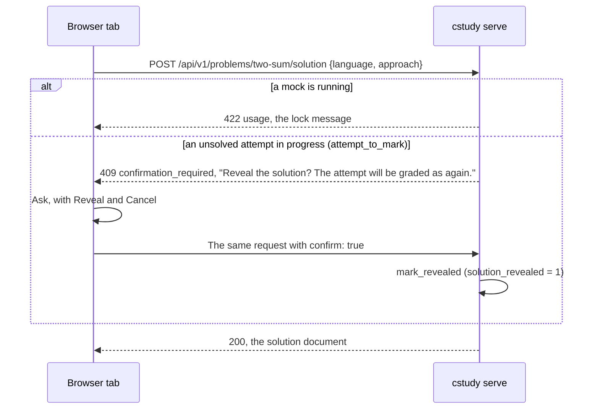

# Spec: Local web UI (`cstudy serve`)

`cstudy serve` serves a page on `127.0.0.1` where the whole practice loop happens in a browser on your own machine: browse and pick problems, start an attempt, read the statement, edit the code, run the tests and submit with results arriving live, take hints, reveal solutions, finish, run mock interviews, and see progress and workspace health. It is a second driving adapter beside the terminal ([ADR 0015](../decisions/0015-local-web-ui.md)): every value it shows and every change it makes goes through the application use case the matching `cstudy` command calls, and every grade still comes from `cstudy`. Code paths are relative to `cli/src/coding_study/`.

## Principles

| Rule | Detail |
|------|--------|
| Parity, never more | The page never gets behaviour the CLI lacks. When the page needs a value no command prints, the CLI gains it first, in the same or an earlier change ([cli](cli.md)). Editing aids belong to the editor, not to practice: [code intelligence](#code-intelligence-sessions), like highlighting, grades nothing, records nothing and writes no file, and terminal users get the same from the language servers their IDE runs on the workspace ([ADR 0018](../decisions/0018-editor-code-intelligence.md)); the CLI's part is installing and checking the servers ([`cstudy doctor`](cli.md#cstudy-doctor)) |
| One judge | Runs are child `cstudy` processes; the page never runs user code itself and never judges an output |
| Same documents | An endpoint that has a matching `--json` document returns it unchanged, so one JSON Schema serves both |
| No state of its own | Files live in the workspace and progress in `progress.db`; the terminal, the IDE and the page always agree. The only page-owned file is the preferences file ([Preferences](#preferences)) |
| Local | The server binds `127.0.0.1` only and makes no network request; the page loads nothing from anywhere but the server |

## Command parity

Each practice command maps to one page area, one endpoint and the use case the command calls. "Child" means the endpoint starts the command as a child process ([Runs](#runs), [Jobs](#jobs)).

| Command | Page | Endpoint | Use case |
|---------|------|----------|----------|
| `cstudy list` | Problems view | `GET /api/v1/problems` | `list_problems`, `list_items` |
| `cstudy next` | Next card | `GET /api/v1/next` | `next_problem` |
| `cstudy show` | Statement pane | `GET /api/v1/problems/{slug}/statement` | `show_statement` |
| `cstudy history` | Problem view, History | `GET /api/v1/problems/{slug}/history` | `problem_history` (new with `cstudy history`) |
| `cstudy start` | Start dialog | `POST /api/v1/attempts` | `start_attempt`, `start_item_attempt` |
| `cstudy start --restore` | File tree, Restore | `POST /api/v1/attempts/{id}/restore` | `restore_project_file` |
| `cstudy status` | Attempt header | `GET /api/v1/attempts/{id}` | `attempt_status` (`project_status` extended to every kind) |
| `cstudy test` | Run tests | `POST /api/v1/runs`, `command: test` | Child `cstudy test --events`: `stream_tests` (task U14) or `stream_project_tests` |
| `cstudy submit` | Submit | `POST /api/v1/runs`, `command: submit` | Child `cstudy submit --events`: `stream_submission` |
| `cstudy hint` | Hint button | `POST /api/v1/attempts/{id}/hints` | `reveal_hint` |
| `cstudy solution` | Solution pane | `POST /api/v1/problems/{slug}/solution` | `show_solution`, `attempt_to_mark`, `mark_revealed`; items `reveal_item_solution` |
| `cstudy done` | Done dialog | `POST /api/v1/attempts/{id}/done` | `complete_attempt` |
| `cstudy mock` | Mock view | `POST /api/v1/mock`, `GET /api/v1/mock` | `start_mock`; the state from `running_mock`, as `require_no_running_mock` reads it |
| `cstudy stats` | Progress view | `GET /api/v1/stats` | `show_stats` |
| `cstudy export` | Progress view, Export | `GET /api/v1/progress/export` | `export_progress` |
| `cstudy import` | Progress view, Import | `POST /api/v1/progress/import` | `import_progress` |
| `cstudy doctor` | Health view | `GET /api/v1/doctor` | Child `cstudy doctor --json`: `run_doctor` |
| `cstudy doctor --fix` | Health view, Fix | `POST /api/v1/jobs`, `command: doctor_fix` | Child `cstudy doctor --fix`: `fix_workspace` |
| `cstudy verify` | Health view, your problems | `POST /api/v1/jobs`, `command: verify` | Child `cstudy verify`: `verify_content` |
| `cstudy bench` | Problem and attempt views, Bench | `POST /api/v1/jobs`, `command: bench` | Child `cstudy bench`: `run_bench` |
| Your editor | Editor tabs, file tree | `/api/v1/attempts/{id}/files…` | `attempt_files` (new): tree, read, save, create, move, delete |

`cstudy init`, `cstudy ide`, `cstudy serve`, `cstudy new`, `cstudy verify` on catalog problems, `cstudy test --debug` and `--watch`, and the path arguments of `export` and `import` stay in the terminal, for the reasons [ADR 0015](../decisions/0015-local-web-ui.md#commands-that-stay-in-the-terminal) gives. The page names the command to run where it meets one, such as `cstudy init` when the server's workspace is gone.

## Server

### Process

| Item | Rule |
|------|------|
| Command | [`cstudy serve [--port N] [--open]`](cli.md#cstudy-serve) |
| Stack | Starlette on uvicorn (without the `standard` extra), in `entrypoints/web/`; `entrypoints/commands/serve.py` imports it inside the command function only. uvicorn starts with `ws="wsproto"` (wsproto 1.3.2), per-message compression off and at most 4 MiB per WebSocket message, for the one WebSocket route ([Code intelligence sessions](#code-intelligence-sessions)); naming the implementation keeps an installed `websockets` package from replacing it |
| In-process calls | Handlers call use cases through one worker thread (an anyio `CapacityLimiter` of 1), each call with a fresh `Environment`, so use cases never run concurrently inside the server |
| Child processes | `sys.executable -m coding_study --workspace <root> [--content <root>] <command> …`, the argument list built by the server with no shell. `--content` is passed when the server was started with it. Each child starts in a session of its own, with standard input from `/dev/null`, the workspace root as its current directory, and `NO_COLOR=1` and `COLUMNS=120` added to the server's environment |
| `python -m coding_study` | `coding_study/__main__.py` calls the console script's `main`, so a child is always the same install as the server |
| Logging | No access log. Standard output holds the startup lines, one line per finished run and job, and the `stop` line ([`cstudy serve`](cli.md#cstudy-serve)); an internal error prints its traceback to standard error. The session token never reaches a log line |

### Modules

| Module | Holds |
|--------|-------|
| `entrypoints/commands/serve.py` | The `cstudy serve` command |
| `entrypoints/web/app.py` | The app factory: routes, middleware, startup and shutdown |
| `entrypoints/web/page.html` | The page template: the server fills in the CSRF token and the CSP nonce of each response (`{{csrf}}`, `{{nonce}}`) |
| `entrypoints/web/security.py` | Token, cookie, Host, Origin and CSRF checks, the CSP nonce, response headers |
| `entrypoints/web/runs.py` | The registry of runs and jobs: child processes, buffered lines, slots, cancel |
| `entrypoints/web/run_options.py` | The [run options](#run-options) and [job options](#jobs), checked by name and type, and the child's argument list they become |
| `entrypoints/web/notifications.py` | The [notification](#notifications) streams, the run and job notices, and the watch of the workspace that feeds them |
| `entrypoints/web/api_*.py` | Route handlers, one module per group of the [endpoint tables](#endpoints) |
| `entrypoints/web/documents.py` | Builders of the documents no command prints; the others come from the command modules' builders, such as `status_document` |
| `entrypoints/web/solution_document.py` | The [solution document](#solutions): what `cstudy solution` pages, as Markdown |
| `entrypoints/web/bodies.py` | The JSON bodies of writes, read by field name and type ([API conventions](#api-conventions)) |
| `entrypoints/web/static/` | The vendored front end, `manifest.json` and `THIRD_PARTY_LICENSES.txt` ([Front-end assets](#front-end-assets)) |
| `application/attempt_files.py` | Tree, read, save, create, move and delete within an attempt's [file scope](#file-scope) |
| `application/problem_history.py` | The history of one problem, shared with `cstudy history` |
| `application/past_attempt_files.py` | The [files of an attempt that is over](#past-attempt-files): where they come from, and one of them |
| `application/attempt_changes.py` | Snapshots of what the [notifications](#notifications) watch, and the changes between two |
| `adapters/watchfiles_watcher.py` | `folder_changes`, beside the watch of `cstudy test --watch`: one burst signal over several folders, some with their subfolders and some without |
| `application/run_checks.py` | The [pre-checks](#lifecycle) of a run, and the scope check of `verify` jobs |
| `entrypoints/web/code_intelligence.py` | The [sessions](#sessions): a socket and its server relayed to each other, the limit of four servers, and the stop of a server whenever its session ends. The handshake checks and the CSRF message are the route's, in `api_code_intelligence.py` |
| `entrypoints/web/language_server.py` | A server as a [child process](#lifecycle-and-limits): `Content-Length` framing, the last lines of its standard error, its exit code and the stop sequence |
| `entrypoints/web/language_broker.py` | The [broker](#the-broker) between a session's socket and its server's standard streams: what each message becomes, given a message and answering with the messages to send where; it holds no socket and no process |
| `entrypoints/web/documentation.py` | A server's [documentation](#documentation) rendered to the HTML the page may insert (`hover_html`, `documentation_html`), on the renderer of `markdown.py` |
| `entrypoints/web/library_files.py` | The files a definition names, read for `cstudy/libraryFile` ([Definitions and library files](#definitions-and-library-files)): links followed, the build area and the content root refused by path and by identity |
| `domain/code_intelligence.py` | The [catalog of servers](#language-servers): per language the command, version command, root rule, initialization options, client capabilities, settings and idle time |
| `application/code_intelligence.py` | `language_server_states` (the doctor rows and `GET /api/v1/code-intelligence/languages`) and `install_language_servers` (`cstudy doctor --fix`) |
| `adapters/language_servers/` | The shipped `.cs/lsp/` manifest (`package.json`, `pnpm-lock.yaml`, package data) and `LspDirectory`, which locates the installed servers and installs them ([layout](installation-and-workspaces.md#layout)) |
| `adapters/workspace_fs.py` | New `Workspace` methods `read_within`, `delete_within` and `move_within` beside `write_within`, none following a link, and `locked_with_deadline`, the project lock that gives up after a deadline ([Lock](#file-scope)) |

### Shutdown

Ctrl-C (SIGINT) or SIGTERM stops the server: it sends SIGINT to every run and job in progress, ends every [code intelligence session](#lifecycle-and-limits) (its socket closes with 1001 and its server stops as when a socket closes), closes every stream (each tab's notification stream ends at once, the watch of the workspace stops, and each run's stream ends once its child exits), waits for the children as [Cancel](#cancel) does, deletes its `--open` redirect file, and exits 130 (143 after SIGTERM). The children are stopped first, before the server waits for its open responses, since a run's stream stays open until its child exits; from then on a new run or job gets 409 `conflict` (`cstudy serve is stopping`).

## Security

The file API and the run API together execute code: whoever can save a file and start a run runs that code as you. Every control below keeps other web pages and other programs on the machine away from them.

| Threat | Control |
|--------|---------|
| Another machine on the network | The server binds `127.0.0.1` only; no option binds another address |
| Another program on this machine | A 256-bit session token, new on every start, required before anything but the login page is served |
| A web page in your browser sending requests | The session cookie is `SameSite=Strict`; every `POST`, `PUT` and `DELETE` also needs the CSRF token in an `X-Cstudy-CSRF` header and an `Origin` equal to `http://127.0.0.1:<port>` or `http://localhost:<port>`. No response carries CORS headers, so a cross-origin request with that header fails its preflight |
| DNS rebinding | A request whose `Host` is not `127.0.0.1:<port>` or `localhost:<port>` gets 403 `forbidden` |
| Reading responses, framing the page | No CORS headers; `Cross-Origin-Resource-Policy: same-origin`; `frame-ancestors 'none'` |
| Script injection | `Content-Security-Policy: default-src 'self'; script-src 'self'; style-src 'self' 'nonce-<per page>'; img-src 'self' data:; connect-src 'self'; object-src 'none'; base-uri 'none'; frame-ancestors 'none'; form-action 'self'` on the page; `X-Content-Type-Options: nosniff` and `Referrer-Policy: no-referrer` on every response; `Cache-Control: no-store` on the API. File content is shown only in the editor, never as HTML. Markdown is rendered on the server with raw HTML disabled and no `style` attribute: code blocks carry Pygments classes (`tok-k`) and aligned table cells a class (`align-right`). Language-server documentation follows the same rule, and the page inserts no other server text as HTML ([Documentation](#documentation)). `connect-src 'self'` also covers the code-intelligence session's `ws:` URL, which has the page's host and port |
| Leaving the attempt's files | The [file API rules](#file-api-rules) |
| Running other commands | Runs and jobs take a command from a fixed set and options by name and type; the server builds the child's argument list, with no shell |
| Language-server sessions | The WebSocket handshake needs an allowed `Host` and `Origin` and the cookie, and the session's first message the CSRF token; the broker keeps documents inside the session's root and reads a library file only when the server named it as a definition ([Session security](#session-security)) |

| Session rule | Detail |
|--------------|--------|
| Token | `secrets.token_urlsafe(32)`, printed in the URL `http://127.0.0.1:<port>/?token=<token>`. A request to `/` with the right token gets the cookie and a 200 page, never stored (`Cache-Control: no-store`), that sends the browser on to `/` at once (`<meta http-equiv="refresh" content="0; url=/">`, with a link for a browser that ignores it), which removes the token from the address bar. Not a 303: after a navigation that another site started, such as the `--open` file, browsers withhold a `SameSite=Strict` cookie from the redirect they follow, so the page would answer 401; the page's own navigation to `/` sends it, in every engine the [browser tests](#browser-support) cover. A wrong token gets 401. The URL keeps working until the server stops |
| Cookie | Named `cstudy-<port>` (cookies ignore ports, so two servers keep their own), a second random value of 256 bits, `HttpOnly`, `SameSite=Strict`, `Path=/`, no expiry |
| Without the cookie | `/` answers 401 with a short HTML page saying to open the URL `cstudy serve` printed; the API answers 401 `unauthorized` |
| CSRF token | A third random value, embedded in the page as `<meta name="cstudy-csrf">`, compared in constant time |
| `--open` | Writes `.cs/serve/<port>.html` with mode 0600, a page that redirects to the URL, and opens that file in the default browser, so the token never appears in another process's arguments; the server deletes the file when it stops |
| Body size | At most 2 MiB per request body, 64 MiB for `POST /api/v1/progress/import`; larger gets 413 `too_large` |

## API conventions

| Item | Rule |
|------|------|
| Base | `/api/v1/`. JSON in and out (`application/json; charset=utf-8`), except the export download, file reads with `?raw` and the SSE streams (`text/event-stream`) |
| Version | `api` 1 changes only when a response changes incompatibly: a field removed, renamed or given another type. New endpoints, fields, error codes and SSE message types keep it |
| Schemas | Documents that a command prints are described where the command is ([cli](cli.md)); the others in `schemas/web-api.schema.json`, one definition each under `$defs`: the session, the preferences, the error document, a problem's additions to its list entry, the statement, a hint, Done's values, a solution, the file tree, a file, a past attempt's files and one of them, a save, a restore, a started run or job, a run, a job, the `closed` and `line` events, the mock's state and a started mock, an import's counts, the data of each notification, and the code-intelligence languages. A fast test validates real responses of every definition against it; the tests of each endpoint compare the documents a command also prints with that command's output |
| Attempts | An attempt is addressed by its id. A request on an attempt that is no longer `in_progress`, or that another attempt of the same problem and language replaced, gets 409 `attempt_ended`. The server calls the use case with the attempt's slug and language. The [past-files endpoints](#past-attempt-files) are the exception: they read attempts that are over and refuse the one in progress |
| Refusals | Where the CLI refuses, the API refuses with the CLI's message: a use case's usage error is 422 `usage` with the same text |
| Bodies | A write's body is a JSON object; one that is not, a missing required field (`the request needs slug`), or a value of another type or outside its range (`invalid timer_minutes 0: use an integer from 1 to 600`) gets 422 `usage`. A boolean left out or null is false |
| Confirmations | An action the CLI or [ADR 0015](../decisions/0015-local-web-ui.md) guards with a question takes `"confirm": true`. Without it the server changes nothing and answers 409 `confirmation_required` with the question as `message`; the page asks it and repeats the request with `confirm` |

Errors share one document:

```json
{"error": {"code": "usage", "message": "level 3 is locked; pass level 2 with cstudy submit first", "fix": null}}
```

| Code | Status | When |
|------|--------|------|
| `usage` | 422 | What exits 3 in the terminal: a locked level, an unknown case, a path the rules refuse, a hint or solution during a mock |
| `not_found` | 404 | An unknown problem, attempt, run, job or file, or a path the API does not have |
| `method_not_allowed` | 405 | A method the path does not take, such as `DELETE /api/v1/session`; the `Allow` header names the ones it takes |
| `attempt_ended` | 409 | The attempt is no longer in progress |
| `conflict` | 409 | A run of the attempt is in progress (the document adds `run`, its id), a job is in progress (`job`), a move target exists, `doctor --fix` is running |
| `locked` | 409 | The project's lock stayed busy for 5 s |
| `confirmation_required` | 409 | The action needs `"confirm": true` |
| `precondition_failed` | 412 | A stale `If-Match`, or `If-None-Match: *` on an existing file. The document adds `sha256`, the SHA-256 of the file's content now (null when no file is there), which is also the response's `ETag` |
| `precondition_required` | 428 | A save, move or delete without `If-Match`, or a `PUT` with neither `If-Match` nor `If-None-Match: *` |
| `too_large` | 413 | A body over the limit, or a file over 1 MiB |
| `environment` | 503 | What exits 4: a missing toolchain or library, or a selected JDK outside the problem's range (`start`, `test`, `submit` and `bench` refuse before they build); `fix` holds the CLI's `fix:` hint when it has one |
| `content` | 500 | What exits 5: a problem file that fails its schema |
| `internal` | 500 | What exits 70, or a bug in the server; the message never holds a traceback |
| `unauthorized` | 401 | No session cookie |
| `forbidden` | 403 | A bad Host, Origin or CSRF header |

## Endpoints

### Session and preferences

| Method and path | Request | Response |
|-----------------|---------|----------|
| `GET /` | `?token=` on the first visit | The page, with the CSRF token and a CSP nonce |
| `GET /assets/{file}` | | A file of the vendored bundle, with `Cache-Control: max-age=31536000, immutable` for content-hashed names |
| `GET /api/v1/session` | | `{"api": 1, "cstudy": "0.9.0", "events_version": 1, "workspace": "/home/me/ws", "port": 53817, "default_lang": "python", "languages": [...], "tracks": [...], "kinds": [...], "domains": [...], "job_roles": [...], "scopes": [...], "selected_jdk": {"version": "26.0.1", "feature": 26, "source": "JAVA_HOME", "supported": true}}`. `domains`, `job_roles` and `scopes` are the values of the [labels](content.md#labels), the choices of the filters. `selected_jdk` is the [JDK that `cstudy` selects](cli.md#the-selected-jdk) in the server's environment, or null when none is found: the `selected_jdk` of [`cstudy list --json`](cli.md#cstudy-list). The server's child processes run in the same environment, so they select the same JDK |
| `GET /api/v1/preferences` | | The [preferences](#preferences) |
| `PUT /api/v1/preferences` | The whole preferences document | The stored document; unknown keys get 422 |

### Browsing

| Method and path | Request | Response and use case |
|-----------------|---------|-----------------------|
| `GET /api/v1/problems` | `track`, `kind`, `lang`, `difficulty`, `status`, `pattern`, `content`, `domain`, `role`, `scope`, each optional, with the values of `cstudy list` | [`cstudy list --json`](cli.md#cstudy-list), with each entry's `jdk` and the document's `selected_jdk` |
| `GET /api/v1/problems/{slug}` | | The problem's entry of `cstudy list --json`, with `languages` the languages `cstudy start` accepts instead of the reference languages, plus `approaches` (`id`, `name`, `role`), `broken` (the broken reference ids, or empty), `levels` (`last`, or null), `hints_total`, `bench` (whether `cstudy bench` applies) and `oracle` (whether `--stress N` adds oracle inputs). For an item: `languages`, `approaches` and `broken` empty, `levels` null, `hints_total` 0, `bench` and `oracle` false |
| `GET /api/v1/problems/{slug}/statement` | `level` (optional, as `cstudy show --level`) | `{"markdown": …, "html": …}`: the text `cstudy show` prints, and its HTML; `show_statement` |
| `GET /api/v1/problems/{slug}/history` | | [`cstudy history --json`](cli.md#cstudy-history) |
| `GET /api/v1/next` | `track` (repeatable), `pattern`, `difficulty`, `lang`, `domain`, `role`, `scope`, `new` or `review` (booleans) | [`cstudy next --json`](cli.md#cstudy-next) |

### Attempts

| Method and path | Request | Response and use case |
|-----------------|---------|-----------------------|
| `POST /api/v1/attempts` | `slug`, `language` (null: `default_lang`, or the problem's one language; null for an item), `fresh` (boolean), `timer_minutes` (an integer from 1 to 600, or null) | 201 with the attempt's [`cstudy status --json`](cli.md#cstudy-status) document. As `cstudy start <slug> --no-open [--lang] [--fresh] [--timer <n>m]`: it resumes an attempt in progress, never opens an editor, a review attempt archives as `--fresh` does, and a new Rust project folder joins VS Code's linked projects as it does in the terminal. An item with a `language` gets the CLI's 422 (`url-shortener is not autograded; --lang applies to problems`) |
| `GET /api/v1/attempts/{id}` | | `cstudy status --json` of the attempt |
| `POST /api/v1/attempts/{id}/hints` | | `{"hint": {"number": 1, "total": 2, "markdown": …, "html": …}}`, `{"locked_until_level": 2}` or `{"exhausted": true}`; `reveal_hint`. During a mock: 422 `usage` with the lock message |
| `POST /api/v1/attempts/{id}/done` | `rating` (`easy`, `ok`, `hard`) or `gave_up: true`, and `notes` (optional) | What `cstudy done` prints, as `{"slug", "language", "status", "levels_finished", "solve_s", "rating", "grade", "caps", "hints_used", "next_review": {"due_on", "in_days", "ease"}}`, where `levels_finished` is a project's (else null) and `caps` names, in this order, each cap that held the grade below the rating (`hint`, `time_box`, `suboptimal`, `levels`, `solution`), so it is empty after `gave_up`; `complete_attempt`. The wrong one of `rating` and `gave_up` gets the CLI's 422. The page shows the two lines `cstudy done` prints, built from these values |
| `POST /api/v1/attempts/{id}/restore` | `path` | `{"path", "origin", "level"}`; `restore_project_file`, the use case of `cstudy start --restore`, waiting at most 5 s for the project's lock; projects only, others get 422 with `--restore is for project problems` |
| `GET /api/v1/attempts/{id}/files` | | The [tree](#file-scope): `{"root", "entries"}`, `root` relative to the workspace root |
| `GET /api/v1/attempts/{id}/files/{path}` | `?raw` for the bytes | `{"path", "text", "sha256", "origin", "level", "state", "editable"}`, `ETag` the SHA-256 in quotes, for the JSON and for `?raw` (`application/octet-stream`); a file that is not UTF-8 text or exceeds 1 MiB has `text` null and `editable` false |
| `GET /api/v1/attempts/{id}/past-files` | | `{"source", "root", "entries": [{"path", "size"}]}`: the [files of an attempt that is over](#past-attempt-files), read-only. `source` is `archive`, `current` or `missing` (`root` then null, `entries` empty); `entries` in path order; `past_attempt_files` |
| `GET /api/v1/attempts/{id}/past-files/{path}` | | `{"path", "source", "size", "text"}`, `text` null for a file that is not UTF-8 text or exceeds 1 MiB; `read_past_file`. An attempt in progress gets 422 `usage` (`attempt 12 of two-sum is in progress; open it in the Attempt view`) from both |
| `PUT /api/v1/attempts/{id}/files/{path}` | `{"text": …}`, with `If-Match` (save) or `If-None-Match: *` (create) | 200 (save) or 201 (create) with `{"path", "sha256"}`, `path` without `.` and `..` segments and `ETag` the new SHA-256; `AttemptFileChanges.save` and `create` |
| `POST /api/v1/attempts/{id}/files/{path}/move` | `{"to": …}`, with `If-Match` | `{"path", "sha256"}`, the new path; an existing target gets 409 `conflict`, the same path 422; `AttemptFileChanges.move` |
| `DELETE /api/v1/attempts/{id}/files/{path}` | `If-Match` | 204; a starter or generated file then shows `deleted` and can be restored; `AttemptFileChanges.delete` |
| `POST /api/v1/problems/{slug}/solution` | `language`, `approach`, `all`, `broken` (an id, or `true` for the default), `explanation_only`, `confirm` | The [solution document](#solutions) |

### Runs and jobs

| Method and path | Request | Response |
|-----------------|---------|----------|
| `POST /api/v1/runs` | [Run options](#run-options) | 201 `{"id": "c8a4df906a913818"}` |
| `GET /api/v1/runs?attempt_id=N` | | The attempt's retained runs, newest first, each as below |
| `GET /api/v1/runs/{id}` | | `{"id", "attempt_id", "command", "options", "state", "started_at", "exit_code", "summary"}`: `options` the run options but `attempt_id` and `command`, with `typecheck` as the run applied it; `state` `running` or `ended`, `summary` the `run_end` summary or null |
| `GET /api/v1/runs/{id}/events` | `Last-Event-ID` | The run as [SSE](#server-sent-events) |
| `POST /api/v1/runs/{id}/cancel` | | 202 `{"id"}`; an ended run gets 409 `conflict` |
| `POST /api/v1/jobs` | [Job options](#jobs) | 201 `{"id": …}` |
| `GET /api/v1/jobs/{id}` | | `{"id", "command", "options", "state", "started_at", "exit_code"}` |
| `GET /api/v1/jobs/{id}/events` | `Last-Event-ID` | The job's lines as SSE |
| `POST /api/v1/jobs/{id}/cancel` | | 202 `{"id"}`; an ended job gets 409 `conflict` |

A 409 `conflict` for a taken slot names what holds it inside the error document: `{"error": {"code": "conflict", "message": "a run of this attempt is in progress: test two-sum · python", "fix": null, "run": "c8a4df906a913818"}}`, or `"job": …` for a job.

### Mock, progress and health

| Method and path | Request | Response and use case |
|-----------------|---------|-----------------------|
| `GET /api/v1/mock` | | `{"running": false}`, or `{"running": true, "ends_at", "remaining_s", "attempts": [{"attempt_id", "slug", "title", "difficulty", "kind", "language"}], "locked": ["hint", "solution", "mock"]}`; `current_mock`, from `running_mock` over the attempts in progress. `attempts` are the [mock's attempts](#mock-view): those the lock names |
| `POST /api/v1/mock` | `minutes` (1 to 600, default 45), `count` (1 to 20, default 2), `tracks` (a list, default `next.tracks`), `language` (default `default_lang`) | 201 with the started session: `{"minutes", "count", "language", "ends_at", "problems": [{"slug", "title", "difficulty", "group", "reason", "attempt_id", "kind", "file", "statement"}], "message": null}`, each problem as `cstudy mock` lists it (`reason` as in `cstudy next --json`, `file` the stub, project folder or notes); `start_mock`. Nothing in scope: 200 with `problems` empty, `ends_at` null and `message` `no new medium or hard problems in scope`. A running mock: 422 with the lock message |
| `GET /api/v1/stats` | `by`, `since` | [`cstudy stats --json`](cli.md#cstudy-stats) |
| `GET /api/v1/progress/export` | | The document `cstudy export` writes, as a download (`Content-Disposition: attachment; filename="progress-export.json"`); `export_progress`. Nothing is written in the workspace |
| `POST /api/v1/progress/import` | `{"confirm": true, "export": <the document>}` | `{"imported": {"attempts": 6, …}}`, the rows per table `cstudy import` reports; `import_progress_document`, the part of `import_progress` after reading the file. Every refusal of `cstudy import` is 422 with its message; a body without `export` is 422 `the request needs export`. Without `confirm`: 409 with `Import this file into progress.db? cstudy imports only into a database that holds no progress yet.`, before the document is checked |
| `GET /api/v1/doctor` | | [`cstudy doctor --json`](cli.md#cstudy-doctor), from a child process with a 180 s deadline (503 `environment` past it). Exit 0 and 4 answer the document; a child that prints none gets the error of its exit code with its `error:` line as the message |
| `GET /api/v1/events` | `Last-Event-ID` | [Notifications](#notifications) as SSE |

### Code intelligence

| Method and path | Request | Response and use case |
|-----------------|---------|-----------------------|
| `GET /api/v1/code-intelligence/languages` | | `{"languages": [{"language": "python", "server": "basedpyright", "version": "1.40.2", "state": "installed", "detail": "basedpyright 1.40.2", "idle_s": 60}, …]}`, one entry per language in `cstudy list`'s order; `language_server_states`, the use case of the `code intelligence` rows of [`cstudy doctor`](cli.md#cstudy-doctor), whatever the preference says. `state` is `installed`, `not_installed` (`detail` `not installed: run cstudy doctor --fix`, or the version command's failure) or `not_available` (`detail` `not available yet`; `server` and `version` null). `version` is the pinned version; `idle_s` the catalog's idle time, null without a server |
| `GET /api/v1/code-intelligence?attempt_id=N` | A WebSocket upgrade | A [language-server session](#sessions) for the attempt's root |

## Runs

A run is a child `cstudy test --events` or `cstudy submit --events`, relayed unchanged ([event stream](cli.md#event-stream)).

### Run options

| Field | Type | Becomes | For |
|-------|------|---------|-----|
| `attempt_id` | integer, required | `<slug> --lang <language>` of the attempt (no `--lang` for a project) | every run |
| `command` | `test` or `submit` | the command | `submit` for project problems only |
| `level` | integer or null | `--level=N` | progressive and project problems |
| `cases` | list of strings | `--case=ID` per entry | `test` |
| `typecheck` | boolean or null | `--typecheck` | TypeScript, and left out for any other language; null or absent: the `typecheck` preference |
| `stress` | integer 1 to 100, or null | `--stress=N` | concurrent problems, and function and design problems with `oracle` |
| `seed` | integer or null | `--seed=S` | with `stress` |
| `time_limit` | null (the configuration's), `true`, `false`, or a value such as `"5x"` or `"1500ms"` | nothing, `--time-limit`, `--no-time-limit`, `--time-limit=<value>` | single-file problems but concurrent stress runs |
| `perf` | boolean | `--perf` | function and design problems, without `cases` |

The page offers only the options the attempt's kind accepts. The server checks names, types and ranges and runs the pre-checks below; any other refusal comes from the child as exit 3, reported in `closed`. An unknown field gets 422 `usage`, and so does a `submit` with a `test` option set (`cstudy submit takes no cases`). A value from the request becomes one `--option=value` token, so it never reads as another option: `test two-sum --lang python --events --case=ex1 --stress=30`.

### Lifecycle

| Step | Rule |
|------|------|
| Pre-checks | In-process, before a child starts: the attempt is in progress, its kind accepts the command (`test` on an item, `submit` on another kind: 422 with the CLI's message), and `level` is not locked. Their errors are HTTP errors, not streams |
| Slot | One run per attempt at a time: a second `POST /api/v1/runs` for the attempt gets 409 `conflict` with the active run's id, and the page attaches to it. Runs of different attempts may overlap, as two terminal runs may. While a `doctor_fix` job runs, every run gets 409 |
| Start | 201 as soon as the child is spawned; `run_started` goes to every notification stream |
| Free | The slot frees when the child exits, not at `run_end`, and `closed` is sent at that moment |
| End | One line on the server's standard output, from `run_end`: `run   test two-sum · python · passed · 14/14 · 0.9s` (`interrupted` or `error` alone without a summary); a child that wrote no `run_end` shows its exit code or signal instead (`run   test two-sum · python · exit 3`); `run_ended` on every notification stream |
| Retention | A run's lines stay in memory while it runs and until ten newer runs of the same attempt exist |

### Server-sent events

```text
id: 3
event: case_result
data: {"type": "case_result", "version": 1, "id": "ex1", "visible": true, "generated": false, "status": "pass", "duration_ns": 41000, "level": null}

```

| Rule | Detail |
|------|--------|
| Message | `event` is the line's `type`, `data` the line unchanged, `id` its 0-based index in the run. Ordering is the CLI's ([ordering](cli.md#ordering)). A line that is not a JSON object with a `type` is dropped and reported on the server's standard error |
| `closed` | The server's own last message, after the child exits, without an `id`: `{"exit_code": n, "signal": null, "stderr": [...]}`. `signal` names the signal that ended the child (`SIGKILL`) or is null, and `exit_code` is then 128 + its number, as a shell reports it (137); `stderr` holds the last 20 lines of standard error when no `run_end` came, else is empty. The server then ends the response. The output a child wrote before it exited is relayed first; a process it left behind holding its standard output open delays `closed` by at most 1 s |
| Replay | A request with `Last-Event-ID: n` gets the lines after `n`, then the live ones; an ended run replays and closes at once |
| Opening | Every stream, the notification stream and a run's or a job's, starts with a comment line (`: open`), so Firefox, which fires `open` on an `EventSource` only when the first bytes arrive, reports it at once |
| Keep-alive | A comment line (`: keep-alive`) every 15 s while nothing else is sent |
| Connections | A browser opens at most six HTTP/1.1 connections per host across all tabs. A tab holds one notification stream, plus one run or job stream while one is in progress, and closes both while hidden (Page Visibility API), so two visible tabs hold at most four and hidden ones none. `EventSource` sends `Last-Event-ID` on its own reconnects only, so a tab that comes back opens the run's stream again from its start and redraws the results from the replay, and opens its notification stream from the next notice and reads again what it shows |

### Cancel

`POST /api/v1/runs/{id}/cancel` sends SIGINT to the child, which writes `run_end` with outcome `interrupted`, kills its runner's process group and stores nothing, as Ctrl-C does in the terminal. A child still alive 10 s later gets SIGTERM, which an `--events` run treats as SIGINT ([cli](cli.md#rules)); one still alive 5 s after that gets SIGKILL, with every process still in its process group, and `closed` names the signal. SIGINT and SIGTERM go to the child alone, as its own handlers stop its runner; a second cancel while the first is under way changes nothing.

### Feedback

NFR-11 holds a page run to the terminal's time plus 0.1 s. It is measured as the p50 of 7 warm runs, after one warm-up run each: `cstudy test --events` from its start to its `run_end` line in the terminal, and Run tests from the click to `run_end` reaching the page (an `EventSource` listener), in headless Chromium, with the page at rest for a second before each click, as a person clicks. TypeScript runs in the terminal take `--typecheck`, as the page's runs do by default. Every pre-check loads the problem, so the process keeps each schema's validator: `POST /api/v1/runs` answers in about 16 ms.

Measured 2026-10-31 on an Apple Silicon Mac, load average 4.0 to 5.6 (other work running), the projects at their starter code and two-sum at its reference:

| Problem | Language | Terminal p50 | Page p50 | Page minus terminal |
|---------|----------|-------------:|---------:|--------------------:|
| `bank-project-python` | Python | 0.661 s | 0.698 s | +0.038 s |
| `bank-project-typescript` | TypeScript | 0.983 s | 1.028 s | +0.046 s |
| `bank-project-java` | Java | 1.137 s | 1.211 s | +0.074 s |
| `bank-project-kotlin` | Kotlin | 1.179 s | 1.291 s | +0.112 s (+0.088 s measured again) |
| `bank-project-go` | Go | 1.667 s | 1.726 s | +0.059 s |
| `bank-project-rust` | Rust | 0.958 s | 0.974 s | +0.016 s |
| `two-sum` | Python | 0.618 s | 0.628 s | +0.010 s |
| `two-sum` | TypeScript | 1.048 s | 1.068 s | +0.020 s |
| `two-sum` | Java | 1.212 s | 1.217 s | +0.006 s |
| `two-sum` | Kotlin | 1.280 s | 1.361 s | +0.082 s |
| `two-sum` | Go | 0.777 s | 0.801 s | +0.024 s |
| `two-sum` | Rust | 0.820 s | 0.856 s | +0.036 s |

The Go project's terminal run took 1.67 s at that load, within NFR-1's 2 s for Go projects; every page run is within 0.1 s of its terminal run but the Kotlin project's first measurement, 12 ms over and inside the JVM's run-to-run spread of about 0.15 s.

## Jobs

A job is a child `cstudy` command whose text report is relayed line by line: commands with no event stream, shown as their terminal output.

| `command` | Options | Child |
|-----------|---------|-------|
| `doctor_fix` | `confirm` (required) | `cstudy doctor --fix` |
| `verify` | `slugs` (one or more of your own problems: those whose `source` is `workspace` in `cstudy list --json`), `static`, `oracle`, `ladder` (booleans) | `cstudy verify [--static] [--oracle] [--ladder] -- <slug>...` |
| `bench` | `slug`, `language`, `sizes` (list of positive integers), `reps` (1 to 50), `refs_only`, `no_memory` | `cstudy bench --lang=<language> [--sizes=LIST] [--reps=N] [--refs-only] [--no-memory] -- <slug>` |

| Rule | Detail |
|------|--------|
| Confirmation | `doctor_fix` without `confirm` gets 409 with `Run cstudy doctor --fix? It writes missing workspace files, refreshes the runner runtime, migrates progress.db, and runs uv sync, pnpm install and the Gradle warm-up, which may need the network.` |
| Verify scope | A catalog problem gets 422: `the page verifies your own problems; run cstudy verify in a content checkout for catalog problems`; a slug no problem has gets 404 `not_found` |
| Slot | One job at a time in the server: a second gets 409 `conflict` with the job's id. `doctor_fix` also waits for no run: with a run in progress it gets 409 |
| Messages | `event: line`, `data: {"stream": "stdout" or "stderr", "text": "<line without its newline>"}`, `id` the line's index; then `closed` as for runs |
| Cancel and retention | As for runs; the server keeps the last ten jobs |
| End | `job   doctor --fix · exit 0` (or the signal that ended it, `SIGKILL`) on the server's standard output; `job_ended` on every notification stream |

## Notifications

`GET /api/v1/events` tells every tab what changed, wherever the change came from: the page, the terminal, an editor or another tab.

| Message | Data | When |
|---------|------|------|
| `file_changed` | `attempt_id`, `path` (relative to the attempt's root), `sha256` (null when deleted) | A file in an attempt's [file scope](#file-scope) was written, created or deleted |
| `attempt_changed` | `attempt_id`, `slug` | The attempt's manifest (`.cs/projects/<slug>.json`) or statement (`.statements/<slug>.md`) changed, or the attempt started: a level opened, a restore, a start |
| `progress_changed` | `{}` | `progress.db` or its `-wal` file changed: an attempt started, ended or recorded a run, a hint or a reveal, from the page or the terminal. A mock is nothing but its attempts, so this is also when the [mock's state](#mock-view) may have changed |
| `run_started`, `run_ended` | `run_id`, `attempt_id`, `command`, and `exit_code` when ended | A run of any tab started or ended |
| `job_started`, `job_ended` | `job_id`, `command`, and `exit_code` when ended | A job started or ended |

| Rule | Detail |
|------|--------|
| Watched set | The folder of every attempt in progress with its subfolders for a project, and without for the others (a package directory, the directory of a single file, a track's notes), `.cs/projects/` and `.statements/` without subfolders, and the progress database and its `-wal` file by name, each only when it exists. `WatchfilesWatcher.folder_changes` watches them in two threads, one per kind of folder, through `watchfiles.watch`, and drops untracked entries (`is_untracked`) and directories |
| By content | Each burst of events ends in a snapshot on the worker: the SHA-256 of every file in each attempt's scope, of each attempt's manifest and statement, and of the progress database and its `-wal` file. A notice goes out only for what differs from the previous snapshot, so a burst that changes nothing sends nothing. The snapshot reads the attempts in progress only when the database's files changed, so the server's own reads, which touch them, never count. When the attempts' folders change, as after a start, the watch starts again over the new set |
| Debounce | 150 ms, as `cstudy test --watch`; one `progress_changed` per 250 ms at most, a change within the interval sent at its end |
| Own saves | A page save comes back as `file_changed` with the SHA-256 the tab already holds, and the tab ignores it |
| Replay | `id` counts the server's notifications from 0; the last 100 are kept for `Last-Event-ID`. A new stream starts with the next notice |
| Failures | A snapshot or a watch that fails, as on a database another command holds locked, prints a line on the server's standard error, and the watch goes on with the next burst |
| Shutdown | Every notification stream ends when the server stops, before it waits for its open responses |

## File API rules

### File scope

The page edits only the files of attempts in progress. Each attempt has a root and a scope; paths in the file API are relative to the root, `/`-separated.

| Attempt | Root | Scope | Create, move, delete |
|---------|------|-------|----------------------|
| Project problem | `projects/<slug>/` | Every file under the root but the untracked ones | Yes |
| Java, Kotlin or Go single-file problem | The problem's package directory (`jvm/<java\|kotlin>/src/main/<java\|kotlin>/practice/<snake_slug>/`, `go/practice/<snake_slug>/`) | Every file directly in it with the language's extension, as [solution file targets](cli.md#solution-file-targets) count them, and the file `cstudy start` wrote | Files directly in the directory with the language's extension (`.java`, `.kt`, `.go`) |
| Python, TypeScript or Rust single-file problem | The directory of the user file | The user file only | No: 422 `cannot create helper.py: the attempt has one file, two_sum.py` |
| Non-autograded item | `notes/<track>/` | The notes file only | No |

A move checks both paths against the column above: the file must be one the kind may move, and the target one it may create.

The tree (`GET …/files`) lists the scope in path order. For a project it is `files.entries` of `cstudy status --json` plus `size` and `editable`; for another attempt each entry has `path`, `origin` (`stub` for the file `cstudy start` wrote, `notes` for an item's notes, `yours` for any other), `level` null, `state` null, `size` and `editable`. A file the scope names that is missing on disk, such as a `deleted` starter file, has `size` null and `editable` false.

| Rule | Detail |
|------|--------|
| Paths | `folder_path` resolves `.` and `..` and refuses a path that leaves the root, an absolute path or a `\` (`domain/project_manifest.py`); the result must pass `relative_path_issue` (`domain/project.py`) and lie in the scope; otherwise 422 `usage` with the reason `cstudy start --restore` gives for the same path (`cannot read bank/../../x.py: leaves the folder`). A path in the scope with no file gets 404 `not_found` (`no file bank/ledger.py in projects/bank-project-python`) |
| Untracked | A path `is_untracked` names (`.venv`, `node_modules`, caches, build output) is refused and never listed |
| Links | No segment may be a symbolic link. The new `Workspace` methods walk the path with `os.open(…, O_DIRECTORY \| O_NOFOLLOW, dir_fd=…)` per segment and open the file with `O_NOFOLLOW`, so nothing can swap a link in between the check and the write. A named pipe or any other file that is not a regular file is refused |
| Content | UTF-8 text up to 1 MiB is editable; any other file appears in the tree and opens read-only with a note. A save over such a file gets 422 `usage`, and text over 1 MiB gets 413 `too_large` |
| Writes | Atomic: a temporary file in the same directory, then `os.replace`, keeping the file's mode; a new file gets mode 0644, and missing directories on the way are made |
| Conflicts | Reads return the SHA-256 of the content as the `ETag`. Saving, moving or deleting an existing file needs `If-Match` (428 without, 412 when stale or when the file is gone); creating needs `If-None-Match: *` (412 when the file exists). A 412 names the SHA-256 of the file now, so the page can show both versions and overwrite on purpose with that `ETag` |
| Ended attempts | A change checks, once it holds the lock, that the attempt is still in progress (409 `attempt_ended`), so a change that waited for a `cstudy start --fresh` never writes into the folder of the attempt that replaced it |
| Lock | Writes in a project folder take `.cs/projects/<slug>.lock` for the write itself, so they never interleave with a restore, an unlock or a start. The web adapter waits at most 5 s for it and then answers 409 `locked`; the CLI's own commands keep waiting without a deadline |
| Generated test files | Editable, as in the terminal; the page notes that editing one never changes a grade ([ADR 0014](../decisions/0014-project-problems.md)) |
| Diagnostics | A [diagnostic](cli.md#diagnostics)'s `file` is relative to the project folder for a project and to the workspace root otherwise; the page strips the attempt's root from the latter to find the tab |

### Past attempt files

History shows the code of an attempt that is over, read-only ([Problem view](#problem-view)). The endpoints are `GET …/past-files` and `GET …/past-files/{path}`, beside the file API and not in it: `GET …/files` answers 409 `attempt_ended` for an attempt that is no longer in progress, which the Attempt view relies on, and its documents describe files a tab edits.

| Source | When | Root |
|--------|------|------|
| `archive` | The attempt's archive folder, `.archive/<slug>/<attempt_id>-<lang>/` (`-notes` for an item), exists and holds a file: the next start of the problem moved the attempt's files there, as `--fresh` and every review attempt do ([`cstudy start`](cli.md#cstudy-start)) | That folder; a project's holds its tracked files, a single-file problem's the file `cstudy start` moved |
| `current` | No archive, and the attempt is the latest of its slug and language (`latest_attempt`), in any status but in progress: its files are where it left them, so they may have been edited since it ended. They are its [file scope](#file-scope) less the files that are missing: the practice file, a JVM or Go problem's source files, a project's tracked files (what `code_hash` sees) or an item's notes | The scope's root (`python/practice`, `projects/<slug>`, `notes/<track>`) |
| `missing` | Otherwise: an older attempt whose files were never archived (a start that archives nothing reuses the file of the attempt before it), or files that were deleted | null |

| Rule | Detail |
|------|--------|
| Attempts | Any attempt that is not in progress, whatever its mode or status. A mock attempt is an ordinary one here: the mock's lock names `hint`, `solution` and `mock`, and the files are the user's own. An unknown id gets 404 `not_found`, an attempt in progress 422 `usage`: the Attempt view shows it |
| A start before any attempt | A start that archives a file no attempt wrote, such as a practice file made by hand, puts it under the id of the attempt it starts (`attempts.archive_path` says so). That folder is not that attempt's work, so the attempt's files are its current ones |
| Paths | As the [file API](#file-api-rules): `folder_path` resolves `.` and `..` and refuses a path that leaves the folder, an absolute path or a `\`; the archive refuses what tools write (`.venv`, `node_modules`, caches) and the current files refuse a path outside the attempt's scope; both 422 `usage` with the file API's reasons. A file that is not there gets 404 `not_found` |
| Links | No segment may be a symbolic link and the file must be a regular file, read with the `Workspace` methods the file API uses, so nothing leads out of the folder. A link in an archive is not listed |
| Content | As the file API's reads: text up to 1 MiB, else `text` null with the `size`, which the page shows as a note |
| Read-only | Only `GET` is routed; a write gets 405. The page shows the files in a read-only editor with no save and no run |
| Responses | `Cache-Control: no-store`, a session cookie and a loopback `Host`, as every API response |

The terminal has no command that lists these files, and the page adds no value it lacks: they are workspace files, which any editor or `cat` reads. A follow-up could add `cstudy history <slug> --files`, which names each attempt's source and root, or `cstudy show <slug> --attempt N`; neither is built.

## Code intelligence sessions

With the `code_intelligence` [preference](#preferences) on, the editor gets live diagnostics, hover documentation and go to definition from a language server on this machine, and with `autocomplete` also on, completion and signature help ([ADR 0018](../decisions/0018-editor-code-intelligence.md)). Each server is a child of `cstudy serve`, one per session, and talks to one tab over one WebSocket through a broker in the web adapter. Phase 1 covers Python and TypeScript; Java and Kotlin come in phase 2 (Kotlin after a spike of its server; if the spike fails, Java ships alone), then Go and Rust in phase 3. What the page draws is in [Code intelligence in the editor](#code-intelligence-in-the-editor).

### Sessions

| Rule | Detail |
|------|--------|
| Route | `GET /api/v1/code-intelligence?attempt_id=N`, upgraded to a WebSocket on the page's own host and port (`ws://127.0.0.1:<port>/api/v1/code-intelligence?attempt_id=N`). The server derives the language and the root from the attempt ([Language servers](#language-servers)). The page opens one session per root it shows files of; a later attempt in the same root reuses it |
| Before the upgrade | Checked in this order; each refusal is an HTTP response with the [error document](#api-conventions) instead of the upgrade: a `Host` not allowed, 403 `forbidden`; no session cookie, 401 `unauthorized`; an `Origin` missing or other than `http://127.0.0.1:<port>` or `http://localhost:<port>`, 403 `forbidden`; `attempt_id` missing or not an integer, 422 `usage`; no such attempt, 404 `not_found`; an attempt no longer in progress, 409 `attempt_ended`; `code_intelligence` off, 422 `usage` (`code intelligence is off: turn it on in Settings`); a language without a server in this phase, 422 `usage` (`no code intelligence for go yet`), and an item, which has no language, 422 `usage` (`<slug> has no code`); a server not installed, 503 `environment` with `fix` `cstudy doctor --fix`. A browser reports any refusal as a close with code 1006 and no status, so the page reads [the languages](#code-intelligence) before it connects and connects only for an installed server |
| First message | `{"csrf": "<the page's CSRF token>"}`, compared in constant time. A wrong token, any other first message (a binary one included, and a JSON-RPC message sent first), or none within 10 s of the upgrade closes the socket with 1008 `bad CSRF token`. The server starts only after this message |
| Messages | Each text message carries one JSON-RPC 2.0 message, without the `Content-Length` header that standard streams use. A binary message closes the socket with 1003; a message over 4 MiB (UTF-8 bytes) closes it with 1009, which uvicorn enforces on the wire and the session checks again. A text message that is not one JSON object gets JSON-RPC's parse error (`-32700`, `id` null) and the session goes on. The server's messages have the same limit, by their `Content-Length`: a longer one ends the session with 4002 before any of it is read |
| Ids | The page numbers its own requests: an integer, or a string that does not start with `cstudy-`. Any other id, a boolean, null, a number with a fraction, a list, an object or a string with that prefix, gets `-32600` with a null `id`. So does a request whose id is still pending, one the server has not answered (`the id 7 is still pending`), whatever its method: the pending request keeps its answer, and the broker's record of what each pending request is, not the page's wording, decides what its answer is. The broker's own requests to the server use string ids that start with `cstudy-`, and the broker answers every request the server sends, so no request crosses from the server to the page |
| Positions | UTF-16 offsets, LSP's default and CodeMirror's own |

| Close code | When | The page's status bar |
|------------|------|-----------------------|
| 1000 | The page closed the session | Nothing; the session is gone |
| 1001 | `cstudy serve` is stopping | `stopped · Restart` |
| 1003, 1008, 1009 | A binary message, a bad CSRF message, a message over 4 MiB; and, with the reason `the page does not read the server's messages` (1008), more than 32 MiB of the server's messages waiting unread | `stopped · Restart` |
| 4002 | The server exited on its own, wrote output that is not LSP, could not start, or stopped reading its input. The reason is `exit <code>: <last line of its standard error>` (`exit 1: Error: Cannot find module …`; a signal counts as 128 plus its number, as for runs) `bad output: <what is wrong>` (`bad output: a message without Content-Length`, `bad output: a message over 4 MiB`; the server is stopped as for any end), `stuck: the server does not read its input` (more than 32 MiB of messages for it waiting), or `cannot start: <why>` (`cannot start: node not found`, `cannot start: no such directory: <root>`), cut at a character boundary to WebSocket's 123 bytes | `stopped: exit 1 · Restart`, or `stopped: cannot start · Restart` |
| 4003 | A fifth server would start: `at most 4 code intelligence sessions run at once; close one in another tab` | `stopped: 4 sessions running · Restart` |
| Any other, such as 1006 after a dropped connection or a refused handshake | | Tries again after 1, 2 and 5 s, showing `reconnecting…`, then `stopped · Restart` |

Restart opens the session again, as a reconnect does: the page initializes again and opens its files again, so nothing is replayed.

### Session security

The session lets the page open documents, ask the server about them and read the files it names. Each control keeps other pages and programs out:

| Threat | Control |
|--------|---------|
| Another web page, including one on another `127.0.0.1` port | The handshake needs a `Host` and an `Origin` from the allow-lists, refused with 403 before the upgrade. The cookie alone does not keep out a page on another port, since cookies ignore ports, and browsers send it |
| A request forged from a page | The CSRF token in the session's first message, compared in constant time. A WebSocket cannot carry the `X-Cstudy-CSRF` header, and the session reads files and starts processes, as unsafe requests do |
| Another program on this machine | The session cookie, refused with 401 before the upgrade, as on every route |
| Files outside the attempt | Text documents only inside the session's root ([The broker](#the-broker)); a library file only when the server named it as a definition in this session, only as a regular UTF-8 file up to 4 MiB, never under `.cs/build/`, `.cs/cases/`, `.cs/runs/` or the content root ([Definitions and library files](#definitions-and-library-files)) |
| A document that imports a reference solution | `import … from "../../.cs/build/…"`, `/// <reference path="…" />` and the like name a file the server would resolve like any other: the server cannot open `.cs/build/`, `.cs/cases/`, `.cs/runs/` or the content root, so the import fails as a file that is not there does, and no answer shows a reference's types or documentation ([Hidden directories](#hidden-directories)) |
| A request made to look like another | A request cannot reuse the id of a pending one ([Sessions](#sessions)), so the answer to one request is never filed as the answer to another; and a completion item is resolved only if the server wrote it, from the server's own copy, since a server trusts the file and module an item's `data` names ([Completion items](#completion-items)) |
| Script injection through documentation | Documentation is rendered on the server with raw HTML disabled and no `style` attribute; the page inserts no other server text as HTML ([Documentation](#documentation)) |
| Edits from the server | `workspace/applyEdit` is refused; the page sends no method beyond the list the broker forwards |
| Large or many messages | 4 MiB per message, in both directions and checked before a server's message is read; document text up to 1 MiB, no compression, at most four servers; at most 32 MiB of messages waiting for a server that reads nothing or unread by a page that reads nothing, each of which ends the session ([Lifecycle and limits](#lifecycle-and-limits)) |
| Code the servers run | They run as you, on your code. basedpyright and typescript-language-server run no workspace code; from phase 2, JDT LS runs Gradle scripts, as `cstudy test` builds do, and from phase 3 rust-analyzer runs build scripts and procedural macros |

Accepted as they are, since each needs write access to the workspace, which the user already has: a hard link to a single reference file, and the race between the check of a library file and its read.

The Content Security Policy is unchanged: `connect-src 'self'` covers the session's `ws:` URL in every engine of [Browser support](#browser-support).

### The broker

`entrypoints/web/language_broker.py` sits between the socket and the server's standard streams.

| Message | What the broker does |
|---------|----------------------|
| `initialize` from the page | Sends it to the server with its parameters rebuilt: `processId` the PID of `cstudy serve`; `rootUri` the root, and `workspaceFolders` one folder, the root, named after its directory; `clientInfo` `{"name": "cstudy", "version": "<cstudy's version>"}`; `initializationOptions` and `capabilities` from the [catalog](#language-servers). Nothing else of the page's parameters reaches the server. The answer goes back unchanged. A second `initialize` in the session gets `-32600` |
| Other page messages | Only these reach the server: `initialized`, `textDocument/didOpen`, `textDocument/didChange`, `textDocument/didClose`, `textDocument/didSave`, `textDocument/hover`, `textDocument/definition`, `textDocument/completion`, `completionItem/resolve`, `textDocument/signatureHelp` and `$/cancelRequest`, a `completionItem/resolve` only for an item the server wrote ([Completion items](#completion-items)). The broker answers `cstudy/libraryFile` itself ([Definitions and library files](#definitions-and-library-files)). The requests are `textDocument/hover`, `textDocument/definition`, `textDocument/completion`, `completionItem/resolve` and `textDocument/signatureHelp`; the others are notifications. Any other request, and a request for a method of the notifications, gets `-32601` (method not found); any other notification, a notification for a method of the requests, and any response, is dropped. A message whose `method` is not a string gets `-32600` when it has an `id`, else it is dropped. The page never sends `shutdown` or `exit`: it closes the socket |
| Documents | Every text document a page message names (`textDocument.uri`) must be a `file:` URI whose path, percent-decoded, is absolute, has no `.` or `..` segment, lies inside the root and has no segment that `is_untracked` names (`node_modules`, `.venv`, caches, build output). A request that names another, or none, gets `-32602` (`file:///…/x.py is outside the session's root`, `textDocument.uri is missing`); a notification is dropped. A URI with a query or a fragment, or with a host other than `localhost`, is not a `file:` URI of this machine. A `didOpen` or `didChange` that carries more than 1 MiB of text in UTF-8 bytes, the file API's limit, summed over a `didChange`'s content changes, is dropped |
| Requests from the server | Answered by the broker and never forwarded: `workspace/configuration` with, for each item, the catalog's settings under its `section`, or null when the catalog has none; `workspace/workspaceFolders` with the root; `client/registerCapability` and `client/unregisterCapability` with null, keeping whether a `workspace/didChangeWatchedFiles` registration is active; `window/workDoneProgress/create` with null; `window/showMessageRequest` with null; each `workspace/…/refresh` with null; `workspace/applyEdit` with `{"applied": false, "failureReason": "cstudy applies no edits from a language server"}`; any other with `-32601` |
| Notifications from the server | `textDocument/publishDiagnostics` is forwarded when its URI is a file inside the root, with no `.` or `..` segment in its path, and without the `relatedInformation` of its diagnostics (the client declares none, and its locations could name any file). Every other (`window/logMessage`, `window/showMessage`, `$/progress`, `$/logTrace`, `telemetry/event`) is dropped |
| Answers from the server | Forwarded to the page when it answers a request the page sent, once; an answer to nothing the page asked, or to a request of the broker's own, is dropped. Documentation is rendered ([Documentation](#documentation)), completion items are given tokens ([Completion items](#completion-items)) and the targets of the answers to `textDocument/definition` requests are recorded, and of no other answer. An error answer goes back unchanged |
| Watched files | While a `workspace/didChangeWatchedFiles` registration is active, each [`file_changed`](#notifications) inside the root goes to the server as `workspace/didChangeWatchedFiles`: type 3 (deleted) when `sha256` is null, 1 (created) when the previous snapshot lacked the file, else 2 (changed). The hub tells a session of a change with the attempt's root and whether the file is new, which the `file_changed` event leaves out; the session stops hearing it when it ends. The registration's glob patterns are not matched; the server filters |
| Standard error | The last 20 lines are kept for the 4002 reason; nothing is printed |

The client capabilities the catalog declares, the same for both phase 1 servers:

| Capability | Value |
|------------|-------|
| `general.positionEncodings` | `["utf-16"]` |
| `textDocument.synchronization` | `didSave` true, no dynamic registration |
| `textDocument.publishDiagnostics` | `tagSupport.valueSet` `[1, 2]` (Unnecessary, Deprecated), `relatedInformation` false |
| `textDocument.hover` | `contentFormat` `["markdown", "plaintext"]` |
| `textDocument.definition` | `linkSupport` true |
| `textDocument.completion` | `contextSupport` true; `completionItem`: `snippetSupport` false, `documentationFormat` `["markdown", "plaintext"]`, `resolveSupport.properties` `["documentation", "detail"]`, `labelDetailsSupport` true |
| `textDocument.signatureHelp` | `contextSupport` true; `signatureInformation`: `documentationFormat` `["markdown", "plaintext"]`, `parameterInformation.labelOffsetSupport` true, `activeParameterSupport` true |
| `workspace` | `configuration` true, `workspaceFolders` true, `didChangeWatchedFiles.dynamicRegistration` true |
| `window` | `workDoneProgress` false |

Every session declares completion and signature help, whatever `autocomplete` says, and the page asks for them only while autocomplete applies, so turning it on or off never restarts a server.

### Completion items

A server trusts the `data` of an item it is asked to resolve: basedpyright 1.40.2 reads from it the file and the module whose documentation it returns, so an item the page made up would make it document any module it can read, reference solutions included. The page therefore never holds an item's `data`:

| Step | Rule |
|------|------|
| Completion answer | In each item of a `textDocument/completion` answer, a list or the `items` of a list, the broker replaces `data`, with or without one, by a string token of this session (`cstudy-item-<answer>.<position>`) and keeps the item as the server wrote it, with its `data` (basedpyright's `uri` and `moduleUri`, typescript-language-server's `cacheId`). What is not an item passes through. The rest of the item is as [Documentation](#documentation) says |
| Resolve | `completionItem/resolve` reaches the server only when the `data` of the page's item is a token of one of the latest 4 completion answers of the session. The server is sent the item it wrote under that token, as it wrote it, whatever else the page's item says. Any other item gets `-32602` (`completionItem/resolve needs an item that a completion answer of this session carried`), and the server never sees it |
| Resolved item | The answer carries the same token in `data`, so the page can resolve the item again; the server's `data` never reaches the page |

### Documentation

The broker renders every documentation value of these answers and sends it as `{"kind": "cstudy-html", "value": "<html>"}` in place of the server's value:

| Answer | Fields |
|--------|--------|
| `textDocument/hover` | `contents` |
| `completionItem/resolve` | `documentation` |
| `textDocument/completion` | `documentation` of any item that has one (the measured servers send none in lists) |
| `textDocument/signatureHelp` | `documentation` of each signature and of each of its parameters |

| Server value | HTML |
|--------------|------|
| `MarkupContent` of kind `markdown`, or a string `MarkedString` | markdown-it-py with raw HTML disabled and no `style` attribute, code blocks highlighted by Pygments in the fence's language with the `tok-` classes of statements; a fence with no language, or one Pygments does not know, is an escaped code block |
| `MarkupContent` of kind `plaintext`, of any kind but `markdown`, or a string `documentation` | The text escaped, in one `<pre class="doc-plain">`. A `MarkedString` that is a string, in a hover, is markdown; a `documentation` that is a string is plain text, as LSP defines them |
| `MarkedString` `{"language", "value"}` | A code block in that language |
| A list of the above | Each rendered, in order, separated by `<hr>` |
| A link | `http:` and `https:` links stay links, opening in a new tab with `rel="noopener noreferrer"`. In phase 1 every other link, `file:` included, and a link with no scheme, renders as its text alone, whatever its spelling or case (`javascript:`, `data:`, `mailto:`); from phase 3 a `file:` link becomes a button that opens the library tab |
| An image | Its alt text alone, so the page requests nothing |
| Nothing left | A hover whose `contents` render to nothing is answered as null; a `documentation` that renders to nothing is left out of its item, signature or parameter |

The page inserts HTML only from a `cstudy-html` value in those fields. Every other server string is text: completion labels, details and label details, signature labels, diagnostic messages, and any documentation value that is not `cstudy-html`.

### Definitions and library files

The broker records the target of every location in each `textDocument/definition` answer of the session (a `Location`'s `uri`, a `LocationLink`'s `targetUri`), for as long as the session lasts, after it has left out the locations in a [hidden directory](#hidden-directories): the page is told of none of them, and an answer left with none is an empty list (`null` when the answer was one `Location`). The page reads a target that is not a file of the attempt with a request the broker answers itself and never forwards:

```json
{"jsonrpc": "2.0", "id": 7, "method": "cstudy/libraryFile", "params": {"uri": "file:///home/me/ws/.cs/lsp/node_modules/basedpyright/dist/typeshed-fallback/stdlib/builtins.pyi"}}
{"jsonrpc": "2.0", "id": 7, "result": {"uri": "file:///home/me/ws/.cs/lsp/…/builtins.pyi", "path": ".cs/lsp/node_modules/basedpyright/dist/typeshed-fallback/stdlib/builtins.pyi", "text": "…"}}
```

`uri` is the request's; `path` is the URI's path relative to the workspace root when the file is inside it, else absolute with the home directory written `~`; `text` is the file's content. A refusal is JSON-RPC error `-32803` with `message` and `data` `{"reason", "path"}`, where `path` is the path as shown, or the URI itself when it names no file of this machine, checked in this order:

| `reason` | `message` | When |
|----------|-----------|------|
| `not_a_definition` | `not a definition target of this session` | No definition answer of the session named the URI |
| `not_a_file_uri` | `not a file: URI` | Another scheme, such as JDT LS's `jdt://` in phase 2; a host other than `localhost`; a query or a fragment; a path that is not absolute |
| `build_area` | `not shown: cstudy's build area` | The path, or the path with its links resolved, is under the workspace's `.cs/build/`, `.cs/cases/` or `.cs/runs/`, or the content root, so a reference solution shows only through the Solution pane and its question. The definition answers leave such a place out, so this is the check again at the read. A directory is recognised by what it is on the disk (its device and inode) as well as by its name, so another spelling of it on a case-insensitive file system, a `..` in the path or a link does not get past, and a file that is not there under it is refused the same way |
| `missing` | `no such file` | Nothing at the resolved path, or nothing the server may open (a path with a NUL, a permission denied) |
| `not_a_file` | `not a regular file` | A directory, a pipe or another kind of file, after links are resolved |
| `too_large` | `over 4 MiB` | |
| `not_text` | `not UTF-8 text` | |

Links are followed, so a project folder's `.venv` link reaches `python/.venv`; the refusals apply to the resolved path as well as to the named one. The file is opened without following a link, since its path was resolved, and without waiting for a pipe, and what was checked is what is read. It is read once per request and never watched.

### Hidden directories

Four places hold what the page must never see through a language server: the references that `cstudy test` and `cstudy submit` materialize in the workspace's `.cs/build/`, the generated cases with their expected outputs in `.cs/cases/`, the data of the runs in `.cs/runs/`, and the content root, where the reference solutions are. A session's root never holds them, but a page document can name them, with `import … from "../../.cs/build/typescript/ref/<slug>/<approach>.ts"`, `/// <reference path="…" />`, `import("…")` or a `tsconfig.json` `paths` entry, and a server resolves such a path like any other, so its hover, completion, signature help, definitions and diagnostics would show the types and the documentation of a reference. Four controls prevent it; the first does not depend on knowing every way to name a file:

| Control | Rule |
|---------|------|
| The server cannot open them | A Node server, both of phase 1, starts with `NODE_OPTIONS=--require="<…>/entrypoints/web/hide_paths.cjs"` (after any `NODE_OPTIONS` of the user's) and `CSTUDY_HIDDEN_DIRECTORIES`, a JSON array of the four directories; one that holds the session's root or `.cs/lsp/`, such as a content root that holds the workspace, is left out, since the server could not work without it. The script runs in every Node process the server starts, tsserver included. In them, opening, reading, listing, statting and resolving a path in those directories fails with `ENOENT`. The path is judged by where the kernel takes it: it is resolved with `realpath` (a link, `..` after a link, `/proc/self/root`), and each directory from the file up is compared with the hidden ones by name, in Unicode decomposed form and lower case, and by device and inode (case on a case-insensitive file system, `/System/Volumes/Data` on macOS). An import of a reference then fails as an import of a file that is not there does (`Cannot find module …`), which tells the two apart by nothing |
| Definition answers | A location in a hidden directory is left out of a `textDocument/definition` answer, by the test the library read applies (the named path, then the path with its links resolved, by name and by device and inode) |
| Diagnostics | A diagnostic's `relatedInformation` is left out ([The broker](#the-broker)) |
| Library files | Refused with `build_area` ([Definitions and library files](#definitions-and-library-files)) |

A server that is not a Node program, such as JDT LS and the Kotlin LSP in phase 2 and gopls and rust-analyzer in phase 3, does not run the script; each of those phases must keep these directories from its server in its own way, and tests it with a reference in `.cs/build/` before it ships. Until then the other three controls are all there is.

### Lifecycle and limits

| Step | Rule |
|------|------|
| Start | Once the CSRF message arrives, unless four servers already run in this `cstudy serve`: then the socket closes with 4003. The catalog's command runs with no shell, the root as its current directory, in a session of its own so its whole process group can be stopped, its standard input and output as the LSP stream, its standard error kept, in the server's environment plus the variables that [hide the reference directories](#hidden-directories) from a Node server |
| Limit | At most four servers at once across every tab; a server counts until its process has exited |
| End | When the socket closes, for any reason, the session sends `shutdown` (the request `cstudy-shutdown`), then `exit` once `shutdown` is answered or 1 s has passed, then closes standard input. Whatever the server writes meanwhile is read and dropped. 3 s after the socket closed, any process left in the server's process group gets SIGTERM, and 2 s after that SIGKILL, as [Cancel](#cancel) escalates, even when the server reads none of what is written to it: `shutdown`, `exit` and the closing of standard input must be done by then, or are given up; the group is checked and signalled even when the server itself has exited, since it may have left a process behind. The stop runs as a task of its own, so a socket that goes away mid-request never leaves a process behind |
| Server exit | A server that exits while its socket is open closes the socket with 4002; its process group is still stopped as above |
| Queues | Every message for a server waits in the session until the server has taken it, up to 32 MiB; more ends the session with 4002 (`stuck: the server does not read its input`) and stops the server as above. The server's messages wait for the page, up to 32 MiB; beyond that the waiting messages are dropped, the server's output is no longer read, and the session ends with 1008 (`the page does not read the server's messages`). A server that keeps up and a page that reads never come near either limit: the editor's traffic is a few kilobytes a keystroke |
| Orphans | If `cstudy serve` dies, the server sees end of file on its standard input; a server that follows LSP's `processId` rule also exits when that PID is gone |
| Shutdown | Ctrl-C or SIGTERM ends every session (1001) and stops its server as above, together with the runs and jobs, before the server waits for its open responses ([Shutdown](#shutdown)) |
| The attempt | Checked at the upgrade only: a session stays open after its attempt ends, until the page closes it |
| Idle | The page closes (1000) a session whose files have all been closed for the language's `idle_s` (60 s for Python and TypeScript), and every session of a hidden tab after 5 minutes; showing the tab opens them again |
| Connections | A WebSocket takes none of the six HTTP/1.1 connections per host that [the streams](#server-sent-events) count in Chromium and Firefox; a browser test holds two visible tabs, each with its streams and a session, and saves a file from each, in every engine |

### Language servers

`domain/code_intelligence.py` is the catalog. The servers are installed in the workspace's `.cs/lsp/` by `cstudy doctor --fix` while `code_intelligence` is on ([layout](installation-and-workspaces.md#layout), [`cstudy doctor`](cli.md#cstudy-doctor)), and run with the `node` on `PATH`, the Node 24 that TypeScript practice needs. Each command runs the script that the package's `package.json` names as its `bin`, never a `.bin/` shim.

| Language | Server | Root | Command | Settings |
|----------|--------|------|---------|----------|
| Python | basedpyright 1.40.2 | `python/` for a single-file attempt, the project folder for a project | `node <basedpyright-langserver> --stdio` | basedpyright reads `[tool.pyright]` from the root's `pyproject.toml`, so it checks in the workspace's `standard` mode and resolves imports through `python/.venv`. `workspace/configuration` answers the section `basedpyright`, the one the server asks for (it asks `pyright` and `python` too, which get null), with `analysis`: `autoImportCompletions` false and `typeCheckingMode` `standard`, which a `[tool.pyright]` overrides |
| TypeScript | typescript-language-server 6.0.3 | `typescript/` for a single-file attempt, the project folder for a project | `node <typescript-language-server> --stdio` | `initializationOptions`: `tsserver.path` the workspace's `typescript/node_modules/typescript/lib`, the compiler `--typecheck` runs; `disableAutomaticTypingAcquisition` true; `preferences.includeCompletionsForModuleExports` false |
| Go, Rust, Java, Kotlin | None in phase 1 | | | `not available yet` |

| Rule | Detail |
|------|--------|
| Roots | A root is a practice project or a project folder, never the workspace root or `.cs/`, so the materialized references in `.cs/build/` are never indexed, hovered or offered as a definition; a document that imports one finds it missing ([Hidden directories](#hidden-directories)) |
| Installed | The package is in `.cs/lsp/node_modules/` and its version command prints the pinned version: `node <basedpyright> --version`, whose first line is `basedpyright 1.40.2`, and `node <typescript-language-server> --version`, which prints `6.0.3`. TypeScript also needs `typescript/node_modules/typescript/lib/tsserver.js`. Otherwise the language is `not_installed`, with the reason as `detail`: `not installed: run cstudy doctor --fix`, `basedpyright 1.39.0 installed; cstudy needs 1.40.2: run cstudy doctor --fix`, `typescript/node_modules missing: run cstudy doctor --fix`, or the first line the version command printed (`exited with 3` when it printed none, `node not found on PATH` without `node`) |
| Idle time | 60 s for both |
| Offline | No server reaches the network (NFR-6): tsserver's automatic type acquisition is off |
| No imports added | Completions that add an import are off in both servers, since adding an import is a quick fix, which stays out of scope |

## Page

One page, with views addressed by the URL's fragment, so the server serves only `/`. Every view works with the keyboard alone.

| Route | View |
|-------|------|
| `#/` | Problems |
| `#/problems/<slug>` | Problem |
| `#/attempts/<id>` | Attempt |
| `#/mock` | Mock |
| `#/progress` | Progress |
| `#/health` | Health |
| `#/settings` | Settings |

The top bar on every view: the navigation (Problems, Mock, Progress, Health and Settings, which Alt and 1 to 5 also open), a menu of the attempts in progress (from `in_progress` in `cstudy list --json`), the mock banner while a mock runs (`Mock interview · 31:20 left · hints and solutions locked`, linking to the Mock view), and the notification stream's state while it is down (`reconnecting…` while the browser tries again, `disconnected` once the server refused it, as after a restart). The bar stays at the top of the window while the page scrolls, in every view, below the dialogs and menus, and a skip link, an in-page anchor or the focus scrolls an element clear of it (`scroll-padding-top` is twice the bar's height, which leaves room for a stuck table header too). The Attempt view fits the window between the bars, so the page itself does not scroll there. Dialogs (Start, Done, Solution and every confirmation) are modal `<dialog>` elements: the focus stays inside, Escape closes them, and the focus returns to the control that opened them; each names the `cstudy` command it runs. Each view shows a loading state, an empty state and an error state; an `environment` error shows its `fix` hint and a link to the Health view. A view reads what sizes an area before it draws it, so nothing a user may be about to click moves once it shows: a control that moves between a press and its release clicks nothing. The Problems view draws the Next card and the table together, and the Attempt view draws its header with the run controls the attempt's kind has, above the file tree.

### Problems view

| Area | Behaviour |
|------|-----------|
| Next card | The `cstudy next` pick with its reason (`review  merge-intervals  overdue 3d, interval 7d`), filtered by the same track, pattern, difficulty, language, domain, role and scope as the list (a domain, role or scope with no track searches every track, as in `cstudy next`), and never a problem the selected JDK cannot run in the language; Start opens the start dialog for it. With nothing to pick, the CLI's message |
| Filters | Track, kind, language, difficulty, status (`new`, `in_progress`, `attempted`, `passed`, `due`, `mastered`), content status, [domain, role and scope](content.md#labels) and pattern, the values of `cstudy list`, whose flag each filter is named after (`--domain` for Domain); the choices of the labels come from the session. Kept in the route's query (`#/?track=dsa&status=due`, `#/?domain=backend&role=platform&scope=function`), and the command above the view is the `cstudy list` command of the filters |
| Table | A header row that stays in view ([Table headers](#keyboard-and-accessibility)); ID, title, difficulty, pattern or track, kind, scope (a dash for a problem of your own without labels), status (a glyph and the word `cstudy list` writes, `in_progress` while an attempt is open, in any language), due date, languages, and a Resume link per attempt in progress; items follow the problems, as in `cstudy list`. Java and Kotlin are marked where the [selected JDK](cli.md#the-selected-jdk) cannot run them (the entry's `jdk` against `selected_jdk`): the language ends in `!`, as in `cstudy list` (`java!`), with the CLI's reason as the mark's tooltip and text for assistive technology. The reason is the refusal that `cstudy start` gives for that problem and language (`two-sum runs its java version on JDK 21 to 26; JAVA_HOME selects JDK 27, which cstudy does not support yet`); for a JDK above the problem's range the page says `which cstudy does not support yet` when the session's `selected_jdk` has `supported` false, and `which is newer than the problem supports` when it is true, and with no JDK `no JDK was found`. A row opens the Problem view |

### Problem view

Planned: this view, the Problems view and the Start dialog list [what a problem depends on](service-projects.md#what-a-problem-depends-on). See also the [Web UI plan for service projects](service-projects.md#web-ui).

| Area | Behaviour |
|------|-----------|
| Header | Title, id, difficulty, track, pattern, kind, languages |
| Statement | The `cstudy show` text, levels as the attempt in progress has them |
| Actions | Start or Resume; Solution; Bench (when `bench` applies) |
| History | The review line (due date, interval, ease, reps, lapses) and the attempts of `cstudy history`, newest first, each expanding to its test runs, submissions and bench runs and, once it is over, to where its files are and a button that opens them read-only ([past attempt code](#past-attempt-code)); an attempt in progress links to the Attempt view |

Start dialog: the language (the problem's languages, with Java and Kotlin disabled and the CLI's reason shown beside them when the selected JDK is outside the problem's range, and the first language it can run chosen; fixed for a project, whose reason is shown the same way; none for an item), Start disabled while the chosen language is one of those, Start fresh (`--fresh`), and a time box in minutes (empty for none). When the problem has a review schedule, so a start is a review attempt that archives the files of the attempt before it, the dialog says `review attempt: your current files move to .archive/ — nothing is deleted, and History keeps them readable`, and the Practise panel says the same after `a start is a review attempt: `. The terminal reports the same move as an `archived` line, and its `--fresh` flag does it too ([cli](cli.md#cstudy-start)). Start opens the Attempt view.

#### Past attempt code

Opening the History row of an attempt that is over reads [`GET …/past-files`](#past-attempt-files) once, and the row says where its files come from.

| Area | Behaviour |
|------|-----------|
| Row | A mark, in a word and a glyph, then the detail: `archived`, moved to `.archive/two-sum/1-python` when the next attempt started; `current files`, which may have been edited after the attempt ended; `not available`, never archived or deleted. With files, a button: `View two_sum.py` for one, `View code · 3 files` for several. An attempt in progress shows `Open it in the Attempt view` in place of all this, since its files are edited there |
| Dialog | A wide modal dialog titled `code · two-sum · attempt 1 · python`, with the `read-only` mark and the same source line, a picker of the files when there are several (the first opens), and the file in the page's editor, in its language's highlighting: `EditorState.readOnly` with `aria-readonly="true"`, still focusable and selectable. It has no save and no run, and nothing it does writes to the server: the page only reads `past-files`. Theme and Vim follow the preferences, as in every editor |
| Without text | A file that is not UTF-8 text or exceeds 1 MiB shows its name and size in a note in place of the editor, as an editor tab does |
| Closing | Escape, the close button, or leaving the view closes it, and the focus returns to the button that opened it |
| Mock | A mock attempt that is over reads like any other |

### Attempt view

| Area | Content |
|------|---------|
| Header | Problem, language, kind, mode, `level 2 of 4`, the timer, Run tests, Submit (projects), Cancel, Run options, Hint, Solution, Bench, Done |
| Timer | Elapsed of the time box (`12:31 / 25:00`), counted from the attempt's `started_at`; past the box it shows `over by 3:10` and the Done dialog says the grade is capped at `hard`. Without a box, elapsed time only |
| Statement pane | The statement of the unlocked levels, a banner when a level opens (its title, the methods to add, its test file), the hints revealed in this tab, and the hint notice `any hint caps the review grade at ok` |
| File tree | The [scope](#file-scope); for a project each file's state (`modified`, `added`, `deleted`) and origin (starter, level N test, yours), with New file and New folder (a folder comes with its first file, since the tree lists files), Rename or move, Delete (after a confirmation that says whether Restore can bring the file back) and Restore (a modified or deleted starter or test file; a modified one asks first) where the scope allows them. Each file's actions open from its menu button, a right click, Shift-F10 or the context menu key; F2 renames and Delete deletes. A file whose tab has unsaved edits is not renamed until they are saved or dropped. The tree reads its files again after every change, so the states follow |
| Editor tabs | One CodeMirror view per open file, an unsaved marker, diagnostics as underlines, gutter markers and tooltips; with code intelligence on, live diagnostics, hover, go to definition and read-only library tabs ([Code intelligence in the editor](#code-intelligence-in-the-editor)) |
| Results panel | The run as it streams: the header from `run_start` (counts, time limit, timer), the build line, a row per case, test, oracle input or stress result, diagnostics with jump-to-line, the `--perf` verdict, and the summary from `run_end` |

| Kind | What changes |
|------|--------------|
| Function, design, debugging | Case rows: passing hidden cases collapse into a count unless Show all is on, failing ones show input, expected, actual, error and standard output, `TLE` rows show the time, the limit and its basis. Oracle inputs follow, failing ones smallest `n` first, three shown and the rest behind `n more`. A debugging problem's statement says the starting code has a planted bug |
| Progressive | As above, with the level of each case; a run that opens a level shows the banner and refreshes the header, the file tree and the statement; the hints this tab revealed stay |
| Concurrent | Sequential case rows, then one row per stress case and variant, whose run dots fill in as runs end; a failing run shows its seed and reasons and a Rerun action that starts `cases: [id]`, `stress: 1`, `seed: <seed>`. The summary adds `stress runs found no race (not a proof of thread safety)` |
| Project | Test rows by file with origin tags for `test`; level tallies and case rows for `submit` (in a mock, only failing hidden counts); a level unlock adds the new test file to the tree. A deadlock on the [virtual clock](problem-format.md#asynchronous-code-and-the-virtual-clock) is a `STALLED` case row that names the operation and the virtual time. [Stress cases](problem-format.md#stress-cases-in-projects) draw their rows with their run dots inside the level's group of a submission (each level's case rows, then its stress rows, whose facts name the level), as they do for a concurrent problem's test run but without a Rerun action, since a project's stress case runs only in a submission, and the summary of a passing submission adds `stress runs found no race (not a proof of thread safety)`. The statement pane renders an example's harness operations in words (`r1 = receive(5000) starts`, `1000 ms pass`, `r1 returns "a"`, `the clock reads 1000 ms`), and a level section with stress cases shows the stress table that a concurrent problem's `## Concurrency` section has |
| Item | The notes file in the editor and the prompt in the statement pane; no runs; Done takes a rating only; Solution shows the rubric and the reference without asking |

| Change from elsewhere | Page behaviour |
|-----------------------|----------------|
| A file changed on disk, the tab has no unsaved edits | The tab takes the new version silently: only what differs changes, so the cursor, the selection and the scroll stay, and Undo takes the change back; a screen reader hears that it changed. `file_changed` names the file's SHA-256, so the tab's own save, and a change it already holds, change nothing |
| A file changed on disk, the tab has unsaved edits | A banner: Reload theirs, which drops the tab's edits, or Overwrite, which saves over the disk version on purpose (`If-Match` with the SHA-256 the notice or the 412 named). The banner takes no focus; a change that comes while the tab saves waits for the save, which may be its own |
| A file of a tab deleted on disk | The banner of a deleted file, Close the tab or Save mine again, with or without unsaved edits; the tab keeps its text until the user chooses |
| A save with a stale `If-Match` | The same banner; when the file is gone, Close the tab, or Save mine again (`If-None-Match: *`) |
| A save the server refuses otherwise | A banner with the refusal's message; after `attempt_ended` the tab turns read-only |
| Closing a tab, leaving the view or the page with unsaved edits | The page asks first: its own dialog for a tab, the browser's for the view and the page |
| A file added, deleted or changed | The tree refreshes, 100 ms after the last `file_changed` of the attempt, so the states follow |
| `attempt_changed` | The header, statement, tree and status refetch: a level opened elsewhere, such as from `cstudy submit` in the terminal, shows in the statement |
| `progress_changed` | The header, tree and status refetch 100 ms after the last one, the statement too when the level changed. Each refetch draws again only what changed, so the focus and the statement's scroll stay; the results panel, while it shows the run `cstudy test` last recorded, shows the newest, as after a run in the terminal |
| The attempt ended elsewhere | The status answers 409 `attempt_ended`: the view says so, keeps the editors read-only, disables Run tests, Submit, Run options and Bench, and links to the Problem view |
| A run another tab started | `run_started` attaches the results panel to it, and the run controls show it running: Cancel stops it. A run the terminal starts is no server run; the panel shows it once `cstudy test` recorded it |
| The tab hidden, then shown again | It closes its notification stream and a run's stream while hidden ([connections](#server-sent-events)). Shown again, it opens them, then reads the attempt, each open file and the attempt's newest run again, since anything may have changed; it does the same after the browser reconnects its stream |
| A second tab | It works as the first, with streams of its own: a run either tab starts shows in both, a save in one reaches the other as `file_changed`, which reloads its tab or shows the banner, and either can cancel the run. Two visible tabs hold at most four of the browser's six connections per host; a hidden tab holds none |
| The view opens, or the page reloads | The results panel shows the attempt's newest retained run (`GET /api/v1/runs?attempt_id=N`), live while it runs, else its replay; with none, the run `cstudy test` last recorded |
| Run tests or Submit while the attempt's slot is taken | The 409 names the run holding it, and the panel attaches to that run |

A run's diagnostics replace the previous run's markers at the next `run_start` of the same attempt; live diagnostics from a language server are a second source beside them ([Code intelligence in the editor](#code-intelligence-in-the-editor)). Jump-to-line opens the file when it is not open and moves the focus to the editor on purpose; nothing else a run does moves the focus. A diagnostic whose file is not in the attempt's tree is listed in the results without a jump.

**Run on save.** With the `run_on_save` preference on, a save from the page, or a `file_changed` in the attempt's scope, starts a test run with the last run options after a 150 ms debounce, as `cstudy test --watch` re-runs. A change during a run queues one more run, started when the run closes; further changes join that queued run. The page hears its own saves through a `cstudy:file-saved` event on `window` (`detail`: `attemptId`, and the `path` and `sha256` the save answered), which the API client dispatches after every successful `PUT` of an attempt's file, whichever part of the page sent it; the `file_changed` of such a save names the same path and SHA-256 and starts nothing more.

### Mock view

| State | Content |
|-------|---------|
| No mock running | The start form: minutes (45), problem count (2), tracks (default `next.tracks`), language (default `default_lang`), with the rule `new medium and hard problems; hints and solutions lock until the timer ends or every problem is done` |
| Running | The shared countdown from `ends_at`, a card per problem (title, difficulty, kind, attempt status, Open) and the lock. The cards' attempts are ordinary attempts in mode `mock`, practised in the Attempt view |
| Over | When the timer ends or every problem is done, the lock lifts and the view says so; each unfinished attempt stays in progress until Done, and finishing past the box caps its grade at `hard` |

A mock started in the terminal shows the same way, since the state comes from the attempts in progress. Hint and Solution are disabled during a mock with the lock message as their description; the server refuses them anyway.

| Session rule | Detail |
|--------------|--------|
| The mock's attempts | A mock is stored as nothing but its attempts, so the server lists those the lock names: the attempts in progress with mode `mock` whose time box still runs, in the order they started. A problem finished with Done leaves the list, as it leaves the lock message; an attempt left from an earlier mock whose timer ended is in neither |
| Cards | The view keeps a card for every attempt it has shown in this tab. A card whose attempt left the list shows `finished` (its attempt answers 409 `attempt_ended`); the others link to the Attempt view. A reload shows the unfinished problems only |
| Over | When `running` turns false, the view says the lock lifted and keeps its cards; each attempt still in progress stays open until Done |
| Reading | The page reads `GET /api/v1/mock` on load, after each `progress_changed` (a mock is nothing but its attempts, so a mock started or finished in the terminal shows), when its notification stream opens again, when the countdown reaches zero, and after it starts a mock or finishes an attempt; it polls nothing |

### Progress view

| Area | Content |
|------|---------|
| Statistics | `cstudy stats` with its `by` and `since` controls: the group table and the attempts, reviews and bench lines |
| Reviews | Due today and overdue (a `due_on` of today or before, so a review with an attempt in progress stays here, though its status reads `in_progress`), then the next 14 days by `due_on`, each with Start |
| Export | Downloads `progress-export.json` |
| Import | A file picker, then the confirmation, then the counts imported or the CLI's refusal |

### Health view

Planned: the Docker rows and their install message. See [Docker states](service-projects.md#docker-states).

| Area | Content |
|------|---------|
| Checks | The `cstudy doctor` rows: status (text and icon), name, detail and `fix`, with Re-check. While `code_intelligence` is on, they include the `code intelligence python` and `code intelligence typescript` rows, and Fix installs their servers. A long `fix` wraps instead of scrolling the table, and a web link in it is a link, as in an error's hint. A row whose `fix` is exactly `cstudy doctor --fix` shows a Fix button in its place, named for the row (`Fix code intelligence python`), that starts the job the main Fix starts; any other hint stays text, drawn without a chip, so that nothing looks pressable but the buttons |
| Fix | At the top of the view and on each row whose fix it is: runs `doctor_fix` after its confirmation, shows the job's lines live, then re-checks. It repairs what fails or warns: every row that names `cstudy doctor --fix`, which is each of its steps. Every Fix button is disabled while a job runs, since the server runs one job at a time |
| Your problems | The workspace's own problems with a Verify action (`static`, `oracle`, `ladder`), shown as a job |

### Settings view

Planned: an opt-in for AI review with your own key, set here or in `credentials.toml` next to the [configuration file](cli.md#configuration), which the local server process uses and the page never sees again. See [ADR 0021](../decisions/0021-ai-reviewed-problems.md).

The [preferences](#preferences), each applied at once and stored, and the paths of the workspace and the config file for reference.

| Control | Behaviour |
|---------|-----------|
| Code intelligence | A checkbox for `code_intelligence`: `Live diagnostics, hover documentation and go to definition from language servers on this machine`. Under it, one line per language from [`GET /api/v1/code-intelligence/languages`](#code-intelligence), in `cstudy list`'s order, whatever the checkbox says: `Python  basedpyright 1.40.2`, `TypeScript  not installed: run cstudy doctor --fix`, `Go  not available yet`; a language that is not installed links to the Health view, where its row has a Fix button (the link's tooltip says so). The page reads the list when the view opens and after each `job_ended` of a `doctor_fix` job |
| Autocomplete | A checkbox for `autocomplete`, under Code intelligence: `Completion and signature help. Off, the editor offers no completion at all`. While `code_intelligence` is off it is disabled, shows its stored value and has the note `Turn on code intelligence first`, tied to it with `aria-describedby`; turning code intelligence off or on never changes it |

### Editor

| Item | Rule |
|------|------|
| Languages | Python, TypeScript, Java, Kotlin, Go, Rust, JSON, TOML and Markdown highlighting, each loaded the first time a file needs it. Without code intelligence the page relies on the CLI's diagnostics; with it, a language server adds live diagnostics, hover and go to definition ([Code intelligence in the editor](#code-intelligence-in-the-editor)) |
| Setup | `editor.ts` builds its setup from `basicSetup`'s parts, copied into `setup.ts` (the `codemirror` package is not a dependency), so that adding a cursor is Alt-Shift-click (Option-Shift-click) for every user, Alt-drag stays rectangular selection, and Cmd-click and Ctrl-click never add a cursor: they go to the definition while code intelligence applies to the file, and act as a plain click otherwise. Completion sits in a compartment of its own ([Autocomplete](#autocomplete)) |
| Completion | Only while autocomplete applies: `code_intelligence` and `autocomplete` both on. Otherwise the editor offers no completion list at all, neither as you type nor on Ctrl-Space, and no signature help. This changes what every user had before code intelligence: `basicSetup` gave every editor CodeMirror's completion, and with both preferences at their defaults it is gone. Bracket closing, from the same package, is not completion and stays |
| CSP | Every view gets `EditorView.cspNonce` with the page's nonce |
| Indentation | Each language's chunk sets its unit: four spaces in Python, Java, Kotlin and Rust, a tab shown four columns wide in Go, and CodeMirror's two spaces in TypeScript, JavaScript and every other file. Enter puts the cursor where the grammar says, counted in that unit (one more after `def f():` or a `{`, the same after an indented line), and at the previous line's indentation where the grammar has no say, as in TOML and Markdown. Tab indents the line by one unit |
| Selection | `drawSelection` paints the selection behind the text, under each line's own background, so the active line's colour is translucent, chosen to look over the theme's background as the opaque colour did: a selection shows on the line of the cursor, in both themes, focused or not |
| Vim | With the `vim` preference on, `codemirror-vim` loads as a chunk of its own and applies to every editor; `:w` saves |
| Read-only | The [past attempt code](#past-attempt-code) dialog opens the same editor with `readOnly` on, which no preference and no response turns off: its content stays focusable and selectable and says `aria-readonly` to screen readers |
| Save | Explicit only (Cmd or Ctrl-S, anywhere in the Attempt view, for the active tab); no autosave. A tab with unsaved edits shows a dot in place of its close button and says so to screen readers; a generated test file opens with a note that editing it never changes a grade |

### Code intelligence in the editor

Code intelligence applies to a tab while `code_intelligence` is on, the tab shows a file of an attempt, and the file's language has an installed server ([Language servers](#language-servers)); every other tab behaves as it does without it. With `code_intelligence` off, nothing below loads, and the page opens no session.

| Item | Rule |
|------|------|
| Loading | The code-intelligence chunk loads when the preference is on and a file of a language with an installed server opens, after the editor is editable ([Front-end assets](#front-end-assets)). To know whether a server is installed before the chunk exists, the page reads [the languages](#code-intelligence) when the preference is on and a file opens, and again after each `job_ended` of a `doctor_fix` job. A file whose language is not the attempt's (a `.ts` file in a Python project), or that has none (Markdown, TOML), is left as it is |
| Sessions | One per root the tab shows files of ([Sessions](#sessions)), keyed by the tree's `root` (the page does not know the server's own root, which a single-file attempt shares with its language's other files); a later attempt in the same root reuses the session, and a reconnect asks for that attempt. `ready` once `initialize` is answered and `initialized` sent. A request may take 15 s, `initialize` included, since a server starting is slower than the client's own 3 s. Turning the preference off closes every session at once, whatever view is open |
| URIs | `file://` followed by the session's `workspace`, the tree's `root` and the file's path, each segment percent-encoded as `encodeURIComponent` does |
| Open documents | The tabs' files, each with the language id of its extension (`python`; `typescript`, `typescriptreact`, `javascript`, `javascriptreact`): `didOpen` with the tab's text, unsaved edits included; `didChange` 500 ms after the last change and before every request; `didClose` when the tab closes; `didSave` after each save the page makes, from the `cstudy:file-saved` event. The server reads every other file from disk. A connection that closes takes its unsent notifications with it: the next connection opens every file again with its text then, so nothing is replayed |
| Changes on disk | A tab without unsaved edits takes the new version, which reaches the server as a change, like typing; under the conflict banner the server keeps checking what the tab shows. Files no tab shows reach the server through the broker's watched-file events |

#### Live diagnostics

| Item | Rule |
|------|------|
| Two sources | `Editor` holds the last run's diagnostics, cleared at the next `run_start` as before, and the server's, replaced by each `textDocument/publishDiagnostics` for the file. Together they are the file's one lint set; a run diagnostic and a live one on the same line with the same message show once. `@codemirror/lsp-client`'s `serverDiagnostics()` is not used, since it replaces the whole set |
| Severity | An error is underlined in red with a gutter marker, a warning in yellow and information in blue; a hint has no underline and no marker, and shows only in the lint panel, in its tooltip and, for Unnecessary and Deprecated, as the fade or the strike |
| Tags | Unnecessary shows as faded text (`opacity` 0.7, which keeps the text above WCAG AA's 4.5:1 contrast), Deprecated as struck through; the tags are LSP's `DiagnosticTag` 1 and 2. These styles, the yellow and blue underlines and the missing underline of a hint belong to the code-intelligence chunk's stylesheet, so NFR-12's first-editable budget does not carry them: with code intelligence off a run's warning keeps CodeMirror's orange and its information grey |
| Source | Each diagnostic's tooltip names its source: the server's `source` and `code` (`basedpyright reportUndefinedVariable`, `ts 2304`; the `value` of a code that carries a link), or `last run`, followed by the code or source the run gave (`last run · TS2304`) |
| Publications | Each `textDocument/publishDiagnostics` for a file with a tab replaces the server's diagnostics for that file at once. One for a file with no tab, or for a document version the page has since replaced (the server publishes again for the newer one), is ignored. Positions are those of the text last sent, kept inside the document and carried through what was typed since. Diagnostics stay after the session stops, and go when code intelligence turns off |
| Counts | The status bar shows the active file's errors, warnings and information after de-duplication (`2 errors · 1 warning · 1 info`; `infos` for two or more), hints left out, and nothing when there are none. They follow the ready segment (`python · basedpyright · ready · 2 errors`) |
| Keys | F8 and Shift-F8 select the next and previous diagnostic, skipping hints and wrapping around, and open its tooltip; Cmd or Ctrl-Shift-M opens CodeMirror's lint panel, which lists hints too. Under Vim, `]d` and `[d` do the same but only put the cursor at the diagnostic's start, since a selection would turn normal mode into visual mode. The keys' code is fetched at the first press, so a file is editable without it |

#### Hover

| Item | Rule |
|------|------|
| Opening | With the pointer at rest over a symbol (CodeMirror's 300 ms), or at the cursor with Cmd or Ctrl-K, then Cmd or Ctrl-I; `K` under Vim. Escape closes it, as does moving the pointer away from a hover the pointer opened |
| Content | The page's own tooltip, not `@codemirror/lsp-client`'s: the `cstudy-html` of the answer ([Documentation](#documentation)). A diagnostic under the pointer shows in the same tooltip box, above the documentation. In phase 1, `file:` links show as their text |
| Nothing | An answer of null opens no tooltip |
| Screen readers | A hover opened from the keyboard is read out by the polite live region: its first paragraph, as plain text (the first `<p>` of the rendered HTML, else its first code block); when there is nothing to show it says `no documentation here`. A hover opened with the pointer is not read out |
| Box | One tooltip box holds the diagnostic under the pointer (`@codemirror/lint`'s own section) above the documentation (the page's), as CodeMirror hosts every hover tooltip of a position in one box. The documentation is a focusable region named `Documentation`, at most 26 em or half the window high, so the keyboard scrolls what does not fit. A text answer (anything but `cstudy-html`) shows in a `<pre>` as text. A hover opened from the keyboard stays until Escape, an edit or a cursor move |

#### Go to definition

Cmd-click on macOS, Ctrl-click elsewhere (on macOS Ctrl-click opens the context menu), F12, and Vim's `gd` and `Ctrl-]` go to the definition of the symbol at that position. The page's own command asks for `textDocument/definition` and opens the target through the tabs; `@codemirror/lsp-client`'s `jumpToDefinition` and `Workspace.displayFile` are not used, since `jumpToDefinition` reads `uri` and `range` of the first location, which a `LocationLink` (declared in the broker's capabilities) lacks, and it can show neither a library tab nor a refusal. A click moves the cursor to the clicked position first, so Back returns there; with `code_intelligence` off, or in a tab without a session, Cmd-click and Ctrl-click are a plain click. While Cmd or Ctrl is held over the editor, the word under the pointer is underlined and the pointer becomes a hand; nothing is requested until the click. Each jump pushes where it started on a stack of the last 50 origins; Ctrl-Minus goes back to the newest, reopening its file's tab if it was closed and skipping an origin in a library tab that was closed. Under Vim a jump also enters Vim's jump list (`Vim.getVimGlobalState_().jumpList`), so `Ctrl-o` goes back.

| Target | What happens |
|--------|--------------|
| The same file | The cursor moves there, scrolled into view |
| Another file of the attempt (in the attempt's [tree](#file-scope)), such as a project's module or a generated test file | Its tab opens, or comes forward, at the definition |
| Any other URI: a file inside the root that the tree does not list, or outside it (the standard library, typeshed, `node_modules`, `.venv`, the runner's support code, another practice file) | The page asks for it with `cstudy/libraryFile` ([Definitions and library files](#definitions-and-library-files)) and opens a library tab at the definition: read-only, with a `library` badge on the tab and above the code beside the file's `path`, highlighted by its extension, with no session in phases 1 to 3. It cannot be saved and closes like any tab; Ctrl-Minus works in it. A second jump to the same file reads it again and brings its tab forward |
| A refusal for `missing`, `not_a_file`, `too_large`, `not_text` or `not_a_file_uri` | No tab: a note at the click names the file, the line and the reason (`python/.venv/lib/python3.13/site-packages/big.py:120 · over 4 MiB`), and closes on the next key or click |
| A refusal for `build_area` | The same note: `not shown: cstudy's build area`. The broker leaves a location in a [hidden directory](#hidden-directories) out of the answer, so a definition into one is no location (`no definition found`) and the refusal shows only if the page asks for the file itself |
| Several locations, as for an overloaded function | The first |
| No location | Nothing moves; the status bar says `no definition found` |

The position is the location's `range.start`, or a `LocationLink`'s `targetSelectionRange.start` (its `targetRange.start` without one). The library tab's editor is named by the path, and says `aria-readonly` to screen readers; the line above the code says `read-only` too. The note is a status that a screen reader hears. The jump list of Vim holds places of one editor, so only a jump within the file enters it; a jump into another tab is Back's (Ctrl-Minus), which works under Vim too.

#### Autocomplete

Autocomplete applies while `code_intelligence` and `autocomplete` are both on; the preferences document may hold `autocomplete: true` with `code_intelligence: false`, which keeps the stored choice and applies nothing.

| State | Completion | Signature help |
|-------|------------|----------------|
| Autocomplete does not apply (the default) | None: no list as you type or on Ctrl-Space | None |
| Applies, the file's session is ready | The server's, from the page's own completion source | The server's |
| Applies, the session is starting, reconnecting or stopped, the server is not installed, or the language has no server yet | CodeMirror's completion from the language support (Python's builtins and the file's names, TypeScript's snippets and the file's names) | None |

| Item | Rule |
|------|------|
| Triggers | As you type, on a word character or one of the server's trigger characters (`completionProvider.triggerCharacters` of the `initialize` answer; `.` in both servers), after CodeMirror's 100 ms; and on Ctrl-Space at any time (on macOS also Option-` and Option-I) |
| The list | Each item's label and kind icon, filtered and ranked by CodeMirror as you type. The page asks the server again only when the server marked its list incomplete, as basedpyright does, or the typed text leaves the list's range. A newer request cancels an older one with `$/cancelRequest` |
| Info panel | The selected item's `detail` (as text) and documentation (its `cstudy-html`), from `completionItem/resolve`, beside the list; each item is resolved once per list, and goes back to the server exactly as it came, since the broker checks the opaque `data` it added to it. A server that declares no `resolveProvider` is not asked, and the item's own detail and documentation show. A resolve that fails shows no panel |
| Accepting | Enter and Tab each insert the item's `textEdit.newText`, else its `insertText`, else its label, as plain text; an item marked as a snippet inserts its label. With no list open, Tab indents and Enter breaks the line, as ever; in Vim's insert mode the same |
| Signature help | The page's own tooltip, not `@codemirror/lsp-client`'s: it opens when you type one of the server's signature trigger or retrigger characters (`(` and `,` in a call; a bracket typed with its closing bracket counts as the bracket) and on Cmd or Ctrl-Shift-Space (not in Vim's normal mode). While it is open it asks again 80 ms after each change or move of the cursor, so the active parameter, in bold in the signature's label (text, never markup), follows the cursor; it shows the active parameter's documentation and the signature's (`cstudy-html`). It anchors where it opened, and closes when the server finds the cursor outside a call, when the cursor goes back before the anchor, and on Escape. Only the active signature shows |
| Escape | Closes a list that shows, else the signature help, else the hover. Vim takes Escape before any key binding, so the Vim chunk puts a handler for it before Vim's own, which closes whichever is open; the same press then leaves insert mode. A completion that is only pending, with no list on screen, takes Escape from the editor's key bindings, so the signature help closes from a key handler of the DOM that runs before them |
| Vim | Completion and signature help work in insert mode with the same keys; normal mode opens neither. One Escape closes the list or the signature help and leaves insert mode |
| Switching | Turning `autocomplete` or `code_intelligence` on or off takes effect at once in every open editor and never restarts a session. The server's source and signature help are one extension in a slot of the file's code-intelligence extension; the page puts it there while autocomplete applies and the file's session is `ready`, and takes it out when either stops, so the editor's own completion (which stays in its compartment of the editor, and only while autocomplete applies) shows in between |

#### Status bar

The status bar shows the active file's code intelligence while `code_intelligence` is on:

| State | Segment |
|-------|---------|
| Starting | `python · basedpyright · starting` |
| Ready | `python · basedpyright · ready`, then the counts (`2 errors · 1 warning`) |
| Reconnecting | `python · basedpyright · reconnecting…` |
| Stopped | `python · basedpyright · stopped: exit 1 · Restart`, or another reason from the close codes of [Sessions](#sessions) |
| Not installed | `no code intelligence for Python: basedpyright is not installed · Health`, linking to the Health view |
| No server yet | `no code intelligence for Go yet` |
| No definition | `no definition found`, for 3 s after a jump that found none |

The segment is text in the status bar, not a live region. Restart is a button after the text, and `Health` a link to the Health view; a stopped session's tooltip carries the whole close reason (`exit 1: Error: Cannot find module …`). A file in a language without a server works as it does without code intelligence.

### Keyboard and accessibility

| Area | Behaviour |
|------|-----------|
| Tab | Tab accepts the selected item of an open completion list, and otherwise indents. Escape then Tab leaves the editor, and Ctrl-M (Alt-Shift-M on macOS) toggles tab focus mode; with Vim on, only the toggle applies |
| Shortcuts | Cmd or Ctrl-S saves, Cmd or Ctrl-Enter runs the tests, Cmd or Ctrl-Shift-Enter submits, Escape in the results panel cancels a run after a confirmation, F8 and Shift-F8 go to the next and previous diagnostic, skipping hints, and Cmd or Ctrl-Shift-M opens CodeMirror's lint panel, the file's diagnostics as a list. Each button names its shortcut and the CLI command it runs. Code intelligence adds the keys of the table below |
| Clicks | Alt-Shift-click (Option-Shift-click) adds a cursor and Alt-drag selects a rectangle, whatever the preferences; Cmd-click and Ctrl-click never add a cursor |
| Screen readers | The editor content has an `aria-label` naming the file; a polite live region announces a run's start and summary, not every case; statuses are text and icon, never color alone. Everything the page draws sits in a landmark: the top bar, the command line (a named region), the view in `main` with the file tree's menu, and the status bar. A hover opened from the keyboard is read out by the live region (its first paragraph, as plain text); a library tab's editor names its path and `read-only`; the status bar's code-intelligence segment is text |
| Scrolling | A region that scrolls on its own takes the focus, so the arrow keys scroll it: the editor, the results, the statement beside the editor, the statistics and the health checks, and each code block of a statement, hint or solution |
| Table headers | The header row of the Problems table and of every table in a `table-scroll` box (the health checks, the statistics) stays under the top bar while the page scrolls. In a window of 1100 pixels or less, where a table can be wider than the window, the table scrolls in a box of its own that is no taller than the window, and its header sticks to the top of that box instead; the box takes the focus, so the arrow keys scroll it, and a focused row is scrolled clear of the header. The header's background is opaque in both themes, and its rule is a shadow, since a collapsed table's border stays behind a stuck cell |
| Narrow windows | The page reflows to one column and never scrolls sideways (WCAG 1.4.10): below 720 pixels the top bar and the status bar scroll on their own, wide tables scroll in their own box, and long paths and commands wrap |
| Display | Light and dark follow `prefers-color-scheme` unless the `theme` preference names one; with `prefers-reduced-motion` every animation and transition stops, and the state it showed stays in words |
| Checks | No violation of WCAG 2.2 A and AA, nor of axe-core's best practices, on any view or dialog, in light and dark, 1440 and 390 pixels wide, in each engine of [Browser support](#browser-support); at 390 pixels the page is no wider than the window. The hover tooltip, the completion list and the library tab are checked too |

The keys of [code intelligence](#code-intelligence-in-the-editor). Go to definition, Back and hover work while code intelligence applies to the tab; the diagnostic keys and adding a cursor work for every user; completion and signature help work while autocomplete applies:

| Action | Keys | With Vim, in normal mode |
|--------|------|--------------------------|
| Go to definition | F12; Cmd-click (macOS) or Ctrl-click | `gd`, `Ctrl-]`; F12 and the click work too |
| Back to where the last jump started | Ctrl-Minus, VS Code's binding on macOS. On Linux and Windows it is also the browser's zoom-out key, which the editor takes while it has the focus; the browser tests check each engine | `Ctrl-o`, through Vim's jump list |
| Hover at the cursor | Cmd or Ctrl-K, then Cmd or Ctrl-I; Escape closes it | `K` |
| Next and previous diagnostic | F8 and Shift-F8, skipping hints | `]d` and `[d` |
| The file's diagnostics as a list | Cmd or Ctrl-Shift-M, CodeMirror's lint panel | The same |
| Completion, with autocomplete on (off, no key opens a list) | As you type, or Ctrl-Space; on macOS also Option-` and Option-I, CodeMirror's, since macOS may take Ctrl-Space to switch input sources. The arrows, PageUp and PageDown move; Enter accepts; Escape closes | In insert mode the same, except that Escape closes the list and leaves insert mode |
| Signature help, with autocomplete on | Opens on `(` and `,` in a call, or with Cmd or Ctrl-Shift-Space; Escape closes it | In insert mode the same, except that Escape closes it and leaves insert mode |
| Add a cursor, whether the setting is on or off | Alt-Shift-click (Option-Shift-click), IntelliJ IDEA's binding; Alt-drag stays rectangular selection. Cmd-click and Ctrl-click never add a cursor: with code intelligence off they move the cursor like a plain click | The same |

The Vim keys (`gd`, `Ctrl-]`, `K`, `]d`, `[d`) are those of LazyVim. They are mapped once, with `Vim.mapCommand` in normal mode, when the Vim chunk loads, and each runs the command of its name that the editor offers (`src/editor-commands.ts`): `]d` and `[d` are the editor's own, the others come with code intelligence. In an editor that has no such command, because code intelligence does not apply to its file, the key does nothing. A click under Vim moves the cursor and stays in normal mode.

## Solutions

The page shows reference solutions as `cstudy solution` does, behind the same confirmation, and records the reveal the same way.



```json
{"slug": "two-sum", "kind": "function", "language": "python", "approaches": ["hash-map"], "marked_attempt_id": 12, "markdown": "...", "html": "..."}
```

| Rule | Detail |
|------|--------|
| Selection | `language`, `approach`, `all`, `broken` (`true` for `--broken`, an id for `--broken=ID`) and `explanation_only` as `cstudy solution` takes them, with its defaults and its usage errors. As in the terminal, the selection and the mock lock are checked before the question, so a refused request never asks |
| Content | `markdown` is what `cstudy solution` pages, as Markdown: the title line (`# Two Sum · python`), the rubric (track `lld`), the overview table, each approach's section followed by its code in a fenced block, or the `no <lang> reference; available: …` line in italics; for a project, each added file in full and each changed file as a fenced `diff` under its path (`**bank/bank.py** (changed)`); for `broken`, the broken reference's bug, code and section. A fence is one backtick longer than the longest run of backticks in the code. `html` is that Markdown rendered on the server with Pygments highlighting. `approaches` lists the ids of the approaches shown (empty for `broken` and for an item), `kind` is as in `cstudy list --json` |
| Items | The title with the track, `rubric.md` and `reference.md`, without a question; `language` null. A `language`, `approach`, `all`, `broken` or `explanation_only` gets the CLI's 422 |
| Shown | In a read-only Solution pane, never in an editor tab, so a reference is never saved into your files |
| Recorded | `marked_attempt_id` names the attempt marked `solution_revealed`, or is null when none was: no attempt in progress, one already passed, or an item, whose reference never lowers the grade |

## Preferences

`.cs/serve/preferences.json` in the workspace, ignored with the rest of `.cs/`:

```json
{"format": 1, "vim": false, "run_on_save": false, "typecheck": true, "theme": "system", "code_intelligence": false, "autocomplete": false}
```

| Key | Default | Effect |
|-----|---------|--------|
| `vim` | false | Vim keybindings in every editor |
| `run_on_save` | false | [Run on save](#attempt-view) |
| `typecheck` | true | `typecheck` of TypeScript runs, so type errors reach the editor as markers |
| `theme` | `system` | `light` or `dark` for the page and its editors; `system` follows `prefers-color-scheme` |
| `code_intelligence` | false | Live diagnostics, hover documentation and go to definition from language servers ([Code intelligence in the editor](#code-intelligence-in-the-editor)); the `code intelligence` rows of `cstudy doctor`, and `cstudy doctor --fix` installing their servers, or saying that it skipped them while the preference is off ([cli](cli.md#cstudy-doctor)) |
| `autocomplete` | false | Completion and signature help, while `code_intelligence` is also on. While autocomplete does not apply, the editor offers no completion at all ([Autocomplete](#autocomplete)) |

A missing or unreadable file means the defaults, and a key the stored file leaves out takes its default, so the format stays 1. The server rewrites the file whole on `PUT`, which stores any combination of `code_intelligence` and `autocomplete`: turning code intelligence off keeps `autocomplete` as stored, and the page applies autocomplete only while both are true.

## Front-end assets

| Item | Rule |
|------|------|
| Sources | `tools/web-ui/`: `package.json` with exact versions, `pnpm-lock.yaml` with integrity hashes, `src/**/*.ts`, `src/page/app.css`, `build.sh`. Outside `cli/src`, so the wheel and the sdist leave it out |
| Build | `pnpm install --frozen-lockfile --ignore-scripts` (run from `tools/web-ui/`, so Corepack reads the pinned pnpm), then esbuild: minified ES modules, content-hashed chunk names, legal comments gathered into `THIRD_PARTY_LICENSES.txt`. The page's code is TypeScript compiled by the same run, without a UI framework: `app.js` and `app.css` with fixed names, which `page.html` loads, the editor module as a chunk fetched when the first file opens, the Mock, Progress, Health and Settings views as chunks fetched when each first opens, every dialog (`src/page/sheets.ts`: the module that confirmations and name questions share, the Start, Done and Solution dialogs, the code of a past attempt and the file tree's menu and actions) as one chunk with one stylesheet, fetched when a control first opens any of them, since together they weigh less than apart, the run session (streaming and drawing a run, Cancel, diagnostics) as a chunk fetched when a run first starts or shows, the Run options form and the job panel as chunks fetched when each is first used, the link between the editors and the sessions (`src/page/intelligence.ts`) as a chunk fetched when `code_intelligence` is on, and the code-intelligence chunk as described below. `app.css` holds the styles of what the page draws at start; each chunk's own styles are a content-hashed stylesheet that the chunk links, with the page's CSP nonce, as it loads, and the chunk resolves once it applies, so nothing shows unstyled |
| Output | `entrypoints/web/static/`, committed; not a directory named `build`, which the wheel excludes |
| Manifest | `static/manifest.json` records each file's SHA-256; a slow test rebuilds and compares, a fast test asserts the wheel holds every file it names, and `cstudy doctor` compares the installed files with it |
| Code-intelligence chunk | `src/code-intelligence.ts`, imported dynamically, becomes `chunks/code-intelligence-<hash>.js`, with its stylesheet and any chunk only it imports. It holds `@codemirror/lsp-client` 6.3.0 (the client, the plugin, the workspace class, the definition commands; `vscode-languageserver-protocol` adds types only) and the page's own transport, workspace, diagnostics, hover, click handling, completion source, signature tooltip and status. It imports `@codemirror/autocomplete` from the main bundle, which already holds it through the editor. It loads when `code_intelligence` is on and a file of a language with an installed server opens, after the editor is editable |
| Budget | NFR-12: the whole bundle at most 1 MB raw and 350 KB gzip without the Vim and code-intelligence chunks (the link chunk counts); at most 600 KB raw loaded before the first file of one language is editable, which is `app.js` and the chunks it imports statically, `app.css`, the editor and the language's chunk; the code-intelligence chunk at most 64 KB raw and 24 KB gzip. A fast test holds the committed files to each |
| Markdown | Rendered on the server with markdown-it-py and Pygments, declared as direct dependencies although Rich installs them too; no Markdown library in the bundle. `@codemirror/lsp-client` imports `marked`; `scripts/build.ts` aliases it to an escaping stand-in, `src/code-intelligence/marked-stand-in.ts`, which exports what the package imports and returns its input with `&`, `<`, `>`, `"` and `'` escaped, and a fast test checks that the chunk holds no `marked` |

## Browser support

The page supports current Chrome and Edge, Firefox and Safari on the machine that runs `cstudy serve`. It uses `<dialog>`, `:has()`, `color-mix()` and ES2022 modules, which these browsers have had since 2023 (Firefox 121, the last of them to ship `:has()`).

| Engine | Browsers | Verified |
|--------|----------|----------|
| Chromium | Chrome, Edge | Every browser test, in Playwright's Chromium |
| Gecko | Firefox | Every browser test, in Playwright's Firefox |
| WebKit | Safari | Every browser test, in Playwright's WebKit: the engine of Safari as Playwright builds it, not the Safari app. A manual check in the Safari app is pending |

Each browser test runs once per engine (`tests/browsers.py`), and each engine counts the same console errors, warnings and Content Security Policy violations as a failure, but for notices the engines log of their own:

| Engine | Notice | Why it is not the page's |
|--------|--------|--------------------------|
| WebKit | A `style-src-attr` violation on every `<select>` | Playwright's WebKit reports it for a `<select>` in a static page with no `style` attribute and no script |
| WebKit | A `style-src-attr` violation on the document when the Start dialog of a project opens | The dialog has a checkbox, a number field and buttons, and the page sets no `style` attribute on any of them; Playwright's WebKit logs it for the dialog of a project, which has no `<select>` |
| WebKit | `Refused to apply a stylesheet…`, naming no element | WebKit's line for any refused style; a listener of `securitypolicyviolation` events names the element instead, so a real violation still fails the test |
| Firefox | `This site appears to use a scroll-linked positioning effect` | A performance hint, logged now and then when CodeMirror's cursor moves while the editor scrolls |

## Testing

| Layer | What it proves | How | Marker |
|-------|----------------|-----|--------|
| Application | `attempt_files`: the path rules (`..`, absolute, `\`, untracked, a link at any segment, a directory at the file's path, outside the scope), preconditions, the lock's deadline; `problem_history`; `past_attempt_files`: the three sources, an archive made before any attempt, the paths and links it refuses, the size and text limits | Fakes, as in `tests/application/` | fast |
| Adapter | The new `Workspace` methods never follow a link, with real links in `tmp_path` | Real files | fast |
| API | Each endpoint's status, and its own documents validated against `schemas/web-api.schema.json` (`tests/entrypoints/web/test_api_schema.py`, over the responses of a project attempt from start to done, an import, a mock and a watch of the workspace; documents a CLI command also prints are compared with that command's output instead, as `cli.md` describes them); documents equal to the CLI's (`status_document`, `list`, `next`, `stats`); the security matrix: Host, Origin, cookie, CSRF, CSP present, no CORS headers, body limits; confirmations; the past-files endpoints (`tests/entrypoints/web/test_past_files_api.py`): the sources, the refusals, the limits, the cookie, the Host, `no-store` and the writes they refuse | Starlette's `TestClient` with a test `Environment` | fast |
| Streaming | SSE framing, ordering, `Last-Event-ID`, `closed`, the 409 slot, cancel to `run_end` `interrupted`, the SIGTERM and SIGKILL escalation, job lines | A scripted child that replays golden NDJSON and waits for signals (`tests/scripted_child.py`, run in place of `python -m coding_study` through the child command's interpreter) | fast |
| Notifications | The stream's numbering, replay, keep-alive and end; progress changes spaced out; run and job notices; the watch turning a burst into notices by content and starting again over new folders; a failed snapshot | The hub's streams read as async generators, a scripted folder watch, the test workspaces; `tests/adapters/test_watchfiles_watcher.py` (slow) watches real folders | fast |
| Code intelligence broker | Framing, with a `Content-Length` over 4 MiB refused before the message is read and exactly 4 MiB read; the queues of a session bounded (a server that reads no input, a page that reads nothing) and a stop that reaches SIGTERM and SIGKILL on time whatever the server reads; the rewritten `initialize`, without snippet support; the page methods forwarded and refused; a request that reuses a pending id refused and the pending one still answered, the reviewer's forged-definition script among the tests; completion items given tokens and resolved only from the server's own copy; the housekeeping answers; documents outside the root refused; the CSRF first message and its 10 s; `cstudy-html` for hover, resolved completion items and signature help, with raw HTML escaped and `file:` links shown as their text; library reads (definition targets only, `.cs/build/`, `.cs/cases/`, `.cs/runs/` and the content root refused also through a link, the 4 MiB limit, UTF-8 only, links followed); definition answers and diagnostics that name a hidden directory or a path with a `..` filtered; the environment that hides the directories from a Node server; the four-server limit (4003); a server exit (4002 with its reason); end of file and the SIGTERM and SIGKILL escalation; Ctrl-C | A fake language server (`tests/fake_language_server.py`, scripted as `tests/scripted_child.py` is) under Starlette's `TestClient.websocket_connect`, which runs in-process and needs no wsproto | fast |
| Code intelligence security matrix | Refused before the upgrade: a bad `Host`, an `Origin` on another port or none, no cookie; then a wrong or missing CSRF message (1008); an ended attempt, the preference off, a language without a server, a server not installed | The same | fast |
| Code intelligence status | The `code intelligence` doctor rows and `--fix`: missing, installed, another version, a version command that fails, `typescript/node_modules` missing, the preference off (no rows, nothing installed); `GET /api/v1/code-intelligence/languages` | Fakes, as in `tests/application/`; the route under `TestClient` | fast |
| Preferences | `code_intelligence` and `autocomplete` default to false, a stored file without them reads them as false, and `PUT` stores any combination | Unit tests of `domain/preferences.py` and of the preferences route | fast |
| Front end | The merge of run and live diagnostics, tags to classes, URIs to tree paths, the definition targets of [Go to definition](#go-to-definition), Cmd or Ctrl by platform, the reconnect delays and what each close code means, the session's states against a fake socket (tries after 1, 2 and 5 s, Restart, idle close, suspend), the manager's one session per root, hidden-tab close and resume, the preference turned off and the `didSave` of a saved file, the status bar's text and the Settings rows; completion items to options (ranges, kinds, incomplete lists), resolve once per item, `autocompleteApplies` true only while both preferences are on, no completion at all while it is false, and the editor's own completion replaced only while the session is ready | `node --test` in `tools/web-ui/test/*.test.ts`, run by `build.sh` | fast |
| Real servers | basedpyright and typescript-language-server installed in `.cs/lsp/` of the test workspace: both version commands; an undefined name is an error, `sorted` has documentation, the definition of `sorted` is `builtins.pyi`, read through `cstudy/libraryFile`; completion after `heapq.` offers `heappush` and after `Math.` offers `max`, each with resolved documentation through the token the broker gives the item (typescript-language-server's `cacheId` stays with the broker), while typing `sor` lists `sorted` and no completion that adds an import, and typing `readFileS` in a TypeScript file lists no export of `node:fs`, while an item the page made up, naming a reference solution as the module to document, is refused; a page document that imports a reference solution (`import`, `/// <reference path>`, `import()` in TypeScript; `extraPaths` in Python) gets a module that is not found and no hover, definition, completion or diagnostic that shows what the reference declares, with a control that lets the server see the reference and does | The slow workspace fixtures, skipped while `.cs/lsp/` is not installed | slow |
| Hidden directories in Node | `hide_paths.cjs` preloaded into a plain Node process: a file of `.cs/build/` or `.cs/cases/` fails with `ENOENT` by the path, `..`, a link, `..` after a link, a relative path, a URL, a buffer, `open`, `stat`, `readdir`, `realpath`, a promise, a callback, a stream, a child process and an ES module import; another spelling of the directory (case, `/System/Volumes/Data`, `/proc/self/root`) and a directory made after the server started fail too; the files around still open; a control without the script reads every one | Node, with `hide_paths_probe.cjs` | slow |
| End to end | A real `test --events` and `submit --events` on the Python project pilot, a single-file run in each core language, a concurrent stress run, a level unlock, a cancel, a real file event | The existing slow workspace fixtures; `tests/entrypoints/commands/test_serve_runs_end_to_end.py` covers a Python single-file run, the pilot's tests, a cancel that leaves no test process, the reference's submission opening level 2 and a server stopped during a run so far; `tests/entrypoints/commands/test_serve_notifications_end_to_end.py` covers a file edited on disk, an attempt started in the terminal and Ctrl-C with a notification stream open; `tests/entrypoints/commands/test_serve_code_intelligence_end_to_end.py` covers the code-intelligence sessions through a real uvicorn and wsproto, with the fake language server behind a `node` on `PATH`: the refusals, the 4 MiB limit and the missing compression on the wire, a tab that vanishes, Ctrl-C and SIGTERM closing every socket with 1001 with no language server left, Ctrl-C while a language server reads no input, and a `cstudy serve` that dies; `tests/entrypoints/commands/test_serve_parity_end_to_end.py` starts one problem of each kind (function, design, progressive, concurrent, a debugging problem, project) in each of the six languages, runs its tests in a child `cstudy test --events` and finishes it with Done, all through the page's API | slow |
| Browser | Login, the editor under the CSP, a streamed run, cancel, a diagnostic marker, the solution confirmation, Vim loading, the label filters showing the rows of `cstudy list` with the same flags, no console error, in each engine of [Browser support](#browser-support) | Playwright, in the optional `browser` dependency group (`uv sync --group browser`, then `uv run --group browser playwright install chromium firefox webkit`), skipped when not installed; `tests/entrypoints/web/test_browser_login.py` opens the `--open` redirect file and lands on the page logged in; `tests/entrypoints/web/test_browser_axe.py` runs axe-core (from `axe-playwright-python`, in the same group) over every view and dialog in light and dark at 1440 and 390 pixels; `tests/entrypoints/web/test_browser_keyboard.py` follows the keyboard alone: the skip link, a view's shortcut, a visible focus on every stop, a dialog that keeps the focus and gives it back on Escape, the file tree's menu, the way out of the editor, the live region's announcements and Escape cancelling a run; `tests/entrypoints/web/test_browser_smoke.py` covers login, the problem list, a project's statement and tree, a row of the list and a file of the tree that stay where they showed, a file in the editor, a save with the shortcut that turns the file `modified`, a restore from the tree that turns it `unchanged`, a project run whose rows show while it goes on, its cancel, a run to its summary, and a new file named in the tree's dialog, and a save that starts a run when Run on save is on so far; `tests/entrypoints/web/test_browser_flows.py` starts a single-file problem with a time box, turns Vim on and finds it after a reload, takes a hint, reveals the solution through its question, finishes with Done, starts a mock and finds Hint locked in its attempt; `tests/entrypoints/web/test_browser_navigation.py` scrolls the Problems, Health, Problem and Attempt views and a narrow window and measures where the top bar, the stuck header, the focused row and the status bar are laid out, and that a menu opens above the header; `tests/entrypoints/web/test_browser_health.py` answers the Health view's checks and its job with fakes and sees a Fix button on each row whose fix is the command, named for the row, the question it asks, every Fix disabled while the job runs and enabled after it, and the other hints as text with their links; `tests/entrypoints/web/test_browser_status.py` starts a problem and reads `in_progress` in `cstudy list` and in the Problems view with its Status filter; `tests/entrypoints/web/test_browser_jdk.py` runs the page on a server whose JDK is a 27: the list's `java!` and `kt!` marks with the reason as tooltip and assistive text, the Start dialog with Java and Kotlin disabled and the reason beside them, a Java project that cannot start, and a refusal whose `fix:` hint and link show; `tests/entrypoints/web/test_browser_notifications.py` edits an open file on disk and sees its tab take the new version with the cursor kept, edits it again under unsaved edits and sees the conflict banner keep them, and opens a second tab that takes the first tab's save and shows the run the first started; `tests/entrypoints/web/test_browser_history.py` finishes an attempt, expands its History row and opens its file read-only with no save and no run, starts the review, and finds the first attempt reading from `.archive/` and the second from its current files; `tests/entrypoints/web/test_browser_diagnostics.py` saves a syntax error from the editor, runs the tests and sees the error's line marked in the editor and its gutter, jumps to that line from the results, then fixes it and sees the next run clear the marker; `tests/entrypoints/web/test_browser_selection.py` compares clipped screenshots of the active line with and without a selection, in both themes, focused and unfocused, and with its look before the selection | slow |
| Browser, code intelligence | In each engine, against the fake language server: the underline and gutter marker, faded unused code, hover by mouse and by keys with the live region, Cmd-click or Ctrl-click and F12 in the file, into another tab and into a library tab, Alt-Shift-click adding a cursor, Ctrl-Minus back, Vim's `gd`, `K` and `Ctrl-o`; with autocomplete off, no list on Ctrl-Space; with it on, the list on `.` and on Ctrl-Space with its info panel, Enter accepting, signature help on `(`, and one Escape under Vim closing the list and leaving insert mode; the Autocomplete checkbox disabled while code intelligence is off; two visible tabs that each hold a session and still save; no CSP violation; axe on the tooltip, the completion list and the library tab | Playwright, in the optional `browser` group; `tests/entrypoints/web/test_browser_code_intelligence.py` covers the session (ready, the documents the server hears, two visible tabs, the status bar's other states, Restart, the Settings languages, the Health rows, the preference turned off), `test_browser_diagnostics.py` the live diagnostics, `test_browser_keyboard.py` the clicks and keys, and a Settings test the two checkboxes | slow |
| Bundle | The rebuild matches `manifest.json`; the wheel holds every asset | npm and esbuild; `uv build` | slow |
| Bundle budget | The committed files meet NFR-12: the whole bundle without the Vim and code-intelligence chunks, and a file of each language editable within 600 KB raw; the code-intelligence chunk within 64 KB raw and 24 KB gzip, and without `marked` | A test follows the static `import`s of `app.js` and of the editor and language chunks | fast |
| Import cost | `import coding_study.entrypoints.cli` loads neither Starlette, uvicorn nor wsproto | A subprocess checks `sys.modules` | fast |

The fast tests also run in the CI workflow that task F9 adds (lint, types, contracts, fast tests); the slow and browser tests run locally before a release, through the existing `slow` marker. The fake language server keeps the fast and browser tests of code intelligence deterministic: they wait for what the page draws, never for time; the real servers stay in the local gate. The release job builds the wheel without Node, because the bundle is committed.
