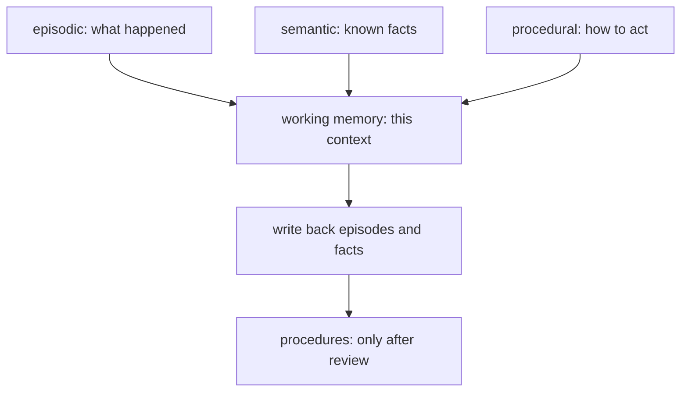

# Agent memory

## The idea

A model remembers nothing between calls. Each request starts from zero, and the only things the model knows about you, the task or the last hour are the things in its context window right now. **Memory**, for an agent, is everything the application does to put the right past into that window: what it keeps, where, in what form, and how it chooses what to bring back.

A common vocabulary comes from cognitive science, by way of the paper *Cognitive Architectures for Language Agents* by Sumers, Yao, Narasimhan and Griffiths. It distinguishes **short-term working memory** from three kinds of **long-term memory**:

| Kind | Holds | In an agent | Example |
|------|-------|-------------|---------|
| **Working** | What the current step is working with | The context of the current call: instructions, the recent conversation, retrieved items, tool results | "The user just asked what to buy first" |
| **Episodic** | Experiences: what happened, when | A log of past conversations, actions and their outcomes | "On Tuesday the refund tool failed twice for order A-1002" |
| **Semantic** | Knowledge: facts about the world and the user | Facts extracted and kept, often as subject, attribute and value | "Ana is allergic to peanuts" |
| **Procedural** | How to do things | The model's weights, the agent's own code and its instructions, saved skills | "To issue a refund, look up the order first" |

How memories are stored is a separate choice from what kind they are. The forms you will meet:

- **Context buffer**: the last turns of the conversation, as many as fit. Simple, exact, and forgetful: whatever falls off the start is gone.
- **Rolling summary**: older turns folded into a summary that a model call keeps rewriting. Keeps the gist of everything, loses detail, and can drift.
- **Vector memory**: memories stored as text with embeddings, retrieved by similarity to the current question, often weighed with recency and importance.
- **Graph memory**: facts stored as connections between entities, so that facts one or two steps apart can be found together.
- **File memory**: notes the agent writes into files, or a database, that it reads back later: a plan, a list of decisions, what it learned about a codebase. Plain, inspectable, and easy for a person to correct.

## A worked example

### Short-term: a buffer against a rolling summary

The conversation below has eight turns, and the budget for the conversation in the context is 45 tokens, counted as words. The buffer keeps the most recent turns that fit. The rolling summary keeps the last two turns verbatim and, whenever the context would overflow, folds older turns into a summary written by a model call; here the summarizer is a fake with scripted summaries.

```python examples/short_term.py
"""Two ways to keep a long conversation inside a budget: a context buffer and a rolling summary.

Tokens are counted as words. The summarizer is a fake that plays back scripted summaries.
"""

TURNS = [
    "user: hi, I'm Ana and I'm allergic to peanuts",
    "assistant: nice to meet you Ana, how can I help",
    "user: plan a dinner for four on Friday",
    "assistant: here is a menu with a satay starter, a curry and a mango dessert",
    "user: make the starter vegetarian",
    "assistant: the starter is now grilled vegetable skewers with satay sauce",
    "user: what should I buy first",
    "assistant: start with the vegetables and the satay sauce",
]
SCRIPTED_SUMMARIES = [
    "Ana is allergic to peanuts. She is planning a dinner for four on Friday.",
    "Ana is allergic to peanuts. Dinner for four on Friday: a satay starter, a curry, a mango dessert.",
    "Ana is allergic to peanuts. Dinner for four on Friday; the starter is now vegetarian.",
]
BUDGET = 45


def tokens(text: str) -> int:
    return len(text.split())


def buffer_view(turns: list[str], budget: int) -> list[str]:
    """The most recent turns that fit, newest kept first; older ones are simply dropped."""
    kept: list[str] = []
    for turn in reversed(turns):
        if tokens(turn) + sum(map(tokens, kept)) > budget:
            break
        kept.insert(0, turn)
    return kept


def summary_view(turns: list[str], budget: int, keep_recent: int = 2) -> list[str]:
    """Fold everything but the last turns into a summary whenever the context would overflow."""
    summaries = iter(SCRIPTED_SUMMARIES)
    summary, recent = "", []
    for turn in turns:
        recent.append(turn)
        context = ([f"summary: {summary}"] if summary else []) + recent
        if sum(map(tokens, context)) > budget:
            summary = next(summaries)  # a model call: old summary + folded turns -> new summary
            recent = recent[-keep_recent:]
    return ([f"summary: {summary}"] if summary else []) + recent


for name, view in (("buffer", buffer_view(TURNS, BUDGET)), ("rolling summary", summary_view(TURNS, BUDGET))):
    print(f"{name}: {sum(map(tokens, view))} tokens")
    for line in view:
        print("   ", line)
    print("    knows about the allergy:", any("peanut" in line for line in view))
```

It prints:

```output examples/short_term.py
buffer: 31 tokens
    user: make the starter vegetarian
    assistant: the starter is now grilled vegetable skewers with satay sauce
    user: what should I buy first
    assistant: start with the vegetables and the satay sauce
    knows about the allergy: False
rolling summary: 31 tokens
    summary: Ana is allergic to peanuts. Dinner for four on Friday; the starter is now vegetarian.
    user: what should I buy first
    assistant: start with the vegetables and the satay sauce
    knows about the allergy: True
```

Both views use 31 tokens, and they remember different things. The buffer holds the last four turns word for word, and nothing in it says that the user is allergic to anything, while the conversation is still about a sauce for the starter. The rolling summary holds only two turns verbatim, but its summary still carries the allergy from the first turn, along with the plan. The price is paid elsewhere: each fold was a model call, and each summary is the model's paraphrase, so a detail the summarizer judged unimportant is gone for good, and an error in one summary is copied into every summary after it. Which turns to keep verbatim and what the summary must never drop, such as allergies, names and decisions, are design choices, and the summarizer's instructions should say them.

### Long-term: which memories to bring back

Long-term memories are too many to put in the context, so each request retrieves a few. Ranking by similarity to the question alone has a blind spot: a vital fact that does not share the question's topic never comes up. Park and colleagues' generative agents score each memory on three signals, scale each signal to the range 0 to 1 across the candidates, and add them with equal weights:

- **Recency**: an exponential decay, `0.995` to the power of the hours since the memory was last used.
- **Importance**: a number from 1 to 10, rated by the model when the memory is written.
- **Relevance**: the cosine similarity of the memory's embedding and the query's.

```python examples/long_term.py
"""Retrieving long-term memories by recency, importance and relevance, each scaled to [0, 1] and added.

The weights, the scaling and the hourly decay of 0.995 follow the design of Park and colleagues'
generative agents. The embedding model is a fake: known words map to five named axes.
"""

import math

AXES = ("food", "health", "family", "weather", "shopping")
WORD_AXIS = {
    "cook": "food", "dinner": "food", "recipes": "food", "vegan": "food", "list": "shopping",
    "shopping": "shopping", "allergic": "health", "peanuts": "health", "sister": "family",
    "bea": "family", "weather": "weather", "nice": "weather",
}
MEMORIES = [  # (hours since last used, importance from 1 to 10, text)
    (1, 2, "Ana asked for a shopping list for Friday"),
    (30, 9, "Ana is allergic to peanuts"),
    (5, 3, "Ana prefers recipes under 30 minutes"),
    (200, 8, "Ana's sister Bea is vegan"),
    (2, 1, "Ana said the weather is nice"),
]


def embed(text: str) -> list[float]:
    counts = [0.0] * len(AXES)
    for word in text.lower().replace("?", "").replace("'s", "").split():
        if word in WORD_AXIS:
            counts[AXES.index(WORD_AXIS[word])] += 1
    length = math.sqrt(sum(c * c for c in counts))
    return [c / length for c in counts] if length else counts


def min_max(values: list[float]) -> list[float]:
    low, high = min(values), max(values)
    return [(v - low) / (high - low) if high > low else 0.0 for v in values]


def retrieve(query: str, k: int = 3) -> list[tuple[float, str]]:
    q = embed(query)
    recency = min_max([0.995**hours for hours, _, _ in MEMORIES])
    importance = min_max([float(score) for _, score, _ in MEMORIES])
    relevance = min_max([sum(a * b for a, b in zip(q, embed(text))) for _, _, text in MEMORIES])
    for (_, _, text), r, i, v in zip(MEMORIES, recency, importance, relevance):
        print(f"    {text:<40} recency {r:.2f}  importance {i:.2f}  relevance {v:.2f}  sum {r + i + v:.2f}")
    scored = [(r + i + v, text) for (_, _, text), r, i, v in zip(MEMORIES, recency, importance, relevance)]
    return sorted(scored, key=lambda pair: -pair[0])[:k]


query = "What can I cook for dinner with my sister Bea?"
print(f"query: {query}")
best = retrieve(query)
print("top 3:", [text for _, text in best])
by_relevance = sorted(MEMORIES, key=lambda m: -sum(a * b for a, b in zip(embed(query), embed(m[2]))))
print("top 3 by relevance alone:", [text for _, _, text in by_relevance[:3]])
```

It prints:

```output examples/long_term.py
query: What can I cook for dinner with my sister Bea?
    Ana asked for a shopping list for Friday recency 1.00  importance 0.12  relevance 0.00  sum 1.12
    Ana is allergic to peanuts               recency 0.79  importance 1.00  relevance 0.00  sum 1.79
    Ana prefers recipes under 30 minutes     recency 0.97  importance 0.25  relevance 0.75  sum 1.96
    Ana's sister Bea is vegan                recency 0.00  importance 0.88  relevance 1.00  sum 1.88
    Ana said the weather is nice             recency 0.99  importance 0.00  relevance 0.00  sum 0.99
top 3: ['Ana prefers recipes under 30 minutes', "Ana's sister Bea is vegan", 'Ana is allergic to peanuts']
top 3 by relevance alone: ["Ana's sister Bea is vegan", 'Ana prefers recipes under 30 minutes', 'Ana asked for a shopping list for Friday']
```

By relevance alone, the top three are Bea's diet, the quick-recipes preference and the shopping list. The combined score swaps the shopping list for the peanut allergy: it scores 0 on relevance with this crude embedding, but it is important and recent enough to come back. That is the point of mixing signals. The weights are a choice, and so is the decay: at `0.995` per hour, a memory unused for 200 hours keeps about 37% of its recency before scaling, and after scaling across these five it gets 0.



<!-- text-of-mermaid sha256:08848cc190c8d8dd1a05d1389ef82d1938625999301e3d11f61c9c6034e359d3 -->
```text
┌─────────────────────────────┐    ┌─────────────────────┐    ┌──────────────────────┐
│   episodic: what happened   │    │semantic: known facts│    │procedural: how to act│
└──────────────┬──────────────┘    └──────────┬──────────┘    └───────────┬──────────┘
               ▼──────────────────────────────┴───────────────────────────┘
┌─────────────────────────────┐
│ working memory: this context│
└──────────────┬──────────────┘
               ▼
┌─────────────────────────────┐
│write back episodes and facts│
└──────────────┬──────────────┘
               ▼
┌─────────────────────────────┐
│procedures: only after review│
└─────────────────────────────┘
```

The drawing funnels everything through the context window because everything passes through it: a memory that is never retrieved into working memory might as well not exist. The last box is the dangerous write. Changing what the agent knows how to do changes its behaviour on every later task, so it deserves a person's review.

## When to use it

- **A context buffer** for short conversations and tasks that fit, which is most of them.
- **A rolling summary** for long conversations where the gist matters more than the wording: support chats, long planning sessions. Tell the summarizer what it must keep.
- **Extracted facts** for things that stay true across conversations: preferences, constraints, names. Store them with when they were learned and where they came from, so a newer fact can replace an older one.
- **Vector memory** for large collections of past episodes or notes, where you cannot know in advance which will matter.
- **Graph memory** when questions join facts: "what does my sister's partner like?" needs two connected facts, and neither alone answers it.
- **File memory** for agents that work over many sessions on the same project: a plan, decisions and open questions in plain files that the agent and a person can both read and edit.

## Common traps

- **Remembering everything.** Every stored memory competes for the context window and can be retrieved at the wrong moment. Decide what is worth keeping, and let old, unused, unimportant memories expire.
- **Forgetting only the original.** When a user asks the assistant to forget something, the text, its embedding, any summary that mentions it, the facts extracted from it and any index statistics derived from it must all go. A forgotten memory that can still be found is not forgotten.
- **Facts that never change.** People move, change jobs and change their minds. Keep the time each fact was learned, let newer facts supersede older ones, and keep the history when you need to answer "what did we know then?".
- **Two writers, one memory.** Several runs of an agent may revise the same note at once; with plain writes, the second silently erases the first. Give each memory a version and refuse a write based on a version that has moved on.
- **Summaries that drift.** A summary of a summary of a summary can lose or distort what mattered. Keep the original episodes somewhere a summary can be rebuilt from, and test what summaries keep.
- **Memories as instructions.** A memory is written from conversation text, so it can contain anything a user typed, including text that reads like an instruction to the assistant. Read back into a later context, it carries that instruction across sessions. Treat writes to memory as privileged: sanitize them, flag what looks like an instruction, and wrap memories in delimiters that the stored text cannot close.
- **No separation between users.** Every read and write of memory must be scoped to one user, or one tenant. A retrieval that searches everyone's memories and filters afterwards has already let the ranking see them.

## Complexity

For `m` stored memories of one user, `d`-dimensional embeddings, and `k` memories retrieved:

| Operation | Cost |
|-----------|------|
| Append a turn to a buffer | O(1); building the view is O(turns kept) |
| Fold turns into a rolling summary | One model call per fold |
| Write a memory | An embedding call, plus an importance rating if the model rates it |
| Retrieve by recency, importance and relevance | O(m d) to score every memory exactly, then a sort or a selection of `k` |
| Look up a fact by subject and attribute | O(1) with a map keyed by both |
| Facts within `h` steps of an entity in a graph | Proportional to the facts reached, with a breadth-first search |
| Forget a memory | Every structure that holds it or something derived from it |

Retrieval for one user is usually small enough for an exact scan; the cost that grows is the context, so `k` stays small.

## Expert notes

- **The four kinds, precisely.** Sumers and colleagues define working memory as information kept active for the current decision cycle, a data structure that persists across model calls, from which each call's input is built. Episodic memory stores experience from earlier decision cycles, semantic memory stores knowledge about the world and the agent itself, and procedural memory is both implicit, in the model's weights, and explicit, in the agent's code. They note that writing to procedural memory is significantly riskier than writing to episodic or semantic memory, because it can introduce bugs or let an agent subvert its designers' intentions.
- **Generative agents.** Park and colleagues stored a complete record of each agent's experiences in natural language, synthesized those memories over time into higher-level reflections, and retrieved them to plan behaviour. Their retrieval combined recency, importance and relevance as in the example, with all three weights set to 1, and put the top-ranked memories that fit the context window into the prompt.
- **Recursive summaries.** Wang and colleagues had a model first summarize small parts of a dialogue, then recursively produce new memory from the previous memory and the following context, so that a long conversation is carried by a summary that is rewritten as it grows. The rolling summary of the example follows the same idea.
- **Memory is an attack surface.** The 2026 OWASP Top 10 for LLM Applications notes, under prompt injection, that an injection which writes to long-term memory taints every later session that reads it, and advises treating memory writes as privileged operations: log the prompt that caused them, classify writes for instruction-like content, and require approval before memories that carry instructions persist across sessions.
- **Concurrency is not optional.** As soon as two runs share a memory, writes need the same care as any shared database row: versions checked on write, refused writes retried after reading again. A revision that waits on a model call keeps that window open for as long as the call takes.

## Practice

- `cstudy start memory-store`: short memories per user with keyword search, expiry, versions and a quota that evicts the least recently used.
- `cstudy start chat-history-index`: an episodic store of conversations, searched by keyword, with deletions that are permanent and projects that scope search.
- `cstudy start forgettable-inverted-index`: a keyword index over memories where a forgotten memory leaves nothing behind, not even in the statistics that rank the others.
- `cstudy start versioned-memory-store`: a shared memory whose writes name the version they read, so no writer erases an update unseen.
- `cstudy start memory-facts-with-merge`: semantic memory as facts per user, with versions, reads as of a time, merges between two stores, and export and import.
- `cstudy start graphrag-context`: graph memory turned into context: the facts around an entity, ranked, packed into a budget, each with its path.

## Further reading

- [Sumers, Yao, Narasimhan and Griffiths, *Cognitive Architectures for Language Agents* (2024)](https://arxiv.org/abs/2309.02427): working, episodic, semantic and procedural memory for language agents.
- [Park and others, *Generative Agents: Interactive Simulacra of Human Behavior* (2023)](https://arxiv.org/abs/2304.03442): a memory stream, reflections, and retrieval by recency, importance and relevance.
- [Wang and others, *Recursively Summarizing Enables Long-Term Dialogue Memory in Large Language Models* (2023)](https://arxiv.org/abs/2308.15022): rolling summaries for long conversations.
- [Edge and others, *From Local to Global: A Graph RAG Approach to Query-Focused Summarization* (2024)](https://arxiv.org/abs/2404.16130): knowledge kept as an entity graph.
- [OWASP Top 10 for LLM Applications 2026](https://genai.owasp.org/resource/owasp-genai-llm-top-10-2026/): LLM01 Prompt Injection on memory persistence and memory writes.
