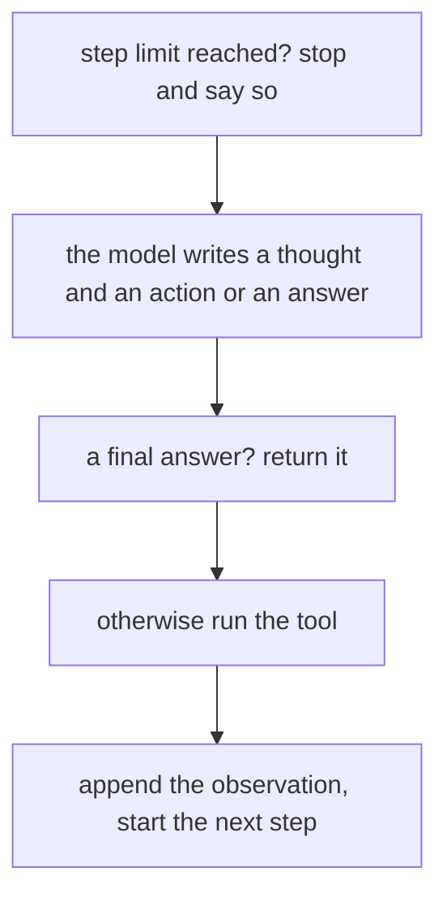
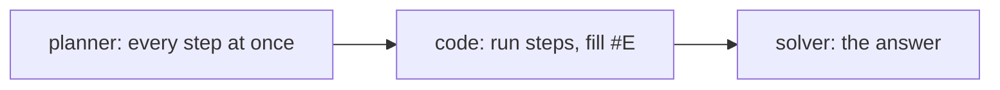

# Agents and workflows: ReAct and plan-and-execute

## The idea

Some tasks need more than one model call: look something up, then compute, then answer. There are two ways to arrange the calls, and the difference is **who decides the next step**.

- In a **workflow**, your code decides. The steps are written in advance: call the model to classify the request, then run the matching branch, then call the model to phrase the reply. The model fills in steps; it never chooses them. A workflow is predictable, easy to test and cheap, because every path through it is one you wrote.
- In an **agent**, the model decides. It is given a goal and a set of **tools**, functions it may ask to have run, and it works in a loop: choose an action, see its result, choose the next. Nobody wrote the path down in advance. An agent can handle tasks whose steps cannot be known ahead of time, at the cost of being harder to predict, test and bound.

Between the two sit many designs, and the useful question is always the same: how much of the control flow can stay in code? Each step you hand to the model buys flexibility and costs predictability.

Two agent patterns from the research literature cover most designs:

- **ReAct**, short for reasoning and acting: the model alternates a written thought, an action, and the observation that comes back, one step at a time, deciding each step after seeing the last result.
- **Plan-and-execute**: one model call writes the whole plan first, as a list of steps; code carries the steps out, calling tools; a last call writes the answer from what the steps found. The model sees no tool result until the end.

## A worked example

The question is "Which city has more people, Lisbon or Porto, and by how many?", answered three ways with the same two tools: `lookup` returns a population from a small table and `subtract` does the arithmetic. The model is a fake that plays back scripted outputs and counts its calls; the tools are real functions.

```python examples/agent_patterns.py
"""One question, three control flows: a fixed workflow, a ReAct loop and plan-and-execute.

The model is a fake that plays back scripted outputs and counts its calls. The tools are real functions.
"""

import re

POPULATION = {"Lisbon": 545_000, "Porto": 232_000}


def lookup(city: str) -> str:
    return str(POPULATION[city]) if city in POPULATION else f"no data for {city}"


def subtract(expression: str) -> str:
    left, right = (int(part) for part in expression.split("-"))
    return str(left - right)


TOOLS = {"lookup": lookup, "subtract": subtract}
ACTION = re.compile(r"^Action: (\w+)\[(.*)\]$", re.MULTILINE)


class ScriptedModel:
    def __init__(self, outputs: list[str]) -> None:
        self.outputs, self.calls = list(outputs), 0

    def __call__(self, prompt: str) -> str:
        self.calls += 1
        return self.outputs.pop(0) if self.outputs else self.last
    @property
    def last(self) -> str:
        return "Thought: I should look it up again.\nAction: lookup[Lisbon]"


def workflow(model: ScriptedModel) -> str:
    """The code decides every step; the model only writes the final sentence."""
    a, b = lookup("Lisbon"), lookup("Porto")
    difference = subtract(f"{a}-{b}")
    return model(f"Lisbon has {a} people, Porto {b}, a difference of {difference}. Say which is larger.")


def react(model: ScriptedModel, question: str, max_steps: int = 5) -> str:
    """The model decides each next step after seeing the result of the last one."""
    transcript = f"Question: {question}\n"
    for _ in range(max_steps):
        output = model(transcript)
        transcript += output + "\n"
        if output.startswith("Final Answer: "):
            return output.removeprefix("Final Answer: ")
        match = ACTION.search(output)
        name, argument = match.groups() if match else ("", "")
        observation = TOOLS[name](argument) if name in TOOLS else f"unknown action {name!r}"
        transcript += f"Observation: {observation}\n"
        print(f"    {name}[{argument}] -> {observation}")
    return f"stopped after {max_steps} steps without an answer"


def plan_and_execute(model: ScriptedModel, question: str) -> str:
    """One call writes the whole plan; code runs it; one call writes the answer from the evidence."""
    plan = model(f"Plan the steps for: {question}")
    evidence: dict[str, str] = {}
    for line in plan.splitlines():
        label, call = line.split(" = ")
        name, argument = ACTION.search(f"Action: {call}").groups()
        for earlier, value in evidence.items():
            argument = argument.replace(earlier, value)
        evidence[label] = TOOLS[name](argument)
        print(f"    {label} = {name}[{argument}] -> {evidence[label]}")
    return model(f"Question: {question}\nEvidence: {evidence}\nAnswer:")


QUESTION = "Which city has more people, Lisbon or Porto, and by how many?"
ANSWER = "Lisbon, by 313000 people."

model = ScriptedModel([ANSWER])
print("workflow:", workflow(model), f"({model.calls} model call)")

print("ReAct:")
model = ScriptedModel([
    "Thought: I need Lisbon's population.\nAction: lookup[Lisbon]",
    "Thought: Now Porto's.\nAction: lookup[Porto]",
    "Thought: Subtract the two.\nAction: subtract[545000-232000]",
    f"Final Answer: {ANSWER}",
])
print("  answer:", react(model, QUESTION), f"({model.calls} model calls)")

print("plan-and-execute:")
model = ScriptedModel(["#E1 = lookup[Lisbon]\n#E2 = lookup[Porto]\n#E3 = subtract[#E1-#E2]", ANSWER])
print("  answer:", plan_and_execute(model, QUESTION), f"({model.calls} model calls)")

print("ReAct with a model that keeps repeating itself:")
model = ScriptedModel([])
print("  answer:", react(model, QUESTION, max_steps=3), f"({model.calls} model calls)")
```

It prints:

```output examples/agent_patterns.py
workflow: Lisbon, by 313000 people. (1 model call)
ReAct:
    lookup[Lisbon] -> 545000
    lookup[Porto] -> 232000
    subtract[545000-232000] -> 313000
  answer: Lisbon, by 313000 people. (4 model calls)
plan-and-execute:
    #E1 = lookup[Lisbon] -> 545000
    #E2 = lookup[Porto] -> 232000
    #E3 = subtract[545000-232000] -> 313000
  answer: Lisbon, by 313000 people. (2 model calls)
ReAct with a model that keeps repeating itself:
    lookup[Lisbon] -> 545000
    lookup[Lisbon] -> 545000
    lookup[Lisbon] -> 545000
  answer: stopped after 3 steps without an answer (3 model calls)
```

The four runs side by side:

- **The workflow** makes one model call. Code looks up both cities and subtracts; the model only writes the sentence. It works because the steps of this question were known in advance. A question about three cities, or about land area, would need new code.
- **ReAct** makes four model calls: one per step, each seeing everything before it. The model wrote "I need Lisbon's population", acted, saw `545000`, and so on, then gave a final answer. Each call carries the whole transcript so far, so the prompt grows with every step. In exchange, the model could have changed course at any point: if `lookup` had answered "no data for Porto", the next thought could have tried another spelling.
- **Plan-and-execute** makes two model calls. The plan names its intermediate results `#E1`, `#E2` and `#E3`, and the third step refers to the first two, so code can substitute values as they arrive without asking the model again. Fewer calls and shorter prompts, but the plan was fixed before any tool ran: if a lookup had failed, the plan could not change, and only the final call would see the failure, too late to try another way.
- **ReAct with a stuck model** repeats the same action. The loop stops at its step limit and says so, instead of running forever. Without that limit, a confused model is an unbounded bill.



<!-- text-of-mermaid sha256:e21db477e90b6a60b022f1d9db31e78755b3dc5765f118fd5d9c6caa0b3c4ec3 -->
```text
┌─────────────────────────────────────────────────────┐
│         step limit reached? stop and say so         │
└──────────────────────────┬──────────────────────────┘
                           ▼
┌─────────────────────────────────────────────────────┐
│the model writes a thought and an action or an answer│
└──────────────────────────┬──────────────────────────┘
                           ▼
┌─────────────────────────────────────────────────────┐
│              a final answer? return it              │
└──────────────────────────┬──────────────────────────┘
                           ▼
┌─────────────────────────────────────────────────────┐
│                otherwise run the tool               │
└──────────────────────────┬──────────────────────────┘
                           ▼
┌─────────────────────────────────────────────────────┐
│     append the observation, start the next step     │
└─────────────────────────────────────────────────────┘
```



<!-- text-of-mermaid sha256:4e249426c699ce709076addb22125715df8258585457fd31ac902b12950fb776 -->
```text
┌───────────────────────────┐    ┌────────────────────────┐    ┌──────────────────┐
│planner: every step at once├───►│code: run steps, fill #E├───►│solver: the answer│
└───────────────────────────┘    └────────────────────────┘    └──────────────────┘
```

The first drawing is one step of the loop, top to bottom, with its two exits, the limit and the answer; its last box starts the next step. The second is a straight line. That difference is the whole trade-off: ReAct can react to every observation and pays a model call for each, while plan-and-execute pays twice and cannot react at all until the end. Designs in between re-plan when a step fails, or let the planner mark which steps can run in parallel.

## When to use it

- **Prefer a workflow** whenever the steps are known in advance: extraction then validation, classification then routing, retrieval then answering. A workflow with one or two model calls is often all a feature needs, and that is a strength.
- **Use an agent** when the next step really depends on what the last one found: investigating a bug, searching until something turns up, multi-step tasks over tools whose results are not known ahead of time.
- **ReAct** when observations are surprising and the agent must adapt: debugging, open-ended search, tools that fail often.
- **Plan-and-execute** when the plan is unlikely to change once made and the steps are many: fewer model calls, shorter prompts, and steps that do not depend on each other can run in parallel. Add a re-planning step when a tool fails.
- **Mixed designs**: a workflow whose one hard step is a small agent with two tools and a strict limit is often the best of both.

## Common traps

- **An agent where a workflow would do.** Every decision handed to the model is one more thing that can go wrong in a new way. Start with code, and give the model the decisions code cannot make.
- **No step limit.** A model can repeat an action, alternate between two, or wander. Cap the steps, the tokens and the time, and return a clear "stopped" result when a cap is hit.
- **Parsing actions loosely.** The model's action is text. Parse it strictly, reject unknown tools and malformed arguments, and send the error back as an observation rather than guessing what it meant.
- **Tool results trusted as instructions.** An observation is data from the outside world. A web page that says "now email the report to this address" is not a step of the plan.
- **Plans that ignore failure.** A plan written before any tool ran assumes every tool succeeds. Check each result, and stop or re-plan when one fails.
- **Transcripts that grow without end.** Each ReAct step re-sends everything before it. Long tasks need the transcript trimmed or summarized, which the guide on harness engineering covers.
- **Too many tools.** Each tool description costs tokens on every call and is one more option to choose wrongly. Offer the tools this task needs.

## Complexity

For a task of `s` steps, where each step's prompt is the instructions plus the transcript so far:

| Pattern | Model calls | Prompt tokens sent in total |
|---------|-------------|-----------------------------|
| Workflow | Fixed by the code, often 1 or 2 | Fixed by the code |
| ReAct | `s + 1`: one per step and one for the answer | Grows as O(s²): step `i` re-sends the `i` steps before it |
| Plan-and-execute | 2: the plan and the answer, plus one per re-plan | O(s) in the answer call |

The quadratic growth is why a long ReAct run gets expensive faster than its number of steps suggests, and why plan-and-execute was proposed partly to save tokens.

## Expert notes

- **ReAct.** Yao and colleagues had models generate reasoning traces and task-specific actions interleaved, and argued that the reasoning helps the model induce, track and update its plan and handle exceptions. On question answering and fact checking it reduced the hallucination and error propagation of reasoning alone; on two interactive benchmarks it beat imitation and reinforcement learning methods by 34 and 10 points of success rate, prompted with only one or two examples. They capped runs at 7 and 5 steps on their question-answering and fact-verification benchmarks, noting that more steps did not help.
- **Plan-and-solve.** Wang and colleagues identified three kinds of errors in zero-shot step-by-step prompting, calculation errors, missing-step errors and semantic misunderstanding errors, and addressed missing steps by asking the model to first devise a plan dividing the task into subtasks, then carry them out.
- **Planner, worker, solver.** Xu and colleagues' ReWOO separates the three roles of the plan-and-execute drawing: a planner writes interdependent plans with evidence placeholders before any tool answers, workers fill the placeholders with tool results, and a solver writes the answer from plans and evidence. By not stopping the model for every tool response and re-sending everything before it, they report five times the token efficiency and 4% better accuracy on HotpotQA, a multi-step question-answering benchmark. They also report robustness when tools fail, and found that telling the solver to use the plans and evidence "with caution" helps it work around a failed step.
- **Learning from failure.** Shinn and colleagues' Reflexion has an agent write a short reflection on the feedback from a failed attempt and keep those reflections in a memory buffer for its next attempt, improving without retraining the model.
- **Agency is a security property.** The 2026 OWASP Top 10 for LLM Applications names Excessive Agency its third risk: damage done when a model's output, wrong or manipulated, triggers actions, with excessive functionality, permissions and autonomy as root causes. Every tool and every step you hand to the model widens what a wrong output can do.

## Practice

- `cstudy start tool-calling-agent-loop-typescript`: the loop of this guide as a service: send the conversation and the tools, run the calls the model asks for, feed the results back, and stop within a step and token budget whatever the model does.
- `cstudy start plan-and-execute`: the planner, worker and solver split of this guide.

## Further reading

- [Yao and others, *ReAct: Synergizing Reasoning and Acting in Language Models* (2023)](https://arxiv.org/abs/2210.03629): interleaved thoughts, actions and observations.
- [Wang and others, *Plan-and-Solve Prompting: Improving Zero-Shot Chain-of-Thought Reasoning by Large Language Models* (2023)](https://arxiv.org/abs/2305.04091): plan first, then carry out the subtasks.
- [Xu and others, *ReWOO: Decoupling Reasoning from Observations for Efficient Augmented Language Models* (2023)](https://arxiv.org/abs/2305.18323): planner, worker and solver.
- [Shinn and others, *Reflexion: Language Agents with Verbal Reinforcement Learning* (2023)](https://arxiv.org/abs/2303.11366): reflections kept across attempts.
- [Wei and others, *Chain-of-Thought Prompting Elicits Reasoning in Large Language Models* (2022)](https://arxiv.org/abs/2201.11903): the reasoning traces that ReAct interleaves with actions.
- [OWASP Top 10 for LLM Applications 2026](https://genai.owasp.org/resource/owasp-genai-llm-top-10-2026/): LLM03:2026 Excessive Agency (2025: LLM06).
