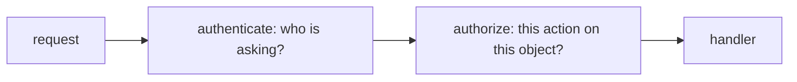
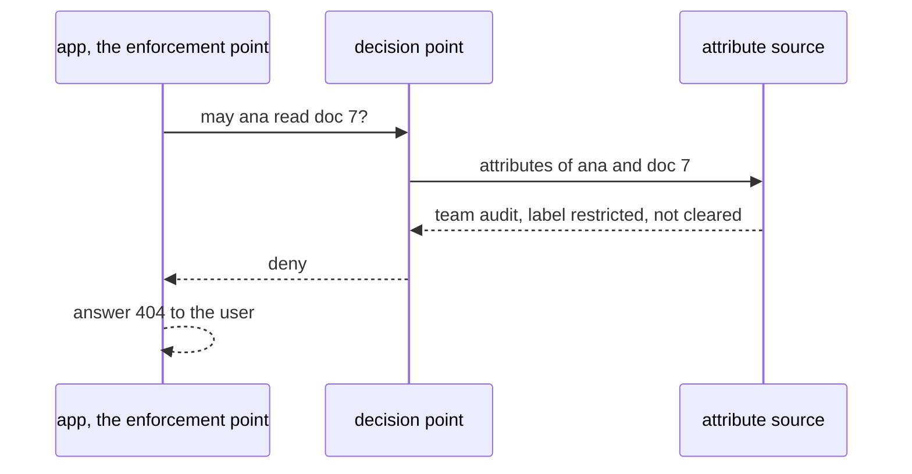

# Authentication, authorization and policy engines

## The idea

Every request to a protected system raises two different questions, and keeping them apart is half of getting them right:

- **Authentication**: who is asking? The OWASP Authorization Cheat Sheet calls it the process of verifying an entity's identity.
- **Authorization**: may they do *this*, to *this* object, now? The same cheat sheet calls it verifying that a requested action or service is approved for a specific entity, and stresses that the two are distinct.

HTTP has a status code for each failure. RFC 9110 defines `401 Unauthorized` for a request that lacks valid authentication credentials, despite its name, and `403 Forbidden` for a request the server understood and refuses to fulfil. It also allows a server that wants to hide that a forbidden resource exists to answer `404 Not Found` instead.

### Authentication

A person proves who they are with one or more **authentication factors**. NIST SP 800-63B-4, the 2025 edition of the US government's guidelines on authentication, uses the classic three: something you know (a password), something you have (a phone or a security key), and something you are (a fingerprint matched on a device). Its higher assurance levels require two distinct factors, which is **multi-factor authentication**. On passwords it reverses older habits: a password used as the only factor must be at least 15 characters long, one used with a second factor at least 8; verifiers must not impose composition rules, such as requiring digits and symbols, and must not force periodic changes, but must force a change when there is evidence of compromise, and must check new passwords against a blocklist of common and compromised ones. A server stores only a slow, salted hash of each password; the OWASP Password Storage Cheat Sheet recommends Argon2id with at least 19 MiB of memory, two iterations and one degree of parallelism.

Once a person has logged in, the server gives the browser a **session ID** in a cookie, and each later request carries it instead of the password. The OWASP Session Management Cheat Sheet points out that this ID is, for as long as it lives, temporarily equivalent to the strongest authentication method the application used. So it needs at least 64 bits of entropy, must mean nothing by itself, travels in a cookie marked `Secure` (HTTPS only), `HttpOnly` (out of reach of scripts) and `SameSite`, and must be replaced by a new one after login or any change of privilege, which defeats **session fixation**, an attacker planting a known ID before the victim logs in.

Between services, and in many APIs, the caller presents a **signed token** instead: a small document of **claims** about the caller, with a signature from the service that issued it. A JSON Web Token (JWT, RFC 7519) is the common format. Its registered claims include `iss` (who issued it), `sub` (whom it is about), `aud` (who should accept it), `exp` (when it expires), `nbf` (not before), `iat` (when it was issued) and `jti` (a unique ID, which can be used to prevent replay). A good signature proves only who wrote the token. Whether *you* should accept it *now* is a separate check: RFC 7519 requires every service to reject a token whose `aud` claim, when present, does not name it, the current time to be before `exp` and at or after `nbf`, allowing a small leeway, usually no more than a few minutes, for clocks that disagree. RFC 8725, the best current practices for JWTs, adds that the caller of a library must say which signature algorithms it accepts and that no other may be used: an attacker can change a token's algorithm to `none`, or change `RS256` (an RSA signature) to `HS256` (an HMAC), which some libraries then checked with the RSA public key as the HMAC's shared secret.

**OAuth 2.0** (RFC 6749) solves a different problem, delegation: it lets an application obtain limited access to a service on a user's behalf, with an access token, and often a **refresh token** that it trades for new access tokens. **OpenID Connect** is an identity layer on top of it: its **ID token** is a security token with claims about how and when the user was authenticated, which lets the application know who signed in. RFC 9700, the 2025 best current practice for OAuth security, requires public clients to use **PKCE** (RFC 7636), which ties the one-time code a login returns to a random secret that only the client that started the login knows; it says clients should not use the implicit grant and must not use the resource owner password credentials grant, and asks for exact matching of redirect URIs and for access tokens restricted to the services that should accept them. For refresh tokens held by public clients it requires either binding them to the client's key or **rotation**: every refresh returns a new refresh token and invalidates the old one, so that when a stolen token and the real one are both used, one of them is already invalid, which tells the server about the breach, and the server then revokes the token that is still active.

### Authorization

Once you know who is asking, a **policy** decides what they may do. Policies come in a few families:

| Model | Decides from | Example rule |
|-------|--------------|--------------|
| Role-based (RBAC) | The roles a user holds | Editors may publish |
| Attribute-based (ABAC) | Attributes of the user, the object, the action and the environment | A user may read a document of their own team, unless it is restricted and they are not cleared |
| Relationship-based (ReBAC) | Relationships between users and objects | The owner of a folder and anyone it was shared with may read it |

NIST SP 800-162 defines ABAC as access control in which authorization is determined by evaluating attributes of the subject and object, the requested operation and sometimes the environment against policy. The OWASP Authorization Cheat Sheet recommends attribute- and relationship-based models over plain roles for application development, since they fit least privilege better.

A **policy engine** takes the rules out of the code and keeps them as data, so that they can be changed, reviewed and audited in one place. The XACML 3.0 standard names the parts that most engines have, whatever their language: a **policy enforcement point** (PEP) in the application, which asks for a decision and enforces it; a **policy decision point** (PDP), which evaluates the applicable policy; a **policy information point** (PIP), which supplies attribute values; and a **policy administration point** (PAP), where policies are written. Its rule-combining algorithms decide what happens when several rules apply: **deny-overrides** returns deny if any applicable rule denies, **permit-overrides** returns permit if any permits, and **first-applicable** returns the result of the first rule in the list that applies. Besides Permit and Deny, a decision can be **NotApplicable**, when no policy applies to the request, or **Indeterminate**, when the decision point cannot evaluate it, for example because an attribute is missing or a policy could not be fetched.

Three principles keep authorization safe:

- **Deny by default.** No applicable rule means no. The OWASP Top 10:2025's first category, broken access control, lists "except for public resources, deny by default" among its preventions; Saltzer and Schroeder called it fail-safe defaults: "base access decisions on permission rather than exclusion."
- **Check every request, for the specific object.** Knowing that Ben may read notes does not mean he may read note 7. OWASP calls the missing check an **insecure direct object reference** (IDOR), and the OWASP API Security Top 10 puts broken object level authorization first, asking for an object-level check in every endpoint that receives an object's ID. Its third entry covers the same problem for an object's properties, such as a client that sets `role` in a request body, which used to be called **mass assignment**.
- **Check on the server.** The cheat sheet says developers must never rely on client-side access control checks.

## A worked example

A toy token, signed with HMAC-SHA256 and a key shared by the login service and the APIs that accept its tokens, shows the two checks that a signature and the claims each perform. HMAC, a keyed hash, is covered in the guide on cryptographic hashes; real systems use a standard format and a maintained library.

```python examples/signed_token.py
"""A signed token: the signature shows who wrote it, and the claims say who and what it is for.

A toy format with a shared key (HMAC-SHA256), so that it runs on the standard library alone.
Real tokens use a standard format, such as a JSON Web Token, and a maintained library.
"""

import base64
import hashlib
import hmac
import json

ISSUER_KEY = b"key shared by the login service and its APIs"  # in practice, from a secret store


def encode(data: bytes) -> str:
    return base64.urlsafe_b64encode(data).rstrip(b"=").decode()


def decode(text: str) -> bytes:
    return base64.urlsafe_b64decode(text + "=" * (-len(text) % 4))


def sign(claims: dict) -> str:
    body = encode(json.dumps(claims, sort_keys=True).encode())
    tag = hmac.new(ISSUER_KEY, body.encode(), hashlib.sha256).digest()
    return body + "." + encode(tag)


def verified_claims(token: str) -> dict | None:
    """The claims, if the signature matches; None if anyone but the key holder wrote them."""
    body, _, tag = token.partition(".")
    expected = hmac.new(ISSUER_KEY, body.encode(), hashlib.sha256).digest()
    if not hmac.compare_digest(decode(tag), expected):
        return None
    return json.loads(decode(body))


def accept(token: str, me: str) -> str:
    claims = verified_claims(token)
    if claims is None:
        return "refused: bad signature"
    if claims["aud"] != me:
        return f"refused: token is for {claims['aud']!r}, not {me!r}"
    return f"accepted: {claims['sub']} may use {me}"


token = sign({"sub": "ana", "aud": "reports-api", "role": "viewer"})
print(accept(token, "reports-api"))

body, _, tag = token.partition(".")
forged_body = encode(json.dumps({"aud": "reports-api", "role": "admin", "sub": "ana"},
                                sort_keys=True).encode())
print(accept(forged_body + "." + tag, "reports-api"))

print(accept(token, "payments-api"))
```

It prints:

```output examples/signed_token.py
accepted: ana may use reports-api
refused: bad signature
refused: token is for 'reports-api', not 'payments-api'
```

The first token is accepted: the signature matches and its audience is the reports API. The second keeps Ana's signature but changes `role` to `admin`; without the key, nobody can produce a matching tag, and `hmac.compare_digest` compares the tags without stopping at the first difference, so the time it takes reveals nothing about how much of a guess was right. The third is Ana's genuine token presented to the payments API. Its signature is fine, since the same issuer signs tokens for every service, but it was written for someone else; without the audience check, any token for any service would open every service.



<!-- text-of-mermaid sha256:f0e319cdbad8abe5e79e2390c92d7cf43246ae4d68c770e4119cfbe9a9dd890c -->
```text
┌───────┐    ┌────────────────────────────┐    ┌──────────────────────────────────────┐    ┌───────┐
│request├───►│authenticate: who is asking?├───►│authorize: this action on this object?├───►│handler│
└───────┘    └────────────────────────────┘    └──────────────────────────────────────┘    └───────┘
```

The diagram shows the order on every request: authentication first, then authorization of the specific action on the specific object, and only then the code that does the work.

Authorization rules often disagree, and how an engine combines them matters. Two rules, written as attribute checks, are combined below with XACML's three classic algorithms, in both orders:

```python examples/combining_rules.py
"""Two rules that disagree, and three ways a policy engine can combine them.

Each rule looks at attributes of the user, the document and the action (attribute-based access
control), and either applies to a request or does not. The combining algorithm decides what
happens when more than one applies, or none does.
"""

RULES = {
    "team-read": ("allow", lambda r: r["action"] == "read" and r["doc_team"] == r["user_team"]),
    "restricted": ("deny", lambda r: r["doc_label"] == "restricted" and not r["user_cleared"]),
}


def first_applicable(order: list[str], request: dict) -> str:
    for name in order:
        effect, applies = RULES[name]
        if applies(request):
            return effect
    return "no rule applies"


def deny_overrides(order: list[str], request: dict) -> str:
    effects = {RULES[name][0] for name in order if RULES[name][1](request)}
    if "deny" in effects:
        return "deny"
    return "allow" if "allow" in effects else "no rule applies"


def permit_overrides(order: list[str], request: dict) -> str:
    effects = {RULES[name][0] for name in order if RULES[name][1](request)}
    if "allow" in effects:
        return "allow"
    return "deny" if "deny" in effects else "no rule applies"


requests = {
    "own team, restricted": {"action": "read", "user_team": "audit", "doc_team": "audit",
                             "doc_label": "restricted", "user_cleared": False},
    "other team, public": {"action": "read", "user_team": "audit", "doc_team": "sales",
                           "doc_label": "public", "user_cleared": False},
}
orders = [["team-read", "restricted"], ["restricted", "team-read"]]

for label, request in requests.items():
    print(label)
    for combine in (first_applicable, deny_overrides, permit_overrides):
        answers = [combine(order, request) for order in orders]
        print(f"  {combine.__name__:17} {answers[0]:16} reversed: {answers[1]}")
```

It prints:

```output examples/combining_rules.py
own team, restricted
  first_applicable  allow            reversed: deny
  deny_overrides    deny             reversed: deny
  permit_overrides  allow            reversed: allow
other team, public
  first_applicable  no rule applies  reversed: no rule applies
  deny_overrides    no rule applies  reversed: no rule applies
  permit_overrides  no rule applies  reversed: no rule applies
```

For a restricted document of Ana's own team, `team-read` allows and `restricted` denies. **First-applicable** gives whichever answer comes first, so reordering the rules, which an administrator might do to tidy a file, silently opens the document. **Deny-overrides** gives deny in either order, which is why it is the usual choice for security rules. **Permit-overrides** gives allow in either order, which suits rules that only ever grant. For a public document of another team, no rule applies under any algorithm; the engine must then answer no, by default.



<!-- text-of-mermaid sha256:5de29f4253a7569d5719782338c4be088bfe7c2455895bb60a72c6693698be07 -->
```text
┌────────────────────────────┐  ┌────────────────┐                            ┌──────────────────┐
│ app, the enforcement point │  │ decision point │                            │ attribute source │
└──────────────┬─────────────┘  └────────┬───────┘                            └─────────┬────────┘
               │                         │                                              │
               │   may ana read doc 7?   │                                              │
               │─────────────────────────▶                                              │
               │                         │                                              │
               │                         │         attributes of ana and doc 7          │
               │                         │──────────────────────────────────────────────▶
               │                         │                                              │
               │                         │  team audit, label restricted, not cleared   │
               │                         ◀╌╌╌╌╌╌╌╌╌╌╌╌╌╌╌╌╌╌╌╌╌╌╌╌╌╌╌╌╌╌╌╌╌╌╌╌╌╌╌╌╌╌╌╌╌╌│
               │                         │                                              │
               │          deny           │                                              │
               ◀╌╌╌╌╌╌╌╌╌╌╌╌╌╌╌╌╌╌╌╌╌╌╌╌╌│                                              │
               │                         │                                              │
               ├╌╌╌┐                     │                                              │
               │   │ answer 404 to the user                                             │
               ◀╌╌╌┘                     │                                              │
               │                         │                                              │
┌──────────────┴─────────────┐  ┌────────┴───────┐                            ┌─────────┴────────┐
│ app, the enforcement point │  │ decision point │                            │ attribute source │
└────────────────────────────┘  └────────────────┘                            └──────────────────┘
```

The sequence shows the parts of a policy engine at work: the application asks, the decision point gathers attributes and evaluates the policy, and the application enforces the answer, here with a `404`, so that the user does not learn that document 7 exists.

## When to use it

- **On every request**: authenticate, then authorize the action on the specific object, on the server.
- **Sessions** suit a browser talking to its own server: the server can end a session at once by deleting it. **Signed tokens** suit services that must check a caller without asking the issuer each time; the price is that a token stays valid until it expires, so access tokens are kept short-lived and refresh tokens rotate.
- **Standard protocols** for signing in with another identity provider, OpenID Connect with the authorization code flow and PKCE, instead of a home-made redirect scheme.
- **Signatures on messages**, such as webhooks, when a sender must prove that a request came from it: the receiver recomputes the signature with the shared secret, and also checks a timestamp so that an old message cannot be replayed.
- **A policy engine** when the rules change often, span several services, or must be audited; plain code checks are fine for a handful of stable rules, as long as every path goes through them.

## Common traps

- **Authenticated is not authorized.** A valid session for Ben says nothing about note 7. Broken access control, missing checks of this kind among them, heads the OWASP Top 10:2025.
- **Answering 403 for someone else's object.** It confirms that the object exists. Answer as you would for an object that does not exist, which RFC 9110 explicitly allows.
- **Trusting a signature alone.** Check the issuer, the audience, the expiry and the not-before time as well, as RFC 7519 and RFC 8725 require; and accept only the algorithms you chose, never the one the token names.
- **Binding the whole request body to the object.** A user who adds `"role": "admin"` to a profile update becomes an administrator. The OWASP API Security Top 10 advises avoiding functions that bind a client's input into objects automatically, and allowing changes only to the properties the client should update.
- **Order-dependent rules.** First-applicable policies change meaning when rules move, as the example shows.
- **Allowing when nothing matched, or when evaluation failed.** NotApplicable and Indeterminate must both end in a refusal.
- **Checks in the client.** Hiding a button is not access control.
- **Old password rules.** Forcing periodic changes, and rules such as "at least one digit and one symbol": NIST SP 800-63B-4 forbids both.
- **Keeping the session ID after login.** Without a new ID, an attacker who planted the old one is logged in with the victim.
- **Long-lived bearer tokens in URLs.** Anyone holding a bearer token can use it, and URLs end up in histories and logs; see the guide on secrets and redaction.

## Complexity

| Operation | Cost |
|-----------|------|
| Verifying a password | Deliberately slow: Argon2id with 19 MiB of memory per attempt, which makes guessing expensive for an attacker who stole the hashes |
| Looking up a session | O(1) on average in a hash map or a key-value store, one lookup per request |
| Verifying an HMAC-signed token | O(n) in the token's length, and no call to the issuer |
| Evaluating a policy | O(r) rule checks for `r` rules in a straightforward engine, plus the cost of fetching attributes; engines index rules by action or resource to check fewer |
| Rotating refresh tokens | One record per token family on the server, kept until the login ends |

The costs that hurt are the waits for attribute sources and the calls to an issuer, not the rule checks; that is why engines cache attributes and why services verify signed tokens locally.

## Expert notes

- **Cross-JWT confusion.** RFC 8725 warns that a token issued for one purpose can be presented for another, and asks for explicit typing with the `typ` header and for validation rules that are mutually exclusive between kinds of tokens.
- **PKCE in detail.** RFC 7636's code verifier is a high-entropy random string of 43 to 128 unreserved characters; the client sends its SHA-256, base64url-encoded, as the code challenge with the login, and the verifier itself when it trades the code for tokens, so that a stolen code is useless without it. A client that can use `S256` must; `plain` is only for clients that cannot.
- **State and nonce.** OpenID Connect's `state` keeps state between the login request and its callback and, bound to a browser cookie, mitigates CSRF; its `nonce` associates the client's session with the ID token and mitigates replay.
- **Reauthentication.** NIST SP 800-63B-4 sets overall timeouts by assurance level: no more than 30 days at the lowest level, 24 hours at the middle one, with an inactivity timeout of at most an hour, and 12 hours at the highest, with at most 15 minutes of inactivity.
- **Indeterminate is an error, not a no.** An engine that cannot reach an attribute source has not decided. The enforcement point must still refuse, and log it differently from a deny, so that an outage of the source shows up as an outage and not as a wave of refusals.
- **Defense in depth for tenants.** In a shared database, a forgotten filter leaks one tenant's rows to another. Databases that enforce row-level policies give a second check below the application's own, so that one missing `WHERE` clause is refused by the database too.
- **Complete mediation.** Saltzer and Schroeder's principle that every access to every object must be checked for authority is the object-level rule in its oldest form.

## Practice

- `cstudy start token-claim-validator`: check the decoded claims of an access token against what this service expects, in a fixed order, with skew for the clock.
- `cstudy start refresh-token-rotation`: every refresh token works once, a replayed one ends the whole login, and a short grace window forgives a lost reply.
- `cstudy start oauth-pkce-client-typescript`: the client side of an OpenID Connect login: the code flow with PKCE, state and nonce, checked ID tokens, refresh and logout.
- `cstudy start payment-webhook-receiver-typescript`: accept only the webhooks a provider signed, while the signature is fresh, then handle duplicates and events out of order.
- `cstudy start authorization-policy-engine`: decide from rules written as data, with inherited roles and resources in a hierarchy, the same in any rule order and closed when no rule speaks.
- `cstudy start tool-permission-gate`: authorization for an agent's tool calls: rules by name, scoped arguments, approvals and an audit log.
- `cstudy start multi-tenant-api-typescript`: many organizations in one database, none of which may see, change or learn of another's rows.

## Further reading

- [OWASP Authorization Cheat Sheet](https://cheatsheetseries.owasp.org/cheatsheets/Authorization_Cheat_Sheet.html): authorization against authentication, least privilege, deny by default, checks on every request, models, IDOR and server-side checks.
- [OWASP Session Management Cheat Sheet](https://cheatsheetseries.owasp.org/cheatsheets/Session_Management_Cheat_Sheet.html) and [OWASP Password Storage Cheat Sheet](https://cheatsheetseries.owasp.org/cheatsheets/Password_Storage_Cheat_Sheet.html).
- [NIST SP 800-63B-4, Digital Identity Guidelines: Authentication and Authenticator Management](https://pages.nist.gov/800-63-4/sp800-63b.html), July 2025.
- [RFC 7519, JSON Web Token](https://www.rfc-editor.org/rfc/rfc7519) and [RFC 8725, JSON Web Token Best Current Practices](https://www.rfc-editor.org/rfc/rfc8725).
- [RFC 6749, The OAuth 2.0 Authorization Framework](https://www.rfc-editor.org/rfc/rfc6749), [RFC 7636, PKCE](https://www.rfc-editor.org/rfc/rfc7636), [RFC 9700, Best Current Practice for OAuth 2.0 Security](https://www.rfc-editor.org/rfc/rfc9700) and [OpenID Connect Core 1.0](https://openid.net/specs/openid-connect-core-1_0.html).
- [RFC 9110, HTTP Semantics](https://www.rfc-editor.org/rfc/rfc9110), sections 15.5.2 (401) and 15.5.4 (403, and hiding a resource with 404).
- [NIST SP 800-162, Guide to Attribute Based Access Control (ABAC) Definition and Considerations](https://csrc.nist.gov/pubs/sp/800/162/upd2/final).
- [XACML Version 3.0](https://docs.oasis-open.org/xacml/3.0/xacml-3.0-core-spec-os-en.html): enforcement and decision points, combining algorithms and decisions.
- [OWASP Top 10:2025, A01 Broken Access Control](https://top10.owasp.org/2025/A01_2025-Broken_Access_Control/), and the OWASP API Security Top 10 2023: [API1 Broken Object Level Authorization](https://api-security.owasp.org/editions/2023/en/0xa1-broken-object-level-authorization) and [API3 Broken Object Property Level Authorization](https://api-security.owasp.org/editions/2023/en/0xa3-broken-object-property-level-authorization).
- Python [`hmac`](https://docs.python.org/3/library/hmac.html): `compare_digest`.
