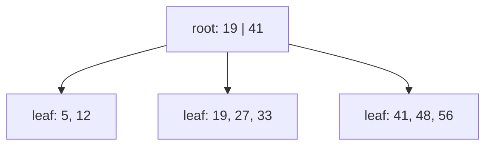
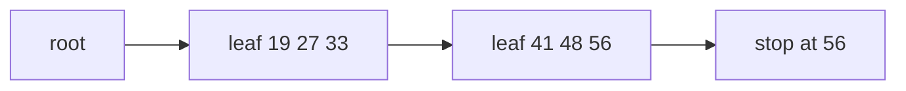

# B-tree indexes: balanced trees of pages

## The idea

A heap stores rows in no order, so finding the row whose `order_id` is 4711 means reading every page. An **index** is a second structure, kept sorted by one or more columns, that maps each value, the **key**, to the address of the row that holds it: in PostgreSQL the page and slot of the row, in SQLite the row's integer id. A lookup searches the index, then reads the one page the address names.

The index lives on disk too, in pages, so what it costs is the number of pages a search reads. A balanced binary search tree reads one node per level and needs about 20 levels for a million keys: 20 page reads, if each node is a page. The **B-tree**, introduced by Rudolf Bayer and Edward McCreight for an index kept on a disc or a drum, puts many keys in one node, a page's worth, so each node has many children and the tree is very shallow. Their paper shows that retrieval, insertion and deletion take time proportional to log_k I, where I is the size of the index and k a number fixed by the page size, and that at least half of the space of every page but the root is used.

Bayer and McCreight define the shape precisely. A B-tree with parameter k and height h satisfies four rules:

1. every path from the root to a leaf has the same length, h;
2. every node except the root and the leaves has at least k + 1 children, and the root is a leaf or has at least two;
3. every node has at most 2k + 1 children;
4. every page except the root holds between k and 2k keys; the root between 1 and 2k.

A node with j children holds j − 1 keys in sorted order, and the keys between two child pointers bound everything below that pointer, as in a binary search tree with more than two ways out of each node. To search, read the root, find where the key falls among its keys (a binary search when the node is large), follow that pointer, and repeat down to a leaf. Douglas Comer's survey of 1979 states the payoff: a search never visits more than 1 + log_d n nodes in a B-tree of order d holding n keys, where a node of order d holds from d to 2d keys.

The tree stays balanced because it only ever changes shape in two ways, which Bayer and McCreight call splitting and catenation. Both start at a leaf and can travel up toward the root.

- **Insert.** Find the leaf where the key belongs and add it in order. If the page is now over full, it **splits**: the first half of its entries stays, the second half moves to a new page beside it, and the middle entry moves up into the parent, between the pointers to the two pages. That insert can overfill the parent, which splits in turn. When the root splits, a new root is made above the two halves: this is the only way the tree grows taller, so every leaf stays at the same depth.
- **Delete.** Remove the key; a key in an inner node is first replaced by the smallest key of the subtree to its right, which sits in a leaf. A page left with too few keys is **catenated** with an adjacent brother, its sibling under the same parent, when the two fit in one page, pulling down the key that separated them; otherwise the keys of the two pages are shared between them. A catenation takes a key out of the parent, so it can travel up the tree, and the tree loses a level when the root is left with a single child.

Most databases use a variant that Comer's survey calls the **B+ tree**: all keys reside in the leaves, and the levels above form only an index, "a roadmap" to the right leaf. The leaves are linked from left to right, a list Comer calls the **sequence set**, so that reading keys in order needs no trips back up the tree. Two details follow from keeping every key in a leaf. When a leaf splits, a *copy* of a key goes up as a **separator**, and the key itself stays in the leaf. And a search does not stop when it meets its key in an inner node; it always goes down to a leaf. The separators only steer, so deleting a key from a leaf can leave a copy of it in the index, still dividing the keys correctly.



<!-- text-of-mermaid sha256:f142e74d806108a6629938f7e008d0086f7d67b517cd7115bdb2f0203ecbbcf0 -->
```text
┌─────────────┐
│root: 19 | 41│
└─────────────┘
       ▼────────────────────▼─────────────────────▼
┌─────────────┐    ┌────────────────┐    ┌────────────────┐
│ leaf: 5, 12 │    │leaf: 19, 27, 33│    │leaf: 41, 48, 56│
└─────────────┘    └────────────────┘    └────────────────┘
```

The root of this small tree holds two separators and three pointers. A search for 27 compares it with 19 and 41, takes the middle pointer, and finds 27 in the second leaf: two page reads. A key equal to a separator goes right, because the separator 19 is a copy of the first key of the leaf it leads to.

A **range scan** uses the leaf links. To find every key from 25 to 50, search for 25, then read leaves to the right until a key passes 50:



<!-- text-of-mermaid sha256:9d0f7ef28637fd1f6dca071677307acf253ef3d0dd19560325aa46b0491fb188 -->
```text
┌────┐    ┌─────────────┐    ┌─────────────┐    ┌──────────┐
│root├───►│leaf 19 27 33├───►│leaf 41 48 56├───►│stop at 56│
└────┘    └─────────────┘    └─────────────┘    └──────────┘
```

Comer points out what the links buy: a plain B-tree may need log_d n accesses to move to the next key, a B+ tree at most one, and a scan of the whole file reads each leaf once.

Where does the name come from? Comer notes that the authors never explained it: "balanced", "broad" and "bushy" all fit, some read the B as the initial of the laboratory where both authors worked, and Comer himself suggests thinking of them as "Bayer" trees.

## A worked example

### How shallow is shallow?

This program counts the levels a lookup needs for a binary tree and for trees of pages, using whole numbers only:

```python examples/fanout.py
"""How many levels, and so how many page reads, a lookup needs, for different fan-outs.

A perfectly balanced binary search tree of height h holds up to 2**h - 1 keys. A tree whose nodes
each have f children reaches f**h leaves' worth of entries in h levels. The model: 8,192-byte
pages and 16-byte entries (a key and a pointer), so a full page holds 512 entries and a half-full
one 256. Only whole numbers are used, so nothing depends on floating-point rounding.
"""

PAGE_BYTES, ENTRY_BYTES = 8192, 16
FULL = PAGE_BYTES // ENTRY_BYTES


def binary_height(n: int) -> int:
    h = 0
    while 2**h - 1 < n:
        h += 1
    return h


def levels(n: int, fanout: int) -> int:
    h = 1
    while fanout**h < n:
        h += 1
    return h


print(f"a full page holds {FULL} entries")
print(f"{'keys':>15} {'binary tree':>12} {'fan-out 100':>12} {'half full':>10} {'full':>6}")
for n in [1_000, 1_000_000, 1_000_000_000, 1_000_000_000_000]:
    print(
        f"{n:>15,} {binary_height(n):>12} {levels(n, 100):>12}"
        f" {levels(n, FULL // 2):>10} {levels(n, FULL):>6}"
    )
```

It prints:

```output examples/fanout.py
a full page holds 512 entries
           keys  binary tree  fan-out 100  half full   full
          1,000           10            2          2      2
      1,000,000           20            3          3      3
  1,000,000,000           30            5          4      4
1,000,000,000,000           40            6          5      5
```

A trillion keys need 40 levels in a binary tree and 5 in a B-tree whose pages hold 512 entries. Half-full pages, k keys out of 2k, the worst case the rules allow for every page but the root, cost one level at most here, because each level multiplies the reach by the fan-out: 256⁵ is already over a trillion. The top levels are few and read by every lookup, so they tend to stay in the buffer pool, and a lookup often reads only the last level or two from disk.

### What an index scan still has to read

An index gives row addresses; the rows live in the table's pages. This program counts the table pages read when an index finds 1,000 rows of 100,000, for two columns: one that follows the physical order of the rows, and one that scatters them.

```python examples/heap_fetches.py
"""An index finds row ids; the rows themselves still live on table pages, which must be read.

A table of 100,000 rows with 100 rows per page, so 1,000 pages: row i sits on page i // 100.
Two columns are indexed. order_id is i, so it follows the order of the rows on disk. customer
is (i * 7919) % 100,000, which visits every value once in a scrambled order, so neighbouring
values sit on unrelated pages. Each query asks for 1,000 consecutive key values, 1% of the rows.
"""

ROWS, PER_PAGE = 100_000, 100
order_id = {i: i for i in range(ROWS)}  # key -> row number, the index's leaf entries
customer = {(i * 7919) % ROWS: i for i in range(ROWS)}


def index_scan(index: dict[int, int], low: int, high: int) -> tuple[int, int]:
    """Fetch rows in key order; reading a page again only when it differs from the last one."""
    reads, last = 0, None
    pages = []
    for key in range(low, high + 1):
        page = index[key] // PER_PAGE
        pages.append(page)
        if page != last:
            reads, last = reads + 1, page
    return reads, len(set(pages))


print(f"full scan reads every page: {ROWS // PER_PAGE:,} pages, in order")
for name, index in [("order_id", order_id), ("customer", customer)]:
    reads, distinct = index_scan(index, 40_000, 40_999)
    print(
        f"index on {name:<8}: 1,000 rows, {reads:>5,} page reads in key order,"
        f" {distinct:>4} distinct pages"
    )
```

It prints:

```output examples/heap_fetches.py
full scan reads every page: 1,000 pages, in order
index on order_id: 1,000 rows,    10 page reads in key order,   10 distinct pages
index on customer: 1,000 rows, 1,000 page reads in key order,  951 distinct pages
```

The index on `order_id` finds 1,000 rows that sit on 10 consecutive pages. The index on `customer` finds as many rows, but they are spread over 951 different pages, and in key order each one is a page of its own: 1,000 reads, as many as the full scan, and none of them sequential. PostgreSQL's planner charges a non-sequential page read four times a sequential one by default (`random_page_cost` 4.0 against `seq_page_cost` 1.0), so in its terms those 1,000 reads cost about 4,000 against the full scan's 1,000. Even reading the 951 pages in page order, as PostgreSQL's bitmap scans do to soften this cost, saves little. This is why the 1979 System R optimizer had separate cost formulas for a **clustered** index, whose rows sit close together on disk, and a non-clustered one, charging the second up to one page per row fetched.

### Keys of several columns

An index can cover several columns, compared one after another: first by the first column, then, among equal first columns, by the second, and so on, like words in a dictionary. An index on (`country`, `city`) keeps every row of one country together, sorted by city within it. So it answers "every city of France" and "cities of France from L to P" as one range, but "every city named Springfield", in any country, is spread across the whole index. PostgreSQL's documentation states the rule for its multicolumn B-trees: equality conditions on the leading columns, plus an inequality on the first column without an equality condition, limit the part of the index that is scanned; conditions on later columns are checked in the index but do not shrink the scan, except through the skip scan that PostgreSQL 18 added, which repeats the index search for each value of an earlier column.

## When to use it

- **Equality and ranges on anything sortable.** PostgreSQL considers a B-tree for `<`, `<=`, `=`, `>=` and `>`, for `BETWEEN` and `IN`, for `IS NULL`, and for a `LIKE` pattern anchored at the start such as `'foo%'` (with the C locale, or else an index built with a special operator class). It can also return rows already sorted, which saves a sort for `ORDER BY`. It is the default kind of index: `CREATE INDEX` makes a B-tree unless told otherwise.
- **A few rows out of many.** The fewer rows a condition keeps, the more an index saves. When a condition keeps a large share of a table whose matching rows are scattered, a full scan reads fewer pages, as the example shows.
- **A hash index** only for equality: PostgreSQL's hash indexes store a 32-bit hash code of the value, so they cannot answer a range or return sorted rows.
- **A log-structured tree** when writes far outnumber reads, which the next guide covers: a B-tree updates its pages in place, one random write after another.
- **No index** on a small table that fits in a few pages, or on a column that is rarely searched: an index holds an entry for every row, so every insert adds to every index of the table.

## Common traps

- **Indexing a column with few distinct values.** An index on a yes-or-no column finds half the table, scattered over every page. A full scan is cheaper, and a planner that knows the statistics will not use the index.
- **Putting the columns in the wrong order.** An index on (`city`, `country`) does not serve "every city of France". Put first the columns that are compared with `=` in the queries you care about.
- **Expecting a pattern with a leading wildcard to use the index.** `LIKE '%bar'` has no prefix to search for; PostgreSQL's documentation says a B-tree serves only patterns anchored at the beginning.
- **Forgetting the table reads.** An index scan that returns many rows reads a table page for each, often at random. Counting only the index pages makes the index look far cheaper than it is.
- **Adding indexes for every query.** Each index costs space and makes every insert slower. PostgreSQL's documentation on heap-only tuples notes that an update can also require new index entries for each updated row.

## Complexity

| Operation | Cost in pages |
|-----------|---------------|
| Search for one key | the height: at most 1 + log_d n for order d (Comer) |
| Insert or delete | the search, plus the pages on one path from the leaf to the root when splits or catenations propagate |
| Range scan of k entries | the height, plus one leaf for every d to 2d entries |
| Fetching the rows | up to one table page per row found, at random, unless the table is clustered on the key |
| Space | at least half of every page used, except the root (Bayer and McCreight) |

With 512 entries per full page, a tree of four levels reaches 512⁴, about 6.9 · 10¹⁰ entries. The CPU cost per page is a binary search, O(log d), so the total CPU cost of a search is O(log n), as in a binary tree; the difference is the number of pages.

## Expert notes

- **Fuller pages.** Bayer and McCreight also describe an **overflow**: when a page is full but an adjacent brother is not, the keys of the two are shared between them instead of splitting, and a page splits only when both brothers are full. Without deletions, this raises the worst-case storage use to about 66%.
- **PostgreSQL's B-trees.** Splits cascade upward, and a root split adds a level, as described above. Typically over 99% of the pages are leaves, and an entry may take at most about a third of a page. Duplicate keys can be stored once with a sorted array of row addresses, a **posting list**; this **deduplication** is on by default. Since PostgreSQL 14, **bottom-up deletion** removes index entries for old row versions, left by updates that did not change the indexed columns, before they force a page split. A B-tree's `fillfactor` sets how full a build packs its leaves, 90% by default.
- **Index-only scans.** All PostgreSQL indexes are secondary: they live apart from the table's heap. A query that needs only indexed columns can skip the heap, but the index entry says nothing about whether the row is visible to the reading transaction. PostgreSQL checks the visibility map instead: when the page's all-visible bit is set, the heap read is skipped, and otherwise it happens anyway.
- **SQLite's B-trees.** A table is a B-tree keyed by its 64-bit rowid, with all row data in the leaves, so the table itself is clustered on the rowid; each index is a separate B-tree of keys and no data. An interior page holds K keys and K + 1 child pointers, and large index keys continue on overflow pages so that every interior page holds at least 4 keys.

## Practice

- `cstudy start btree-index`: build the B+ tree under a database index, level by level: search and insert with splits, range scans that count the pages they read, deletes that borrow from or merge with a sibling, then bulk loading and keys of several columns.

## Further reading

- [R. Bayer and E. McCreight, *Organization and Maintenance of Large Ordered Indexes*, Acta Informatica 1(3), 1972, pages 173 to 189](https://doi.org/10.1007/BF00288683): the B-tree, its rules, splitting, catenation and overflow; first published in 1970 as Mathematical and Information Sciences Report No. 20.
- [D. Comer, *The Ubiquitous B-Tree*, ACM Computing Surveys 11(2), 1979, pages 121 to 137](https://doi.org/10.1145/356770.356776): the variants, among them the B+ tree with its sequence set, and their costs.
- [P. G. Selinger and others, *Access Path Selection in a Relational Database Management System*, SIGMOD 1979](https://doi.org/10.1145/582095.582099): the cost of clustered and non-clustered index scans.
- [PostgreSQL documentation, *Index Types*](https://www.postgresql.org/docs/current/indexes-types.html), [*Multicolumn Indexes*](https://www.postgresql.org/docs/current/indexes-multicolumn.html) and [*Index-Only Scans*](https://www.postgresql.org/docs/current/indexes-index-only-scans.html): what a B-tree can answer, the leading-column rule and skip scan, and the visibility map.
- [PostgreSQL documentation, *B-Tree Indexes*](https://www.postgresql.org/docs/current/btree.html): page splits, deduplication and bottom-up deletion.
- [PostgreSQL documentation, *Planner Cost Constants*](https://www.postgresql.org/docs/current/runtime-config-query.html#RUNTIME-CONFIG-QUERY-CONSTANTS): `seq_page_cost` and `random_page_cost`.
- [SQLite, *Database File Format*, B-tree pages](https://www.sqlite.org/fileformat2.html#b_tree_pages): table and index B-trees.
