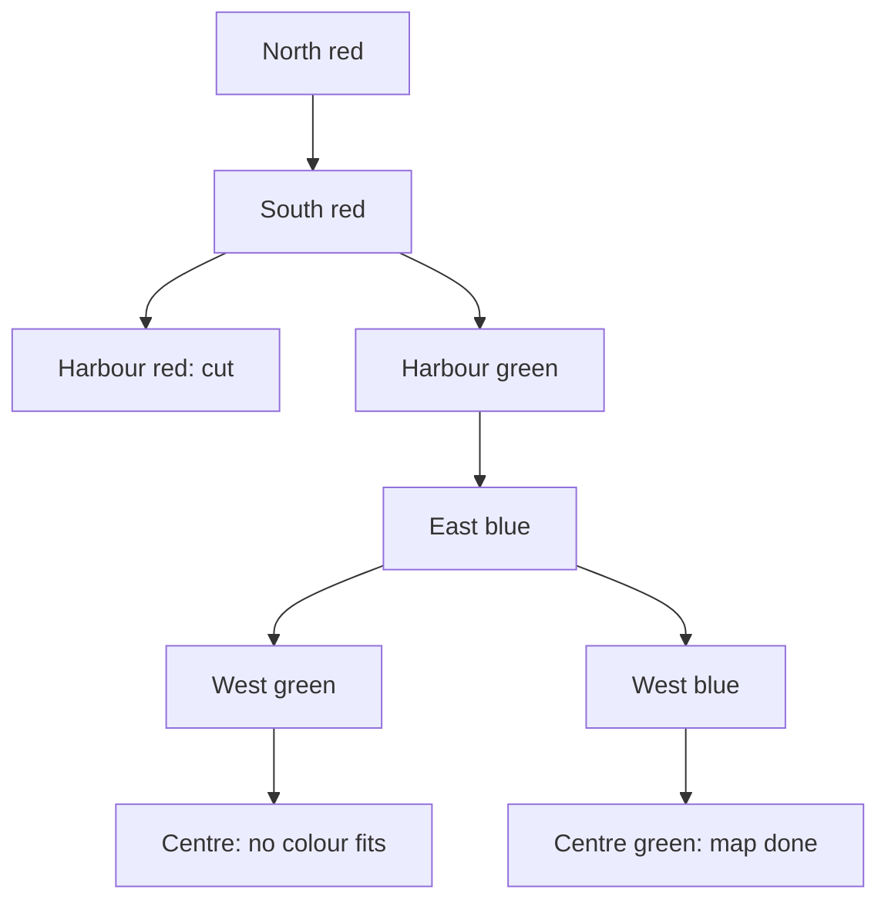

# Backtracking: choose, explore, undo

## The idea

Some questions ask for **every arrangement that obeys a set of rules**, or for one of them: every way to seat a group, every route through a maze, every way to fill a grid. An arrangement is built from a sequence of choices, and the choices form a tree: the first choice branches into its options, each of those branches into the options for the second choice, and so on. A complete arrangement is a path from the top of the tree to the bottom.

**Backtracking** walks that tree **depth first**, following one branch all the way down, to a complete arrangement or a dead end, before it comes back up to try the next branch. It holds one partial arrangement that it changes in place:

1. **Choose**: make the next choice, adding it to the partial arrangement.
2. **Explore**: recurse to make all the choices after it.
3. **Undo**: take the choice back, so the partial arrangement is exactly as it was, and try the next option.

The undo is what makes one shared partial arrangement enough: each branch starts from the state its parent left, not from the leftovers of the branch tried before it.

The second half of the idea is **pruning**. Check the rules each time a choice is made, not only when an arrangement is complete. A partial arrangement that already breaks a rule cannot be completed into one that obeys them all, so the whole subtree below it is skipped without being visited. The skeleton, in words:

```text
search(partial):
    if every choice is made: record a copy of partial, and return
    for each option of the next choice:
        if the option breaks a rule with what is already chosen: skip it   (prune)
        add the option to partial                                          (choose)
        search(partial)                                                    (explore)
        remove the option from partial                                     (undo)
```

## A worked example

Colour a map with three colours, red, green and blue, so that no two regions that share a border have the same colour. The map has six regions:

| Region | Borders |
|--------|---------|
| North | East, West, Centre |
| South | East, West, Centre, Harbour |
| Harbour | East, South |
| East | North, South, Centre, Harbour |
| West | North, South, Centre |
| Centre | North, East, South, West |

The choices are one colour per region, made in the order of the table. Each choice is checked only against the regions already coloured, since those are the only ones it can clash with yet.

```python examples/map_colouring.py
"""Colour a map with three colours so that no two regions that share a border get the same one."""

from itertools import product

BORDERS = {
    "North": ["East", "West", "Centre"],
    "South": ["East", "West", "Centre", "Harbour"],
    "Harbour": ["East", "South"],
    "East": ["North", "South", "Centre", "Harbour"],
    "West": ["North", "South", "Centre"],
    "Centre": ["North", "East", "South", "West"],
}
COLOURS = ["red", "green", "blue"]


def clash(region: str, colour: str, colour_of: dict[str, str]) -> str | None:
    """The first neighbour of region that already has this colour, if any."""
    return next((other for other in BORDERS[region] if colour_of.get(other) == colour), None)


def first_colouring(order: list[str]) -> dict[str, str] | None:
    """Colour the regions in this order, printing every choice, every clash and every undo."""
    colour_of: dict[str, str] = {}

    def place(index: int) -> bool:
        if index == len(order):  # every region has a colour: a solution
            return True
        region, indent = order[index], "  " * index
        for colour in COLOURS:
            neighbour = clash(region, colour, colour_of)
            if neighbour is not None:  # prune: no colouring that starts this way can work
                print(f"{indent}{region} = {colour}: clashes with {neighbour}")
                continue
            print(f"{indent}{region} = {colour}")
            colour_of[region] = colour  # choose
            if place(index + 1):  # explore
                return True
            del colour_of[region]  # undo, so the next colour starts from a clean map
            print(f"{indent}undo {region} = {colour}: nothing fits after it")
        return False

    return dict(colour_of) if place(0) else None


def count_colourings(order: list[str], undo: bool = True) -> tuple[int, int]:
    """(colourings found, choices tried), checking each choice as soon as it is made."""
    colour_of: dict[str, str] = {}
    found = tried = 0

    def place(index: int) -> None:
        nonlocal found, tried
        if index == len(order):
            found += 1
            return
        region = order[index]
        for colour in COLOURS:
            tried += 1
            if clash(region, colour, colour_of) is None:
                colour_of[region] = colour
                place(index + 1)
                if undo:
                    del colour_of[region]

    place(0)
    return found, tried


def count_complete_colourings() -> tuple[int, int]:
    """(colourings found, complete colourings checked), checking only finished maps."""
    regions = list(BORDERS)
    found = checked = 0
    for colours in product(COLOURS, repeat=len(regions)):
        checked += 1
        colour_of = dict(zip(regions, colours, strict=True))
        if all(clash(region, colour_of[region], colour_of) is None for region in regions):
            found += 1
    return found, checked


order = list(BORDERS)  # North, South, Harbour, East, West, Centre
print("found:", first_colouring(order))
found, tried = count_colourings(order)
print(f"checking each choice: {found} found, {tried} choices tried")
found, checked = count_complete_colourings()
print(f"checking complete maps: {found} found, {checked} maps checked")
found, tried = count_colourings(["Centre", "East", "South", "North", "West", "Harbour"])
print(f"Centre first: {found} found, {tried} choices tried")
found, tried = count_colourings(order, undo=False)
print(f"without the undo: {found} found, {tried} choices tried")
```

It prints:

```output examples/map_colouring.py
North = red
  South = red
    Harbour = red: clashes with South
    Harbour = green
      East = red: clashes with North
      East = green: clashes with Harbour
      East = blue
        West = red: clashes with North
        West = green
          Centre = red: clashes with North
          Centre = green: clashes with West
          Centre = blue: clashes with East
        undo West = green: nothing fits after it
        West = blue
          Centre = red: clashes with North
          Centre = green
found: {'North': 'red', 'South': 'red', 'Harbour': 'green', 'East': 'blue', 'West': 'blue', 'Centre': 'green'}
checking each choice: 6 found, 183 choices tried
checking complete maps: 6 found, 729 maps checked
Centre first: 6 found, 84 choices tried
without the undo: 1 found, 21 choices tried
```

Follow the trace, one indentation step per region:

- North takes red. South does not border North, so red is fine for it too.
- Harbour borders South, so red is **pruned**: no colouring that starts with North red, South red and Harbour red can be valid, and none of the 27 ways to colour the three remaining regions after it is ever looked at. Harbour takes green.
- East borders North (red) and Harbour (green), so only blue is left. West borders North and South, both red, and takes green, the first colour that fits.
- Centre borders North (red), West (green) and East (blue): every colour clashes. The branch is a **dead end**, and the choice that caused it is one level up: West = green clashed with nothing when it was made, but leaves Centre no colour. The search **undoes** West = green and tries the next option for West, blue, and now Centre can be green.



<!-- text-of-mermaid sha256:2537e9279f939b8aa0c0a7d408ef2d685b550ed49cb0891eb645cba49ba6a010 -->
```text
┌──────────────────────┐
│      North red       │
└───────────┬──────────┘
            ▼
┌──────────────────────┐
│      South red       │
└──────────────────────┘
            ▼───────────────────────────▼
┌──────────────────────┐    ┌──────────────────────┐
│   Harbour red: cut   │    │    Harbour green     │
└──────────────────────┘    └───────────┬──────────┘
                                        │
┌──────────────────────┐                │
│      East blue       │◄───────────────┘
└──────────────────────┘
            ▼───────────────────────────▼
┌──────────────────────┐    ┌──────────────────────┐
│      West green      │    │      West blue       │
└───────────┬──────────┘    └───────────┬──────────┘
            ▼                           ▼
┌──────────────────────┐    ┌──────────────────────┐
│Centre: no colour fits│    │Centre green: map done│
└──────────────────────┘    └──────────────────────┘
```

The counts show what pruning is worth. Checking each choice as it is made, finding all six valid colourings takes 183 single choices. Checking only complete maps means colouring all 729 (`3⁶`) of them in full before rejecting all but six. Both searches find the same six colourings, which is the test that the pruning is safe: it skipped only branches that held no answer.

The order of the regions matters too. Colouring Centre first, the region with the most borders, takes 84 choices instead of 183: once the most connected region has a colour, clashes show up earlier, higher in the tree, where cutting a branch removes more below it.

The last line is the undo left out. Without `del colour_of[region]`, the colours of abandoned branches stay on the map, and the next branches clash with regions that are not even coloured in them: the search finds one colouring out of six.

## When to use it

- The question asks for **all** arrangements that obey rules, or **any** one of them: placements, assignments, orders, splits, paths through a grid.
- The rules can be **checked on a partial arrangement**, so that a bad start is caught early. When a rule can only be judged on a complete arrangement, pruning cannot help and backtracking is just brute force.
- The input is **small**. The number of arrangements grows exponentially with the number of choices, and so does the output when every arrangement is wanted.
- **Use something else** when only a count or a best value is wanted and what is left to decide depends on a small summary of the choices made so far, not on all of them: then many branches ask the same question, and [memoization](../memoization/guide.md) answers it once. And when a simple rule can be proved to always make a right choice, no search is needed at all; [choosing states](../choosing-states/guide.md) shows how to tell.

## Common traps

- **Forgetting the undo.** The partial arrangement is shared by every branch, so a choice left in place leaks into the branches tried after it, as the last line of the example shows: one colouring found out of six, with no error to warn you.
- **Recording the arrangement instead of a copy of it.** Appending the partial arrangement itself to a list of results stores a reference to the one object the search keeps changing; after the search, every stored result shows the same final state, often empty. Record `list(partial)` or `dict(partial)`.
- **Pruning too eagerly.** A rule that cuts a branch which could still have succeeded loses answers silently. On small inputs, compare the pruned search with a brute force that checks complete arrangements, as the example does.
- **Checking only at the end.** Correct, but it visits every complete arrangement: 729 here, and `kⁿ` in general.
- **Not stopping when one answer is enough.** To stop at the first solution, the recursion must say it succeeded, as `place` returns `True` in `first_colouring`, and every level must return as soon as a deeper level did.

## Complexity

| Quantity | Bound |
|----------|-------|
| Complete arrangements, for `n` choices of at most `k` options | at most `kⁿ`: `3⁶ = 729` here |
| Nodes of the search tree | at most `1 + k + k² + ... + kⁿ`, fewer than `2kⁿ` for `k ≥ 2` |
| Time | the nodes visited times the cost of checking one choice, here the borders of one region |
| Extra space | the recursion's depth, `n` frames, plus the partial arrangement, plus the results kept |

Pruning changes how many nodes are visited, often by a lot, but the bounds above stay the worst case: nothing in the method promises that a given input lets it cut much. When every arrangement is listed, the output alone sets a floor: `S` answers of `n` choices each take at least `S · n` steps to write down.

## Expert notes

- **Order the choices by how constrained they are.** Deciding the most constrained choice first, the region with the most borders, or the slot with the fewest options left, finds dead ends near the top of the tree, where cutting saves the most: 84 choices instead of 183 here. When one solution is enough, the order of the options matters too: try the likeliest one first.
- **Break symmetries.** Swapping colour names turns any valid colouring into another, so the six colourings here are one colouring up to renaming. Fixing the first region's colour divides the work by the number of colours, as long as you multiply the count back, or produce the renamed copies, at the end.
- **Branch and bound for the best arrangement.** When the question is the best arrangement rather than every one, keep the best found so far, and cut a branch as soon as an optimistic estimate of everything below it cannot beat it. The estimate must never be lower than what the branch could really reach, or the cut loses the answer. [Choosing states](../choosing-states/guide.md) shows such an estimate for packing a bag.
- **Generators hand out solutions one at a time.** In Python, a search written with `yield` suspends at each solution, keeping its local variables and its place, and resumes where it left off when the caller asks for the next one. The caller can stop after the first, or after ten, without the search computing the rest.
- **The name is old.** Solomon Golomb and Leonard Baumert's paper "Backtrack Programming" appeared in the Journal of the ACM in 1965.

## Practice

- `cstudy start subsets`: list every collection that can be kept from a set of distinct values.
- `cstudy start permutations`: list every ordering of a set of distinct values.
- `cstudy start combination-sum`: list the combinations of candidates, each usable any number of times, that add up to a target.
- `cstudy start word-search`: decide whether a word can be spelled by walking from cell to neighbouring cell in a grid of letters.
- `cstudy start n-queens`: place `n` queens on an `n` by `n` board so that none attacks another, and list every way.

## Further reading

- [Python `itertools.product`](https://docs.python.org/3/library/itertools.html#itertools.product): the Cartesian product, which the brute force uses to list every complete map; `repeat=6` is the product of six copies.
- [Python glossary: generator iterator](https://docs.python.org/3/glossary.html#term-generator-iterator): each `yield` suspends the function, remembering its local variables, and resuming picks up where it left off.
- Solomon W. Golomb and Leonard D. Baumert, [Backtrack Programming](https://doi.org/10.1145/321296.321300), Journal of the ACM 12(4), 1965, pages 516 to 524.
