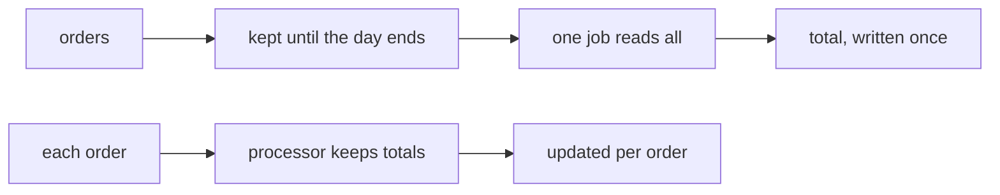
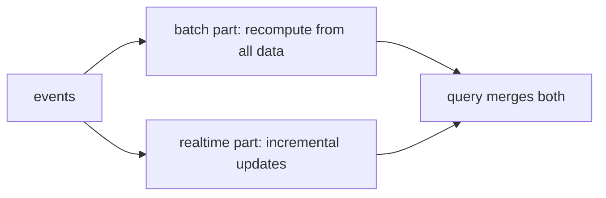

# Batch and streaming

## The idea

Data engineering moves data from where it is produced to where it is used, and computes on it along the way: totals, cleaned copies, tables joined together. Before choosing how, ask one question about the data: **does it end?**

- **Bounded** data has an end you can point to: yesterday's orders, last month's invoices, a file a supplier uploaded. You can read all of it, and then answer.
- **Unbounded** data never ends: page views, payments and sensor readings keep arriving for as long as the business runs. Any answer about it describes the part seen so far.

Two ways of processing follow from that.

- A **batch job** waits until a piece of data is complete, or is treated as complete, reads all of it, computes, and writes its result once. A job that runs every night and adds up the day's orders is batch.
- A **stream processor** handles each record the moment it arrives. What it must remember between records, such as a running total, is its **state**, and its results change as records come in.

The paper that describes the Dataflow model (Akidau and others, 2015) keeps the two pairs of words apart: *bounded* and *unbounded* describe the data, *batch* and *streaming* the engine that processes it. Unbounded data has been processed by running batch jobs again and again for as long as there have been batch systems, each run taking one slice, such as one day; and a streaming engine can process a bounded file. So the real question is not which kind of data you have, but which trade-off you want:

| | Batch | Streaming |
|---|-------|-----------|
| **Latency**: the time from an event to a result that includes it | At least the length of the slice plus the run: a day or more for a daily job | Seconds or less |
| **Completeness** | It runs once the slice is believed complete, and running it again later picks up what arrived late | Results come early, and must be corrected when late data arrives |
| **Operation** | Machines work only while a job runs; a failed run is run again | The processor runs all the time and must keep its state safe across crashes |



<!-- text-of-mermaid sha256:3abafbeaa8fe5e91498f0a9f30db7bbeac60e4fadad2e5b4891654c4976122c9 -->
```text
┌──────────┐    ┌───────────────────────┐    ┌─────────────────┐    ┌───────────────────┐
│  orders  ├───►│kept until the day ends├───►│one job reads all├───►│total, written once│
└──────────┘    └───────────────────────┘    └─────────────────┘    └───────────────────┘

┌──────────┐    ┌───────────────────────┐    ┌─────────────────┐
│each order├───►│ processor keeps totals├───►│updated per order│
└──────────┘    └───────────────────────┘    └─────────────────┘
```

The drawing shows both paths. The batch path has a wait built in: nothing is computed until the day ends. The stream path computes all the time, and its answer is never "final" in the same way.

## A worked example

An online shop wants its revenue per day, in cents. Five orders reach the pipeline. Each one carries the day it was placed and the hour, counted from Monday at midnight, at which it arrived. One of them, `o4`, was placed on Monday by a phone that had no signal, and arrived only on Tuesday at 3 in the morning.

The batch side runs Monday's job at hour 24, when Monday ends, and Tuesday's at hour 48, each over what has arrived by then. The stream side keeps one running total per day and updates it with every order.

```python examples/batch_vs_stream.py
"""Revenue per day, answered by a batch job and by a stream processor over the same orders.

Each order has the day it was placed and the hour, counted from Monday 00:00, at which it reached
the pipeline. The batch job for a day runs once, when the day ends, over what has arrived by then.
The stream processor updates a running total the moment each order arrives.
"""

ORDERS = [  # (order id, day placed, amount in cents, hour it arrived)
    ("o1", "mon", 1200, 9),
    ("o2", "mon", 800, 17),
    ("o3", "tue", 1500, 26),
    ("o4", "mon", 300, 27),  # placed on Monday by a phone that was offline until Tuesday
    ("o5", "tue", 700, 40),
]
DAY_ENDS = {"mon": 24, "tue": 48}


def batch_job(day: str, run_at_hour: int) -> int:
    """One run: read every order of the day that has arrived by now, and add them up."""
    arrived = [order for order in ORDERS if order[3] <= run_at_hour]
    return sum(cents for _, placed, cents, _ in arrived if placed == day)


class RunningTotals:
    """A stream processor: it keeps one total per day and updates it for each order."""

    def __init__(self) -> None:
        self.totals: dict[str, int] = {}

    def on_order(self, placed: str, cents: int) -> int:
        self.totals[placed] = self.totals.get(placed, 0) + cents
        return self.totals[placed]


print("batch, each day's job at the end of the day:")
for day, end in DAY_ENDS.items():
    print(f"  hour {end}: {day} = {batch_job(day, end)}")
print(f"  hour 50, monday's job run again: mon = {batch_job('mon', 50)}")

print("stream, one update per order:")
stream = RunningTotals()
for order_id, placed, cents, hour in ORDERS:
    print(f"  hour {hour}: {order_id} -> {placed} = {stream.on_order(placed, cents)}")
```

It prints:

```output examples/batch_vs_stream.py
batch, each day's job at the end of the day:
  hour 24: mon = 2000
  hour 48: tue = 2200
  hour 50, monday's job run again: mon = 2300
stream, one update per order:
  hour 9: o1 -> mon = 1200
  hour 17: o2 -> mon = 2000
  hour 26: o3 -> tue = 1500
  hour 27: o4 -> mon = 2300
  hour 40: o5 -> tue = 2200
```

Read it as a timeline.

1. **Latency.** The stream knows Monday's revenue is at least 1200 at hour 9, and 2000 at hour 17. The batch job says nothing until hour 24.
2. **Completeness.** At hour 24 the batch job reports 2000 for Monday, and that number is wrong: `o4` belongs to Monday but has not arrived. Only a second run of Monday's job, at hour 50, gives the right 2300.
3. **Correction.** The stream gets Monday right as soon as `o4` arrives, at hour 27, by updating a total it had already reported. Whoever reads its output must expect a reported total to change.

Neither side is simply better. The batch job is simple and can be run again at any time to fix its answer; the stream answers sooner and must be built to revise what it said. Deciding *when* a day counts as complete, and what to do with an order that arrives after that, is the subject of the next guide, on event time and watermarks.

## Lambda and Kappa

Many systems need both: answers within seconds, and answers that are right. Two well-known designs combine the two styles.

**Lambda.** A 2011 post, *How to beat the CAP theorem*, describes a system in two parts. A batch part recomputes the answer from all the data, except the last few hours; a realtime part runs beside it and covers those hours with incremental updates. A query reads both results and merges them, and since the batch part keeps recomputing, everything the realtime part computed is eventually replaced by the batch answer. The Dataflow paper calls this design the **Lambda Architecture**, citing that post. It notes that Lambda does not make correct answers arrive sooner: it serves the stream's best early estimate, with the promise that the batch run will correct it, and even the batch output is only correct if the input was complete when the batch job ran.



<!-- text-of-mermaid sha256:069eecfa7fa2199e3e7195dd3e85a3acf0f1a7d87f89950a3695c58152d7dc80 -->
```text
┌──────┐    ┌───────────────────────────────────┐    ┌─────────────────┐
│events├───►│batch part: recompute from all data├───►│query merges both│
└───┬──┘    └───────────────────────────────────┘    └─────────────────┘
    │                                                         ▲
    │       ┌───────────────────────────────────┐             │
    └──────►│ realtime part: incremental updates├─────────────┘
            └───────────────────────────────────┘
```

**Kappa.** A 2014 article, *Questioning the Lambda Architecture*, points at Lambda's cost: the same logic must be written twice, for two different systems, and kept producing the same results. Its alternative keeps only the stream processor. The input is kept as a log that holds the full history. To recompute, you start a second copy of the stream job from the beginning of the log, writing to a new output table; when it has caught up, the application switches to the new table, and the old job and its table are removed. The article suggests, tentatively, calling this the **Kappa Architecture**.

The Dataflow paper reports an experience that weighs on the choice: a team ran a stream that gave weakly consistent results, with a nightly batch job to produce the truth, and found that its users stopped trusting the stream's numbers; the team rebuilt the system around strong consistency.

## When to use it

- **Batch** when a result is needed hourly or daily, not sooner; when the question is about a closed period, such as a month's invoices; when the input arrives as files; and when the simplest way to fix a mistake is to run the job again. Most reporting is batch.
- **Streaming** when the result loses value within seconds or minutes: fraud checks, alerts, live counters, a search index or a cache that must follow a database. Copying a database's changes to other systems, the subject of the guide on change data capture, is a stream by nature.
- **Small batches** in between: running a batch job every few minutes over the newest slice gives minutes of latency with batch tools, at the price of many small runs.
- **Both**, when you need early answers and corrected ones. Prefer one code path that can run either way, or a stream that can be replayed from a retained log, over two separate implementations of the same logic.

## Common traps

- **Treating a slice as complete when its time ends.** Data for Monday keeps arriving after Monday ends, as `o4` did. A batch job that runs at midnight and is never run again keeps its wrong answer forever.
- **Assuming a stream's output is final.** A stream that handles late data revises results it has already reported. A consumer that adds up every update it receives, instead of keeping the latest one per day, counts the same orders twice.
- **Confusing reading a file as a stream with stream processing.** Reading a large file row by row, so that it never has to fit in memory, is good practice in any batch job. It does not make the job a stream processor: the file still ends, and the answer is still computed once.
- **Two implementations that drift apart.** In a Lambda design, a fix applied to the batch code and forgotten in the stream code makes the two disagree, and the merged answer jumps when the batch result replaces the stream's.
- **State lost in a crash.** A stream processor's running totals live in memory unless it saves them. One that restarts with empty state, or that processes some records twice after a restart, reports totals that are silently wrong.
- **Choosing streaming for its own sake.** A processor that runs all the time, with state to protect, costs more to build and to run than a nightly job. If nobody reads the result more than once a day, the extra latency of batch costs nothing.

## Complexity

For `n` records and `k` distinct groups, such as days or customers:

| Approach | Time | Memory | Latency |
|----------|------|--------|---------|
| Batch, grouping with a hash map | O(n) per run, on average | O(k) for the totals, plus the input if it is read whole | The slice's length plus the run time |
| Batch, run again to pick up late data | O(n) per rerun | O(k) | As above, plus the wait before the rerun |
| Stream with running totals | O(1) per record, on average | O(k) of state, kept for as long as a group can still change | The time to handle one record |

The stream's memory is the real bound: it must keep a group's state as long as a record for that group may still arrive. A day that can receive orders forever must be kept forever, unless the processor decides at some point that the day is complete, which the next guide covers.

## Expert notes

- **Windows are optional for bounded data.** The Dataflow paper notes that on unbounded data most grouping operations, such as aggregations and outer joins, need windows, finite pieces of time, while filtering, mapping and inner joins do not; on bounded data windows are optional, but still useful, for example to recompute one part of a previous result.
- **Delivery guarantees.** A stream system that resends a record until it is acknowledged delivers it **at least once**: possibly twice, after a crash. The MillWheel paper (Akidau and others, 2013) treats at-least-once delivery as a prerequisite for exactly-once delivery: every record gets a unique id when it is produced, and the id is stored in the same atomic write as the state change the record causes, so a record delivered again is recognized and discarded. The paper is explicit that this guarantee does not extend to external systems.
- **Tables can be streams too.** A table format that records every commit in a log lets a reader follow that log and pick up only what was added since it last looked; the Delta Lake protocol lists this, incremental processing by tailing the log, among its design goals. The guide on table formats covers these logs.
- **One model, several engines.** The Dataflow paper names as an initial motivation a single implementation that runs in streaming and in batch mode without changes, and argues that the choice between batch, micro-batch and streaming engines can then rest on their practical differences: latency and resource cost.

## Practice

- `cstudy start feed-ingest-python`: a daily batch feed from shops. Load each file once however often it is sent, and refuse the rows you cannot trust.
- `cstudy start stream-windows`: its first two levels answer questions over every event received so far, as a batch view would; its last two run the same events as a live stream that must decide when to report.

## Further reading

- [Akidau and others, *The Dataflow Model: A Practical Approach to Balancing Correctness, Latency, and Cost in Massive-Scale, Unbounded, Out-of-Order Data Processing* (VLDB 2015)](https://www.vldb.org/pvldb/vol8/p1792-Akidau.pdf): bounded and unbounded data, and the Lambda Architecture discussed.
- [Akidau and others, *MillWheel: Fault-Tolerant Stream Processing at Internet Scale* (VLDB 2013)](https://www.vldb.org/pvldb/vol6/p1033-akidau.pdf): at-least-once delivery and duplicate detection by record id.
- [*How to beat the CAP theorem* (2011)](http://nathanmarz.com/blog/how-to-beat-the-cap-theorem.html): the batch and realtime layers that the Dataflow paper names the Lambda Architecture.
- [*Questioning the Lambda Architecture* (2014)](https://www.oreilly.com/radar/questioning-the-lambda-architecture/): reprocessing from a retained log, and the name Kappa.
- [Delta Lake transaction protocol](https://github.com/delta-io/delta/blob/master/PROTOCOL.md): readers that tail the log of a table to process what was added.
