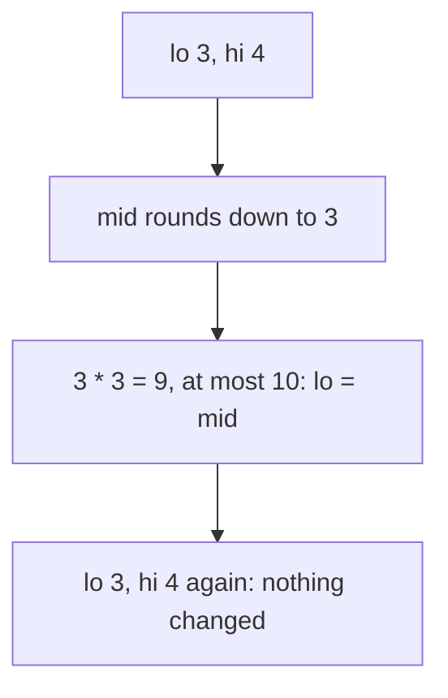
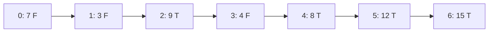

# Common binary search mistakes

## The idea

A binary search is a few lines long and easy to get almost right. Almost every bug in one breaks one of three conditions, and checking them is a short proof that the code is correct:

1. **An invariant.** A statement about the positions outside the interval that holds before the loop and after every step. For the [bound search](../lower-and-upper-bounds/guide.md) `first_true`: every position before `lo` is false, and every position from `hi` on is true.
2. **Progress.** Every step removes at least one position from the interval, so the loop ends.
3. **A monotone predicate.** The yes/no question switches once, from false to true, and never back. Sorted data is the usual way to get one; it is not the requirement itself.

When the loop ends, the interval is empty, and the invariant, read at that moment, is the answer. If the three conditions hold, the search is right for every input. If one of them fails, the search is wrong for some input, often only for an empty array, a single element, or a target beyond either end, which is why a few random tests miss it.

Two practical rules follow from them:

- The three lines that set the interval style, the start, the loop condition and the move after "too big", must belong to [the same style](../searching-a-sorted-array/guide.md#two-ways-to-write-the-interval), half-open or closed.
- A move that keeps `mid` in the interval, `hi = mid` or `lo = mid`, makes progress only if `mid` can never equal that bound.

## A worked example

Find the largest whole number `k` with `k * k <= 10`, which is 3. The question "is `k * k <= 10`?" is true, true, true, true, then false from 4 on: true **first**. A natural first attempt keeps the interval `[lo, hi]` of candidates and moves `lo` up to any `mid` that is still true:

```text
lo, hi = 0, 10
while lo < hi:
    mid = lo + (hi - lo) / 2      # rounds down
    if mid * mid <= 10: lo = mid   # mid is still a candidate: keep it
    else:               hi = mid - 1
```

| Step | `lo` | `hi` | `mid` | `mid * mid` | Move |
|------|------|------|-------|-------------|------|
| 1 | 0 | 10 | 5 | 25 | Too big: `hi = 4` |
| 2 | 0 | 4 | 2 | 4 | Fits: `lo = 2` |
| 3 | 2 | 4 | 3 | 9 | Fits: `lo = 3` |
| 4 | 3 | 4 | 3 | 9 | Fits: `lo = 3`, no change |
| 5 | 3 | 4 | 3 | 9 | The same, forever |

The invariant holds throughout: the answer is always between `lo` and `hi`. What fails is progress. Once `hi = lo + 1`, the midpoint rounds down to `lo`, and the true branch sets `lo` to the value it already has.



<!-- text-of-mermaid sha256:0609db233946cd9f6ed45c6cb498d57d499533253afd3a2234851064c8971589 -->
```text
┌─────────────────────────────────┐
│            lo 3, hi 4           │
└────────────────┬────────────────┘
                 ▼
┌─────────────────────────────────┐
│       mid rounds down to 3      │
└────────────────┬────────────────┘
                 ▼
┌─────────────────────────────────┐
│ 3 * 3 = 9, at most 10: lo = mid │
└────────────────┬────────────────┘
                 ▼
┌─────────────────────────────────┐
│lo 3, hi 4 again: nothing changed│
└─────────────────────────────────┘
```

Two fixes, both correct:

- **Round the midpoint up** when the true branch is `lo = mid`: `mid = lo + (hi - lo + 1) / 2` is always greater than `lo`, so `lo = mid` always moves. The rule: a branch that keeps `mid` must use the rounding that keeps `mid` away from that bound, down for `hi = mid` and up for `lo = mid`.
- **Search for the first false instead, and subtract one.** The first `k` with `k * k > 10` is 4, found by `first_true`, whose moves are `hi = mid` with a midpoint rounded down and `lo = mid + 1`: both always shrink the interval. The answer is `4 - 1 = 3`. Every "last true" question can be asked this way, and then there is only one loop to get right.

The program below runs the stuck loop with a step limit, checks both fixes, then shows the other mistakes of this guide one by one:

```python examples/mistakes.py
"""Four ways a binary search goes wrong, each caught by running it: a loop that stops moving, a predicate
that is not monotone, floating-point midpoints that stop moving, and a one-character bug that a brute
force over small inputs finds at once."""

import math
from collections.abc import Callable
from itertools import combinations_with_replacement


def first_true(lo: int, hi: int, is_true: Callable[[int], bool]) -> int:
    """The smallest i in [lo, hi) with is_true(i), or hi: correct when is_true is monotone."""
    while lo < hi:
        mid = lo + (hi - lo) // 2
        if is_true(mid):
            hi = mid
        else:
            lo = mid + 1
    return lo


# 1. No progress: the largest k with k * k <= n, searched with lo = mid and a midpoint rounded down.
def isqrt_stuck(n: int, max_steps: int = 7) -> int | None:
    lo, hi = 0, n
    for _ in range(max_steps):
        if lo >= hi:
            return lo
        mid = lo + (hi - lo) // 2  # rounds down, so mid == lo once hi == lo + 1
        print(f"  lo {lo:2}  hi {hi:2}  mid {mid}  {mid} * {mid} = {mid * mid}")
        if mid * mid <= n:
            lo = mid  # keeps mid: nothing changes when mid == lo
        else:
            hi = mid - 1
    return None  # gave up; without the step limit the loop would never end


def isqrt_round_up(n: int) -> int:
    lo, hi = 0, n
    while lo < hi:
        mid = lo + (hi - lo + 1) // 2  # rounds up, so mid > lo and lo = mid always moves
        if mid * mid <= n:
            lo = mid
        else:
            hi = mid - 1
    return lo


def isqrt_first_false(n: int) -> int:
    return first_true(0, n + 1, lambda k: k * k > n) - 1  # the first k that is too big, minus one


print("largest k with k * k <= 10, using lo = mid and a midpoint rounded down:")
print("  ->", isqrt_stuck(10))
fixed = all(isqrt_round_up(n) == isqrt_first_false(n) == math.isqrt(n) for n in range(2000))
print("both fixes match math.isqrt for 0..1999:", fixed)
big = 10**40 + 12345
print("and for 10**40 + 12345:", isqrt_round_up(big) == isqrt_first_false(big) == math.isqrt(big))

# 2. Predicates that are not monotone: first_true finds *a* switch from F to T, not the first T.
readings = [7, 3, 9, 4, 8, 12, 15]  # not sorted
print("readings >= 8:  ", " ".join("T" if r >= 8 else "F" for r in readings))
print("  first_true says", first_true(0, len(readings), lambda i: readings[i] >= 8), "but the first T is at 2")
ages = [1, 3, 5, 5, 7, 9]  # sorted, but equality is still not monotone
print("ages == 3:      ", " ".join("T" if a == 3 else "F" for a in ages))
print("  first_true says", first_true(0, len(ages), lambda i: ages[i] == 3), "(none) but 3 is at 1")
print("  ages >= 3 finds", first_true(0, len(ages), lambda i: ages[i] >= 3), "then one equality check")


# 3. Real numbers: near 1e16 neighbouring doubles are 2 apart, so the midpoint can equal an end.
def bisect_real(
    lo: float, hi: float, is_true: Callable[[float], bool], eps: float, max_steps: int
) -> tuple[int, float]:
    steps = 0
    while hi - lo > eps and steps < max_steps:
        mid = (lo + hi) / 2
        if is_true(mid):
            hi = mid
        else:
            lo = mid
        steps += 1
    return steps, hi - lo


def bisect_until_stuck(lo: float, hi: float, is_true: Callable[[float], bool]) -> tuple[int, float]:
    steps = 0
    while True:
        mid = (lo + hi) / 2
        if not lo < mid < hi:  # no double strictly between: the interval cannot shrink any more
            return steps, hi - lo
        if is_true(mid):
            hi = mid
        else:
            lo = mid
        steps += 1


target = 1e16 + 2
print("math.ulp(1e16) =", math.ulp(1e16))
print("stop when hi - lo <= 1e-9: (steps, gap) =", bisect_real(0.0, target, lambda x: x >= target, 1e-9, 2000))
print("stop when no midpoint is left: (steps, gap) =", bisect_until_stuck(0.0, target, lambda x: x >= target))


# 4. A brute force over every small input finds a one-character bug in an upper bound.
def upper_bound_buggy(items: list[int], x: int) -> int:
    return first_true(0, len(items), lambda i: items[i] >= x)  # should be >


def upper_bound_spec(items: list[int], x: int) -> int:
    return sum(1 for value in items if value <= x)  # in a sorted array, that count is the upper bound


cases = [
    (list(items), x)
    for length in range(5)
    for items in combinations_with_replacement(range(3), length)  # every sorted array over 0, 1, 2
    for x in range(-1, 4)
]
failures = [(items, x) for items, x in cases if upper_bound_buggy(items, x) != upper_bound_spec(items, x)]
items, x = failures[0]
print(f"{len(cases)} cases, {len(failures)} failures; the first: items {items}, x {x}:", end=" ")
print(f"got {upper_bound_buggy(items, x)}, expected {upper_bound_spec(items, x)}")
```

It prints:

```output examples/mistakes.py
largest k with k * k <= 10, using lo = mid and a midpoint rounded down:
  lo  0  hi 10  mid 5  5 * 5 = 25
  lo  0  hi  4  mid 2  2 * 2 = 4
  lo  2  hi  4  mid 3  3 * 3 = 9
  lo  3  hi  4  mid 3  3 * 3 = 9
  lo  3  hi  4  mid 3  3 * 3 = 9
  lo  3  hi  4  mid 3  3 * 3 = 9
  lo  3  hi  4  mid 3  3 * 3 = 9
  -> None
both fixes match math.isqrt for 0..1999: True
and for 10**40 + 12345: True
readings >= 8:   F F T F T T T
  first_true says 4 but the first T is at 2
ages == 3:       F T F F F F
  first_true says 6 (none) but 3 is at 1
  ages >= 3 finds 1 then one equality check
math.ulp(1e16) = 2.0
stop when hi - lo <= 1e-9: (steps, gap) = (2000, 2.0)
stop when no midpoint is left: (steps, gap) = (52, 2.0)
175 cases, 60 failures; the first: items [0], x 0: got 0, expected 1
```

The trace repeats the same line until the step limit stops it; the fixed versions agree with Python's `math.isqrt` up to 1999 and on a 41-digit number, since Python's integers have no fixed size. The other three parts are explained in the sections below: a predicate that is not monotone, floating-point midpoints, and the brute-force check.

## Mixed intervals and off-by-one answers

Each interval style is consistent on its own; a line from the other style breaks it. Start half-open, `hi = n`, and loop with the closed condition `lo <= hi`: when the target is larger than every value, `lo` climbs to `n`, the condition still holds, and the loop reads the element at position `n`, one past the end. Every other mix fails on some input too. The cure is to take all three lines from one style, rather than to adjust whichever line a failing test points at.

Off-by-one errors also hide in what the search returns:

- A bound search returns a position from 0 to `n`. `n` has no element, and "the last position before it" is `bound - 1`, which is -1 when the bound is 0. Check both ends before reading.
- "First true" and "last true" differ by one, as the square root shows: the first `k` that is too big, minus one, is the last `k` that fits.
- "Last true" and "last false" are mirror questions, and swapping `>=` for `>` moves the answer across a whole block of equal values. The brute force at the end of the program catches exactly this.

## Overflow and underflow

[`lo + hi` can overflow](../searching-a-sorted-array/guide.md#computing-the-midpoint) a fixed-width integer even when both fit: write `lo + (hi - lo) / 2`. The mirror problem appears with **unsigned** indexes, which cannot hold -1:

- In Rust, indexes are `usize`. By default, `0 - 1` panics in a debug build ("attempt to subtract with overflow") and wraps around to the largest `usize` in a release build, where overflow checks are off unless enabled with `-C overflow-checks`.
- In Go, unsigned arithmetic wraps silently, by the language's specification, in every build.

A closed interval decrements its bounds: `hi = mid - 1` when `mid` is 0, and `hi = n - 1` when the array is empty. Both reach below zero. In Go:

```go examples/underflow.go
// With unsigned indexes, a bound cannot go below zero: 0 - 1 wraps around to the largest value.
// Go's unsigned arithmetic wraps silently, so the bug shows up later, as an index far out of range.
package main

import (
	"fmt"
	"math"
)

func closedSearch(values []int, target int) {
	lo, hi := uint64(0), uint64(len(values))-1
	for lo <= hi {
		mid := lo + (hi-lo)/2
		fmt.Printf("  lo %d  hi %d  mid %d  value %d\n", lo, hi, mid, values[mid])
		if values[mid] == target {
			fmt.Println("  found")
			return
		}
		if values[mid] < target {
			lo = mid + 1
		} else {
			hi = mid - 1
		}
		if hi == math.MaxUint64 {
			fmt.Printf("  hi = mid - 1 wrapped to %d, so lo <= hi still holds\n", hi)
			fmt.Println("  the next step would index values with a number that large: a panic")
			return
		}
	}
	fmt.Println("  absent")
}

// The half-open version never subtracts from a bound, so it has nothing to wrap.
func halfOpenSearch(values []int, target int) string {
	lo, hi := uint64(0), uint64(len(values))
	for lo < hi {
		mid := lo + (hi-lo)/2
		if values[mid] == target {
			return fmt.Sprintf("found at %d", mid)
		}
		if values[mid] < target {
			lo = mid + 1
		} else {
			hi = mid
		}
	}
	return "absent"
}

func main() {
	values := []int{10, 20, 30, 40, 50}
	fmt.Println("closed interval, unsigned indexes, searching for 5:")
	closedSearch(values, 5)

	var empty []int
	fmt.Println("an empty slice: uint64(len(empty)) - 1 =", uint64(len(empty))-1)

	fmt.Println("half-open, searching for 5:", halfOpenSearch(values, 5))
	fmt.Println("half-open, searching for 40:", halfOpenSearch(values, 40))
	fmt.Println("half-open, empty slice:", halfOpenSearch(empty, 5))
}
```

It prints:

```output examples/underflow.go
closed interval, unsigned indexes, searching for 5:
  lo 0  hi 4  mid 2  value 30
  lo 0  hi 1  mid 0  value 10
  hi = mid - 1 wrapped to 18446744073709551615, so lo <= hi still holds
  the next step would index values with a number that large: a panic
an empty slice: uint64(len(empty)) - 1 = 18446744073709551615
half-open, searching for 5: absent
half-open, searching for 40: found at 3
half-open, empty slice: absent
```

Searching for 5, smaller than everything, moves `hi` left until `mid` is 0, and `0 - 1` becomes 18,446,744,073,709,551,615. The condition `lo <= hi` is still true, so the loop would go on and index the slice with that number. An empty slice wraps before the loop even starts. The half-open search has nothing to wrap, since it never subtracts from a bound: `hi = mid` and `lo = mid + 1` stay between 0 and `n`. With unsigned indexes, the half-open style is the safe default; in Rust, `checked_sub` returns `None` instead of wrapping when a subtraction must stay.

## Predicates that are not monotone

`first_true` assumes the predicate switches once. Given one that does not, it still returns something: a position where false is followed by true, but not necessarily the first true position, and with no error. The program shows two cases:



<!-- text-of-mermaid sha256:7d6931e1bbc5396484da8e02d7637966dcc6eb8d5fd98ea167cbafc90789b0ec -->
```text
┌──────┐    ┌──────┐    ┌──────┐    ┌──────┐    ┌──────┐    ┌───────┐    ┌───────┐
│0: 7 F├───►│1: 3 F├───►│2: 9 T├───►│3: 4 F├───►│4: 8 T├───►│5: 12 T├───►│6: 15 T│
└──────┘    └──────┘    └──────┘    └──────┘    └──────┘    └───────┘    └───────┘
```

- **Unsorted data.** "At least 8" on the readings switches three times. The search looked at position 3, saw false, and never looked left of it again, so it reported 4.
- **Equality as the predicate.** Even on sorted data, "equals 3" is false, true, then false again, so the search slid past the only match and reported "none". Search for "at least 3", which is monotone, and test equality once at the end.

The same mistake appears in larger forms: a [feasibility check](../binary-search-on-the-answer/guide.md) that is not monotone, or a rotated array searched as if it were sorted ([rotated and implicit structures](../rotated-and-implicit-search/guide.md)). Before writing the loop, say in words why the answer cannot switch back.

## Real numbers

Searching over real numbers, such as a rate or a length, works the same way with `mid = (lo + hi) / 2` and no rounding, until the interval is as narrow as the numbers can be. Doubles are spaced unevenly: Python's `math.ulp(1e16)` is 2.0, so no double lies strictly between `1e16` and `1e16 + 2`, and their midpoint rounds to one of them. A loop that stops when `hi - lo <= 1e-9` then runs forever, since the gap stays 2. In the program it ran into its limit of 2000 steps with the gap still 2.0.

Two ways to stop safely:

- Stop when the midpoint is no longer strictly between the ends: then the interval cannot shrink any more. The program's second version stopped after 52 steps.
- Run a fixed number of steps, chosen for the precision you need. Each step halves the interval, so `k` steps divide it by `2^k`.

A tolerance relative to the size of the numbers is a third option, but it must stay above their spacing at the scale of the answer.

## When to use it

- Writing any binary search by hand: check the three conditions before running it, and say which style the interval is.
- Reading one in a review: find the invariant first, then check that each branch keeps it and shrinks the interval.
- Choosing between a library and your own loop: if a [library bound](../lower-and-upper-bounds/guide.md#the-standard-libraries) expresses the question, use it, since its edge cases are tested; write your own when the predicate is not a comparison with one value.
- Debugging a search that hangs or fails rarely: trace it on arrays of length 0, 1 and 2, with the target before, at and after each element.

## Common traps

- **Testing only big random inputs.** Most binary search bugs live at the edges: the empty array, one element, two elements, a target outside the range. A few hundred tiny cases, every sorted array of length up to 4 over three values, as in the program, cover all of them in milliseconds.
- **Returning `mid` from a bound search.** A bound search ends when the interval is empty; the answer is `lo`, which may be a position `mid` never visited.
- **Fixing a symptom.** Making a failing test pass without checking the three conditions again can trade one bug for another.
- **Assuming a library sorts or checks.** Library searches assume sorted input and do not verify it; their result on unsorted data is undefined or "unspecified and meaningless".
- **Trusting a floating-point tolerance.** `while hi - lo > eps` can run forever, as above.

## Complexity

| Mistake | What it costs |
|---------|---------------|
| No progress | An endless loop, on some inputs only |
| A predicate that is not monotone | A wrong answer, in O(log n) time and with no error |
| `lo + hi` overflow | A negative or wrong index, only for large bounds |
| Unsigned underflow | A panic in Rust debug builds, a huge index otherwise |
| A floating-point tolerance below the spacing | An endless loop |

Checking all small inputs is cheap: there are `C(L + v - 1, L)` sorted arrays of length `L` over `v` values, so lengths 0 to 4 over 3 values give 1 + 3 + 6 + 10 + 15 = 35 arrays, and 175 cases with five targets each, as the program counted.

## Expert notes

- **The proof is the code review.** For any binary search, write down three things: what is known outside the interval, why each branch keeps that true, and why each branch shrinks the interval. A loop for which one of the three cannot be written down has a bug, even if every test passes.
- **A variant proves termination.** `hi - lo` is a whole number, at least 0, and decreases on every step; such a quantity can only decrease a finite number of times. Asserting that it decreased, in a debug build, turns an endless loop into an immediate failure.
- **Compare against a specification, not against another search.** The program's brute force compares the upper bound with "how many values are at most `x`", a definition with no search in it. Comparing two binary searches with each other can agree on the same wrong answer.
- **One loop, reused.** Writing `first_true` once, testing it exhaustively, and expressing every search as a predicate leaves only the predicate to get right in each new problem.
- **The JDK's midpoint bug.** Java's own `Arrays.binarySearch` overflowed in `(low + high) >> 1` until Java 6 ([searching a sorted array](../searching-a-sorted-array/guide.md#expert-notes)): the invariant and the progress were right, and the arithmetic was not.

## Practice

- `cstudy start debug-binary-search-bounds`: a binary search that passes most of its tests and fails some; find the inputs that break it, then fix it.
- `cstudy start debug-unsigned-underflow`: a search ported to Rust that crashes on some queries; find out why and fix it.

## Further reading

- [Python `math.isqrt` and `math.ulp`](https://docs.python.org/3/library/math.html): the integer square root (3.8), and the value of the least significant bit of a float (3.9).
- [Python tutorial: floating-point arithmetic](https://docs.python.org/3/tutorial/floatingpoint.html): almost all platforms map Python floats to IEEE 754 binary64 values, with 53 bits of precision.
- [The Rust Reference: overflow](https://doc.rust-lang.org/reference/expressions/operator-expr.html#overflow): integer operators panic on overflow in debug mode; `-C overflow-checks` controls it.
- [The Rust book: integer overflow](https://doc.rust-lang.org/book/ch03-02-data-types.html#integer-overflow): a panic in debug builds, two's complement wrapping with `--release`, and the `checked_*` methods.
- [Rust `usize::checked_sub`](https://doc.rust-lang.org/std/primitive.usize.html#method.checked_sub): `None` if the subtraction overflows.
- [The Go specification: integer overflow](https://go.dev/ref/spec#Integer_overflow): unsigned operations are computed modulo 2ⁿ, and overflow never panics.
