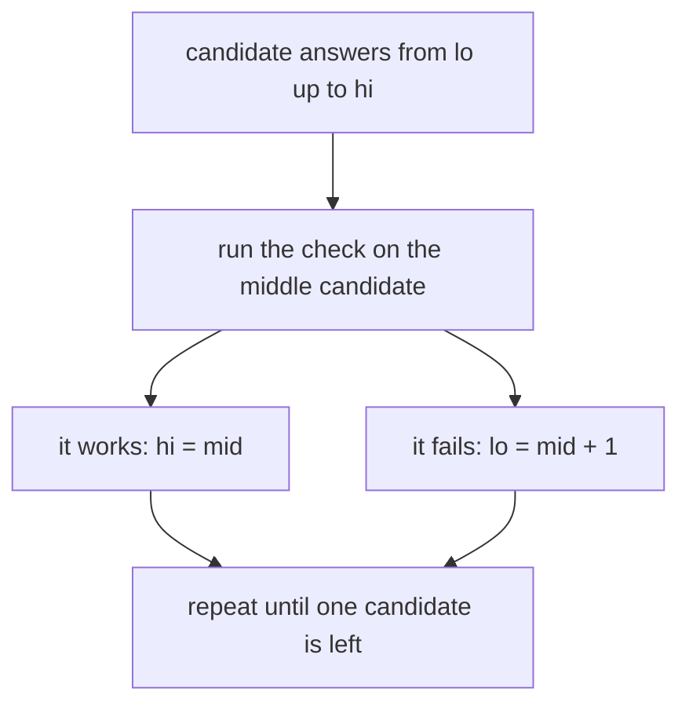
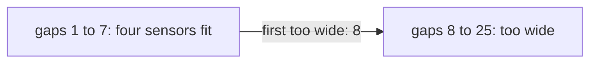

# Binary search on the answer

## The idea

Some questions ask for the best value of something: the smallest capacity that is enough, the earliest time something becomes possible, the largest distance that can be kept. Trying every value one by one is slow when the values run into the millions. Often, though, a different question is easy:

> Does this particular value work?

That question is a **feasibility check**. Now suppose it is **monotone** in the value: when a capacity is enough, every larger capacity is enough too. Then the answers over all candidate values read no, no, no, then yes, yes, yes, and the smallest value that works is the first yes. That is exactly what a [bound search](../lower-and-upper-bounds/guide.md) finds, with one difference: there is no array. The "array" is the range of candidate values, and each "element" is computed when the search asks for it, by running the check.

The recipe has four steps:

1. **Name the answer and its range.** What number is being optimized, and between which two values must it lie?
2. **Write the check.** Given one candidate value, decide yes or no. Fixing the value often makes the problem easy: a greedy pass, a count, a reachability search.
3. **Say why the check is monotone**, in one sentence. Usually: "if this value works, the next one does too, because the same plan still works".
4. **Search for the boundary** with `first_true` over the range. To find the *largest* value that works, search for the first value that does not, and subtract one.



<!-- text-of-mermaid sha256:bc011dc0edcb2db55e1fa363fa6be704206290afc559c3727af4e89635274e70 -->
```text
┌─────────────────────────────────────┐
│  candidate answers from lo up to hi │
└──────────────────┬──────────────────┘
                   ▼
┌─────────────────────────────────────┐
│run the check on the middle candidate│
└─────────────────────────────────────┘
                   ▼───────────────────────────────────▼
┌─────────────────────────────────────┐    ┌──────────────────────┐
│          it works: hi = mid         │    │it fails: lo = mid + 1│
└──────────────────┬──────────────────┘    └───────────┬──────────┘
                   ▼───────────────────────────────────┘
┌─────────────────────────────────────┐
│  repeat until one candidate is left │
└─────────────────────────────────────┘
```

Each check halves the candidates, so a range of a billion values needs about 30 checks. If one check costs O(n), the whole search costs O(n log R) for a range of R values.

## A worked example

Nine fence posts stand at these distances from the gate, in metres: `0 3 4 7 11 12 18 20 25`. Four sensors go on four of the posts, and they interfere when they are close, so the **closest two should be as far apart as possible**. What is the largest such distance?

**The answer and its range.** The answer is a distance, the **gap**, a whole number of metres. A gap of 1 always works, since the posts are at different whole-metre spots, and no gap can exceed 25, the length of the fence.

**The check.** Given a gap, can four sensors stand on posts with every two at least that far apart? Put the first sensor on the first post, and each next sensor on the first post at least `gap` beyond the previous one; the gap works if that places four sensors. Why is this greedy right? Compare it with any placement that works, sensor by sensor. The greedy's first sensor is on the first post, so it is no further along than the other's first. If the greedy's sensor number `i` is no further along than the other's, then the other's next sensor is at least `gap` beyond the other's sensor `i`, hence at least `gap` beyond the greedy's: a post the greedy was allowed to take, so its next sensor is no further along either. By the end, the greedy has placed at least as many sensors as any placement that works.

**Monotone.** Sensors that are at least 8 metres apart are also at least 7 metres apart. So if a gap works, every smaller gap works: yes, yes, ..., then no from some gap on.

| Gap | 1 | 2 | 3 | 4 | 5 | 6 | 7 | 8 | 9 | 10 | 11 | 12 |
|-----|---|---|---|---|---|---|---|---|---|----|----|----|
| Fits | yes | yes | yes | yes | yes | yes | yes | no | no | no | no | no |



<!-- text-of-mermaid sha256:18542c640048299b73c8371a2b9d073007d0883935050efc594d10dc5df4df92 -->
```text
┌─────────────────────────────┐                   ┌──────────────────────┐
│gaps 1 to 7: four sensors fit├─first─too─wide:─8►│gaps 8 to 25: too wide│
└─────────────────────────────┘                   └──────────────────────┘
```

**The search.** The answer is the last gap that fits, so search for the first gap that is too wide, over `[1, 26)`, and subtract one:

| Step | Interval | Gap tried | Greedy places sensors at | Too wide? | Move |
|------|----------|-----------|--------------------------|-----------|------|
| 1 | `[1, 26)` | 13 | 0, 18 | yes: only 2 | `hi = 13` |
| 2 | `[1, 13)` | 7 | 0, 7, 18, 25 | no: 4 fit | `lo = 8` |
| 3 | `[8, 13)` | 10 | 0, 11, 25 | yes: 3 | `hi = 10` |
| 4 | `[8, 10)` | 9 | 0, 11, 20 | yes: 3 | `hi = 9` |
| 5 | `[8, 9)` | 8 | 0, 11, 20 | yes: 3 | `hi = 8` |
| | `[8, 8)` | | | | The first gap too wide is 8, so the answer is 7 |

Five checks of nine posts each, against 25 checks for trying every gap and 126 for trying every choice of four posts out of nine.

```python examples/answer_search.py
"""Binary search on the answer: no sorted array, only a yes/no check that is monotone in the answer.

Sensors go on posts along a fence. Place k of them so that the closest two are as far apart as possible.
"""

from bisect import bisect_left
from collections.abc import Callable
from itertools import combinations


def first_true(lo: int, hi: int, is_true: Callable[[int], bool]) -> int:
    """The smallest i in [lo, hi) with is_true(i), or hi when there is none."""
    while lo < hi:
        mid = lo + (hi - lo) // 2
        if is_true(mid):
            hi = mid
        else:
            lo = mid + 1
    return lo


posts = [0, 3, 4, 7, 11, 12, 18, 20, 25]  # metres along the fence, sorted
k = 4


def fits(gap: int) -> bool:
    """Can k sensors stand on posts with every two at least gap apart? Greedy: each sensor on the
    first post far enough from the previous one, which leaves the most room for the rest."""
    count, last = 1, posts[0]
    for post in posts[1:]:
        if post - last >= gap:
            count, last = count + 1, post
    return count >= k


print("gap:  ", " ".join(f"{gap:2}" for gap in range(1, 13)))
print("fits: ", " ".join(" T" if fits(gap) else " F" for gap in range(1, 13)))

# fits is true, then false. The answer is the last true gap: one less than the first false one.
span = posts[-1] - posts[0]


def too_wide(gap: int) -> bool:
    print(f"  try gap {gap:2}: {'fits' if fits(gap) else 'too wide'}")
    return not fits(gap)


print(f"search the gaps 1..{span}:")
first_too_wide = first_true(1, span + 1, too_wide)
print("largest gap:", first_too_wide - 1)

# The same search with bisect: a range is a sequence whose elements are computed, not stored.
gaps = range(1, span + 2)
print("with bisect over a range:", gaps[bisect_left(gaps, True, key=lambda gap: not fits(gap))] - 1)

# Checking every choice of k posts agrees, at a cost that grows much faster.
best = max(min(b - a for a, b in zip(chosen, chosen[1:])) for chosen in combinations(posts, k))
print(f"every choice of {k} posts out of {len(posts)}: largest gap {best}")
```

It prints:

```output examples/answer_search.py
gap:    1  2  3  4  5  6  7  8  9 10 11 12
fits:   T  T  T  T  T  T  T  F  F  F  F  F
search the gaps 1..25:
  try gap 13: too wide
  try gap  7: fits
  try gap 10: too wide
  try gap  9: too wide
  try gap  8: too wide
largest gap: 7
with bisect over a range: 7
every choice of 4 posts out of 9: largest gap 7
```

The table of T and F is the check over the first twelve gaps: monotone, as argued. The search tried the same five gaps as the table above. The bisect line does the same search with the standard library: a `range` computes its elements instead of storing them, so `bisect_left` can search the gaps through `key=`, which turns each gap into False or True, while the value searched for, `True`, is compared as it is. The last line tries every choice of four posts and agrees.

## Setting up the search

- **The range must contain the answer.** `lo` must be a value at or below the answer, and the search interval must reach a value that is known to fail, or one past the largest candidate, so that "nothing fails" is a possible result. If the range is too narrow, `first_true` returns its end, which is then not an answer.
- **The direction.** For "the smallest value that works", the check is false then true: search for the first true. For "the largest value that works", it is true then false: search for the first false and subtract one, as above. Writing a separate "last true" loop invites [the endless loop of `lo = mid`](../binary-search-mistakes/guide.md#a-worked-example).
- **Overflow.** Candidate values can be large, so `lo + hi` can overflow even where indexes never would: write [`lo + (hi - lo) / 2`](../searching-a-sorted-array/guide.md#computing-the-midpoint). The check overflows too when it adds up large values in a fixed-width type: a sum of 100,000 values of up to a billion needs 64 bits.
- **Real-valued answers.** For a rate or a length, bisect with a fixed number of steps, or until no midpoint is left between the ends, never with a tolerance alone ([real numbers](../binary-search-mistakes/guide.md#real-numbers)).

Go's `sort.Search` takes any range `[0, n)` and a predicate, not a slice, so it searches values as readily as positions. The second half of this program shows the overflow on a range of large values:

```go examples/answer_search.go
// On the answer, the "array" is a range of values. sort.Search walks any range [0, n) with a
// predicate, and a value range can be large enough for lo + hi to overflow an int64.
package main

import (
	"fmt"
	"sort"
)

var posts = []int{0, 3, 4, 7, 11, 12, 18, 20, 25}

// fits reports whether k sensors can stand on posts with every two at least gap apart.
func fits(gap, k int) bool {
	count, last := 1, posts[0]
	for _, post := range posts[1:] {
		if post-last >= gap {
			count, last = count+1, post
		}
	}
	return count >= k
}

func main() {
	span := posts[len(posts)-1] - posts[0]
	// The smallest gap in [0, span + 1) that is too wide: sort.Search's index is a gap here.
	firstTooWide := sort.Search(span+1, func(gap int) bool { return !fits(gap, 4) })
	fmt.Println("largest gap for 4 sensors:", firstTooWide-1)

	lo, hi := int64(5_000_000_000_000_000_000), int64(9_000_000_000_000_000_000)
	fmt.Println("(lo + hi) / 2      =", (lo+hi)/2)
	fmt.Println("lo + (hi - lo) / 2 =", lo+(hi-lo)/2)

	// The first value of at least the threshold in [lo, hi): 62 steps cover four quintillion values.
	threshold := int64(7_123_456_789_012_345_678)
	steps := 0
	for lo < hi {
		mid := lo + (hi-lo)/2
		if mid >= threshold {
			hi = mid
		} else {
			lo = mid + 1
		}
		steps++
	}
	fmt.Println("found", lo, "in", steps, "steps")
}
```

It prints:

```output examples/answer_search.go
largest gap for 4 sensors: 7
(lo + hi) / 2      = -2223372036854775808
lo + (hi - lo) / 2 = 7000000000000000000
found 7123456789012345678 in 62 steps
```

`sort.Search` returned the first gap that is too wide, 8, so the answer is again 7. `lo + hi` is 14 quintillion, more than an `int64` holds, so it wrapped to a negative number; `lo + (hi - lo) / 2` did not. The last search covered four quintillion values in 62 steps, since four quintillion lies between 2⁶¹ and 2⁶².

## When to use it

- The question asks for an extreme: "the smallest ... that is enough", "the earliest time when ...", "minimize the largest ...", "maximize the smallest ...".
- With the answer fixed, the problem becomes a yes/no question that a greedy pass, a count or a search answers.
- That yes/no answer is monotone, and you can say why in one sentence.
- The range of values is large, but the check is fast: about log₂ R checks replace R of them.

Use something else when:

- The check is not monotone: more is not always better, or it is better up to a point and worse after. No search finds a single boundary then.
- A direct argument gives the answer, such as a formula, or a greedy that builds the optimum itself.
- Only a few candidate answers exist: sort them and binary-search the sorted list, or try them all.

## Common traps

- **A check that is not monotone.** "Exactly k groups" is often not monotone where "at most k groups" is. Phrase the check so that the same plan still works when the value moves the safe way.
- **A range that misses the answer.** Starting `lo` above the answer, or stopping `hi` below it, returns a bound, not the answer. Derive both ends from the problem: the least value that could ever work and the most that could ever be needed.
- **Mixing up the direction.** "Smallest that works" is the first true; "largest that works" is the first false minus one. Write which one in a comment.
- **Overflow in the check.** The check often sums or multiplies large values; in Java or Go, use 64-bit integers, and stop summing once the total already decides the answer.
- **A check wrong at its edges.** The greedy above must start at the first post and count the first sensor; off by one there and every answer shifts.
- **Searching floats with a tolerance.** It can loop forever; use a step count.

## Complexity

| Approach | Time | Space |
|----------|------|-------|
| Try every candidate value | O(R · C) | The check's |
| Binary search on the answer | O(C · log R): at most ⌊log₂ R⌋ + 1 checks | The check's |
| The sensors, with an O(n) greedy check | O(n log L), for a fence of length L | O(1) |
| The sensors, trying every choice of `k` posts | O(C(n, k) · k) | O(k) |

Here `R` is the number of candidate values and `C` the cost of one check. The count of checks has the [same proof](../searching-a-sorted-array/guide.md#complexity) as any bound search. For R up to 10⁹ that is at most 30 checks; for 10¹⁸, at most 60. The bound assumes the check's answer is monotone; the search itself never verifies it.

## Expert notes

- **Optimization through decision.** The search turns "find the best value" into about log₂ R questions of the form "is this value good enough?". Whenever the decision question is easier than the optimization, which is often, this costs only a logarithmic factor.
- **The answer is often one of a few values.** For the sensors, the best gap is always the distance between two posts, so there are at most `n(n - 1) / 2` candidates. Searching the sorted list of candidates takes about log₂(n²) checks instead of log₂ L; for a long fence with few posts, that can be fewer checks, at the cost of building and sorting the list. Searching the whole integer range is simpler, and usually enough.
- **The check can be expensive.** A breadth-first search, a dynamic program, a simulation: the search multiplies its cost by log R and nothing more, so a check of O(n²) on a range of 10⁹ costs about 30 × n².
- **The libraries.** Python's `bisect` searches a `range` through `key=` (Python 3.10 and later), since a `range` is a sequence that computes its elements. Go's `sort.Search(n, f)` takes the range `[0, n)` and calls `f` only inside it. Rust's `partition_point` is a method of slices, so searching a range of values without first building a slice of them takes a loop of your own.
- **Real numbers.** Each bisection step halves the interval, so after 60 steps an interval of width W has width W / 2⁶⁰; doubles carry 53 bits of precision, so beyond a certain point more steps change nothing ([real numbers](../binary-search-mistakes/guide.md#real-numbers)).

## Practice

- `cstudy start koko-eating-bananas`: the slowest steady eating speed that still finishes every pile in time.
- `cstudy start split-array-largest-sum`: cut an array into `k` runs of consecutive elements so that the largest run sum is as small as possible.
- `cstudy start swim-rising-water`: the earliest time at which a route exists across a grid as the water rises.

## Further reading

- [Python `bisect`](https://docs.python.org/3/library/bisect.html): `key=` since 3.10, applied to the elements and not to the value searched for.
- [Python `range`](https://docs.python.org/3/library/stdtypes.html#ranges): a range stores only its start, stop and step, computes its items as needed, and implements the `Sequence` ABC.
- [Go `sort.Search`](https://pkg.go.dev/sort#Search): the smallest index in `[0, n)` where `f` is true, calling `f` only inside that range.
- [The Go specification: integer overflow](https://go.dev/ref/spec#Integer_overflow): signed overflow wraps without a panic.
- [Rust slice `partition_point`](https://doc.rust-lang.org/std/primitive.slice.html#method.partition_point): a method of slices.
- [Python tutorial: floating-point arithmetic](https://docs.python.org/3/tutorial/floatingpoint.html): binary64 values carry 53 bits of precision.
