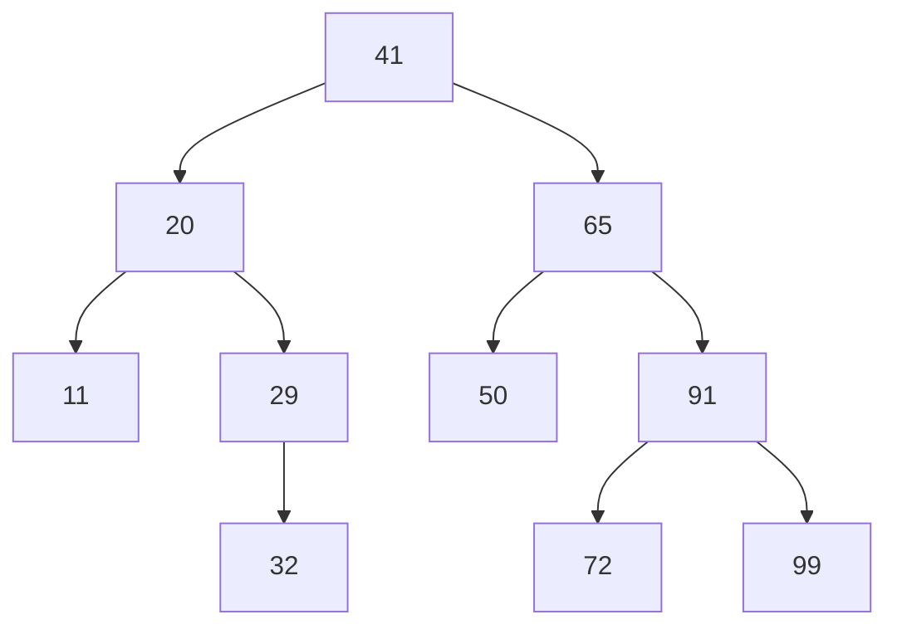
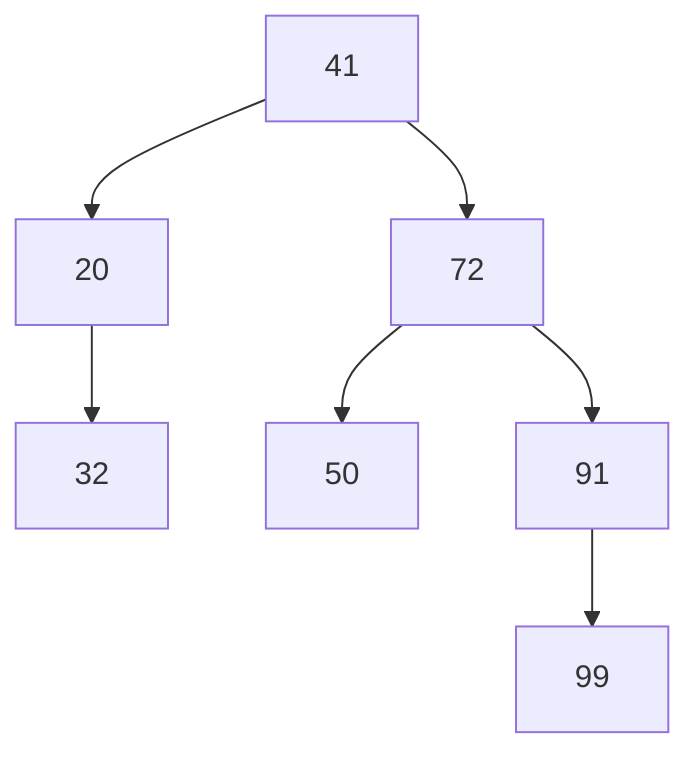
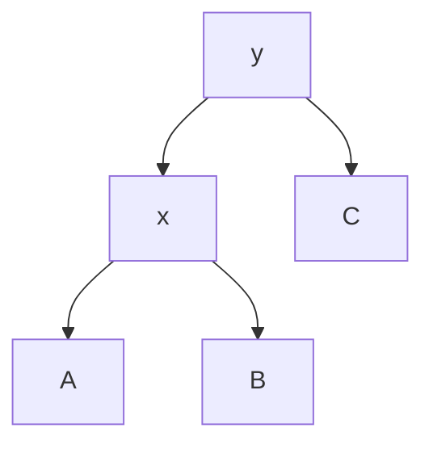
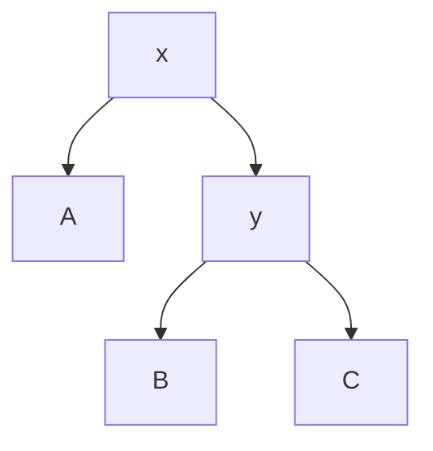

# Binary search trees

## The idea

Binary search finds a key in a sorted array in O(log n) comparisons, but inserting a key into a sorted array means shifting everything after it, O(n). A **binary search tree** (BST) keeps the fast search and makes insertion cheap too, by storing the keys in a binary tree instead of an array.

Every node of a BST obeys one rule, the **ordering invariant**:

> Every key in a node's left subtree is smaller than the node's key, and every key in its right subtree is larger.

The rule is about whole subtrees, not just the two children: a key anywhere below the left child must still be smaller than the node. That is what makes searching work. Standing at a node, you compare the key you want with the node's key. If they are equal, you have found it. If yours is smaller, it cannot be anywhere on the right, so you go left; if larger, you go right. Each comparison discards a whole subtree, and the search follows a single path down. It costs one comparison per level: at most the height plus one.

Everything else follows from the search:

- **Insert** searches for the key. If it is not there, the search falls off the tree at an empty place, and that place is exactly where the key belongs: attach it there as a new leaf.
- **The nearest key**, the largest key at or below a value (its **floor**), is a search that remembers the best candidate seen on the way down.
- **Delete** finds the node, then removes it in a way that keeps the invariant, in one of three cases described below.
- **In-order** traversal, left subtree, node, right subtree, lists the keys in increasing order.

Duplicates need a policy. The code here keeps keys distinct, so inserting a key that is already present changes nothing. Other choices are a count in each node, or always sending equal keys to one side.

## A worked example

Insert the keys 41, 20, 65, 11, 29, 50, 91, 32, 72 and 99, in that order, into an empty tree. 41 becomes the root. 20 is smaller, so it goes left; 65 is larger and goes right. 11 goes left of 41 and left of 20. 29 goes left of 41, then right of 20. 50 goes right of 41, then left of 65. 91 goes right twice. 32 goes left, right, right: below 29, on its right. 72 goes right of 41, right of 65, left of 91. 99 goes right three times.



<!-- text-of-mermaid sha256:e945cbbd74729f30aea8e23fd9d41214b522ff60af2bd4dd7442ef72c0ace1bb -->
```text
┌──┐
│41│
└──┘
  ▼───────▼
┌──┐    ┌──┐
│20│    │65│
└──┘    └──┘
  ▼───────▼───────▼───────▼
┌──┐    ┌──┐    ┌──┐    ┌──┐
│11│  ┌─┤29│    │50│    │91│
└──┘  │ └──┘    └──┘    └──┘
  ▼───┘   ▼───────▼───────┘
┌──┐    ┌──┐    ┌──┐
│32│    │72│    │99│
└──┘    └──┘    └──┘
```

Check the invariant at the root: everything below 20 (11, 29, 32) is smaller than 41, and everything below 65 (50, 72, 91, 99) is larger. It holds at every other node too.

**Search for 32.** 32 is smaller than 41: go left. Larger than 20: go right. Larger than 29: go right. Equal to 32: found, after 4 comparisons, one per level.

**Search for 55.** Larger than 41: right. Smaller than 65: left. Larger than 50: right, but 50 has no right child. The search falls off: 55 is not in the tree. If you inserted 55 now, it would become 50's right child, the place where the search fell off.

**Floor of 55,** the largest key at most 55. 41 is at most 55, so it is a candidate, and anything larger can only be on its right: go right. 65 is too large: go left. 50 is at most 55 and better than 41: the new candidate; go right, and fall off. The answer is 50. A hash map cannot answer this question at all without looking at every key.

**Delete** has three cases, depending on how many children the node has:

1. **No children**: remove the leaf. Deleting 11 just empties 20's left side.
2. **One child**: the child takes the node's place. Deleting 29 lifts 32 into its spot, as 20's right child. Everything below 29 was larger than 20, so the invariant still holds.
3. **Two children**: the node's key is replaced by its **successor**, the smallest key of its right subtree, and the successor is deleted from that subtree instead. To delete 65, step right to 91, then left as far as possible: 72. Copy 72 into 65's node, and delete the old 72, a leaf. The successor works because it is larger than everything on the left side and smaller than everything else on the right side. And it never has a left child, since a left child would be smaller, so removing it is always case 1 or 2.

Deleting 65, then 29, then 11 leaves this tree:



<!-- text-of-mermaid sha256:5dd4fd82e2467bf70485ebf48bbea53d57b8ffd68d833a200cb351c1ba41704c -->
```text
┌──┐
│41│
└──┘
  ▼───────▼
┌──┐    ┌──┐
│20│    │72│
└─┬┘    └──┘
  ▼       ▼───────▼
┌──┐    ┌──┐    ┌──┐
│32│    │50│    │91│
└──┘    └──┘    └─┬┘
                  │
┌──┐              │
│99│◄─────────────┘
└──┘
```

**In-order** lists the keys sorted. The reason is the invariant applied at every level: in-order lists the whole left subtree, whose keys are all smaller, then the node, then the whole right subtree, whose keys are all larger; and the same holds inside each subtree.

```python examples/bst.py
"""A binary search tree of distinct integer keys: search, insert, the nearest key at or below a
value, delete, and the in-order listing."""

from dataclasses import dataclass


@dataclass
class Node:
    key: int
    left: "Node | None" = None
    right: "Node | None" = None


def search(root: Node | None, key: int) -> list[int]:
    """The keys compared on the way down; the last one is the key itself if it is present."""
    path = []
    node = root
    while node:
        path.append(node.key)
        if key == node.key:
            break
        node = node.left if key < node.key else node.right
    return path


def insert(root: Node | None, key: int) -> Node:
    if root is None:
        return Node(key)
    if key < root.key:
        root.left = insert(root.left, key)
    elif key > root.key:
        root.right = insert(root.right, key)
    return root  # an equal key is already present: nothing changes


def floor(root: Node | None, value: int) -> int | None:
    """The largest key that is at most value, or None."""
    best = None
    node = root
    while node:
        if node.key <= value:
            best = node.key  # a candidate; a larger one can only be to the right
            node = node.right
        else:
            node = node.left
    return best


def delete(root: Node | None, key: int) -> Node | None:
    if root is None:
        return None
    if key < root.key:
        root.left = delete(root.left, key)
    elif key > root.key:
        root.right = delete(root.right, key)
    elif root.left is None:  # no child, or only a right child: lift it up
        return root.right
    elif root.right is None:  # only a left child
        return root.left
    else:  # two children: take the smallest key of the right subtree
        successor = root.right
        while successor.left:
            successor = successor.left
        root.key = successor.key
        root.right = delete(root.right, successor.key)
    return root


def in_order(node: Node | None) -> list[int]:
    if node is None:
        return []
    return [*in_order(node.left), node.key, *in_order(node.right)]


root = None
for key in [41, 20, 65, 11, 29, 50, 91, 32, 72, 99]:
    root = insert(root, key)
print("in-order:", in_order(root))
print("search 32 compares", search(root, 32))
print("search 55 compares", search(root, 55), "and falls off: not found")
print("floor(55) =", floor(root, 55), "| floor(10) =", floor(root, 10))

for key in (65, 29, 11):  # two children, then one child, then none
    root = delete(root, key)
    print(f"delete {key}: in-order {in_order(root)}")
print("the root's children are now", root.left.key, "and", root.right.key)
```

It prints:

```output examples/bst.py
in-order: [11, 20, 29, 32, 41, 50, 65, 72, 91, 99]
search 32 compares [41, 20, 29, 32]
search 55 compares [41, 65, 50] and falls off: not found
floor(55) = 50 | floor(10) = None
delete 65: in-order [11, 20, 29, 32, 41, 50, 72, 91, 99]
delete 29: in-order [11, 20, 32, 41, 50, 72, 91, 99]
delete 11: in-order [20, 32, 41, 50, 72, 91, 99]
the root's children are now 20 and 72
```

Search, insert, floor and delete each walk one path from the root, so each costs O(h). The code uses loops for search and floor and recursion for insert and delete, to show both styles; every one of them can be written either way.

## Why balance matters

The height decides everything, and the height depends on the order of insertion. Insert keys in increasing order and every new key is larger than all the others: it goes right at every node and becomes the new deepest node. The tree is a path, and a search is a linear scan with extra steps.

```python examples/balance.py
"""The same keys, inserted in a different order, make search trees of very different heights.

Each insert walks down from the root and attaches the new key below the last key it compared,
so the number of keys it compared is the new key's depth. Depths never change afterwards (there
are no deletes here), so the deepest insert gives the height, and a later search for a key
compares its depth plus one keys."""

import math
import random


def build(keys: list[int]) -> tuple[int, float]:
    """Insert the keys into an empty tree; return (height, average comparisons)."""
    left: dict[int, int] = {}
    right: dict[int, int] = {}
    root = keys[0]
    height, total = 0, 1
    for key in keys[1:]:
        node, depth = root, 0
        while True:  # a loop, not recursion: the sorted case is 999 levels deep
            depth += 1
            side = left if key < node else right
            if node not in side:
                side[node] = key
                break
            node = side[node]
        height = max(height, depth)
        total += depth + 1
    return height, total / len(keys)


def shuffled(n: int, seed: int) -> list[int]:
    """A Fisher-Yates shuffle on random(), whose sequence for a seed Python keeps stable."""
    keys = list(range(n))
    rng = random.Random(seed)
    for i in range(n - 1, 0, -1):
        j = int(rng.random() * (i + 1))
        keys[i], keys[j] = keys[j], keys[i]
    return keys


for n in (1_000, 100_000):
    print(f"{n} keys, the shortest possible height: {math.floor(math.log2(n))}")
    for name, keys in (("sorted", list(range(n))), ("shuffled", shuffled(n, seed=2026))):
        if name == "sorted" and n > 1_000:
            continue  # 100,000 sorted inserts would compare about 5 * 10**9 keys
        height, average = build(keys)
        print(f"  {name:>8} order: height {height:>3}, {average:6.1f} comparisons per search")
```

It prints:

```output examples/balance.py
1000 keys, the shortest possible height: 9
    sorted order: height 999,  500.5 comparisons per search
  shuffled order: height  24,   11.9 comparisons per search
100000 keys, the shortest possible height: 16
  shuffled order: height  40,   21.2 comparisons per search
```

The same 1,000 keys make a tree of height 999 when inserted in sorted order, and 24 when shuffled; the best possible is 9. A search then compares 500 keys on average instead of about 12. With 100,000 shuffled keys the height is 40, still within a small factor of the best possible 16. Random order keeps a plain BST shallow, but a program rarely chooses the order of its input, and sorted or nearly sorted input is common: increasing ids, timestamps, already sorted files.

**Balanced search trees** remove the dependence on order. They restructure themselves on every insert and delete to keep the height O(log n) whatever the order, using **rotations**: a local rearrangement of a parent and a child that changes the heights below them but not the in-order sequence.

Here is a right rotation at y. Before it, y is the parent, with x as its left child; A, B and C stand for whole subtrees, possibly empty.



<!-- text-of-mermaid sha256:92f5405c74f4b5ba65613561064b51a015ceab76fd63a2b2fac6b948fff4d8f4 -->
```text
┌─┐
│y│
└─┘
 ▼──────▼
┌─┐    ┌─┐
│x│    │C│
└─┘    └─┘
 ▼──────▼
┌─┐    ┌─┐
│A│    │B│
└─┘    └─┘
```

The rotation lifts x into y's place, makes y the right child of x, and hands B, which sat between x and y, to y as its new left subtree:



<!-- text-of-mermaid sha256:cb77004c591161e3dc27af0703c35d1ab8e73106b3cfb45a967e1d3687161cd1 -->
```text
┌─┐
│x│
└─┘
 ▼──────▼
┌─┐    ┌─┐
│A│    │y│
└─┘    └─┘
 ▼──────▼
┌─┐    ┌─┐
│B│    │C│
└─┘    └─┘
```

Before the rotation, an in-order walk reads A, x, B, y, C. After it, still A, x, B, y, C, so the invariant survives. But A has moved up a level and C down one: a rotation shifts height from one side to the other, which is how a balanced tree repairs a side that has grown too deep. Two standard libraries show two designs: Java's `TreeMap` is a red-black tree, and Rust's `BTreeMap` a B-tree, which keeps many keys in each node.

## When to use it

- **You need order as well as lookup**: the nearest key above or below a value, every key in a range, the smallest or largest key, or the keys in sorted order, while keys keep being inserted and deleted. Use a balanced tree from the library: `TreeMap` and `TreeSet` in Java, `BTreeMap` and `BTreeSet` in Rust.
- **You only need exact lookups.** A hash map answers them in O(1) on average, against O(log n) for a balanced tree. Choose the tree only for its order.
- **The keys rarely change.** A sorted array with binary search (`bisect` in Python) uses less memory and searches as fast. Python's documentation notes that inserting into a sorted list is dominated by the O(n) insertion step, so it suits data that is mostly read.
- **You only ever need the smallest or the largest.** A [heap](../heaps/guide.md) is simpler and faster for that alone.

Write your own BST to learn how it works, or when a problem asks for one. In production code, use the library's balanced tree: an unbalanced tree is a performance bug waiting for sorted input.

## Common traps

- **Feeding sorted data to a plain BST.** The tree degenerates into a path, every operation becomes O(n), and a recursive insert or traversal can exceed the call stack, as in the 999-level tree above.
- **Deleting a node with two children by unlinking it.** Its two subtrees need one parent. Replace its key with its successor (or, symmetrically, its predecessor, the largest key of its left subtree), then delete that node instead.
- **No policy for duplicates.** Code that sends equal keys left on insert but searches right for them will never find them. Choose one rule and use it in every operation.
- **Changing a key while it is in the tree.** The node stays where its old key put it, so searches for the new key go the wrong way. Rust's `BTreeMap` documentation calls modifying a key so that its ordering changes a logic error; remove the entry and insert it again instead.
- **A comparison that disagrees with equality.** Java's `TreeMap` compares keys only with `compareTo` or the comparator, and its documentation requires that ordering to be consistent with `equals` for the map to behave as a `Map`. Two different objects that compare as 0 are one key to a `TreeMap`.

## Complexity

With `h` the height of the tree:

| Operation | Cost | Balanced tree, `h = O(log n)` | Worst plain BST, `h = n - 1` |
|-----------|------|-------------------------------|------------------------------|
| Search, insert, delete | O(h) | O(log n) | O(n) |
| Floor, ceiling, smallest, largest | O(h) | O(log n) | O(n) |
| In-order listing of all keys | O(n) | O(n) | O(n) |
| Building from n inserts | O(n·h) at most | O(n log n) | O(n²) |
| Memory | O(n) | O(n) | O(n) |

A plain BST built from keys in random order stays shallow on average, as the run above shows, but nothing guarantees it. A balanced tree guarantees O(log n) per operation in the worst case, at the cost of the restructuring code.

## Expert notes

- **Java `TreeMap`.** Its documentation describes a red-black tree with guaranteed log(n) time for `containsKey`, `get`, `put` and `remove`, adapted from Cormen, Leiserson and Rivest's *Introduction to Algorithms*. It is a `NavigableMap`: `floorKey` returns the greatest key less than or equal to a given key, `ceilingKey` the least key greater than or equal, and `subMap` a view of a key range.
- **Rust `BTreeMap`.** A B-tree puts between B - 1 and 2B - 1 keys in each node, in a contiguous array. Its documentation explains the trade: a binary tree allocates a node per key and risks a cache miss on every comparison, while a B-tree cuts the allocations by a factor of B and keeps the keys of a node together. It searches each node linearly, which its documentation says takes about B·log(n) comparisons, more than a binary tree, yet performs very well in practice. Its iterators produce items in key order.
- **Why rotations are safe.** A rotation moves one subtree from one parent to another and swaps a parent with its child, three link changes in all, and leaves the in-order sequence unchanged, so it can never break the invariant. A balanced tree only has to decide when to rotate. OpenJDK's `TreeMap` source shows it: insertion and deletion end in fix-up routines that recolour nodes and call `rotateLeft` and `rotateRight`, each marked as taken from the same textbook.
- **Floor and ceiling are one path.** The floor walk never backtracks: at each node it either records a candidate and goes right, or goes left, so it costs O(h). Ceiling is the mirror image. A sorted array answers both with one binary search, the same `bisect` call that finds an insertion point.
- **Random order is an average, not a promise.** The shuffled runs above give heights of 24 and 40, both about 2.4 times log2 n, while sorted input gives n - 1. An adversary, or an unlucky data source, can always supply the bad order to a plain BST, which is why the libraries above ship balanced trees.

## Practice

- `cstudy start validate-bst`: decide whether a binary tree obeys the ordering invariant everywhere.
- `cstudy start kth-smallest-in-bst`: find the value of a given rank in a binary search tree.
- `cstudy start bst-iterator`: hand out a binary search tree's values in increasing order, one call at a time.

## Further reading

- [Java `TreeMap`](https://docs.oracle.com/en/java/javase/21/docs/api/java.base/java/util/TreeMap.html): a red-black tree with guaranteed log(n) operations, `floorKey`, `ceilingKey`, `subMap`, and consistency with `equals`.
- [Rust `BTreeMap`](https://doc.rust-lang.org/std/collections/struct.BTreeMap.html): the B-tree design and why it beats a binary tree on real machines, and the rule against changing a key in place.
- [OpenJDK `TreeMap` source](https://github.com/openjdk/jdk/blob/master/src/java.base/share/classes/java/util/TreeMap.java): `rotateLeft`, `rotateRight`, `fixAfterInsertion` and `fixAfterDeletion`.
- [Python `bisect`](https://docs.python.org/3/library/bisect.html): binary search on a sorted list, and the O(n) cost of `insort`.
- [NIST: binary search tree](https://xlinux.nist.gov/dads/HTML/binarySearchTree.html): the definition.
