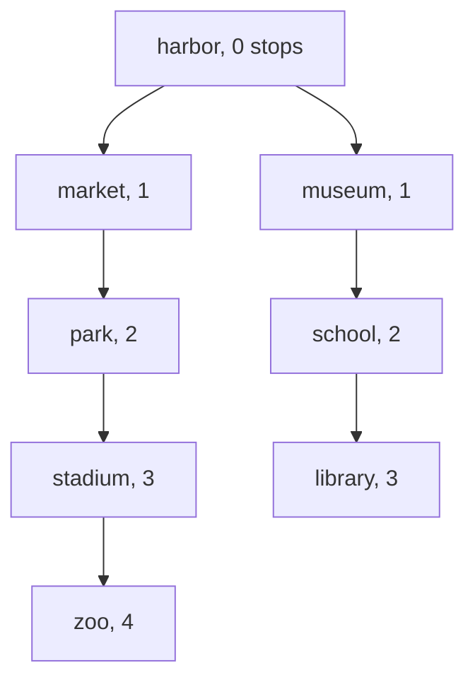

# Breadth-first search

## The idea

Drop a stone in a pond and the ripples reach every point in order of distance. **Breadth-first search** (BFS) explores a graph the same way: first the start, then every node one edge away, then every node two edges away, and so on. The nodes at the same distance form a **level**, and the level a node is first found at is the fewest edges between it and the start. That is why BFS is the tool for "fewest steps" questions in a graph whose edges all cost the same.

One data structure does the ordering: a **queue**, first in, first out. Take a node from the front, look at its neighbors, and put each one not seen before at the back. Nodes one step away go in before any node two steps away, because they are found first, so they also come out first.

Three pieces of bookkeeping make it correct and fast:

1. **A visited set**, so that a node reached by several routes is handled once and a cycle cannot send the search round forever.
2. **When to mark.** A node is marked visited when it is **discovered**, the moment it is put into the queue, not later when it is taken out. Then no node is ever in the queue twice.
3. **Where each node came from.** Recording the node it was discovered from, its **parent**, costs one entry per node and lets you rebuild a shortest route afterwards by walking the parents back to the start.

In Python the queue is `collections.deque`: `append` adds at the back and `popleft` takes from the front, each in about constant time. A plain list is the wrong tool, because `pop(0)` shifts every remaining element, which Python's documentation describes as O(n) memory movement.

## A worked example

### Fewest stops on a tram map

A small tram network, stored as an adjacency list: each station lists the stations one stop away. Every stop counts the same, so the fewest stops from `harbor` to each station is a BFS.

```python examples/tram_bfs.py
"""Breadth-first search on a tram map: fewest stops from harbor to every station, and a route."""

from collections import deque

lines = {
    "harbor": ["market", "museum"],
    "market": ["harbor", "park"],
    "museum": ["harbor", "park", "school"],
    "park": ["market", "museum", "stadium"],
    "school": ["museum", "library", "stadium"],
    "stadium": ["park", "school", "zoo"],
    "library": ["school"],
    "zoo": ["stadium"],
}


def bfs(start: str) -> tuple[dict[str, int], dict[str, str | None]]:
    stops = {start: 0}  # doubles as the visited set
    came_from: dict[str, str | None] = {start: None}
    queue = deque([start])
    while queue:
        station = queue.popleft()
        for nearby in lines[station]:
            if nearby not in stops:  # mark it now, when it is discovered
                stops[nearby] = stops[station] + 1
                came_from[nearby] = station
                queue.append(nearby)
        print(f"take {station:<8} queue: {list(queue)}")
    return stops, came_from


stops, came_from = bfs("harbor")

levels: dict[int, list[str]] = {}
for station, count in stops.items():
    levels.setdefault(count, []).append(station)
for count, stations in levels.items():
    print(f"level {count}: {stations}")

route = []
station: str | None = "zoo"
while station is not None:
    route.append(station)
    station = came_from[station]
print("route:", " -> ".join(reversed(route)), f"({stops['zoo']} stops)")
```

It prints:

```output examples/tram_bfs.py
take harbor   queue: ['market', 'museum']
take market   queue: ['museum', 'park']
take museum   queue: ['park', 'school']
take park     queue: ['school', 'stadium']
take school   queue: ['stadium', 'library']
take stadium  queue: ['library', 'zoo']
take library  queue: ['zoo']
take zoo      queue: []
level 0: ['harbor']
level 1: ['market', 'museum']
level 2: ['park', 'school']
level 3: ['stadium', 'library']
level 4: ['zoo']
route: harbor -> market -> park -> stadium -> zoo (4 stops)
```

Follow the queue line by line:

- Taking `harbor` discovers `market` and `museum`, both 1 stop away.
- Taking `market` discovers `park`, at 2. Its other neighbor, `harbor`, is already marked.
- Taking `museum` discovers `school`, at 2. It also sees `park`, which `market` discovered a moment ago: `park` is already marked, so it is not queued a second time. That one check is what keeps the work linear.
- `park` discovers `stadium` and `school` discovers `library`, both at 3; `stadium` discovers `zoo`, at 4. `library` and `zoo` discover nothing new, and the queue runs dry.

At every moment the queue holds at most two neighboring levels, the nearer one in front: after `market` is taken, it holds `museum` (level 1) then `park` (level 2). The levels come out in order, which is the whole trick.

The parents form a **BFS tree**: each station hangs under the station it was discovered from, at the depth of its distance.



<!-- text-of-mermaid sha256:17366e6215144b01ececec8b2dd250a99a0a31785f602964e3e3b7f8c33f8509 -->
```text
┌───────────────┐
│harbor, 0 stops│
└───────────────┘
        ▼──────────────────▼
┌───────────────┐    ┌──────────┐
│   market, 1   │    │museum, 1 │
└───────┬───────┘    └─────┬────┘
        ▼                  ▼
┌───────────────┐    ┌──────────┐
│    park, 2    │    │school, 2 │
└───────┬───────┘    └─────┬────┘
        ▼                  ▼
┌───────────────┐    ┌──────────┐
│   stadium, 3  │    │library, 3│
└───────┬───────┘    └──────────┘
        ▼
┌───────────────┐
│     zoo, 4    │
└───────────────┘
```

Each row of the drawing is one level of the search, the frontier it reached at that distance. Two tram lines are missing from the tree, `museum`–`park` and `school`–`stadium`: they led to stations that were already discovered, so they gave no parent. The route the program prints walks the tree from `zoo` up to `harbor` and reverses it. There is a second route of 4 stops, through `museum`, `school` and `stadium`; BFS reports the one it discovered first, which depends on the order of the neighbor lists. Both are shortest.

### When to mark: on discovery

The same distances come out if you mark a node when it leaves the queue instead, and skip any copy of it that comes out later. The cost does not stay the same. This program runs both versions on a club of 30 members in which everybody knows everybody.

```python examples/when_to_mark.py
"""Mark a node when it enters the queue, not when it leaves: same distances, very different costs.

The graph is a club of 30 members in which everybody knows everybody, so every node is discovered
again and again."""

from collections import deque

MEMBERS = 30
everyone = range(MEMBERS)
knows = {member: [other for other in everyone if other != member] for member in everyone}


def mark_on_entry(start: int) -> tuple[dict[int, int], int]:
    distance = {start: 0}
    pushes = 1
    queue = deque([start])
    while queue:
        node = queue.popleft()
        for other in knows[node]:
            if other not in distance:
                distance[other] = distance[node] + 1
                queue.append(other)
                pushes += 1
    return distance, pushes


def mark_on_exit(start: int) -> tuple[dict[int, int], int]:
    distance: dict[int, int] = {}
    pushes = 1
    queue = deque([(start, 0)])
    while queue:
        node, steps = queue.popleft()
        if node in distance:  # a copy that waited in the queue while another copy was handled
            continue
        distance[node] = steps
        for other in knows[node]:
            if other not in distance:
                queue.append((other, steps + 1))
                pushes += 1
    return distance, pushes


early, early_pushes = mark_on_entry(0)
late, late_pushes = mark_on_exit(0)
print("same distances:", early == late)
print("pushes when marking on entry:", early_pushes)
print("pushes when marking on exit: ", late_pushes)
```

It prints:

```output examples/when_to_mark.py
same distances: True
pushes when marking on entry: 30
pushes when marking on exit:  436
```

Marking on discovery pushes each member once: 30 pushes. Marking on exit lets a member be pushed by every member taken out before it, 29 + 28 + ... + 1 copies plus the start, 436 pushes, almost all of them thrown away. On a graph with V nodes where everybody knows everybody, that is about V²/2 pushes instead of V, and the queue's memory grows with it. Drop the skip check as well, and every copy is expanded again, which multiplies the waste.

### A graph nobody listed: two jugs

A classic puzzle: with a 3-litre jug, a 5-litre jug and a tap, measure exactly 4 litres. You may fill a jug, empty it, or pour one into the other until the source is empty or the target is full.

There is no map to search, but there is a graph: a **state** is the pair (litres in the small jug, litres in the big jug), and its neighbors are the states one move away. The search computes them when it reaches a state, as the [grid](../graph-representations/guide.md) was computed on demand.

```python examples/two_jugs.py
"""BFS over states nobody listed: measure exactly 4 litres with a 3-litre jug and a 5-litre jug.

A node is a state (litres in the small jug, litres in the big jug), and its neighbors are the states
one pour away, computed when the search reaches it."""

from collections import deque

SMALL, BIG, GOAL = 3, 5, 4


def moves(state: tuple[int, int]):
    small, big = state
    pour_into_big = min(small, BIG - big)
    pour_into_small = min(big, SMALL - small)
    yield "fill small", (SMALL, big)
    yield "fill big", (small, BIG)
    yield "empty small", (0, big)
    yield "empty big", (small, 0)
    yield "small into big", (small - pour_into_big, big + pour_into_big)
    yield "big into small", (small + pour_into_small, big - pour_into_small)


start = (0, 0)
came_from: dict[tuple[int, int], tuple[tuple[int, int], str] | None] = {start: None}
queue = deque([start])
found = None
while queue and found is None:
    state = queue.popleft()
    for move, after in moves(state):
        if after not in came_from:
            came_from[after] = (state, move)
            if GOAL in after:
                found = after
                break
            queue.append(after)

steps = []
state = found
while came_from[state] is not None:
    previous, move = came_from[state]
    steps.append(f"{move:<15} -> {state}")
    state = previous
every_state = (SMALL + 1) * (BIG + 1)
print(f"{len(steps)} pours, after discovering {len(came_from)} of the {every_state} states:")
for step in reversed(steps):
    print(" ", step)
```

It prints:

```output examples/two_jugs.py
6 pours, after discovering 14 of the 24 states:
  fill big        -> (0, 5)
  big into small  -> (3, 2)
  empty small     -> (0, 2)
  big into small  -> (2, 0)
  fill big        -> (2, 5)
  big into small  -> (3, 4)
```

Six moves is the minimum, and BFS proves it: the goal was discovered at level 6, after every state of levels 0 to 5 had been discovered, none of them a goal. Of the 24 possible pairs, 16 are reachable: after every move at least one jug is full or empty, which rules out the 8 pairs, such as (1, 1), where neither is. The search stopped after discovering 14 of the 16. It stops as soon as it discovers a goal state, which is safe for BFS: a node is discovered first at its smallest level, so nothing found later can be closer.

## Why the first discovery is the shortest

Every distance BFS records is the length of a real route, the chain of parents back to the start, so no recorded distance is smaller than the true one. The question is whether it can be larger. It cannot, and the argument runs from the start outwards.

Two facts come from the queue. A node's recorded distance is one more than that of the node that discovered it. And the queue is always sorted by recorded distance, holding at most two values, some `k` in front and `k + 1` behind: taking a node of distance `k` from the front and appending nodes of `k + 1` at the back keeps it that way. So nodes leave the queue in order of their recorded distance.

Now take a node `v` whose shortest route has `d` edges, and let `u` be the node just before it on that route, `d - 1` edges from the start. Suppose, as holds for the start and then level after level, that `u` was recorded at its true distance, `d - 1`. When `u` leaves the queue, either `v` is still undiscovered, and `u` discovers it at `d`, or `v` was discovered earlier, by a node that left the queue no later than `u` and so has a recorded distance of at most `d - 1`, which gives `v` at most `d`. Either way `v` is recorded at no more than `d`, and with the first fact, exactly `d`.

The argument uses one assumption: every edge counts the same. With weights, a route of more edges can be cheaper, and the first discovery is no longer the best; that is the [weighted shortest paths](../weighted-shortest-paths/guide.md) guide.

## When to use it

- **Fewest steps, moves or hops**, when each one costs the same: fewest stops on a map, fewest moves in a puzzle.
- **Everything within k steps**, or work done level by level: the nodes of each level are together in the queue, and their recorded distance says which level they belong to.
- **The nearest node with some property**: stop at the first one discovered.
- **Reachability**: which nodes can be reached at all. [Depth-first search](../depth-first-search/guide.md) answers this too, and either is fine.
- **Huge or infinite state spaces with a nearby goal**: BFS never wanders deeper than the answer, while a depth-first search can follow one branch forever.

Use something else when edges have different costs (Dijkstra's algorithm, in the [weighted shortest paths](../weighted-shortest-paths/guide.md) guide), when you need cycles, components of a directed graph or an order of dependencies ([depth-first search](../depth-first-search/guide.md), [topological order](../topological-order/guide.md)), or when the levels are very wide and memory is short: the queue holds a whole level at once.

## Common traps

- **Marking on exit.** As the club example showed, a node gets queued many times. Mark it when you put it in.
- **Forgetting to mark the start.** Then a neighbor rediscovers it at distance 2. Put the start in the visited set as you queue it.
- **A list as the queue.** `list.pop(0)` moves every remaining element; on a large graph the search turns quadratic. Use `collections.deque` and `popleft`.
- **Counting the wrong thing.** A recorded distance counts edges. A question may count something else along the route; read what it counts before you return.
- **Stopping in the wrong place.** Checking for the goal when a node is discovered and checking when it leaves the queue both work, if you do it consistently; check the start itself too, since it may already be the goal.
- **Mutable states.** A state must be hashable to go into the visited set. Use tuples or strings, never lists, and build a new value for each neighbor instead of changing the current one.
- **Weights.** BFS on a weighted graph returns the route with the fewest edges, which is not the cheapest one.

## Complexity

With V nodes and E edges stored as adjacency lists:

| Resource | Cost | Why |
|----------|------|-----|
| Time | O(V + E) | Each reachable node is queued and taken out once, thanks to marking on discovery; each of its edges is looked at once, or twice for an undirected edge, once from each end |
| Memory | O(V) | The visited set, the parents and the queue hold at most one entry per node |
| Time, adjacency matrix | O(V²) | Listing a node's neighbors scans a whole row |

For an implicit graph, V and E are the states and moves the search actually reaches, not the whole space, and each neighbor costs whatever building it costs: generating the six jug moves is constant, while a state that is a long string or tuple costs time in proportion to its length to build and to hash. A search with b moves per state that ends at depth d can reach up to about b to the power d states, which is why a nearby goal matters.

## Expert notes

- **History.** C. Y. Lee's 1961 paper "An Algorithm for Path Connections and Its Applications" set out to solve path-connection problems in logical drawing, wiring diagrams and optimal route finding, and programmed its minimal-distance solution on an IBM 704.
- **More than one start.** Nothing in the algorithm requires the queue to begin with a single node.
- **Searching from both ends.** When the goal is known, a second search can run from the goal towards the start, and the two meet in between. The technique exists; it comes with conditions of its own and a stopping rule that needs care.
- **Python's `deque`.** The documentation promises thread-safe, memory-efficient appends and pops from either end in approximately O(1), and says indexing is O(1) at both ends but O(n) in the middle, so use it as a queue, not as an array.
- **Java's `ArrayDeque`.** A resizable array with no capacity limit, not thread-safe, and refusing `null` elements. Its documentation says it is likely faster than `Stack` when used as a stack and faster than `LinkedList` when used as a queue, and that most of its operations run in amortized constant time.

## Practice

- `cstudy start clone-graph`: copy every node of a graph that has cycles, exactly once each.
- `cstudy start shortest-path-binary-matrix`: the shortest route across a grid where diagonal steps are allowed.
- `cstudy start rotting-oranges`: how many minutes until something spreading through a grid has reached everything it can.
- `cstudy start open-the-lock`: the fewest turns from one lock setting to another, avoiding some settings.
- `cstudy start word-ladder`: the shortest chain of words from one word to another, one letter at a time.
- `cstudy start shortest-path-with-removals`: the fewest moves across a grid when you may break through a limited number of obstacles.

## Further reading

- [Python `collections.deque`](https://docs.python.org/3/library/collections.html#collections.deque): O(1) appends and pops at either end, and the O(n) cost of `list.pop(0)` and `list.insert(0, v)`.
- [Java `ArrayDeque`, Java 21](https://docs.oracle.com/en/java/javase/21/docs/api/java.base/java/util/ArrayDeque.html): no capacity limit, no `null` elements, faster than `Stack` and `LinkedList` for their jobs.
- C. Y. Lee, [An Algorithm for Path Connections and Its Applications](https://doi.org/10.1109/TEC.1961.5219222), IEEE Transactions on Electronic Computers EC-10(3), 1961, pages 346 to 365.
