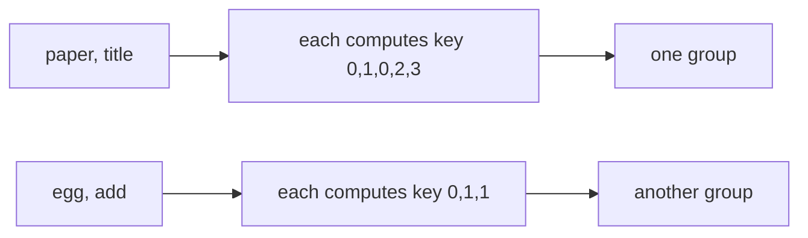

# Canonical keys and grouping

## The idea

A hash map finds things that are **exactly equal**. Real problems often have a looser idea of "the same": two roads are the same whichever end you name first, `2/4` is the same number as `1/2`, two email addresses may be the same mailbox in different letter case. A hash map can still find those, if you give it the right key.

A **canonical key** is a value computed from an item so that two items you consider the same always produce the same key, and two items you consider different never do. Instead of storing the item under itself, you store it under its key. Things you call equal then **collide on purpose**: they land on the same key, and the map groups them for you.

Choosing a canonical key means answering two questions:

1. **What do I want to ignore?** Order, case, scale, sign, whitespace, which end comes first. The key throws that information away.
2. **What must I keep?** Everything that makes two items really different. If the key throws away too much, unequal items collide; if it keeps too much, equal items miss each other.

The common recipes are: **sort** what has no meaningful order, **normalize** what has several spellings (lowercase, trim, reduce a fraction), **count** what is a multiset, and **combine** several facts into a tuple.



<!-- text-of-mermaid sha256:d7c7acdc4ab872b1bb651b21c11bd03a11f1077c081a3dbdf300fad46416e7cd -->
```text
┌────────────┐    ┌───────────────────────────┐    ┌─────────────┐
│paper, title├───►│each computes key 0,1,0,2,3├───►│  one group  │
└────────────┘    └───────────────────────────┘    └─────────────┘

┌────────────┐    ┌───────────────────────────┐    ┌─────────────┐
│  egg, add  ├───►│  each computes key 0,1,1  ├───►│another group│
└────────────┘    └───────────────────────────┘    └─────────────┘
```

In the drawing, `paper` and `title` look nothing alike, but both repeat their first letter in third place and nothing else, so their **shape** keys are equal and they land in one group. The map never compares words with each other: it compares keys.

## A worked example

Here are five canonical keys, each ignoring something different.

```python examples/canonical_keys.py
"""Choosing a key so that the things you call equal collide on purpose."""

from collections import defaultdict
from math import gcd


def group(items, key):
    groups = defaultdict(list)
    for item in items:
        groups[key(item)].append(item)
    return dict(groups)


# 1. Undirected edges: (a, b) and (b, a) are one road. Sort the ends.
roads = [("lyon", "paris"), ("paris", "lyon"), ("lyon", "nice")]
print("distinct roads:", sorted({tuple(sorted(road)) for road in roads}))


# 2. Word shapes: "paper" and "title" repeat letters in the same places.
def shape(word: str) -> tuple[int, ...]:
    first_seen: dict[str, int] = {}
    return tuple(first_seen.setdefault(letter, len(first_seen)) for letter in word)


words = ["paper", "title", "apple", "egg", "add", "foo"]
for key, members in group(words, shape).items():
    print("shape", key, "->", members)


# 3. Fractions: 2/4 and -1/-2 are 1/2. Divide by the gcd and put the sign on the top.
def reduced(fraction: tuple[int, int]) -> tuple[int, int]:
    top, bottom = fraction
    divisor = gcd(top, bottom) * (-1 if bottom < 0 else 1)
    return top // divisor, bottom // divisor


fractions = [(1, 2), (2, 4), (2, 3), (-1, -2), (4, 6), (3, -6)]
for key, members in group(fractions, reduced).items():
    print("value", key, "->", members)

# 4. A key built by gluing strings together can make different things collide.
glued = {"ab" + "c", "a" + "bc"}
print("glued keys for ('ab', 'c') and ('a', 'bc'):", glued)
print("tuple keys keep them apart:", len({("ab", "c"), ("a", "bc")}), "keys")

# 5. One set, tagged keys: a room or a teacher may not be booked twice in one slot.
bookings = [("room 1", "kim", 9), ("room 2", "lee", 9), ("room 1", "lee", 10), ("room 2", "lee", 10)]
taken: set[tuple[str, str, int]] = set()
for room, teacher, hour in bookings:
    for key in (("room", room, hour), ("teacher", teacher, hour)):
        if key in taken:
            print("conflict:", key)
        taken.add(key)
```

It prints:

```output examples/canonical_keys.py
distinct roads: [('lyon', 'nice'), ('lyon', 'paris')]
shape (0, 1, 0, 2, 3) -> ['paper', 'title']
shape (0, 1, 1, 2, 3) -> ['apple']
shape (0, 1, 1) -> ['egg', 'add', 'foo']
value (1, 2) -> [(1, 2), (2, 4), (-1, -2)]
value (2, 3) -> [(2, 3), (4, 6)]
value (-1, 2) -> [(3, -6)]
glued keys for ('ab', 'c') and ('a', 'bc'): {'abc'}
tuple keys keep them apart: 2 keys
conflict: ('teacher', 'lee', 10)
```

Trace each one.

1. **Undirected edges.** A road from Lyon to Paris is the road from Paris to Lyon. Sorting the two ends makes the key ignore direction: both become `('lyon', 'paris')`, and a set of keys holds two distinct roads, not three.
2. **Word shapes.** The key replaces each letter with the position at which that letter was first seen. For `paper`: `p` is new, 0; `a` is new, 1; `p` was seen first at 0; `e` is new, 2; `r` is new, 3. So `paper` becomes `(0, 1, 0, 2, 3)`, and `title` gives the same tuple: `t`, `i`, `t` again, `l`, `e`. `apple` repeats its second letter instead and gets `(0, 1, 1, 2, 3)`. The key ignores which letters are used and keeps where they repeat.
3. **Fractions.** Dividing by the greatest common divisor turns `2/4` into `1/2`. Equal values can still differ in sign, `-1/-2` against `1/2`, so the key also moves the sign to the top: the divisor takes the sign of the bottom, which leaves every bottom positive. `3/-6` becomes `-1/2`, a different value, in a group of its own.
4. **A key that loses information.** Gluing strings, `"ab" + "c"` and `"a" + "bc"`, gives the same `"abc"`: two different pairs collide by accident. A tuple keeps the boundary between its parts, so `("ab", "c")` and `("a", "bc")` stay two keys. If you must build a string key, put a separator that cannot occur in the parts between them, or the length of each part in front of it. [Cryptographic hashes](../cryptographic-hashes/guide.md) meets the same trap with higher stakes.
5. **Tagged keys in one set.** A room may not be booked twice in the same hour, and neither may a teacher. Rather than one set per rule, one set holds tuples tagged with the rule they belong to: `("room", "room 1", 9)` and `("teacher", "kim", 9)` can never be confused, because the tag differs. The fourth booking puts Lee in two rooms at 10, and the teacher key catches it.

### The same idea in JavaScript

JavaScript's `Map` compares keys with SameValueZero: strings and numbers by value, but objects and arrays by **identity**. Two arrays with the same contents are two different keys. A plain object goes the other way and turns every key into a string.

```javascript examples/canonical_keys.mjs
// JavaScript compares Map keys by identity for objects and arrays, and turns plain object keys
// into strings. Both change what a "key" means.

const visits = [["paris", "lyon"], ["paris", "lyon"]];

const byArray = new Map();
for (const route of visits) {
  byArray.set(route, (byArray.get(route) ?? 0) + 1);
}
console.log("Map with array keys:", byArray.size, "entries, each counted once");

const byString = new Map();
for (const route of visits) {
  const key = JSON.stringify(route); // a canonical string: equal arrays give equal keys
  byString.set(key, (byString.get(key) ?? 0) + 1);
}
console.log("Map with JSON keys:", [...byString]);

const plain = {};
plain[["paris", "lyon"]] = "array";
plain[{ city: "nice" }] = "first object";
plain[{ city: "pau" }] = "second object";
console.log("plain object keys:", Object.keys(plain));

const values = new Map([[NaN, "not a number"]]);
console.log("Map finds NaN with NaN:", values.get(NaN));
```

It prints:

```output examples/canonical_keys.mjs
Map with array keys: 2 entries, each counted once
Map with JSON keys: [ [ '["paris","lyon"]', 2 ] ]
plain object keys: [ 'paris,lyon', '[object Object]' ]
Map finds NaN with NaN: not a number
```

The `Map` with array keys counts two different routes, because each array is its own object. `JSON.stringify` turns each array into a canonical string, and the two visits now share a key. The plain object shows the opposite danger: an array key becomes `"paris,lyon"`, and **every** object key becomes the same string `"[object Object]"`, so the second object silently overwrote the first. A `Map` also finds `NaN` with `NaN`, which `===` never does.

## When to use it

- **Grouping**: put together everything that is "the same" in some loose sense: words with the same letters, files with the same content, points on the same line.
- **Deduplicating** by a looser equality: store keys in a set and keep an item only if its key is new.
- **Detecting conflicts**: two things that may not share a slot collide on a key built from the slot. Tagged tuples check several rules with one set.
- **Caching** the result of a function whose answer does not depend on some detail of the input: key the cache by the input with that detail removed.

The sign that you need a canonical key: you are about to compare every item with every other item using some custom notion of equality. Comparing all pairs is O(n²); computing a key per item and hashing it is O(n) keys, each as costly as its computation.

## Common traps

- **A key that ignores too much.** Lowercasing an identifier where case matters, or sorting the letters of words when the question was about the order of letters, makes different things collide.
- **A key that keeps too much.** Leaving trailing whitespace, a sign, or a scale factor in the key keeps equal things apart. Test the key with pairs you know should match.
- **Ambiguous concatenation.** Joining parts with no separator, or with one that can appear inside the parts, makes unequal tuples share a string. Use a real tuple, or encode lengths.
- **Unhashable keys.** A list or a dict cannot be a key in Python; a mutable list as a key in Java breaks when it changes. Convert to a tuple or a frozenset, or build an immutable string.
- **Identity instead of value.** In JavaScript a `Map` or a `Set` compares arrays and objects by identity. In Java, an array used as a key also uses identity, since arrays do not override `equals` and `hashCode`; use a `List` or a record.
- **Expensive keys computed twice.** If the key costs O(L log L) to build, as sorting does, compute it once per item, not once per comparison.

## Complexity

For `n` items, each of size `L`, with a key that costs `K(L)` to compute:

| Step | Time | Space |
|------|------|-------|
| Compute every key | O(n · K(L)) | O(n · size of a key) |
| Group or deduplicate with a hash map | O(n) hashes and comparisons on average, each O(size of a key) | O(n) |
| Compare every pair instead | O(n² · cost of one comparison) | O(1) extra |

Typical key costs: sorting the characters of a word is O(L log L); counting letters over a fixed alphabet of size `A` is O(L + A), and the count tuple itself has `A` entries; normalizing case or whitespace is O(L); reducing a fraction is O(log of the numbers) with Euclid's algorithm. The hash map is O(1) per key **on average**, with the usual assumption of a well-spread hash; hashing a key of size `s` costs O(s), so long keys make each step slower without changing the count of steps.

## Expert notes

- **Canonical form versus invariant.** A canonical form is a key that is itself a member of the class, such as the reduced fraction `1/2` or the sorted edge `('lyon', 'paris')`. An invariant only has to be equal for equal items: a letter count is an invariant of an anagram class. Either works as a key, provided it is also different for different classes. An invariant that is equal for some different classes, such as the length of a word, makes a fine **pre-filter** but a wrong key.
- **Counting keys beat sorting keys on long inputs.** For words over a fixed alphabet, a tuple of 26 counts is computed in O(L), while sorting is O(L log L). For short words the sort is often faster in practice, because building and hashing a 26-entry tuple has a fixed cost.
- **Unicode makes "the same text" hard.** The same accented letter can be stored as one code point or as a letter followed by a combining mark, and case folding is more than lowercasing in some languages. Python's `unicodedata.normalize` and `str.casefold` exist for these cases; decide which equality the problem means before choosing one.
- **Floating-point keys.** `0.1 + 0.2 == 0.3` is false, so values computed in different ways may never share a key. Round to a fixed number of digits, or work in integers or exact fractions, before using numbers as keys.
- **Keys for geometry.** A line through two integer points can be keyed by its reduced direction and offset, the same gcd-and-sign normalization as the fractions above. Without it, the slope `dy/dx` in floating point splits one line into several keys.
- **Tagged keys scale.** One set of tagged tuples replaces several sets, and adding a rule is one more tag. The tag must make keys of different rules unequal, so use a tuple, never a glued string.

## Practice

- `cstudy start group-anagrams`: choose the key that makes anagrams collide. Compare sorting each word with counting its letters.
- `cstudy start valid-sudoku`: several rules over one board. Decide what each key must hold, so that a repeated digit collides with the digit it repeats.

## Further reading

- [MDN: `Map`](https://developer.mozilla.org/en-US/docs/Web/JavaScript/Reference/Global_Objects/Map): SameValueZero, any value as a key, and the comparison with objects, whose keys are strings or symbols.
- [Python `dict`](https://docs.python.org/3/library/stdtypes.html#mapping-types-dict): which values may be keys, and that values comparing equal, such as `1` and `1.0`, are the same key.
- [Python `math.gcd`](https://docs.python.org/3/library/math.html#math.gcd) and [`unicodedata.normalize`](https://docs.python.org/3/library/unicodedata.html#unicodedata.normalize).
- [Java `List.hashCode`](https://docs.oracle.com/en/java/javase/21/docs/api/java.base/java/util/List.html#hashCode()): a list's hash is defined from its elements, so equal lists are equal keys.
