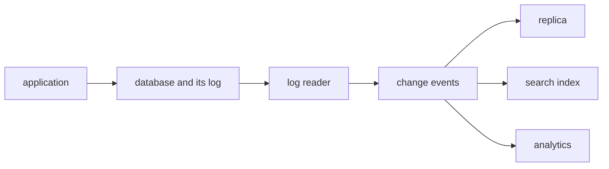
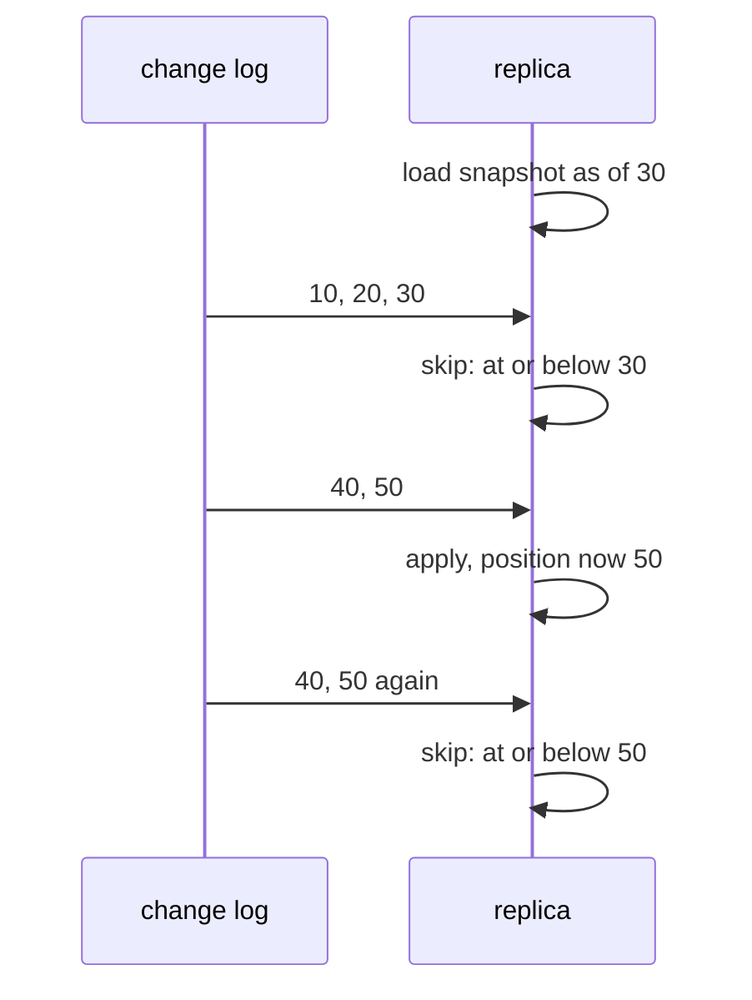

# Change data capture and log-based replication

## The idea

An application keeps its data in a database. Other systems need the same data: a search index, a cache, an analytics store, another service. Copying the whole table every night is slow and a day out of date. **Change data capture** (CDC) copies the *changes* instead: every insert, update and delete, as it happens, to whoever needs them.

The changes are already written down. A database such as PostgreSQL records each change in a **write-ahead log** (WAL), an append-only log, kept as a series of files, of changes in the order they were written, before it changes its data files; its documentation calls this a standard method for ensuring data integrity. That rule is what lets the database recover after a crash, by replaying the log. Each record of the log sits at a **log sequence number** (LSN), a position that only grows. PostgreSQL's documentation, for example, defines its LSN as a byte offset into the WAL, increasing with each new record.

Log-based CDC reads that log and turns each entry into a **change event**:

| Field | Holds |
|-------|-------|
| Operation | Create, update or delete; some formats add others, such as a read for rows copied by a snapshot |
| Key | The primary key of the row that changed |
| Before | The row before the change; empty for an insert |
| After | The row after the change; empty for a delete |
| Position | The LSN, so the reader can say how far it got |
| Source | Metadata about where it came from, such as the table and, on some databases, the transaction |

The events are a stream, in the sense of the guide on batch and streaming: they never end, and each one can be applied as it arrives. A system that applies them to its own copy of the table, a **replica**, stays in step with the source without ever copying the whole table again.



<!-- text-of-mermaid sha256:9cc0aa04e9f816e7f6098706e5b20c963a7ff99e9e5bf493061ff42cb356c5e8 -->
```text
┌───────────┐    ┌────────────────────┐    ┌──────────┐    ┌─────────────┐    ┌────────────┐
│application├───►│database and its log├───►│log reader├───►│change events├───►│  replica   │
└───────────┘    └────────────────────┘    └──────────┘    └──────┬──────┘    └────────────┘
                                                                  │
                                                                  │           ┌────────────┐
                                                                  ├──────────►│search index│
                                                                  │           └────────────┘
                                                                  │
                                                                  │           ┌────────────┐
                                                                  └──────────►│ analytics  │
                                                                              └────────────┘
```

The drawing shows the path. Nothing in it asks the application to do anything new: the log exists anyway, and the reader only reads it.

Two facts shape everything a consumer of change events must do.

- **A log is not kept forever.** A database removes old log once it no longer needs it for its own recovery or replication. A new consumer therefore cannot rebuild a table from its first change: it starts from a **snapshot**, a copy of the table as of one log position, and then applies the changes after that position.
- **Events can arrive more than once.** Readers and consumers save their position from time to time. After a crash they resume from the last saved one, so the changes since then are delivered again. Applying an event must be **idempotent**: applying it twice must leave the same result as applying it once.

## A worked example

### Polling against reading the log

The simplest way to find changes is **polling**: ask the table, every few minutes, for the rows whose last-updated time is newer than the last poll. Here is a tiny database that writes a log, as a real one does, and both ways of reading it:

```python examples/polling_vs_log.py
"""Two ways to copy a table's changes: polling it by a last-updated time, and reading its log.

A tiny database keeps a table and, like a real one, writes every change to a log first, at a
position that only grows. Polling asks the table "which rows changed since my last poll?";
reading the log asks "which changes come after the position I stopped at?".
"""


class Database:
    def __init__(self) -> None:
        self.rows: dict[str, dict[str, str]] = {}
        self.updated_at: dict[str, int] = {}
        self.log: list[dict] = []  # one change event per write, in the order written

    def write(self, time: int, op: str, key: str, row: dict[str, str] | None = None) -> None:
        before = self.rows.get(key)
        self.log.append({"lsn": 10 * (len(self.log) + 1), "op": op, "key": key,
                         "before": before, "after": row})
        if row is None:
            del self.rows[key], self.updated_at[key]
        else:
            self.rows[key], self.updated_at[key] = row, time


def poll(db: Database, since: int) -> list[str]:
    return [f"{key} {row['plan']}" for key, row in db.rows.items() if db.updated_at[key] > since]


db = Database()
db.write(1, "c", "1", {"name": "ana", "plan": "free"})
db.write(2, "c", "2", {"name": "ben", "plan": "free"})
print("poll at time 2:", poll(db, since=0))
db.write(3, "u", "1", {"name": "ana", "plan": "pro"})
db.write(4, "u", "1", {"name": "ana", "plan": "team"})
db.write(5, "d", "2")
print("poll at time 5:", poll(db, since=2))
print("the log from position 0:")
for event in db.log:
    before = event["before"] and event["before"]["plan"]
    after = event["after"] and event["after"]["plan"]
    print(f"  lsn {event['lsn']}: {event['op']} key {event['key']}, plan {before} -> {after}")
```

It prints:

```output examples/polling_vs_log.py
poll at time 2: ['1 free', '2 free']
poll at time 5: ['1 team']
the log from position 0:
  lsn 10: c key 1, plan None -> free
  lsn 20: c key 2, plan None -> free
  lsn 30: u key 1, plan free -> pro
  lsn 40: u key 1, plan pro -> team
  lsn 50: d key 2, plan free -> None
```

The second poll sees only that `ana` is now on `team`. It missed two things: that she was on `pro` in between, since two updates fell between polls, and that `ben` was deleted, since a deleted row is no longer in the table to be found. A copy built by polling keeps `ben` forever. Polling also needs every table to have a last-updated column that every writer keeps up to date, and it puts a query load on the database at every poll. The log has none of these problems: it holds all five changes, each with the row before and after, and the delete is an event like any other.

### A replica that catches up

A new replica starts from a snapshot, taken as of position 30, and then reads the log. The log still holds every change from position 10, and the reader starts there, before the snapshot's position. Later, its connection drops and the log delivers again from position 40.

The replica keeps its rows and the position it has applied up to, and changes the two together. That one rule handles both overlaps: an event at or below the position is already in the replica, whether it came from the snapshot or from an earlier delivery.

```python examples/replica_apply.py
"""A replica that starts from a snapshot and catches up on one ordered change log.

The replica stores its rows and the log position it has applied up to, and changes both in the
same step. The snapshot sets that position, and every event at or below it is skipped, so events
the snapshot already holds, and events delivered again after a reconnect, change nothing.
"""

LOG = [  # (log position, op, key, row after the change); "d" carries no row
    (10, "c", "1", {"plan": "free"}),
    (20, "c", "2", {"plan": "free"}),
    (30, "u", "1", {"plan": "pro"}),
    (40, "u", "1", {"plan": "team"}),
    (50, "d", "2", None),
]


class Replica:
    def __init__(self) -> None:
        self.rows: dict[str, dict[str, str]] = {}
        self.position = 0

    def load_snapshot(self, rows: dict[str, dict[str, str]], position: int) -> None:
        self.rows, self.position = dict(rows), position

    def apply(self, lsn: int, op: str, key: str, row: dict[str, str] | None) -> str:
        if lsn <= self.position:
            return "skipped"
        if op == "d":
            self.rows.pop(key, None)
        else:
            self.rows[key] = row or {}
        self.position = lsn  # a real replica commits the rows and the position together
        return "applied"


def plans(rows: dict[str, dict[str, str]]) -> dict[str, str]:
    return {key: row["plan"] for key, row in sorted(rows.items())}


replica = Replica()
replica.load_snapshot({"1": {"plan": "pro"}, "2": {"plan": "free"}}, position=30)
print("snapshot as of 30:", plans(replica.rows))
for event in LOG:  # the reader started before the snapshot finished, at position 10
    print(f"  lsn {event[0]}: {replica.apply(*event)}")
for event in LOG[3:]:  # the connection dropped, and the log delivers again from 40
    print(f"  lsn {event[0]} again: {replica.apply(*event)}")
print("replica:", plans(replica.rows), "at position", replica.position)

naive: dict[str, dict[str, str]] = {}
for lsn, op, key, row in LOG + LOG[:1]:
    if op == "c" and key in naive:
        print(f"without positions, lsn {lsn} again: insert of key {key} fails, duplicate key")
    elif op == "d":
        naive.pop(key, None)
    else:
        naive[key] = row or {}
```

It prints:

```output examples/replica_apply.py
snapshot as of 30: {'1': 'pro', '2': 'free'}
  lsn 10: skipped
  lsn 20: skipped
  lsn 30: skipped
  lsn 40: applied
  lsn 50: applied
  lsn 40 again: skipped
  lsn 50 again: skipped
replica: {'1': 'team'} at position 50
without positions, lsn 10 again: insert of key 1 fails, duplicate key
```

The replica ends exactly where the source is, `ana` on `team` and `ben` gone, however many times the events came. The last line shows the replica without positions: when the insert of key 1 is delivered again, it fails on a duplicate key, and a replica that turned it into an upsert (insert, or update if the key exists) instead would quietly put an old row back over a newer one.



<!-- text-of-mermaid sha256:7585d78b87635dec1dfcc44aa70927a58a3cc9f5c4733209479d73f50de7d4fe -->
```text
┌────────────┐      ┌─────────┐
│ change log │      │ replica │
└──────┬─────┘      └────┬────┘
       │                 │
       │                 ├───┐
       │                 │   │ load snapshot as of 30
       │                 ◀───┘
       │                 │
       │   10, 20, 30    │
       │─────────────────▶
       │                 │
       │                 ├───┐
       │                 │   │ skip: at or below 30
       │                 ◀───┘
       │                 │
       │     40, 50      │
       │─────────────────▶
       │                 │
       │                 ├───┐
       │                 │   │ apply, position now 50
       │                 ◀───┘
       │                 │
       │  40, 50 again   │
       │─────────────────▶
       │                 │
       │                 ├───┐
       │                 │   │ skip: at or below 50
       │                 ◀───┘
       │                 │
┌──────┴─────┐      ┌────┴────┐
│ change log │      │ replica │
└────────────┘      └─────────┘
```

The drawing is the same story as a conversation. The one position is enough here because there is one log, delivered in order. When changes travel through several ordered channels instead, for example one per range of keys, each channel is in order but the channels are not in order with each other, and one position for the whole replica no longer tells it what it has seen: the position has to be kept per key.

## When to use it

- **Keeping other systems in step with a database**: search indexes, caches, read replicas, analytics stores, other services that need the data. CDC gives them every change, within seconds, without a nightly copy.
- **Instead of dual writes.** An application that writes to its database and also sends the same change elsewhere can fail between the two, leaving them out of step. Reading the log captures exactly what the database committed.
- **Feeding history.** Because every change has its before and after, CDC can build a history table, or the versions of a slowly changing dimension, from the source's changes.
- **Polling** is acceptable when the table has a reliable last-updated column, rows are never deleted, intermediate states do not matter, and a delay of minutes is fine.
- **A full copy** still wins for small tables that change entirely, and is needed once anyway, as the snapshot.

## Common traps

- **Polling and deletes.** A deleted row cannot be found by a query, so a copy built by polling never learns of it. Teams then add soft deletes, a "deleted" flag, which every writer must remember to set.
- **Assuming each event arrives once.** Readers, queues and consumers resend after crashes. Apply events so that a second delivery changes nothing.
- **A gap or an overlap between snapshot and log.** The log must be read from the snapshot's position or earlier, never from a later one, and the overlap must be skipped. A snapshot without a known position cannot be joined to the log safely.
- **Changes applied out of order.** An update applied before the insert of its row, or an old update applied after a newer one, leaves the wrong row. Keep order per key, and compare positions before applying.
- **A reader that stops.** The database keeps the log a reader still needs. A reader that is gone, but still registered, makes the database keep log, and use storage, until someone notices.
- **Forgetting the schema.** Columns are added, dropped and renamed in the source, and those changes travel in the same order as the rows. A consumer that ignores them breaks on the first event with a new shape, or misreads values by position.
- **Losing deletes downstream.** A consumer that only applies an upsert (insert, or update if the key exists) for each event it receives never removes anything. Deletes must be applied, and kept as markers long enough that an old insert delivered late cannot bring the row back.

## Complexity

For a table of `n` rows, `c` changes since the last copy, and an index on the last-updated column:

| Approach | Work per refresh | Captures deletes | Captures every intermediate state |
|----------|-----------------|------------------|-----------------------------------|
| Full copy | O(n) | Yes, by comparison | No |
| Polling with an index on last-updated | O(log n + changed rows) | No | No |
| Reading the log | O(c), the changes themselves | Yes | Yes |

A replica applying events needs O(1) average work per event with a hash map from key to row, and O(n) memory for the rows, plus the positions it keeps: one number for a single ordered log, or one per key, kept also for deleted keys, when several channels deliver out of order with each other.

## Expert notes

- **Write-ahead logging.** PostgreSQL's documentation states the rule plainly: changes to data files must be written only after the log records describing them have been flushed to permanent storage, so after a crash, changes not yet in the data files can be redone from the log. The log exists for recovery; CDC reuses it.
- **Logical decoding and slots.** The same documentation defines logical decoding as extracting all persistent changes to a database's tables into a format that can be understood without knowing the database's internal state. A replication slot represents a stream of changes replayed to a client in the order they were made. Slots persist across crashes and prevent removal of the log they still need, which consumes storage, so an unused slot should be dropped. A slot emits each change once in normal operation, but its position is saved only at checkpoints, so after a crash it may go back to an earlier position and send recent changes again; the documentation makes clients responsible for handling the same message more than once.
- **The shape of change events.** Debezium, an open-source CDC platform, gives each event optional `before` and `after` fields and an operation: `c` for create, `u` update, `d` delete, `r` read, used for rows read during a snapshot, `t` truncate and `m` message. A delete's `after` is null. After each delete it can emit a **tombstone**, an event with the same key and no value, so that a log that keeps only the latest event per key can drop every earlier event for that key.
- **What log-based capture gives.** The same project's documentation lists the advantages over polling and dual writes: every change is captured, deletes included; delays are low without the load of frequent polling; the data model needs no last-updated column; and, depending on the database, the event can carry the old row and metadata such as the transaction id. When the capture process starts and the database has already discarded the log it would need, it begins with a snapshot of the current state. Its FAQ is clear that when things go wrong, consumers can see some events more than once.
- **Snapshots without stopping the log.** Copying a large table takes time while the table keeps changing. The DBLog paper (Andreakis and Papapanagiotou, 2020) notes that transaction logs typically do not hold the full history, and describes interleaving log events with rows selected from the tables in chunks, each chunk framed by a low and a high watermark written to a table, so that they show up in the log as change events; the snapshot can pause and resume, takes no locks, and never stops the log events from flowing.

## Practice

- `cstudy start cdc-apply`: apply a change log to a copy of a table: result codes for changes that cannot apply, positions that make deliveries again harmless, transactions that commit whole over a snapshot, schema changes in log order, and a check against the source.

## Further reading

- [PostgreSQL documentation, *Write-Ahead Logging*](https://www.postgresql.org/docs/current/wal-intro.html) and [*WAL Internals*](https://www.postgresql.org/docs/current/wal-internals.html): the rule of logging first, and the LSN.
- [PostgreSQL documentation, *Logical Decoding Concepts*](https://www.postgresql.org/docs/current/logicaldecoding-explanation.html): logical decoding, replication slots, and changes sent again after a crash.
- [Debezium documentation, *Features*](https://debezium.io/documentation/reference/stable/features.html): log-based capture against polling, and initial snapshots.
- [Debezium documentation, PostgreSQL connector](https://debezium.io/documentation/reference/stable/connectors/postgresql.html): the `before`, `after` and `op` fields, and tombstones.
- [Debezium FAQ](https://debezium.io/documentation/faq/): why consumers must expect some events more than once.
- [*Five Advantages of Log-Based Change Data Capture* (2018)](https://debezium.io/blog/2018/07/19/advantages-of-log-based-change-data-capture/): what polling misses between two polls, and deletes.
- [Andreakis and Papapanagiotou, *DBLog: A Watermark Based Change-Data-Capture Framework* (2020)](https://arxiv.org/abs/2010.12597): snapshots in chunks, interleaved with log events.
