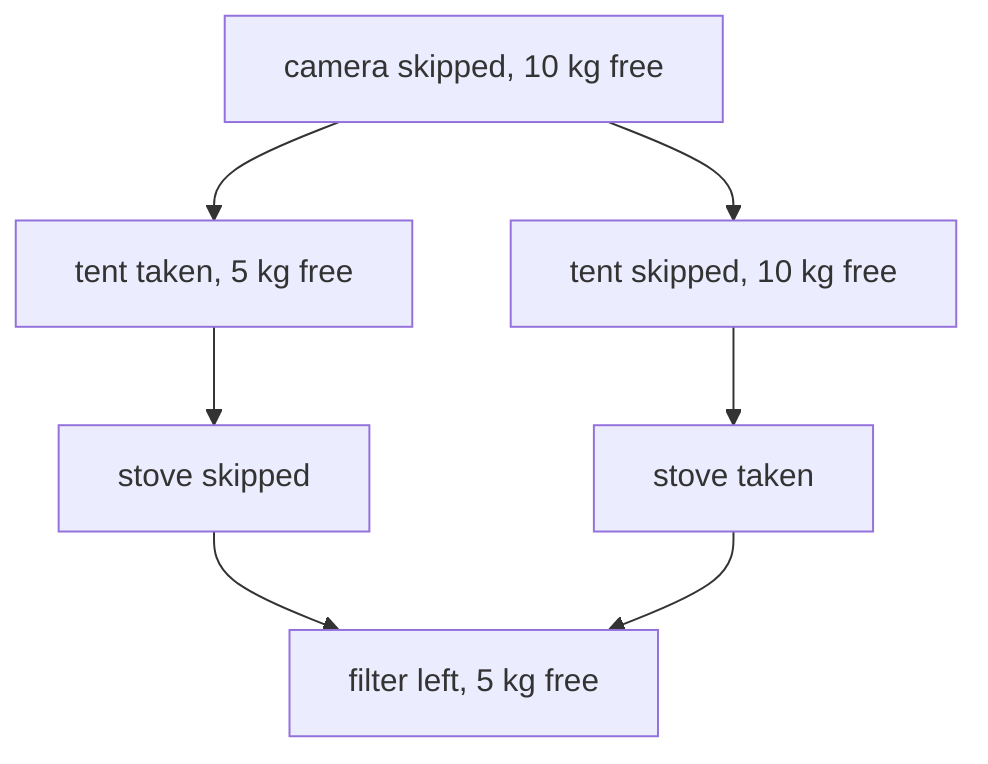
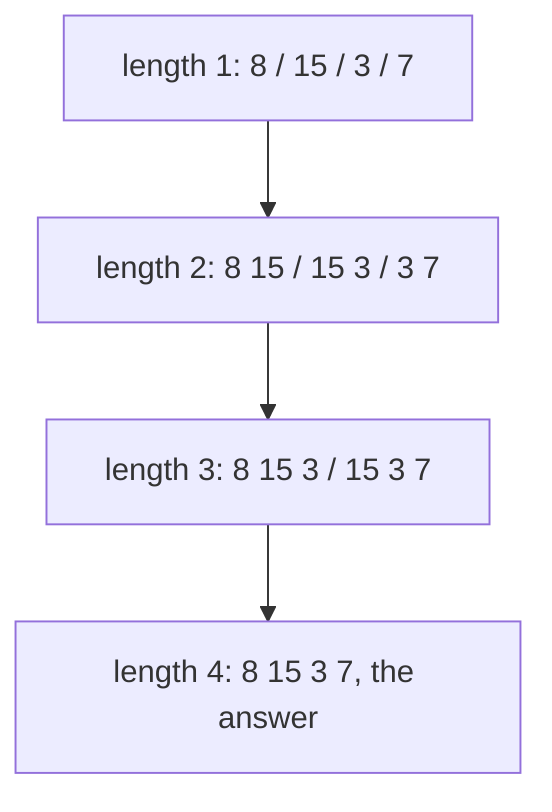

# Choosing the state: take or skip, intervals, and greedy

## The idea

Every dynamic program so far stood on one decision: what a state is. The recurrence, the order and the table all follow from it. A good state holds **exactly what the rest of the problem depends on**:

- **Nothing less.** If the future depends on something the state leaves out, two different situations share one answer, and one of them gets the wrong one, as the [memoization guide](../memoization/guide.md)'s key without the divisions left showed.
- **Nothing more.** Every extra detail in the state multiplies the number of states. Put the whole history in it and no two states are ever the same, so nothing is reused and the table is the brute force again.

Richard Bellman, who named dynamic programming, put the property that makes this work as his **principle of optimality**: "An optimal policy has the property that whatever the initial state and initial decisions are, the remaining decisions must constitute an optimal policy with regard to the state resulting from the first decisions." In other words, once you know the state you are in, the best way to finish does not depend on how you got there. Choosing a state means finding a description of "where you are" for which that is true.

To find one, ask: **after some of the choices are made, what do I need to know to make the rest of them well?** Three answers come up often, and this guide takes them in turn:

| Family | What the rest depends on | State |
|--------|--------------------------|-------|
| **Take or skip** | which items are still to be decided, and how much of the budget is left | `(item i, budget left)` |
| **Intervals** | which stretch of a row is still in play | `(i, j)`, the stretch from `i` to `j` |
| **Greedy** | nothing worth tabulating, because one choice can be proved safe at every step | no table at all |

## A worked example

A bag holds 10 kilograms. Four items could go in, each whole or not at all:

| Item | Weight | Value |
|------|--------|-------|
| camera | 6 kg | 30 |
| tent | 5 kg | 20 |
| stove | 5 kg | 20 |
| filter | 2 kg | 6 |

Which items give the most value? Decide the items one at a time: take each, or skip it. After deciding some of them, what does the rest depend on? Not on which items were taken, only on **which items are left to decide** and **how many kilograms are still free**. Two different histories that reach the same pair face exactly the same future:



<!-- text-of-mermaid sha256:9d6a949f4e9eb528811d74587b925683d1dfa34648e77d8f95682f9a202ace57 -->
```text
┌──────────────────────────┐
│camera skipped, 10 kg free│
└──────────────────────────┘
              ▼──────────────────────────────▼
┌──────────────────────────┐    ┌────────────────────────┐
│  tent taken, 5 kg free   │    │tent skipped, 10 kg free│
└─────────────┬────────────┘    └────────────┬───────────┘
              ▼                              ▼
┌──────────────────────────┐    ┌────────────────────────┐
│      stove skipped       │    │      stove taken       │
└─────────────┬────────────┘    └────────────┬───────────┘
              ▼──────────────────────────────┘
┌──────────────────────────┐
│  filter left, 5 kg free  │
└──────────────────────────┘
```

**The state.** `best[i][c]` is the most value that the first `i` items can give in a bag that holds `c` kilograms.

**The recurrence.** Item `i` is skipped, or, if it fits, taken:

```text
best[i][c] = the larger of best[i - 1][c]                       (skip item i)
                       and value(i) + best[i - 1][c - weight(i)]   (take it, when weight(i) <= c)
best[0][c] = 0   (no items, no value)
```

**The order.** Row `i` reads only row `i - 1`, so fill the rows in order; within a row, any order works.

```python examples/packing.py
"""Pack a bag: each item is taken whole or left behind, the weights must fit the bag, and the
total value should be as large as possible. The state is (items considered, kilograms left)."""

from itertools import combinations, product

ITEMS = [("camera", 6, 30), ("tent", 5, 20), ("stove", 5, 20), ("filter", 2, 6)]  # name, kg, value
CAPACITY = 10


def fill(items: list[tuple[str, int, int]], capacity: int) -> list[list[int]]:
    """best[i][c]: the most value from the first i items in a bag that holds c kilograms."""
    best = [[0] * (capacity + 1)]  # no items yet: nothing to gain at any capacity
    for _, weight, value in items:
        above = best[-1]  # skip the item: above[c]; take it, if it fits: value + above[c - weight]
        best.append(
            [
                max(above[c], value + above[c - weight]) if weight <= c else above[c]
                for c in range(capacity + 1)
            ]
        )
    return best


def read_back(best: list[list[int]], items: list[tuple[str, int, int]]) -> list[str]:
    """Walk up from the last cell: a value that differs from the cell above means taken."""
    taken, c = [], len(best[0]) - 1
    for i in range(len(items), 0, -1):
        if best[i][c] != best[i - 1][c]:
            name, weight, _ = items[i - 1]
            taken.append(name)
            c -= weight
    return taken[::-1]


best = fill(ITEMS, CAPACITY)
print("bag holds " + "".join(f"{c:>4}" for c in range(CAPACITY + 1)))
for i, cells in enumerate(best):
    label = "no items" if i == 0 else f"+{ITEMS[i - 1][0]}"
    print(f"{label:10}" + "".join(f"{cell:>4}" for cell in cells))
print("best bag:", read_back(best, ITEMS), "worth", best[-1][-1])


def greedy_by_density(items: list[tuple[str, int, int]], capacity: int) -> tuple[list[str], int]:
    """Take items in order of value per kilogram while they fit."""
    taken, value = [], 0
    for name, weight, worth in sorted(items, key=lambda item: item[2] / item[1], reverse=True):
        if weight <= capacity:
            taken.append(name)
            capacity -= weight
            value += worth
    return taken, value


print("greedy by value per kg:", *greedy_by_density(ITEMS, CAPACITY))

room, worth = CAPACITY, 0.0
for _name, weight, value in sorted(ITEMS, key=lambda item: item[2] / item[1], reverse=True):
    share = min(weight, room)  # with divisible items, pour in as much of the densest as fits
    worth += value * share / weight
    room -= share
print("if items could be split, greedy by value per kg gets:", worth)


def brute_force(items: list[tuple[str, int, int]], capacity: int) -> int:
    return max(
        sum(value for _, _, value in subset)
        for size in range(len(items) + 1)
        for subset in combinations(items, size)
        if sum(weight for _, weight, _ in subset) <= capacity
    )


cases = wrong = 0
for weights in product(range(1, 5), repeat=3):  # every bag of three items with small numbers
    for values in product(range(1, 7), repeat=3):
        items = [(str(k), w, v) for k, (w, v) in enumerate(zip(weights, values, strict=True))]
        for capacity in range(1, 7):
            cases += 1
            optimum = brute_force(items, capacity)
            assert fill(items, capacity)[-1][-1] == optimum
            wrong += greedy_by_density(items, capacity)[1] != optimum
print(f"small cases: the table matched brute force on all {cases}; greedy was wrong on {wrong}")
```

It prints:

```output examples/packing.py
bag holds    0   1   2   3   4   5   6   7   8   9  10
no items     0   0   0   0   0   0   0   0   0   0   0
+camera      0   0   0   0   0   0  30  30  30  30  30
+tent        0   0   0   0   0  20  30  30  30  30  30
+stove       0   0   0   0   0  20  30  30  30  30  40
+filter      0   0   6   6   6  20  30  30  36  36  40
best bag: ['tent', 'stove'] worth 40
greedy by value per kg: ['camera', 'filter'] 36
if items could be split, greedy by value per kg gets: 46.0
small cases: the table matched brute force on all 82944; greedy was wrong on 6202
```

Read the last column of the table. With only the camera, 10 kg give 30. Adding the tent changes nothing at 10 kg: the tent alone is worth less, and both do not fit. Adding the stove, the cell at 10 kg compares skipping it, 30 from the row above, with taking it, `20 + best[2][5] = 20 + 20 = 40`, where `best[2][5]` is the tent alone in the 5 kg the stove leaves. The filter adds nothing at 10 kg.

**Reading the answer back** works as in the [two-dimensional guide](../two-dimensional-tables/guide.md), from the cell that holds the answer, `best[4][10] = 40`. A cell equal to the one above it means the item was skipped; a cell that differs means it was taken, and the walk continues in the row above at the capacity the item left. The filter is skipped (40 above), the stove taken (30 above, so it made the difference), leaving 5 kg in which the tent is taken (20 against 0 above), and the camera is skipped. The bag is the tent and the stove.

## When a greedy rule is enough

A **greedy** algorithm makes the choice that looks best now and never revisits it. It needs no table, and when it is right it is usually much faster than one. The trouble is that it is often wrong, and nothing in the code says so.

**Greedy by value per kilogram fails here.** The densest item is the camera, 5 per kilogram, so the greedy rule takes it first. Then the 4 kg left cannot hold the tent or the stove, and the filter brings it to 36. The table's 40 leaves the densest item out and takes two that together fill the bag exactly. The greedy rule judged the camera by its density and could not see the cost of the 4 kg it leaves unusable, a cost that depends on the other items. One counterexample like this is enough to reject a greedy rule.

**Greedy by value per kilogram is right when items can be divided**, like rice or water, so that any part of an item can be taken for the same share of its value. The proof is an **exchange argument**. Take any load that fills the bag, and suppose it holds some of a less dense item while a denser item is not fully in. Take out a little of the less dense item, and put in the same weight of the denser one: the weight is unchanged and the value does not go down. Repeating such swaps turns any load into the load that takes the densest item first, as much as fits, then the next densest, and so on, without ever losing value. So that greedy load is at least as good as any other, which makes it optimal. For whole items, the swap is not allowed: you cannot trade 4 kg of a stove for 4 kg of a camera, and the argument breaks exactly where the counterexample lives.

The divisible answer, 46, is also an **upper bound** for the whole-item problem: every whole-item load is also a divisible load, so none can beat the best divisible one. That makes it a cheap optimistic estimate for the branch and bound of the [backtracking guide](../backtracking/guide.md): a branch whose divisible bound cannot beat the best bag found so far can be cut.

The last line of the example is how to test a greedy idea before trusting it: compare it with a correct answer on every small case. On 82,944 small cases the table always matched the brute force, and greedy by value per kilogram was wrong on 6,202 of them. A proof, by an exchange argument, makes a greedy rule safe; a single failing case makes it unsafe; anything in between is a guess.

## Intervals: the stretch still in play

Some problems break into subproblems that are each **one stretch** of a row, `row[i..j]`. Then the stretch is the state.

Two players take turns removing a coin from either end of a row and keep what they take; both play as well as they can. Take the row `8, 15, 3, 7`. What can the first player get?

**The state.** For the stretch from `i` to `j`, `lead[i][j]` is how far ahead the player about to move ends up, counting only the coins of that stretch. Measuring the lead, the difference between the two totals, lets one number describe both players.

**The recurrence.** Taking the left coin gains `row[i]`, and then the rival is the one about to move on `i + 1..j`, ahead by `lead[i + 1][j]`; the rival's lead is the mover's deficit. So:

```text
lead[i][j] = the larger of row[i] - lead[i + 1][j]   (take the left coin)
                       and row[j] - lead[i][j - 1]   (take the right coin)
lead[i][i] = row[i]   (one coin left: take it)
```

**The order.** A stretch reads only stretches one coin shorter, so fill by **length**: every stretch of one coin, then of two, and so on up to the whole row. Filling row by row from the top would read `lead[i + 1][j]` before it is filled.



<!-- text-of-mermaid sha256:7dc3400e442f7a1eab9a7ea8b6418470f6a03dc8e44f8eab2ea4d5333ec2febf -->
```text
┌──────────────────────────────┐
│   length 1: 8 / 15 / 3 / 7   │
└───────────────┬──────────────┘
                ▼
┌──────────────────────────────┐
│ length 2: 8 15 / 15 3 / 3 7  │
└───────────────┬──────────────┘
                ▼
┌──────────────────────────────┐
│  length 3: 8 15 3 / 15 3 7   │
└───────────────┬──────────────┘
                ▼
┌──────────────────────────────┐
│length 4: 8 15 3 7, the answer│
└──────────────────────────────┘
```

```python examples/two_ends.py
"""Two players take turns removing a coin from either end of a row and keep what they take.
The state is the stretch of the row still on the table: (i, j), the coins from i to j."""

from collections.abc import Callable

ROW = [8, 15, 3, 7]


def lead_table(row: list[int]) -> list[list[int]]:
    """lead[i][j]: how far ahead the player to move ends up on the coins i..j, against a rival who
    also plays as well as possible. Filled by stretch length, short to long; only i <= j is used."""
    n = len(row)
    lead = [[0] * n for _ in range(n)]
    for i in range(n):
        lead[i][i] = row[i]  # one coin left: take it
    for length in range(2, n + 1):
        for i in range(n - length + 1):
            j = i + length - 1
            # after taking a coin, the rival is the one to move on what is left
            lead[i][j] = max(row[i] - lead[i + 1][j], row[j] - lead[i][j - 1])
    return lead


lead = lead_table(ROW)
print("lead[i][j]" + "".join(f"{f'j={j}':>6}" for j in range(len(ROW))))
for i, cells in enumerate(lead):
    shown = ["" if j < i else str(cell) for j, cell in enumerate(cells)]
    print(f"{f'i={i}':10}" + "".join(f"{cell:>6}" for cell in shown))
total = sum(ROW)
print(f"first player: {(total + lead[0][-1]) // 2}, second: {(total - lead[0][-1]) // 2}")


def play(row: list[int], takes_left: Callable[[int, int], bool]) -> list[int]:
    """The two players' totals when both take the left coin exactly when takes_left(i, j)."""
    totals, i, j, player = [0, 0], 0, len(row) - 1, 0
    while i <= j:
        if takes_left(i, j):
            totals[player] += row[i]
            i += 1
        else:
            totals[player] += row[j]
            j -= 1
        player = 1 - player
    return totals


def table_says_left(i: int, j: int) -> bool:
    return i == j or ROW[i] - lead[i + 1][j] >= ROW[j] - lead[i][j - 1]


print("both follow the table:", play(ROW, table_says_left))
print("both take the larger end:", play(ROW, lambda i, j: ROW[i] >= ROW[j]))
```

It prints:

```output examples/two_ends.py
lead[i][j]   j=0   j=1   j=2   j=3
i=0            8     7    -4    11
i=1                 15    12    11
i=2                        3     4
i=3                              7
first player: 22, second: 11
both follow the table: [22, 11]
both take the larger end: [15, 18]
```

The whole row has `lead[0][3] = 11`, and the totals add up to 33, so the first player gets `(33 + 11) / 2 = 22` and the second 11. The first move that achieves it is surprising: take the 7, not the 8. That leaves `8, 15, 3`, where whichever end the rival takes, the 15 becomes available to the first player.

Taking the larger end every time is a greedy rule, and it fails: the first player takes 8 instead of 7, which opens the 15 to the rival, and ends with 15 against 18. The table shows why. Taking the 7 hands the rival `8, 15, 3`, where the player to move ends up 4 behind (`lead[0][2] = -4`); taking the 8 hands the rival `15, 3, 7`, where the player to move ends up 11 ahead (`lead[1][3] = 11`).

## When to use it

- **Take or skip** fits when there are items, each used at most once, a budget they consume, and an order of the items that does not matter to the answer. The state is the next item and what is left of the budget, never the set of items taken.
- **Intervals** fit when each subproblem is one stretch of the original row, as when coins are taken only from the ends. Fill by length.
- **Greedy** fits when an exchange argument shows that the locally best choice can always be part of an optimal answer. Without that argument, test it against brute force on small cases, and keep the table if a single case fails.
- **To find any state**, list what the rules of the remaining choices depend on: budgets left, the last choice made, whose turn it is, what is still available. That list, and nothing else, is the state.

## Common traps

- **Trusting a greedy rule because it works on the examples.** Rules like "the densest first" or "the larger end first" pass the obvious cases. Compare with brute force on many small inputs before believing one.
- **Putting the history in the state.** "The set of items taken so far" has `2ⁿ` values and no two histories share a cell; "the kilograms left" has at most `C + 1` and is all the future needs.
- **Forgetting part of the state.** Dropping the budget, or whose turn it is, makes situations with different futures share one cell. The answers come out wrong with no error.
- **Filling an interval table row by row.** A stretch reads the stretches inside it; fill by length, or by `i` from the last row up, so they are ready.
- **The sign in a game table.** After your move the rival is the one to move, and the rival's lead is your deficit: subtract it. Adding it, or taking the rival's best as yours, solves a game in which both players help the same side.
- **A budget too large for a table.** The take-or-skip table has a column per kilogram, so a capacity of 10⁹ makes it impossible to build. Look for a different second number with a small range, such as the value instead of the weight.

## Complexity

| Method | Time | Space |
|--------|------|-------|
| Brute force over every set of `n` items | O(2ⁿ · n) | O(n) |
| Take-or-skip table, `n` items, capacity `C` | O(n · C) | O(n · C) |
| Interval table over a row of `n` | O(n²) when each stretch reads a constant number of shorter ones | O(n²) |
| Greedy by value per kilogram | O(n log n), for sorting | O(n) |

The take-or-skip bound depends on the **value** of the capacity, not on how many digits it takes to write it: adding one decimal digit to `C` makes the table ten times larger. That is why the table works for a bag of 10 kg and not for a budget of a billion.

## Expert notes

- **The principle of optimality is a test for a state.** Bellman stated it in "The theory of dynamic programming", an address to the American Mathematical Society on 2 September 1954, whose text RAND printed as paper P-550; the Bulletin of the society published a paper of the same title that year. If you can describe a situation in which two ways of reaching the same state need different decisions afterwards, the principle fails for that state, and the state is missing something.
- **Swap the roles of value and weight.** When capacities are huge but values are small, index the table by value instead: the lightest load that reaches each total value. The answer is the largest value whose lightest load fits.
- **A greedy proof has two parts.** The exchange argument shows a greedy choice can be part of some optimal answer; the second part shows that what remains after it is the same kind of problem, so the argument applies again. Both are needed: the first alone says nothing about the steps after it.
- **Bounds make searches fast.** The divisible bound of 46 against a best-known 40 is the kind of estimate that lets branch and bound skip whole subtrees; the closer the bound, the more it cuts.
- **One number for two players.** Keeping both players' totals per cell would double the state and complicate the recurrence; the lead of the player to move holds everything that matters, because each player's total follows from the lead and the sum of the stretch.

## Practice

- `cstudy start partition-equal-subset-sum`: decide whether an array can be split into two groups with equal sums.
- `cstudy start coin-change-ways`: count the different combinations of coins that pay an amount exactly.
- `cstudy start target-sum`: count the ways to put a sign before every number so that they add up to a target.
- `cstudy start jump-game`: decide whether the last index of an array can be reached by jumps of limited length.
- `cstudy start job-scheduling-max-profit`: the largest total profit from paid jobs that must not overlap in time.
- `cstudy start burst-balloons`: the most coins from bursting a row of balloons in the best order.

## Further reading

- Richard Bellman, [The Theory of Dynamic Programming](https://www.rand.org/content/dam/rand/pubs/papers/2008/P550.pdf), RAND paper P-550, 30 July 1954: the text of his address to the American Mathematical Society; section 2 states the principle of optimality.
- Richard Bellman, [The theory of dynamic programming](https://doi.org/10.1090/S0002-9904-1954-09848-8), Bulletin of the American Mathematical Society 60(6), 1954, pages 503 to 515.
- [Python `itertools.combinations`](https://docs.python.org/3/library/itertools.html#itertools.combinations): every set of items of a given size, for the brute force.
