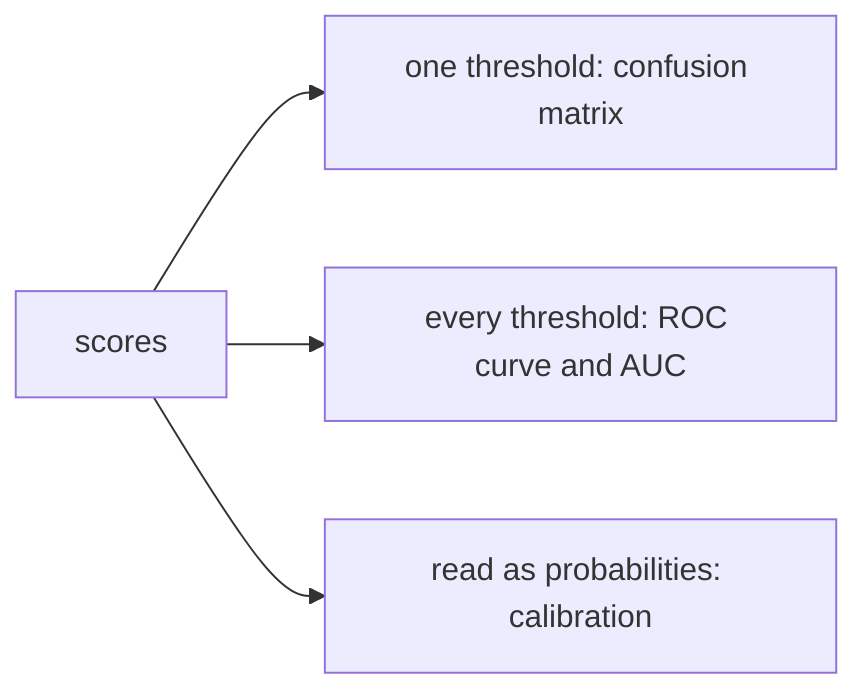

# Classifier metrics: from the confusion matrix to ROC and calibration

## The idea

A classifier usually produces a **score** for each example, how strongly it believes the example is **positive** (spam, fraud, a defect), and a **threshold** turns the score into an answer: yes when the score is at least the threshold. Measuring a classifier means answering three different questions, and each has its own tools.

**At one threshold, how do its answers line up with the truth?** Each example falls in one of four cells, together called the **confusion matrix**:

| | Really positive | Really negative |
|---|---|---|
| **Said yes** | **True positive** (TP) | **False positive** (FP): a false alarm |
| **Said no** | **False negative** (FN): a miss | **True negative** (TN) |

Every common rate divides one cell by a sum of cells:

| Rate | Formula | Asks |
|------|---------|------|
| **Accuracy** | `(TP + TN) / all` | What share of the answers were right? |
| **Precision** | `TP / (TP + FP)` | Of the examples it flagged, what share were positive? |
| **Recall**, also **true positive rate** or **sensitivity** | `TP / (TP + FN)` | Of the positives, what share did it find? |
| **Specificity** | `TN / (TN + FP)` | Of the negatives, what share did it leave alone? |
| **False positive rate** | `FP / (FP + TN)`, which is 1 - specificity | Of the negatives, what share did it flag? |
| **F1** | `2 * precision * recall / (precision + recall)` | Both at once: their **harmonic mean**, which is high only when both are |

Accuracy misleads when one class is rare: if 1 email in 100 is spam, a filter that never says yes is 99% accurate and useless. Precision and recall look at the positives from the two sides, and they pull against each other: lowering the threshold finds more positives (recall rises) and raises more false alarms (precision usually falls).

**Over every threshold, do the scores put positives above negatives?** The **ROC curve** (receiver operating characteristic, a name from signal detection theory) plots the true positive rate against the false positive rate as the threshold sweeps from high to low. It starts at `(0, 0)`, where the classifier says no to everything, and ends at `(1, 1)`, where it says yes to everything. The **area under the curve**, the **AUC**, sums it up in one number: the probability that a randomly chosen positive gets a higher score than a randomly chosen negative, a tie counting one half. An AUC of 1 means the scores put every positive first, 0.5 means they say nothing, as a coin flip would.

**Can the scores be read as probabilities?** A classifier is **calibrated** when its stated probabilities match how often things happen: of the examples given 0.8, about 80% are positive. A classifier can rank perfectly, AUC 1, and still be badly calibrated, by saying 0.99 when it should say 0.7.



<!-- text-of-mermaid sha256:9399232dc866431d77195849fc1eaac8ee3e09409e3fb75a08d17396cf6fac3b -->
```text
┌──────┐    ┌──────────────────────────────────┐
│scores├───►│ one threshold: confusion matrix  │
└───┬──┘    └──────────────────────────────────┘
    │
    │       ┌──────────────────────────────────┐
    ├──────►│every threshold: ROC curve and AUC│
    │       └──────────────────────────────────┘
    │
    │       ┌──────────────────────────────────┐
    └──────►│read as probabilities: calibration│
            └──────────────────────────────────┘
```

The drawing shows the three questions branching from the same scores. A report that answers only one of them leaves the other two open.

## A worked example

### One set of scores, five thresholds

A spam filter scores twelve emails, six of them spam. The program builds the confusion matrix at five thresholds and computes the rates of each.

```python examples/thresholds.py
"""One set of scores, five thresholds: the confusion matrix and its rates at each.

Twelve emails scored by a spam filter, six of them spam (the positives). Moving the threshold
trades false alarms against misses.
"""

spam = [0.95, 0.85, 0.70, 0.62, 0.40, 0.30]
not_spam = [0.80, 0.55, 0.45, 0.20, 0.15, 0.05]

print("threshold  TP FP FN TN  precision  recall     F1  false positive rate")
for threshold in [0.90, 0.75, 0.50, 0.35, 0.10]:
    tp = sum(score >= threshold for score in spam)
    fp = sum(score >= threshold for score in not_spam)
    fn, tn = len(spam) - tp, len(not_spam) - fp
    precision, recall = tp / (tp + fp), tp / (tp + fn)
    f1 = 2 * precision * recall / (precision + recall)
    counts = f"{tp:2} {fp:2} {fn:2} {tn:2}"
    rates = f"{precision:9.3f}  {recall:6.3f}  {f1:.3f}  {fp / (fp + tn):19.3f}"
    print(f"{threshold:9.2f}  {counts}  {rates}")
```

It prints:

```output examples/thresholds.py
threshold  TP FP FN TN  precision  recall     F1  false positive rate
     0.90   1  0  5  6      1.000   0.167  0.286                0.000
     0.75   2  1  4  5      0.667   0.333  0.444                0.167
     0.50   4  2  2  4      0.667   0.667  0.667                0.333
     0.35   5  3  1  3      0.625   0.833  0.714                0.500
     0.10   6  5  0  1      0.545   1.000  0.706                0.833
```

At 0.90 the filter flags one email and is right, a perfect precision that means little, since it misses five spams of six. At 0.10 it finds every spam and flags five good emails with them. Recall only rises as the threshold falls, and the false positive rate with it; precision mostly falls, though not always, since it depends on which emails cross the threshold. The best F1, 0.714, comes at 0.35, but whether that is the right threshold depends on what a false alarm costs against a miss: a filter that hides a customer's invoice is worse than one that lets an advertisement through.

Each row is one point of the ROC curve: `(0, 0.167)`, `(0.167, 0.333)`, `(0.333, 0.667)` and so on, a false positive rate and a recall. The AUC does not depend on any threshold. Of the 36 pairs of one spam and one good email, the spam has the higher score in 28, so the AUC is `28 / 36 = 0.778`: pick a spam and a good email at random, and 78% of the time the filter scores the spam higher.

### Calibrated, and good

Three forecasters give the chance of rain for the same thirty days. The days come in three kinds, ten of each, and it rained on 2, 5 and 8 of them. The honest forecaster says 0.2, 0.5 and 0.8; the base-rate forecaster always says 0.5, the share of rainy days overall; the overconfident one ranks the days like the honest one but says 0.01 and 0.99 at the ends. The program measures each with a **calibration error**, the average gap between a stated probability and how often it rained when it was said, weighted by how often it was said; the **Brier score**, the mean of `(p - y)²` where `y` is 1 for rain and 0 otherwise; and the log loss.

```python examples/calibration.py
"""Three forecasters on the same thirty days: is it calibrated, and how good is it overall?

The days fall into three kinds. On ten days of the first kind it rained twice, on ten of the
second five times, and on ten of the third eight times. Each forecaster states one probability of
rain per kind of day.
"""

import math

rained = {"first": 2, "second": 5, "third": 8}  # rainy days out of 10 of each kind
forecasters = {
    "honest": {"first": 0.2, "second": 0.5, "third": 0.8},
    "base rate": {"first": 0.5, "second": 0.5, "third": 0.5},
    "overconfident": {"first": 0.01, "second": 0.5, "third": 0.99},
}

for name, said in forecasters.items():
    groups: dict[float, list[int]] = {}  # stated probability -> [days, rainy days]
    brier = log_loss = 0.0
    for kind, rainy in rained.items():
        p, dry = said[kind], 10 - rainy
        days, wet = groups.get(p, [0, 0])
        groups[p] = [days + 10, wet + rainy]
        brier += rainy * (1 - p) ** 2 + dry * p**2
        log_loss += rainy * -math.log(p) + dry * -math.log(1 - p)
    # How far each stated probability is from how often it rained when it was said.
    gap = sum(days * abs(p - wet / days) for p, (days, wet) in groups.items())
    print(f"{name:13}  calibration error {gap / 30:.3f}  Brier {brier / 30:.3f}  "
          f"log loss {log_loss / 30:.3f}")
```

It prints:

```output examples/calibration.py
honest         calibration error 0.000  Brier 0.190  log loss 0.565
base rate      calibration error 0.000  Brier 0.250  log loss 0.693
overconfident  calibration error 0.127  Brier 0.214  log loss 0.850
```

The honest and the base-rate forecasters are both perfectly calibrated: when the base-rate forecaster says 0.5, it rains half the time. But it says the same thing every day and tells you nothing, which the Brier score and the log loss see: 0.250 and 0.693, against 0.190 and 0.565 for the honest one. The overconfident forecaster ranks the days exactly as the honest one does, so any threshold gives the same answers and its AUC is the same; only its probabilities are wrong, which the calibration error catches, and the log loss punishes hardest, for the two rainy days it called at 1%. Calibration and ranking are separate questions, and the Brier score and the log loss reward both at once.

## When to use it

- **Precision and recall, or F1,** when positives are rare and what matters is how many you find and how many false alarms it takes. Report both, not F1 alone, since the same F1 hides very different trade-offs.
- **A threshold chosen on validation data, by cost.** Decide what a false positive and a false negative cost, and pick the threshold that minimizes the total on the validation set, never on the test set.
- **ROC and AUC** to compare models before a threshold is chosen, or when the threshold will change.
- **Precision-recall curves** when negatives vastly outnumber positives, where the ROC curve can look excellent while most flagged examples are false alarms.
- **Calibration, the Brier score or the log loss** whenever the scores will be read as probabilities: to set prices, to combine with costs, or to show a person.
- **Per class, then averaged,** with more than two classes. Each class becomes a yes-or-no question of its own, one against the rest. A **macro** average gives each class the same weight, so a neglected small class shows; a **micro** average adds up the counts over the classes first, so it reflects the typical answer.

## Common traps

- **Accuracy on a rare class.** "Always no" scores the share of negatives. Look at recall and precision, or at the confusion matrix itself.
- **A perfect precision on a handful of flags.** One flag that is right gives precision 1. Read the counts behind every rate.
- **The AUC computed from yes-or-no answers.** It then measures one threshold, not the ranking. Compute it from the scores.
- **Comparing precision across datasets with different shares of positives.** Precision, accuracy and F1 change with the class balance even when the classifier does not, while the ROC curve does not change; the guide on [evaluation pitfalls](../evaluation-pitfalls/guide.md) works through an example.
- **Joining the points of a precision-recall curve with straight lines.** Unlike in ROC space, a straight line between two achievable points of a precision-recall curve is not achievable, so its area comes out wrong.
- **Treating a high AUC as good probabilities.** A model can rank perfectly and be badly calibrated. Check calibration separately.
- **A calibration error near zero as proof of quality.** The base-rate forecaster is perfectly calibrated and useless; read it with the Brier score or the log loss.
- **One overall calibration number.** A model can be calibrated on average and off on every group of users. Check calibration per group that matters.

## Complexity

For `n` examples:

| Measure | Time | Extra space |
|---------|------|-------------|
| Confusion matrix and its rates, one threshold | O(n) | O(1) |
| ROC or precision-recall curve | O(n log n) to sort by score, then O(n) to sweep the thresholds | O(n) |
| AUC by comparing every positive with every negative | O(P N) for `P` positives and `N` negatives | O(1) |
| Calibration error with `b` bins, Brier score, log loss | O(n + b) | O(b) |

With `k` classes, each per-class measure runs once per class.

## Expert notes

- **The confusion matrix and ROC space.** Fawcett (*An introduction to ROC analysis*, 2006) defines the true positive rate (also called hit rate and recall), the false positive rate (false alarm rate), sensitivity, specificity and precision from the four cells. A classifier that only outputs a class is a single point in ROC space; `(0, 0)` never says yes, `(1, 1)` always does, `(0, 1)` is perfect, and random guessing follows the diagonal, whose area is 0.5.
- **What the AUC means.** Fawcett notes that the AUC equals the probability that the classifier ranks a randomly chosen positive above a randomly chosen negative, which makes it equivalent to the Wilcoxon test of ranks (Hanley and McNeil, 1982), and that the Gini coefficient is `2 * AUC - 1`. A classifier with the higher AUC can still be worse in a particular region of ROC space, the one where you will operate.
- **Class skew.** ROC curves do not change when the proportion of positives in a test set changes, because the true and false positive rates each divide within one column of the confusion matrix. Accuracy, precision, lift and F scores mix both columns and change with the class balance even when the classifier is the same (Fawcett, §4.2). Skews of 10 to 100 negatives per positive are very common in real domains.
- **Precision-recall curves.** Davis and Goadrich (2006) prove that one curve dominates another in ROC space if and only if it dominates in precision-recall space, that linear interpolation between points is incorrect in precision-recall space, and that maximizing the area under the ROC curve does not guarantee maximizing the area under the precision-recall curve. Saito and Rehmsmeier (2015) show that the precision-recall plot is more informative on imbalanced data, and that its baseline is not fixed: a random classifier has a precision equal to the share of positives, `P / (P + N)`, about 0.09 for one positive per ten negatives.
- **Measuring calibration.** Naeini, Cooper and Hauskrecht (2015) call predictions well calibrated when the outcomes predicted with probability `p` occur about a `p` fraction of the time. Their **expected calibration error** sorts the predictions into bins (ten in their experiments) and averages, weighted by each bin's share of the predictions, the gap between the bin's mean probability and its fraction of positives; the **maximum calibration error** takes the worst bin instead. Guo, Pleiss, Sun and Weinberger (2017) use equally spaced bins and draw the same comparison as a **reliability diagram**, accuracy against confidence, where a perfectly calibrated model follows the diagonal.
- **Proper scores.** Gneiting and Raftery (2007) show that the quadratic score, proposed by Brier in 1950, and the logarithmic score are **strictly proper**: a forecaster gets the best expected score only by stating the probabilities it believes. The log score has been criticized for being unbounded. Their quadratic score for several classes sums the squared differences over the classes, which for a yes-or-no outcome is twice the one-number form used here.
- **Fixing calibration.** Niculescu-Mizil and Caruana (2005) found that some methods push probabilities away from 0 and 1 and others toward them, and compared two corrections fitted after training: **Platt scaling**, a logistic regression on the classifier's scores, best when the distortion is sigmoid-shaped, and **isotonic regression**, which corrects any monotonic distortion but overfits when data is scarce. Guo and others found that modern neural networks, unlike those of a decade before, are poorly calibrated, and that **temperature scaling**, a single-parameter variant of Platt scaling fitted on the validation set, is surprisingly effective. Platt scaling with a positive slope keeps the order of the scores, so the AUC does not move; isotonic regression fits a piecewise constant function, which can merge neighbouring scores into ties and so change it.

## Practice

- `cstudy start classification-metrics`: the confusion counts, accuracy, precision, recall and F1 of each class at a threshold, their macro and micro averages, and the ROC AUC of each class.
- `cstudy start calibration-metrics`: the expected calibration error and the Brier score of recorded probabilities, overall and per slice.

## Further reading

- [Fawcett, *An introduction to ROC analysis*, Pattern Recognition Letters 27(8), 2006](https://doi.org/10.1016/j.patrec.2005.10.010): the confusion matrix, ROC space, class skew and the AUC.
- [Davis and Goadrich, *The Relationship Between Precision-Recall and ROC Curves*, ICML 2006](https://doi.org/10.1145/1143844.1143874): dominance in both spaces and interpolation.
- [Saito and Rehmsmeier, *The Precision-Recall Plot Is More Informative than the ROC Plot When Evaluating Binary Classifiers on Imbalanced Datasets*, PLOS ONE 10(3), 2015](https://doi.org/10.1371/journal.pone.0118432): the moving baseline of precision-recall plots.
- [Naeini, Cooper and Hauskrecht, *Obtaining Well Calibrated Probabilities Using Bayesian Binning*, AAAI 2015](https://pmc.ncbi.nlm.nih.gov/articles/PMC4410090/): the expected and maximum calibration errors.
- [Guo, Pleiss, Sun and Weinberger, *On Calibration of Modern Neural Networks* (arXiv 1706.04599)](https://arxiv.org/abs/1706.04599): reliability diagrams and temperature scaling.
- [Niculescu-Mizil and Caruana, *Predicting Good Probabilities With Supervised Learning*, ICML 2005](https://www.cs.cornell.edu/~alexn/papers/calibration.icml05.crc.rev3.pdf): Platt scaling and isotonic regression.
- [Gneiting and Raftery, *Strictly Proper Scoring Rules, Prediction, and Estimation*, JASA 102(477), 2007](https://doi.org/10.1198/016214506000001437): the Brier and logarithmic scores as proper scoring rules.
