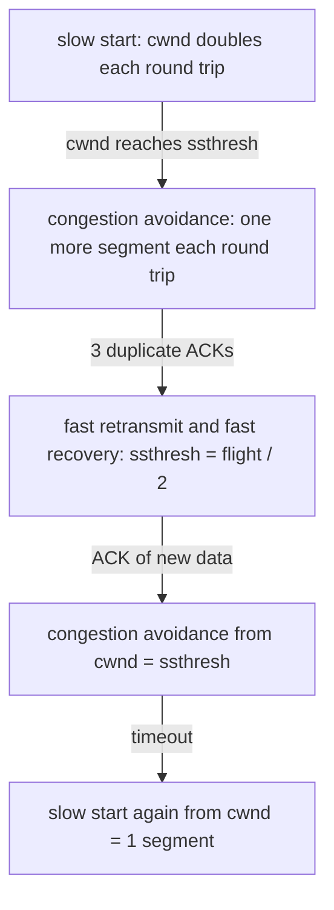
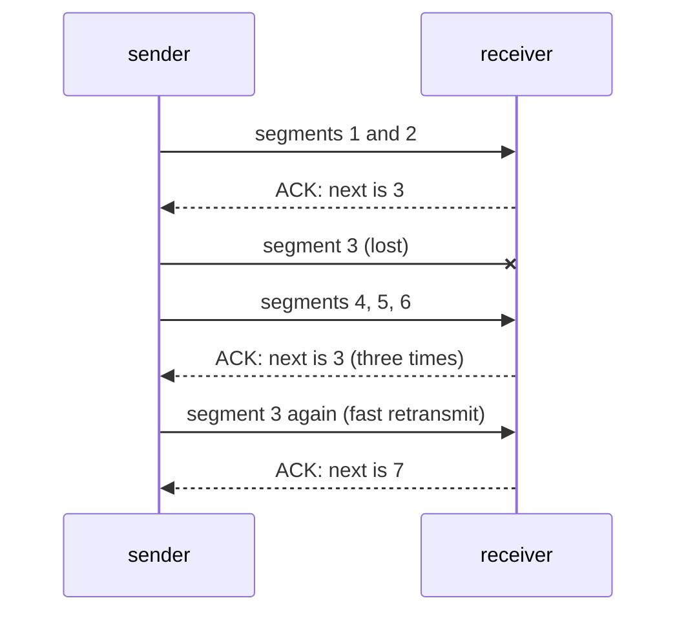

# Congestion control

## The idea

Flow control keeps a sender from overrunning its receiver. Nothing in it protects the network in between, and the network is shared. A router holds arriving packets in a **queue**, a buffer, until its outgoing link can send them. When packets arrive faster than the link drains them, the queue grows and every round trip through it gets longer. When the buffer is full, the router drops what arrives. That is **congestion**.

Retransmission makes congestion worse. RFC 896, in 1984, described what happens in a heavily loaded datagram network with end-to-end retransmission: as routers become congested, round trips grow and so does the number of datagrams in transit; once a round trip exceeds a host's retransmission interval, the host starts putting more and more copies of the same datagrams into the network; eventually every buffer is full and packets must be dropped, and hosts send each packet several times until some copy gets through. RFC 896 named this **congestion collapse**, and noted that it is stable: the network stays in it. The links are busy, and almost nothing useful arrives.

**Congestion control** is each sender's share of avoiding that. RFC 5681 defines TCP's version around one number the sender keeps for itself, the **congestion window** (`cwnd`): a limit on how much data it may have in flight. The receiver's advertised window, `rwnd`, still applies too. RFC 5681: at any given time, a TCP must not send data with a sequence number higher than the highest acknowledged sequence number plus the minimum of `cwnd` and `rwnd`.

A sender cannot see the routers' queues. It infers congestion from **loss**: it treats a segment that is never acknowledged as one that a full queue dropped. So it grows `cwnd` while ACKs come back, to find the capacity, and shrinks it when a loss says it went too far. RFC 5681's pieces, with `SMSS` the largest segment the sender can transmit:

| Piece | Rule in RFC 5681 |
|-------|------------------|
| Initial window | 4 segments for an SMSS of up to 1,095 bytes, 3 for up to 2,190, and 2 above that |
| Slow start, while `cwnd < ssthresh` | each ACK of new data adds `min(N, SMSS)`, where `N` is the number of bytes it newly acknowledges |
| Congestion avoidance, while `cwnd > ssthresh` | `cwnd` grows by roughly one full-sized segment per round trip |
| Slow start threshold, `ssthresh` | starts arbitrarily high; after a loss, `max(FlightSize / 2, 2 · SMSS)` |
| A retransmission timeout | `cwnd` falls to the loss window, one full-sized segment, and slow start begins again |
| Three duplicate ACKs | fast retransmit and fast recovery, below |

`FlightSize` is the data sent but not yet cumulatively acknowledged. When `cwnd` equals `ssthresh`, RFC 5681 lets the sender use either slow start or congestion avoidance.

Despite its name, slow start is the fast phase. When every segment gets its own ACK, each ACK adds a segment, so once a whole window is acknowledged the window has doubled: exponential growth, one doubling per round trip. RFC 5681 explains its purpose as probing the network slowly to find the available capacity, rather than starting with an inappropriately large burst. Congestion avoidance then grows by one segment per round trip: linear growth, close to the edge.

## A worked example

Here is the window round by round, counted in segments. A loss signalled by duplicate ACKs comes at the end of round 9, and a timeout at the end of round 15:

```python examples/cwnd_rounds.py
"""A congestion window, one round trip at a time, counted in segments.

Slow start doubles the window each round while it is below ssthresh; congestion avoidance adds
one segment per round. Three duplicate ACKs halve it (fast retransmit, then fast recovery); a
timeout drops it to one segment and starts slow start again. The model treats a round as one
whole window sent and acknowledged, which is coarser than the per-ACK rules of RFC 5681, so
here doubling stops at ssthresh instead of passing it.
"""

INITIAL_WINDOW = 4  # segments: RFC 5681's initial window for segments of up to 1,095 bytes
LOSSES = {9: "3 duplicate ACKs", 15: "timeout"}  # the round at whose end each loss is seen

cwnd, ssthresh = INITIAL_WINDOW, 32  # ssthresh starts high; 32 keeps the table short
print("round  cwnd  ssthresh  phase")
for round_number in range(1, 21):
    phase = "slow start" if cwnd < ssthresh else "congestion avoidance"
    print(f"{round_number:>5}  {cwnd:>4}  {ssthresh:>8}  {phase:<20}  {'#' * cwnd}")
    loss = LOSSES.get(round_number)
    if loss is not None:
        ssthresh = max(cwnd // 2, 2)  # half of what was in flight, at least two segments
        cwnd = ssthresh if loss == "3 duplicate ACKs" else 1
        print(f"       {loss}: ssthresh {ssthresh}, cwnd {cwnd}")
    elif cwnd < ssthresh:
        cwnd = min(2 * cwnd, ssthresh)
    else:
        cwnd += 1
```

It prints:

```output examples/cwnd_rounds.py
round  cwnd  ssthresh  phase
    1     4        32  slow start            ####
    2     8        32  slow start            ########
    3    16        32  slow start            ################
    4    32        32  congestion avoidance  ################################
    5    33        32  congestion avoidance  #################################
    6    34        32  congestion avoidance  ##################################
    7    35        32  congestion avoidance  ###################################
    8    36        32  congestion avoidance  ####################################
    9    37        32  congestion avoidance  #####################################
       3 duplicate ACKs: ssthresh 18, cwnd 18
   10    18        18  congestion avoidance  ##################
   11    19        18  congestion avoidance  ###################
   12    20        18  congestion avoidance  ####################
   13    21        18  congestion avoidance  #####################
   14    22        18  congestion avoidance  ######################
   15    23        18  congestion avoidance  #######################
       timeout: ssthresh 11, cwnd 1
   16     1        11  slow start            #
   17     2        11  slow start            ##
   18     4        11  slow start            ####
   19     8        11  slow start            ########
   20    11        11  congestion avoidance  ###########
```

Read the table in three parts:

1. **Rounds 1 to 3, slow start.** 4, 8, 16: the window doubles each round trip, from the initial window of 4 segments.
2. **Rounds 4 to 9, congestion avoidance.** At 32 the window reaches `ssthresh` and grows by one a round. At 37 the network has had enough: three duplicate ACKs report a loss. `ssthresh` becomes half the flight, 18, and so does the window, after fast recovery.
3. **Round 15, a timeout.** No ACKs came back at all, a stronger sign of trouble. `ssthresh` halves to 11 and the window falls to one segment. Slow start rebuilds it, 1, 2, 4, 8, and at `ssthresh` the sender returns to careful growth.

The shape, slow rises and sharp falls, is called a **sawtooth**. The run's phases, and the events that moved the sender from one to the next:



<!-- text-of-mermaid sha256:7cec8f14fc2fb4a652fcac9dafed9ef452e41016fe7c48d86bdbf9d32467ee05 -->
```text
┌────────────────────────────────────────────────────────┐
│        slow start: cwnd doubles each round trip        │
└──────────────────cwnd─reaches─ssthresh─────────────────┘
                             ▼
┌────────────────────────────────────────────────────────┐
│ congestion avoidance: one more segment each round trip │
└────────────────────3─duplicate─ACKs────────────────────┘
                             ▼
┌────────────────────────────────────────────────────────┐
│fast retransmit and fast recovery: ssthresh = flight / 2│
└─────────────────────ACK─of─new─data────────────────────┘
                             ▼
┌────────────────────────────────────────────────────────┐
│       congestion avoidance from cwnd = ssthresh        │
└─────────────────────────timeout────────────────────────┘
                             ▼
┌────────────────────────────────────────────────────────┐
│         slow start again from cwnd = 1 segment         │
└────────────────────────────────────────────────────────┘
```

Two more moves are possible: three duplicate ACKs during slow start also lead to fast recovery, and a timeout in any phase sends the sender back to slow start from one segment. The model is coarse on purpose. Real senders apply the rules on every ACK, not once per round, and their windows are in bytes. The overall shape is the same.

## Fast retransmit and fast recovery

Waiting for the retransmission timer costs at least a second, by RFC 6298's minimum, and then restarts slow start from one segment. Duplicate ACKs often tell the sender much sooner. RFC 5681 says a receiver should send an immediate duplicate ACK when a segment arrives out of order, to tell the sender so. If segment 3 of 6 is lost, segments 4, 5 and 6 each produce an ACK that still asks for segment 3:



<!-- text-of-mermaid sha256:a63d832af5609cc02db8624c3bcf5b7f9b87dbc24f9c51ddb0df97a597e48b16 -->
```text
┌────────┐                            ┌──────────┐
│ sender │                            │ receiver │
└────┬───┘                            └─────┬────┘
     │                                      │
     │          segments 1 and 2            │
     │──────────────────────────────────────▶
     │                                      │
     │           ACK: next is 3             │
     ◀╌╌╌╌╌╌╌╌╌╌╌╌╌╌╌╌╌╌╌╌╌╌╌╌╌╌╌╌╌╌╌╌╌╌╌╌╌╌│
     │                                      │
     │          segment 3 (lost)            │
     │──────────────────────────────────────▶
     │                                      │
     │          segments 4, 5, 6            │
     │──────────────────────────────────────▶
     │                                      │
     │    ACK: next is 3 (three times)      │
     ◀╌╌╌╌╌╌╌╌╌╌╌╌╌╌╌╌╌╌╌╌╌╌╌╌╌╌╌╌╌╌╌╌╌╌╌╌╌╌│
     │                                      │
     │  segment 3 again (fast retransmit)   │
     │──────────────────────────────────────▶
     │                                      │
     │           ACK: next is 7             │
     ◀╌╌╌╌╌╌╌╌╌╌╌╌╌╌╌╌╌╌╌╌╌╌╌╌╌╌╌╌╌╌╌╌╌╌╌╌╌╌│
     │                                      │
┌────┴───┐                            ┌─────┴────┐
│ sender │                            │ receiver │
└────────┘                            └──────────┘
```

RFC 5681 defines a **duplicate ACK** strictly: the sender has data outstanding, the ACK carries no data, its SYN and FIN bits are off, its number equals the greatest acknowledgement received so far, and it advertises the same window as the previous ACK. An ACK that only opens the window is not a duplicate.

On the third duplicate, the sender retransmits what appears to be the missing segment without waiting for the timer: **fast retransmit**. Then **fast recovery**:

1. `ssthresh = max(FlightSize / 2, 2 · SMSS)`, and `cwnd = ssthresh + 3 · SMSS`. RFC 5681 explains the three: the window is inflated by the segments that have left the network, one per duplicate.
2. Each further duplicate adds one SMSS to `cwnd`, since each one means another segment has left the network, and new data may go out when `cwnd` and the receiver's window allow.
3. The next ACK of new data sets `cwnd` back to `ssthresh`, which RFC 5681 calls deflating the window.

RFC 5681 reads each duplicate as a segment that has left the network and sits in the receiver's buffer: data is still flowing, so the path is not blocked. The sender halves its rate instead of starting over from one segment.

## Sharing a link

Why add a constant and cut by half, rather than, say, add and subtract? Because of what happens when several flows share one link. Here two flows start with very different windows on a link that carries 60 segments a round, and both see a loss whenever together they exceed it:

```python examples/aimd_sharing.py
"""Why windows grow by adding and shrink by halving: two flows sharing one link.

Each round, both flows grow their windows; when together they send more than the link carries,
both see a loss and shrink. With additive increase and multiplicative decrease (AIMD), the gap
between them stays the same while they grow and halves at every loss, so they end up close to
equal shares. With additive decrease instead, the gap never closes.
"""

CAPACITY = 60  # segments per round that the link carries


def share(start: tuple[int, int], decrease: str, rounds: int = 120) -> list[tuple[int, int]]:
    a, b = start
    after_losses = []
    for _ in range(rounds):
        a, b = a + 1, b + 1  # additive increase: one segment per round each
        if a + b > CAPACITY:
            if decrease == "halve":
                a, b = max(a // 2, 1), max(b // 2, 1)
            else:  # subtract a constant
                a, b = max(a - 10, 1), max(b - 10, 1)
            after_losses.append((a, b))
    return after_losses


for decrease in ("halve", "subtract 10"):
    losses = share((40, 16), decrease)
    shown = ", ".join(f"{a}/{b}" for a, b in losses[:6])
    a, b = losses[-1]
    print(f"{decrease:<11}  windows after each loss: {shown}, ... last {a}/{b}, gap {a - b}")
```

It prints:

```output examples/aimd_sharing.py
halve        windows after each loss: 21/9, 18/12, 17/14, 16/14, 16/15, 15/15, ... last 15/15, gap 0
subtract 10  windows after each loss: 33/9, 33/9, 33/9, 33/9, 33/9, 33/9, ... last 33/9, gap 24
```

With **additive increase, multiplicative decrease** (AIMD), growing by the same amount keeps the gap between the flows unchanged, and halving both halves the gap. After a few losses they share the link almost equally, from any start. With a constant decrease, both lose the same amount and the gap of 24 segments stays forever: the flow that started big stays big. The multiplicative cut is what moves competing flows toward a fair share.

## When to use it

- **Every sender on a shared network needs it.** TCP and QUIC have it built in; RFC 9114 notes that QUIC applies congestion control across the whole connection.
- **A protocol of your own on UDP needs it too.** RFC 8085, the guidelines for applications on UDP, says even an application that exchanges only a few datagrams with a destination should send on average no more than one datagram per round trip, and one that cannot measure the round trip, because the destination sends nothing back, no more than one every 3 seconds. It allows a transmission interval that is backed off exponentially when packets are deemed lost.
- **Understanding throughput.** A transfer that starts slowly, a rate that falls after losses, or a long, fast path that never seems to fill are congestion control at work, not bugs.
- **It does not replace flow control.** The sender respects both windows at once: the smaller one wins.

## Common traps

- **Confusing the two windows.** `rwnd` is what the receiver can take; `cwnd` is what the sender believes the network can take. A huge receive buffer does not make a congested path faster.
- **Reacting to every duplicate ACK.** A single duplicate may only mean a segment was overtaken. RFC 5681 waits for three in a row before it retransmits.
- **Counting an ACK that changed the window as a duplicate.** RFC 5681's definition requires the same advertised window.
- **Letting a receiver inflate `cwnd`.** If slow start added a full segment for every ACK, however little it acknowledged, a receiver could speed up a sender by sending several ACKs for one segment, which RFC 5681 calls ACK division. Adding `min(N, SMSS)`, the byte counting of RFC 3465, gives robustness against such receivers.
- **Halving `cwnd` instead of using the flight size.** RFC 5681's equation is half of `FlightSize`, the data actually outstanding, which can differ from `cwnd`.
- **Retrying at a fixed pace above the transport.** An application that resends requests on a fixed short timer during an outage behaves like the hosts of RFC 896, at a higher layer. The guide on retries covers backing off there.

## Complexity

Times are in round trips, `W` a window in segments:

| Phase | Growth | Round trips to reach `W` |
|-------|--------|--------------------------|
| Slow start | doubles per round trip | about `log2(W / IW)` |
| Congestion avoidance | one segment per round trip | about `W - ssthresh` from `ssthresh` |
| Recovery after fast recovery | from `W / 2` back to `W` | about `W / 2` |
| Recovery after a timeout | slow start to `W / 2`, then linear | about `log2(W / 2) + W / 2` |

Linear recovery is what makes long, fast paths hard. To fill a link of 1 gigabit a second with a 100 ms round trip and 1,000-byte segments, a window needs about 12,500 segments; after one loss halves it, adding one segment a round trip takes about 6,250 round trips, over ten minutes, to grow back. The bookkeeping itself is cheap: a few numbers per connection and constant work per ACK.

## Expert notes

- **CUBIC.** RFC 9438, on the Standards Track since 2023, specifies CUBIC, which grows the window as a cubic function of the time since the last congestion event instead of linearly, to scale better on fast, long-distance paths. Its multiplicative decrease factor should be 0.7 rather than one half. RFC 9438 updates RFC 5681 to allow CUBIC's occasionally more aggressive sending.
- **Several losses in one window.** RFC 5681 notes that fast retransmit and fast recovery generally do not recover efficiently from multiple losses in a single flight of packets: the first ACK of new data ends fast recovery while other holes remain. Selective acknowledgements (RFC 2018) let a receiver report what arrived, so the sender knows every hole at once.
- **Initial window.** RFC 5681's initial window depends on the segment size: 4 segments of at most 1,095 bytes, 3 of at most 2,190, or 2 of more. It must not be more than that number of segments.
- **ACK frequency.** RFC 5681 says a receiver should send an ACK for at least every second full-sized segment, and must send one within 500 ms of the first unacknowledged packet. Since slow start grows per ACK, the receiver's ACK policy affects how fast a sender's window grows.
- **The timer is part of it.** RFC 6298's security considerations say the Internet relies on correct retransmission timers to preserve network stability and avoid congestion collapse. The backoff of the reliable transport guide and the windows of this one are two halves of the same defense.

## Practice

- `cstudy start reliable-transport-sim`: its last level adds RFC 5681 to the sender built in the earlier levels: an initial window, slow start, congestion avoidance, the response to a timeout, fast retransmit and fast recovery, with a trace of every change.

## Further reading

- [RFC 5681, TCP Congestion Control](https://www.rfc-editor.org/rfc/rfc5681.html): definitions (section 2), slow start and congestion avoidance (section 3.1), fast retransmit and fast recovery (section 3.2), ACK generation and loss recovery (sections 4.2 and 4.3).
- [RFC 896, Congestion Control in IP/TCP Internetworks](https://www.rfc-editor.org/rfc/rfc896.html): congestion collapse, as first described.
- [RFC 6298, Computing TCP's Retransmission Timer](https://www.rfc-editor.org/rfc/rfc6298.html): the timer that congestion control relies on (sections 2, 5 and 6).
- [RFC 9438, CUBIC for Fast and Long-Distance Networks](https://www.rfc-editor.org/rfc/rfc9438.html): a cubic window growth function.
- [RFC 8085, UDP Usage Guidelines](https://www.rfc-editor.org/rfc/rfc8085.html): congestion control for applications on UDP (section 3.1).
- [RFC 2018, TCP Selective Acknowledgment Options](https://www.rfc-editor.org/rfc/rfc2018.html): recovering from several losses at once.
