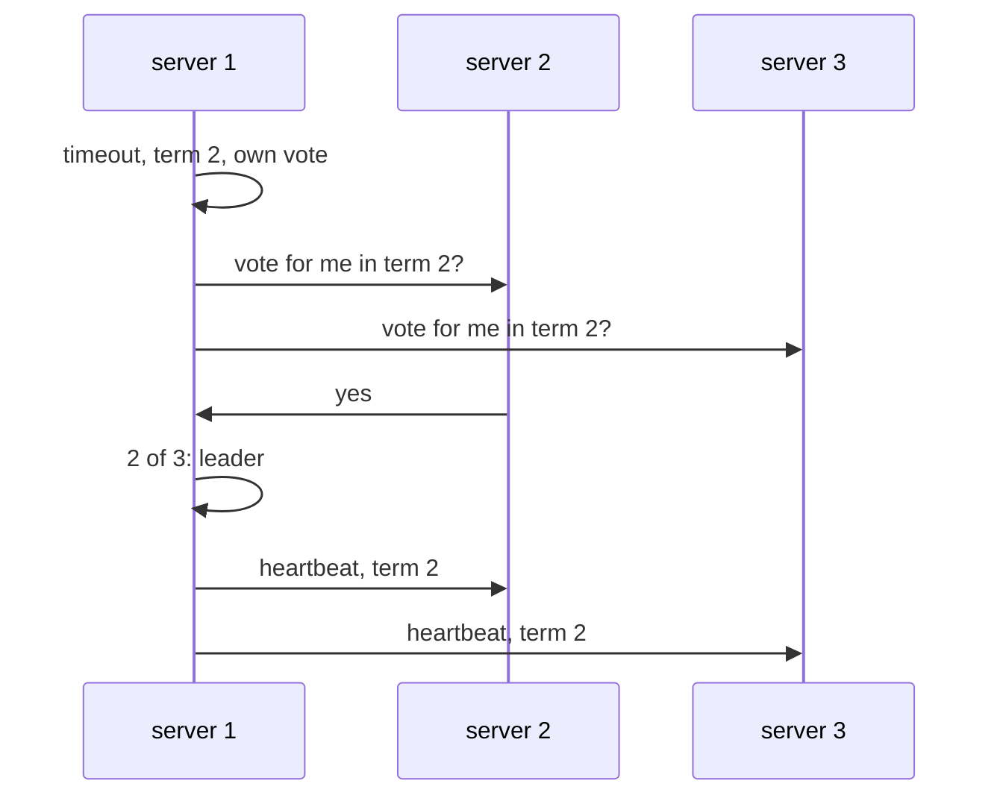

# Consensus with Raft

## The idea

**Consensus** is getting several processes to agree on a value, such that once they have agreed, the answer never changes, even if some of them crash and messages go missing. The guide on replication showed why it matters: a leader that orders every change in a log keeps replicas identical, but someone must decide who the leader is, and the decision must survive the leader's failure without ever producing two leaders, or two different logs.

The Raft paper (Ongaro and Ousterhout, 2014) presents consensus the way most systems use it, as a **replicated state machine**: every server keeps a log of commands, a consensus module makes sure every log eventually holds the same commands in the same order, and each server applies the commands in order to a deterministic state machine, so all of them compute the same state. Its stated goal was understandability: it produces a result equivalent to Paxos, the algorithm that dominated the field, and is as efficient, but separates leader election, log replication and safety so that each can be understood on its own. The paper's list of properties of practical consensus algorithms sets the bar: never return an incorrect result under any non-Byzantine condition, which rules out only servers that behave arbitrarily or maliciously, and so includes network delays, partitions, and packet loss, duplication and reordering; stay available as long as any majority of the servers are up and can communicate; and do not depend on timing for the consistency of the logs.

**Majorities.** A **majority** is more than half of all the servers of the cluster. Raft needs a majority to elect a leader and to commit an entry, and everything rests on one fact: any two majorities of the same cluster share at least one server. A cluster of five servers has majorities of three and keeps working through the failure of any two, the paper's typical configuration.

**Roles and terms.** At any time a server is a **follower**, a **candidate** or the **leader**. In normal operation there is exactly one leader, which handles every client request, and the followers only answer requests from leaders and candidates. Time is divided into **terms**, numbered with consecutive integers; each term begins with an election and has at most one leader. The paper says that terms act as a logical clock: every message carries its sender's term, a server that sees a larger term adopts it, and a candidate or leader that discovers its term is out of date reverts to follower. A server rejects a request that carries a stale term.

The roles change as Figure 4 of the paper shows:

| From | To | When |
|------|----|------|
| follower | candidate | Its election timeout passes with no word from a leader |
| candidate | candidate | Its election ends with no winner, and it starts another in a new term |
| candidate | leader | It has the votes of a majority of the full cluster |
| candidate | follower | It hears from a leader whose term is at least its own, or sees a higher term |
| leader | follower | It sees a higher term |

**Elections.** A leader sends periodic **heartbeats**, messages that carry no new entries, to keep its authority. A follower that hears nothing for a period called the **election timeout** assumes there is no leader: it increments its term, becomes a candidate, votes for itself and asks every other server for its vote. Each server votes for at most one candidate per term, first come first served, and a candidate that gets the votes of a majority of the full cluster becomes leader. Since two majorities share a server and that server votes once per term, two candidates cannot both win the same term. If votes split and nobody wins, the candidates time out and start a new term. To keep splits rare, Raft draws each election timeout at random from an interval, 150 to 300 ms in the paper's example, so that usually one server times out first and wins before the others wake up.



<!-- text-of-mermaid sha256:6898cf92ae9578e35850277cb4876f08f175d5d90c8a89e4bea464c696915b76 -->
```text
┌──────────┐                ┌──────────┐   ┌──────────┐
│ server 1 │                │ server 2 │   │ server 3 │
└─────┬────┘                └─────┬────┘   └─────┬────┘
      │                           │              │
      ├───┐                       │              │
      │   │ timeout, term 2, own vote            │
      ◀───┘                       │              │
      │                           │              │
      │  vote for me in term 2?   │              │
      │───────────────────────────▶              │
      │                           │              │
      │         vote for me in term 2?           │
      │──────────────────────────────────────────▶
      │                           │              │
      │            yes            │              │
      ◀───────────────────────────│              │
      │                           │              │
      ├───┐                       │              │
      │   │ 2 of 3: leader        │              │
      ◀───┘                       │              │
      │                           │              │
      │     heartbeat, term 2     │              │
      │───────────────────────────▶              │
      │                           │              │
      │            heartbeat, term 2             │
      │──────────────────────────────────────────▶
      │                           │              │
┌─────┴────┐                ┌─────┴────┐   ┌─────┴────┐
│ server 1 │                │ server 2 │   │ server 3 │
└──────────┘                └──────────┘   └──────────┘
```

The drawing shows the common case, where one server times out alone. Its vote and server 2's make a majority, so server 3's answer, whenever it comes, changes nothing.

**Log replication.** The leader appends each client command to its log as an entry, which records the command and the term in which the leader received it, and sends the new entries to the followers. An entry is **committed** once the leader that created it has stored it on a majority of the servers; committed entries are durable and will eventually be applied by every available server, and the leader tells the followers how far the log is committed in its later messages. Each message that carries entries also carries the position and term of the entry just before them, and a follower that does not hold a matching entry there refuses the new ones. That consistency check gives the **log matching** property: if two logs hold an entry with the same position and term, they are identical up to that position. When the check fails, the leader retries further back until it finds where the two logs agree, and the follower then drops its conflicting entries and takes the leader's. A leader never overwrites or deletes entries in its own log.

**Safety.** Two more rules keep a committed entry from being lost when leaders change. The **election restriction**: a server refuses its vote to a candidate whose log is less **up-to-date** than its own, where the log whose last entry has the later term is more up-to-date, and between equal last terms the longer log is. A committed entry is on a majority, and a winning candidate needs a majority's votes, so at least one voter holds the entry. That voter refuses every candidate whose log lacks it, provided the entry was committed by counting copies in its own leader's term. That is the second rule: a leader never commits an entry from an earlier term by counting its copies. Figure 8 of the paper shows such an entry stored on a majority whose holders that are still up all vote for a candidate with a later last term, which then overwrites it. A leader commits only entries of its current term by counting, and those commit everything before them.

## A worked example

### Majorities always meet

```python examples/majorities.py
"""Majorities of a cluster: how many servers make one, how many can fail, and why two always meet.

A majority is more than half of all the servers. Any two majorities of the same cluster share a
server, which is checked here by trying every pair for five servers; two groups of two can miss
each other.
"""

from itertools import combinations

print("servers  majority  failures it survives")
for n in range(1, 8):
    majority = n // 2 + 1
    print(f"{n:>7}  {majority:>8}  {n - majority:>20}")

servers = range(5)
for size in (3, 2):
    pairs = list(combinations(combinations(servers, size), 2))
    apart = sum(1 for a, b in pairs if not set(a) & set(b))
    print(f"groups of {size} out of 5: {apart} of {len(pairs)} pairs share no server")
```

It prints:

```output examples/majorities.py
servers  majority  failures it survives
      1         1                     0
      2         2                     0
      3         2                     1
      4         3                     1
      5         3                     2
      6         4                     2
      7         4                     3
groups of 3 out of 5: 0 of 45 pairs share no server
groups of 2 out of 5: 15 of 45 pairs share no server
```

Read the table in pairs. Four servers survive one failure, like three, because a majority of four is three: the fourth server adds a machine that can fail without adding a failure the cluster can survive. That is why clusters have odd sizes. The last two lines check the fact the whole algorithm leans on: of the 45 pairs of groups of three out of five, none is disjoint, while 15 pairs of groups of two are, which is what would let two leaders be elected, or a committed entry be missed, if two out of five were enough.

### Why the timeouts are random

The second program is a model, far simpler than Raft, of the first moments after a leader fails. Every server waits its election timeout; the first to time out wins only if no other server times out before its request for votes arrives, 5 ms later:

```python examples/split_votes.py
"""A model of why Raft draws its election timeouts at random.

Five servers stop hearing from their leader at the same moment, and each waits for its own
election timeout. The first to time out asks the others for their votes, and the request takes
5 ms to arrive. A server whose timeout runs out before that request arrives stands too, and the
votes split; then every server waits a new timeout and the round starts again. The model only
counts rounds until one server times out alone; it is far simpler than Raft's real rules.
"""

import random

SERVERS, DELAY_MS, TRIALS, GIVE_UP = 5, 5, 1000, 20


def rounds_until_leader(rng: random.Random, low: int, high: int) -> int | None:
    for round_number in range(1, GIVE_UP + 1):
        timeouts = sorted(rng.randrange(low, high + 1) for _ in range(SERVERS))
        if timeouts[1] >= timeouts[0] + DELAY_MS:  # the first candidate's request wins the race
            return round_number
    return None


rng = random.Random(2014)
print(f"{'election timeouts':<22} {'first round':>11} {'mean rounds':>11} {'no leader':>9}")
for low, high in [(150, 150), (150, 175), (150, 300)]:
    results = [rounds_until_leader(rng, low, high) for _ in range(TRIALS)]
    elected = [r for r in results if r is not None]
    first = sum(1 for r in elected if r == 1)
    mean = f"{sum(elected) / len(elected):.2f}" if elected else "-"
    label = f"{low} ms for all" if low == high else f"{low} to {high} ms"
    print(f"{label:<22} {first:>11} {mean:>11} {TRIALS - len(elected):>9}")
```

It prints:

```output examples/split_votes.py
election timeouts      first round mean rounds no leader
150 ms for all                   0           -      1000
150 to 175 ms                  395        2.55         0
150 to 300 ms                  845        1.17         0
```

With every server waiting exactly 150 ms, all five time out together, every round splits, and no leader is ever elected. Spreading the timeouts over 25 ms elects one in the first round in 395 trials of 1,000; over 150 ms, as in the paper's example, in 845, with 1.17 rounds on average. The paper reports the same effect on its real implementation: without randomness, elections consistently took longer than 10 seconds because of repeated split votes, and adding just 5 ms of randomness brought the median downtime to 287 ms.

## When to use it

- **Choosing a leader that everyone agrees on**, so that one server orders all changes and a failed leader is replaced without ever having two.
- **Storing small, critical state**: which server is the primary, the configuration of a cluster, locks and leases. The paper notes that large systems with a single cluster leader typically keep this kind of information in a separate replicated state machine, because it must survive leader crashes.
- **A replicated log for a whole store**, when every write must be ordered and survive the loss of a minority of servers, and the latency of a round trip to a majority on each write is acceptable.
- **What to use instead**: a single server with backups, when a short outage during failover is acceptable and the failover can be decided by a person or by a coordinator that is itself replicated; CRDTs, when replicas must keep accepting writes during a partition and the data can merge; a majority quorum without a log, when you only need reads to meet the latest write, not an order of all writes.

## Common traps

- **Even cluster sizes.** Four servers need three for a majority and survive one failure, no better than three servers.
- **Counting votes or replies from an old term.** A reply that answers an earlier term's request means nothing now. Every message carries its term, and stale ones are ignored.
- **Committing an earlier term's entry because a majority stores it.** Figure 8 of the paper shows how such an entry can still be overwritten. Only entries of the current term are committed by counting.
- **A leader that does not know it has been replaced.** A leader cut off from the majority keeps believing it leads and can accept requests, but it can no longer commit them. A read served by it alone may be stale: the paper has a new leader first commit an entry of its own term, and exchange heartbeats with a majority before it answers a read-only request without writing to the log.
- **Retries that execute a command twice.** A leader can commit a command and crash before replying; the client retries with the new leader. The paper's fix is a unique serial number per client command, remembered by the state machine, the method of the guide on idempotency.
- **Election timeouts that are too short.** The paper's measurements show that below a point, leaders cannot get their heartbeats out before others start elections, causing needless changes of leader.

## Complexity

For a cluster of `n` servers:

| Operation | Messages | Waiting | Condition |
|-----------|----------|---------|-----------|
| Commit one entry | `n − 1` requests and replies | One round trip to the fastest majority | Normal operation, with a stable leader; a slow minority does not delay it |
| Elect a leader | `n − 1` vote requests per candidate | About one election timeout, plus a round trip | Longer when votes split, which randomized timeouts make rare |
| Bring a lagging follower up to date | One retry per position it has to go back | One round trip per retry | The paper retries one entry further back each time |
| Survive failures | | | Up to `⌊(n − 1)/2⌋` servers down: 2 of 5, 3 of 7 |

Every server keeps the whole log, O(L) for `L` entries, until it is compacted. The paper states the timing requirement for a steady leader as broadcast time ≪ election timeout ≪ mean time between failures, where the broadcast time is a round of messages to every server and back.

## Expert notes

- **No deterministic consensus in a fully asynchronous system.** Fischer, Lynch and Paterson proved in 1985 that no completely asynchronous consensus protocol, its processes acting deterministically, can tolerate even one unannounced crash. In their words, the stopping of a single process at an inopportune time can cause any distributed commit protocol to fail to reach agreement. Thus, this important problem has no robust solution without further assumptions about the computing environment or still greater restrictions on the kind of failures to be tolerated! The ways out are timing assumptions, which Raft uses for progress only, restricting the failures, or asking for termination only with probability 1. Raft respects the result by splitting the guarantees: safety never depends on timing, while availability does, through the election timeout and the timing requirement above. With bad timing Raft may stop making progress; it never returns a wrong result.
- **The proof idea in one sentence.** The paper's argument for leader completeness goes through a voter: if a leader of term `T` commits an entry and a later leader lacks it, some server both stored the entry and voted for the later leader, and its vote was only possible if the later leader's log was at least as up-to-date as its own, which leads to a contradiction either way.
- **Relatives.** The paper calls Raft similar in many ways to existing algorithms, most notably Oki and Liskov's Viewstamped Replication, and its novel features are a strong leader, through which log entries flow in only one direction, randomized timers for elections, and a joint-consensus method for membership changes. In Viewstamped Replication a server can be elected without all committed entries and receive them afterwards; Raft's election restriction avoids that extra mechanism.
- **Changing the membership.** Switching a cluster directly from one set of servers to another is unsafe, because the cluster could split into two independent majorities during the change. Raft first moves to a **joint consensus** configuration, in which decisions need majorities of both the old and the new configuration, and only then to the new one.
- **Logs cannot grow forever.** The paper's simplest compaction is a **snapshot**: the whole current state is written to stable storage and the log up to that point is discarded; a leader can send its snapshot to a follower that has fallen too far behind.
- **Understandable by design.** The paper reports a user study with 43 students at two universities, in which 33 answered questions about Raft better than questions about Paxos after learning both.

## Practice

- `cstudy start raft-sim`: a step-by-step Raft cluster on a scripted network that you control: the voting rules, elections with lost and reordered messages, log replication with safe commits, and a partition that heals without losing a committed entry.

## Further reading

- [Ongaro and Ousterhout, *In Search of an Understandable Consensus Algorithm (Extended Version)*, 2014](https://raft.github.io/raft.pdf): section 2, replicated state machines; section 5, the algorithm, with Figure 2 its summary, Figure 3 its five safety properties and Figure 8 the case of entries from earlier terms; section 5.6, timing; section 6, membership changes; section 7, snapshots; section 8, clients; section 9.3, the measurements of elections.
- [Fischer, Lynch and Paterson, *Impossibility of Distributed Consensus with One Faulty Process*, Journal of the ACM 32(2), 1985](https://groups.csail.mit.edu/tds/papers/Lynch/jacm85.pdf): why consensus needs an assumption beyond full asynchrony.
