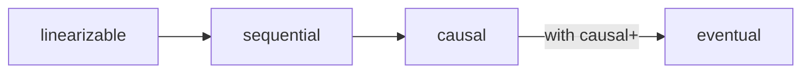
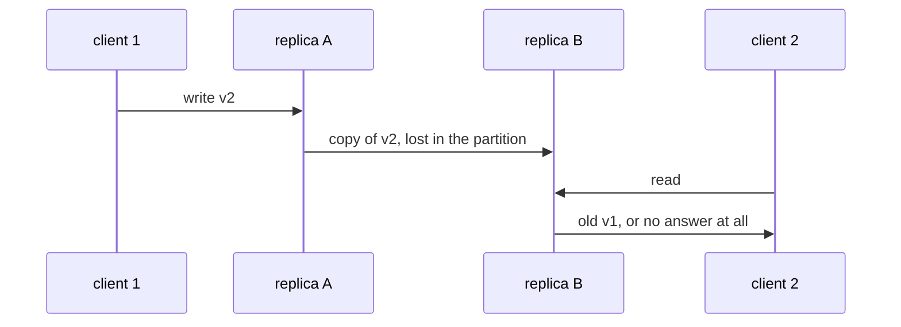

# Consistency models: from linearizable to eventual, and CAP

## The idea

A replicated store has several copies of each value, and reads and writes reach them at different moments. A **consistency model** is the store's promise about which values a read may return, given the writes that happened around it. A strong model hides the copies, so the store behaves like one machine; a weak model lets the copies show, in exchange for speed and for answering when replicas cannot reach each other. The models below go from strongest to weakest. An **operation** is one read or one write; it is **invoked** when the client sends it and **returns** when the client gets the answer, and two operations are concurrent when neither returned before the other was invoked.

**Linearizability.** Herlihy and Wing's 1990 paper defines it: each operation appears to take effect instantaneously at some point between its invocation and its response. The order of those points must respect real time: if one operation returned before another was invoked, it comes first. For a single value this has a consequence that Gilbert and Lynch state plainly in their proof of the CAP theorem: a read that begins after a write has completed must return the value of that write, or of a later one. The store behaves as if it were one copy, answering one operation at a time. Gilbert and Lynch call this **atomic** consistency, a name that means something else in database transactions.

**Sequential consistency.** Lamport's 1979 definition: the result of any execution is the same as if the operations of all the processors were executed in some sequential order, and the operations of each processor appear in this sequence in the order its program issued them. Herlihy and Wing point out the difference from linearizability: sequential consistency does not require the order to respect real time across processes. A read may return an old value after someone else's write has completed, as long as one single order explains everything every process saw.

**Causal consistency.** Only operations that could have influenced each other must be seen in order. Lloyd and others, in a 2011 paper on causal consistency for wide-area storage, define **potential causality** for a key-value store by three rules, the same shape as Lamport's happened-before: two operations of one thread of execution are ordered as the thread issued them; a write comes before a read that returns its value; and the relation is transitive. Causal consistency requires that it must appear that a write occurs after every operation that causally precedes it. Concurrent writes are not ordered at all, and the paper notes that two concurrent writes to the same key allow one replica to return the first value forever and another the second. Causal consistency alone therefore does not make replicas converge. The paper's **causal+** consistency adds **convergent conflict handling**: every replica handles conflicting writes in the same way, with a function that is associative and commutative, so that the results converge.

**Eventual consistency.** Shapiro and others, in their 2011 paper on CRDTs, define it by three properties: an update delivered at some correct replica is eventually delivered to all of them; replicas that have delivered the same updates eventually reach equivalent states; and every operation terminates. Informally, if writes stop, the replicas end up agreeing. It promises nothing about what a read returns in the meantime. The same paper defines **strong eventual consistency**: replicas that have delivered the same updates are in equivalent states at once, with no rollback, which is the subject of the guide on CRDTs.



<!-- text-of-mermaid sha256:ed0f773ce86535aedc22d5d9f83dc2c2100a0297fc942eaa7619ac03d61ba788 -->
```text
┌────────────┐    ┌──────────┐    ┌──────┐              ┌────────┐
│linearizable├───►│sequential├───►│causal├with─causal+─►│eventual│
└────────────┘    └──────────┘    └──────┘              └────────┘
```

The drawing orders the four as the causal consistency paper lists them, in decreasing strength. Each arrow from linearizable to causal points to a weaker model. The last arrow needs a condition: causal consistency alone lets concurrent writes to one key diverge forever, so it implies eventual consistency only when every replica resolves such conflicts the same way, which that paper calls causal+.

**The CAP theorem.** In 2000, Eric Brewer conjectured that a web service cannot guarantee consistency, availability and partition tolerance at once. Gilbert and Lynch proved it in 2002, with precise definitions. Consistency is linearizability, as above. **Availability** means that every request received by a node that has not failed must result in a response, however long it takes. **Partition tolerance** means that these must hold even when the network loses arbitrarily many messages between nodes, as it does when a partition splits the nodes into groups that cannot reach each other. Their Theorem 1: in an asynchronous network, no read/write object guarantees both availability and linearizability in all executions, including those where messages are lost. The proof splits the nodes into two groups and loses every message between them: a write completes in one group, a read then starts in the other, and the read cannot return the written value, since nothing of the write reached its group, yet availability forces it to answer.



<!-- text-of-mermaid sha256:68980e7885333e55caedda6f0ad1d98cf91e701211cc4d394d29ac9d5a15c674 -->
```text
┌──────────┐   ┌───────────┐                          ┌───────────┐                    ┌──────────┐
│ client 1 │   │ replica A │                          │ replica B │                    │ client 2 │
└─────┬────┘   └─────┬─────┘                          └─────┬─────┘                    └─────┬────┘
      │              │                                      │                                │
      │  write v2    │                                      │                                │
      │──────────────▶                                      │                                │
      │              │                                      │                                │
      │              │  copy of v2, lost in the partition   │                                │
      │              │──────────────────────────────────────▶                                │
      │              │                                      │                                │
      │              │                                      │             read               │
      │              │                                      ◀────────────────────────────────│
      │              │                                      │                                │
      │              │                                      │  old v1, or no answer at all   │
      │              │                                      │────────────────────────────────▶
      │              │                                      │                                │
┌─────┴────┐   ┌─────┴─────┐                          ┌─────┴─────┐                    ┌─────┴────┐
│ client 1 │   │ replica A │                          │ replica B │                    │ client 2 │
└──────────┘   └───────────┘                          └───────────┘                    └──────────┘
```

The drawing is the proof in one picture. During a partition, a replica asked to read must choose: answer with what it has, which may be stale, or refuse until it can check. Outside partitions, once replicas can time out on lost messages, there is no such choice to make (the expert notes give Gilbert and Lynch's version), and Daniel Abadi's 2012 article insists on the point: CAP imposes no restriction when there is no partition. What does constrain systems all the time, he argues, is a different tradeoff, between consistency and latency, because keeping replicas consistent means waiting for messages between them. He folds both into **PACELC**: if there is a partition (P), how does the system trade availability (A) against consistency (C); else (E), when the system runs normally, how does it trade latency (L) against consistency (C)?

## A worked example

### Checking histories

A **history** is what clients observed: each operation with the moment it was invoked and the moment it returned. This program takes histories of one register, initially 0, and checks each against two models by trying every order of its operations:

```python examples/histories.py
"""Check small histories of one register, initially 0, against two consistency models.

Each operation is (process, kind, value, start, end), with start and end read off one ideal
clock. A history is sequentially consistent when some single order of all the operations keeps
each process's own order and every read returns the latest write before it. It is linearizable
when such an order also keeps real time: an operation that ended before another started comes
first. The check tries every order, which is fine for four operations.
"""

from itertools import permutations

HISTORIES = {
    "read after the write ends sees it": [("P", "w", 1, 0, 1), ("Q", "r", 1, 2, 3)],
    "read after the write ends misses it": [("P", "w", 1, 0, 1), ("Q", "r", 0, 2, 3)],
    "reads overlap the write": [("P", "w", 1, 0, 4), ("Q", "r", 0, 1, 2), ("Q", "r", 1, 3, 5)],
    "new value, then the old one again": [
        ("P", "w", 1, 0, 1), ("Q", "r", 1, 2, 3), ("Q", "r", 0, 4, 5),
    ],
}


def legal(order: tuple) -> bool:
    value = 0
    for _, kind, v, _, _ in order:
        if kind == "w":
            value = v
        elif v != value:
            return False
    return True


def respects(order: tuple, before) -> bool:
    return all(not before(b, a) for i, a in enumerate(order) for b in order[i + 1 :])


def same_process_first(a, b) -> bool:
    return a[0] == b[0] and a[4] < b[3]


def ended_before_started(a, b) -> bool:
    return a[4] < b[3]


def exists(history: list, before) -> bool:
    return any(legal(o) and respects(o, before) for o in permutations(history))


print(f"{'history':<38} {'sequential':<11} linearizable")
for name, history in HISTORIES.items():
    sequential = exists(history, same_process_first)
    linearizable = exists(history, ended_before_started)
    print(f"{name:<38} {'yes' if sequential else 'no':<11} {'yes' if linearizable else 'no'}")
```

It prints:

```output examples/histories.py
history                                sequential  linearizable
read after the write ends sees it      yes         yes
read after the write ends misses it    yes         no
reads overlap the write                yes         yes
new value, then the old one again      no          no
```

- **Read after the write ends sees it**: the obvious history, allowed by both.
- **Read after the write ends misses it**: `P` finished writing 1 at time 1, and `Q` read 0 at time 2. Sequential consistency allows it, ordering the read before the write, since nothing ties `Q`'s read to `P`'s write except real time. Linearizability forbids it: the write returned before the read started, so the read must see it. A store that serves reads from a lagging follower produces exactly this history.
- **Reads overlap the write**: while a write is in progress, a read may return the old value or the new one, and here `Q` sees 0 and then 1. Linearizable, with the write's instant placed between the two reads.
- **New value, then the old one again**: `Q` reads 1, then 0. No single order can explain it, since once the write is placed before the first read it is also before the second. Even sequential consistency forbids going backwards.

### What a replica does during a partition

Two replicas, `A` and `B`. A write has just landed at `A`, and a read arrives at `B` before `A`'s copy of the write. A **consistent** `B` asks `A` before answering; an **available** `B` answers from its own copy:

```python examples/partition_choice.py
"""Two replicas, A and B, of one register; a client writes at A, then another reads at B.

A copies every write to B soon after, but this read comes before the copy arrives. A replica
that answers on its own replies in 1 ms; asking the other replica costs a round trip of 80 ms,
and fails when the link between them is cut. A "consistent" B asks A before it answers a read;
an "available" B answers from its own copy.
"""

LOCAL_MS, ROUND_TRIP_MS = 1, 80


def read_at_b(mode: str, link_up: bool) -> str:
    a, b = "v2", "v1"  # the write has landed at A; B still holds the old value
    if mode == "available":
        return f"{b} after {LOCAL_MS} ms (stale)"
    if not link_up:
        return "no answer: A cannot be reached"
    return f"{a} after {LOCAL_MS + ROUND_TRIP_MS} ms"


for link_up in (True, False):
    for mode in ("consistent", "available"):
        link = "link up " if link_up else "link cut"
        print(f"{link}, {mode:<10} B: {read_at_b(mode, link_up)}")
```

It prints:

```output examples/partition_choice.py
link up , consistent B: v2 after 81 ms
link up , available  B: v1 after 1 ms (stale)
link cut, consistent B: no answer: A cannot be reached
link cut, available  B: v1 after 1 ms (stale)
```

The bottom two lines are CAP: with the link cut, `B` either gives no answer or a stale one. The top two lines are the "else" of PACELC: with the link up, the consistent replica pays a round trip, 81 ms instead of 1, on every read, and the available one is fast and stale until the copy arrives. Partitions are rare; that round trip is paid all the time.

## When to use it

- **Linearizable** when the code reasons as if there were one copy: a lock, a leader's lease, a unique username, a balance that must not go negative, a counter that hands out ids. Pay the coordination for those values only.
- **Sequential** where clients only compare notes through the store itself, never through a side channel such as a phone call or another service, so real-time order between them is not observable.
- **Causal** for things people read in context: a reply must not appear before the message it answers, a comment before the post. Causal consistency gives that without waiting for distant replicas.
- **Eventual** for data where a short delay does no harm and concurrent updates can be merged: a like count, a shopping list, a cache. Prefer designs where the merge is defined, which the guide on CRDTs covers.
- **Isolation levels are a separate question.** A consistency model speaks of single operations on copies; an isolation level speaks of transactions, groups of operations on several values. A store needs both answers, and the "C" of CAP is not the "C" of a database transaction's ACID guarantees: atomicity, consistency, isolation and durability.

## Common traps

- **"We are AP, so we have no consistency."** CAP is about behavior during a partition. Abadi's point is that a system that gives up consistency when there is no partition does so for latency, not because CAP forces it.
- **Reading CAP as "pick two of three".** Partitions are not something a distributed system can decline. The real choice is what each operation does when one happens: wait, refuse, or answer from what it has.
- **Calling a quorum system linearizable.** As the guide on replication shows, overlapping quorums make reads meet the latest completed write, and still leave concurrent writes unordered; Abadi notes that a quorum protocol alone does not reach Gilbert and Lynch's definition of consistency.
- **Forgetting side channels.** Sequential consistency allows a client to read a stale value after hearing, by email or another service, that the write was done. If clients talk outside the store, only linearizability keeps them in agreement.
- **Assuming serializable means linearizable.** Serializability says transactions appear to run one at a time in some order, not in the order they happened. Herlihy and Wing call the version that respects real time **strict serializability**.
- **Assuming snapshot isolation is serializable.** It is not, as the expert notes show.

## Complexity

| Promise | Cost of a write | Cost of a read | During a partition |
|---------|----------------|----------------|--------------------|
| Linearizable, leader with a majority | A round trip to a majority, through the leader | The Raft paper has a new leader first commit an entry of its own term, and exchange heartbeats with a majority before it answers a read-only request without writing to the log | The side without a majority stops answering |
| Causal | Local, with the write's dependencies recorded beside it | Local; a replica applies a write copied from elsewhere only once the writes it depends on are there | Every side keeps answering |
| Eventual | Local | Local, possibly stale | Every side keeps answering |

The checker of the example is exponential: `n!` orders for `n` operations, each checked in O(n), which is fine for four operations and hopeless for a real log. It makes the main point visible anyway: a consistency model is a property of whole histories, not of single operations, so no single read can be judged on its own.

## Expert notes

- **Linearizability composes.** Herlihy and Wing show that linearizability is a **local** property: a system is linearizable if each of its objects is. Sequential consistency is not, nor is serializability: their example is two queues, each sequentially consistent on its own, whose combined history is not. They also show that linearizability is nonblocking: a process that invokes an operation defined in every state of the object is never forced to wait.
- **Linearizability as a special case.** Herlihy and Wing describe linearizability as a special case of strict serializability where every transaction is a single operation on a single object, and note that strict serializability is ensured by some mechanisms, such as two-phase locking, but not by others, such as multiversion timestamp schemes.
- **Snapshot isolation.** Berenson and others, in their 1995 critique of the ANSI SQL isolation levels, define snapshot isolation: each transaction reads from a snapshot of the committed data as of its start, and commits only if no other transaction that committed during its run wrote data it also wrote, a rule they call **first-committer-wins**, which prevents lost updates. It is not serializable, because a transaction's reads come at one instant and its writes at another. Their **write skew** example: a rule says that `x + y` must stay positive; two transactions both read `x` and `y`, each writes a different one of them in a way that is safe on what it read, both commit, and the rule is broken. No serial order of the two allows that.
- **Asynchronous against partially synchronous.** In Gilbert and Lynch's asynchronous model, there is no clock, and a node cannot tell a lost message from one arbitrarily delayed. Their Corollary 1.1 follows: no read/write object is available in all fair executions and linearizable even in just the fair executions in which no message is lost. In their partially synchronous model, every node has a timer and every message arrives within a known time or is lost. The impossibility still holds when messages are lost (Theorem 2), but the analogue of the corollary does not (§4.3): a system can return linearizable data in every execution where all messages arrive, and stale data only when some are lost, by timing out on lost messages.
- **Strong eventual consistency stands apart.** Shapiro and others show that it is incomparable with sequential consistency: a replicated set that lets a concurrent add win over a remove can end in a state no sequential order produces, while sequential consistency, in general, needs consensus, which strong eventual consistency does not.

## Practice

- `cstudy start mvcc-snapshot-isolation`: build a store of versions with snapshot reads, first-committer-wins, the write skew that snapshot isolation allows and the extra checks that make it serializable, and the cleanup of versions no one can read.

## Further reading

- [Herlihy and Wing, *Linearizability: A Correctness Condition for Concurrent Objects*, ACM TOPLAS 12(3), 1990](https://cs.brown.edu/~mph/HerlihyW90/p463-herlihy.pdf): the definition, locality, and the comparison with sequential consistency and serializability.
- [Lamport, *How to Make a Multiprocessor Computer That Correctly Executes Multiprocess Programs*, IEEE Transactions on Computers C-28(9), 1979](https://lamport.azurewebsites.net/pubs/multi.pdf): the definition of sequential consistency.
- [Lloyd, Freedman, Kaminsky and Andersen, *Don't Settle for Eventual: Scalable Causal Consistency for Wide-Area Storage with COPS*, SOSP 2011](https://www.cs.cmu.edu/~dga/papers/cops-sosp2011.pdf): section 3, potential causality, causal consistency, and the models in decreasing strength.
- [Shapiro, Preguiça, Baquero and Zawirski, *Conflict-free Replicated Data Types*, SSS 2011](https://www.cs.tufts.edu/~nr/cs257/archive/marc-shapiro/CRDTs_SSS-2011.pdf): section 2.2, eventual and strong eventual consistency; section 3.3, strong eventual against sequential consistency.
- [Gilbert and Lynch, *Brewer's Conjecture and the Feasibility of Consistent, Available, Partition-Tolerant Web Services*, SIGACT News 33(2), 2002](https://www.comp.nus.edu.sg/~gilbert/pubs/BrewersConjecture-SigAct.pdf): the definitions, Theorem 1 and its proof, and the partially synchronous model.
- [Abadi, *Consistency Tradeoffs in Modern Distributed Database System Design*, IEEE Computer 45(2), 2012](https://www.cs.umd.edu/~abadi/papers/abadi-pacelc.pdf): what CAP does and does not say, the consistency/latency tradeoff, and PACELC.
- [Berenson, Bernstein, Gray, Melton, O'Neil and O'Neil, *A Critique of ANSI SQL Isolation Levels*, SIGMOD 1995](https://arxiv.org/abs/cs/0701157): snapshot isolation, first-committer-wins and write skew.
