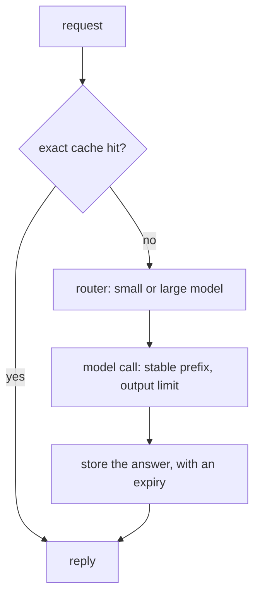

# Cost: caching, routing and output limits

## The idea

Where a model is paid by the token, the tokens you send and the tokens it writes can be priced differently, and a call takes time in proportion to both. An application that works in a demo can cost too much at a thousand users, not because any one request is expensive but because the same work is done again and again: the same instructions re-read on every call, the same question answered twice, a large model asked what a small one could have answered.

Four levers cut that cost without making answers worse:

| Lever | Saves | By |
|-------|-------|----|
| **Prompt caching** | Re-reading the same start of a prompt | Keeping the model's work on an identical prefix and reusing it on the next request |
| **Response caching** | Answering the same request twice | Storing answers under a key made from the whole request |
| **Semantic caching** | Answering a question already answered in other words | Storing answers under the question's embedding and reusing one above a similarity threshold |
| **Routing** | Using a large model where a small one would do | Sending each request to the cheapest model likely to answer it well, and escalating when it fails |

A fifth lever caps the damage instead of the average: **output limits**, the most tokens an answer may use, and **budgets**, the most a user, a team or a run may spend.

Where the cost comes from explains the levers. Serving a request has two phases: reading the prompt, which processes all its tokens together, and writing the answer, one token after another, each step waiting for the last. Keeping the model's intermediate state for a prompt prefix, its keys and values, lets the reading phase skip work it already did; that is what prompt caching reuses.

## A worked example

### Three caches

```python examples/caching.py
"""Three caches in front of a model: exact responses, a stable prompt prefix, and similar questions.

Tokens are counted as words. The embedding model is a fake that maps known words to named axes.
"""

import hashlib
import json
import math


# 1. An exact response cache: the key is a hash of the whole request in one canonical form.
def cache_key(request: dict) -> str:
    canonical = json.dumps(request, sort_keys=True, separators=(",", ":"), ensure_ascii=False)
    return hashlib.sha256(canonical.encode()).hexdigest()


first = {"model": "small", "temperature": 0, "messages": [{"role": "user", "content": "Refund window?"}]}
same = {"messages": [{"content": "Refund window?", "role": "user"}], "temperature": 0, "model": "small"}
spaced = {"model": "small", "temperature": 0, "messages": [{"role": "user", "content": "Refund window? "}]}
print("same request, keys in another order:", cache_key(first) == cache_key(same))
print("one trailing space:", cache_key(first) == cache_key(spaced))


# 2. Prompt caching reuses the work done on an identical start of the prompt, so its order matters.
INSTRUCTIONS = "You answer questions about the shop's policies. " * 20
TOOLS = "Tools: search_kb(query), lookup_order(order_id). " * 10


def shared_prefix(a: str, b: str) -> int:
    count = 0
    for x, y in zip(a.split(), b.split()):
        if x != y:
            break
        count += 1
    return count


def stable(turn: str, time: str) -> str:
    return f"{INSTRUCTIONS}{TOOLS}Question: {turn} (asked at {time})"


def unstable(turn: str, time: str) -> str:
    return f"Now: {time}. {INSTRUCTIONS}{TOOLS}Question: {turn}"


for layout in (stable, unstable):
    a, b = layout("Refund window?", "09:00"), layout("Where is my order?", "09:01")
    print(f"{layout.__name__:>8} layout: {shared_prefix(a, b)} of {len(b.split())} tokens shared with the last request")

# 3. A semantic cache answers a new question with the answer to a similar earlier one.
AXES = ("refund", "replacement", "time", "shipping")
WORDS = {"refund": "refund", "money": "refund", "back": "refund", "replacement": "replacement",
         "exchange": "replacement", "long": "time", "days": "time", "when": "time", "ship": "shipping"}


def embed(text: str) -> list[float]:
    counts = [0.0] * len(AXES)
    for word in text.lower().replace("?", "").replace(",", "").split():
        if word in WORDS:
            counts[AXES.index(WORDS[word])] += 1
    length = math.sqrt(sum(c * c for c in counts))
    return [c / length for c in counts] if length else counts


cached = {"How long do I have to ask for a refund?": "30 days from purchase."}
for question in ["How many days do I have to get my money back?", "How long, in days, do I have to ask for a replacement?",
                 "When do you ship?"]:
    best, score = max(((q, sum(x * y for x, y in zip(embed(q), embed(question)))) for q in cached), key=lambda p: p[1])
    verdicts = [f"at {threshold}: {'hit' if score >= threshold else 'miss'}" for threshold in (0.6, 0.9)]
    print(f"{question!r} similarity {score:.2f}, {', '.join(verdicts)}")
print("a hit answers with:", repr(cached["How long do I have to ask for a refund?"]))
```

It prints:

```output examples/caching.py
same request, keys in another order: True
one trailing space: False
  stable layout: 171 of 178 tokens shared with the last request
unstable layout: 1 of 177 tokens shared with the last request
'How many days do I have to get my money back?' similarity 0.95, at 0.6: hit, at 0.9: hit
'How long, in days, do I have to ask for a replacement?' similarity 0.63, at 0.6: hit, at 0.9: miss
'When do you ship?' similarity 0.50, at 0.6: miss, at 0.9: miss
a hit answers with: '30 days from purchase.'
```

Part by part:

1. **The exact cache key** is a SHA-256 hash of the request written in one canonical form: keys sorted and no optional whitespace. The same request with its keys in another order gets the same key, so it hits. One trailing space in the question gives a different key: an exact cache is exact. Normalize what you can safely normalize, such as surrounding whitespace, before hashing, and nothing that changes meaning. Cache only answers you would be happy to give again: deterministic settings, no personal data in a shared cache, and an expiry.
2. **The prompt layout.** Prompt caching reuses work on an identical **prefix**, so only the tokens up to the first difference count. With the instructions and tool list first and the changing parts last, two requests share 171 of 178 tokens. Put a timestamp at the very start and they share 1: every request pays for the whole prompt again. Stable content first, variable content last.
3. **The semantic cache** reuses an answer for a question that means about the same thing. "How many days do I have to get my money back?" is a good hit at either threshold. "How long, in days, do I have to ask for a replacement?" scores 0.63: at a threshold of 0.6 it hits and is told "30 days from purchase", the refund window, which may not be the replacement window at all. At 0.9 it misses and the model answers it properly. The threshold trades savings against wrong answers, and only measurement on real questions can set it.

### Routing and limits

```python examples/routing.py
"""What a batch of requests costs on one large model, on a cascade from a small one, and with output limits.

Prices are invented, in credits per million tokens. The models' answers are recorded data.
"""

PRICES = {"small": (0.2, 0.8), "large": (3.0, 15.0)}  # (per million prompt tokens, per million completion tokens)

# (prompt tokens, completion tokens, does the small model's answer pass the validator?)
REQUESTS = [(900, 120, True), (1200, 200, True), (800, 90, True), (1500, 400, False), (1000, 150, True),
            (700, 60, True), (2000, 600, False), (950, 110, True), (1100, 180, True), (1300, 250, True)]


def cost(model: str, prompt: int, completion: int) -> float:
    per_prompt, per_completion = PRICES[model]
    return (prompt * per_prompt + completion * per_completion) / 1_000_000


large_only = sum(cost("large", p, c) for p, c, _ in REQUESTS)
cascade, escalated = 0.0, 0
for prompt, completion, passes in REQUESTS:
    cascade += cost("small", prompt, completion)  # always try the small model first
    if not passes:  # the validator rejects its answer: pay again for the large model
        cascade += cost("large", prompt, completion)
        escalated += 1
print(f"large model for everything: {large_only:.4f} credits")
print(f"cascade, {escalated} of {len(REQUESTS)} escalated: {cascade:.4f} credits ({cascade / large_only:.0%} of it)")

# If the router could tell the hard requests from the easy ones up front, nothing would be paid twice.
routed = sum(cost("small" if passes else "large", p, c) for p, c, passes in REQUESTS)
print(f"a perfect router: {routed:.4f} credits ({routed / large_only:.0%})")

# Output tokens cost five times as much as prompt tokens here; an output limit caps the worst case.
for limit in (None, 200):
    total = sum(cost("large", p, c if limit is None else min(c, limit)) for p, c, _ in REQUESTS)
    cut = 0 if limit is None else sum(c > limit for _, c, _ in REQUESTS)
    print(f"large model, output limit {limit}: {total:.4f} credits, {cut} answers cut short")
```

It prints:

```output examples/routing.py
large model for everything: 0.0668 credits
cascade, 2 of 10 escalated: 0.0295 credits (44% of it)
a perfect router: 0.0280 credits (42%)
large model, output limit None: 0.0668 credits, 0 answers cut short
large model, output limit 200: 0.0570 credits, 3 answers cut short
```

The large model costs 15 times as much per prompt token and almost 19 times per completion token. A **cascade** sends every request to the small model first and checks its answer with a validator, such as a schema check, a test or a set of assertions; only the two that fail go to the large model, which then costs a second full request. The batch costs 44% of the large-only price. A router that knew in advance which requests were hard would pay 42%; the difference is the price of finding out by trying. The last lines show the output limit: at 200 tokens, three answers are cut short and the bill drops by about 15%, which is only a good trade if those answers did not need the extra length. A limit is a ceiling on the worst case, set above what good answers need.



<!-- text-of-mermaid sha256:307c98292a335dbcbb24071e79f26ba97f571047c7d516e61b50c3ee003236a9 -->
```text
┌───────────────────────────────────────┐
│                request                │
└───────────────────┬───────────────────┘
                    ▼
◇───────────────────────────────────────◇
│            exact cache hit?           ├──────────────────no
◇──────────────────yes──────────────────◇                   │
                    ▼                                       ▼
┌───────────────────────────────────────┐    ┌────────────────────────────┐
│                 reply                 │◄─┐ │router: small or large model│
└───────────────────────────────────────┘  │ └──────────────┬─────────────┘
                                           │                │
┌───────────────────────────────────────┐  │                │
│model call: stable prefix, output limit│◄─┼────────────────┘
└───────────────────┬───────────────────┘  │
                    ▼                      │
┌───────────────────────────────────────┐  │
│    store the answer, with an expiry   ├──┘
└───────────────────────────────────────┘
```

The drawing orders the levers by cost: a cache hit costs a lookup, routing costs a decision, and only what is left reaches a model, with its prefix laid out for prompt caching and its answer capped. A semantic cache, when you use one, sits after the exact cache and before the router.

## When to use it

- **Prompt caching** almost always: it needs no change of behaviour and mostly needs a stable layout; depending on the provider it may also need to be enabled, and writing to the cache may cost more than an ordinary read. Keep the instructions, tool definitions and long shared documents identical and first; keep timestamps, user details and the question last.
- **Response caching** for repeated, deterministic requests: classification of the same input, the same question on a help page, embeddings of the same text. Never across users when answers depend on who asks.
- **Semantic caching** for high-volume, low-stakes questions that recur in many wordings, with a threshold measured on real traffic and a way to invalidate answers when the facts change. Avoid it where a near miss is costly.
- **Routing** when requests vary in difficulty: a small model for the easy majority, a large one for the rest. Decide with a validator where you can check answers, with a trained router where you cannot.
- **Output limits** on every call, set above what good answers need; **budgets** per user, team and run, enforced, not just reported.

## Common traps

- **A volatile prefix.** A timestamp, a request id or a shuffled tool list at the start of the prompt makes every request a cache miss. Order matters, down to the token.
- **Caching non-deterministic answers.** With sampling, the same request has many valid answers; caching one is a choice to always give that one. Make it deliberately, and cache only what is safe to repeat.
- **One cache for all users.** A cached answer about one customer's order served to another is a data leak. Whether an answer was cached can itself leak information through timing. Key caches by tenant, and keep personal answers out of shared caches.
- **A semantic threshold set by feel.** Too low gives confident wrong answers; too high saves nothing. Measure false hits on real questions before trusting it, and remember that a cache keyed on similarity can be poisoned with crafted entries.
- **Stale cached answers.** When a policy changes, every cached answer about it is wrong. Expire entries, and clear the related ones when the source changes.
- **Routing without checking.** A router that sends hard requests to the small model saves money by giving worse answers. Measure each route's quality on the golden set, not only its cost.
- **Paying twice without noticing.** A cascade pays for the small model on every escalated request. If most requests escalate, it costs more than the large model alone.
- **Output limits that truncate silently.** An answer cut at the limit looks like a short answer. Check why generation stopped, and treat a cut structured answer as invalid.

## Complexity

For a request with `n` prompt tokens, of which `p` are a cached prefix, and `m` completion tokens:

| Step | Cost |
|------|------|
| Exact cache lookup | O(n) to hash the canonical request, then O(1) |
| Semantic cache lookup | One embedding call, then a nearest-neighbour search over the cached questions |
| Prompt with a cached prefix | Reading `n - p` new tokens instead of `n` |
| Writing the answer | `m` sequential steps; an output limit caps `m` |
| Cascade | The small model always, plus the large model for the share `e` that escalates: `small + e · large` per request |
| Router decided up front | One cheap classification per request, then one model |

A cascade beats the large model alone when `small + e · large < large`, that is when the escalation rate `e` is below `1 - small / large`. With the example's prices that is most requests; with two models of similar price it may be none.

## Expert notes

- **Two phases.** Patel and colleagues characterized inference as a compute-intensive prompt computation followed by a memory-intensive token generation, with different latency, throughput and power profiles, and proposed running the two phases on separate machines. Whatever the hardware, it explains why an answer takes longer to produce than a prompt of the same length takes to read.
- **What a prompt cache keeps.** Kwon and colleagues describe the key-value cache of each request as large and growing with the request, and built a serving system that can share it within and across requests. Gim and colleagues' Prompt Cache precomputes and stores the attention states of frequently reused text segments, such as system messages, templates and documents, and reuses them when those segments reappear, keeping track of their positions; they report time-to-first-token improvements from 8 times on GPUs to 60 times on CPUs, with the same output accuracy.
- **Stable tool lists.** The Model Context Protocol's specification asks servers to return tools in a deterministic order, noting that this improves prompt cache hit rates when tool definitions are included in the model's context.
- **Cascades and routers.** Chen, Zaharia and Zou describe three ways to cut inference cost: adapting the prompt, approximating a large model, and cascading from cheaper to more expensive models; they report a learned cascade matching the best individual model at up to 98% lower cost on their benchmarks. Ong and colleagues train routers that choose between a stronger and a weaker model from human preference data, reporting cost reductions of more than half in some cases without loss of response quality, and routers that keep working when the two models are swapped for others.
- **Cost is an attack surface.** The 2026 OWASP Top 10 for LLM Applications ranks Unbounded Consumption sixth: attackers can trigger expensive computation at little cost to themselves, up to a denial of wallet. Its advice includes limits in tokens per minute and per day as well as requests, estimating tokens before inference to reject oversized requests, and hard spending caps that stop inference rather than alert. Its entry on vector and embedding weaknesses describes semantic cache poisoning, where content crafted to land just above a similarity threshold is served for every similar question, and its entry on sensitive information disclosure lists cache-hit behaviour among the signals that can leak information.

## Practice

- `cstudy start llm-gateway-typescript`: a gateway that caps each request's output to the team's remaining budget, refuses a team with nothing left, and records cost per team from each provider's prices.
- `cstudy start cache-and-router`: caching and routing in front of models.

## Further reading

- [Patel and others, *Splitwise: Efficient generative LLM inference using phase splitting* (2023)](https://arxiv.org/abs/2311.18677): prompt computation and token generation as two phases.
- [Kwon and others, *Efficient Memory Management for Large Language Model Serving with PagedAttention* (2023)](https://arxiv.org/abs/2309.06180): the KV cache and sharing it across requests.
- [Gim and others, *Prompt Cache: Modular Attention Reuse for Low-Latency Inference* (2023)](https://arxiv.org/abs/2311.04934): reusing attention states for repeated prompt segments.
- [Chen, Zaharia and Zou, *How to Use Large Language Models While Reducing Cost and Improving Performance* (2023, title shortened)](https://arxiv.org/abs/2305.05176): prompt adaptation, approximation and cascades.
- [Ong and others, *RouteLLM: Learning to Route LLMs with Preference Data* (2024)](https://arxiv.org/abs/2406.18665): routers between a stronger and a weaker model.
- [Model Context Protocol, tools](https://modelcontextprotocol.io/specification/2026-07-28/server/tools): deterministic tool order and prompt cache hit rates.
- [Python `json`](https://docs.python.org/3/library/json.html) and [Python `hashlib`](https://docs.python.org/3/library/hashlib.html): `sort_keys`, compact `separators` and SHA-256 for cache keys.
- [OWASP Top 10 for LLM Applications 2026](https://genai.owasp.org/resource/owasp-genai-llm-top-10-2026/): LLM06 Unbounded Consumption, and semantic cache poisoning under LLM09.
