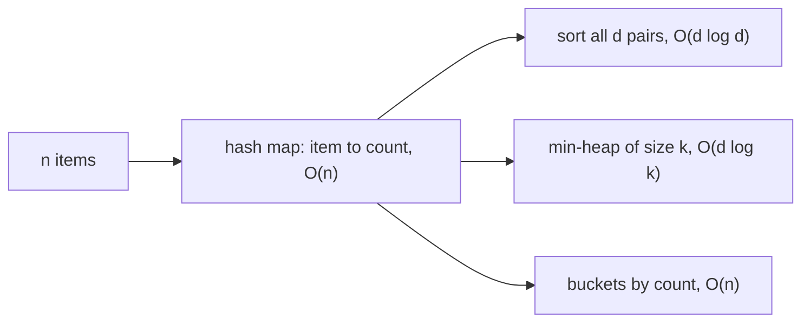

# Counting and frequency

## The idea

Many questions about a collection are questions about **how often** each thing occurs. Which word is most common? Does any value fill more than half the list? Do two strings use the same letters? Which three error codes came up most this hour?

The tool is a **counter**: a hash map from each distinct item to the number of times it has been seen. One pass over the input builds it. For each item, look up its count, add one, store it back. Because each lookup and store is O(1) on average in a [hash map](../hash-maps-and-sets/guide.md), counting `n` items takes O(n) time, and the map holds one entry per **distinct** item, `d` of them, so it takes O(d) space.

Once the counts exist, most questions become easy:

- "How many times does `x` occur?" is one lookup.
- "Which item is most common?" is one pass over the `d` entries.
- "Which `k` items are most common?" needs the entries **ranked** by count, and there are three good ways to rank them, with different costs. Choosing among them is most of this guide.



<!-- text-of-mermaid sha256:41662e1809ab4417eaad5227ff7b5dd78a30cd6aafde9c4146f55a2712c3fb99 -->
```text
┌───────┐    ┌─────────────────────────────┐    ┌──────────────────────────────┐
│n items├───►│hash map: item to count, O(n)├───►│ sort all d pairs, O(d log d) │
└───────┘    └──────────────┬──────────────┘    └──────────────────────────────┘
                            │
                            │                   ┌──────────────────────────────┐
                            ├──────────────────►│min-heap of size k, O(d log k)│
                            │                   └──────────────────────────────┘
                            │
                            │                   ┌──────────────────────────────┐
                            └──────────────────►│    buckets by count, O(n)    │
                                                └──────────────────────────────┘
```

The diagram reads left to right: the counting pass is the same for every method, and only the ranking step differs.

## A worked example

Take a small log of severity levels and find the most frequent ones.

```text
warn info info error info debug warn info error warn trace info
```

Counting, one item at a time:

1. `warn`: not in the map, so it starts at 0 and becomes 1.
2. `info`: becomes 1. The next `info` makes it 2.
3. `error`: 1. Then `info` again: 3. And so on.

After twelve items the map holds `info: 5`, `warn: 3`, `error: 2`, `debug: 1` and `trace: 1`: five distinct items, `d = 5`, from `n = 12`.

Now rank them.

- **Sort.** Sort the five `(item, count)` pairs by count, highest first, and take the first `k`. Simple and always correct; it costs O(d log d).
- **Heap.** Keep a min-heap of at most `k` pairs, ordered by count. For each pair, push it; if the heap now holds `k + 1`, pop the smallest. The heap always holds the best `k` seen so far, and its root is the weakest of them, the one to evict next. Each push and pop costs O(log k), so the ranking costs O(d log k), which beats sorting when `k` is much smaller than `d`.
- **Buckets.** No count can exceed `n`, so make `n + 1` buckets, one per possible count, and put each item in the bucket of its count. Then walk the buckets from count `n` down to 1, collecting items until you have `k`. That is O(n + d) = O(n), with no comparisons at all.

```python examples/top_k.py
"""Count with a hash map, then find the most frequent items three ways."""

import heapq
from collections import Counter

LOG = "warn info info error info debug warn info error warn trace info".split()

counts: dict[str, int] = {}
for level in LOG:
    counts[level] = counts.get(level, 0) + 1
print("counts:", counts)
print("Counter agrees:", Counter(LOG) == counts, "| a missing key counts", Counter(LOG)["fatal"])

# 1. Sort every distinct item by count: O(d log d) for d distinct items.
by_count = sorted(counts.items(), key=lambda pair: pair[1], reverse=True)
print("sorted, top 2:", by_count[:2])

# 2. A heap keeps only the k best: O(d log k).
print("nlargest, top 2:", heapq.nlargest(2, counts.items(), key=lambda pair: pair[1]))

# 3. Buckets indexed by count: O(n), since no count exceeds n.
buckets: list[list[str]] = [[] for _ in range(len(LOG) + 1)]
for level, count in counts.items():
    buckets[count].append(level)
ranked = [level for count in range(len(LOG), 0, -1) for level in buckets[count]]
print("buckets, top 2:", ranked[:2])

# Where k cuts through a tie, "the k most frequent" has more than one right answer.
print("top 4:", Counter(LOG).most_common(4), "| debug and trace both count", counts["trace"])
```

It prints:

```output examples/top_k.py
counts: {'warn': 3, 'info': 5, 'error': 2, 'debug': 1, 'trace': 1}
Counter agrees: True | a missing key counts 0
sorted, top 2: [('info', 5), ('warn', 3)]
nlargest, top 2: [('info', 5), ('warn', 3)]
buckets, top 2: ['info', 'warn']
top 4: [('info', 5), ('warn', 3), ('error', 2), ('debug', 1)] | debug and trace both count 1
```

All three agree on the top 2: `info` and `warn`. The last line shows something the methods can disagree on: asked for the top 4, the cut falls between `debug` and `trace`, which share a count of 1. `Counter.most_common` keeps items with equal counts in the order they were first seen, so it returns `debug`; another method might return `trace`, and both answers are correct. Problems that ask for "the k most frequent" usually promise that no tie straddles the cut, or accept any answer.

### The same count in Go

Go's map counts just as simply, and a missing key reads as 0, so `counts[level]++` needs no check. The difference is order: ranging over a Go map visits keys in an order the language leaves unspecified, and since Go 1 it is unpredictable on purpose, even between two loops over the same map. A ranking must sort explicitly, and a tie-break makes the result the same on every run.

```go examples/top_k.go
// Counting in Go: a map counts, but ranging over a map visits keys in an unspecified order, so a
// ranking sorts explicitly, with a tie-break, to give the same answer every run.
package main

import (
	"cmp"
	"fmt"
	"maps"
	"slices"
	"strings"
)

func main() {
	log := strings.Fields("warn info info error info debug warn info error warn trace info")
	counts := map[string]int{}
	for _, level := range log {
		counts[level]++ // a missing key reads as 0, the zero value of int
	}
	fmt.Println("fmt prints a map sorted by key:", counts)

	levels := slices.Collect(maps.Keys(counts))
	slices.SortFunc(levels, func(a, b string) int {
		if byCount := cmp.Compare(counts[b], counts[a]); byCount != 0 {
			return byCount // more frequent first
		}
		return cmp.Compare(a, b) // then alphabetical, so ties are stable
	})
	for rank, level := range levels[:4] {
		fmt.Printf("%d. %s %d\n", rank+1, level, counts[level])
	}
}
```

It prints:

```output examples/top_k.go
fmt prints a map sorted by key: map[debug:1 error:2 info:5 trace:1 warn:3]
1. info 5
2. warn 3
3. error 2
4. debug 1
```

`fmt.Println` prints the map sorted by key, which Go has done since 1.12 to make output testable; that sorting is in `fmt`, not in the map, so a `for` loop over the same map still visits keys in an unpredictable order. The ranking sorts the keys by count, highest first, and alphabetically among equal counts, so `debug` comes before `trace` every time. The example uses `maps.Keys` and `slices.Collect`, which need Go 1.23 or later.

## When to use it

- The question is about **multiplicity**: how many of each, the most or least common, whether any item repeats, whether two collections hold the same items the same number of times.
- The items are hashable: numbers, strings, tuples. For floating-point values, decide first whether `0.1 + 0.2` and `0.3` should count as the same item, since they are not equal.
- The alphabet is unknown or large. When it is small and fixed, say 26 lowercase letters, an array of 26 counts indexed by `letter - 'a'` does the same job with less memory and no hashing.

Pick the ranking by the sizes involved:

| Situation | Use |
|-----------|-----|
| `k` is small, `d` is large, or the input arrives as a stream | A heap of size `k`: O(d log k) time, O(k) extra space |
| You need every item in order anyway | Sort: O(d log d) |
| You need the best possible bound, and counts are bounded by `n` | Buckets: O(n) time, O(n) space for the buckets |
| `k` is 1 | One pass for the maximum: O(d) |

## Common traps

- **Sorting the input instead of the counts.** Sorting the `n` items to group equal ones costs O(n log n) and works, but it throws away the hash map's advantage. Count first, then rank the `d` distinct items.
- **A max-heap of all `d` items.** Pushing every pair into a max-heap and popping `k` costs O(d + k log d) with a heapify, or O(d log d) with pushes. The min-heap of size `k` is the one that saves work, and it is the one that evicts its root, the smallest of the current best.
- **Forgetting ties.** Decide what happens when counts are equal, both at the cut and inside the answer. Sort keys such as `(-count, item)` make the order total and the output stable.
- **Buckets sized by the wrong bound.** The bucket array needs one slot per possible count, from 0 to `n`, not one per distinct item.
- **Counting with a default that hides bugs.** `counts.get(x, 0)`, Python's `Counter`, Go's zero value and Java's `merge(key, 1, Integer::sum)` all treat a missing key as 0. That is right for counting and wrong when "missing" should be an error.
- **Iterating over a map in a test.** Python's `dict` keeps insertion order, but Python's `set`, Java's `HashMap` and Go's `map` do not. Sort before comparing output.

## Complexity

Let `n` be the number of items, `d` the number of distinct items, and `k` how many are wanted.

| Step | Time | Space |
|------|------|-------|
| Counting | O(n) on average | O(d) |
| Rank by sorting | O(d log d) | O(d) |
| Rank with a min-heap of size `k` | O(d log k) | O(k) |
| Rank with buckets | O(n) | O(n) |
| Most common single item | O(d) | O(1) |

The counting pass is O(n) **on average**, under the usual assumption that the hash function spreads the items; with adversarial collisions it degrades like any hash map. The rankings are worst-case bounds. Since `d ≤ n`, every method is O(n log n) at worst overall, and the bucket method is O(n) overall.

Python's `heapq.nlargest(k, items, key=...)` is documented as equivalent to `sorted(items, key=key, reverse=True)[:k]`, and the documentation advises it for small `k`, `sorted` for large `k`, and `max` when `k` is 1.

## Expert notes

- **`Counter` is a dict.** Python's `collections.Counter` is a dict subclass for counting hashable objects. A missing key reads as 0 instead of raising `KeyError`, and `most_common(n)` lists the items from most to least common, with equal counts in the order first encountered. Two counters compare equal when they hold the same counts, so `Counter(a) == Counter(b)` is a one-line multiset comparison.
- **Partial selection.** Quickselect finds the `k`-th largest count in O(d) average time and partitions the rest around it, without sorting: another way to get the top `k`, unordered, in linear average time. Its worst case is O(d²) unless the pivot is chosen with care.
- **Majority without a map.** When one value is known to occupy more than half the positions, there is a voting algorithm that finds it in one pass with O(1) extra space, because the majority value survives every cancellation of a pair of different values. The counter is O(d) space; the vote is O(1). The problem below lets you compare them.
- **Streams that do not fit.** When `d` is too large to keep a count per item, sketches estimate counts in fixed memory. A Count-Min sketch hashes each item into one counter per row of a small table and reports the smallest of its counters, which can overestimate but never underestimate; the Misra-Gries summary keeps `k - 1` counters and finds every item that occurs more than `n / k` times. Both trade exactness for memory.
- **Counting in parallel.** Counts are easy to split: count each chunk on its own, then add the maps together. Addition is associative and commutative, so the chunks can be merged in any order. This is the shape of word count in every map-reduce system.

## Practice

- `cstudy start majority-element`: one value fills more than half the positions. Count first; then look for a way that needs no map at all.
- `cstudy start top-k-frequent-elements`: count, then rank. Try sorting, a heap of size `k` and buckets, and compare their bounds with `cstudy bench`.

## Further reading

- [Python `collections.Counter`](https://docs.python.org/3/library/collections.html#collections.Counter): a dict subclass for counting, zero counts for missing items, and `most_common` with ties in first-seen order.
- [Python `heapq`](https://docs.python.org/3/library/heapq.html): `nlargest` and `nsmallest`, their equivalence to `sorted(...)[:n]`, and when each is faster.
- [The Go specification: for statements with range clause](https://go.dev/ref/spec#For_range): map iteration order is not specified.
- [Go 1.12 release notes: fmt](https://go.dev/doc/go1.12#fmt): maps printed in key-sorted order.
- [Go `maps` package](https://pkg.go.dev/maps): `maps.Keys`, added in Go 1.23, in unspecified order.
