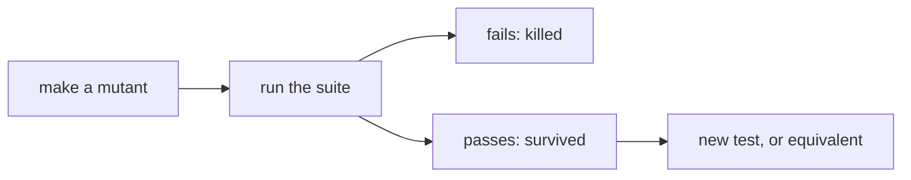

# Coverage and mutation testing

## The idea

How good is a test suite? Two measures answer different halves of the question.

**Coverage** measures which parts of the code the tests *ran*. **Line coverage**, also called statement coverage, is the share of lines that ran at least once. **Branch coverage** is the share of the ways out of each decision that were taken: each `if` both taken and skipped, each loop both entered and not. Coverage is good at one thing, finding code that no test runs, since a test cannot find a bug in a line it never executes. It is blind to the other half: a line that ran was not necessarily *checked*. A test with no assertion at all can still reach full coverage.

**Mutation testing** measures whether the tests *notice* changes. It makes many copies of the code, each with one small deliberate bug, called a **mutant**: a `>` turned into `>=`, a `+` into `-`, a constant changed by one, a condition negated. The rules that make such changes are **mutation operators**. The suite runs against each mutant. If some test fails, the mutant is **killed**: the suite noticed. If every test passes, the mutant **survived**, and either the tests have a gap or the mutant behaves exactly like the original, an **equivalent mutant** that no test can kill. The **mutation score** is the share of killed mutants among the non-equivalent ones.



<!-- text-of-mermaid sha256:98d2b80d6c4de99acdd81f71a0048b20b6e06a4b85a6a97707bcce7859d24fc9 -->
```text
┌─────────────┐    ┌─────────────┐    ┌────────────────┐    ┌───────────────────────┐
│make a mutant├───►│run the suite├───►│ fails: killed  │    │new test, or equivalent│
└─────────────┘    └──────┬──────┘    └────────────────┘    └───────────────────────┘
                          │                                             ▲
                          │           ┌────────────────┐                │
                          └──────────►│passes: survived├────────────────┘
                                      └────────────────┘
```

The drawing follows one mutant. A real run repeats it for every mutant the operators can make.

## A worked example

### What coverage sees

A shipping cost starts at 5, adds 3 for each kilogram above 2, and doubles for express delivery. The program measures coverage itself with `sys.settrace`, which calls a function before each line runs, recording each line and each jump from one line to the next. It measures three suites: one test that runs every line, the same call with no assertion, and a suite that also takes the other side of both decisions. Lines are numbered from the first line of the body.

```python examples/line_coverage.py
"""Line and branch coverage measured with sys.settrace, and what they cannot see.

The tracer records each line of shipping_cost that runs, and each jump from one line to the
next. Three small suites are measured: one test that runs every line, the same call with no
check at all, and a suite that also takes the other side of both decisions.
"""

import sys


def shipping_cost(weight_kg: int, express: bool) -> int:
    cost = 5
    if weight_kg > 2:
        cost += 3 * (weight_kg - 2)
    if express:
        cost *= 2
    return cost


FIRST = shipping_cost.__code__.co_firstlineno
BODY = {line - FIRST for _, _, line in shipping_cost.__code__.co_lines()
        if line is not None and line > FIRST}


def measure(suite) -> tuple[set[int], set[tuple[int, int]]]:
    lines, arcs, previous = set(), set(), [None]

    def tracer(frame, event, arg):
        if frame.f_code is not shipping_cost.__code__:
            return None
        if event == "call":
            previous[0] = None
        elif event == "line":
            line = frame.f_lineno - FIRST
            lines.add(line)
            if previous[0] is not None:
                arcs.add((previous[0], line))
            previous[0] = line
        return tracer

    sys.settrace(tracer)
    try:
        suite()
    finally:
        sys.settrace(None)
    return lines, arcs


def one_test():
    assert shipping_cost(3, True) == 16


def no_check():
    shipping_cost(3, True)  # runs the code, checks nothing


def both_sides():
    assert shipping_cost(3, True) == 16
    assert shipping_cost(1, False) == 5


_, all_arcs = measure(both_sides)
for suite in (one_test, no_check, both_sides):
    lines, arcs = measure(suite)
    missing = ", ".join(f"{a}->{b}" for a, b in sorted(all_arcs - arcs)) or "none"
    print(f"{suite.__name__:<10} lines {len(lines)}/{len(BODY)}, "
          f"jumps {len(arcs)}/{len(all_arcs)}, jumps never taken: {missing}")
```

It prints:

```output examples/line_coverage.py
one_test   lines 6/6, jumps 5/7, jumps never taken: 2->4, 4->6
no_check   lines 6/6, jumps 5/7, jumps never taken: 2->4, 4->6
both_sides lines 6/6, jumps 7/7, jumps never taken: none
```

One test with a heavy express parcel runs all six lines: 100% line coverage. Yet two jumps never happened: from the weight check straight to the express check (a light parcel), and from the express check straight to the return (standard delivery). Line coverage cannot tell, because no line was skipped; it was the *decisions* that only ever went one way. Branch coverage, measured here as jumps between lines, shows the gap.

The second line of output is the blind spot. `no_check` calls the function and asserts nothing, and its coverage is identical to `one_test`. Coverage measures execution, not checking.

### What mutation testing sees

The second program parses the same function, makes twelve mutants with four operators (swap a comparison, swap an arithmetic operator, add one to a constant, negate a condition), and runs two suites against each. The weak suite is the single test from above, with its full line coverage; the strong suite adds a light standard parcel and a heavier one.

```python examples/mutants.py
"""Mutation testing in miniature: plant one small change at a time, and see which tests notice.

Each mutant is the function's syntax tree with one operator swapped, one constant changed or
one condition negated. A suite kills a mutant when one of its checks gives a different answer;
a mutant that no check notices survives.
"""

import ast
import copy

SOURCE = """
def shipping_cost(weight_kg, express):
    cost = 5
    if weight_kg > 2:
        cost += 3 * (weight_kg - 2)
    if express:
        cost *= 2
    return cost
"""

SWAPS = {ast.Gt: ast.GtE, ast.GtE: ast.Gt, ast.Lt: ast.LtE, ast.LtE: ast.Lt,
         ast.Add: ast.Sub, ast.Sub: ast.Add, ast.Mult: ast.Div}


def mutation_sites(tree: ast.AST) -> list[tuple[int, str]]:
    """Every place one change can go, as (index of the node in ast.walk order, kind)."""
    sites = []
    for index, node in enumerate(ast.walk(tree)):
        if isinstance(node, (ast.BinOp, ast.AugAssign)) and type(node.op) in SWAPS:
            sites.append((index, "operator"))
        elif isinstance(node, ast.Compare) and type(node.ops[0]) in SWAPS:
            sites.append((index, "comparison"))
        elif isinstance(node, ast.Constant) and isinstance(node.value, int):
            sites.append((index, "plus one"))
        elif isinstance(node, ast.If):
            sites.append((index, "negate"))
    return sites


def mutate(tree: ast.AST, index: int, kind: str) -> tuple[ast.AST, str]:
    """A copy of the tree with one change, and the first line of the statement it changed."""
    mutant = copy.deepcopy(tree)
    node = list(ast.walk(mutant))[index]
    if kind == "operator":
        node.op = SWAPS[type(node.op)]()
    elif kind == "comparison":
        node.ops = [SWAPS[type(node.ops[0])]()]
    elif kind == "plus one":
        node.value += 1
    else:
        node.test = ast.UnaryOp(op=ast.Not(), operand=node.test)
    return ast.fix_missing_locations(mutant), first_line(statement_of(node, mutant))


def statement_of(node: ast.AST, tree: ast.AST) -> ast.stmt:
    parents = {child: parent for parent in ast.walk(tree)
               for child in ast.iter_child_nodes(parent)}
    while not isinstance(node, ast.stmt):
        node = parents[node]
    return node


def first_line(statement: ast.stmt) -> str:
    return ast.unparse(statement).splitlines()[0]


def compile_function(tree: ast.AST):
    namespace = {}
    exec(compile(tree, "<mutant>", "exec"), namespace)
    return namespace["shipping_cost"]


SUITES = {
    "weak": [((3, True), 16)],
    "strong": [((3, True), 16), ((1, False), 5), ((4, False), 11)],
}

original = ast.parse(SOURCE)
nodes = list(ast.walk(original))
mutants = []
for index, kind in mutation_sites(original):
    mutant, changed = mutate(original, index, kind)
    mutants.append((mutant, first_line(statement_of(nodes[index], original)), changed))
survivors = {name: [] for name in SUITES}
for mutant, before, changed in mutants:
    function = compile_function(mutant)
    verdicts = []
    for name, checks in SUITES.items():
        try:
            killed = any(function(*args) != expected for args, expected in checks)
        except ArithmeticError:
            killed = True  # a crash is noticed too
        verdicts.append("killed" if killed else "survived")
        if not killed:
            survivors[name].append(changed)
    print(f"{before:<27} -> {changed:<28} weak {verdicts[0]:<8} "
          f"strong {verdicts[1]}")
for name in SUITES:
    print(f"{name}: killed {len(mutants) - len(survivors[name])} of {len(mutants)}")
```

It prints:

```output examples/mutants.py
if weight_kg > 2:           -> if not weight_kg > 2:        weak killed   strong killed
if express:                 -> if not express:              weak killed   strong killed
cost = 5                    -> cost = 6                     weak killed   strong killed
if weight_kg > 2:           -> if weight_kg >= 2:           weak survived strong survived
cost += 3 * (weight_kg - 2) -> cost -= 3 * (weight_kg - 2)  weak killed   strong killed
cost *= 2                   -> cost /= 2                    weak killed   strong killed
if weight_kg > 2:           -> if weight_kg > 3:            weak killed   strong killed
cost += 3 * (weight_kg - 2) -> cost += 3 / (weight_kg - 2)  weak survived strong killed
cost *= 2                   -> cost *= 3                    weak killed   strong killed
cost += 3 * (weight_kg - 2) -> cost += 4 * (weight_kg - 2)  weak killed   strong killed
cost += 3 * (weight_kg - 2) -> cost += 3 * (weight_kg + 2)  weak killed   strong killed
cost += 3 * (weight_kg - 2) -> cost += 3 * (weight_kg - 3)  weak killed   strong killed
weak: killed 10 of 12
strong: killed 11 of 12
```

The weak suite, with 100% line coverage, lets two mutants through. One is `3 / (weight_kg - 2)` instead of `3 * (weight_kg - 2)`: at 3 kg both give 3, so a test at exactly 3 kg cannot tell multiplication from division. The strong suite's 4 kg parcel can, and kills it. A surviving mutant points at a missing test as precisely as a line number.

The other survivor, `weight_kg >= 2`, survives both suites, and no suite could kill it: at exactly 2 kg, the original skips the surcharge and the mutant adds `3 * (2 - 2)`, which is 0. The two programs compute the same cost for every input. This is an equivalent mutant. Counting it as a failure of the tests would be wrong, so the scores, honestly stated, are 10 of 11 for the weak suite and 11 of 11 for the strong one.

## When to use it

- **Coverage, to find untested code.** Run it, read the lines and branches that never ran, and ask whether each one matters: an error path, a rare branch, dead code to delete.
- **Branch coverage over line coverage**, since a suite can run every line while every decision goes only one way.
- **Mutation testing, to judge whether the tests check what they run**: on the code where a wrong answer is expensive (money, security, data loss), on a library others depend on, or to compare two ways of testing the same code.
- **Surviving mutants as a to-do list.** Each one is either a test to write, a sign that the code has a redundant part, or an equivalent mutant to mark and move past.
- **Neither as a target.** A required percentage gets met with tests that run code without checking it. Use the numbers to find gaps, not to grade people.

## Common traps

- **Treating 100% coverage as "tested".** The weak suite above had it and missed a wrong operator. Coverage is necessary for a line to be tested, not sufficient.
- **Assertion-free tests.** They raise coverage and catch only crashes. Mutation testing exposes them at once, since they kill almost nothing.
- **Chasing equivalent mutants.** Some survivors cannot be killed, and deciding which is a judgement a person makes. Mark them and move on, rather than writing strange tests that pass anyway.
- **Running every mutant against every test.** The cost is the number of mutants times the time of the suite. Run only the tests that cover the mutated line, stop at the first failing test, and sample mutants on large code bases.
- **Mutants nobody cares about.** Mutating log messages or debugging output produces survivors that waste time. Point the operators at logic.
- **Line coverage of generated or trivial code.** Counting it inflates the number and hides the code that matters. Exclude what you would never test by hand.

## Complexity

Coverage is cheap: a tracer adds overhead to every line that runs, a constant factor on the suite's time, and a set of lines or jumps uses memory proportional to the size of the code.

Mutation testing is expensive by design. With `M` mutants and a suite that takes time `T`, a full run takes up to `M · T`, and `M` grows with the number of places an operator applies, roughly with the size of the code. The example made 12 mutants of a 6-line function; a real module makes thousands. Stopping at the first failing test helps, since most mutants are killed quickly; the cost lands on the survivors, which run the whole suite.

The survey of the field lists ways to cut the number of mutants. **Mutant sampling** runs a random subset. **Selective mutation** leaves out the operators that make the most mutants; in one study it kept a mean mutation score of 99.99% while making 24% fewer mutants. **Weak mutation** checks a mutant right after the mutated part executes, instead of comparing the output of the whole program.

## Expert notes

- **Origins.** Jia and Harman's survey (*An Analysis and Survey of the Development of Mutation Testing*, IEEE Transactions on Software Engineering, 2011) traces mutation testing to a 1971 student paper by Richard Lipton, with the field's birth in papers by DeMillo, Lipton and Sayward and by Hamlet in the late 1970s.
- **Two hypotheses.** Mutation testing rests on two assumptions, both introduced by DeMillo and colleagues in 1978. The *competent programmer hypothesis* says that programmers write programs close to correct, so real faults are mostly small and syntactic, like mutants. The *coupling effect* says that test data that tells apart every program differing from a correct one by simple errors is so sensitive that it also tells apart more complex errors. In experiments the survey reports, test data built to kill all single-change mutants also killed over 99% of mutants with two and three changes.
- **Do mutants stand for real bugs?** Just, Jalali, Inozemtseva, Ernst, Holmes and Fraser (*Are Mutants a Valid Substitute for Real Faults in Software Testing?*, FSE 2014) used 357 real faults from 5 open-source applications of 321,000 lines in all, with 230,000 mutants. 73% of the real faults were coupled to mutants made by common operators, 10% would need new or stronger operators, and 17% were not coupled to mutants at all. A suite's mutation score correlated with its detection of real faults, significantly, independently of code coverage, and more strongly than statement coverage did.
- **Does coverage predict quality?** Inozemtseva and Holmes (*Coverage Is Not Strongly Correlated with Test Suite Effectiveness*, ICSE 2014) generated 31,000 test suites for five systems of up to 724,000 lines, measured statement, decision and modified condition coverage, and judged effectiveness by mutation testing. Once the number of tests in a suite was controlled for, the correlation between coverage and effectiveness was low to moderate, and stronger forms of coverage gave no more insight. Their conclusion: coverage is useful for finding under-tested parts of a program, but should not be used as a quality target.
- **Equivalence is undecidable.** Deciding whether a mutant is equivalent means deciding whether two programs behave the same on every input, which no algorithm can do in general, so detecting all equivalent mutants automatically is impossible. Tools use heuristics, and people decide the rest.
- **Measuring coverage in Python.** The standard library's `trace` module can produce statement coverage listings. `sys.settrace` installs the kind of tracer the example uses; its documentation describes it as meant for debuggers, profilers, coverage tools and the like, and as an implementation detail of CPython. Python 3.12 added `sys.monitoring`, an event interface for such tools, with a tool id predefined for coverage; in Python 3.14 its single `BRANCH` event is deprecated in favour of `BRANCH_LEFT` and `BRANCH_RIGHT`, which a tool can disable independently. The example's list of executable lines comes from `co_lines()` (Python 3.10), which maps a function's bytecode to its line numbers.

## Practice

This guide has no problem of its own: its technique applies to the tests of any problem. Take a solution you wrote for an earlier problem of this path, plant one small change at a time, by hand or with a script like the example's, and check that your tests catch each one. Every survivor that is not equivalent names a test you have not written yet.

## Further reading

- [Y. Jia and M. Harman, *An Analysis and Survey of the Development of Mutation Testing*, IEEE Transactions on Software Engineering 37(5), 2011, pages 649 to 678](https://doi.org/10.1109/TSE.2010.62): mutants, operators, the mutation score, the two hypotheses, equivalent mutants and the ways to reduce cost.
- [R. Just and others, *Are Mutants a Valid Substitute for Real Faults in Software Testing?*, FSE 2014, pages 654 to 665](https://doi.org/10.1145/2635868.2635929): mutants against real faults.
- [L. Inozemtseva and R. Holmes, *Coverage Is Not Strongly Correlated with Test Suite Effectiveness*, ICSE 2014, pages 435 to 445](https://doi.org/10.1145/2568225.2568271): coverage, suite size and effectiveness.
- [Python, `sys.settrace`](https://docs.python.org/3/library/sys.html#sys.settrace), [`trace`](https://docs.python.org/3/library/trace.html) and [`sys.monitoring`](https://docs.python.org/3/library/sys.monitoring.html): tracing lines, statement coverage, and branch events.
- [Python, `ast`](https://docs.python.org/3/library/ast.html): parsing, `NodeTransformer`, `unparse` (3.9) and `fix_missing_locations`, the tools for writing mutation operators.
