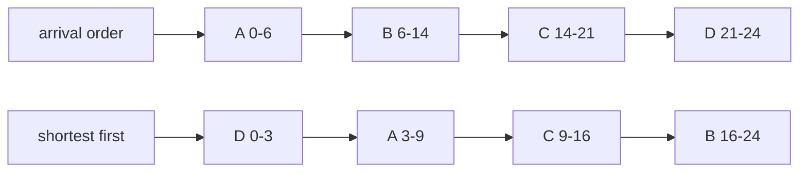
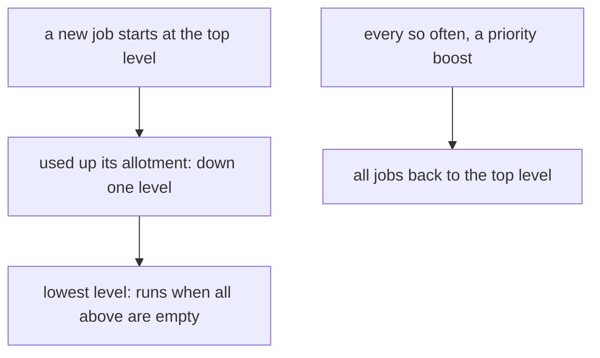

# CPU scheduling

## The idea

A processor core runs one thread at a time, and a busy machine has many that are ready. The **scheduler** is the part of the kernel that picks which one runs next, and for how long. The guide on processes calls a process that could run but is not running **ready**; the ready processes wait in a **ready queue**, and the scheduler's rule, its **policy**, decides who leaves it.

This guide speaks of **jobs**: a job is a piece of work that needs the processor for some time, its **burst**, and arrives at some moment, its **arrival**. A job here only computes: it never waits for a disk.

Three numbers measure how well a policy treats a job, all counted from its arrival:

| Measure | Definition | What it tells |
|---------|------------|---------------|
| **Turnaround** | completion − arrival | How long the job was in the system |
| **Waiting** | turnaround − burst | How long it was ready but not running |
| **Response** | first time it runs − arrival | How long before it got any service at all |

A policy is either **non-preemptive**, letting a job run until it finishes, or **preemptive**, allowing the scheduler to stop (**preempt**) a running job, put it back in the queue and run another. Preemption is how a machine stays responsive: the kernel regains control through the timer interrupt and decides again.

No policy is best on every measure. A policy that finishes short jobs early lowers the average turnaround; a policy that gives every job a turn early lowers response times but stretches every job out. The rest of this guide is a tour of that trade.

## A worked example

Four jobs arrive at time 0 and need 6, 8, 7 and 3 **ticks**, units of processor time. The program runs them under three policies, described in the next section: first come, first served in the order A, B, C, D; shortest job first; and round robin with turns of at most 4 ticks. Since every job arrives at 0, its turnaround is its completion time.

```python examples/three_policies.py
"""Four jobs that all arrive at time 0, run under three scheduling policies.

For each policy the program prints the runs, written job:start-end, and the average waiting,
turnaround and response times. Then it tries all 24 orders of the jobs, to check that running the
shortest job first gives the smallest average waiting time.
"""

from collections import deque
from fractions import Fraction
from itertools import permutations

BURSTS = {"A": 6, "B": 8, "C": 7, "D": 3}  # ticks of CPU time each job needs

Run = tuple[str, int, int]  # (job, start, end)


def one_after_another(order: list[str]) -> list[Run]:
    """Run each job to the end, in the given order: no job is ever stopped."""
    runs, now = [], 0
    for job in order:
        runs.append((job, now, now + BURSTS[job]))
        now += BURSTS[job]
    return runs


def round_robin(quantum: int) -> list[Run]:
    """Each job runs for at most `quantum` ticks, then goes to the back of the queue."""
    queue, left, runs, now = deque(BURSTS), dict(BURSTS), [], 0
    while queue:
        job = queue.popleft()
        ran = min(quantum, left[job])
        runs.append((job, now, now + ran))
        now += ran
        left[job] -= ran
        if left[job] > 0:
            queue.append(job)
    return runs


def averages(runs: list[Run]) -> tuple[Fraction, Fraction, Fraction]:
    first_start: dict[str, int] = {}
    completion: dict[str, int] = {}
    for job, start, end in runs:
        first_start.setdefault(job, start)
        completion[job] = end
    n = len(BURSTS)
    turnaround = Fraction(sum(completion.values()), n)  # every job arrived at 0
    waiting = Fraction(sum(completion[job] - BURSTS[job] for job in BURSTS), n)
    response = Fraction(sum(first_start.values()), n)
    return waiting, turnaround, response


policies = {
    "first come, first served": one_after_another(list(BURSTS)),
    "shortest job first": one_after_another(sorted(BURSTS, key=BURSTS.get)),
    "round robin, quantum 4": round_robin(4),
}
for name, runs in policies.items():
    waiting, turnaround, response = averages(runs)
    print(name)
    print("  " + " ".join(f"{job}:{start}-{end}" for job, start, end in runs))
    print(
        f"  waiting {float(waiting):.2f}, turnaround {float(turnaround):.2f}, "
        f"response {float(response):.2f}"
    )

orders = [list(order) for order in permutations(BURSTS)]
best = min(orders, key=lambda order: averages(one_after_another(order))[0])
print(
    f"best average waiting of {len(orders)} orders: {' '.join(best)}, "
    f"{float(averages(one_after_another(best))[0]):.2f}"
)
```

It prints:

```output examples/three_policies.py
first come, first served
  A:0-6 B:6-14 C:14-21 D:21-24
  waiting 10.25, turnaround 16.25, response 10.25
shortest job first
  D:0-3 A:3-9 C:9-16 B:16-24
  waiting 7.00, turnaround 13.00, response 7.00
round robin, quantum 4
  A:0-4 B:4-8 C:8-12 D:12-15 A:15-17 B:17-21 C:21-24
  waiting 13.25, turnaround 19.25, response 6.00
best average waiting of 24 orders: D A C B, 7.00
```



<!-- text-of-mermaid sha256:9ce52560221966c2177273eab39544149d193706c71a3dade6742f82822f9b38 -->
```text
┌──────────────┐    ┌─────┐    ┌──────┐    ┌───────┐    ┌───────┐
│arrival order ├───►│A 0-6├───►│B 6-14├───►│C 14-21├───►│D 21-24│
└──────────────┘    └─────┘    └──────┘    └───────┘    └───────┘

┌──────────────┐    ┌─────┐    ┌──────┐    ┌───────┐    ┌───────┐
│shortest first├───►│D 0-3├───►│A 3-9 ├───►│ C 9-16├───►│B 16-24│
└──────────────┘    └─────┘    └──────┘    └───────┘    └───────┘
```

Read the numbers.

1. **First come, first served** makes D, the shortest job, wait 21 ticks behind the three longer ones. The jobs wait 0, 6, 14 and 21 ticks: 10.25 on average.
2. **Shortest job first** runs D first. The same work finishes at the same time, 24, but the jobs wait 0, 3, 9 and 16 ticks: 7 on average. No order of the 24 does better.
3. **Round robin** gives every job its first turn by tick 12, so its average response, 6, is the best of the three. But each job is interrupted and finishes late: its average turnaround, 19.25, is the worst.

Why is shortest first the best order for waiting? Every job waits for all the jobs that run before it. In any order where a longer job runs just before a shorter one, swapping the two makes the shorter one wait less by the longer one's burst, while the longer one waits more by only the shorter one's burst: the total falls. So no order beats the sorted one. The textbook *Operating Systems: Three Easy Pieces* states the result for turnaround, which is the same here since turnaround is waiting plus a burst that no order changes.

## The classic policies

- **First come, first served** (FCFS, or first in, first out) runs jobs in arrival order, each to the end. It is simple and fair in one sense, but short jobs stuck behind a long one wait for all of it. The textbook calls this the **convoy effect**.
- **Shortest job first** (SJF) runs, whenever the processor is free, the ready job with the smallest burst, to the end. It is best for average waiting when all jobs are known at once, but it needs each burst in advance, which a real scheduler does not know, and a long job can **starve**: wait without limit while shorter jobs keep arriving. With arrivals, it can only choose among the jobs that have arrived.
- **Shortest time to completion first** is the preemptive version: a new job that needs less than the running job has left takes the processor. The textbook notes it is optimal for average turnaround when jobs arrive at different times, under the same unrealistic knowledge of bursts.
- **Round robin** (RR) gives each ready job a turn of at most one **time slice**, or **quantum**, then moves it to the back of the queue. A short quantum makes response times low; but every switch from one job to another, a **context switch**, costs time, so the textbook advises a quantum long enough to amortize that cost: to make the switches a small share of the time. When the quantum is longer than every burst, no job is ever cut short, and round robin is first come, first served.
- **Priorities** run the ready job with the highest priority first. Starvation is the danger: low-priority jobs may never run while higher ones keep arriving. A common cure is **aging**, raising the priority of a job the longer it waits. Linux's manual for its default policy describes exactly that: the dynamic priority of a ready thread grows for each time quantum it is denied the processor.

## The multi-level feedback queue

A scheduler does not know how long a job will run, but it can watch. The **multi-level feedback queue** (MLFQ) keeps several queues of decreasing priority. A new job starts at the top, where turns are short. A job that uses up its share of processor time at a level, its **allotment**, moves down one level; jobs that finish quickly never use up their share and stay high. The processor always serves the highest non-empty queue.



<!-- text-of-mermaid sha256:91524f4ae3b87722e43ab6b350cc1ce767feb944704a18e4599426d559f03640 -->
```text
┌───────────────────────────────────────────┐    ┌────────────────────────────────┐
│     a new job starts at the top level     │    │every so often, a priority boost│
└─────────────────────┬─────────────────────┘    └────────────────┬───────────────┘
                      ▼                                           ▼
┌───────────────────────────────────────────┐    ┌────────────────────────────────┐
│   used up its allotment: down one level   │    │ all jobs back to the top level │
└─────────────────────┬─────────────────────┘    └────────────────────────────────┘
                      ▼
┌───────────────────────────────────────────┐
│lowest level: runs when all above are empty│
└───────────────────────────────────────────┘
```

The left chain is what makes the queue learn: short jobs finish near the top, long jobs sink. The right chain is the cure for the danger the left one creates. Without it, a steady stream of short jobs keeps the upper levels busy and the jobs at the bottom starve; the textbook adds the **priority boost**, which periodically moves every job back to the top. Its version of the rules also counts the allotment over all of a job's turns at a level.

The idea is old. The 1962 paper by Corbató, Merwin-Daggett and Daley, which describes an experimental time-sharing system, presents a "multi-level scheduling algorithm": a program enters a queue at level ℓ, runs for up to 2^ℓ quanta, and if it has not finished goes to the end of the queue at level ℓ + 1, where turns are twice as long. The supervisor always serves the lowest-numbered occupied level, and when a lower level becomes occupied it interrupts the running program. The paper's own summary of the design is that long runs must, in effect, prove they are long.

## When to use it

You rarely write a kernel's scheduler, but scheduling choices are everywhere:

- **Interactive work** wants low response times: a preemptive policy with short turns, or high priority for jobs that block often, as a feedback queue gives.
- **Throughput work**, such as batch jobs and builds, wants low turnaround and few switches: long turns, or running jobs to the end.
- **Jobs with deadlines** want a policy that looks at the deadline, not the arrival. Linux's `SCHED_DEADLINE` uses global earliest deadline first together with a constant bandwidth server, and runs an admission test that refuses a thread when the set of deadline threads could no longer be served.
- **Application-level schedulers**, such as a pool of worker threads, a job queue or an event loop, face the same trade: first come, first served is simple, a priority queue serves urgent work first, and anything that can starve needs aging or a boost.

On Linux, `sched(7)` lists the policies a thread can choose. The normal policy, `SCHED_OTHER`, is time-sharing among all ordinary threads, influenced by the **nice value**, from −20 (favored) to +19; `SCHED_BATCH` and `SCHED_IDLE` are for background work. The real-time policies `SCHED_FIFO` and `SCHED_RR` use static priorities from 1 to 99, always above the normal threads: `SCHED_FIFO` runs a thread until it blocks, yields or is preempted by a higher priority, and `SCHED_RR` is the same with a maximum time quantum per turn. POSIX requires at least 32 distinct real-time priority levels.

## Common traps

- **Measuring from time 0 instead of from the arrival.** Turnaround, waiting and response all start when the job arrives. A late arrival measured from 0 looks far worse than it was.
- **Comparing policies on one measure.** Round robin looks bad on turnaround and good on response; shortest first the reverse. Say which measure you optimize before choosing.
- **Assuming the scheduler knows the bursts.** Shortest job first is a yardstick, not a policy you can run; real schedulers estimate from past behavior, as the feedback queue does.
- **A quantum that is too short or too long.** Too short, and context switches eat the processor; too long, and round robin turns into first come, first served, with its convoys.
- **Starvation.** Any policy that prefers some jobs, by length or by priority, can postpone others without limit. Look for the rule that guarantees every job eventually runs: aging, a boost, or a bound.
- **Real-time priority without a limit.** Linux's manual warns that a thread under `SCHED_FIFO` or `SCHED_RR` can block every other thread from the processor forever; since Linux 2.6.25, a resource limit, `RLIMIT_RTTIME`, can cap the processor time a real-time process consumes.

## Complexity

For `n` ready jobs and `k` levels:

| Policy | Choosing the next job | Notes |
|--------|-----------------------|-------|
| First come, first served | O(1): the front of a first-in, first-out queue | |
| Shortest job first | O(log n) with a heap keyed by burst, O(n) by scanning | Plus knowing the bursts |
| Round robin | O(1): front of the queue, and a preempted job to the back | One decision per quantum, not per job |
| Priorities | O(log n) with a heap; O(1) to find the highest non-empty list when priorities are a small fixed set | `sched(7)` describes Linux's real-time policies as one list per priority |
| Feedback queue | O(k) to find the highest non-empty level, O(1) per queue operation | Plus the periodic boost, O(n) |

The decision itself is cheap. What costs is switching: each context switch saves and restores registers, and the textbook notes that a process builds up state in a processor's caches and its TLB, its cache of address translations, that the next process does not find there; a policy that switches more often pays more of it.

## Expert notes

- **Corbató's levels were chosen by size, too.** In the 1962 paper, a program's first level is computed from its size, compared with how much the machine can move between disk and memory in one quantum, so that a program always runs at least as long as it takes to swap it in and out. The paper derives from this that the computing efficiency never falls below one half, and that simple round robin collapses abruptly near saturation, when swapping dominates. That paper is also one where the interrupted program goes back to the head of its queue, not the end; rules differ between descriptions, and the practice problem states its own.
- **Nice values multiply.** Linux's manual says that, in the current implementation, each step of difference in nice value between two processes changes by a factor of 1.25 how strongly the scheduler favors one over the other.
- **Priority inversion.** A high-priority thread that needs a lock held by a low-priority thread waits for it, and a medium-priority thread that needs no lock can then run ahead of both. POSIX defines the `PTHREAD_PRIO_INHERIT` protocol for a mutex: a thread that blocks higher-priority threads by owning such a mutex runs at the priority of the highest one waiting.
- **Several cores.** With several cores, each core can keep its own ready queue, which keeps a job near the data its core has cached and avoids a single shared, locked queue; the price is imbalance, when one core runs out of work while another has a long queue. Moving work between queues fixes the imbalance at the cost of cold caches. The last level of the practice problem explores one such design.
- **Deadline scheduling has an admission test.** Linux checks, when a thread asks for `SCHED_DEADLINE`, whether all deadline threads together can still be served, and refuses the request otherwise; once admitted, deadline threads preempt every other policy.

## Practice

- `cstudy start single-threaded-cpu`: a single core that runs, whenever it is free, the available task with the shortest processing time, never preempting it; return the order in which it runs the tasks.
- `cstudy start cpu-scheduler-sim`: a simulator that grows from first come, first served and shortest job first to round robin, a multi-level feedback queue with a priority boost, and several cores. Each level fixes exactly how ties are broken, so read its rules as carefully as you write the loop.

## Further reading

- [Corbató, Merwin-Daggett and Daley, *An experimental time-sharing system* (Spring Joint Computer Conference, 1962)](https://doi.org/10.1145/1460833.1460871): the multi-level scheduling algorithm, with turns of 2^ℓ quanta at level ℓ.
- [Linux manual, `sched(7)`](https://man7.org/linux/man-pages/man7/sched.7.html): the scheduling policies, static and dynamic priorities, nice values, the real-time policies and deadline scheduling.
- [POSIX, `pthread_mutexattr_getprotocol`](https://pubs.opengroup.org/onlinepubs/9799919799/functions/pthread_mutexattr_getprotocol.html): the priority inheritance protocol.
- [*Operating Systems: Three Easy Pieces*](https://pages.cs.wisc.edu/~remzi/OSTEP/), a free textbook: the chapters on scheduling and on the multi-level feedback queue cover the metrics, the convoy effect, shortest job first and its optimality, round robin, the time slice, starvation and the priority boost.
- Python's documentation of [`collections.deque`](https://docs.python.org/3/library/collections.html#collections.deque) and [`itertools.permutations`](https://docs.python.org/3/library/itertools.html#itertools.permutations), used by the example.
