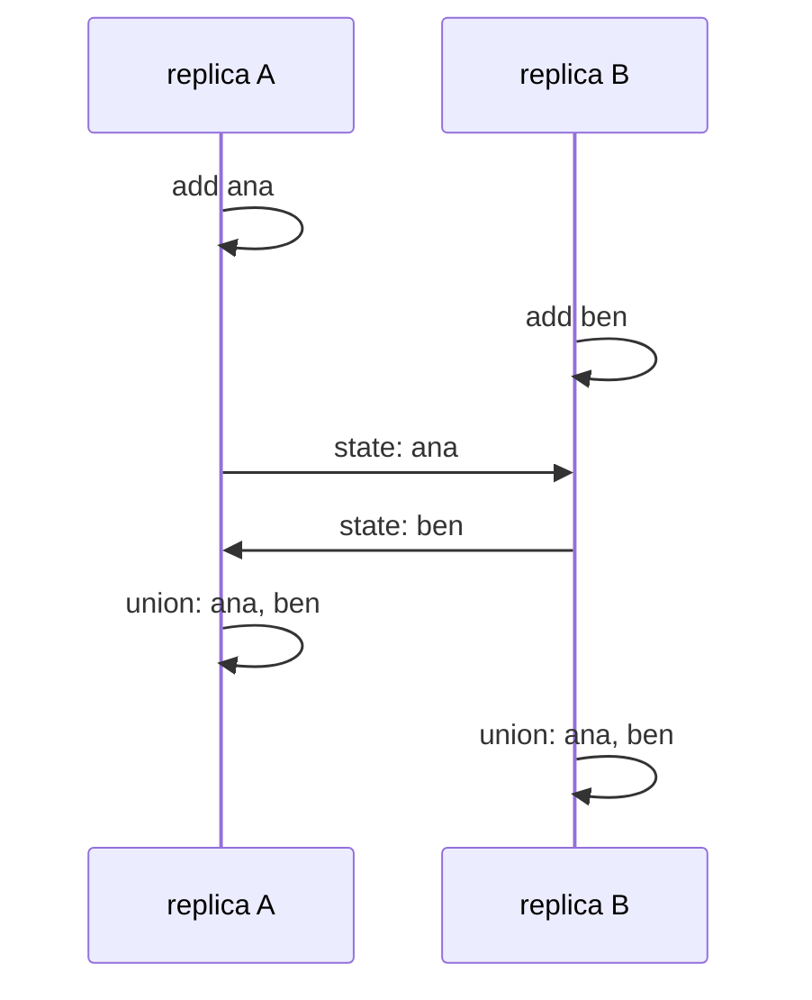

# CRDTs: replicated data that merges without conflicts

## The idea

Some data must stay writable everywhere, all the time: a shared list on a phone that has no signal, a document edited by two people at once, a counter updated in several data centres. Each copy, a **replica**, accepts every update at once, without asking the others, and sends what it learned to the other replicas later. That is eventual consistency, as the guide on consistency models defines it. Shapiro, Preguiça, Baquero and Zawirski's 2011 paper on **conflict-free replicated data types** (CRDTs) starts from its weak spot: updates reach replicas in different orders, concurrent updates may conflict, and resolving a conflict after the fact may need a consensus and a rollback, an approach the paper calls ad hoc and error-prone.

A CRDT avoids conflicts by design. The paper's goal is **strong eventual consistency**: replicas that have delivered the same updates are in equivalent states, immediately, with no conflict to resolve and nothing to roll back. It gives two ways to get there.

**State-based.** Each replica keeps a state and, from time to time, sends the whole state to another replica, which **merges** it into its own. The paper's sufficient condition, its Theorem 1: the possible states form a **join semilattice**, the merge computes their **least upper bound**, and every update only moves a state upward. A semilattice is a set with a partial order in which any two states have a least upper bound, the smallest state that is at least as large as both. The paper derives the three laws the merge then obeys:

- **commutative**: `merge(x, y) = merge(y, x)`, so the order in which states arrive does not matter;
- **associative**: `merge(merge(x, y), z) = merge(x, merge(y, z))`, so it does not matter how merges are grouped, or which replica passes news on to which;
- **idempotent**: `merge(x, x) = x`, so a state that arrives twice changes nothing.

Those three laws are exactly what an unreliable network demands: messages arrive in any order, through any path, and more than once. Sets ordered by inclusion with union as the merge are the paper's simplest example, an add-only set; numbers ordered as usual with the larger one as the merge form another semilattice.

**Operation-based.** Each replica sends its operations instead of its state, and every replica applies every operation. The paper's Theorem 2: if concurrent operations **commute**, giving the same state in either order, and the network delivers every operation to every replica exactly once and in an order consistent with happened-before, the replicas converge. Operations are smaller than states, but the delivery requirement is much stronger; a state-based design tolerates loss, duplication and reordering by itself. The paper shows that each style can emulate the other.



<!-- text-of-mermaid sha256:2381499b7dbebc1b9df96614c328821762da4638d73aa3cdff0067cdc2eaa188 -->
```text
 ┌───────────┐   ┌───────────┐
 │ replica A │   │ replica B │
 └─────┬─────┘   └─────┬─────┘
       │               │
       ├───┐           │
       │   │ add ana   │
       ◀───┘           │
       │               │
       │               ├───┐
       │               │   │ add ben
       │               ◀───┘
       │               │
       │  state: ana   │
       │───────────────▶
       │               │
       │  state: ben   │
       ◀───────────────│
       │               │
       ├───┐           │
       │   │ union: ana, ben
       ◀───┘           │
       │               │
       │               ├───┐
       │               │   │ union: ana, ben
       │               ◀───┘
       │               │
 ┌─────┴─────┐   ┌─────┴─────┐
 │ replica A │   │ replica B │
 └───────────┘   └───────────┘
```

The drawing shows the simplest case: two replicas update offline, exchange states in both directions, and end equal. Union is commutative, so it does not matter which merge happens first.

## A worked example

Three replicas each make one change, then send their states to each other: every replica to every other, six messages, in each of the 720 possible orders, with the last message delivered twice. The program tries four merge functions:

```python examples/merge_laws.py
"""Which merge functions make replicas agree, whatever the network does with their messages?

Three replicas each make one local change, then pass their states around: every replica sends
to every other, in every possible order, and the last message is sent twice. A merge that is
commutative, associative and idempotent ends with all three replicas in the same state every
time; the others lose changes or count them twice. The laws are checked on the three states.
"""

from itertools import permutations

MERGES = {  # name: (merge, the three replicas' states after their local changes)
    "union of sets": (lambda mine, theirs: mine | theirs, [{"ana"}, {"ben"}, {"cy"}]),
    "larger number": (max, [3, 9, 4]),
    "take theirs": (lambda mine, theirs: theirs, [3, 9, 4]),
    "concatenate": (lambda mine, theirs: mine + theirs, [("ana",), ("ben",), ("cy",)]),
}
SENDS = [(s, t) for s in range(3) for t in range(3) if s != t]


def show(state) -> str:  # sets print in a fixed order, whatever the hash seed
    return repr(sorted(state)) if isinstance(state, set) else repr(state)


def laws(merge, x, y, z) -> str:
    return " ".join([
        "commutative" if merge(x, y) == merge(y, x) else "-",
        "associative" if merge(merge(x, y), z) == merge(x, merge(y, z)) else "-",
        "idempotent" if merge(x, x) == x else "-",
    ])


print(f"{len(list(permutations(SENDS)))} orders of {len(SENDS)} messages, the last one sent twice")
for name, (merge, start) in MERGES.items():
    finals = set()
    for order in permutations(SENDS):
        states = list(start)
        for source, target in [*order, order[-1]]:  # the last message arrives twice
            states[target] = merge(states[target], states[source])
        agree = len({show(s) for s in states}) == 1
        finals.add("agree on " + show(states[0]) if agree else "disagree")
    print(f"{name:<14} {laws(merge, *start)}")
    for outcome in sorted(finals):
        print(f"{'':<14} {outcome}")

guests = [{"milk"}, {"milk"}]  # two replicas of a set, both holding milk
guests[1] = guests[1] - {"milk"}  # replica 1 removes milk
guests[1] = guests[1] | guests[0]  # then merges replica 0's state, which still has milk
print("remove, then merge by union:", show(guests[1]))
```

It prints:

```output examples/merge_laws.py
720 orders of 6 messages, the last one sent twice
union of sets  commutative associative idempotent
               agree on ['ana', 'ben', 'cy']
larger number  commutative associative idempotent
               agree on 9
take theirs    - associative idempotent
               agree on 3
               agree on 4
               agree on 9
               disagree
concatenate    - associative -
               disagree
remove, then merge by union: ['milk']
```

- **Union of sets** obeys all three laws, and in all 720 orders, duplicate included, the three replicas end with the same set, holding every change.
- **Larger number** obeys all three, and every order ends with all three replicas at 9. It is a CRDT too: a register that only keeps the largest value it has seen.
- **Take theirs**, where a replica replaces its state with the one it receives, is not commutative. The replicas sometimes agree, on 3, 4 or 9 depending on which message came last, and sometimes do not agree at all. Whatever they agree on, two of the three changes are lost.
- **Concatenate**, appending the received list to one's own, is neither commutative nor idempotent. The duplicated message alone repeats entries, and no order ends in agreement.

The last line shows where state-based design gets hard. Replica 1 removes `milk`, then merges replica 0's state, which still holds `milk`, and union brings it back. A merge only moves states upward, and removing an element moves a set downward. A set that supports removal must therefore remember something about what was removed, so that the removal itself only adds information, and designs differ in what they remember and in which operation wins when an add and a remove of the same element are concurrent.

## When to use it

- **Replicas that must accept writes while disconnected**: offline-first apps, collaborative editing, devices that sync later. Strong eventual consistency lets every replica answer reads and writes whatever the network does.
- **Replicas far apart, where waiting is expensive**: an update applies locally at once, and copies converge in the background, with no coordination on the write path.
- **Data whose concurrent updates have an obvious combined meaning**: counts, sets of members, flags that only switch on, maxima. Choosing a CRDT is choosing that meaning in advance.
- **Use consensus instead** when the application needs a single order or an invariant across replicas: a balance that must never go negative, a username that must be unique. Two replicas that each accept the last ticket on their own have both sold it, and no merge can take one of the sales back.
- **Use last-writer-wins only knowingly.** Keeping the write with the largest timestamp is a merge that obeys the three laws, but it silently drops one of two concurrent writes, and depends on clocks that disagree.

## Common traps

- **A merge that is almost right.** "Take the newer value" without a total order on values, or "add the two numbers", fails one of the three laws, and the failure shows only when messages are reordered or duplicated, which tests on one machine rarely do.
- **Losing information to a choice.** Two concurrent updates to one value cannot both survive in a single slot. A design either keeps both, for the application to combine, or picks one by a fixed rule and loses the other. Know which yours does.
- **Removal by deletion.** Deleting an element from a merged state lets the next merge with an older copy bring it back, as the example shows.
- **State that only grows.** Information about removals is kept so that merges stay correct, and a replica cannot safely forget it until it knows that every other replica has seen it.
- **Timestamps from wall clocks.** A replica whose clock runs fast wins every last-writer-wins tie for as long as it is ahead, even against writes made later in real time.
- **Expecting more than convergence.** A CRDT guarantees that replicas agree once they have seen the same updates. It does not keep an invariant that spans replicas, and the guide on consistency models shows that a CRDT may even reach states no sequential execution could.

## Complexity

For a state of size `S`:

| Design | Cost of a local update | What a replica sends | What the network must provide |
|--------|-----------------------|----------------------|-------------------------------|
| State-based | Changing the local state, often O(1) | The whole state, O(S) | Eventual delivery over links that may lose messages; duplication and reordering are harmless |
| Operation-based | O(1) per operation, at each replica | Each operation, O(1) | Every operation delivered exactly once to every replica, in causal order |

A merge costs O(S) for a state of size `S`, since it visits every part of both states. The metadata a CRDT needs, to tell concurrent updates apart or to remember removals, is part of `S`, and is often larger than the visible value.

## Expert notes

- **The two definitions side by side.** Shapiro and others define eventual consistency by eventual delivery, convergence and termination, where convergence means that replicas that have delivered the same updates *eventually* reach equivalent states; strong eventual consistency replaces it with **strong convergence**: such replicas *have* equivalent states. The difference is the window during which an eventually consistent system may still be rolling back a conflicting update.
- **Available through partitions, with no consensus.** The paper notes that a strongly eventually consistent replica is always available for reads and writes, whatever the network does; any group of replicas that can communicate converges, even when cut off from the rest; it tolerates up to `n − 1` crashes; and it does not need consensus.
- **The semantics of a concurrent add and remove.** The paper lists choices that all satisfy strong convergence: the add wins, the remove wins, the replica with the highest address wins, or the element is reset to a distinguished state. Any may suit some application; what matters is that every replica applies the same one.
- **Strong eventual consistency is not sequential.** With the add-wins choice, replica `p0` adds `e` and removes `e′` while replica `p1` concurrently adds `e′` and removes `e`; a replica that merges both ends with both elements present, a state no sequential order of the four operations produces. The paper concludes that the two models are incomparable.
- **Last writer wins, and operational transformation.** The paper credits the last-writer-wins register to Johnson and others, and notes that it ensures a total order of operations at the cost of losing concurrent updates. It contrasts CRDTs with operational transformation, used in concurrent editing, where operations do not commute but are transformed against concurrent ones, and cites a study showing that most decentralized transformation algorithms are incorrect; the authors argue that designing for commutativity from the start is cleaner and simpler.

## Practice

- `cstudy start crdt-replicas`: replicas that accept updates offline and always agree after merging: counters, a last-writer-wins register, a set in which a concurrent add wins over a remove, and sync that sends only what changed. Finding what each replica must keep is the problem.
- `cstudy start logical-clocks`: its later levels keep concurrent writes to the same key as siblings, found with vector clocks, instead of letting one of them win, and add hybrid clocks that stay close to physical time.

## Further reading

- [Shapiro, Preguiça, Baquero and Zawirski, *Conflict-free Replicated Data Types*, SSS 2011](https://www.cs.tufts.edu/~nr/cs257/archive/marc-shapiro/CRDTs_SSS-2011.pdf): sections 2 and 3, the system model, eventual and strong eventual consistency, the state-based and operation-based conditions and their equivalence, and strong eventual against sequential consistency.
