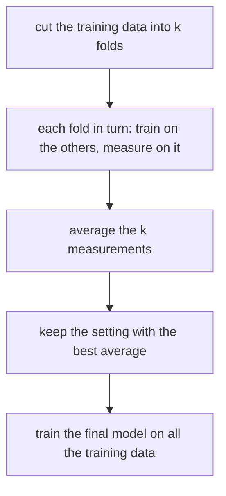

# Cross-validation and choosing a model

## The idea

A validation set answers "how good is this model on data it has not seen?", but it costs data twice over. Every example in it is one the model does not learn from, and a small validation set gives a noisy answer: with 40 examples, one more right answer moves the accuracy by 2.5 points. **Cross-validation** reuses the data so that every example serves for validation once and for training the rest of the time.

**k-fold cross-validation** cuts the training data into `k` parts of about the same size, called **folds**. Then, for each fold in turn:

1. train a fresh model on the other `k - 1` folds;
2. measure it on the fold it did not see.

The **cross-validation estimate** is the average of the `k` measurements. To choose a hyperparameter, such as the strength of a penalty, you run the whole procedure once per candidate value and keep the value with the best estimate. Then you train the final model, with that value, on all the training data.

| Variant | Folds | Use it when |
|---------|-------|-------------|
| **k-fold**, `k` = 5 or 10 | Random parts of equal size | The default |
| **Leave-one-out** | One example per fold, `k = n` | Data is very scarce and training is cheap |
| **Stratified** | Each fold keeps the share of each class | A class is rare |
| **Grouped** | All rows of a customer, patient or device in one fold | The model will meet new groups |
| **Forward in time** | Train on the past, validate on the next period, then move forward | The model predicts the future |



<!-- text-of-mermaid sha256:2e8ef15bf815aecdf16c93249add3d7ac186df15304596cfd66744f7e6159a22 -->
```text
┌─────────────────────────────────────────────────────┐
│          cut the training data into k folds         │
└──────────────────────────┬──────────────────────────┘
                           ▼
┌─────────────────────────────────────────────────────┐
│each fold in turn: train on the others, measure on it│
└──────────────────────────┬──────────────────────────┘
                           ▼
┌─────────────────────────────────────────────────────┐
│              average the k measurements             │
└──────────────────────────┬──────────────────────────┘
                           ▼
┌─────────────────────────────────────────────────────┐
│        keep the setting with the best average       │
└──────────────────────────┬──────────────────────────┘
                           ▼
┌─────────────────────────────────────────────────────┐
│    train the final model on all the training data   │
└─────────────────────────────────────────────────────┘
```

The drawing reads from the top. The test set, if there is one, is outside it altogether: cross-validation replaces the validation set, not the test set.

Cross-validation chooses, and choosing has a cost of its own. The estimate of the setting you kept is the best of several noisy estimates, so it is too good, by more the more settings you tried. **Nested cross-validation** measures the whole choosing procedure honestly: an outer loop of folds, and inside each outer training part an inner cross-validation that makes the choice. The outer folds never take part in the choice, so their average is a fair estimate of what the chosen model will do.

## A worked example

### Folds for a rare class

Thirty examples, six of them positive, arrive sorted with the negatives first, as exports often do. The program cuts them into three folds in three ways and counts the positives each fold holds out, and how many are left in its training part.

```python examples/stratified_folds.py
"""Three ways to cut 30 examples, 6 of them positive, into 3 folds.

The data arrives sorted, negatives first, as an export often does. A fold whose training part has
no positive at all cannot teach a classifier anything about them.
"""

import random

rng = random.Random(1)
labels = [0] * 24 + [1] * 6
K = 3


def shuffled(items) -> list:
    """A Fisher-Yates shuffle built on random(), whose sequence is stable across versions."""
    items = list(items)
    for i in range(len(items) - 1, 0, -1):
        j = int(rng.random() * (i + 1))
        items[i], items[j] = items[j], items[i]
    return items


def blocks(order: list[int]) -> list[list[int]]:
    size = len(order) // K
    return [order[f * size : (f + 1) * size] for f in range(K)]


def stratified(indexes: list[int]) -> list[list[int]]:
    folds: list[list[int]] = [[] for _ in range(K)]
    for label in (0, 1):
        members = shuffled(i for i in indexes if labels[i] == label)
        for position, index in enumerate(members):
            folds[position % K].append(index)  # deal each class round the folds
    return folds


everything = list(range(len(labels)))
for name, folds in [
    ("blocks as stored", blocks(everything)),
    ("blocks after a shuffle", blocks(shuffled(everything))),
    ("stratified", stratified(everything)),
]:
    held_out = [sum(labels[i] for i in fold) for fold in folds]
    to_learn = [6 - count for count in held_out]
    print(f"{name:24} positives held out {held_out}, left to learn from {to_learn}")
```

It prints:

```output examples/stratified_folds.py
blocks as stored         positives held out [0, 0, 6], left to learn from [6, 6, 0]
blocks after a shuffle   positives held out [4, 1, 1], left to learn from [2, 5, 5]
stratified               positives held out [2, 2, 2], left to learn from [4, 4, 4]
```

Cut as stored, the first two folds hold out no positive at all, so how many positives the model finds cannot even be measured, and the third fold's model trains on no positive: it can only ever say no. Shuffling first fixes the worst of it, but by chance one fold holds out four of the six positives and leaves its model only two to learn from. Stratified folds deal each class round the folds separately, so every fold holds out two and learns from four. With a rare class, that difference is the difference between three comparable measurements and three that measure different things.

### The best of many is too good

Choosing is where cross-validation is most often trusted too far. Here 50 models answer by flipping a coin, the labels are coin flips too, and every model's true accuracy is 50%. Each is scored on the same 40 validation examples, and the best is kept.

```python examples/winners_curse.py
"""Choosing the best of many models by their validation score, when none of them is any good.

The labels are coin flips and so are the 50 models' answers, so every model's true accuracy is
50%. Each is scored on the same 40 validation examples, and the best one is kept. Its validation
score is then compared with its score on 10,000 fresh examples.
"""

import random
import statistics

rng = random.Random(4)


def coin() -> int:
    return 1 if rng.random() < 0.5 else 0


validation = [coin() for _ in range(40)]
answers = [[coin() for _ in validation] for _ in range(50)]
scores = [sum(a == y for a, y in zip(model, validation)) / len(validation) for model in answers]

low, middle, high = min(scores), statistics.median(scores), max(scores)
print(f"validation accuracy: worst {low:.3f}, median {middle:.3f}, best {high:.3f}")
fresh = sum(coin() == coin() for _ in range(10_000)) / 10_000  # the winner still guesses
print(f"the winner on fresh examples: {fresh:.3f}")
```

It prints:

```output examples/winners_curse.py
validation accuracy: worst 0.325, median 0.512, best 0.675
the winner on fresh examples: 0.509
```

The median model scores about what it is worth, but the scores spread from 32.5% to 67.5% by luck alone, and the winner is the luckiest: 67.5% on validation, 50.9% on fresh data. Nothing was trained on the validation examples; choosing among 50 was enough. Real candidates differ less wildly than coin flips and the effect is smaller, but it is always in the same direction: the score of the winner, read off the data used to pick it, is optimistic. That is why the test set stays untouched until the choice is made, or, without one, why nested cross-validation measures the choice from outside.

## When to use it

- **Small and medium datasets**, where setting aside a validation set would cost too much training data or leave too few examples to measure.
- **Choosing hyperparameters**: the strength of a penalty, the number of neighbours, the number of training steps.
- **Comparing two kinds of model** on the same folds, so that both see the same splits.
- **Nested cross-validation** when you need an honest number for the whole procedure, choice included, and have no separate test set.
- **Not when the data is large**: one validation set of tens of thousands of examples gives a precise answer at a `k`-th of the cost.
- **Not with random folds** when the rows are grouped or ordered in time: use grouped or forward folds, for the reasons in [data splits and leakage](../data-splits-and-leakage/guide.md).

## Common traps

- **Fitting a step outside the folds.** A scaler, a feature selection, or an average used to fill in missing values, computed once on all the data before the folds are cut, leaks the validation fold into its own training. Every learned step goes inside the loop, fitted on each fold's training part.
- **Reporting the winner's cross-validation score as its expected performance.** It is the best of several, as the example shows. Measure the final model on a test set, or nest the choice.
- **Random folds on data sorted in time.** Each fold then trains on the future of the examples it validates.
- **Comparing models on different folds.** The split itself moves the score; use the same folds for every candidate.
- **Trusting a tiny difference.** The folds overlap in their training data, so their scores are not independent measurements, and an error bar computed as if they were independent is too small, as the expert notes explain.

## Complexity

For `n` examples, `k` folds, `s` candidate settings and a training run that costs `T(m)` on `m` examples:

| Procedure | Training runs | Time |
|-----------|---------------|------|
| One validation set | `s` | `s T(n)`, roughly |
| k-fold cross-validation | `s k` | `s k T(n (k - 1) / k)` |
| Leave-one-out | `s n` | `s n T(n - 1)` |
| Nested, `k` outer and `j` inner folds | `k (s j + 1)` | Each outer fold runs a full inner choice, then one final training |

Assigning examples to folds costs O(n) for a shuffle, or O(n) on average for stratified or grouped folds with a hash map from class or group to its rows.

## Expert notes

- **How many folds.** *The Elements of Statistical Learning* (§7.10.1) gives 5 or 10 as typical. Leave-one-out is approximately unbiased but can have high variance, because its training sets are almost identical to each other, and it costs `n` trainings. Five-fold trains on 80% of the data, so if the model still improves noticeably with more data, the estimate is pessimistic. On balance the authors recommend five- or tenfold as a good compromise, citing Breiman and Spector (1992) and Kohavi (1995). Once the setting is chosen, the final model is trained on all the data.
- **Stratification.** Kohavi defines stratified cross-validation as folds that contain approximately the same proportions of labels as the original dataset. In over half a million runs of two learning algorithms on real-world datasets, his conclusion was that, for datasets like his, ten-fold stratified cross-validation was the best method for choosing among classifiers, even when more folds were affordable; he also notes that repeating cross-validation with different random folds gives a better estimate at an added cost.
- **The wrong and the right way.** ESL (§7.10.2) shows that selecting features on all the data before cross-validating made a classifier with a true error of 50% look like 3%. Every step of building the model, feature selection included, has to be repeated inside each fold.
- **Tuning inflates the estimate.** Varma and Simon (2006) tuned classifiers by cross-validation on random datasets whose two classes did not differ. The cross-validation error of the tuned classifier was below 30% for 18.5% of the datasets with one method and 38% with the other, while on independent test data both did no better than chance. A nested procedure, an inner loop that tunes and an outer loop that estimates, gave an estimate very close to the independent test error.
- **Overfitting the choice.** Cawley and Talbot (2010) argue that a low variance matters at least as much as unbiasedness in a model selection criterion: a criterion with variance can be overfitted like a training loss, and the resulting loss of performance is often as large as the differences between learning algorithms, so evaluations that tune and measure on the same data are unreliable.
- **No unbiased error bars.** Bengio and Grandvalet (2004) prove that no estimator of the variance of k-fold cross-validation is unbiased under every distribution, because the folds share training data and their errors are correlated; naive estimators that ignore this can grossly underestimate the variance.

## Practice

- `cstudy start gradient-descent-models`: its level 3 cross-validates a penalized linear model on consecutive folds, training each fold from zero, and chooses the strength with the lowest mean validation error.

## Further reading

- [Hastie, Tibshirani and Friedman, *The Elements of Statistical Learning*, second edition](https://hastie.su.domains/ElemStatLearn/): §7.10, cross-validation, and the wrong and right way to do it.
- [Kohavi, *A Study of Cross-Validation and Bootstrap for Accuracy Estimation and Model Selection*, IJCAI 1995](https://www.ijcai.org/Proceedings/95-2/Papers/016.pdf): stratified ten-fold cross-validation.
- [Varma and Simon, *Bias in error estimation when using cross-validation for model selection*, BMC Bioinformatics 7:91, 2006](https://doi.org/10.1186/1471-2105-7-91): nested cross-validation.
- [Cawley and Talbot, *On Over-fitting in Model Selection and Subsequent Selection Bias in Performance Evaluation*, JMLR 11, 2010](https://www.jmlr.org/papers/v11/cawley10a.html): overfitting the selection criterion.
- [Bengio and Grandvalet, *No Unbiased Estimator of the Variance of K-Fold Cross-Validation*, JMLR 5, 2004](https://www.jmlr.org/papers/v5/grandvalet04a.html): why fold scores give no exact error bars.
