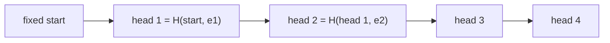
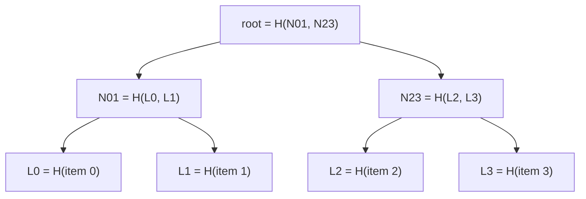
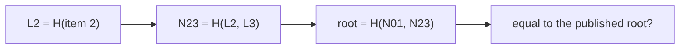

# Cryptographic hashes and integrity

## The idea

The [hash functions](../hash-functions/guide.md) of hash tables only need to spread keys out. Nobody minds if two keys share a hash: the table compares the keys anyway. A **cryptographic hash function**, such as SHA-256, makes a much stronger promise: it is infeasible for anyone, even someone trying hard with a lot of computing power, to find two inputs with the same output. That promise turns a hash into a **fingerprint**: a short value that stands for data of any size, so that comparing fingerprints is as good as comparing the data.

The output is called a **digest**. SHA-256's is always 256 bits, 32 bytes, usually written as 64 hexadecimal characters, whether the input is one byte or a terabyte. Three properties define a cryptographic hash, from weakest to strongest requirement on the attacker:

| Property | The attacker gets | It must be infeasible to find | Generic cost for an `n`-bit digest |
|----------|-------------------|-------------------------------|------------------------------------|
| **Preimage resistance** | A digest `d` | Any input `x` with `H(x) = d` | About 2ⁿ tries |
| **Second-preimage resistance** | An input `x` | A different `y` with `H(y) = H(x)` | About 2ⁿ tries |
| **Collision resistance** | Nothing | Any two different `x`, `y` with `H(x) = H(y)` | About 2^(n/2) tries, by the birthday bound |

Collisions are the cheapest to find, because the attacker may choose both inputs: among about 2^(n/2) random inputs, two will likely share a digest, the same birthday effect that makes hash tables collide early. For SHA-256 that is still about 2¹²⁸ tries, far beyond any computer. The table hashes of the earlier guides offer none of these properties: `"Aa"` and `"BB"` share Java's `String.hashCode()`, by arithmetic anyone can do.

With a fingerprint in hand, three tools follow, and this guide builds each:

1. **Digests** prove that data is unchanged, if the digest itself comes from somewhere you trust.
2. **Hash chains** make a log tamper-evident: one digest stands for the entire history.
3. **Merkle trees** let you prove that one item belongs to a large set, with a proof of only O(log n) digests.

## A worked example

### Digests, and the bytes behind them

```python examples/digests_and_chains.py
"""SHA-256 digests, the encodings that make them trustworthy, and a hash chain over a log."""

import hashlib
import hmac


def sha256(data: bytes) -> bytes:
    return hashlib.sha256(data).digest()


# 1. A digest has a fixed size, and a one-letter change scrambles it.
first, second = sha256(b"backup.tar"), sha256(b"backup.tas")
changed = bin(int.from_bytes(first) ^ int.from_bytes(second)).count("1")
print("digest bytes:", len(first), "| hex:", first.hex()[:16] + "...")
print(f"one letter changed: {changed} of 256 bits differ")


# 2. Encodings. Joining fields loses where one ends and the next begins.
def joined(fields: list[str]) -> bytes:
    return "".join(fields).encode()


def with_separator(fields: list[str]) -> bytes:
    return "|".join(fields).encode()


def length_prefixed(fields: list[str]) -> bytes:
    """Each field as its byte length, a colon, its bytes and a comma: 2:ab,1:c,"""
    return b"".join(b"%d:%s," % (len(raw), raw) for raw in (field.encode() for field in fields))


pairs = [(["ab", "c"], ["a", "bc"]), (["a|b", "c"], ["a", "b|c"])]
for encode in (joined, with_separator, length_prefixed):
    collisions = [sha256(encode(one)) == sha256(encode(other)) for one, other in pairs]
    print(f"{encode.__name__:>15}: collisions {collisions}")


# 3. A hash chain: each head covers its entry and every head before it.
def heads(entries: list[str]) -> list[bytes]:
    head = sha256(b"audit-log v1")  # a fixed starting value
    chain = []
    for entry in entries:
        head = sha256(head + sha256(entry.encode()))
        chain.append(head)
    return chain


log = ["alice logs in", "alice reads report", "bob logs in", "alice logs out"]
tampered = [*log]
tampered[1] = "alice deletes report"
original, edited = heads(log), heads(tampered)
print("heads equal per entry:", [a == b for a, b in zip(original, edited, strict=True)])

# 4. Anyone can recompute a plain hash after editing. A keyed MAC needs the secret.
key = b"server-secret"
tag = hmac.new(key, b"amount=10", hashlib.sha256).digest()
forged = hmac.new(b"guessed-key", b"amount=99", hashlib.sha256).digest()
genuine = hmac.new(key, b"amount=10", hashlib.sha256).digest()
print("MAC of the edit with a guessed key accepted:", hmac.compare_digest(tag, forged))
print("MAC recomputed with the real key accepted:", hmac.compare_digest(tag, genuine))
```

It prints:

```output examples/digests_and_chains.py
digest bytes: 32 | hex: 9c7ed45e977f6bc3...
one letter changed: 113 of 256 bits differ
         joined: collisions [True, False]
 with_separator: collisions [False, True]
length_prefixed: collisions [False, False]
heads equal per entry: [True, False, False, False]
MAC of the edit with a guessed key accepted: False
MAC recomputed with the real key accepted: True
```

The first two lines show what a digest looks like: 32 bytes, and a one-letter change in the input flips 113 of the 256 output bits, close to the half you would expect from unrelated values. This **avalanche** is what makes a digest useless for guessing what changed, and useful for noticing that something did.

The next three lines show the trap that breaks more integrity checks than any weakness of SHA-256: **ambiguous encodings**. A hash function hashes bytes, so a record of several fields must first become bytes, and two different records must never become the same bytes.

- **Joining** the fields loses the boundaries: `("ab", "c")` and `("a", "bc")` both become `abc`, so they get the same digest. That is a collision of your encoding, not of SHA-256, and no hash function can undo it.
- **A separator** such as `|` fixes that pair, but fails as soon as a field may contain the separator: `("a|b", "c")` and `("a", "b|c")` both become `a|b|c`.
- **Length prefixes** fix both: each field is written as its byte length, a colon, its bytes and a comma, so where each field ends is always known. Any encoding works if it is **injective**, meaning different records always give different bytes: length prefixes, a fixed-width layout, or a canonical serialization format. Count lengths in bytes of a fixed text encoding such as UTF-8, not in characters, and fix the number formats too, or `1.0` and `1` will differ.

### Hash chains

A log is a list of entries, appended over time. To make it tamper-evident, keep a running digest, the **head**: start from a fixed value, and for each entry set `head = H(head + H(entry))`. Each head covers its own entry and, through the previous head, every entry before it.



<!-- text-of-mermaid sha256:957cdfd3e8c4ec80fbb705324bf3f5e52458f5abcb44bd403fc659b840925aca -->
```text
┌───────────┐    ┌─────────────────────┐    ┌──────────────────────┐    ┌──────┐    ┌──────┐
│fixed start├───►│head 1 = H(start, e1)├───►│head 2 = H(head 1, e2)├───►│head 3├───►│head 4│
└───────────┘    └─────────────────────┘    └──────────────────────┘    └──────┘    └──────┘
```

In the example, changing entry 2 leaves head 1 equal and changes heads 2, 3 and 4. So:

- **One digest stands for the whole history.** Two parties that agree on head 4 agree on every entry, in order. Comparing two histories of any length costs one comparison of 32 bytes.
- **The heads tell you where histories part.** Heads agree up to some entry and differ from there on, never agreeing again by accident. Agreement is a prefix, so binary search over the heads finds the first difference with O(log n) comparisons.
- **Detection needs an anchor.** Someone who can rewrite the whole log can recompute every head. A chain proves nothing unless the latest head is kept where the attacker cannot change it: published, sent to another party, or signed.

The last two lines of the example show the tool for that last case. A plain digest can be recomputed by anyone who changes the data. An **HMAC** mixes a secret key into the hash, so only someone who holds the key can produce a valid tag; Python's `hmac` module implements RFC 2104, and `hmac.compare_digest` compares tags without leaking, through timing, how many bytes matched.

### Merkle trees and inclusion proofs

A chain answers "is this the same history?", but proving that **one** entry belongs to a set of a million would mean handing over every entry to recompute the digest. A **Merkle tree** fixes that. Hash each item into a leaf; hash pairs of leaves into nodes; hash pairs of nodes, up to a single **root**. The root stands for every item, like a chain's head, and any item's membership can be proven with only the siblings along its path to the root.



<!-- text-of-mermaid sha256:eaa4e057e1ba93231958a4c111b99cc7165d218532e571afd671fd4ef8af6900 -->
```text
┌──────────────────┐
│root = H(N01, N23)│
└──────────────────┘
          ▼─────────────────────▼
┌──────────────────┐    ┌───────────────┐
│ N01 = H(L0, L1)  │    │N23 = H(L2, L3)│
└──────────────────┘    └───────────────┘
          ▼─────────────────────▼────────────────────▼───────────────────▼
┌──────────────────┐    ┌───────────────┐    ┌──────────────┐    ┌──────────────┐
│  L0 = H(item 0)  │    │ L1 = H(item 1)│    │L2 = H(item 2)│    │L3 = H(item 3)│
└──────────────────┘    └───────────────┘    └──────────────┘    └──────────────┘
```

To prove that item 2 is in the tree, send its siblings on the way up: `L3`, then `N01`. The verifier hashes item 2 into `L2`, combines it with `L3` into `N23`, combines `N01` with that into a root, and compares the result with the published root.



<!-- text-of-mermaid sha256:499c8810dc87618a8b63607273d481705e6036e26ecf6ba6c7d78cbeb66ed0e5 -->
```text
┌──────────────┐    ┌───────────────┐    ┌──────────────────┐    ┌────────────────────────────┐
│L2 = H(item 2)├───►│N23 = H(L2, L3)├───►│root = H(N01, N23)├───►│equal to the published root?│
└──────────────┘    └───────────────┘    └──────────────────┘    └────────────────────────────┘
```

The example builds the tree the way RFC 9162 defines it for Certificate Transparency: a leaf is `SHA-256(0x00 || data)`, a node is `SHA-256(0x01 || left || right)`, and a list of `n > 1` items splits at `k`, the largest power of two smaller than `n`.

```python examples/merkle_proofs.py
"""A Merkle tree with inclusion proofs, as RFC 9162 defines them for Certificate Transparency.

A leaf is SHA-256(0x00 || data); a node is SHA-256(0x01 || left || right). A list of n > 1 items
splits at k, the largest power of two smaller than n, so an odd item is never duplicated.
"""

import hashlib

LEAF, NODE = b"\x00", b"\x01"


def sha256(*parts: bytes) -> bytes:
    return hashlib.sha256(b"".join(parts)).digest()


def split(n: int) -> int:
    """The largest power of two smaller than n, for n > 1."""
    k = 1
    while k * 2 < n:
        k *= 2
    return k


def root(items: list[bytes]) -> bytes:
    if len(items) == 1:
        return sha256(LEAF, items[0])
    k = split(len(items))
    return sha256(NODE, root(items[:k]), root(items[k:]))


def proof(index: int, items: list[bytes]) -> list[tuple[str, bytes]]:
    """The siblings from the leaf up: ('L', hash) when the sibling is on the left."""
    if len(items) == 1:
        return []
    k = split(len(items))
    if index < k:
        return [*proof(index, items[:k]), ("R", root(items[k:]))]
    return [*proof(index - k, items[k:]), ("L", root(items[:k]))]


def verify(expected_root: bytes, item: bytes, steps: list[tuple[str, bytes]]) -> bool:
    node = sha256(LEAF, item)
    for side, sibling in steps:
        node = sha256(NODE, sibling, node) if side == "L" else sha256(NODE, node, sibling)
    return node == expected_root


files = [b"photo-01.jpg", b"photo-02.jpg", b"notes.txt", b"budget.ods", b"cv.pdf"]
published = root(files)
steps = proof(2, files)
print("files:", len(files), "| proof for notes.txt has", len(steps), "steps:", [s for s, _ in steps])
print("notes.txt verifies:", verify(published, b"notes.txt", steps))
print("a changed file verifies:", verify(published, b"notes.txt!", steps))
print("cv.pdf, the odd one, needs", len(proof(4, files)), "step(s):", verify(published, b"cv.pdf", proof(4, files)))

# Without the 0x00 and 0x01 prefixes, a node's two children, concatenated, would be accepted as a
# leaf whose data is those 64 bytes: the prefixes keep leaves and nodes apart.
inner = sha256(LEAF, files[0]) + sha256(LEAF, files[1])
print("a node's 64 child bytes hashed as a leaf match the node:", sha256(LEAF, inner) == sha256(NODE, inner))
```

It prints:

```output examples/merkle_proofs.py
files: 5 | proof for notes.txt has 3 steps: ['R', 'L', 'R']
notes.txt verifies: True
a changed file verifies: False
cv.pdf, the odd one, needs 1 step(s): True
a node's 64 child bytes hashed as a leaf match the node: False
```

Five files give a proof of 3 steps for `notes.txt`: its sibling on the right, a node on the left, and the fifth file's subtree on the right. The proof verifies against the root, and fails for a changed file. The odd fifth file is never duplicated: the split puts the first four in one subtree and `cv.pdf` alone in the other, so its proof is one step. The last line shows why the `0x00` and `0x01` prefixes are there: without them, the 64 bytes of a node's two children, hashed as a leaf, would give the node's own hash, so an inner node could be passed off as a leaf. The RFC says this domain separation is required for second-preimage resistance.

## When to use it

- **Integrity of data you received**: compare the digest of a download with one published by a source you trust.
- **Comparing large things cheaply**: two files, two batches or two histories are equal exactly when their digests are, with overwhelming probability. Compute each digest once, then compare 32 bytes.
- **Tamper evidence for logs**: a hash chain whose latest head is published or signed.
- **Proving membership**: a Merkle root published once, and short proofs per item, as Certificate Transparency logs do for TLS certificates.
- **Not for hash tables**: a cryptographic hash is far slower than a table hash and buys nothing there. For hash-flooding resistance, a keyed fast hash such as SipHash, Rust's default, is the right tool.
- **Not for passwords on its own**: a fast hash lets an attacker try billions of guesses. Use a deliberately slow, salted key-derivation function; Python's `hashlib` provides `pbkdf2_hmac` and `scrypt`.

## Common traps

- **Ambiguous encodings.** The most common real failure, as the example shows. Length-prefix every field, fix the text encoding, and normalize numbers before hashing.
- **Hashing text whose bytes vary.** The same visible text can be different bytes: Unicode normalization forms, line endings, trailing whitespace, key order in JSON. Decide on one canonical form and hash that.
- **Comparing hex strings carelessly.** `"AB"` and `"ab"` are the same digest in different case; compare raw bytes, or normalize. When the comparison guards a secret, use a constant-time comparison such as `hmac.compare_digest`.
- **Trusting a digest from the same place as the data.** An attacker who can replace a file can replace the digest next to it. The digest must come from a more trusted channel, or be signed.
- **Duplicating the odd node.** A Merkle tree that pairs an odd last node with a copy of itself gives some different lists the same root, unless the design also fixes the number of leaves. Bitcoin's block Merkle tree duplicates the last hash on odd levels, and its source code explains that this let the transaction lists `[1,2,3,4,5,6]` and `[1,2,3,4,5,6,5,6]` share a root (CVE-2012-2459).
- **Mixing leaves and nodes.** Without separate prefixes, a node can be presented as a leaf. Domain-separate every kind of input.
- **Using broken hashes.** MD5 and SHA-1 have known collision weaknesses, as Python's `hashlib` documentation notes. Use SHA-256, SHA-512, SHA-3 or BLAKE2 for anything that must resist collisions.

## Complexity

For `n` items or entries, each of size at most `L`, and a digest of fixed size:

| Operation | Time | Space |
|-----------|------|-------|
| Digest of data of size `L` | O(L) | O(1) |
| Compare two stored digests | O(1) | |
| Append to a hash chain | O(L) for the entry, O(1) to extend the head | O(1) per stored head |
| Compare two histories by their heads | O(1) | |
| First difference between two histories, heads kept | O(log n) comparisons | O(n) heads |
| Build a Merkle tree | O(n L) | O(n) nodes |
| Inclusion proof: size, and time to verify | O(log n) digests, O(L + log n) | O(log n) |

These costs assume the hash is never broken in the ways it is designed against; the security claims are about computation, not certainty. "Infeasible" means no known method does better than the generic attacks in the first table, and with 2¹²⁸ steps for a SHA-256 collision, no computer does that.

## Expert notes

- **Generic bounds and digest length.** Because of the birthday bound, an `n`-bit hash offers at most `n/2` bits of collision resistance. That is why 128-bit digests are too short for collision resistance today, and why SHA-256's 256 bits give about 128 bits of it.
- **Preimage does not imply collision.** A hash can resist preimages and still have practical collisions, which is the situation of MD5 and SHA-1: fine as checksums against accidents, broken as fingerprints against attackers.
- **Merkle tree shapes.** RFC 9162's split at the largest power of two gives every list exactly one tree, and makes proofs of consistency between an older and a newer tree possible, so a log can prove it only appended. Other designs pad to a power of two, or promote the odd node unchanged; the one shape to avoid is duplicating it without fixing the leaf count.
- **What a proof proves.** An inclusion proof shows that an item is in the tree whose root you hold, nothing more. Whether that root is the right one is a separate question, answered by signatures or by publishing roots where many parties can compare them.
- **Chains, trees and both.** Version control systems name every snapshot by a hash of its content and of its parents, a chain of trees; append-only logs combine a growing Merkle tree with signed roots. The building blocks are the two in this guide.
- **Hash tables and cryptographic hashes meet in the middle.** SipHash, the default hasher of Rust's `HashMap`, is a keyed pseudorandom function: it is fast enough for tables, and an attacker without the per-process key cannot predict which keys collide. It is designed for that, not to be a collision-resistant fingerprint.

## Practice

- `cstudy start tamper-evident-ledger`: four levels that build exactly this guide's tools. Level 1 fingerprints batches, which needs an unambiguous encoding; level 2 chains them; level 3 finds where two chains part in O(log n); level 4 proves that a record is in a batch with a Merkle proof. Read its rules carefully: they fix their own encoding and tree shape, which differ from the examples here.

## Further reading

- [Python `hashlib`](https://docs.python.org/3/library/hashlib.html): `digest`, `hexdigest`, the algorithms always present, the collision weaknesses of MD5 and SHA-1, and `pbkdf2_hmac` and `scrypt`.
- [Python `hmac`](https://docs.python.org/3/library/hmac.html): HMAC as in RFC 2104, and `compare_digest`.
- [RFC 9162: Certificate Transparency version 2.0](https://www.rfc-editor.org/rfc/rfc9162.html), section 2.1: the Merkle tree, its 0x00 and 0x01 prefixes, and inclusion proofs.
- [RFC 2104: HMAC](https://www.rfc-editor.org/rfc/rfc2104.html): keyed hashing for message authentication.
- [FIPS 180-4: Secure Hash Standard](https://csrc.nist.gov/pubs/fips/180-4/upd1/final): the definition of SHA-256.
- [Bitcoin Core `consensus/merkle.cpp`](https://github.com/bitcoin/bitcoin/blob/master/src/consensus/merkle.cpp): the comment on duplicated odd nodes and CVE-2012-2459.
- [Rust `HashMap`](https://doc.rust-lang.org/std/collections/struct.HashMap.html): SipHash 1-3 as a HashDoS-resistant default.
