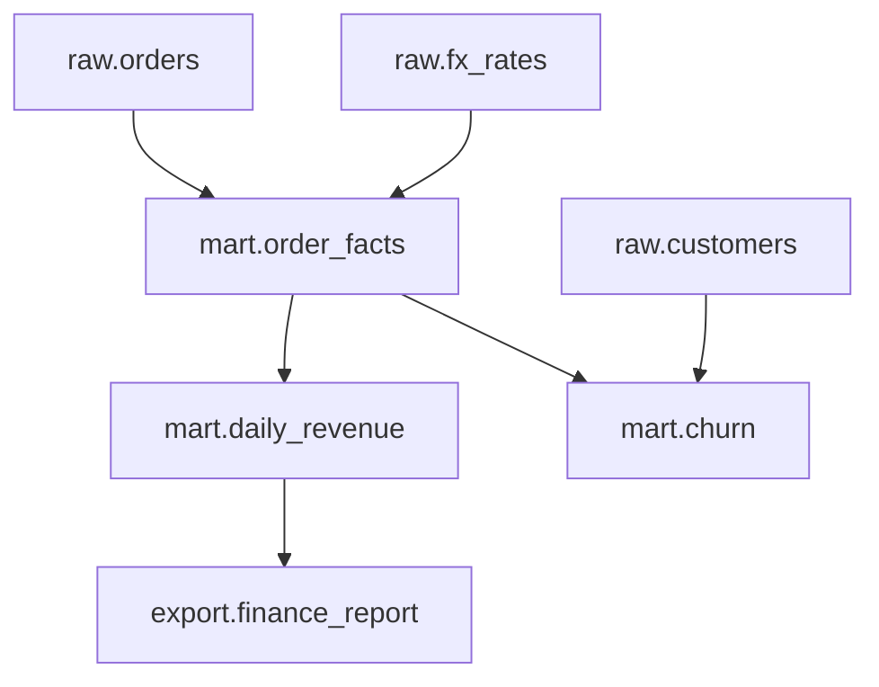
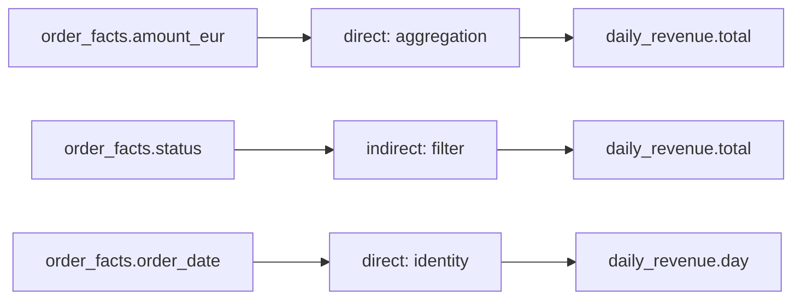

# Data lineage

## The idea

A number in a report looks wrong. Where does it come from? The report reads a revenue table, which is built from an order table, which is built from raw orders and exchange rates, each loaded by a job of its own. Without a record of those steps, finding the cause means reading the code of every job. And before anyone changes a column of the raw orders, a second question matters as much: what will this break?

**Data lineage** is the record that answers both. It is a graph: each **dataset** (a table, a file, a stream of messages) is a node, and an edge goes from each dataset a job reads to each dataset it writes. Walking the edges backwards from a dataset gives its **upstream**, everything it is built from; walking them forwards gives its **downstream**, everything built from it.

Lineage comes at two levels of detail.

- **Dataset-level** lineage says which datasets a dataset reads. It is cheap to collect, and it over-approximates: a change to one column of a table appears to affect everything that reads the table at all.
- **Column-level** lineage says which input columns each output column is computed from, and how: copied as it is, transformed, aggregated over many rows, or used only to filter rows. It answers precisely, and is harder to collect.

Lineage can also be collected in two ways. **Design-time** lineage is read from the code or from specs: parsing the SQL of a job, or a declaration of its inputs and outputs. **Runtime** lineage is reported by each job as it runs: "this run read these datasets and wrote those". Runtime lineage describes what actually happened, including jobs nobody documented; design-time lineage is available before anything runs, and describes what is supposed to happen.



<!-- text-of-mermaid sha256:97824b51101ea607c9da0469f71e9a97f0dc8591b6ebda7c73f498c126cfd0f1 -->
```text
┌─────────────────────┐    ┌────────────┐    ┌─────────────┐
│      raw.orders     │    │raw.fx_rates│    │raw.customers│
└──────────┬──────────┘    └──────┬─────┘    └──────┬──────┘
           ▼──────────────────────┘                 │
┌─────────────────────┐                             │
│   mart.order_facts  │                             │
└──────────┬──────────┘                             │
           ▼──────────────────────▼─────────────────┘
┌─────────────────────┐    ┌────────────┐
│  mart.daily_revenue │    │ mart.churn │
└──────────┬──────────┘    └────────────┘
           ▼
┌─────────────────────┐
│export.finance_report│
└─────────────────────┘
```

The drawing is the graph of the example below. Upstream of the finance report are four datasets; downstream of the exchange rates are four as well, including the churn table, which a change to the rates would reach only through the order facts.

**OpenLineage** is an open standard for collecting lineage at runtime. Its model has three entities. A **job** is a process that reads or writes datasets: a task in a pipeline, a query, a model. A **run** is one execution of a job. A **dataset** is a discrete collection of data, such as a table. A job reports its runs as **run events**, at the start, at completion or failure, with the datasets it read and wrote; extra metadata travels in **facets**, such as a dataset's schema or column-level lineage. Joining the events of many jobs, across many systems, gives the graph.

## A worked example

Seven runs report what they read and wrote. One of them, the revenue job, also reports column-level lineage for its output. The program joins the reports into a graph, walks it upstream from the finance report and downstream from the exchange rates, and prints the columns behind the revenue table:

```python examples/lineage.py
"""A lineage graph built from run events, walked upstream and downstream.

Each finished job run reports the datasets it read and wrote, as an OpenLineage run event trimmed
to the fields read here: a real one also carries its time, a run id, its producer and a schema URL.
Joining those reports gives a graph from every dataset to the datasets built from it. One output
also carries column-level lineage: which input columns each column comes from, and how.
"""


def run(job: str, inputs: list[str], outputs: list[str], columns: dict | None = None) -> dict:
    facets = {"columnLineage": {"fields": columns}} if columns else {}
    return {
        "eventType": "COMPLETE",
        "job": {"namespace": "shop", "name": job},
        "inputs": [{"namespace": "shop", "name": name} for name in inputs],
        "outputs": [{"namespace": "shop", "name": name, "facets": facets} for name in outputs],
    }


def field(name: str, column: str, kind: str, subtype: str) -> dict:
    return {"namespace": "shop", "name": name, "field": column,
            "transformations": [{"type": kind, "subtype": subtype, "masking": False}]}


EVENTS = [
    run("ingest_orders", [], ["raw.orders"]),
    run("ingest_rates", [], ["raw.fx_rates"]),
    run("ingest_customers", [], ["raw.customers"]),
    run("build_order_facts", ["raw.orders", "raw.fx_rates"], ["mart.order_facts"]),
    run("build_churn", ["mart.order_facts", "raw.customers"], ["mart.churn"]),
    run("build_revenue", ["mart.order_facts"], ["mart.daily_revenue"], {
        "total": {"inputFields": [
            field("mart.order_facts", "amount_eur", "DIRECT", "AGGREGATION"),
            field("mart.order_facts", "status", "INDIRECT", "FILTER")]},
        "day": {"inputFields": [field("mart.order_facts", "order_date", "DIRECT", "IDENTITY")]},
    }),
    run("export_finance", ["mart.daily_revenue"], ["export.finance_report"]),
]

readers: dict[str, set[str]] = {}  # dataset -> datasets built from it
sources: dict[str, set[str]] = {}  # dataset -> datasets it is built from
for event in EVENTS:
    for output in event["outputs"]:
        sources.setdefault(output["name"], set())
        for source in event["inputs"]:
            readers.setdefault(source["name"], set()).add(output["name"])
            sources[output["name"]].add(source["name"])


def walk(start: str, edges: dict[str, set[str]]) -> list[str]:
    seen: set[str] = set()
    stack = [start]
    while stack:
        for nxt in edges.get(stack.pop(), ()):
            if nxt not in seen:
                seen.add(nxt)
                stack.append(nxt)
    return sorted(seen)


print("upstream of export.finance_report:", walk("export.finance_report", sources))
print("downstream of raw.fx_rates:", walk("raw.fx_rates", readers))
revenue = next(e for e in EVENTS if e["job"]["name"] == "build_revenue")["outputs"][0]
for column, lineage in revenue["facets"]["columnLineage"]["fields"].items():
    for source in lineage["inputFields"]:
        how = source["transformations"][0]
        print(f"daily_revenue.{column} <- {source['name']}.{source['field']}"
              f" ({how['type']}, {how['subtype']})")
```

It prints:

```output examples/lineage.py
upstream of export.finance_report: ['mart.daily_revenue', 'mart.order_facts', 'raw.fx_rates', 'raw.orders']
downstream of raw.fx_rates: ['export.finance_report', 'mart.churn', 'mart.daily_revenue', 'mart.order_facts']
daily_revenue.total <- mart.order_facts.amount_eur (DIRECT, AGGREGATION)
daily_revenue.total <- mart.order_facts.status (INDIRECT, FILTER)
daily_revenue.day <- mart.order_facts.order_date (DIRECT, IDENTITY)
```

No job declared the whole graph; each run only said what it read and wrote, and the walks follow the joined reports. The walk keeps a set of datasets already seen, so a dataset reached by two paths is visited once, and a graph with a loop cannot trap it.

The column lines tell more than the dataset graph can. `daily_revenue.total` is an aggregation of `amount_eur`, so a change in amounts changes totals. It also depends on `status`, but only as a filter: no part of the total comes from the status value, yet a change in which statuses exist changes which rows are counted. `day` is a copy of `order_date`. Dataset-level lineage would say only that the revenue table reads the order facts.



<!-- text-of-mermaid sha256:1dc5caee498cea6da65c978ffc66a3664d3af09c9e32084873109454b6697112 -->
```text
┌──────────────────────┐    ┌───────────────────┐    ┌───────────────────┐
│order_facts.amount_eur├───►│direct: aggregation├───►│daily_revenue.total│
└──────────────────────┘    └───────────────────┘    └───────────────────┘

┌──────────────────────┐    ┌───────────────────┐    ┌───────────────────┐
│  order_facts.status  ├───►│  indirect: filter ├───►│daily_revenue.total│
└──────────────────────┘    └───────────────────┘    └───────────────────┘

┌──────────────────────┐    ┌───────────────────┐    ┌───────────────────┐
│order_facts.order_date├───►│  direct: identity ├───►│ daily_revenue.day │
└──────────────────────┘    └───────────────────┘    └───────────────────┘
```

The drawing has one line per column edge, with how the input is used in the middle: `total` aggregates one input and is filtered by another, and `day` copies a third.

## When to use it

- **Tracing a wrong number** to its source: walk upstream from the bad column, and check each step's latest run.
- **Before changing or dropping a column**: walk downstream to list every dataset, report and export that reads it, and their owners. Column-level lineage separates the columns that merely copy it from those that compute with it.
- **Backfills**: the downstream walk from a rewritten dataset is the list of what must run again, as the guide on orchestration explains.
- **Sensitive data**: mark the columns that hold personal data, follow the edges that carry their values, and find every published dataset they reach. An edge that only filters carries no value onward. A masking edge, such as a hash or a count, hides the value but may still identify a person: a hash of an email still matches that email. Whether a masked edge stops a label is a policy you choose, not something the lineage proves.
- **Audits and trust**: show where a published figure came from, which job versions built it, and which checks its inputs passed.

## Common traps

- **Lineage written by hand.** A diagram or a spec maintained apart from the code drifts as soon as the code changes. Collect lineage from the runs, or generate it from the code, and compare the two.
- **Only dataset-level lineage.** Every change then seems to affect everything downstream, so people stop looking. Column-level lineage is what makes impact analysis precise enough to act on.
- **Forgetting indirect edges.** A filter or a join key contributes no value to an output, but changing it changes the output. A lineage that records only the columns copied or computed misses those dependencies.
- **Treating every edge as carrying data, or a masked one as safe.** For sensitive data, a column used only to filter does not carry its values onward, and following it overstates where personal data went. A hashed or counted column hides its values but may still identify a person, so stopping a label there is a policy decision, not a fact the lineage shows.
- **Names that do not match.** The same table called `orders` by one job and `prod.sales.orders` by another becomes two nodes, and the graph breaks in two. Agree on how datasets are named, with a namespace that says where they live.
- **No versions.** Knowing that a table reads another is less useful than knowing which run, of which code version, read which version of it. Record runs, and the dataset versions where the storage provides them.

## Complexity

For a lineage graph of `V` nodes (datasets, or columns for column-level lineage) and `E` edges:

| Operation | Time | Space |
|-----------|------|-------|
| Build the graph from events | O(E) | O(V + E) for adjacency in both directions |
| Upstream or downstream of one node | O(V + E) at worst, with a visited set | O(V) for the set |
| Where each of `S` sensitive columns reaches | O(S (V + E)), one walk per source | O(V) per walk |

Column-level graphs are much larger than dataset-level ones, a few columns to hundreds per dataset, but the walks stay linear in their size.

## Expert notes

- **OpenLineage.** It describes itself as an open framework for data lineage collection and analysis, with an extensible specification at its core, defined using OpenAPI and extended through facets; it is a graduate project of the LF AI & Data Foundation. Its object model includes jobs, so that it records how datasets come into being, not only that they are related, and it builds a lineage graph by joining observations of many jobs across platforms.
- **Run events.** A run event carries its event time, its producer and schema URL, the run with a client-generated id (UUIDv7 recommended), the job with a name unique within its namespace, and its input and output datasets. The run states are `START`, `RUNNING`, `COMPLETE`, `ABORT`, `FAIL` and `OTHER`; `COMPLETE`, `ABORT` and `FAIL` are terminal. Jobs declare a processing type: `BATCH` jobs are finite with a clear start and end, while `STREAMING` and `SERVICE` jobs run indefinitely and report periodically. Design-time metadata travels as job events and dataset events, which belong to no run.
- **Facets.** Jobs can carry the location and version of their source code, runs their nominal scheduled time and their parent run, datasets their schema and a version such as a table format's snapshot id, input datasets data quality metrics and test results, and output datasets the size written.
- **Column lineage types.** OpenLineage's column-level lineage facet gives each input of an output column a type and a subtype. `DIRECT` means the output value is derived from the input: `IDENTITY` (taken as is), `TRANSFORMATION` (transformed from the same row) or `AGGREGATION` (from many rows). `INDIRECT` means the input affects the output without being part of its value: `JOIN`, `GROUP_BY`, `FILTER`, `SORT`, `WINDOW` and `CONDITIONAL`. A `masking` flag says the input was obfuscated on the way, with hashing as an example of a masking transformation and counting of a masking aggregation.
- **Provenance.** The W3C's PROV-O, a Recommendation of 30 April 2013, models provenance with entities, activities that act on them over time, and agents responsible for both. It defines a derivation as a transformation of an entity into another, an update of an entity resulting in a new one, or the construction of a new entity based on a pre-existing one: the edges of a lineage graph are derivations.

## Practice

- `cstudy start lineage-graph`: column-level specs: validation with cycles, upstream and downstream walks, the impact of a dropped, renamed or retyped column, and sensitive labels that reach published data.

## Further reading

- [OpenLineage, *About*](https://openlineage.io/docs/): what the standard is, and how it is defined.
- [OpenLineage, *Object Model*](https://openlineage.io/docs/spec/object-model): jobs, runs, datasets, events and facets.
- [OpenLineage, *The Run Cycle*](https://openlineage.io/docs/spec/run-cycle): run states and processing types.
- [OpenLineage, *Column Level Lineage Dataset Facet*](https://openlineage.io/docs/spec/facets/dataset-facets/column_lineage_facet): direct and indirect transformations, their subtypes, and masking.
- [W3C, *PROV-O: The PROV Ontology*](https://www.w3.org/TR/prov-o/): entities, activities, agents and derivations.
