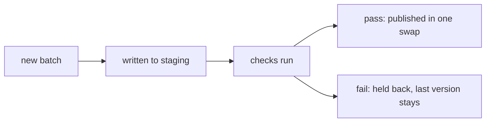

# Data quality checks and data contracts

## The idea

A pipeline that runs without errors can still publish wrong data. The source sent half its usual rows; a column that held amounts in cents now holds them in dollars; every order of the day points to a customer nobody has heard of. Nothing crashes, and a report goes out with a wrong number. **Data quality checks** catch such problems the way tests catch bugs: mechanically, every time, before anyone reads the result.

A check is a rule about the data that a program can test. Checks come in a few families, by how much of the data they need to see:

| Family | Asks | For example |
|--------|------|-------------|
| **Value** checks | Is this one value acceptable? | Not missing; an integer; a date that exists; one of `new`, `paid`, `shipped`; between 0 and 120 |
| **Key** checks | Do the rows fit together? | No two orders share an id; every order's customer exists in the customer table |
| **Volume** checks | Is the batch the expected size? | Within 20% of yesterday's row count |
| **Distribution** checks | Is the data spread the way it usually is? | Ages, amounts or categories shifted far from last week's |
| **Freshness** checks | Is the data recent enough? | The newest event is less than two hours old |

A check that fails has to *do* something, and what depends on the rule: **warn** and publish anyway; **quarantine**, setting aside the rows that fail and publishing the rest; or **block**, holding back the whole batch. Where the check runs matters as much: a check that runs after the data is published only tells you what your readers have already seen. The **write-audit-publish** pattern writes a new batch where readers cannot see it, audits it there, and publishes it in one step only if it passes.



<!-- text-of-mermaid sha256:178ce2f7952656dae986f0cc40638b347ffa8bb79c3f72213325a2f2707e87a9 -->
```text
┌─────────┐    ┌──────────────────┐    ┌──────────┐    ┌───────────────────────────────────┐
│new batch├───►│written to staging├───►│checks run├───►│    pass: published in one swap    │
└─────────┘    └──────────────────┘    └─────┬────┘    └───────────────────────────────────┘
                                             │
                                             │         ┌───────────────────────────────────┐
                                             └────────►│fail: held back, last version stays│
                                                       └───────────────────────────────────┘
```

The drawing shows the two outcomes. Readers only ever see a version that passed.

Checks find problems; **data contracts** prevent many of them. A data contract is an agreement, written down and versioned, between the team that produces a dataset and the teams that read it: the columns and their types, what each one means, the quality rules the data meets, when it is delivered, and who to ask. With a contract, a producer who wants to rename a column knows that it is a change other people depend on, and the readers learn about it before it ships, not from a broken dashboard.

## A worked example

### A change that breaks readers

A contract describes an `orders` dataset. Its producer proposes a new version: `customer_id` renamed to `buyer_id`, amounts as text, `placed_at` allowed to be missing, and a new `channel` column. The program compares the two versions column by column, from the side of a reader who selects columns by name and relies on their types and on their being present:

```python examples/schema_changes.py
"""Which changes to a dataset's schema break the people who read it.

A contract lists each column with its type and whether it always has a value. A proposed new
version is compared with it, column by name, from the readers' side: a reader that selects a
column by name, and relies on its type and on it being present, must not be surprised.
"""

CONTRACT = {  # column -> (type, required)
    "order_id": ("string", True),
    "customer_id": ("string", True),
    "amount_cents": ("integer", True),
    "coupon": ("string", False),
    "placed_at": ("timestamp", True),
}
PROPOSED = {
    "order_id": ("string", True),
    "buyer_id": ("string", True),  # customer_id, renamed
    "amount_cents": ("string", True),  # now text, such as "12.50"
    "coupon": ("string", False),
    "placed_at": ("timestamp", False),  # may now be missing
    "channel": ("string", False),
}


def changes(old: dict, new: dict) -> list[tuple[str, str]]:
    found = []
    for column, (kind, required) in old.items():
        if column not in new:
            found.append((f"{column} removed", "breaking"))
            continue
        new_kind, new_required = new[column]
        if new_kind != kind:
            found.append((f"{column} type {kind} -> {new_kind}", "breaking"))
        if required and not new_required:
            found.append((f"{column} may now be missing", "breaking"))
        elif new_required and not required:
            found.append((f"{column} now always present", "compatible"))
    for column in new.keys() - old.keys():
        found.append((f"{column} added", "compatible"))
    return sorted(found)


for change, verdict in changes(CONTRACT, PROPOSED):
    print(f"{verdict:>10}: {change}")
```

It prints:

```output examples/schema_changes.py
  breaking: amount_cents type integer -> string
compatible: buyer_id added
compatible: channel added
  breaking: customer_id removed
  breaking: placed_at may now be missing
```

A rename shows up as two changes, a removal and an addition: a reader asking for `customer_id` finds nothing, whatever the new column is called. A type change breaks every reader that does arithmetic on the column, and a column that may now be missing breaks every reader that assumed it never is. Adding a column breaks no one who selects by name, and neither does promising a value where there used to be none. Three breaking changes mean this version needs the readers' agreement and a migration period: publish both shapes for a while, or the new one under a new name, and retire the old one once its readers have moved.

### A batch that does not get published

The second program publishes batches of orders with write-audit-publish. It checks that ids are present and unique, that every customer exists, that the row count is within half to double of the last published batch, and that the newest event is at most two hours old.

```python examples/write_audit_publish.py
"""Write, audit, publish: a batch is checked where readers cannot see it, and published whole or
not at all.

Readers always read the published version. A new batch is written to a staging area, a few
checks run on it, and only a batch that passes them becomes the next published version.
"""

CUSTOMERS = {"c1", "c2", "c3"}
published = {"version": 1, "rows": [("o1", "c1", 900, 470), ("o2", "c2", 450, 480)]}


def audit(rows: list[tuple[str, str, int, int]], now: int) -> list[str]:
    """The failed checks; rows are (order id, customer, amount in cents, event minute)."""
    failed = []
    ids = [row[0] for row in rows]
    if any(not order_id for order_id in ids):
        failed.append("order id missing")
    if len(set(ids)) != len(ids):
        failed.append(f"order id not unique ({len(ids) - len(set(ids))} repeated)")
    unknown = [row[1] for row in rows if row[1] not in CUSTOMERS]
    if unknown:
        failed.append(f"unknown customer {unknown}")
    previous = len(published["rows"])
    if not previous / 2 <= len(rows) <= previous * 2:
        failed.append(f"row count {len(rows)}, previous {previous}")
    newest = max((row[3] for row in rows), default=None)
    if newest is None or now - newest > 120:
        failed.append(f"stale: newest event at minute {newest}, now {now}")
    return failed


def write_audit_publish(staged: list[tuple[str, str, int, int]], now: int) -> None:
    failed = audit(staged, now)
    if failed:
        print(f"blocked: {'; '.join(failed)}")
        return
    published["version"] += 1
    published["rows"] = staged  # one swap: readers see the old version or the new one
    print(f"published version {published['version']} with {len(staged)} rows")


write_audit_publish([("o3", "c1", 1200, 1400), ("o4", "c3", 300, 1410), ("o5", "c2", 80, 1415)],
                    now=1440)
write_audit_publish([("o6", "c2", 500, 2600), ("o6", "c2", 500, 2600), ("o7", "c9", 70, 2610)],
                    now=2880)
print(f"readers see version {published['version']}: {[row[0] for row in published['rows']]}")
```

It prints:

```output examples/write_audit_publish.py
published version 2 with 3 rows
blocked: order id not unique (1 repeated); unknown customer ['c9']; stale: newest event at minute 2610, now 2880
readers see version 2: ['o3', 'o4', 'o5']
```

The first batch passes every check and becomes version 2. The second has a duplicated order, a customer `c9` that does not exist, and its newest event is four and a half hours old. It is blocked, and the readers keep version 2 as if nothing had happened, while the failures say exactly what to fix. Here every failure blocks; a real gate would let some rules only warn, and would quarantine the rows that fail a value check rather than block the batch for one bad row.

### Measuring drift

Volume and value checks miss a batch whose every row is valid but whose overall shape is wrong: ages that are suddenly mostly over 50, or a category that vanished. A common measure is the **population stability index** (PSI). Cut the values into bins, compute the share of values in each bin before (`e`) and now (`a`), and add up, over the bins:

```text
PSI = sum of (a - e) * ln(a / e)
```

Every term is zero or positive, since `a - e` and `ln(a / e)` always have the same sign, so PSI is 0 when the shares are equal and grows as they move apart. With three bins whose shares move from 0.5, 0.3 and 0.2 to 0.3, 0.3 and 0.4, the terms are 0.1022, 0 and 0.1386, and PSI is 0.2408. An empty bin makes `ln(a / e)` undefined, so implementations replace a zero share by a small number, or leave the bin out.

## When to use it

- **Value checks** on every column that a reader filters, groups or computes on: missing values, types, allowed values, ranges.
- **Key checks** on every key: uniqueness of the primary key, and that every foreign key finds its row. A fact table whose keys find no dimension row silently loses rows in an inner join.
- **Volume and freshness checks** on every scheduled dataset: they catch the failures that produce no error at all, an empty extract or a stuck upstream job.
- **Distribution checks** on the columns that models or important reports depend on, where a shift matters even when each value looks fine.
- **Write-audit-publish** whenever readers would act on bad data before anyone could stop them.
- **A contract** for every dataset that another team reads. Start with the schema and an owner; add quality rules and delivery times as they matter.

## Common traps

- **Checks after publishing.** By the time the check fails, the dashboard has refreshed and the export has gone. Check before the data becomes visible.
- **Only checking for missing values.** Most bad data is present and wrong: in the wrong unit, the wrong time zone, or a duplicate.
- **Blocking on everything, or nothing.** A gate that blocks for one bad row in a million stops the business; one that only warns trains everyone to ignore it. Decide each rule's action by what a failure costs.
- **Alerts that fire every day.** A rule that always fails is noise. Fix the data or the rule, or remove it.
- **Comparing only with yesterday.** A slow drift moves the baseline a little every day and is never caught. Compare with a fixed reference period as well.
- **Quarantine as a hiding place.** Rows set aside must be counted and looked at. A quarantine that quietly grows means the source is broken.
- **A contract nobody checks.** A schema written in a document drifts from the data. Check the contract in the pipeline, on every batch, and on every proposed change.

## Complexity

For a batch of `n` rows, `r` value rules and `b` bins:

| Check | Time | Extra space |
|-------|------|-------------|
| Value checks | O(n r) | O(1) per rule, plus the failing rows if they are kept |
| Uniqueness of a key | O(n) on average, with a hash set | O(n) |
| References into a dimension of `d` keys | O(n) on average, with the keys in a hash set | O(d) |
| Row count | O(1) once the batch is counted | |
| Distribution (PSI) | O(n log b) to bin with a binary search over the edges, then O(b) | O(b) |
| Freshness | O(n) for the newest event time | |

All of them read the batch once, so a gate costs about one more pass over the data than the pipeline already makes.

## Expert notes

- **The Open Data Contract Standard.** ODCS, published by the Bitol project of the LF AI & Data Foundation under the Apache 2.0 license, defines a data contract as the agreement between a data producer and consumers, written in YAML. Version 3.2.0 has sections for fundamentals, schema, references, data quality, support and communication channels, pricing, team, roles, service-level agreement, infrastructure and servers, authoritative definitions, tags, and custom properties.
- **Quality rules in a contract.** ODCS rules can be plain text, predefined metrics such as `nullValues`, `missingValues`, `invalidValues`, `duplicateValues` and `rowCount`, SQL queries that return a value, or rules for a specific tool. A rule compares its result with operators such as `mustBe`, `mustBeLessThan` or `mustBeBetween`, and can name a severity and the business impact of a failure. Rules can be classified by dimension: accuracy, completeness, conformity, consistency, coverage, timeliness and uniqueness.
- **Delivery promises.** The contract's service-level section lists properties such as `latency`, `frequency`, `retention` and `timeOfAvailability`, so freshness checks have a written target to test against.
- **Where PSI comes from.** Potgieter, Van Zyl, Schutte and Lombard trace the population stability index to Lewis (1994), who coined the name; their equation (1) defines it as above, as a consistent estimator of the symmetric Kullback-Leibler divergence, leaving out bins whose current share is zero. The usual rule of thumb, below 0.10 no change, 0.10 to 0.25 worth a look, above 0.25 a material shift, comes from Lewis's example. They show that fixed thresholds ignore sample size: they raise alarms too often on small samples and miss real shifts on large ones, and they propose a statistic based on the chi-square test, whose critical values depend on the sample size and the number of bins.
- **Write-audit-publish with table branches.** Apache Iceberg's documentation shows the pattern with branches: writes go to an audit branch, independent of the main table history; a validation workflow checks it, for example for data quality; and the main branch is then fast-forwarded to the audited snapshot. The guide on table formats explains snapshots and branches.
- **Quality in lineage.** OpenLineage lets an input dataset carry data quality metrics, such as row count, null count and distinct count, and the results of data tests, so a lineage graph can show which runs read data that failed a check.

## Practice

- `cstudy start data-quality-gate`: rules kept as data, with checks on single values, on keys and references, on the row count, on drift and freshness, and a gate that publishes, sets rows aside or blocks.
- `cstudy start feed-ingest-python`: refuse each bad row of a daily feed with its reason, load the rest, and load it once however often it is sent.
- `cstudy start csv-upload-ingestion-typescript`: report every bad row of an upload in a file of its own, and reject a file that is mostly bad instead of loading part of it.

## Further reading

- [Open Data Contract Standard](https://github.com/bitol-io/open-data-contract-standard): the standard, its version and its sections; the [reader-friendly site](https://bitol-io.github.io/open-data-contract-standard/).
- [ODCS, *Data Quality*](https://github.com/bitol-io/open-data-contract-standard/blob/main/docs/data-quality.md): rule types, library metrics, operators and dimensions.
- [ODCS, *Service-Level Agreement*](https://github.com/bitol-io/open-data-contract-standard/blob/main/docs/service-level-agreement.md): latency, frequency, retention and time of availability.
- [Potgieter, Van Zyl, Schutte and Lombard, *The Population Resemblance Statistic: A Chi-Square Measure of Fit for Banking* (arXiv 2307.11878)](https://arxiv.org/abs/2307.11878): the PSI, its origin and the limits of fixed thresholds.
- [Apache Iceberg, *Branching and Tagging*](https://iceberg.apache.org/docs/latest/branching/): the audit branch workflow.
- [OpenLineage, *Object Model*](https://openlineage.io/docs/spec/object-model): data quality facets on input datasets.
