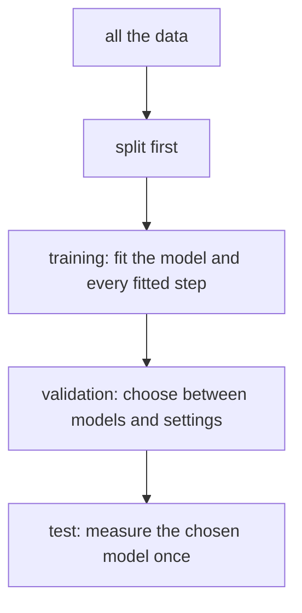

# Data, features, splits and leakage

## The idea

**Machine learning** writes a program from examples instead of rules. You do not tell the program how to decide whether a parcel will arrive late; you show it thousands of parcels whose outcome you already know, and a learning algorithm adjusts a model until its answers match. This guide covers the kind called **supervised learning**, where every example comes with the answer.

| Word | Meaning | For a parcel |
|------|---------|--------------|
| **Example** | One row of the data | One parcel |
| **Feature** | A number or category that describes the example and is known when the model must answer | Distance in kilometres, weight, the day it was sent |
| **Label** | The answer the model should learn to give | Arrived late: yes or no; or the delivery time in minutes |
| **Model** | A function from features to a **prediction**, with numbers inside it that learning sets | A weighted sum of the features, turned into a probability |
| **Training** | Adjusting the model's numbers so that its predictions match the labels of known examples | |

A label that is a category (late or not) makes a **classification** problem; a label that is a number (minutes) makes a **regression** problem.

What you want is not a model that fits the examples you have, but one that does well on the examples it will meet later. That is called **generalization**, and it cannot be seen on the training examples themselves: a model that simply memorized them would answer every one correctly and still know nothing about the next parcel. So part of the data is held back, and the model is measured on that part only.

Most learning algorithms also have **hyperparameters**: settings that the algorithm does not learn by itself, such as how flexible the model may be. Choosing them is a second kind of learning, and it needs examples of its own. So the data is usually split into three parts:

| Part | Used to | Touched |
|------|---------|---------|
| **Training set** | Fit the model, and every other step that learns from data | As often as you like |
| **Validation set** | Compare models and choose hyperparameters | Whenever you compare |
| **Test set** | Measure the one model you chose, at the very end | Once |



<!-- text-of-mermaid sha256:a557d23435236838427ad1db4bd7ca2c43fd319b23de95a5cd60feb720708d2d -->
```text
┌──────────────────────────────────────────────┐
│                 all the data                 │
└───────────────────────┬──────────────────────┘
                        ▼
┌──────────────────────────────────────────────┐
│                 split first                  │
└───────────────────────┬──────────────────────┘
                        ▼
┌──────────────────────────────────────────────┐
│training: fit the model and every fitted step │
└───────────────────────┬──────────────────────┘
                        ▼
┌──────────────────────────────────────────────┐
│validation: choose between models and settings│
└───────────────────────┬──────────────────────┘
                        ▼
┌──────────────────────────────────────────────┐
│     test: measure the chosen model once      │
└──────────────────────────────────────────────┘
```

The drawing reads from the top: the split comes before anything learns from the data, and each part is used for one job.

**Leakage** is what happens when information from outside the training set gets into the model, or into the choices made about it, so that the measured score is better than what the model will do in use. A leak rarely shows: the code runs, the numbers look good, and the model disappoints later.

## A worked example

An online shop wants to predict which orders will be sent back. Some customers send back most of what they buy, and most send back little, so the label depends mostly on who placed the order. A model with enough freedom learns exactly that: in effect, it recognizes customers. The program below plays that model. It predicts the label most common for a customer in its training rows, and for a customer it has never seen, the label most common overall.

The shop will use the model on next month's orders, many of them from new customers. The program measures the model twice: once with the orders split at random, and once with whole customers held out.

```python examples/split_by_customer.py
"""Splitting by row against splitting by customer, for a model that recognizes customers.

Each customer places five orders, and whether an order is sent back depends mostly on who placed
it. The model has, in effect, learned to recognize customers: it predicts the label most common for
that customer in its training rows, and the label most common overall for a customer it has never
seen. The question is how well it will do next month, when the customers are new.
"""

import random

rng = random.Random(7)


def shuffled(items) -> list:
    """A Fisher-Yates shuffle built on random(), whose sequence is stable across versions."""
    items = list(items)
    for i in range(len(items) - 1, 0, -1):
        j = int(rng.random() * (i + 1))
        items[i], items[j] = items[j], items[i]
    return items


rows = []  # (customer, returned): 1 when the order was sent back
for customer in range(40):
    habit = 0.85 if rng.random() < 0.4 else 0.1  # the share of orders this customer sends back
    for _ in range(5):
        rows.append((customer, 1 if rng.random() < habit else 0))


def most_common(labels: list[int]) -> int:
    return 1 if 2 * sum(labels) > len(labels) else 0


def accuracy(train: list, test: list) -> float:
    seen: dict[int, list[int]] = {}
    for customer, returned in train:
        seen.setdefault(customer, []).append(returned)
    fallback = most_common([returned for _, returned in train])
    hits = sum((most_common(seen[c]) if c in seen else fallback) == y for c, y in test)
    return hits / len(test)


by_row = shuffled(rows)
row_test, row_train = by_row[:50], by_row[50:]
new_customers = set(shuffled(range(40))[:10])
cust_test = [row for row in rows if row[0] in new_customers]
cust_train = [row for row in rows if row[0] not in new_customers]

print(f"split by row:      accuracy {accuracy(row_train, row_test):.2f}, {len(row_test)} orders")
print(f"split by customer: accuracy {accuracy(cust_train, cust_test):.2f}, {len(cust_test)} orders")
kept = sum(returned == 0 for _, returned in cust_test) / len(cust_test)
print(f"always 'kept':     accuracy {kept:.2f}, the same new customers")
```

It prints:

```output examples/split_by_customer.py
split by row:      accuracy 0.88, 50 orders
split by customer: accuracy 0.70, 50 orders
always 'kept':     accuracy 0.70, the same new customers
```

Split by row, the test orders come from customers whose other orders are in the training set, and the model recognizes them: 88% of its answers are right. Split by customer, it meets ten customers it has never seen, falls back on "kept" every time, and does exactly as well as a rule that always says "kept", 70%. The first number measured how well the model remembers customers; the second measured what the shop asked, how it does on new ones.

Nothing in the code is wrong, and no number is computed badly. The leak is in the split: orders of the same customer are not independent of each other, so a random split lets the training set know things about the test set. The fix is to split the way the model will be used.

## When to use it

- **Split before you look.** Set the test set aside before exploring the data, choosing features or trying models, so that nothing you decide is shaped by it.
- **Split the way the model will be used.** Random rows when future examples are like the past ones and independent of each other; whole groups (customers, patients, devices) when the model will meet new groups; by time, the past for training and the future for testing, when the model predicts what comes next.
- **Fit every learned step on the training set only.** Scaling features, filling in missing values with an average, choosing features and balancing classes all learn from data. Fit them on the training set and apply them, unchanged, to the validation and test sets.
- **Use the validation set for every choice** of model, feature or hyperparameter, and the test set once. When the data is too small to set a validation set aside, use [cross-validation](../cross-validation/guide.md).
- **Ask of every feature: would I know this when the model has to answer?** A feature that is recorded after the outcome, or that is a stand-in for it, makes the model look good and fail in use.

## Common traps

- **Measuring on the training set.** A model that memorized its examples scores perfectly on them. Training error says how well the model fits, not how well it generalizes.
- **Preprocessing before splitting.** A scaler, an average used to fill in missing values, or new examples made up to balance the classes, computed on all the data, carry information from the test rows into training.
- **Choosing features on all the data.** Picking the features that move most closely with the label, and only then splitting, lets the test labels vote on the features. The expert notes describe a case where this turns a coin flip into a 3% error rate.
- **Duplicates across the split.** The same example, or a near copy, in both sets turns the test into a memory check.
- **Groups across the split.** Several rows of one customer, one patient or one machine on both sides, as in the example.
- **The future in the training set.** A random split of data that changes over time trains on next week to predict yesterday, which the model will never be able to do in use.
- **Features that give the answer away.** A "refund issued" column predicts returns perfectly, because it is written after the return.
- **Choosing on the test set.** Comparing ten models on the test set and keeping the best one turns the test set into a validation set, and the winner's score on it is optimistic. The guide on [evaluation pitfalls](../evaluation-pitfalls/guide.md) explains why.

## Complexity

For `n` examples in `g` groups:

| Split | Time | Extra space |
|-------|------|-------------|
| Random rows | O(n) for a shuffle that swaps each position once | O(n) for the shuffled indexes |
| Whole groups | O(n) on average: group the rows with a hash map, then shuffle the `g` groups | O(n) |
| By time | O(n log n) to sort by time, or O(n) to compare each row with a cut-off date | O(n) |

Splitting costs about one pass over the data. What it costs in data is larger: every example in the validation and test sets is one the model does not learn from.

## Expert notes

- **Two separate goals.** Hastie, Tibshirani and Friedman (*The Elements of Statistical Learning*, §7.2) separate **model selection**, estimating how good several models are in order to choose one, from **model assessment**, estimating how good the chosen one is on new data. With enough data they recommend three parts, the test set kept "in a vault" until the end, and they warn that if the test set is used again and again to choose the model with the smallest test error, the chosen model's test error underestimates the true one, sometimes substantially. They give 50% for training and 25% each for validation and testing as a typical split, while noting that no general rule fits every signal-to-noise ratio and sample size.
- **The validation set comes out of the training data.** Goodfellow, Bengio and Courville (*Deep Learning*, §5.3) explain why a hyperparameter that controls how flexible a model is cannot be learned on the training set: it would always choose the most flexible model. They build the validation set from the training data, typically 80% for training and 20% for validation, so that no test example takes part in any choice, and they note that the validation error, having been used to choose, underestimates the generalization error too, though usually by less than the training error does. A test set reused by a whole field for years ends up optimistic in the same way.
- **The wrong and right way to choose features.** In ESL §7.10.2, 50 samples in two equal classes have 5,000 features unrelated to the label, so no classifier can beat a 50% error. Choosing the 100 features most correlated with the label on all 50 samples, then cross-validating a classifier on them, gave an average estimated error of 3% over 50 simulations. Choosing the features again inside each fold, from that fold's training samples only, is the right way.
- **A taxonomy of leakage.** Kapoor and Narayanan surveyed the literature of fields that adopted machine learning and found 17 fields where errors had been reported, together affecting 329 papers. They sort leakage into 8 types in three groups: no clean separation of training and test data (no test set at all, preprocessing on both, feature selection on both, duplicates); features that should not be available, such as a stand-in for the outcome (one study predicted high blood pressure from whether the patient took drugs against it); and a test set that does not match the claim (data from before the training data when the claim is about the future, the same patients on both sides, and sampling bias). In their own study of civil war prediction, every paper that claimed complex models beat logistic regression, a simple model that the [next guide](../linear-and-logistic-regression/guide.md) explains, failed to reproduce because of leakage, and once it was fixed the complex models did not do substantively better.
- **Reproducible randomness.** The examples of these guides shuffle with their own loop on top of `random.random()`, not with `random.shuffle`. Python's documentation guarantees that `random()` keeps producing the same sequence for the same seed, while most of the module's other algorithms may change between versions. A split you need to repeat exactly, to compare two models on the same test rows, should depend only on what is guaranteed, or be saved as a list of ids.

## Practice

- `cstudy start gradient-descent-models`: its level 4 sets the last examples aside as a validation part, fits every learned step on the training part only, and measures what changes when that rule is broken.

## Further reading

- [Kapoor and Narayanan, *Leakage and the Reproducibility Crisis in ML-based Science* (arXiv 2207.07048)](https://arxiv.org/abs/2207.07048): the survey and the eight types of leakage.
- [Hastie, Tibshirani and Friedman, *The Elements of Statistical Learning*, second edition](https://hastie.su.domains/ElemStatLearn/): §7.2 on the three-way split, §7.10.2 on choosing features inside cross-validation.
- [Goodfellow, Bengio and Courville, *Deep Learning*, chapter 5](https://www.deeplearningbook.org/contents/ml.html): §5.3, hyperparameters and validation sets.
- [Python, `random`: notes on reproducibility](https://docs.python.org/3/library/random.html#notes-on-reproducibility): what stays the same across versions for a given seed.
