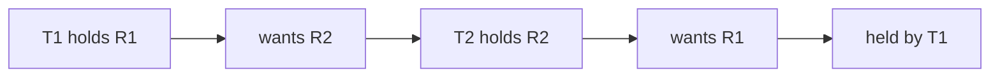
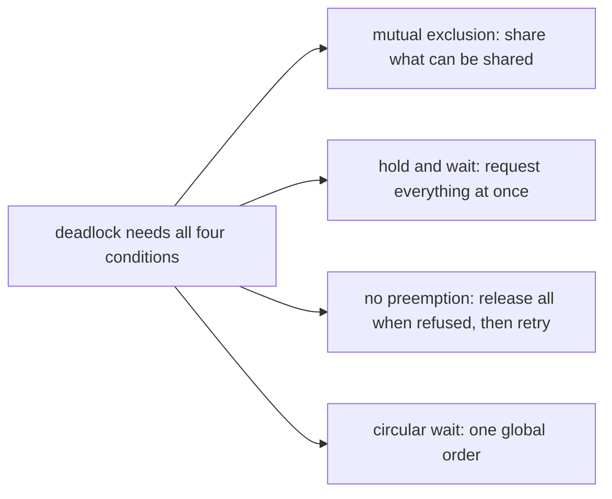

# Deadlock

## The idea

A **deadlock** is a group of tasks that can never proceed, because each holds something another needs and waits for something another holds. The 1971 survey by Coffman, Elphick and Shoshani, *System Deadlocks*, opens with an example: one task, in the middle of updating a shared file, waits for the disk channel; a second task holds the disk channel but waits for that update to finish. Neither will let go, so neither moves. Dijkstra called such a situation a **deadly embrace**.

The survey uses the word **resource** broadly: devices, processors and memory, but also programs and data such as tables and files; in a program, the resources are usually locks. It then names four conditions that were all in effect when the deadlock arose, now often called the Coffman conditions:

1. **Mutual exclusion**: tasks claim exclusive control of the resources they need.
2. **Hold and wait** (the survey's "wait for" condition): tasks hold the resources they already have while waiting for more.
3. **No preemption**: a resource cannot be taken away from a task before it has finished with it.
4. **Circular wait**: there is a circular chain of tasks, each holding a resource that the next one in the chain requests.

All four are necessary: remove any one and no deadlock can form. That is the whole strategy of prevention, below.



<!-- text-of-mermaid sha256:f8d6956762495a889e3f23546cd0ccf1f88d748978654ace76849eb75664aba5 -->
```text
┌───────────┐    ┌────────┐    ┌───────────┐    ┌────────┐    ┌──────────┐
│T1 holds R1├───►│wants R2├───►│T2 holds R2├───►│wants R1├───►│held by T1│
└───────────┘    └────────┘    └───────────┘    └────────┘    └──────────┘
```

The chain in the drawing ends where it began: T1 waits for T2, which waits for T1. The survey turns this into a test with a **state graph**: one node per resource, and an arc from resource Ri to resource Rj when some task holds Ri while requesting Rj. The survey reports that, when there is one unit of each resource, as with locks, a **cycle** (a directed loop) in that graph has been shown to be necessary and sufficient for a deadlock, given the first three conditions.

## A worked example

The program below runs two threads and two locks twice. First, T1 takes R1 then R2 while T2 takes R2 then R1. A barrier, a point where threads wait until a given number of them have arrived, makes each thread wait until the other holds its first lock, so the deadlock happens on every run; each tries its second lock with a timeout, so the program can report the deadlock instead of hanging. Then both threads take the locks in the same order, R1 before R2.

```python examples/two_locks.py
"""Two threads that take two locks in opposite orders deadlock; one order for everyone does not.

In the first run, T1 takes R1 then R2 and T2 takes R2 then R1. A barrier makes each thread wait
until the other holds its first lock, so the deadlock happens on every run. The second lock is
tried with a timeout, so the program reports the deadlock instead of hanging, and a second barrier
keeps both first locks held until both tries have ended. In the second run both threads take the
locks in the same order, R1 before R2, and both finish.
"""

import threading


def opposite_orders() -> dict[str, bool]:
    r1, r2 = threading.Lock(), threading.Lock()
    both_hold, both_tried = threading.Barrier(2), threading.Barrier(2)
    got: dict[str, bool] = {}

    def task(name: str, first: threading.Lock, second: threading.Lock) -> None:
        with first:
            both_hold.wait()
            got[name] = second.acquire(timeout=0.5)
            both_tried.wait()
            if got[name]:
                second.release()

    threads = [
        threading.Thread(target=task, args=("T1", r1, r2)),
        threading.Thread(target=task, args=("T2", r2, r1)),
    ]
    for thread in threads:
        thread.start()
    for thread in threads:
        thread.join()
    return got


def one_order() -> list[str]:
    locks = {"R1": threading.Lock(), "R2": threading.Lock()}
    finished: list[str] = []

    def task(name: str, wanted: list[str]) -> None:
        first, second = sorted(wanted)  # every thread takes R1 before R2
        with locks[first], locks[second]:
            finished.append(name)

    threads = [
        threading.Thread(target=task, args=("T1", ["R1", "R2"])),
        threading.Thread(target=task, args=("T2", ["R2", "R1"])),
    ]
    for thread in threads:
        thread.start()
    for thread in threads:
        thread.join()
    return sorted(finished)


got = opposite_orders()
print(f"opposite orders: T1 got R2: {got['T1']}, T2 got R1: {got['T2']}")
print(f"one order, R1 before R2: finished {one_order()}")
```

It prints:

```output examples/two_locks.py
opposite orders: T1 got R2: False, T2 got R1: False
one order, R1 before R2: finished ['T1', 'T2']
```

Check the four conditions against the first run. A lock is held by one thread at a time (mutual exclusion). Each thread keeps its first lock while it waits for the second (hold and wait). Neither lock can be taken from its holder (no preemption). T1 waits for T2's lock while T2 waits for T1's (circular wait). Without the timeouts, both threads would wait forever.

In the second run, the thread that wants the locks in the order R2, R1 sorts them first. Whichever thread takes R1 first can then take R2, since nobody holds R2 without holding R1; the other waits at R1, not halfway. The cycle cannot form, because every chain of waiting goes from a lower lock to a higher one, and a chain that only climbs can never return to where it began.

## Preventing deadlock

Prevention removes one of the four conditions by design. The survey notes that the first condition cannot be removed for every resource: a file can be shared only while nobody updates it. It then presents three approaches suggested by Havender, one against each remaining condition.



<!-- text-of-mermaid sha256:9d08e6f41fb374a0c8dc2c2686fb7d136b9a6608723b19432cb6d2513ed4fbc5 -->
```text
┌──────────────────────────────────┐    ┌───────────────────────────────────────────────────┐
│deadlock needs all four conditions├───►│     mutual exclusion: share what can be shared    │
└─────────────────┬────────────────┘    └───────────────────────────────────────────────────┘
                  │
                  │                     ┌───────────────────────────────────────────────────┐
                  ├────────────────────►│     hold and wait: request everything at once     │
                  │                     └───────────────────────────────────────────────────┘
                  │
                  │                     ┌───────────────────────────────────────────────────┐
                  ├────────────────────►│no preemption: release all when refused, then retry│
                  │                     └───────────────────────────────────────────────────┘
                  │
                  │                     ┌───────────────────────────────────────────────────┐
                  └────────────────────►│          circular wait: one global order          │
                                        └───────────────────────────────────────────────────┘
```

- **Request everything at once.** A task asks for all the resources it will need in one request, and does not proceed until all are granted. The survey warns that this may be costly: some resources may sit unused for long periods.
- **Release and retry.** A task that is refused a resource releases the ones it holds and asks for them again together with the new one. The survey calls this convenient only for resources whose state is easily saved and restored, such as a processor. With locks, the equivalent is to try the second lock without waiting, or with a timeout, and on failure release the first and start over.
- **A global order.** Number the resources, and let a task that holds resources of some rank request only resources of higher rank. The survey notes that the state graph can then have no cycles, so a circular wait cannot arise. This is the approach programs use most with locks: decide an order once, for example by a stable identifier, and acquire every lock in that order, everywhere.

Dijkstra's **dining philosophers**, in his paper *Hierarchical Ordering of Sequential Processes*, are the classic illustration. Five philosophers sit at a round table, with one fork between each pair of neighbors, and a philosopher needs both adjacent forks to eat. If each picks up the left fork and then the right one, then when all five get hungry at once, each grabs the left fork and the group is stuck. Dijkstra's own remedies take both forks in a single combined operation, or let a philosopher eat only when neither neighbor is eating; numbering the forks and always taking the lower-numbered one first breaks the cycle as well.

## Avoiding deadlock

Avoidance keeps all four conditions possible but refuses, one request at a time, any grant that could lead to a deadlock. The survey notes that it usually needs some advance information about the resources each task will use.

Dijkstra's **banker's algorithm** is the classic method; *Cooperating Sequential Processes* has a section on it, and his later note *The mathematics behind the Banker's Algorithm* states it formally. A banker has a capital of `cap` units. Each process declares its **need**, the most units it may ever hold at once, and its loans never exceed it. A pattern of loans and needs is **safe** if some way of granting requests guarantees that every current and future request can be granted; the banker grants a request only when the pattern after it is still safe. The survey defines a safe state the same way: one where the available resources, plus those that running tasks will return, allow some order in which every task runs to completion.

```python examples/banker.py
"""Dijkstra's banker: grant a loan only when the state after it is still safe.

The banker has 10 units of one resource. Each process declared in advance the most it will ever
hold at once, its maximum claim. A state is safe when some order lets every process, one at a
time, receive the rest of its claim, finish and pay back everything it holds.
"""

CAPITAL = 10
CLAIMS = {"P": 8, "Q": 4, "R": 9}


def safe_order(loans: dict[str, int]) -> list[str] | None:
    """An order in which every process can finish, or None when there is none."""
    free = CAPITAL - sum(loans.values())
    waiting = dict.fromkeys(loans, True)
    order = []
    while waiting:
        ready = [p for p in sorted(waiting) if CLAIMS[p] - loans[p] <= free]
        if not ready:
            return None
        process = ready[0]
        free += loans[process]  # it finishes and pays back what it held
        order.append(process)
        del waiting[process]
    return order


def request(loans: dict[str, int], process: str, units: int) -> dict[str, int]:
    after = {**loans, process: loans[process] + units}
    order = safe_order(after)
    verdict = f"granted, safe order {' '.join(order)}" if order else "refused: unsafe"
    free = CAPITAL - sum(after.values())
    print(f"{process} asks for {units} more, {free} would stay free: {verdict}")
    return after if order else loans


loans = {"P": 3, "Q": 2, "R": 2}
start = safe_order(loans) or []
print(f"loans {loans}, {CAPITAL - sum(loans.values())} free, safe order: {' '.join(start)}")
loans = request(loans, "R", 1)
loans = request(loans, "P", 1)
```

It prints:

```output examples/banker.py
loans {'P': 3, 'Q': 2, 'R': 2}, 3 free, safe order: Q P R
R asks for 1 more, 2 would stay free: refused: unsafe
P asks for 1 more, 2 would stay free: granted, safe order Q P R
```

Both requests ask for one unit and would leave 2 free, yet the banker refuses one and grants the other. After R's request, Q can still finish (it needs 2 more), freeing 4 units, but then P needs 5 and R needs 6: nobody else can be sure to finish. After P's request, Q finishes and frees 4, which is exactly what P still needs; P then frees 8, enough for R. An unsafe state is not yet a deadlock, since processes may not ask for their whole need, but the banker refuses to bet on it.

## When to use it

- **One lock order** for application code that takes several locks: cheap, local to each acquisition, and checkable in review. Most code needs nothing more.
- **Never holding two locks** where you can avoid it: copy what you need under one lock, release it, then take the other.
- **Try and back off** when no order fits, such as locks chosen at run time from data the program has not seen yet: take the first, try the second without waiting, and on failure release the first and start again. The textbook *Operating Systems: Three Easy Pieces* adds a random delay before each new attempt.
- **Avoidance** where a resource manager knows each client's maximum in advance and can afford to make clients wait, as the banker does.
- **Detection and recovery** where deadlocks are rare and undoing work is cheap: build the state graph, look for a cycle, and abort or roll back one task in it. The survey describes aborting the deadlocked tasks, or aborting them one at a time until the rest can proceed, and an algorithm that picks the resources whose preemption costs the least.

## Common traps

- **An order followed almost everywhere.** One code path that takes the locks in the opposite order is enough. The order must be one total order, the same in every function, library and callback.
- **An order that is not stable.** Ordering by something that can change while the locks are held, or that two threads may see differently, is no order. Use a key that never changes for the life of the resources.
- **Calling unknown code while holding a lock.** A callback, an event handler or a virtual method may take locks of its own in an order you cannot see.
- **Taking a lock you already hold.** POSIX says relocking a normal mutex deadlocks the thread with itself; an error-checking mutex returns the error `EDEADLK` instead.
- **Waiting on a condition while holding another lock.** A condition variable's `wait` releases only its own lock; the thread that would make the condition true may need the other one.
- **Timeouts as a cure.** A timeout turns a hang into a failure. Two threads that time out, release and retry in step can keep failing to get both locks while running all the time, which the textbook calls a **livelock**; it suggests a random delay before each retry, to make repeated collisions unlikely.
- **Starvation is not deadlock.** A task that never gets a lock because others keep winning it is starving, while the others make progress. A deadlocked group makes no progress at all. Both are bugs; the cures differ.

## Complexity

For `n` tasks, `m` resource types and `e` arcs in the state graph:

| Technique | Cost | Conditions |
|-----------|------|------------|
| One global lock order | Sorting the k locks a task needs, O(k log k), when they are not already known in order | No run-time bookkeeping beyond that |
| Detection with one unit per resource | O(m + e) for a cycle search in the state graph | Run on every request or periodically |
| Detection with several units per type | A cycle is necessary but not sufficient, so a fuller state description is needed | The survey describes the matrices of holdings and requests it uses |
| Banker's safety check | O(n² · m) as in the example: up to n rounds, each scanning n tasks and m types | Per request; the survey reports a search time proportional to the square of the number of tasks for one model |
| Release and retry | The work redone after each failure | Unbounded under contention without random delays |

## Expert notes

- **Detection is easy with single units, harder with several.** The survey states the cycle test for resources with one unit each, and notes that with several identical units per type a cycle is only a necessary condition; its detection algorithm then works with matrices of what each task holds and what it requests in excess of that.
- **Avoidance must schedule only safe requests.** The survey points out a subtle trap: when several requests are safe, the system may choose among them by any rule, first come first served or smallest job first, but that rule must be applied only to the safe ones, or scheduling itself creates the deadlock avoidance was meant to prevent.
- **Less information, false alarms.** The survey compares a model with full advance information about each task's steps, which knows exactly when a deadlock becomes unavoidable, with Habermann's model, which needs only each task's maximum claim and checks safety faster, at the price of false threats of deadlock that degrade utilization. Because a finishing task returns everything it holds, the free resources only grow along the search, so it never has to back up and try another order: the survey gives a search time proportional to the square of the number of tasks, and the example's greedy loop relies on the same fact.
- **Prevention first.** The survey's conclusion is that, where possible, preventing the possibility of deadlock is better than curing it, since deadlock is exceptional in most systems and usually involves a limited set of resources; detection and avoidance come in when the constraints of prevention are unacceptable.
- **One failure settles it.** In *The mathematics behind the Banker's Algorithm*, Dijkstra proves that a single failed attempt to order the processes shows the pattern unsafe, with none of the back-tracking a search for permutations usually needs; and he credits L. Zwanenburg with the observation, made in the early 1960s, that when checking a request from one process the search can stop as soon as that process has been placed.

## Practice

- `cstudy start bank-transfers`: accounts whose balances many tellers move money between at the same time. Money must never be created or lost, transfers between unrelated accounts should not wait for each other, and two tellers must never block each other forever.

## Further reading

- [Coffman, Elphick and Shoshani, *System Deadlocks* (ACM Computing Surveys, 1971)](https://doi.org/10.1145/356586.356588): the four conditions, state graphs, Havender's prevention approaches, detection and recovery, safe states and avoidance.
- [Dijkstra, *The mathematics behind the Banker's Algorithm* (EWD 623)](https://www.cs.utexas.edu/~EWD/transcriptions/EWD06xx/EWD623.html): loans, needs and safe patterns.
- [Dijkstra, *Hierarchical Ordering of Sequential Processes* (EWD 310)](https://www.cs.utexas.edu/~EWD/transcriptions/EWD03xx/EWD310.html): the five dining philosophers.
- [Dijkstra, *Cooperating Sequential Processes* (EWD 123)](https://www.cs.utexas.edu/~EWD/transcriptions/EWD01xx/EWD123.html): semaphores, and the problem of the deadly embrace.
- [POSIX, `pthread_mutex_lock`](https://pubs.opengroup.org/onlinepubs/9799919799/functions/pthread_mutex_lock.html): what relocking each type of mutex does, and `EDEADLK`.
- Python's documentation of [`threading`](https://docs.python.org/3/library/threading.html): `Lock.acquire` with a timeout, and `Barrier`.
