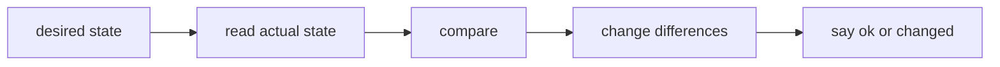

# Declarative desired state and convergence

## The idea

A team runs forty servers. Each needs the same packages, the same configuration files and the same services running. Setting them up by hand takes a day and never comes out quite the same twice. Writing the setup down as a script is better, until the script meets a server that is already half set up: it appends a line that is already there, or stops because a directory exists.

**Infrastructure as code** means describing servers, networks, disks, files and packages in text files, kept in version control and reviewed like any other code, and letting a tool make the real world match them. The description can take two forms.

- **Imperative**: a list of steps. "Install the web server, append this line to the hosts file, start the service." The steps assume a starting point, and running them on another starting point can do something else.
- **Declarative**: a list of facts that must hold. "The web server package is present, the hosts file contains this line, the service is running." It says nothing about how to get there.

A few words before going further. A **resource** is one thing the tool can read and change: a file, a package, a service, a disk. The **desired state** is what the description says each resource should be. The **actual state** is what the resource is right now. A tool that works declaratively runs a loop for each resource: read the actual state, compare it with the desired state, change only what differs, and report whether it changed anything.



<!-- text-of-mermaid sha256:6047a3c4ed12d927752c9319ad4e1a7fd127384f7712b3fc2ea783485bdf3d83 -->
```text
┌─────────────┐    ┌─────────────────┐    ┌───────┐    ┌──────────────────┐    ┌─────────────────┐
│desired state├───►│read actual state├───►│compare├───►│change differences├───►│say ok or changed│
└─────────────┘    └─────────────────┘    └───────┘    └──────────────────┘    └─────────────────┘
```

The drawing is that loop for one resource. Its last step is what makes the approach safe: a resource that already matches reports `ok` and is left alone.

Two properties follow from the loop, and they are the reason to work this way.

- **Idempotence**: doing something a second time changes nothing more than doing it once. In mathematics, a function `f` is idempotent when `f(f(x)) = f(x)` for every `x`: rounding a number is, adding one is not. A task that says "the file contains this line" is idempotent; a step that says "append this line" is not.
- **Convergence**: running the description again and again brings each resource to the desired state from wherever it started, and then keeps it there: once it has arrived, a run finds nothing to change. A tool can then run every hour, after every failure and on every new server, and the fleet drifts back to the description each time.

## A worked example

The program sets up a file twice in each style. The imperative step appends lines whatever the file holds; the declarative task checks first. Then it runs two actions that are each idempotent on their own, one after the other, three times:

```python examples/converge.py
"""Steps against a declared state, each run twice, and two idempotent actions whose sequence is not.

A host is a dictionary from a file's path to its lines. The script appends lines, whatever is
there; the tasks say which lines a file must hold, and change only what differs.
"""

WANTED = [("/etc/hosts", "10.0.0.5 db"), ("/etc/motd", "welcome")]


def append_line(host: dict[str, list[str]], path: str, line: str) -> str:
    host.setdefault(path, []).append(line)
    return "changed"


def ensure_line(host: dict[str, list[str]], path: str, line: str) -> str:
    lines = host.setdefault(path, [])
    if line in lines:
        return "ok"
    lines.append(line)
    return "changed"


for step in (append_line, ensure_line):
    host = {"/etc/hosts": ["127.0.0.1 localhost"]}
    for run in (1, 2):
        statuses = [step(host, path, line) for path, line in WANTED]
        print(f"{step.__name__}, run {run}: {statuses}")
    print(f"  /etc/hosts now holds {host['/etc/hosts']}")


# Two actions on a state of two settings, each idempotent on its own.
def p(state: dict[str, int]) -> str:
    """If x is 1, make y 2."""
    if state["x"] == 1 and state["y"] != 2:
        state["y"] = 2
        return "changed"
    return "ok"


def q(state: dict[str, int]) -> str:
    """Make x 1."""
    if state["x"] != 1:
        state["x"] = 1
        return "changed"
    return "ok"


for action in (p, q):
    state = {"x": 0, "y": 0}
    print(f"{action.__name__} alone, twice: {[action(state), action(state)]}")

state = {"x": 0, "y": 0}
for run in (1, 2, 3):
    statuses = [p(state), q(state)]
    print(f"p then q, run {run}: {statuses} -> {state}")
```

It prints:

```output examples/converge.py
append_line, run 1: ['changed', 'changed']
append_line, run 2: ['changed', 'changed']
  /etc/hosts now holds ['127.0.0.1 localhost', '10.0.0.5 db', '10.0.0.5 db']
ensure_line, run 1: ['changed', 'changed']
ensure_line, run 2: ['ok', 'ok']
  /etc/hosts now holds ['127.0.0.1 localhost', '10.0.0.5 db']
p alone, twice: ['ok', 'ok']
q alone, twice: ['changed', 'ok']
p then q, run 1: ['ok', 'changed'] -> {'x': 1, 'y': 0}
p then q, run 2: ['changed', 'ok'] -> {'x': 1, 'y': 2}
p then q, run 3: ['ok', 'ok'] -> {'x': 1, 'y': 2}
```

Read it in three parts.

1. The appending script reports `changed` on both runs, and the hosts file ends with the database line twice. Run every hour, it would grow forever.
2. The declarative task reports `changed` on the first run and `ok` on the second: the file already holds the line, so nothing is touched. Its second run is the proof that it is idempotent, and a tool can report it as such.
3. `p` ("if x is 1, make y 2") and `q` ("make x 1") are each idempotent: repeating either one changes nothing. Yet running `p` then `q` is not. On the first run `p` finds `x` at 0 and does nothing, then `q` sets `x`. On the second run `p` now sees `x` at 1 and acts. Only the third run is quiet. The pair is not idempotent, even though each of its parts is: `p` reads state that a later step changes. This is the counterexample of Couch and Sun's paper on convergence, and the reason a run that still reports `changed` the second time deserves a look.

## When to use it

- **Many machines that should look alike**, and that keep changing: new servers join, old ones are repaired, someone edits a file during an incident. A declarative run brings each back in line, whatever it was.
- **Recovery after a failure**. A run that stopped halfway can simply be run again: the finished tasks report `ok`, and the rest carry on.
- **A dry run**. Because every task compares before it changes, a tool can run the comparison alone and report what would change, with the old and new values, without changing anything. Only a description that reads the actual state can do this.
- **Not everything has a state to compare.** Sending a message or rotating a key is an action, not a state, and the declarative style needs something it can read back. Describe what can be read; keep the rest to steps, and know that they are not safe to repeat.

## Common traps

- **A task that always reports `changed`.** A restart, an append or a command run without a check changes something on every run, so the tool can never report a quiet run, and real changes hide among the noise. Make it compare first, or run it only after another task reported a change, such as restarting a service only when its configuration file changed.
- **Idempotent parts, a non-idempotent whole.** As in the example, a step that reads state another step changes can make the sequence need several runs to settle. Order such steps so that what a step reads is final before it runs, or make the step state its result outright instead of acting on a condition.
- **Removing a line from the description does not remove the thing.** A tool manages what it is told about. Deleting "the package is present" leaves the package installed; to remove it, say "the package is absent", or use a tool that keeps a record of what it manages, as the guide on [state and drift](../state-and-drift/guide.md) explains.
- **Comparing text that means the same.** A file with a trailing newline, a list in another order, or a number written `08` against `8` can look different to a naive comparison. The task then changes it on every run, or worse, never notices a real difference. Decide what "the same" means for each kind of resource.
- **Trusting a declaration instead of reading.** A task that skips its work because "it ran last time" is not declarative: someone may have changed the resource since. Read the actual state on every run.

## Complexity

For `H` hosts and `T` tasks, one run makes `T · H` comparisons, and each comparison costs whatever reading the resource costs: a file's size, a package database lookup, a service status. Changes are made only where a comparison differs, so a run over a converged fleet writes nothing.

A dry run that must show later tasks the effect of earlier ones (a service task after the task that installs its package) works on a copy of each host's state, which costs memory in proportion to the state copied.

Running until quiet takes at most one pass more than the longest chain of steps in which each step's action depends on another's change: in the example, two passes change something and the third confirms.

## Expert notes

- **Three approaches.** Couch and Sun (2003) describe three approaches to automated configuration. The imperative one expresses configuration as a series of commands applied to a system in a known initial state, where order always matters. The convergent one expresses it as a set of states to assure in an otherwise unknown system. The generative one regenerates each configuration from an overarching rule set instead of changing it step by step.
- **Their definitions.** An action `p` is idempotent if repeating it has the same effect as doing it once, `p ∘ p ≈ p`, and a set of actions in which each one is idempotent they call weakly convergent: the definition, they write, that many configuration tools use. Their Proposition 1 is the counterexample of the worked example: "if (x==1) then y=2" and "x=1", each idempotent, whose composition is not, starting from `x = y = 0`. They add that idempotence is only meaningful relative to a baseline state: started from `x = y = 1`, the same composition is idempotent.
- **A stronger definition.** They call a set of actions stateless when `p ∘ q ∘ p ≈ p ∘ q` for every action `p` and every sequence `q`: repeating `p` before a sequence that ends with `p` changes nothing. Convergent then means idempotent and stateless, and under it every sequence of actions is idempotent (their Lemma 3). The conditional action of the example is not stateless, which is exactly what breaks it.
- **Idempotent methods in HTTP.** RFC 9110 calls a request method idempotent if the intended effect on the server of several identical requests is the same as the effect of one, and notes that this concerns only what the user requested: a server may still log each request. A configuration tool is in the same position. Its runs may write logs and reports every time, while the resources it manages stay unchanged.

## Practice

- `cstudy start idempotent-converge`: tasks that change only what differs on a fleet of hosts, a check run that reports diffs without touching anything, actions that run only after a change and failures that stop a host, then conditions on facts about each host and rollouts in batches.

## Further reading

- [A. Couch and Y. Sun, *On the Algebraic Structure of Convergence*, Self-Managing Distributed Systems, Lecture Notes in Computer Science, Springer, 2003, pages 28 to 40](https://doi.org/10.1007/978-3-540-39671-0_4): idempotent, stateless and convergent actions; [an author copy](https://www.cs.tufts.edu/~couch/publications/dsom-03.pdf).
- [RFC 9110, *HTTP Semantics*, section 9.2.2, Idempotent Methods](https://www.rfc-editor.org/rfc/rfc9110#section-9.2.2): idempotence as the intended effect of repeated requests.
