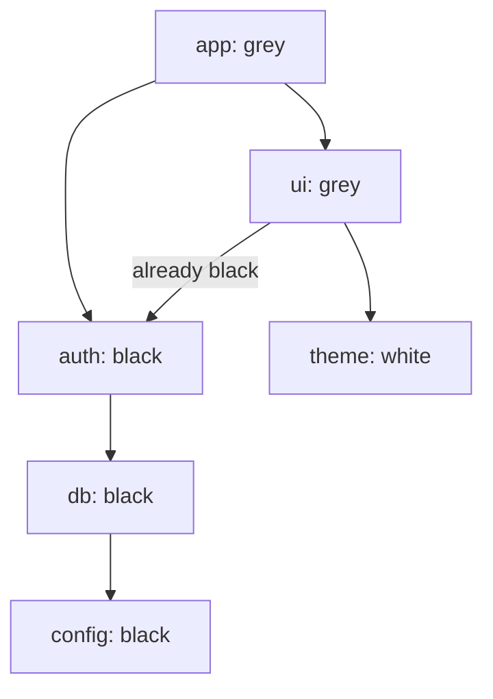
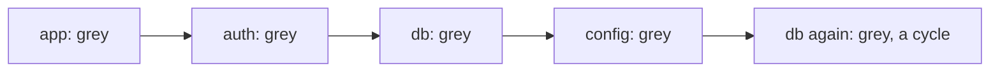

# Depth-first search

## The idea

Explore a maze by keeping one hand on the wall: follow a corridor as far as it goes, and only when you hit a dead end, walk back to the last junction with an untried way and take it. **Depth-first search** (DFS) explores a graph the same way. From a node it steps to an unvisited neighbor, from there to an unvisited neighbor of that one, and so on, as deep as it can; when a node has no unvisited neighbor left, the search **backtracks** to the node it came from and tries that node's next neighbor.

The natural way to write it is recursion:

```python
def visit(node):
    mark node as visited
    for each neighbor of node:
        if neighbor is not visited:
            visit(neighbor)
```

The call stack does the remembering: each call that has not returned yet is a node on the current path, waiting to try its next neighbor. You can also keep that stack yourself, in a list: push the start, then repeatedly pop a node and push its unvisited neighbors. Both reach the same nodes.

Like [breadth-first search](../breadth-first-search/guide.md), DFS visits every node it can reach exactly once, in O(V + E). What it gives in addition is **when** each node is entered and **finished**: a node is finished once every node reachable from it has been explored. Between those two moments, the node is on the current path. That timing is what finds cycles and orders dependencies. What it does not give is shortest paths: the first route DFS finds to a node can be long.

## A worked example

### Connected components

A museum's rooms and the open doorways between them. Which rooms can a visitor reach from which?

Loop over every room. A room that no search has reached yet starts a new **component**: run a DFS from it and give everything it reaches the same label. When the loop ends, two rooms are connected exactly when they share a label.

```python examples/museum_rooms.py
"""Depth-first search labels the connected components of a museum: rooms joined by open doorways.

The same labels come out of a recursive search and of one that keeps its own stack."""

doorways = {
    "atrium": ["gallery", "shop"],
    "gallery": ["atrium", "sculpture"],
    "sculpture": ["gallery"],
    "shop": ["atrium"],
    "cafe": ["terrace"],
    "terrace": ["cafe"],
    "vault": [],
}


def label_recursively() -> dict[str, int]:
    label: dict[str, int] = {}

    def visit(room: str, number: int) -> None:
        label[room] = number
        for nearby in doorways[room]:
            if nearby not in label:
                visit(nearby, number)

    for room in doorways:
        if room not in label:  # an unlabelled room starts a new component
            visit(room, len(set(label.values())))
    return label


def label_with_a_stack() -> dict[str, int]:
    label: dict[str, int] = {}
    components = 0
    for room in doorways:
        if room in label:
            continue
        label[room] = components
        stack = [room]
        while stack:
            current = stack.pop()
            for nearby in doorways[current]:
                if nearby not in label:
                    label[nearby] = components
                    stack.append(nearby)
        components += 1
    return label


recursive = label_recursively()
print("labels:", recursive)
print("same labels with a stack:", recursive == label_with_a_stack())
print("components:", len(set(recursive.values())))
print("can you walk from shop to sculpture?", recursive["shop"] == recursive["sculpture"])
print("can you walk from shop to terrace?", recursive["shop"] == recursive["terrace"])
```

It prints:

```output examples/museum_rooms.py
labels: {'atrium': 0, 'gallery': 0, 'sculpture': 0, 'shop': 0, 'cafe': 1, 'terrace': 1, 'vault': 2}
same labels with a stack: True
components: 3
can you walk from shop to sculpture? True
can you walk from shop to terrace? False
```

The first search starts at `atrium` and reaches `gallery`, `sculpture` and `shop`: component 0. `cafe` is still unlabelled, so it starts component 1 with `terrace`, and `vault`, which has no doorway, is a component of its own. After the labelling, "can I walk from `shop` to `sculpture`?" is a comparison of two labels, with no search at all.

The version with its own stack marks a room when it pushes it, as BFS does, so no room is pushed twice. It visits the rooms in a different order from the recursive one, which does not matter here: a component is the same set whichever order you collect it in.

### Three colours find a cycle

In a directed graph, a visited set is not enough to find a cycle. Take a project's modules and what each one imports. `app` imports `auth` and `ui`, and `ui` also imports `auth`. A search that reaches `auth` a second time, from `ui`, has not found a cycle: `auth` was reached by two routes, and no module imports itself.

DFS tells the two cases apart with three colours:

- **white**: not reached yet;
- **grey**: entered and not finished, so it is on the current path;
- **black**: finished, along with everything reachable from it.

An edge to a grey node goes back to a node on the current path, so following it closes a loop: a **cycle**. An edge to a black node goes to work that is already complete: a shared dependency, not a cycle.

```python examples/import_cycles.py
"""Three colours tell a module imported twice from a circular import.

white: not reached yet. grey: entered and not finished, so it is on the current path.
black: finished, with everything it imports. An edge to a grey module closes a cycle."""

WHITE, GREY, BLACK = "white", "grey", "black"


def find_cycle(imports: dict[str, list[str]]) -> list[str] | None:
    colour = dict.fromkeys(imports, WHITE)
    path: list[str] = []

    def visit(module: str) -> list[str] | None:
        colour[module] = GREY
        path.append(module)
        print(f"  enter {module}")
        for imported in imports[module]:
            if colour[imported] == GREY:
                print(f"  {module} imports {imported}, which is grey: a cycle")
                return [*path[path.index(imported) :], imported]
            if colour[imported] == BLACK:
                print(f"  {module} imports {imported}, which is black: already finished")
                continue
            cycle = visit(imported)
            if cycle:
                return cycle
        colour[module] = BLACK
        path.pop()
        print(f"  leave {module}")
        return None

    for module in imports:
        if colour[module] == WHITE:
            cycle = visit(module)
            if cycle:
                return cycle
    return None


imports = {
    "app": ["auth", "ui"],
    "auth": ["db"],
    "db": ["config"],
    "config": [],
    "ui": ["auth", "theme"],
    "theme": [],
}
print("first project:")
print("cycle:", find_cycle(imports))

imports["config"] = ["db"]  # config now imports db, which imports config
print("second project:")
print("cycle:", find_cycle(imports))
```

It prints:

```output examples/import_cycles.py
first project:
  enter app
  enter auth
  enter db
  enter config
  leave config
  leave db
  leave auth
  enter ui
  ui imports auth, which is black: already finished
  enter theme
  leave theme
  leave ui
  leave app
cycle: None
second project:
  enter app
  enter auth
  enter db
  enter config
  config imports db, which is grey: a cycle
cycle: ['db', 'config', 'db']
```

In the first project, the search goes `app`, `auth`, `db`, `config`, finishes them on the way back, then enters `ui`. When `ui` looks at `auth`, the drawing below is the state of the search: `app` and `ui` are grey, on the current path; `auth`, `db` and `config` are black; `theme` is still white.



<!-- text-of-mermaid sha256:fc462339ce5b9bb7d62bc8104426538b26d09056282a82b00624640dd25e8f6f -->
```text
┌─────────────┐
│  app: grey  │
└─────────────┘
       ▼─────────────────────────────▼
┌─────────────┐               ┌────────────┐
│ auth: black │◄already─black─┤  ui: grey  │
└──────┬──────┘               └──────┬─────┘
       ▼                             ▼
┌─────────────┐               ┌────────────┐
│  db: black  │               │theme: white│
└──────┬──────┘               └────────────┘
       ▼
┌─────────────┐
│config: black│
└─────────────┘
```

`auth` is black, so the search moves on. In the second project, `config` imports `db` as well, and the search meets it while `db` is still grey:



<!-- text-of-mermaid sha256:975af65cd8f5d4c9a525153929717a91cada7093aa989a9e4ef9858c56ac00ec -->
```text
┌─────────┐    ┌──────────┐    ┌────────┐    ┌────────────┐    ┌───────────────────────┐
│app: grey├───►│auth: grey├───►│db: grey├───►│config: grey├───►│db again: grey, a cycle│
└─────────┘    └──────────┘    └────────┘    └────────────┘    └───────────────────────┘
```

The drawing shows `db` twice, but it is one module: the last box is where `config`'s import leads, back to the `db` that is still grey on the path. The current path, kept in `path`, is `app`, `auth`, `db`, `config`; the part from `db` to the end, plus `db` again, is the cycle the program reports.

Why this is right in both directions:

- **A grey hit is a real cycle.** The grey nodes are exactly the calls that have not returned, which form the current path, each one reached from the one before. An edge from the current node to a grey node leads back to an earlier node of that path, which then leads forward to the current node again.
- **Every cycle gets a grey hit.** Let `w` be the first node of a cycle that the search enters. At that moment the rest of the cycle is white. A node is only finished after trying all of its edges and visiting every white node they lead to, so the search walks around the cycle from `w` before `w` finishes, and the node just before `w` on the cycle is entered while `w` is grey. Its edge to `w` is the grey hit.

An undirected graph needs no third colour. Every edge works both ways, so the node you just came from always looks visited; skip that one, the **parent**, and any other visited neighbor closes a cycle. If the input can hold the same edge twice, skip the parent once, not every edge to it: a doubled edge is itself a cycle of two edges.

### Deep graphs and the call stack

Recursion has a cost that BFS does not: one stack frame per node on the current path. A path of 5,000 nodes means 5,000 nested calls, and Python stops long before that.

```python examples/deep_paths.py
"""A recursive search fails on a long path in Python; one that keeps its own stack does not.

The graph is a single path of 5,000 nodes: 0 -> 1 -> 2 -> ... -> 4999."""

import sys

NODES = 5_000
successor = {node: [node + 1] for node in range(NODES - 1)}
successor[NODES - 1] = []


def reach_recursively(node: int, seen: set[int]) -> None:
    seen.add(node)
    for nxt in successor[node]:
        if nxt not in seen:
            reach_recursively(nxt, seen)


def reach_with_a_stack(start: int) -> set[int]:
    seen = {start}
    stack = [start]
    while stack:
        node = stack.pop()
        for nxt in successor[node]:
            if nxt not in seen:
                seen.add(nxt)
                stack.append(nxt)
    return seen


print("recursion limit:", sys.getrecursionlimit())
try:
    reached: set[int] = set()
    reach_recursively(0, reached)
    print("recursion reached", len(reached), "nodes")
except RecursionError:
    print("recursion: RecursionError after", len(reached), "nodes")
print("own stack reached", len(reach_with_a_stack(0)), "nodes")
```

It prints:

```output examples/deep_paths.py
recursion limit: 1000
recursion: RecursionError after 999 nodes
own stack reached 5000 nodes
```

Python's **recursion limit**, 1,000 here, is the maximum depth of its interpreter stack, and the documentation says it exists to keep infinite recursion from overflowing the C stack and crashing Python. The program's own top level takes one of the 1,000 frames, so the recursive search raised `RecursionError` after 999 nodes. The search with its own stack keeps the path in a list on the heap and reaches all 5,000.

Every language has such a limit, in a different unit:

| Language | Limit | When it is hit |
|----------|-------|----------------|
| Python | `sys.getrecursionlimit()`, 1,000 in CPython 3.13 as run here; `sys.setrecursionlimit()` raises it, up to a platform-dependent maximum | `RecursionError`, a `RuntimeError` subclass since 3.5 |
| Java | The thread's stack size, set by `-Xss`; the Java 21 documentation gives defaults of 1024 KB on Linux and macOS for x64 and 2048 KB for AArch64 | `StackOverflowError` |
| JavaScript (Node.js) | V8's stack size, `--stack-size`, 984 KB by default in Node.js 24.18.0 | `RangeError: Maximum call stack size exceeded` |
| Go | A goroutine's stack grows as needed, up to `debug.SetMaxStack`, initially 1 GB on 64-bit systems and 250 MB on 32-bit ones | The program crashes |

Go is the exception that shows the rule. The same recursion, 200,000 nodes deep, finishes:

```go examples/deep_paths.go
// Go grows a goroutine's stack as it needs to, up to a limit of 1 GB on 64-bit systems, so a
// recursive search that would fail in Python at a depth of about 1,000 goes 200,000 deep here.
package main

import "fmt"

const nodes = 200_000

func reach(node int, successor [][]int, seen []bool) int {
	seen[node] = true
	count := 1
	for _, next := range successor[node] {
		if !seen[next] {
			count += reach(next, successor, seen)
		}
	}
	return count
}

func main() {
	successor := make([][]int, nodes)
	for node := 0; node < nodes-1; node++ {
		successor[node] = []int{node + 1}
	}
	seen := make([]bool, nodes)
	fmt.Println("recursion reached", reach(0, successor, seen), "nodes")
}
```

It prints:

```output examples/deep_paths.go
recursion reached 200000 nodes
```

Raising Python's limit is not a fix to rely on: the documentation warns that a too-high limit can lead to a crash, and the highest possible limit depends on the platform. When a graph can be deep, a grid of a million cells winding in a snake for instance, write the search with an explicit stack.

## When to use it

- **Reachability and connected components**: which nodes hang together, how big each piece is, labelling regions of a grid. BFS does the same job; DFS is usually shorter to write.
- **Cycles**: three colours in a directed graph, the parent check in an undirected one.
- **Order of dependencies**: the order in which DFS finishes nodes gives a [topological order](../topological-order/guide.md).
- **Exploring every possibility**: a search that tries a choice, recurses, and undoes the choice on the way back is a DFS over the tree of choices, called backtracking.
- **Structure**: the edges DFS uses to discover nodes form a tree, and the edges it does not use say a lot about the graph. Bridges, articulation points and strongly connected components all come from DFS (see the expert notes).

Use BFS instead for fewest steps, or when the graph is deep and narrow and you would rather not manage a stack. When edges arrive one at a time and you only need to know what is connected, [union-find](../union-find/guide.md) avoids searching again after each one.

## Common traps

- **Recursing on a deep graph in Python.** At the default limit, a path or a winding region of a few thousand nodes is enough to fail. Use an explicit stack, or know that the input is shallow.
- **Marking late.** In the recursive form, mark a node when you enter it, before looping over its neighbors. Mark it after, and a cycle sends the search round forever.
- **One visited set for cycles in a directed graph.** It reports a cycle every time two routes meet at a shared node, as `auth` would have been. Use grey and black.
- **Forgetting nodes no search started from.** A single DFS from one node only covers that node's component. Loop over every node and start a search from each one still unvisited.
- **Expecting the stack version to visit in the same order.** Popping the last pushed neighbor visits a node's neighbors in reverse, and marking on push lets a node be claimed by whoever pushed it first. Both are fine for reachability; neither gives the entry and finish times of the recursive version. When those matter, keep on the stack, for each node, where it is in its own neighbor list, and finish a node when that list runs out.
- **Writing marks into the input.** Overwriting a grid cell to mark it visited saves a set, but changes the caller's data. Do it only when the problem allows it.

## Complexity

With V nodes and E edges stored as adjacency lists:

| Resource | Cost | Why |
|----------|------|-----|
| Time | O(V + E) | Each node is entered once; each of its edges is looked at once, or twice for an undirected edge |
| Memory | O(V) | The marks or colours, plus the stack, whose depth is the length of the current path: up to V on a graph that is one long path |
| Components | O(V + E) | The outer loop over nodes adds O(V); each node and edge is still handled once across all the searches |

A grid of R rows and C columns has R · C nodes and O(R · C) edges, so a search over it is O(R · C), and the stack can reach R · C entries deep when the open cells wind in a single path.

## Expert notes

- **Tarjan, 1972.** Robert Tarjan's paper "Depth-First Search and Linear Graph Algorithms" illustrates the value of depth-first search with two examples: an improved algorithm for the strongly connected components of a directed graph, and one for the biconnected components of an undirected graph. The paper bounds the time and space of both by k₁V + k₂E + k₃ for some constants, that is, linear in the size of the graph.
- **Edge types.** Run DFS on a directed graph and every edge falls in one of four kinds: a **tree edge** discovers a white node; a **back edge** reaches a grey node, an ancestor on the current path; a **forward edge** reaches a black descendant; a **cross edge** reaches a black node in another branch. Only back edges mean cycles. In an undirected graph there are only tree edges and edges back to an ancestor: of the two ends of an edge, say `u` is entered first; the edge itself leads from `u` to `v`, so `v` is entered and finished while `u` is still grey, as a descendant of `u`. That is why the parent check is enough there.
- **Iterative DFS with finish times.** Keep on the stack pairs of a node and an iterator over its neighbors. Look at the top: if its iterator yields a white neighbor, colour it grey and push it with a fresh iterator; when the iterator is exhausted, colour the node black, record its finish, and pop it. This is exactly the recursive order, with the path on the heap.
- **Python.** `sys.setrecursionlimit` sets the maximum depth of the interpreter stack, says the documentation; the highest possible limit is platform-dependent, a too-high limit can crash the interpreter, and setting a limit lower than the current depth raises `RecursionError` (since 3.5.1). `RecursionError` itself was added in 3.5; earlier versions raised a plain `RuntimeError`.
- **Java.** `StackOverflowError` is thrown when a stack overflow occurs because an application recurses too deeply, in the words of its documentation. The `-Xss` option sets the thread stack size, rounded up to a multiple of the system page size where the operating system requires it.
- **JavaScript.** MDN lists the error as `RangeError: Maximum call stack size exceeded` in Chrome, a `RangeError` in Safari too, and `InternalError: too much recursion` in Firefox. Node.js 24.18.0 throws the same `RangeError` as Chrome, and `node --v8-options` lists the engine's `--stack-size`, with a default of 984 KB.
- **Go.** `debug.SetMaxStack` sets the largest stack a single goroutine may grow to; a goroutine that exceeds it while growing crashes the program, and the documentation names limiting infinite recursion as its main use.

## Practice

- `cstudy start flood-fill`: repaint one tile of a courtyard and every tile joined to it through its colour.
- `cstudy start number-of-islands`: count the separate pieces of land on a map.
- `cstudy start max-area-of-island`: the size of the largest piece.
- `cstudy start surrounded-regions`: fill in the regions that cannot reach the edge of the board.
- `cstudy start pacific-atlantic-water-flow`: the cells from which water can flow to two different sides of a map.
- `cstudy start bipartite-graph`: can the nodes be split into two teams with every edge between the teams?
- `cstudy start contractor-exposure-rollup`: the total exposure of everyone working under one contractor.
- `cstudy start referral-rewards`, levels 1 and 2: totals over chains of referrals. Its last level grows the chains to a million people; come back to it after [union-find](../union-find/guide.md).

## Further reading

- R. Tarjan, [Depth-First Search and Linear Graph Algorithms](https://doi.org/10.1137/0201010), SIAM Journal on Computing 1(2), 1972, pages 146 to 160.
- [Python `sys.setrecursionlimit`](https://docs.python.org/3/library/sys.html#sys.setrecursionlimit) and [`RecursionError`](https://docs.python.org/3/library/exceptions.html#RecursionError).
- [The `java` command, Java 21](https://docs.oracle.com/en/java/javase/21/docs/specs/man/java.html): `-Xss` and its defaults; [`StackOverflowError`](https://docs.oracle.com/en/java/javase/21/docs/api/java.base/java/lang/StackOverflowError.html).
- [MDN: too much recursion](https://developer.mozilla.org/en-US/docs/Web/JavaScript/Reference/Errors/Too_much_recursion): the message in each engine.
- [Go `runtime/debug.SetMaxStack`](https://pkg.go.dev/runtime/debug#SetMaxStack): the 1 GB and 250 MB limits.
