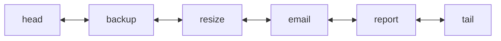
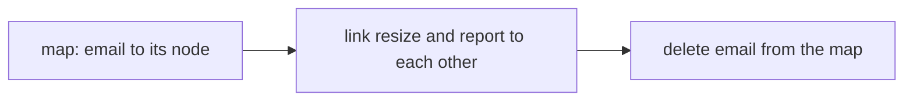
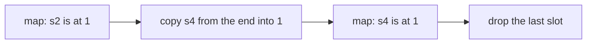
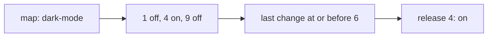

# Designing with hash maps

## The idea

A hash map does one thing superbly: it finds a key in O(1) on average. It does nothing else. It keeps no useful order, it cannot hand you a random member, it cannot answer "what was the value last Tuesday?". Each of those is easy for some other structure, and hopeless for that structure alone, because it cannot **find** things fast.

So many designs pair a hash map with a second structure. The second structure provides the order, the positions or the history; the map provides the **index into it**, so that any element of the second structure can be reached in O(1) without searching. The map's values are not the data: they are pointers to where the data lives.

This guide builds three such pairs:

| Pair | The second structure gives | The map gives |
|------|----------------------------|---------------|
| Map + doubly linked list | An order, with O(1) insertion and removal anywhere | O(1) access to any node, so it can be unlinked or moved |
| Map + dynamic array | Dense storage: no gaps, members reachable by position | Each member's position, so it can be removed in O(1) |
| Map + sorted list per key | Every past value, in order | O(1) access to one key's history, then binary search in it |

The skill is the same each time: write down the operations and the bound each needs, notice that no single structure meets them all, and give each structure the job it does in O(1).

## A worked example

### A map and a doubly linked list: a queue you can cancel from

A job queue hands out jobs in the order they were submitted, and any waiting job can be cancelled. With a plain list, cancelling costs O(n): find the job, then shift everything after it. A **doubly linked list** removes a node in O(1), since the node knows both its neighbors and they can be linked to each other, but finding the node is still O(n). A hash map from job id to its node removes that search.



<!-- text-of-mermaid sha256:92a30cf2c5f7c283f3ac348828feebf659bd6221dadf80541769efe14bfe995b -->
```text
┌────┐    ┌──────┐    ┌──────┐    ┌─────┐    ┌──────┐    ┌────┐
│head◄───►│backup◄───►│resize◄───►│email◄───►│report◄───►│tail│
└────┘    └──────┘    └──────┘    └─────┘    └──────┘    └────┘
```



<!-- text-of-mermaid sha256:8ff5b3a6ba5f6a5ae7587b17a7760c2c78171739e56500536ca46d4b22abaf45 -->
```text
┌──────────────────────┐    ┌────────────────────────────────────┐    ┌─────────────────────────┐
│map: email to its node├───►│link resize and report to each other├───►│delete email from the map│
└──────────────────────┘    └────────────────────────────────────┘    └─────────────────────────┘
```

The first drawing shows the list between two **sentinels**, `head` and `tail`, nodes that hold no job. Every real node then has a node before it and a node after it, so linking and unlinking never need a special case for an empty list or for the ends. Cancelling `email`, in the second drawing, is: look up its node in the map, point `resize` and `report` at each other, and delete the map entry. Two pointer writes and a map deletion, whatever the length of the queue.

```python examples/job_queue.py
"""A first-in, first-out job queue that can also cancel any waiting job in O(1).

A list alone cancels in O(n): it must search for the job and shift what follows. A hash map from
job id to a node of a doubly linked list finds the node in O(1), and the node unlinks itself in
O(1), because it knows both of its neighbors.
"""


class Node:
    def __init__(self, job: str) -> None:
        self.job = job
        self.before: Node | None = None
        self.after: Node | None = None


class JobQueue:
    def __init__(self) -> None:
        self.head = Node("<head>")  # sentinels: every real node has two neighbors
        self.tail = Node("<tail>")
        self.head.after, self.tail.before = self.tail, self.head
        self.nodes: dict[str, Node] = {}

    def submit(self, job: str) -> None:
        node = Node(job)
        last = self.tail.before
        assert last is not None
        node.before, node.after = last, self.tail
        last.after = self.tail.before = node
        self.nodes[job] = node

    def cancel(self, job: str) -> bool:
        node = self.nodes.pop(job, None)
        if node is None:
            return False
        assert node.before is not None and node.after is not None
        node.before.after, node.after.before = node.after, node.before
        return True

    def take(self) -> str | None:
        first = self.head.after
        if first is self.tail or first is None:
            return None
        self.cancel(first.job)
        return first.job

    def waiting(self) -> list[str]:
        jobs, node = [], self.head.after
        while node is not None and node is not self.tail:
            jobs.append(node.job)
            node = node.after
        return jobs


queue = JobQueue()
for job in ("backup", "resize", "email", "report"):
    queue.submit(job)
print("waiting:", queue.waiting())
print("cancel email:", queue.cancel("email"), "->", queue.waiting())
print("cancel email again:", queue.cancel("email"))
print("take:", queue.take(), "->", queue.waiting())
queue.submit("email")
print("submit email:", queue.waiting())
```

It prints:

```output examples/job_queue.py
waiting: ['backup', 'resize', 'email', 'report']
cancel email: True -> ['backup', 'resize', 'report']
cancel email again: False
take: backup -> ['resize', 'report']
submit email: ['resize', 'report', 'email']
```

The second cancel returns `False`, because the map no longer holds `email`, and `take` serves the oldest job in O(1) from the head's side. Each operation keeps the two structures in step: whatever touches the list also touches the map.

The same pair is the classic shape of a cache that evicts the entry used least recently; working out which operations move which nodes is the first practice problem. Python's `collections.OrderedDict` packages the pair, with `move_to_end` and `popitem(last=...)`.

### A map and an array: removal without a hole

A registry of active sessions needs to add a session, remove one by id, and walk all of them quickly, or reach one by its position. An array is ideal for walking and for positions, but removing from its middle shifts the tail: O(n). A hash set removes in O(1), but it has no positions.

The trick: when order does not matter, **move the last element into the hole**, then shrink the array by one. A map from each member to its position tells you where the hole is, and only one other member, the one that moved, needs its position updated.



<!-- text-of-mermaid sha256:943b4c25f4bd0af7376aad448f814c9aa022ec613861969bd91cb5810cffc639 -->
```text
┌───────────────┐    ┌───────────────────────────┐    ┌───────────────┐    ┌──────────────────┐
│map: s2 is at 1├───►│copy s4 from the end into 1├───►│map: s4 is at 1├───►│drop the last slot│
└───────────────┘    └───────────────────────────┘    └───────────────┘    └──────────────────┘
```

The four steps in the drawing are all O(1): a map lookup, one array write, one map write, and removing the last element, which an array does without shifting anything.

```python examples/dense_registry.py
"""A registry of active sessions: add and remove by id in O(1), and keep every member in a dense
array, so it can be walked without gaps or reached by position.

Removing from the middle of an array costs O(n) because the tail shifts left. When order does
not matter, move the last member into the hole instead, and fix that one member's index.
"""


class DenseRegistry:
    def __init__(self) -> None:
        self.members: list[str] = []
        self.index: dict[str, int] = {}  # member -> its position in `members`

    def add(self, member: str) -> bool:
        if member in self.index:
            return False
        self.index[member] = len(self.members)
        self.members.append(member)
        return True

    def remove(self, member: str) -> bool:
        position = self.index.pop(member, None)
        if position is None:
            return False
        last = self.members.pop()
        if last != member:  # fill the hole with the last member
            self.members[position] = last
            self.index[last] = position
        return True


sessions = DenseRegistry()
for session in ("s1", "s2", "s3", "s4"):
    sessions.add(session)
print("members:", sessions.members, "index:", sessions.index)
sessions.remove("s2")
print("remove s2:", sessions.members, "index:", sessions.index)
sessions.remove("s4")
print("remove s4:", sessions.members, "index:", sessions.index)
print("add s1 again:", sessions.add("s1"), "| remove s9:", sessions.remove("s9"))
print("position 1 holds", sessions.members[1], "| any position from 0 to", len(sessions.members) - 1)
```

It prints:

```output examples/dense_registry.py
members: ['s1', 's2', 's3', 's4'] index: {'s1': 0, 's2': 1, 's3': 2, 's4': 3}
remove s2: ['s1', 's4', 's3'] index: {'s1': 0, 's3': 2, 's4': 1}
remove s4: ['s1', 's3'] index: {'s1': 0, 's3': 1}
add s1 again: False | remove s9: False
position 1 holds s3 | any position from 0 to 1
```

After removing `s2`, the array is `s1, s4, s3`: `s4` moved and its index says 1. Removing a member that happens to be last needs no move. And because the members sit in a dense array, the member at any position from 0 to `len - 1` is one index away, which is what makes "pick a member uniformly at random" an O(1) operation: draw a position.

### A map and a sorted history: values that change over time

Feature flags change from release to release, and support needs to know what a flag was in the release a customer runs. Storing a full copy of every flag for every release would answer in O(1) but costs memory for every flag times every release. Instead, store each flag's **history**: the list of `(release, value)` changes, in the order they happened.



<!-- text-of-mermaid sha256:7c7bb96ebfe75d5a86e43e7481f4fc101de02b64f9e301d6cfcd95d19b469277 -->
```text
┌──────────────┐    ┌──────────────────┐    ┌──────────────────────────┐    ┌─────────────┐
│map: dark-mode├───►│1 off, 4 on, 9 off├───►│last change at or before 6├───►│release 4: on│
└──────────────┘    └──────────────────┘    └──────────────────────────┘    └─────────────┘
```

The map finds the flag's history in O(1). Changes are appended with increasing release numbers, so the history is already sorted, and binary search finds the last change at or before a release in O(log h) for a history of `h` changes.

```python examples/versioned_flags.py
"""Feature flags with history: each change is recorded at a release number, and a question asks
what a flag was set to in a given release.

A hash map finds the flag in O(1). Its history is a list of (release, value) appended in
increasing release order, so it is already sorted, and binary search finds the last change at or
before the release asked about in O(log h) for h changes.
"""

from bisect import bisect_right


class FlagHistory:
    def __init__(self) -> None:
        self.changes: dict[str, list[tuple[int, bool]]] = {}

    def set(self, flag: str, release: int, value: bool) -> None:
        history = self.changes.setdefault(flag, [])
        if history and release <= history[-1][0]:
            raise ValueError("releases must increase")
        history.append((release, value))

    def value_at(self, flag: str, release: int) -> bool | None:
        history = self.changes.get(flag, [])
        position = bisect_right(history, release, key=lambda change: change[0])
        return history[position - 1][1] if position > 0 else None


flags = FlagHistory()
flags.set("dark-mode", 1, False)
flags.set("dark-mode", 4, True)
flags.set("dark-mode", 9, False)
for release in (0, 1, 3, 4, 6, 9, 12):
    print(f"dark-mode in release {release:>2}:", flags.value_at("dark-mode", release))
print("an unknown flag:", flags.value_at("beta-search", 5))
```

It prints:

```output examples/versioned_flags.py
dark-mode in release  0: None
dark-mode in release  1: False
dark-mode in release  3: False
dark-mode in release  4: True
dark-mode in release  6: True
dark-mode in release  9: False
dark-mode in release 12: False
an unknown flag: None
```

Before release 1 the flag did not exist, so the answer is `None`. In release 3 it still holds the value set in release 1, and from release 9 on, the value set in release 9. `bisect_right` with `key=` (Python 3.10 and later) returns the position just after the last change whose release is at most the one asked, so the change wanted is the one before that position.

## When to use it

- **The operations have different shapes.** Order plus lookup, positions plus lookup, history plus lookup: when one structure gives some of the bounds and another the rest, index the second with a map.
- **"In O(1)" is part of the requirement.** Designs with stated bounds for every operation usually need a pair, because each operation is cheap in a different structure.
- **The data must stay in step.** Use a pair only when every operation can update both structures together. A map that points to a node that was removed elsewhere is a bug waiting to happen.

What to reach for, by need:

| Need | Pair |
|------|------|
| Insertion order, with removal or reordering by key | Map + doubly linked list (or a language's ordered map) |
| Random member, or iteration without gaps | Map + array with swap-with-last removal |
| The value at a past time or version | Map + sorted list per key, with binary search |
| The smallest or largest key, or keys in a range | A balanced tree or a sorted structure, not a hash map |

## Common traps

- **Updating one structure and not the other.** Every operation must leave the map and the second structure describing the same set of elements. Write each operation as "change the structure, then fix the map", and test removals of the first, last and only element.
- **Forgetting the moved element's index.** In swap-with-last removal, the element that moved has a new position; skip that update and the next removal of it corrupts the array.
- **Removing the last element with the swap.** If the element removed is the last one, there is nothing to move; code that moves it anyway can re-insert what it just deleted into the map.
- **No sentinels.** A doubly linked list without sentinel nodes needs special cases for the head, the tail and the empty list, and each one is a place for a null-pointer bug.
- **Histories that are not in order.** Binary search needs a sorted list. If writes can arrive out of order, insert in sorted position, or sort before searching, or refuse them, as the example does.
- **Off-by-one in binary search.** "Last change at or before `t`" is `bisect_right(..., t) - 1`; `bisect_left` gives "before `t`" and misses a change made exactly at `t`.
- **Storing values where references would do.** If the map holds copies of the elements instead of positions or nodes, the two structures drift apart as soon as one copy changes.

## Complexity

All bounds for the map are averages, under the usual assumption of a well-spread hash function; the second structure's bounds are worst-case.

| Design | Operation | Time | Space |
|--------|-----------|------|-------|
| Map + doubly linked list | Add at an end, remove any, move any to an end, take from an end | O(1) average | O(n) |
| Map + array | Add, remove by key | O(1) average, plus the array's amortized O(1) append | O(n) |
| Map + array | Member at a position, random member | O(1) | |
| Map + sorted history | Record a change in increasing order | O(1) average, amortized | O(total changes) |
| Map + sorted history | Value at a time or version | O(1) average to find the key, then O(log h) | |

The array's append is **amortized** O(1): it doubles its capacity when full, like a hash table's resize. A doubly linked list costs about two pointers of memory per element beyond the element itself, plus the map's entry; the array design costs one integer per element in the map.

## Expert notes

- **Ordered maps are this pair, built in.** Python's `dict` has kept insertion order since 3.7, and `collections.OrderedDict` adds `move_to_end(key, last=True)` and `popitem(last=...)`, which return pairs in LIFO order when `last` is true and FIFO order when it is false. Java's `LinkedHashMap` keeps insertion order, unaffected when a key is put again, or, through a special constructor, access order from least to most recently accessed, which its documentation calls well suited to building LRU caches; `removeEldestEntry` decides whether to drop the eldest entry after each insertion. Knowing how to build the pair by hand is what lets you change the rules, and explains the costs of the built-in one.
- **Intrusive lists.** In systems code, the list pointers often live inside the element itself, an intrusive list, so that one allocation serves both structures and an element can be in several lists at once.
- **Memory and the cache.** A linked list scatters nodes across the heap, so walking it misses the CPU cache often. The array design keeps members contiguous and is usually faster to iterate. Some LRU caches approximate recency with an array and a clock hand instead of a list.
- **Histories at scale.** Version stores keep histories sorted by time and often also keep periodic snapshots, so that a read never replays more than a bounded number of changes. Old versions are dropped by a retention rule, which a per-key list makes easy: drop from the front.
- **Concurrency.** A pair of structures is two places to update, so a concurrent version needs one lock around both, or a design whose updates are a single atomic step. Updating the map and the list under separate locks lets another thread see them disagree.
- **Uniform random members need density.** A hash table's buckets are not dense: some are empty, and walking to a random non-empty bucket does not pick members with equal probability when chains differ in length. A dense array of members makes every member exactly one of `n` equally likely positions.

## Practice

- `cstudy start lru-cache`: a cache with a capacity that evicts the entry used least recently. Decide which structure keeps the order of use, and what the map must point to.
- `cstudy start randomized-set`: add, remove and draw a random member, each in O(1) on average.
- `cstudy start time-based-kv-store`: every version of every key, and the value at a given moment.

## Further reading

- [Python `collections.OrderedDict`](https://docs.python.org/3/library/collections.html#collections.OrderedDict): `move_to_end` and `popitem(last=...)`.
- [Python `bisect`](https://docs.python.org/3/library/bisect.html): `bisect_left` and `bisect_right`, and the `key` parameter added in 3.10.
- [Python `dict`](https://docs.python.org/3/library/stdtypes.html#mapping-types-dict): insertion order since 3.7.
- [Java `LinkedHashMap`](https://docs.oracle.com/en/java/javase/21/docs/api/java.base/java/util/LinkedHashMap.html): insertion order or access order, and `removeEldestEntry`.
