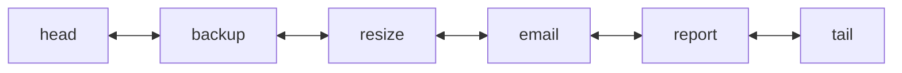
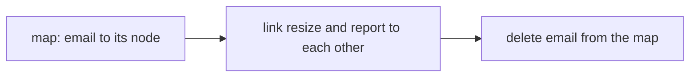
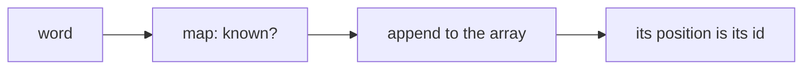
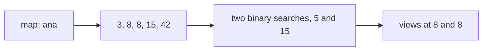

# Designing with hash maps

## The idea

A hash map does one thing superbly: it finds a key in O(1) on average. It does nothing else. It keeps no useful order, it cannot tell you what came between two moments, it does not number its keys. Each of those is easy for some other structure, and hopeless for that structure alone, because it cannot **find** things fast.

So many designs pair a hash map with a second structure. The second structure provides the order, the positions or the history; the map provides the **index into it**, so that any element of the second structure can be reached in O(1) without searching. The map's values are not the data: they are pointers to where the data lives.

This guide builds three such pairs:

| Pair | The second structure gives | The map gives |
|------|----------------------------|---------------|
| Map + doubly linked list | An order, with O(1) insertion and removal anywhere | O(1) access to any node, so it can be unlinked or moved |
| Map + dynamic array | Dense positions: elements numbered 0, 1, 2 and so on, without gaps | Each element's position, so it is reached both ways in O(1) |
| Map + sorted list per key | Every past event of a key, in time order | O(1) access to one key's list, then binary search in it |

The skill is the same each time: write down the operations and the bound each needs, notice that no single structure meets them all, and give each structure the job it does in O(1).

## A worked example

### A map and a doubly linked list: a queue you can cancel from

A job queue hands out jobs in the order they were submitted, and any waiting job can be cancelled. With a plain list, cancelling costs O(n): find the job, then shift everything after it. A **doubly linked list** removes a node in O(1), since the node knows both its neighbors and they can be linked to each other, but finding the node is still O(n). A hash map from job id to its node removes that search.



<!-- text-of-mermaid sha256:92a30cf2c5f7c283f3ac348828feebf659bd6221dadf80541769efe14bfe995b -->
```text
┌────┐    ┌──────┐    ┌──────┐    ┌─────┐    ┌──────┐    ┌────┐
│head◄───►│backup◄───►│resize◄───►│email◄───►│report◄───►│tail│
└────┘    └──────┘    └──────┘    └─────┘    └──────┘    └────┘
```



<!-- text-of-mermaid sha256:8ff5b3a6ba5f6a5ae7587b17a7760c2c78171739e56500536ca46d4b22abaf45 -->
```text
┌──────────────────────┐    ┌────────────────────────────────────┐    ┌─────────────────────────┐
│map: email to its node├───►│link resize and report to each other├───►│delete email from the map│
└──────────────────────┘    └────────────────────────────────────┘    └─────────────────────────┘
```

The first drawing shows the list between two **sentinels**, `head` and `tail`, nodes that hold no job. Every real node then has a node before it and a node after it, so linking and unlinking never need a special case for an empty list or for the ends. Cancelling `email`, in the second drawing, is: look up its node in the map, point `resize` and `report` at each other, and delete the map entry. Two pointer writes and a map deletion, whatever the length of the queue.

```python examples/job_queue.py
"""A first-in, first-out job queue that can also cancel any waiting job in O(1).

A list alone cancels in O(n): it must search for the job and shift what follows. A hash map from
job id to a node of a doubly linked list finds the node in O(1), and the node unlinks itself in
O(1), because it knows both of its neighbors.
"""


class Node:
    def __init__(self, job: str) -> None:
        self.job = job
        self.before: Node | None = None
        self.after: Node | None = None


class JobQueue:
    def __init__(self) -> None:
        self.head = Node("<head>")  # sentinels: every real node has two neighbors
        self.tail = Node("<tail>")
        self.head.after, self.tail.before = self.tail, self.head
        self.nodes: dict[str, Node] = {}

    def submit(self, job: str) -> bool:
        if job in self.nodes:  # one node per id, or the map would lose the first one
            return False
        node = Node(job)
        last = self.tail.before
        assert last is not None
        node.before, node.after = last, self.tail
        last.after = self.tail.before = node
        self.nodes[job] = node
        return True

    def cancel(self, job: str) -> bool:
        node = self.nodes.pop(job, None)
        if node is None:
            return False
        assert node.before is not None and node.after is not None
        node.before.after, node.after.before = node.after, node.before
        return True

    def take(self) -> str | None:
        first = self.head.after
        if first is self.tail or first is None:
            return None
        self.cancel(first.job)
        return first.job

    def waiting(self) -> list[str]:
        jobs, node = [], self.head.after
        while node is not None and node is not self.tail:
            jobs.append(node.job)
            node = node.after
        return jobs


queue = JobQueue()
for job in ("backup", "resize", "email", "report"):
    queue.submit(job)
print("waiting:", queue.waiting())
print("cancel email:", queue.cancel("email"), "->", queue.waiting())
print("cancel email again:", queue.cancel("email"))
print("take:", queue.take(), "->", queue.waiting())
print("submit resize again:", queue.submit("resize"), "->", queue.waiting())
queue.submit("email")
print("submit email:", queue.waiting())
```

It prints:

```output examples/job_queue.py
waiting: ['backup', 'resize', 'email', 'report']
cancel email: True -> ['backup', 'resize', 'report']
cancel email again: False
take: backup -> ['resize', 'report']
submit resize again: False -> ['resize', 'report']
submit email: ['resize', 'report', 'email']
```

The second cancel returns `False`, because the map no longer holds `email`, and `take` serves the oldest job in O(1) from the head's side. Submitting `resize` again is refused: a second node for the same id would replace the first in the map and leave it in the list, where nothing could reach it to cancel it. Each operation keeps the two structures in step: whatever touches the list also touches the map.

Caches that evict by recency are built on this same pair; the first practice problem asks you to design one, and to work out which operations move which nodes.

### A map and an array: dense ids

A program that handles many words, user names or URLs often wants to refer to each one by a small integer instead: integers are cheap to store, to compare and to use as array indexes. A **symbol table** gives each distinct string the next id, 0, 1, 2 and so on, the first time it is seen. A map from string to id answers "what is this word's id?"; an array from id to string answers "which word has this id?". Both are O(1).



<!-- text-of-mermaid sha256:a067f883847a085e012c240b97f23c907dee277cac06829460facd175a86bd99 -->
```text
┌────┐    ┌───────────┐    ┌───────────────────┐    ┌──────────────────────┐
│word├───►│map: known?├───►│append to the array├───►│its position is its id│
└────┘    └───────────┘    └───────────────────┘    └──────────────────────┘
```

The drawing shows the path of a word seen for the first time: the map does not know it, so it goes to the end of the array, and its position there becomes its id. A word seen before stops at the map, which returns its id.

```python examples/interning.py
"""A symbol table: each distinct word gets a small, dense integer id, in O(1) both ways.

The map turns a word into its id; the array turns an id back into its word. Because ids run from
0 without gaps, any data about the words can live in plain arrays indexed by id.
"""


class SymbolTable:
    def __init__(self) -> None:
        self.ids: dict[str, int] = {}  # word -> id
        self.words: list[str] = []  # id -> word

    def intern(self, word: str) -> int:
        """The word's id, assigning the next one the first time the word is seen."""
        known = self.ids.get(word)
        if known is not None:
            return known
        self.ids[word] = len(self.words)
        self.words.append(word)
        return self.ids[word]


symbols = SymbolTable()
text = "to be or not to be that is the question"
ids = [symbols.intern(word) for word in text.split()]
print("ids:", ids)
print("words by id:", symbols.words)

counts = [0] * len(symbols.words)  # per-word data in an array, indexed by id
for word_id in ids:
    counts[word_id] += 1
print("counts by id:", counts)
print("id of 'be':", symbols.ids["be"], "| word with id 4:", symbols.words[4])
```

It prints:

```output examples/interning.py
ids: [0, 1, 2, 3, 0, 1, 4, 5, 6, 7]
words by id: ['to', 'be', 'or', 'not', 'that', 'is', 'the', 'question']
counts by id: [2, 2, 1, 1, 1, 1, 1, 1]
id of 'be': 1 | word with id 4: that
```

The ten words of the line get eight ids: `to` and `be` keep the ids they got the first time. Because the ids are **dense**, from 0 with no gaps, anything you want to know per word can live in a plain array indexed by id, as the counts do here: no second hash map, no hashing per access. Compilers intern identifiers this way, databases encode repeated strings as small integers, and graph code turns names into node numbers before building adjacency arrays.

The pair has one hard operation: removing a string. An array cannot drop an element from the middle in O(1) without either leaving a hole or renumbering everything after it. Doing it in O(1), when order does not matter, is exactly what the second practice problem asks.

### A map and a sorted list per key: events in a window

A site records each user's page views as they happen, and analysts ask what a user viewed between two moments. The map finds the user's list in O(1). Views are appended in time order, so each list is **already sorted** by time, and two binary searches find where the window starts and where it ends.



<!-- text-of-mermaid sha256:b1a11abbc149365116b5446b2dc81e21f77e33124b8841313f6d65ec18d5f5e9 -->
```text
┌────────┐    ┌───────────────┐    ┌─────────────────────────────┐    ┌────────────────┐
│map: ana├───►│3, 8, 8, 15, 42├───►│two binary searches, 5 and 15├───►│views at 8 and 8│
└────────┘    └───────────────┘    └─────────────────────────────┘    └────────────────┘
```

The drawing follows one question: the window from minute 5 up to, but not including, minute 15. The first binary search lands on the view at minute 8, the second on the view at minute 15, and the views between the two positions are the answer.

```python examples/event_ranges.py
"""Page views per user, and the views of one user inside a time window.

A hash map finds the user's list in O(1). Views arrive in time order, so each list is already
sorted, and two binary searches find where the window starts and ends: O(log h) for a list of h
views, however long the window is.
"""

from bisect import bisect_left


class ViewLog:
    def __init__(self) -> None:
        self.views: dict[str, list[tuple[int, str]]] = {}

    def record(self, user: str, minute: int, page: str) -> None:
        history = self.views.setdefault(user, [])
        if history and minute < history[-1][0]:
            raise ValueError("views must arrive in time order")
        history.append((minute, page))

    def between(self, user: str, start: int, end: int) -> list[tuple[int, str]]:
        """The user's views with start <= minute < end."""
        history = self.views.get(user, [])
        first = bisect_left(history, start, key=lambda view: view[0])
        stop = bisect_left(history, end, key=lambda view: view[0])
        return history[first:stop]


log = ViewLog()
for minute, page in ((3, "home"), (8, "pricing"), (8, "signup"), (15, "docs"), (42, "home")):
    log.record("ana", minute, page)
log.record("ben", 5, "home")
print("ana, minutes 5 to 15:", log.between("ana", 5, 15))
print("ana, minutes 8 to 9:", log.between("ana", 8, 9))
print("ana, minutes 16 to 40:", log.between("ana", 16, 40))
print("cy, who never visited:", log.between("cy", 0, 60))
```

It prints:

```output examples/event_ranges.py
ana, minutes 5 to 15: [(8, 'pricing'), (8, 'signup')]
ana, minutes 8 to 9: [(8, 'pricing'), (8, 'signup')]
ana, minutes 16 to 40: []
cy, who never visited: []
```

`bisect_left` with `key=` (Python 3.10 and later) returns the position of the first view whose minute is at least the one given, so the window's views are the slice between the two positions, `start` included and `end` excluded. Both views at minute 8 are found, an empty window returns an empty list, and an unknown user has no list at all. Each query costs O(log h) for a history of `h` views, plus the size of the answer.

The same shape answers other questions about histories: what changed in a release range, how many events fell in the last hour. The third practice problem asks a different question of a history: which value was current at a given moment.

## When to use it

- **The operations have different shapes.** Order plus lookup, positions plus lookup, history plus lookup: when one structure gives some of the bounds and another the rest, index the second with a map.
- **"In O(1)" is part of the requirement.** Designs with stated bounds for every operation usually need a pair, because each operation is cheap in a different structure.
- **The data must stay in step.** Use a pair only when every operation can update both structures together. A map that points to a node that was removed elsewhere is a bug waiting to happen.

What to reach for, by need:

| Need | Pair |
|------|------|
| Arrival order, with removal or reordering by key | Map + doubly linked list, or a language's ordered map |
| Small dense ids, and per-item data in arrays | Map + array |
| Events of a key in a range of times or versions | Map + sorted list per key, with binary search |
| The smallest or largest key overall, or keys in a range across all keys | A balanced tree or a sorted structure, not a hash map |

## Common traps

- **Updating one structure and not the other.** Every operation must leave the map and the second structure describing the same set of elements. Write each operation as "change the structure, then fix the map", and test the first, last and only element.
- **Duplicate keys.** If a key may arrive twice, decide what happens: refuse it, as the job queue does, or update the existing entry. Adding a second element silently strands the first.
- **No sentinels.** A doubly linked list without sentinel nodes needs special cases for the head, the tail and the empty list, and each one is a place for a null-pointer bug.
- **Histories that are not in order.** Binary search needs a sorted list. If events can arrive out of order, insert in sorted position, or sort before searching, or refuse them, as the example does.
- **Off-by-one in binary search.** Decide whether each end of a window is included, and pick `bisect_left` or `bisect_right` for each end to match: they differ exactly on elements equal to the value searched.
- **Storing values where references would do.** If the map holds copies of the elements instead of positions or nodes, the two structures drift apart as soon as one copy changes.

## Complexity

All bounds for the map are averages, under the usual assumption of a well-spread hash function; the second structure's bounds are worst-case.

| Design | Operation | Time | Space |
|--------|-----------|------|-------|
| Map + doubly linked list | Add at an end, remove any, move any to an end, take from an end | O(1) average | O(n) |
| Map + array (symbol table) | Id of a string, string of an id | O(1) average, plus the array's amortized O(1) append | O(n) |
| Map + sorted lists | Record an event in time order | O(1) average, amortized | O(total events) |
| Map + sorted lists | Events of one key in a window | O(1) average to find the key, then O(log h + answer) | |

The array's append is **amortized** O(1): when it is full it grows by a constant factor and copies itself, like a hash table's resize. The factor differs between languages, and Java's `ArrayList` documentation only promises that adding an element has constant amortized cost; any constant factor greater than 1 gives that bound. A doubly linked list costs about two pointers of memory per element beyond the element itself, plus the map's entry; the symbol table stores each string once, in the array, and once more as a map key reference.

## Expert notes

- **Ordered maps are the first pair, built in.** Python's `dict` has kept insertion order since 3.7, and Java's `LinkedHashMap` keeps insertion order with a linked list running through its entries. Knowing how to build the pair by hand is what lets you change its rules, and explains the memory and time the built-in one costs.
- **Intrusive lists.** In systems code, the list pointers often live inside the element itself, an intrusive list, so that one allocation serves both structures and an element can be in several lists at once.
- **Memory and the cache.** A linked list scatters nodes across the heap, so walking it misses the CPU cache often. Arrays keep elements contiguous and are usually faster to walk, which is one reason dense ids pay off: per-item data in arrays beats per-item data in maps.
- **Histories at scale.** Event and version stores keep histories sorted by time and often also keep periodic snapshots, so that a read never replays more than a bounded number of changes. Old entries are dropped by a retention rule, which a per-key list makes easy: drop from the front.
- **Concurrency.** A pair of structures is two places to update, so a concurrent version needs one lock around both, or a design whose updates are a single atomic step. Updating the map and the list under separate locks lets another thread see them disagree.

## Practice

- `cstudy start lru-cache`: a cache with a capacity that evicts the entry used least recently. Decide which structure keeps the order of use, and what the map must point to.
- `cstudy start randomized-set`: add, remove and draw a random member, each in O(1) on average.
- `cstudy start time-based-kv-store`: every version of every key, and the value at a given moment.

## Further reading

- [Python `bisect`](https://docs.python.org/3/library/bisect.html): `bisect_left` and `bisect_right`, and the `key` parameter added in 3.10.
- [Python `dict`](https://docs.python.org/3/library/stdtypes.html#mapping-types-dict): insertion order since 3.7.
- [Java `ArrayList`](https://docs.oracle.com/en/java/javase/21/docs/api/java.base/java/util/ArrayList.html): capacity grows automatically, with constant amortized cost per added element.
