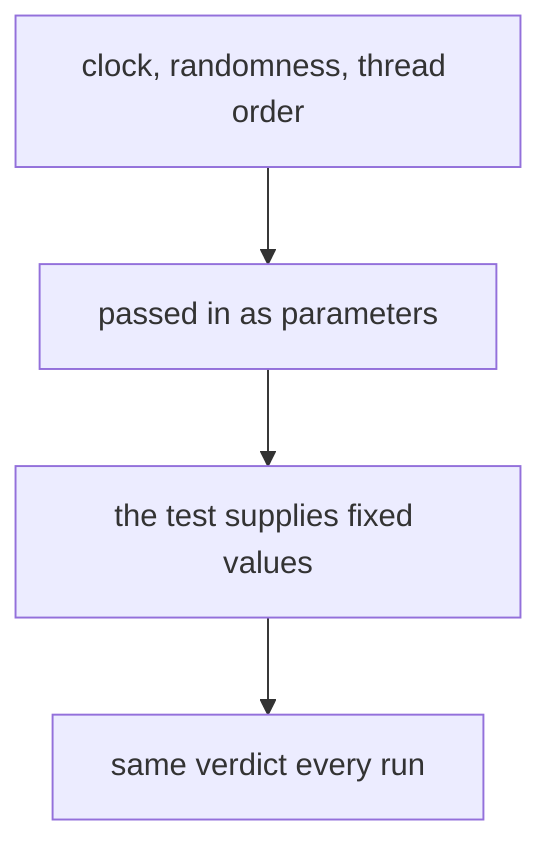

# Deterministic tests: time, randomness, concurrency and flaky tests

## The idea

A test is only useful if its verdict means something. When the code has not changed, a test should pass every time or fail every time. A test that sometimes passes and sometimes fails on the same code is called **flaky**. A flaky test is worse than no test in one way: people learn to ignore its failures, and then they ignore the real one too.

A test's verdict changes when something the code depends on changes between runs, without the test choosing it. The usual suspects:

| Source | How it shows up | The deterministic version |
|--------|-----------------|---------------------------|
| The clock | A check passes until midnight, a month end, or a daylight-saving change; a timeout passes on a fast machine and fails on a busy one | Pass the clock in, and give the test a clock it moves by hand |
| Random numbers | One draw in a few hundred hits a case nobody handled | Pass the random generator in, seed it, and record the seed |
| Threads and asynchronous work | The test checks a result before the work has finished, or two threads interleave badly | Wait on a condition instead of sleeping; control the order of steps, or try every order |
| Shared state | A test passes alone and fails after another test, or the other way round | Give each test its own fresh setup, and clean up what it changes |
| Unordered collections | The output order of a set changes from run to run | Sort before comparing, or compare as sets |
| The environment | The network is down, a file is missing, the time zone or locale differs | Replace the outside world with doubles, and fix the zone and locale in the test |

The common cure is to turn each hidden input into an ordinary one. Code that calls `time.monotonic()` or `random.random()` deep inside reads a value the test cannot choose. Code that receives a clock function or a random generator as a parameter lets production pass the real one and the test pass a controlled one. This is the same move as a [test double](../stubs-spies-mocks-and-fakes/guide.md): a manual clock is a fake, and a seeded generator is a stub with an unusually long script.



<!-- text-of-mermaid sha256:24b256ba63eb3f0c4b0227d5b23f2211dccfe5adfc930a91882f5bee26f83065 -->
```text
┌───────────────────────────────┐
│clock, randomness, thread order│
└───────────────┬───────────────┘
                ▼
┌───────────────────────────────┐
│    passed in as parameters    │
└───────────────┬───────────────┘
                ▼
┌───────────────────────────────┐
│ the test supplies fixed values│
└───────────────┬───────────────┘
                ▼
┌───────────────────────────────┐
│     same verdict every run    │
└───────────────────────────────┘
```

Read the drawing from the top: once each source of change arrives through a parameter, the test chooses its value, and the run becomes repeatable.

## A worked example

### Time, without waiting

A session expires after 15 minutes without activity. Testing that against the real clock would take 15 minutes per test and still be fragile at the edge. The session below asks a clock function for the time; production uses `time.monotonic`, and the test uses a clock it advances by hand, second by second if it likes:

```python examples/injected_clock.py
"""A session that expires after 15 minutes of inactivity, tested without waiting 15 minutes.

The session asks a clock function for the time instead of reading the system clock itself. In
production that function is time.monotonic; in the test it is a manual clock that moves only when
the test moves it, so the test is exact, repeatable and instant.
"""

import time


class ManualClock:
    def __init__(self, start: float = 0.0):
        self.now = start

    def __call__(self) -> float:
        return self.now

    def advance(self, seconds: float) -> None:
        self.now += seconds


class Session:
    def __init__(self, idle_limit: float, clock=time.monotonic):
        self.idle_limit, self.clock = idle_limit, clock
        self.last_seen = clock()

    def touch(self) -> None:
        self.last_seen = self.clock()

    def expired(self) -> bool:
        return self.clock() - self.last_seen >= self.idle_limit


started = time.monotonic()
clock = ManualClock()
session = Session(idle_limit=15 * 60, clock=clock)
checks = []
clock.advance(899)
checks.append(("after 899 s", session.expired(), False))
clock.advance(1)
checks.append(("after 900 s", session.expired(), True))
session.touch()
clock.advance(600)
checks.append(("600 s after a touch", session.expired(), False))
for label, actual, expected in checks:
    print(f"{label:<20} expired={actual!s:<5} {'ok' if actual == expected else 'WRONG'}")
print("real time spent under one second:", time.monotonic() - started < 1)
```

It prints:

```output examples/injected_clock.py
after 899 s          expired=False ok
after 900 s          expired=True  ok
600 s after a touch  expired=False ok
real time spent under one second: True
```

The test checks the exact boundary, 899 seconds against 900, which a test against the real clock could never check reliably, and it takes no real time. The default argument keeps production code simple: nobody passes a clock except the tests. Notice the choice of `time.monotonic` for production: it measures elapsed time with a clock that never goes backwards, while `time.time` follows the system clock and can jump back when the clock is set.

### Randomness, with a seed

A function that shuffles players into two teams gets its randomness from a `random.Random` object it is given. The test runs it many times with different seeds, which explores many inputs, and records each seed, which makes every failure repeatable:

```python examples/seeded_runs.py
"""Random inputs, made repeatable: every run gets its own seed, and a failure reports it.

split_teams shuffles the players and deals them into two teams. It has a bug: with an odd number
of players, the last one is left out. A test that draws team sizes at random finds the bug, and
because each run has a recorded seed, the same failure can be replayed exactly.
"""

import random


def split_teams(players: list[str], rng: random.Random) -> tuple[list[str], list[str]]:
    shuffled = players[:]
    rng.shuffle(shuffled)
    half = len(shuffled) // 2
    return shuffled[:half], shuffled[half:2 * half]  # bug: drops the odd one out


def check(seed: int) -> str | None:
    """One run of the test: None when it passes, a description when it fails."""
    rng = random.Random(seed)
    size = 2 + int(rng.random() * 7)  # 2 to 8 players
    players = [f"p{i}" for i in range(size)]
    first, second = split_teams(players, rng)
    if sorted(first + second) != sorted(players):
        return f"{size} players in, {len(first) + len(second)} placed"
    return None


failures = {seed: failure for seed in range(1, 21) if (failure := check(seed))}
print(f"20 runs, {len(failures)} failed, with seeds {sorted(failures)}")
seed = min(failures)
print(f"seed {seed}: {failures[seed]}")
print("replaying seed", seed, "fails the same way:", check(seed) == failures[seed])
```

It prints:

```output examples/seeded_runs.py
20 runs, 11 failed, with seeds [3, 4, 6, 8, 9, 10, 11, 12, 13, 17, 18]
seed 3: 3 players in, 2 placed
replaying seed 3 fails the same way: True
```

The bug, an odd player left out, shows up in about half the runs, and the report names a seed that replays it. Two details make the replay reliable. The generator is an object of its own, not the module-level functions such as `random.shuffle`, which share one hidden generator with every other piece of code that draws from it. And the seeds are fixed in the test, so every run of the suite tries the same inputs; trying fresh seeds on each run finds new cases, but then the seed must be printed with the failure.

### Concurrency, every order

Two deposits run at the same time on one account. Each reads the balance, then writes the balance plus its amount. Between the read and the write, the other deposit may run. Real threads interleave at the scheduler's whim, so a test that starts two threads and checks the total passes almost every time and proves little. The program below makes each step explicit, as a generator that yields between steps, and runs every possible order:

```python examples/interleavings.py
"""Every interleaving of two deposits, tried one by one instead of hoping a thread switch hits.

Each deposit is a generator, and each `yield` marks a point where the other task may run. A tiny
scheduler runs the tasks in a chosen order, so every possible order can be tried and replayed.
"""

from itertools import combinations


def deposit_split(account: dict, amount: int):
    balance = account["balance"]  # read
    yield
    account["balance"] = balance + amount  # write, from what was read
    yield


def deposit_atomic(account: dict, amount: int):
    account["balance"] += amount  # read and write in one step: nothing runs in between
    yield


def run(order: str, deposit) -> int:
    account = {"balance": 0}
    tasks = {"A": deposit(account, 10), "B": deposit(account, 20)}
    for name in order:
        next(tasks[name])
    return account["balance"]


def schedules(steps_each: int) -> list[str]:
    """Every order of the steps of A and B that keeps each task's own steps in order."""
    total = 2 * steps_each
    return ["".join("A" if i in spots else "B" for i in range(total))
            for spots in combinations(range(total), steps_each)]


for deposit, steps in ((deposit_split, 2), (deposit_atomic, 1)):
    results = {order: run(order, deposit) for order in schedules(steps)}
    lost = [order for order, balance in results.items() if balance != 30]
    print(f"{deposit.__name__}: {len(results)} schedules, {len(lost)} lose a deposit")
    for order, balance in results.items():
        print(f"  {order}  balance {balance}")
```

It prints:

```output examples/interleavings.py
deposit_split: 6 schedules, 4 lose a deposit
  AABB  balance 30
  ABAB  balance 20
  ABBA  balance 10
  BAAB  balance 20
  BABA  balance 10
  BBAA  balance 30
deposit_atomic: 2 schedules, 0 lose a deposit
  AB  balance 30
  BA  balance 30
```

Four of the six orders lose a deposit: each one reads the balance before the other has written it, and the later write overwrites the earlier one. This is a **lost update**, and it is invisible in the two orders where one deposit finishes before the other starts, which are the orders a quick test usually gets. Making the read and the write a single step, as a lock would in real code, leaves two orders, and both are right. Trying every order turns "it passed a thousand times" into "it passes in every order there is", for this model of the steps.

## When to use it

- **Pass a clock in** for any code that compares times, measures durations, waits, retries or expires anything.
- **Pass a seeded generator in** for any code that draws random numbers: shuffling, sampling, jitter (a random spread added to delays so that clients do not retry in step), generated ids in tests.
- **Explore interleavings** when the correctness of the code depends on the order in which threads or tasks run. For small step counts, try every order; for real threads, use stress tests, which run many threads against the code at once, check invariants after each run, and treat a pass as evidence, not proof.
- **Wait on a condition, with a timeout**, whenever a test must wait for other threads or processes: `threading.Event.wait(timeout)` returns `True` as soon as the event is set and `False` if the time runs out, so the test is as fast as the work and still bounded.
- **Investigate a flaky test** the day it flakes. Rerunning it until it passes hides the problem; find which hidden input changed.

## Common traps

- **Sleeping to wait.** `time.sleep(2)` before checking a result is too long on a fast machine and too short on a loaded one. Wait for the condition itself.
- **Seeding the shared generator.** `random.seed(1)` in one test changes the numbers every later test draws from the module functions, so tests start to depend on their order. Give each test its own `random.Random`.
- **Retrying until green.** A test retried up to three times reports a failure only when all three runs fail. A real bug that fails one run in five then shows up as a failure in 0.2³, under 1%, of suite runs.
- **Disabling the flaky test for good.** The test may be flaky because the code is: a race in a test is often a race in production. Fix the cause or the test, and track the ones set aside.
- **Naive times.** A `datetime` without a time zone cannot place itself on the timeline, and `datetime.now()` with no argument returns the local time of whatever machine runs the test. Use aware times, with an explicit zone, and pass them in.
- **Relying on set order.** The hashes of strings and bytes change between Python processes, and with them the iteration order of sets that hold them. Sort before comparing, or compare sets as sets.
- **Exact timing assertions.** "Finishes in under 50 ms" fails on a busy machine. Test what the code does with time through an injected clock, and measure speed in a benchmark, not in a correctness test.
- **Tests that share setup.** A test that leaves a file, a database row or a global setting behind changes the next test's input. Each test builds what it needs and removes what it changed.

## Complexity

The number of interleavings grows fast. Two tasks of `m` and `n` atomic steps, steps that nothing can interrupt, can interleave in `C(m + n, m)` ways, the number of ways to choose which positions belong to the first task: 6 for two steps each, as above, 20 for three each, and 184,756 for ten each. Exhaustive exploration is for small models; beyond that, tools bound the search, for example to orders with few preemptions, the points where the scheduler interrupts one task to run another.

Seeds cost nothing at run time, but a seed reproduces a run only with the same code and the same generator. Python guarantees that `Random.random()` gives the same sequence for the same seed across versions; most of its other algorithms may change between versions. A failure report should therefore carry the seed and the input it produced, so that the failing case survives an upgrade.

An injected clock removes waiting altogether: a test of a one-hour timeout runs as fast as a test of anything else.

## Expert notes

- **What flaky tests are made of.** An empirical study of flaky tests (Luo, Hariri, Eloussi and Marinov, FSE 2014) examined 201 commits that likely fix flaky tests in 51 open-source projects and classified the root cause of 161. The three largest categories were waiting for asynchronous work without proper synchronization (74 commits, 45%), concurrency (32, 20%) and test order dependency (19, 12%), together 77%. The others were resource leaks, network, time, input and output, randomness, floating-point operations and unordered collections. Most of the flaky tests (78%) were flaky from the first time they were written. 42 of the 74 asynchronous-wait fixes added or changed a call that blocks until a condition holds or a timeout passes, which the authors found the most efficient and effective fix, and 74% of the order-dependency fixes cleaned the shared state between tests. The authors call reruns and disabling "workarounds" rather than solutions.
- **Many causes, one symptom.** The xUnit patterns vocabulary calls a test that sometimes passes and sometimes fails an *erratic test*, and lists causes that match the study's: interacting tests (tests that depend on each other), a lonely test (one that passes only after another test set something up), resource leakage, an unrepeatable test (different on the first run than on later ones), a test run war (people sharing one database and tripping each other) and a nondeterministic test, one that uses different values on each run.
- **Making races repeatable.** One research tool for systematic concurrency testing (*Finding and Reproducing Heisenbugs in Concurrent Programs*, OSDI 2008) takes control of thread scheduling and drives a program through its possible interleavings one by one. It can replay any interleaving that failed, and it tries schedules with few preemptions first, on the intuition that many concurrency bugs need only a few. The generator scheduler of the example is the same idea at a small scale.
- **Order dependence hides in a stable order.** `unittest` runs the tests of a class in the order of their names sorted as strings, the same order every time, so a test that depends on an earlier one can pass for years. The flaky test study notes that order dependencies often need explicit reruns in different orders to be found. Running each test alone, and the suite in a shuffled order, brings them out.
- **Reproducing hash order.** Setting `PYTHONHASHSEED` to an integer fixes the hash seed of strings and bytes, so a failure that depends on set order can be replayed; unset, or set to `random`, a fresh seed is used in each process.
- **Waiting for a call.** `unittest.mock.ThreadingMock` (Python 3.13) can wait until it is called from another thread, with a timeout, instead of asserting at once.
- **Randomness and security.** `random` uses the Mersenne Twister, which is completely deterministic: exactly what a test wants, and exactly why the documentation calls it unsuitable for cryptographic purposes. Code that needs unpredictable values uses `secrets`, and its tests replace that source like any other.

## Practice

- `cstudy start test-doubles`: all four levels; level 4 adds a fake clock whose timers fire in order, at the right moments, when the test moves time forward.
- `cstudy start vendor-retry-client-typescript`: a retry client that runs on a virtual clock, so every wait takes no real time and the moment of every attempt is exact. This path's step stops at level 2, where each wait takes a random share that comes from a source a test can script.
- `cstudy start token-bucket-limiter`: a rate limiter that never reads a clock, because time is passed in, and whose counting must stay exact while many threads share it.

## Further reading

- [Q. Luo, F. Hariri, L. Eloussi and D. Marinov, *An Empirical Analysis of Flaky Tests*, FSE 2014, pages 643 to 653](https://doi.org/10.1145/2635868.2635920): the root causes of flaky tests and how they were fixed.
- [xUnit Patterns, *Erratic Test*](http://xunitpatterns.com/Erratic%20Test.html): interacting tests, lonely tests, test run wars and nondeterministic tests.
- [M. Musuvathi and others, *Finding and Reproducing Heisenbugs in Concurrent Programs*, OSDI 2008](https://www.usenix.org/legacy/event/osdi08/tech/full_papers/musuvathi/musuvathi.pdf): controlling the scheduler to explore and replay interleavings.
- [Python, `random`](https://docs.python.org/3/library/random.html): instances that do not share state, the notes on reproducibility, and the warning about security.
- [Python, `time.monotonic` and `time.time`](https://docs.python.org/3/library/time.html#time.monotonic): a clock that cannot go backwards, and one that can.
- [Python, `datetime`: aware and naive objects](https://docs.python.org/3/library/datetime.html#aware-and-naive-objects).
- [Python, `threading.Event.wait`](https://docs.python.org/3/library/threading.html#threading.Event.wait): waiting for a condition with a timeout.
- [Python, `PYTHONHASHSEED`](https://docs.python.org/3/using/cmdline.html#envvar-PYTHONHASHSEED) and [`object.__hash__`](https://docs.python.org/3/reference/datamodel.html#object.__hash__): hash randomization and the order of sets.
