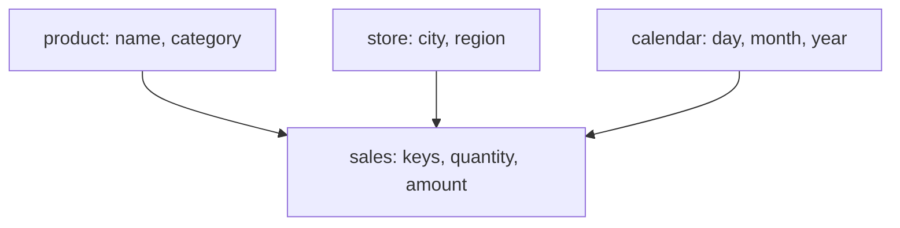
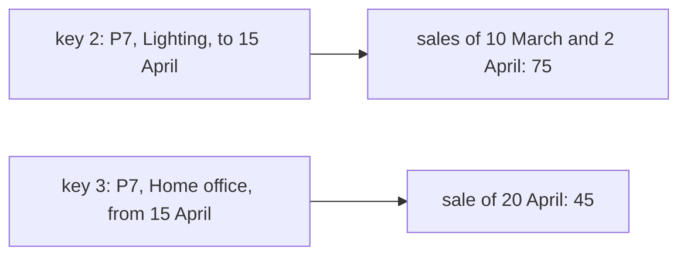

# Dimensional modeling and slowly changing dimensions

## The idea

An analytics store answers questions like "revenue by product category and month" or "orders per store last week". **Dimensional modeling** shapes its tables so that such questions are easy to ask and fast to answer. It splits the data in two.

- A **fact table** records measurements of a business process, one row per event: a sale, a payment, a shipment. Its columns are mostly numbers you can add up, such as an amount or a quantity, plus a key for each thing that took part.
- A **dimension table** describes the things that take part: products, customers, stores, dates. The Kimball Group's definition of dimensions is the "who, what, where, when, why, and how" around an event. Its columns are descriptive text, used to filter and group: a product's name and category, a store's city.

A fact table in the middle with its dimension tables around it, each joined by a key, is a **star schema**. A report joins the facts to the dimensions it needs, filters and groups by dimension columns, and adds up the facts.



<!-- text-of-mermaid sha256:8c0bc77f7958c17bc4e1cdbfafcad937b1d53b41d45aff9327040d71634f541e -->
```text
┌─────────────────────────────┐    ┌───────────────────┐    ┌──────────────────────────┐
│   product: name, category   │    │store: city, region│    │calendar: day, month, year│
└──────────────┬──────────────┘    └─────────┬─────────┘    └─────────────┬────────────┘
               ▼─────────────────────────────┴────────────────────────────┘
┌─────────────────────────────┐
│sales: keys, quantity, amount│
└─────────────────────────────┘
```

The drawing shows the star: every sale points to exactly one row of each dimension, and each dimension row describes any number of sales.

Two decisions come before any column.

- **The grain**: exactly what one fact row represents, such as "one line of one receipt". The Kimball Group calls declaring it the pivotal step, because every fact and every dimension must be true at that grain; a table that mixes "one receipt line" rows with "one day's total" rows double counts the moment anyone adds them up.
- **The keys.** The system that sends you products already names each one, `P7` for example; that is its **natural key**, or business key. The dimension gives every row a key of its own, a **surrogate key**: a plain integer assigned in sequence, 1, 2, 3. Facts point at the surrogate key. Why that matters is the second half of this guide.

### Dimensions change

A product moves to another category; a customer moves to another city. Such changes are rare compared to facts, hence the name **slowly changing dimension**, and the question is what the old facts should show. The Kimball Group numbers the answers:

| Type | On a change | Reports show |
|------|-------------|--------------|
| 0 | Nothing: the value is the original one forever | The original value |
| 1 | Overwrite the value in the row | Every fact as if the new value had always been true; the old value is gone |
| 2 | Close the current row and add a new row, with a new surrogate key | Each fact with the value that was true when it happened |
| 3 | Keep the old value in an extra column beside the new one | Either value, but only one step of history |

Type 2 is the one that keeps history. Because one product can now have several rows, the natural key is no longer unique in the dimension, and that is why the dimension needs a surrogate key: each version of the product is a row of its own, and a fact points at the version that was valid when it happened. Each type 2 row also carries the dates between which it was valid, and a flag for the current row.

Make the dates **half-open**: a row valid from 1 January to 15 April covers every date `d` with `20260101 <= d < 20260415`, and the next row starts on exactly 15 April. Two versions never overlap, and no date falls between them. The current row ends at a date far in the future, such as `99991231`, that stands for "until further notice".

## A worked example

A shop sells a monitor arm, `P3`, and a desk lamp, `P7`. On 15 April the lamp moved from the category Lighting to Home office. Category is a type 2 attribute, so the dimension has two rows for `P7`: key 2, valid until 15 April, and key 3, valid from then on. Each sale points at the key that was current when it happened.

```python examples/star.py
"""A tiny star schema: revenue by product category, as it was and as it is.

The product dimension keeps category as a type 2 attribute: when the desk lamp moved from Lighting
to Home office on 15 April, its row was closed and a new row, with a new surrogate key, began.
Each sale points at the product row that was valid when it happened.
"""

OPEN_END = 99991231
PRODUCTS = [  # (surrogate key, business key, name, category, valid from, valid to)
    (1, "P3", "monitor arm", "Home office", 20260101, OPEN_END),
    (2, "P7", "desk lamp", "Lighting", 20260101, 20260415),
    (3, "P7", "desk lamp", "Home office", 20260415, OPEN_END),
]
SALES = [  # (date, product surrogate key, amount): the fact table
    (20260310, 2, 40),
    (20260320, 1, 120),
    (20260402, 2, 35),
    (20260420, 3, 45),
    (20260505, 1, 110),
]
BY_KEY = {row[0]: row for row in PRODUCTS}
CURRENT = {row[1]: row for row in PRODUCTS if row[5] == OPEN_END}


def revenue_by_category(as_it_is: bool) -> dict[str, int]:
    totals: dict[str, int] = {}
    for _, key, amount in SALES:
        product = BY_KEY[key]
        if as_it_is:  # a type 1 view: follow the business key to the current row
            product = CURRENT[product[1]]
        totals[product[3]] = totals.get(product[3], 0) + amount
    return dict(sorted(totals.items()))


def key_at(business_key: str, date: int) -> int:
    """The surrogate key of the row valid on a date: valid from <= date < valid to."""
    for key, product, _, _, valid_from, valid_to in PRODUCTS:
        if product == business_key and valid_from <= date < valid_to:
            return key
    return -1


print("as it was (type 2):", revenue_by_category(as_it_is=False))
print("as it is (type 1): ", revenue_by_category(as_it_is=True))
late = key_at("P7", 20260410)
print(f"late sale of P7 dated 20260410: key {late} ({BY_KEY[late][3]}), current key {CURRENT['P7'][0]}")
```

It prints:

```output examples/star.py
as it was (type 2): {'Home office': 275, 'Lighting': 75}
as it is (type 1):  {'Home office': 350}
late sale of P7 dated 20260410: key 2 (Lighting), current key 3
```



<!-- text-of-mermaid sha256:f542b12c4805931b3b6616c2be14a99c4984244c4ad49afc1cbdf1522eea8ae6 -->
```text
┌─────────────────────────────────────┐    ┌─────────────────────────────────┐
│   key 2: P7, Lighting, to 15 April  ├───►│sales of 10 March and 2 April: 75│
└─────────────────────────────────────┘    └─────────────────────────────────┘

┌─────────────────────────────────────┐    ┌─────────────────────────────────┐
│key 3: P7, Home office, from 15 April├───►│       sale of 20 April: 45      │
└─────────────────────────────────────┘    └─────────────────────────────────┘
```

The drawing shows which version of the lamp describes each sale, and why the two answers differ. Joined through the surrogate key, the lamp's March and early April sales stay in Lighting, where they were made: 75 in Lighting, 275 in Home office. That is **history as it was**, the type 2 answer. Following each sale's natural key to the current row instead puts every lamp sale in Home office, 350 in total: **history as it is now**, the answer type 1 would give. Neither is wrong. A question about how categories performed last quarter wants the first; a question about how the current catalogue has sold wants the second.

The last line is a **late-arriving fact**: a sale dated 10 April that reaches the store on 1 May, after the lamp has moved. Giving it the current key would put it in Home office. The Kimball Group's rule is to search the dimension for the row that was valid when the event happened, which here is key 2, in Lighting. The example scans the rows; with each key's versions sorted by start date, a binary search finds the row in O(log v).

## When to use it

- **A star schema** for analytics stores that people query with filters and groupings: it keeps joins simple, one hop from the facts to each dimension, and puts the descriptive text where everyone looks for it.
- **The finest grain the source has**, such as one row per receipt line. A coarser grain, such as daily totals, answers only the questions it was built for; it can be added later as a summary table.
- **Type 1** for corrections and for attributes whose history nobody needs: a fixed typo, a phone number.
- **Type 2** for attributes that reports group by and that change over time: category, region, customer segment, price band.
- **Both views** when people need history as it was and as it is: keep a type 2 dimension and give readers a view of current rows, or carry the current value as an extra column on every row (the Kimball Group's type 6).
- **Effective dates in the source** when values have dates of their own, such as a contract that changes from next month, and corrections arrive later: then the history has two times, explored in the Expert notes.

## Common traps

- **Mixing grains in one fact table.** Rows of different meaning add up to nonsense. One grain per fact table.
- **Using the natural key as the dimension's primary key.** It cannot hold two versions, it may be reused by the source for something else, and two sources may use the same code for different things.
- **Overlapping or gapped versions.** If one version ends on 15 April and the next starts on 16 April, a sale on the 15th finds one row or none depending on the comparison. Use half-open dates where each version ends exactly where the next starts.
- **Joining facts to the current row by accident.** A join on the natural key with a "current" filter gives history as it is now. If the report wanted history as it was, the numbers are wrong without any error.
- **Giving a late fact the current key.** A fact must point at the version valid on its event date, not on its load date.
- **Making every column type 2.** Each change of any tracked column adds a row. Track the columns reports group by, and treat the rest as type 1.
- **Dropping facts whose dimension row is missing.** An inner join silently loses facts that point at a product the dimension has not received yet. Keep a reserved "unknown" row for them, so totals stay complete and the gap is visible.

## Complexity

For a dimension of `k` natural keys with up to `v` versions each, and `f` facts:

| Operation | Time | Space |
|-----------|------|-------|
| Find a key's current row | O(1) on average, with a hash map from natural key to its current row | O(k) |
| Find the row valid on a date | O(log v) by binary search over the key's versions sorted by start date | O(k v) for all versions |
| Apply a type 1 change | O(1) per row, or O(v) to correct every version of the key | |
| Apply a type 2 change | O(1): close one row and add one | One row per change |
| A report over a star schema | One pass over the facts, with a hash lookup per dimension per fact: O(f) on average | O(size of the dimensions used) |

Type 2 grows with changes, not with facts: a dimension of a million customers that change twice a year on average gains two million rows a year.

## Expert notes

- **The Kimball Group's four steps.** Select the business process, declare the grain, identify the dimensions, identify the facts, in that order. A fact row corresponds one to one to a measurement event, so a fact table models what happened, not a particular report.
- **Surrogate keys and durable keys.** The Kimball Group recommends simple integer surrogate keys, assigned in sequence starting with 1, for every dimension except the date dimension, which can use a meaningful key. When the natural key itself is unreliable, for example an employee number that changes when someone leaves and is rehired, it recommends a **durable key** of the warehouse's own, which never changes while the surrogate keys of the versions do.
- **Hybrid types.** Type 6 adds the current value of an attribute, overwritten on every version, beside the type 2 value, so facts can be grouped by either. Type 7 puts both the durable key and the surrogate key in the fact table, giving one view joined by the durable key to current rows (as it is) and one joined by the surrogate key (as it was).
- **Conformed dimensions.** When two fact tables share a dimension with the same column names and values, their results can be lined up on the same rows of one report, the Kimball Group's **drill-across**. Conformed dimensions are what make separate star schemas one warehouse.
- **Retroactive changes.** When a type 2 change is learned late, after facts were loaded with the old key, the Kimball Group's advice is to insert the new row and restate the affected facts.
- **Two kinds of time.** The SQL:2011 standard, as described by Kulkarni and Michels, distinguishes **valid time**, when a row is true in the world, from **transaction time**, when it was recorded in the database; application-time period tables hold the first, system-versioned tables the second. Periods are closed-open, like the versions above, and an update for part of a row's period splits the row into two or three contiguous rows, only the part inside the period being changed. A type 2 dimension keeps valid time; a store that also keeps transaction time can answer "what did we believe on 1 May about 10 April?", which is the question of the effective-dated practice problem.

## Practice

- `cstudy start effective-dated-history`: every field of a record over time with effective dates, late entries and corrections, and the values as they were known at an earlier moment: valid time and the time you learned it.
- `cstudy start scd-type2-dimension`: a type 2 dimension: surrogate keys, versions over half-open dates, point-in-time lookups for facts, late changes, and rows that disappear from the source.

## Further reading

- [Kimball Group, *Dimensional Modeling Techniques*](https://www.kimballgroup.com/data-warehouse-business-intelligence-resources/kimball-techniques/dimensional-modeling-techniques/): the index of the techniques cited here.
- [Kimball Group, *Grain*](https://www.kimballgroup.com/data-warehouse-business-intelligence-resources/kimball-techniques/dimensional-modeling-techniques/grain/) and [*Four-Step Dimensional Design Process*](https://www.kimballgroup.com/data-warehouse-business-intelligence-resources/kimball-techniques/dimensional-modeling-techniques/four-4-step-design-process/).
- [Kimball Group, *Dimension Surrogate Keys*](https://www.kimballgroup.com/data-warehouse-business-intelligence-resources/kimball-techniques/dimensional-modeling-techniques/dimension-surrogate-key/) and [*Natural, Durable, and Supernatural Keys*](https://www.kimballgroup.com/data-warehouse-business-intelligence-resources/kimball-techniques/dimensional-modeling-techniques/natural-durable-supernatural-key/).
- [Kimball Group, *Type 1: Overwrite*](https://www.kimballgroup.com/data-warehouse-business-intelligence-resources/kimball-techniques/dimensional-modeling-techniques/type-1/) and [*Type 2: Add New Row*](https://www.kimballgroup.com/data-warehouse-business-intelligence-resources/kimball-techniques/dimensional-modeling-techniques/type-2/); types 0, 3, 6 and 7 are listed on the index page.
- [Kimball Group, *Late Arriving Facts*](https://www.kimballgroup.com/data-warehouse-business-intelligence-resources/kimball-techniques/dimensional-modeling-techniques/late-arriving-fact/) and [*Late Arriving Dimensions*](https://www.kimballgroup.com/data-warehouse-business-intelligence-resources/kimball-techniques/dimensional-modeling-techniques/late-arriving-dimension/).
- [Kulkarni and Michels, *Temporal features in SQL:2011*, SIGMOD Record 41(3), 2012](https://sigmodrecord.org/publications/sigmodRecord/1209/pdfs/07.industry.kulkarni.pdf): closed-open periods, valid time and transaction time, and rows split by a partial update.
