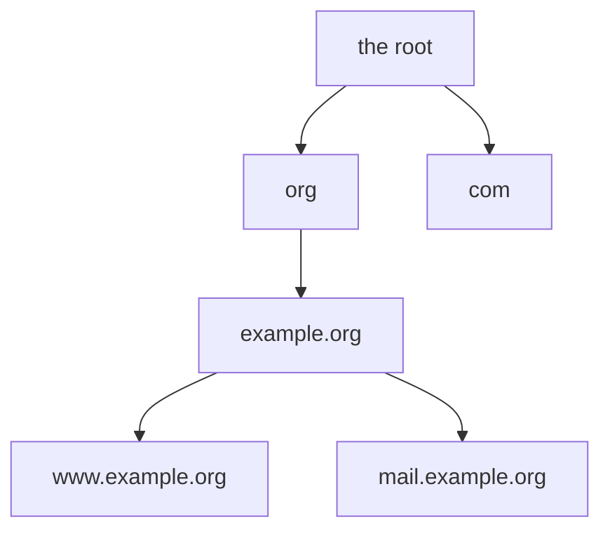
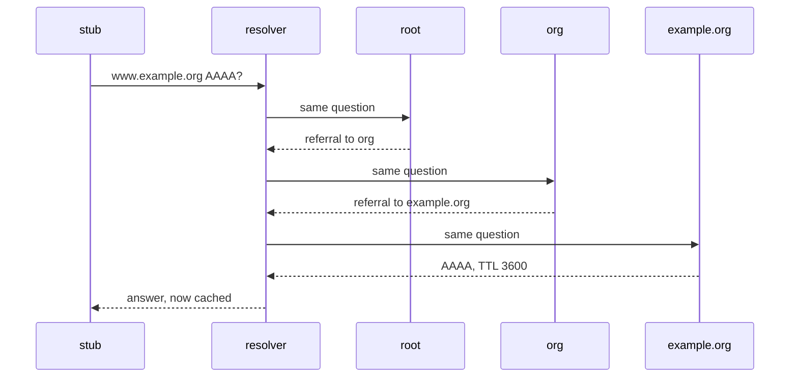

# DNS: names, resolution and caching

## The idea

Programs reach other machines by IP address, such as `192.0.2.10`; people use names, such as `www.example.org`. The **Domain Name System** (DNS) maps names to data about them: addresses, mail servers, other names. No one holds the whole map. It is cut into pieces, each kept by its own servers, and a program finds an answer by asking them in turn.

RFC 1034 describes the system in three parts: the **domain name space** and the **resource records** attached to its names; **name servers**, programs that hold part of the data; and **resolvers**, programs that extract answers from name servers for the programs that ask.

**Names form a tree.** A name is a list of **labels** separated by dots, read from the most specific on the left to the most general on the right. `www.example.org` sits under `example.org`, which sits under `org`, which sits under the **root**. RFC 1034 calls the name space a tree structure, reserves the empty label for the root, and notes that a complete name therefore ends in a dot when it is printed: `www.example.org.`. Names compare without regard to case, so `WWW.Example.ORG` is the same name. RFC 1035 limits a label to 63 octets and a whole name to 255.



<!-- text-of-mermaid sha256:de63045481eff0af937695e9b224a07a24533cf0db49f67c15dc0f0e3bdbc804 -->
```text
┌───────────────┐
│    the root   │
└───────────────┘
        ▼─────────────────────▼
┌───────────────┐    ┌────────────────┐
│      org      │    │      com       │
└───────┬───────┘    └────────────────┘
        ▼
┌───────────────┐
│  example.org  │
└───────────────┘
        ▼─────────────────────▼
┌───────────────┐    ┌────────────────┐
│www.example.org│    │mail.example.org│
└───────────────┘    └────────────────┘
```

The tree in the drawing is read from the top: each name's parent is the name without its leftmost label.

**Records.** Each piece of data is a **resource record**: an owner name, a type, a class (almost always `IN`, the Internet), a TTL and the data (RFC 1035). The common types:

| Type | Number | Data | Meaning |
|------|--------|------|---------|
| `A` | 1 | an IPv4 address | an address of the name |
| `AAAA` | 28 | an IPv6 address | an address of the name (RFC 3596) |
| `CNAME` | 5 | a name | the owner is an alias; the data is its canonical (real) name |
| `NS` | 2 | a name | a name server for the zone at the owner |
| `MX` | 15 | a preference and a name | a mail server for the owner |
| `SOA` | 6 | seven fields | the start of a zone, with numbers that govern it |

The **TTL** (time to live) is a number of seconds. RFC 1034: it describes how long a record can be cached before it should be discarded.

**Zones and delegation.** The tree is cut into **zones**, each managed on its own. The `org` zone holds the names under `org`, except where it hands a subtree to someone else: it **delegates** `example.org` by holding `NS` records at `example.org` that name that zone's servers. The boundary is a **cut**. When a server named by a delegation lies inside the zone it serves, such as `ns1.example.org` for `example.org`, the parent also holds its address, because no one could ask `example.org`'s servers where `ns1.example.org` is without already knowing. RFC 1034 calls these address records **glue**: they are not part of the parent's authoritative data, only addresses for the servers.

**Who answers what.** Three roles, in RFC 9499's terms:

- An **authoritative server** knows the content of a zone from local knowledge, and answers for it.
- A **recursive resolver** acts in recursive mode: it does the whole search and returns an answer or an error, never a referral to someone else (RFC 1034).
- A **stub resolver** cannot do the search itself and relies on a recursive resolver. The resolver library on your laptop is one: it sends each question to the recursive resolver its network configured.

An authoritative server that does not have the answer, but knows who is closer to it, replies with a **referral**: the `NS` records of the delegation, and glue when it has it. A server that answers with referrals is working in **iterative mode**. A recursive resolver starts from the **root hints**, a configured list of the root servers' names and addresses, and follows referrals down the tree.

## A worked example

A program asks its stub resolver for the IPv6 address of `www.example.org`. The recursive resolver's cache is empty, so it walks the tree:



<!-- text-of-mermaid sha256:cd5a15c0e817a2a13535c979f5389ee58510542668b49eb45049ba69693d0001 -->
```text
┌──────┐                 ┌──────────┐           ┌──────┐         ┌─────┐   ┌─────────────┐
│ stub │                 │ resolver │           │ root │         │ org │   │ example.org │
└───┬──┘                 └─────┬────┘           └───┬──┘         └──┬──┘   └──────┬──────┘
    │                          │                    │               │             │
    │  www.example.org AAAA?   │                    │               │             │
    │──────────────────────────▶                    │               │             │
    │                          │                    │               │             │
    │                          │   same question    │               │             │
    │                          │────────────────────▶               │             │
    │                          │                    │               │             │
    │                          │  referral to org   │               │             │
    │                          ◀╌╌╌╌╌╌╌╌╌╌╌╌╌╌╌╌╌╌╌╌│               │             │
    │                          │                    │               │             │
    │                          │           same question            │             │
    │                          │────────────────────────────────────▶             │
    │                          │                    │               │             │
    │                          │      referral to example.org       │             │
    │                          ◀╌╌╌╌╌╌╌╌╌╌╌╌╌╌╌╌╌╌╌╌╌╌╌╌╌╌╌╌╌╌╌╌╌╌╌╌│             │
    │                          │                    │               │             │
    │                          │                  same question     │             │
    │                          │──────────────────────────────────────────────────▶
    │                          │                    │               │             │
    │                          │                 AAAA, TTL 3600     │             │
    │                          ◀╌╌╌╌╌╌╌╌╌╌╌╌╌╌╌╌╌╌╌╌╌╌╌╌╌╌╌╌╌╌╌╌╌╌╌╌╌╌╌╌╌╌╌╌╌╌╌╌╌╌│
    │                          │                    │               │             │
    │   answer, now cached     │                    │               │             │
    ◀╌╌╌╌╌╌╌╌╌╌╌╌╌╌╌╌╌╌╌╌╌╌╌╌╌╌│                    │               │             │
    │                          │                    │               │             │
┌───┴──┐                 ┌─────┴────┐           ┌───┴──┐         ┌──┴──┐   ┌──────┴──────┐
│ stub │                 │ resolver │           │ root │         │ org │   │ example.org │
└──────┘                 └──────────┘           └──────┘         └─────┘   └─────────────┘
```

Step by step:

1. The root server is not responsible for `www.example.org`, but it knows who is responsible for `org`: it returns their `NS` records and, as glue, their addresses.
2. An `org` server does the same one level down: `example.org` is delegated, so it returns that zone's servers.
3. An `example.org` server holds the zone and answers with the record, with the AA bit, the Authoritative Answer bit, set to say it is an authority for the name. The address is from `2001:db8::/32`, which RFC 3849 reserves for documentation.
4. The resolver caches the answer for its TTL, and keeps the two referrals as well, each for the TTL of its records.

A minute later, another program asks for `mail.example.org`. The resolver already knows `example.org`'s servers from the cached referral, so it asks one of them directly: one query instead of three. An hour later the answer has expired, and the next question for `www.example.org` asks again, starting from the lowest zone whose servers are still cached.

**When the answer is no.** There are two negative answers, and RFC 2308 names them:

| Answer | Response code | Meaning |
|--------|---------------|---------|
| NXDOMAIN | Name Error (3) | The name does not exist at all |
| NODATA | No error (0), with no answer records | The name exists, but has no records of the type asked |

RFC 1035 says the Name Error code is meaningful only in responses from an authoritative server, and means that the name in the query does not exist. A name with records only below it, such as `b.example.org` when only `a.b.example.org` has a record, still exists: RFC 9499 calls such names **empty non-terminals**, and a question for them gets NODATA.

## The message on the wire

A question and its answer each travel as one **DNS message**, usually in a UDP datagram to port 53 (RFC 1035). A message has a 12-byte header and up to four sections: the question, the answer records, the authority records (a referral's `NS` records, or the `SOA` of a negative answer), and the additional records (glue). Here is a query built by hand and read back:

```python examples/dns_message.py
"""Build the bytes of a DNS query the way RFC 1035 lays them out, and read them back.

A message is a 12-byte header, then the question: the name as labels, each a length byte and
that many letters, ending with the empty label of the root, then a two-byte type and a two-byte
class. Every number is sent with its most significant byte first.
"""

import struct

TYPES = {"A": 1, "NS": 2, "CNAME": 5, "SOA": 6, "MX": 15, "AAAA": 28}
CLASS_IN = 1  # the Internet
FLAG_RD = 0x0100  # Recursion Desired: "do the whole walk for me"


def encode_name(name: str) -> bytes:
    encoded = b""
    for label in name.split("."):
        if not 1 <= len(label) <= 63:
            raise ValueError(f"a label has 1 to 63 octets, not {len(label)}")
        encoded += bytes([len(label)]) + label.encode("ascii")
    encoded += b"\x00"  # the root's label is empty
    if len(encoded) > 255:
        raise ValueError("a name has at most 255 octets")
    return encoded


def build_query(message_id: int, name: str, qtype: str) -> bytes:
    header = struct.pack("!HHHHHH", message_id, FLAG_RD, 1, 0, 0, 0)  # one question, no records
    return header + encode_name(name) + struct.pack("!HH", TYPES[qtype], CLASS_IN)


def decode_name(data: bytes, offset: int) -> tuple[str, int]:
    labels = []
    while (length := data[offset]) != 0:
        labels.append(data[offset + 1 : offset + 1 + length].decode("ascii"))
        offset += 1 + length
    return ".".join(labels), offset + 1


query = build_query(0x1234, "www.example.org", "AAAA")
print(f"{len(query)} bytes:")
for start in range(0, len(query), 16):
    print("  " + query[start : start + 16].hex(" "))

message_id, flags, questions, answers, authority, additional = struct.unpack("!HHHHHH", query[:12])
print(f"id {message_id:#06x}, QR {flags >> 15} (a query), RD {(flags & FLAG_RD) >> 8}")
print(
    f"sections: {questions} question, {answers} answer, {authority} authority, "
    f"{additional} additional"
)
name, offset = decode_name(query, 12)
qtype, qclass = struct.unpack("!HH", query[offset : offset + 4])
print(f"question: {name}, type {qtype}, class {qclass}")
try:
    encode_name("a" * 64 + ".example.org")
except ValueError as error:
    print("refused:", error)
```

It prints:

```output examples/dns_message.py
33 bytes:
  12 34 01 00 00 01 00 00 00 00 00 00 03 77 77 77
  07 65 78 61 6d 70 6c 65 03 6f 72 67 00 00 1c 00
  01
id 0x1234, QR 0 (a query), RD 1
sections: 1 question, 0 answer, 0 authority, 0 additional
question: www.example.org, type 28, class 1
refused: a label has 1 to 63 octets, not 64
```

The header's fields, in RFC 1035's order:

| Field | Bits | Meaning |
|-------|------|---------|
| ID | 16 | Chosen by the asker and copied into the answer, to match them up |
| QR | 1 | 0 for a query, 1 for a response |
| Opcode | 4 | The kind of query; 0 is a standard query |
| AA | 1 | Authoritative Answer: set by a server that holds the zone |
| TC | 1 | TrunCation: the message was cut to fit the channel |
| RD | 1 | Recursion Desired: the asker wants the whole search done for it |
| RA | 1 | Recursion Available: the server offers recursive service |
| Z | 3 | Reserved |
| RCODE | 4 | 0 no error, 1 format error, 2 server failure, 3 name error, 4 not implemented, 5 refused |
| QDCOUNT, ANCOUNT, NSCOUNT, ARCOUNT | 16 each | How many entries each section holds |

The name travels as labels: `03 77 77 77` is a length of 3 and `www`, `07` and `example`, `03` and `org`, then `00`, the empty root label. A length of at most 63 always starts with two zero bits, and RFC 1035 relies on that: a length byte whose top two bits are ones is not a length but a pointer, described under Expert notes. The type `00 1c` is 28, `AAAA`, and the class `00 01` is `IN`.

## Caching and TTLs

Caching is what makes DNS fast enough to use for every connection. RFC 1034 makes resolvers responsible for discarding records whose TTL has expired. RFC 8767, which updates it, lets a resolver serve an expired record when it cannot reach the zone's servers, so during an outage an old answer can outlive its TTL. The TTL is chosen by whoever runs the zone. The choice is a trade-off, shown here for a name whose address changes at second 610, asked for every 30 seconds through one caching resolver:

```python examples/ttl_and_change.py
"""How a record's TTL trades queries against stale answers.

A name's address changes at second 610. Clients ask a caching resolver for it every 30 seconds
for an hour. The resolver asks the authoritative server only when its cached copy has expired,
and a copy expires TTL seconds after it arrived. A long TTL saves queries; it also keeps the
old address in use for longer after the change.
"""

OLD, NEW = "192.0.2.10", "192.0.2.20"
CHANGE_AT, END, EVERY = 610, 3600, 30


def run(ttl: int) -> tuple[int, int | None]:
    cached: tuple[str, int] | None = None  # (address, time the copy expires)
    upstream, last_stale = 0, None
    for now in range(0, END, EVERY):
        current = OLD if now < CHANGE_AT else NEW
        if cached is None or now >= cached[1]:
            upstream += 1
            cached = (current, now + ttl)
        if cached[0] != current:
            last_stale = now
    return upstream, last_stale


print("TTL (s)  queries to the server  last old answer (s)")
for ttl in (60, 300, 3600):
    upstream, last_stale = run(ttl)
    stale = "none" if last_stale is None else str(last_stale)
    print(f"{ttl:>7}  {upstream:>21}  {stale:>19}")
```

It prints:

```output examples/ttl_and_change.py
TTL (s)  queries to the server  last old answer (s)
     60                     60                  630
    300                     12                  870
   3600                      1                 3570
```

With a TTL of 60 seconds, the authoritative server gets 60 queries an hour and the last old answer is given 20 seconds after the change. With 3,600, it gets one query, and every client keeps the old address until the hour is out. A change can take up to one TTL to reach everyone, and longer from a resolver that cannot reach the zone's servers and serves its expired copy, as RFC 8767 allows. That is why it pays to lower a record's TTL some time before a planned change, wait for the old TTL to run out, and raise it again afterwards.

**Negative caching.** Remembering that a name does not exist saves as many queries as remembering what does. RFC 2308 sets the rules:

- An authoritative server must put the zone's `SOA` record in the authority section of a negative answer, so that the answer can be cached.
- The negative answer is kept for the smaller of the `SOA` record's TTL and its last field, `MINIMUM`, which RFC 2308 redefined for this purpose.
- A name error is cached for the name, whatever type is asked next; a NODATA answer only for the name and the type that had no data.
- A negative answer without an `SOA` record should not be cached.

**Not all data is equally trustworthy.** RFC 2181 ranks data by where it came from: the answer section of an authoritative reply above glue the server loaded from its zone, and that glue above additional data. Glue that arrives in a referral is additional data, the lowest rank. RFC 2181 says the lowest-ranked data, the additional section and the authority section of a non-authoritative answer, should not be cached in such a way that it would ever be returned as an answer. A referral's glue is good enough to find the next server, not to answer a question about that server's name. RFC 9499 sorts the servers of a delegation by where their names lie: **in-domain** (`ns.child.example.com` for `child.example.com`), **sibling domain** (`ns.another.example.com`, also inside the parent `example.com`) and **unrelated** (outside the parent's zone). Glue for an unrelated name is something the parent has no authority over at all.

## When to use it

- **Finding a service by name**: addresses (`A`, `AAAA`), mail servers (`MX`), aliases (`CNAME`). The name stays stable while the addresses behind it change.
- **Letting each organization run its own names.** Delegation means the `org` zone never needs to know what `www.example.org` points to.
- **Planned moves.** Lower the TTL ahead of time, change the record, then raise the TTL again.
- **Instead**, for anything that must change within seconds or be consistent everywhere at once, such as moving traffic off a failed machine right now, DNS alone is the wrong tool: every cache may keep the old answer for a full TTL, and past it while the zone's servers cannot be reached. And for large or private data it is a poor store: answers are meant to be small, and plain DNS sends them unencrypted.

## Common traps

- **Comparing names as plain strings.** `WWW.Example.ORG` and `www.example.org` are the same name, and `badexample.org` is not under `example.org` although its text ends with it. Lowercase once, and compare whole labels.
- **Resolving once and keeping the answer.** A program that looks a name up at start-up and never again ignores the TTL, and keeps talking to an old address long after it moved.
- **Forgetting negative caching.** Create a name right after something asked for it, and resolvers keep answering "no such name" until the negative TTL runs out.
- **Putting other records next to a CNAME.** RFC 1034: if a `CNAME` record is present at a name, no other data should be present, which keeps an alias and its canonical name from disagreeing.
- **Following aliases forever.** RFC 1034 says `CNAME` chains should be followed and loops reported as an error. A resolver needs a visited set or a limit.
- **Answering from glue.** Data that arrived in a referral is a hint for where to ask next. Returning it as an answer lets a parent zone, or a server that sent unrelated glue, decide what a name means.
- **Ignoring truncation.** A UDP answer with TC set is incomplete. RFC 7766 tells a client to take TC as a sign to retry over TCP.

## Complexity

| Situation | Queries sent by the resolver |
|-----------|------------------------------|
| Answer cached and not expired | 0 |
| Delegation of the zone cached, answer not | 1 |
| Cold cache, a name `d` labels deep | up to `d + 1`: the root, then one per zone on the way down |
| A delegation without usable glue | more: the server's own name must be resolved first |

Each query costs one round trip to a server, so a cold lookup of `www.example.org` costs about three round trips beyond the stub's, and a warm one costs none. The cache holds one entry per name and type it has seen, plus one per delegation, each until its TTL ends. As the example shows, the load on an authoritative server is inversely proportional to the TTL, and the time a change takes to reach everyone grows with it.

## Expert notes

- **Message compression.** A name can repeat many times in a response. RFC 1035 lets a message replace a name, or the end of one, with a two-byte **pointer** to an earlier copy: its first two bits are ones, and the remaining bits are an offset from the start of the message. A label's length byte can never be mistaken for one, since labels are limited to 63 octets and so start with two zero bits.
- **Message size.** RFC 1035 limits a message over UDP to 512 bytes, not counting the IP and UDP headers; a longer one is truncated and the TC bit set. EDNS(0) (RFC 6891) lets an asker advertise the largest UDP payload it can take, and suggests 4,096 octets as a good starting point. RFC 9715 now recommends at most 1,400, to avoid IP fragmentation. RFC 7766 made TCP a required part of a full DNS implementation.
- **TTL edges.** RFC 1035 says a TTL of zero means the record may be used for the transaction in progress and should not be cached. RFC 2181 made the TTL unsigned, 0 to 2,147,483,647. RFC 8767 reads a value with the top bit set as positive and recommends capping TTLs at 604,800 seconds (7 days).
- **Negative TTLs.** RFC 2308 reports that one to three hours has worked well as a cap on how long negative answers are kept, and that values above a day have caused problems.
- **Words that changed.** RFC 9499 notes that "bailiwick", once used for glue inside or outside a zone, causes more confusion than meaning, and calls those terms historic; in-domain, sibling domain and unrelated replace them.
- **Each message is a datagram.** The stub's question and the resolver's queries are independent UDP exchanges, with no connection. RFC 1035 recommends UDP for standard queries and, since a query over UDP may be lost, says a retransmission strategy is required. The guide on timeouts and retries covers what a client should do when an answer does not come.

## Practice

- `cstudy start dns-resolver-sim`: build what a server answers from its zones, aliases and their loops, the walk from the root through referrals with a cache on a virtual clock, and then negative caching and glue you cannot trust.

## Further reading

- [RFC 1034, Domain Names: Concepts and Facilities](https://www.rfc-editor.org/rfc/rfc1034.html): the three components (section 2.4), the tree and case-insensitive names (section 3.1), aliases (section 3.6.2), zones, cuts and glue (section 4.2), query modes (section 4.3.1), stub resolvers and caching (sections 5.3.1 and 5.3.2).
- [RFC 1035, Domain Names: Implementation and Specification](https://www.rfc-editor.org/rfc/rfc1035.html): size limits (section 2.3.4), record format and types (section 3.2), the message format, header and compression (section 4.1), UDP and TCP on port 53 (section 4.2).
- [RFC 2308, Negative Caching of DNS Queries](https://www.rfc-editor.org/rfc/rfc2308.html): NXDOMAIN and NODATA, the SOA in negative answers, and how long to keep them.
- [RFC 2181, Clarifications to the DNS Specification](https://www.rfc-editor.org/rfc/rfc2181.html): ranking data (section 5.4.1), TTL limits (section 8), CNAME records (section 10.1).
- [RFC 3596, DNS Extensions to Support IP Version 6](https://www.rfc-editor.org/rfc/rfc3596.html): the `AAAA` record.
- [RFC 6891, EDNS(0)](https://www.rfc-editor.org/rfc/rfc6891.html) and [RFC 7766, DNS over TCP](https://www.rfc-editor.org/rfc/rfc7766.html): larger answers over UDP, and TCP as a requirement.
- [RFC 8767, Serving Stale Data to Improve DNS Resiliency](https://www.rfc-editor.org/rfc/rfc8767.html): serving expired records when the zone's servers cannot be reached, and the TTL's top bit and cap (section 4).
- [RFC 9715, IP Fragmentation Avoidance in DNS over UDP](https://www.rfc-editor.org/rfc/rfc9715.html): the recommended largest UDP payload (section 3).
- [RFC 9499, DNS Terminology](https://www.rfc-editor.org/rfc/rfc9499.html): authoritative servers, recursive and stub resolvers, referrals, glue, root hints and empty non-terminals.
