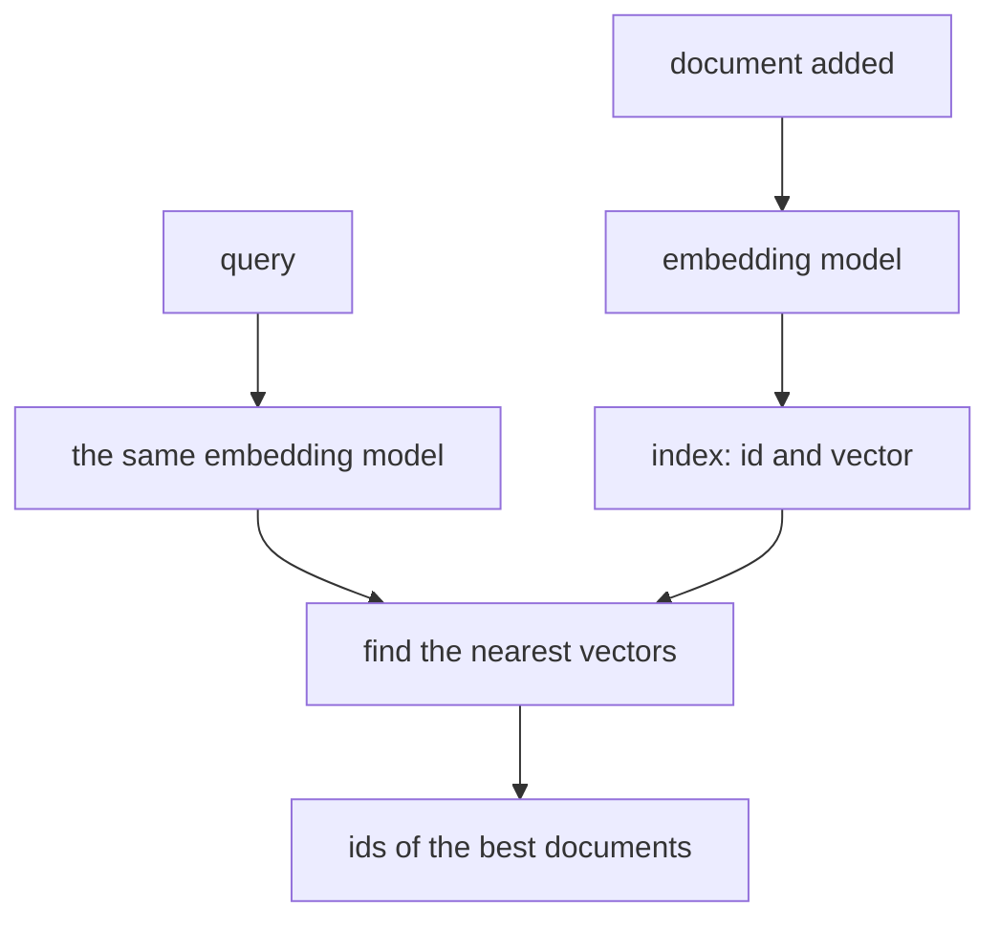

# Embeddings and vector search

## The idea

Keyword search finds documents that share words with the question. It fails when the words differ and the meaning does not: someone asks for a "refund" and the help page says "money back". An **embedding** fixes that by turning a text into a **vector**, a list of numbers, chosen so that texts with similar meanings get vectors that point in similar directions. Searching by meaning then becomes geometry: embed the question, and find the stored vectors nearest to it.

An **embedding model** is a model trained for exactly that job. You give it a text and it gives back a vector of fixed length, the same for every text, however long. Nobody chooses what each number means; training arranges them so that related texts land close together. Two vectors are compared with **cosine similarity**, the cosine of the angle between them:

```text
cosine(a, b) = (a · b) / (|a| * |b|)       a · b = a[0]*b[0] + a[1]*b[1] + ...       |a| = sqrt(a · a)
```

It is 1 when the vectors point the same way, 0 when they are at right angles, and -1 when they point opposite ways. It ignores length: a vector and the same vector doubled score 1. If every stored vector is scaled to length 1 first, cosine similarity is just the dot product, which is cheaper.

**Vector search** keeps a vector per document and returns the `k` documents most similar to the query's vector. With a few thousand documents you compare the query with every one of them. With millions you use an **approximate nearest neighbour** index, which answers far faster by looking at only part of the collection, and occasionally misses a true neighbour.

## A worked example

The example uses a fake embedding model: a table of word vectors over four axes of meaning that are named here, money, travel, food and software, so the numbers can be read. A text's embedding is the average of the vectors of its known words, scaled to length 1. The same six documents are searched three ways: by meaning, by shared words, and by fusing the two rankings.

```python examples/vector_search.py
"""Search by meaning and by words over the same documents, then fuse the two rankings.

The embedding model is a fake: a table of word vectors over four made-up axes of meaning
(money, travel, food, software). A text's embedding is the average of its known words' vectors,
scaled to length 1. A real model learns thousands of axes nobody names, but the geometry is the same.
"""

import math

AXES = ("money", "travel", "food", "software")
WORD_VECTORS = {
    "refund": (0.9, 0.1, 0.0, 0.1), "payment": (0.9, 0.0, 0.0, 0.2), "money": (1.0, 0.0, 0.0, 0.0),
    "charge": (0.8, 0.0, 0.0, 0.2), "purchase": (0.8, 0.1, 0.1, 0.0), "back": (0.3, 0.2, 0.0, 0.0),
    "flight": (0.1, 1.0, 0.0, 0.0), "hotel": (0.2, 0.9, 0.1, 0.0), "trip": (0.1, 0.9, 0.1, 0.0),
    "recipe": (0.0, 0.0, 1.0, 0.0), "dinner": (0.1, 0.1, 0.9, 0.0), "spicy": (0.0, 0.0, 0.8, 0.0),
    "error": (0.0, 0.0, 0.0, 1.0), "login": (0.1, 0.0, 0.0, 0.9), "app": (0.1, 0.1, 0.0, 0.9),
}
DOCUMENTS = [
    "how to get your money back for a purchase",
    "booking a hotel near the airport before a flight",
    "a spicy recipe for a quick dinner",
    "the app shows error ERR-4012 at login",
    "change the card used for each payment",
    "plan a trip on a budget",
]


def words(text: str) -> list[str]:
    return text.lower().split()


def normalize(vector: list[float]) -> list[float]:
    length = math.sqrt(sum(x * x for x in vector))
    return [x / length for x in vector] if length else vector


def embed(text: str) -> list[float]:
    known = [WORD_VECTORS[word] for word in words(text) if word in WORD_VECTORS]
    if not known:
        return [0.0] * len(AXES)
    return normalize([sum(column) / len(known) for column in zip(*known)])


def dot(a: list[float], b: list[float]) -> float:
    return sum(x * y for x, y in zip(a, b, strict=True))


def cosine(a: list[float], b: list[float]) -> float:
    lengths = math.sqrt(dot(a, a)) * math.sqrt(dot(b, b))
    return dot(a, b) / lengths if lengths else 0.0


INDEX = [embed(document) for document in DOCUMENTS]  # computed once, when documents are added


def by_meaning(query: str) -> list[int]:
    q = embed(query)
    scores = {i: dot(q, vector) for i, vector in enumerate(INDEX)}  # unit vectors: dot is cosine
    return [i for i in sorted(scores, key=lambda i: (-scores[i], i)) if scores[i] > 0]


def by_words(query: str) -> list[int]:
    wanted = set(words(query))
    shared = {i: len(wanted & set(words(document))) for i, document in enumerate(DOCUMENTS)}
    return [i for i in sorted(shared, key=lambda i: (-shared[i], i)) if shared[i] > 0]


def fuse(*rankings: list[int], k: int = 60) -> list[int]:
    """Reciprocal rank fusion: each ranking gives a document 1 / (k + its rank)."""
    scores: dict[int, float] = {}
    for ranking in rankings:
        for rank, i in enumerate(ranking, start=1):
            scores[i] = scores.get(i, 0.0) + 1 / (k + rank)
    return sorted(scores, key=lambda i: (-scores[i], i))


for i, document in enumerate(DOCUMENTS):
    print(f"{i}: {document}")
a, b = embed("refund payment"), embed("money back for a purchase")
print(f"cosine {cosine(a, b):.3f}, dot of the unit vectors {dot(a, b):.3f}, length {math.sqrt(dot(a, a)):.3f}")
for query in ["refund", "refund my payment", "ERR-4012", "login error"]:
    meaning, matching = by_meaning(query), by_words(query)
    print(f"{query!r}: by meaning {meaning[:3]}, by words {matching[:3]}, fused {fuse(meaning, matching)[:3]}")
```

It prints:

```output examples/vector_search.py
0: how to get your money back for a purchase
1: booking a hotel near the airport before a flight
2: a spicy recipe for a quick dinner
3: the app shows error ERR-4012 at login
4: change the card used for each payment
5: plan a trip on a budget
cosine 0.982, dot of the unit vectors 0.982, length 1.000
'refund': by meaning [0, 4, 1], by words [], fused [0, 4, 1]
'refund my payment': by meaning [4, 0, 3], by words [4], fused [4, 0, 3]
'ERR-4012': by meaning [], by words [3], fused [3]
'login error': by meaning [3, 4, 0], by words [3], fused [3, 4, 0]
```

The first line checks the arithmetic: `refund payment` and `money back for a purchase` share no word, yet their cosine similarity is 0.982, and since both vectors have length 1, the dot product gives the same number. Then the four queries:

- **`refund`**: no document contains the word, so keyword search finds nothing. Search by meaning puts the money-back page first and the payment page second. It also returns document 1, about hotels, in third place: vector search always returns the nearest vectors, even when none is close. A minimum score, measured on real queries, is what turns "nearest" into "relevant".
- **`refund my payment`**: both methods find the payment page, and meaning also finds the money-back page.
- **`ERR-4012`**: the error code is not a word the embedding model knows, so its vector is all zeros and search by meaning returns nothing. Keyword search finds the page at once. Exact strings, such as product codes, error messages, names and identifiers, are where keyword search beats embeddings.
- **`login error`**: both agree on document 3.

**Reciprocal rank fusion** (RRF) combines the two rankings without comparing their scores, which live on different scales: each ranking gives a document `1 / (k + rank)`, and the sums decide the order. With `k = 60`, the value its authors fixed in their first experiments, a document ranked first by both methods beats one ranked first by only one of them, and a document found by only one method still gets in. The fused lists show both strengths at once: meaning for `refund`, words for `ERR-4012`.

### Where the vectors come from and where they go



<!-- text-of-mermaid sha256:5d0c96364de9006f8d31b5d75e48150950130b48c0072c64c4caef24aed2b0b0 -->
```text
┌─────────────────────────┐    ┌────────────────────────┐
│      document added     │    │         query          │
└────────────┬────────────┘    └────────────┬───────────┘
             ▼                              ▼
┌─────────────────────────┐    ┌────────────────────────┐
│     embedding model     │    │the same embedding model│
└────────────┬────────────┘    └────────────┬───────────┘
             ▼                              │
┌─────────────────────────┐                 │
│   index: id and vector  │                 │
└────────────┬────────────┘                 │
             ▼──────────────────────────────┘
┌─────────────────────────┐
│ find the nearest vectors│
└────────────┬────────────┘
             ▼
┌─────────────────────────┐
│ids of the best documents│
└─────────────────────────┘
```

The drawing has two columns because the work happens at two times. Documents are embedded once, when they are added or changed, and their vectors are kept. Queries are embedded when they arrive, by **the same model**: vectors from two different embedding models live in two unrelated spaces, so comparing them is meaningless, and changing the model means embedding every document again.

## When to use it

- **Questions in people's own words** over documents written in other words: help centres, policies, notes, past conversations. This is the retrieval step of the next guide, retrieval-augmented generation.
- **Similar items**: near-duplicate questions, related articles, grouping texts by topic.
- **Keyword search instead, or beside it**, when queries hold exact strings: codes, names, numbers, quoted phrases. Most production search uses both and fuses them.
- **Neither**, when the question is really a filter or a count: "orders from March over 100" is a database query, not a similarity search.
- **Exact scan or approximate index**: compare against every vector up to tens of thousands of documents, where it is fast enough and never misses. Move to an approximate index when the scan is too slow, and measure what it misses.

## Common traps

- **Mixing embedding models.** A query embedded with one model and documents embedded with another give similarities that mean nothing. Store which model and version made each vector.
- **No minimum score.** The nearest vectors are returned even when nothing is relevant, and a model given irrelevant passages may still use them. Set a threshold on real queries.
- **Forgetting zero vectors.** A text with nothing the model can represent, or an empty text, can produce a zero vector, whose cosine similarity is undefined. Skip it rather than divide by zero.
- **Comparing raw dot products of vectors that were not normalized.** Then long vectors win for being long. Normalize once when storing, or use cosine similarity.
- **Embedding whole documents.** One vector for a fifty-page manual averages everything into nothing in particular. Cut documents into passages first; the next guide is about how.
- **Treating similarity as truth.** A passage close to the question is about the same thing; it may still be outdated, wrong or about another version of the product.
- **Thinking vectors are anonymous.** Stored embeddings can be inverted to recover much of their source text, as the OWASP entry on vector weaknesses reports. Protect stored vectors, and their backups, like the text they came from.

## Complexity

For `n` stored vectors of `d` numbers each, a query vector, and `k` results:

| Operation | Time | Space |
|-----------|------|-------|
| Embed one text | One model call | O(d) for the vector |
| Exact search: score every vector | O(n d) | O(n d) for the index |
| Pick the best `k` of the `n` scores | O(n log n) by sorting them all; less when only `k` are kept as you go | O(n), or O(k) |
| Approximate search with a layered graph index | About O(log n) distance computations, as reported for HNSW | O(n d) plus the graph's links |
| Reciprocal rank fusion of `r` rankings of length `m` | O(r m) to add up, then a sort | O(r m) |

Memory adds up quickly: a million vectors of 1,024 numbers stored as 4-byte floats take 4,096,000,000 bytes, about 4.1 GB, before any index structure. That is why, for a large collection, the size of each stored number matters as much as the number of vectors.

## Expert notes

- **Where embeddings came from.** Mikolov and colleagues showed in 2013 that continuous vector representations of words, learned from a corpus of 1.6 billion words in under a day, captured syntactic and semantic similarity between words. Embedding whole passages followed the same idea at a larger scale.
- **Dense against sparse retrieval.** Karpukhin and colleagues showed that a dual encoder, one encoder for questions and one for passages trained together, could retrieve passages with dense vectors alone, and beat a strong BM25 baseline by 9 to 19 points of top-20 accuracy on open-domain question answering. BM25 is the classic keyword ranking, which weighs each matching word by how often it occurs in the document, how rare it is across the collection and how long the document is; Robertson and Zaragoza describe the framework behind it.
- **Approximate indexes.** Malkov and Yashunin's hierarchical navigable small world graphs (HNSW) keep several layers of proximity graphs, each over a subset of the elements of the layer below, so the top layer holds the fewest; a search starts at the top and works down, which gives logarithmic scaling. An approximate index is judged by its recall: the share of the true `k` nearest neighbours, found by an exact scan, that it returns.
- **Fusion.** Cormack, Clarke and Büttcher proposed reciprocal rank fusion in 2009 and found that it beat Condorcet fusion and individual learning-to-rank methods; its strength is that it uses only ranks, so scores of different kinds never need to be put on one scale.
- **Security.** The 2026 OWASP Top 10 for LLM Applications gives vector stores their own entry, LLM09 Vector and Embedding Weaknesses: one tenant's documents found by another tenant's query in a shared index, embeddings inverted back into text, poisoned documents planted to be retrieved, and the threshold of a semantic cache abused. Its advice includes enforcing who may see a document inside the index query, not after retrieval.
- **Changing the model is a migration.** Every stored vector must be computed again with the new model, and old and new vectors must never be compared. Plan it like a schema migration: build the new index beside the old one and switch when it is complete.

## Practice

- `cstudy start cosine-top-k`: the exact scan, with cosine similarity, zero vectors left out, a fixed tie-break and the memory of `k` results instead of `n`.
- `cstudy start forgettable-inverted-index`: the keyword side, a BM25 index over memories that are updated and forgotten, whose statistics must always describe what is stored now.

## Further reading

- [Mikolov and others, *Efficient Estimation of Word Representations in Vector Space* (2013)](https://arxiv.org/abs/1301.3781): word vectors learned from a large corpus.
- [Karpukhin and others, *Dense Passage Retrieval for Open-Domain Question Answering* (2020)](https://arxiv.org/abs/2004.04906): a dual encoder against BM25.
- [Robertson and Zaragoza, *The Probabilistic Relevance Framework: BM25 and Beyond* (2009)](https://doi.org/10.1561/1500000019): the model behind BM25.
- [Malkov and Yashunin, *Efficient and robust approximate nearest neighbor search using Hierarchical Navigable Small World graphs* (2016)](https://arxiv.org/abs/1603.09320): layered proximity graphs for approximate search.
- [Cormack, Clarke and Büttcher, *Reciprocal Rank Fusion outperforms Condorcet and individual Rank Learning Methods* (2009)](https://doi.org/10.1145/1571941.1572114): RRF and its constant `k = 60`.
- [OWASP Top 10 for LLM Applications 2026](https://genai.owasp.org/resource/owasp-genai-llm-top-10-2026/): LLM09 Vector and Embedding Weaknesses.
