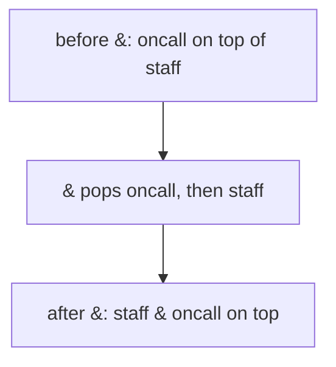
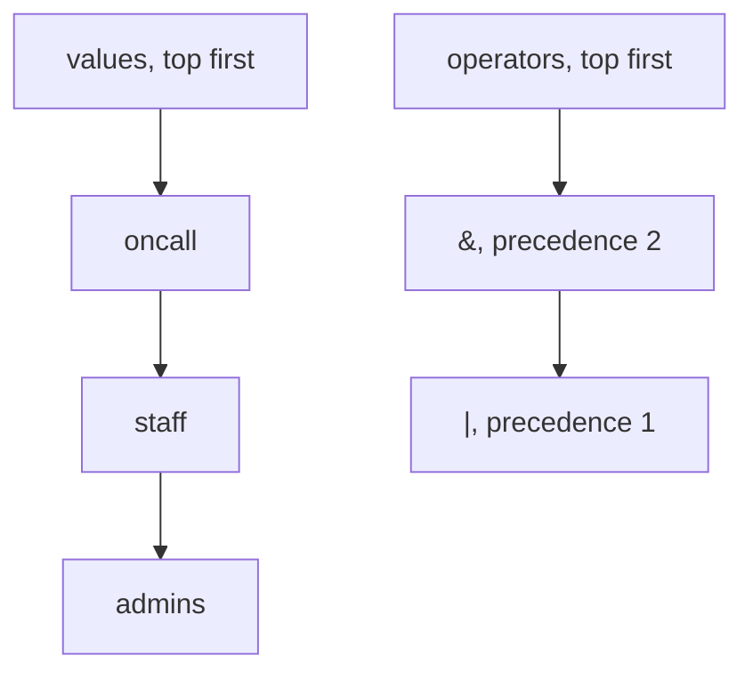

# Evaluating expressions

## The idea

An **expression** combines values with operators: `2 + 3 * 4` in arithmetic, or `admins | staff & oncall` in a filter over groups of users. Written the usual way, with each operator between its two operands, it is called **infix**, and it is ambiguous on its own: does `2 + 3 * 4` mean `(2 + 3) * 4` or `2 + (3 * 4)`? Two rules settle it:

- **Precedence**: some operators bind tighter than others. `*` binds tighter than `+`, so `2 + 3 * 4` is `2 + 12`.
- **Associativity**: operators of the same precedence group in a fixed direction, usually from left to right, so `8 - 3 - 2` is `(8 - 3) - 2`.

Parentheses override both. Every infix expression stands for a tree: each operator is a node whose two children are its operands, and evaluating the expression means evaluating the tree from the leaves up.

This guide evaluates expressions in one left-to-right pass, with stacks, in two ways:

1. **Postfix.** Write each operator after the two values it combines: `2 3 4 * +`. This order needs no precedence and no parentheses, and one stack of values evaluates it.
2. **Two stacks.** Evaluate ordinary infix text directly, with a stack of values and a stack of operators that have to wait.

The examples evaluate filters over groups of users, with three operators on sets: `|` keeps users in either group (union), `&` users in both (intersection), and `-` users in the first but not the second (difference). Like `-` in arithmetic, set difference is not symmetric: `staff - away` and `away - staff` differ.

## A worked example

### Postfix: one stack of values

In postfix order, each operator follows its two operands, and an operand may be the result of an earlier operator. Read the tokens from left to right:

- a **name** pushes its group on the stack;
- an **operator** pops two values, combines them, and pushes the result.

The first value popped is the newer one, and it is the **right** operand: `away -` after `X` means `X - away`, so pop `right`, then pop `left`, then push `left - right`. When the tokens run out, the stack holds the result.

The filter `staff oncall & away - admins |` reads as: the staff who are on call, without those who are away, plus the admins. Here is what its first operator does to the stack:



<!-- text-of-mermaid sha256:03a7d6f08c0c3725eb8375687ac41892f06ef6e55114904487de210ae5eaa675 -->
```text
┌────────────────────────────────┐
│before &: oncall on top of staff│
└────────────────┬───────────────┘
                 ▼
┌────────────────────────────────┐
│   & pops oncall, then staff    │
└────────────────┬───────────────┘
                 ▼
┌────────────────────────────────┐
│ after &: staff & oncall on top │
└────────────────────────────────┘
```

Why are no parentheses needed? Draw the expression as a tree, each operator over its two operands: the union at the root, over the difference and `admins`; the difference over the intersection and `away`; the intersection over `staff` and `oncall`. Postfix lists that tree children first, left before right, then the node itself: `staff oncall &` for the intersection, then `away -`, then `admins |`. The order of the tokens alone says which operator applies to which values.

```python examples/postfix_filter.py
"""Evaluate a filter over groups of users, written in postfix order, with one stack of values.

Each value is a set of user names. The operators are | (union), & (intersection) and
- (difference), and each one is written after the two values it combines.
"""

GROUPS = {
    "admins": {"ana", "bo"},
    "staff": {"bo", "cy", "di", "ed"},
    "oncall": {"cy", "ed", "fay"},
    "away": {"ed"},
}
OPERATIONS = {
    "|": lambda left, right: left | right,
    "&": lambda left, right: left & right,
    "-": lambda left, right: left - right,
}


def show(value: set[str]) -> str:
    return "{" + ", ".join(sorted(value)) + "}"


def evaluate_postfix(tokens: list[str]) -> set[str]:
    values: list[set[str]] = []
    for token in tokens:
        if token in OPERATIONS:
            right = values.pop()  # the newer of the two values is the right operand
            left = values.pop()
            values.append(OPERATIONS[token](left, right))
        else:
            values.append(GROUPS[token])
        print(f"{token:<7} stack, bottom to top: {' '.join(show(value) for value in values)}")
    return values.pop()


tokens = ["staff", "oncall", "&", "away", "-", "admins", "|"]
print("result:", show(evaluate_postfix(tokens)))

staff, oncall, away = GROUPS["staff"], GROUPS["oncall"], GROUPS["away"]
print("the same in Python:", show(((staff & oncall) - away) | GROUPS["admins"]))
print("with the operands of - swapped:", show(away - (staff & oncall)))
```

It prints:

```output examples/postfix_filter.py
staff   stack, bottom to top: {bo, cy, di, ed}
oncall  stack, bottom to top: {bo, cy, di, ed} {cy, ed, fay}
&       stack, bottom to top: {cy, ed}
away    stack, bottom to top: {cy, ed} {ed}
-       stack, bottom to top: {cy}
admins  stack, bottom to top: {cy} {ana, bo}
|       stack, bottom to top: {ana, bo, cy}
result: {ana, bo, cy}
the same in Python: {ana, bo, cy}
with the operands of - swapped: {}
```

Follow the stack. After `staff oncall &`, the two groups are replaced by their intersection, `{cy, ed}`. Then `away` arrives, and `-` combines the two values on top: `{cy, ed} - {ed}` is `{cy}`. Finally `admins |` adds `ana` and `bo`. Each line of the output is one token, and at no point did the program look further ahead than the token in hand. The last line shows what the pop order protects: with the operands of `-` swapped, the answer is the empty set.

### Infix: a stack of values and a stack of operators

Infix text can be evaluated in one pass too. Values go on one stack, as before. Operators cannot apply when they are read, since their right operand has not arrived yet, so they wait on a second stack. The question is when a waiting operator may apply, and precedence answers it:

- When an operator arrives, every waiting operator on top of the stack with **higher or equal** precedence applies first, popping its two operands and pushing the result. Then the new one waits.
- `(` waits on the operator stack as a wall: no operator below it applies before its `)`.
- `)` applies every operator above the matching `(`, then removes the `(`.
- At the end, every operator still waiting applies, from the top down.

Here `&` binds tighter than `|` and `-`, which share one level and group from left to right, just as `*` binds tighter than `+` and `-` in arithmetic.

```python examples/two_stacks.py
"""Evaluate an ordinary (infix) filter in one pass, with a stack of values and a stack of operators.

& binds tighter than | and -, which share one level and group from left to right, like * over +
and - in arithmetic. Parentheses override both rules.
"""

import re

GROUPS = {
    "admins": {"ana", "bo"},
    "staff": {"bo", "cy", "di", "ed"},
    "oncall": {"cy", "ed", "fay"},
    "away": {"ed"},
}
OPERATIONS = {
    "|": lambda left, right: left | right,
    "&": lambda left, right: left & right,
    "-": lambda left, right: left - right,
}
PRECEDENCE = {"|": 1, "-": 1, "&": 2}


def show(value: set[str]) -> str:
    return "{" + ", ".join(sorted(value)) + "}"


def evaluate(text: str, trace: bool = False, left_to_right: bool = True) -> set[str]:
    values: list[set[str]] = []
    operators: list[str] = []

    def apply_top() -> None:
        operator = operators.pop()
        right = values.pop()
        left = values.pop()
        values.append(OPERATIONS[operator](left, right))

    def top_goes_first(new: str) -> bool:
        """Whether the operator on top must apply before `new` joins the stack."""
        if not operators or operators[-1] == "(":
            return False
        waiting = PRECEDENCE[operators[-1]]
        return waiting >= PRECEDENCE[new] if left_to_right else waiting > PRECEDENCE[new]

    for token in re.findall(r"[a-z]+|[()|&-]", text):
        if token == "(":
            operators.append(token)  # a wall: nothing below it applies until its ")" arrives
        elif token == ")":
            while operators[-1] != "(":
                apply_top()
            operators.pop()  # the "(" itself
        elif token in OPERATIONS:
            while top_goes_first(token):
                apply_top()
            operators.append(token)
        else:
            values.append(GROUPS[token])
        if trace:
            shown = " ".join(show(value) for value in values)
            print(f"{token:<7} values: {shown:<40} operators: {' '.join(operators) or '(none)'}")
    while operators:
        apply_top()
    return values.pop()


print("result:", show(evaluate("admins | staff & oncall - away", trace=True)))
admins, staff, oncall, away = (GROUPS[name] for name in ("admins", "staff", "oncall", "away"))
print("the same in Python:", show((admins | (staff & oncall)) - away))

for text in ("admins | staff & oncall", "(admins | staff) & oncall"):
    print(f"{text:<26} = {show(evaluate(text))}")
print("staff - oncall - away, left to right:", show(evaluate("staff - oncall - away")))
print(
    "staff - oncall - away, right to left:",
    show(evaluate("staff - oncall - away", left_to_right=False)),
)
```

It prints:

```output examples/two_stacks.py
admins  values: {ana, bo}                                operators: (none)
|       values: {ana, bo}                                operators: |
staff   values: {ana, bo} {bo, cy, di, ed}               operators: |
&       values: {ana, bo} {bo, cy, di, ed}               operators: | &
oncall  values: {ana, bo} {bo, cy, di, ed} {cy, ed, fay} operators: | &
-       values: {ana, bo, cy, ed}                        operators: -
away    values: {ana, bo, cy, ed} {ed}                   operators: -
result: {ana, bo, cy}
the same in Python: {ana, bo, cy}
admins | staff & oncall    = {ana, bo, cy, ed}
(admins | staff) & oncall  = {cy, ed}
staff - oncall - away, left to right: {bo, di}
staff - oncall - away, right to left: {bo, di, ed}
```

The interesting line is `-`. Just before it arrives, the stacks look like this:



<!-- text-of-mermaid sha256:815eabed970c1c62ea4aea232afb5f15a7d21058808f983ef5a73e4029ff2fa6 -->
```text
┌─────────────────┐    ┌────────────────────┐
│values, top first│    │operators, top first│
└────────┬────────┘    └──────────┬─────────┘
         ▼                        ▼
┌─────────────────┐    ┌────────────────────┐
│      oncall     │    │  &, precedence 2   │
└────────┬────────┘    └──────────┬─────────┘
         ▼                        ▼
┌─────────────────┐    ┌────────────────────┐
│      staff      │    │  |, precedence 1   │
└────────┬────────┘    └────────────────────┘
         ▼
┌─────────────────┐
│      admins     │
└─────────────────┘
```

`-` has precedence 1. The `&` on top has 2, which is higher, so it applies: `staff & oncall` is `{cy, ed}`. Now `|` is on top, with precedence 1, equal to that of `-`, so it applies too: `admins | {cy, ed}`. The operator stack is empty, and `-` waits. At the end it applies to the one remaining pair, and the result matches the fully parenthesized Python expression.

The last lines show the two rules at work. Parentheses change the result: `(admins | staff) & oncall` keeps only the on-call users, `{cy, ed}`. And "equal precedence applies first" is what makes `staff - oncall - away` group from left to right. Applying only strictly higher precedences would compute `staff - (oncall - away)` instead, a different set.

## When to use it

- **A small language of your own**: filters, search queries, conditions in a configuration file, formulas in a report. As soon as the input mixes operators of different precedence and parentheses, the two-stack method evaluates it in one pass with no recursion.
- **Postfix when you choose the format.** If a program writes the expression and another reads it, postfix, or the tree itself, saves the reader all the work on precedence.
- **Stack machines.** Virtual machines that run programs as a sequence of pushes and operations are postfix evaluators; the expert notes show two.

What to use instead: for a full language, with unary operators, function calls and statements, a parser built for it, often recursive descent: one function per precedence level, each calling the next tighter one. And never evaluate text that a user wrote with your language's own `eval`. Python's documentation of `eval` warns that it "executes arbitrary code" and that calling it with untrusted input "will lead to security vulnerabilities".

## Common traps

- **Popping the operands in the wrong order.** The first value popped is the right operand. For `|` and `&` the order does not matter, so the bug hides until an operator like `-` shows up.
- **Getting associativity backwards.** Applying waiting operators of equal precedence makes them group from left to right; applying only strictly higher ones makes them group from right to left. The output shows `staff - oncall - away` giving two different sets. Use "equal applies first" unless the operator really groups from the right, as exponentiation does in mathematics.
- **Comparing with a parenthesis.** `(` is not an operator: the loop that applies waiting operators must stop when it reaches one, and `)` must remove its `(` without applying it.
- **Forgetting the end.** When the input runs out, operators may still be waiting. Apply them all before reading the result.
- **Evaluating untrusted text with `eval`.** It runs whatever code the text contains.

## Complexity

| Method | Time | Space |
|--------|------|-------|
| Postfix, n tokens | O(n) stack operations | O(n): the values waiting for their operator |
| Two stacks, n tokens | O(n) stack operations | O(n) |

Each token is pushed at most once and popped at most once, so the inner loop that applies waiting operators costs O(n) over the whole input, even though one token may trigger many applications. Add the cost of the operations themselves: for numbers that is O(1) each, but a set union costs time in proportion to the sizes of the sets.

## Expert notes

### Where the operator stack comes from

The operator stack and its priority rule come from Edsger Dijkstra's "Making a Translator for ALGOL 60" (published in the APIC Bulletin no. 7, May 1961, and reprinted with his "An ALGOL 60 Translator for the X1" in the Mathematical Centre's report "ALGOL-60 Translation", November 1961), where they serve a translator rather than an evaluator. He wrote that "the translation process shows much resemblance to shunting at a three way railroad junction", and called the stack where operators wait the translator stack. Each operator has a priority number, and before a new operator joins the stack, the waiting operators whose priority is greater than or equal to its own leave first. An opening bracket enters with priority 0, "shielding all postponed operations" until its closing bracket. The report also notes that between brackets, the priority numbers in the stack "increased monotonically": the operator stack is a [monotonic stack](../monotonic-stacks/guide.md).

The first part of the same report says that in the programs its X1 translator produces, algebraic expressions are evaluated "with the help of an accumulator stack", and cites K. Samelson and F. L. Bauer, "Sequentielle Formelübersetzung", Elektronische Rechenanlagen 1 (1959).

### Stack machines

In the Java Virtual Machine, each frame contains "a last-in-first-out (LIFO) stack known as its operand stack". Its specification describes `iadd`: the two `int` values on top of the operand stack are popped, added, and their sum is pushed back. CPython's bytecode works the same way: the `dis` documentation describes `BINARY_OP`, since Python 3.11, as `rhs = STACK.pop()`, then `lhs = STACK.pop()`, then `STACK.append(lhs op rhs)`, the right operand first, exactly as in the postfix evaluator.

### Prefix order

Writing each operator before its operands, `+ 2 * 3 4`, is prefix order, also called Polish notation: the operator comes first instead of last. A prefix expression is evaluated with the same stack, reading the tokens from right to left, where the first value popped is the **left** operand.

## Practice

- `cstudy start evaluate-rpn`: postfix arithmetic on integers, with a rule of its own for division.
- `cstudy start basic-calculator`: infix arithmetic with two levels of precedence and no parentheses.
- `cstudy start tiny-interpreter`: a small expression language in four levels: tokens, a syntax tree that respects precedence, evaluation with closures, and bytecode run on a stack machine.

## Further reading

- E. W. Dijkstra, ["ALGOL-60 Translation"](https://ir.cwi.nl/pub/9251), Mathematisch Centrum, 1961: the shunting junction, the priority rule and the bracket rule are in its second part, "Making a Translator for ALGOL 60".
- [The Java Virtual Machine Specification, §2.6.2 Operand Stacks](https://docs.oracle.com/javase/specs/jvms/se21/html/jvms-2.html#jvms-2.6.2): the operand stack and `iadd`.
- [Python `dis`: `BINARY_OP`](https://docs.python.org/3/library/dis.html#opcode-BINARY_OP): the interpreter stack and the order of its pops.
- [Python `eval`](https://docs.python.org/3/library/functions.html#eval): the warning about untrusted input.
- [Python set types](https://docs.python.org/3/library/stdtypes.html#set-types-set-frozenset): `|`, `&` and `-` on sets.
