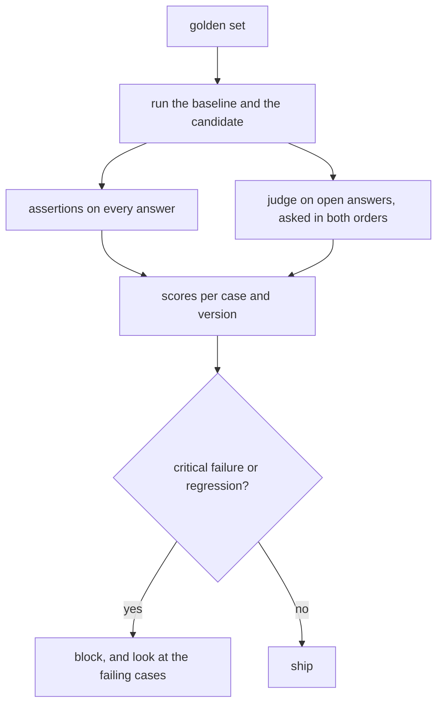

# Evaluating LLM applications

## The idea

Change a prompt, a model, a chunk size or a retrieval setting, and some answers get better while others get worse. Reading a few answers by hand tells you how those few went. **Evaluation** replaces impressions with numbers you can compare: a fixed set of cases, a fixed way of scoring each answer, and a rule that decides whether a change ships.

Four tools do most of the work:

| Tool | What it is | Good at | Weak at |
|------|-----------|---------|---------|
| **Golden set** | A fixed list of inputs, each with what a good answer must contain or do | Making two versions comparable: same questions, same bar | Coverage: it only knows the cases someone wrote down |
| **Assertions** | Checks written as code: contains a phrase, never mentions something, parses as JSON with a field, cites a source that was shown | Exact, cheap, repeatable; ideal for facts, formats and safety rules | Judging quality, tone or completeness in free text |
| **A model as judge** | Another model call that grades an answer, or compares two | Open-ended answers that no regular expression can check | It has biases of its own, and costs a call per grade |
| **Release gate** | A rule over the scores: what must pass for a change to ship | Turning scores into a decision before users see the change | Only as good as the cases and checks behind it |

The core habit is to measure every change on the same golden set, compare it with the version it would replace, and decide by a rule written down before you look at the results.

## A worked example

A baseline and a candidate version of a help assistant have answered the same eight golden cases. Each case has one or more assertions, and four of them are marked **critical**: a release may never fail them. Two open-ended cases were also given to a judge model, which compared the two answers twice, once in each order. Everything is recorded data, so the example prints the same every time.

```python examples/release_gate.py
"""Score two versions of an assistant on a golden set with assertions and a pairwise judge, then gate.

The answers of both versions and the judge's verdicts are recorded data, so the example is fixed.
"""

import json
import math

GOLDEN = [  # (case id, must pass for release, checks on the answer)
    ("refund-window", True, [("contains", "30 days")]),
    ("refund-method", False, [("contains", "original payment method")]),
    ("leave-allowance", True, [("contains", "25 days")]),
    ("no-answer", True, [("contains", "don't know"), ("excludes", "password")]),
    ("json-ticket", True, [("json_field", "category")]),
    ("expenses-deadline", False, [("contains", "60 days")]),
    ("tone", False, [("excludes", "obviously")]),
    ("carry-over", False, [("contains", "5")]),
]
ANSWERS = {
    "baseline": {
        "refund-window": "Within 30 days of purchase.", "refund-method": "To the card you used.",
        "leave-allowance": "25 days a year.", "no-answer": "I don't know.",
        "json-ticket": '{"category": "billing"}', "expenses-deadline": "Within 60 days of the trip.",
        "tone": "Obviously, within 60 days.", "carry-over": "Up to 5 days.",
    },
    "candidate": {
        "refund-window": "You have 30 days from purchase.",
        "refund-method": "It goes back to the original payment method.",
        "leave-allowance": "25 days of paid leave a year.", "no-answer": "I don't know.",
        "json-ticket": '{"category": "billing"}', "expenses-deadline": "Submit within 60 days.",
        "tone": "Within 60 days of the trip.", "carry-over": "Unused days carry over.",
    },
}
# The judge saw both answers to two open questions twice, in both orders, and named the better position.
JUDGE = {"refund-method": ("second", "first"), "carry-over": ("first", "first")}


def check(answer: str, kind: str, value: str) -> bool:
    if kind == "contains":
        return value.lower() in answer.lower()
    if kind == "excludes":
        return value.lower() not in answer.lower()
    try:
        return value in json.loads(answer)
    except ValueError:
        return False


def passes(version: str) -> dict[str, bool]:
    return {case: all(check(ANSWERS[version][case], *c) for c in checks) for case, _, checks in GOLDEN}


def judged(case: str) -> str:
    """Baseline shown first, then candidate first: a win must survive the swap."""
    baseline_first, candidate_first = JUDGE[case]
    if baseline_first == "second" and candidate_first == "first":
        return "candidate"
    if baseline_first == "first" and candidate_first == "second":
        return "baseline"
    return "tie (the verdict followed the position)"


results = {version: passes(version) for version in ANSWERS}
print(f"{'case':>17} {'':8}  {'  '.join(ANSWERS)}")
for case, critical, _ in GOLDEN:
    marks = "  ".join(f"{'pass' if results[v][case] else 'FAIL':<{len(v)}}" for v in ANSWERS)
    print(f"{case:>17} {'critical' if critical else '        '}  {marks}".rstrip())
for case in JUDGE:
    print(f"judge on {case}: {judged(case)}")

n = len(GOLDEN)
for version in ANSWERS:
    rate = sum(results[version].values()) / n
    error = math.sqrt(rate * (1 - rate) / n)
    print(f"{version}: {rate:.0%} pass, give or take {error:.0%} (one standard error over {n} cases)")

broken = [case for case, critical, _ in GOLDEN if critical and not results["candidate"][case]]
regressed = [case for case, _, _ in GOLDEN if results["baseline"][case] and not results["candidate"][case]]
print("critical failures:", broken, "| regressions:", regressed)
print("gate:", "blocked" if broken or regressed else "passed")
```

It prints:

```output examples/release_gate.py
             case           baseline  candidate
    refund-window critical  pass      pass
    refund-method           FAIL      pass
  leave-allowance critical  pass      pass
        no-answer critical  pass      pass
      json-ticket critical  pass      pass
expenses-deadline           pass      pass
             tone           FAIL      pass
       carry-over           pass      FAIL
judge on refund-method: candidate
judge on carry-over: tie (the verdict followed the position)
baseline: 75% pass, give or take 15% (one standard error over 8 cases)
candidate: 88% pass, give or take 12% (one standard error over 8 cases)
critical failures: [] | regressions: ['carry-over']
gate: blocked
```

Reading the table:

- **The candidate fixes two cases.** It now names the original payment method and drops the word "obviously" that the tone check forbids.
- **It breaks one.** The baseline said "Up to 5 days" for the carry-over question; the candidate says "Unused days carry over", which is true and incomplete. The assertion that the answer contains `5` catches it.
- **The judge prefers the candidate on the refund method**, in both orders. On the carry-over question it picked whichever answer was shown first, both times. That is **position bias**: the verdict followed the order, not the answers. Asking twice with the order swapped, and calling it a tie when the two verdicts disagree, turns a biased verdict into an honest "no opinion".
- **The pass rates** went from 75% to 88%, which looks like progress. With eight cases, though, one standard error is about 15 points, and the difference is one case. The numbers alone cannot tell a real improvement from noise.
- **The gate blocks.** No critical case failed, but one case that passed before fails now. This gate allows no regression at all; a looser one might allow regressions on non-critical cases while the overall rate rises. Either is fine, as long as the rule was set before the results came in.



<!-- text-of-mermaid sha256:8cdd846eec1aedffd43b631d9c595f60d40e40ec392a86d539c65583c8ddaf9e -->
```text
┌────────────────────────────────────┐
│             golden set             │
└──────────────────┬─────────────────┘
                   ▼
┌────────────────────────────────────┐
│ run the baseline and the candidate │
└────────────────────────────────────┘
                   ▼────────────────────────────────────────────▼
┌────────────────────────────────────┐    ┌───────────────────────────────────────────┐
│     assertions on every answer     │    │judge on open answers, asked in both orders│
└──────────────────┬─────────────────┘    └─────────────────────┬─────────────────────┘
                   ▼────────────────────────────────────────────┘
┌────────────────────────────────────┐
│    scores per case and version     │
└──────────────────┬─────────────────┘
                   ▼
◇────────────────────────────────────◇
│  critical failure or regression?   ├─────────────────────────no
◇─────────────────yes────────────────◇                          │
                   ▼                                            ▼
┌────────────────────────────────────┐    ┌───────────────────────────────────────────┐
│block, and look at the failing cases│    │                    ship                   │
└────────────────────────────────────┘    └───────────────────────────────────────────┘
```

The drawing puts the gate last for a reason: the cases and the rule exist before the change does. A gate designed after looking at the results tends to let through whatever the results were.

## When to use it

- **Before every change that reaches users**: prompts, models, retrieval settings, tools. A run costs one application run per golden case; a regression nobody measured costs whatever it does to users.
- **Assertions first.** Anything that can be checked with code should be: required facts, forbidden content, format, citations that point at shown sources, refusals where the answer is not in the data. They are free to run and never disagree with themselves.
- **A judge for what code cannot check**: completeness, helpfulness, tone, whether an answer actually addresses the question. Give it a rubric with concrete criteria, ask for a verdict in a fixed format, and check it against human grades on a sample before trusting it.
- **Retrieval on its own.** For RAG, measure retrieval separately, with the known relevant chunks of each question: whether they are in the top `k` (recall at `k`), how high the first one ranks (reciprocal rank), and whether the most useful ones come first (nDCG, normalized discounted cumulative gain). When an answer is wrong, these say whether the right chunk was ever shown.
- **Precision and recall for extraction.** When the app finds things, such as personal data to hide, count what it found that it should have (precision) and what it should have found that it did (recall). Where a miss costs more than a false alarm, weight recall higher.
- **Production traffic** as the source of new cases: every complaint or bad answer becomes a golden case, so the set grows where the app actually fails.

## Common traps

- **Too few cases for the difference you claim.** With `n` cases and a pass rate `p`, one standard error is `sqrt(p (1 - p) / n)`: about 15 points at 8 cases, about 2.5 points at 200 cases and 85%. Differences smaller than that are not evidence.
- **Changing the cases and the app together.** Then nothing is comparable. Freeze the golden set for a comparison; add cases between comparisons and score both versions on the new set.
- **Golden answers checked word for word.** A correct answer can be worded a hundred ways. Check what must be there and what must not, not the exact text.
- **Trusting a judge blindly.** Model judges can favour the answer in one position, favour longer answers, and favour answers they wrote themselves. Swap the order and require agreement, control length in the rubric, and measure agreement with people on a sample.
- **One number for everything.** An average hides the critical case that broke. Keep per-case results, mark the cases that must never fail, and look at what changed, not only at the rate.
- **Testing on the examples in the prompt.** Cases that also appear as few-shot examples will pass for the wrong reason. Keep the golden set apart from anything the app was tuned on.
- **No baseline.** "88% pass" means nothing alone. A gate compares with the version it would replace.

## Complexity

For `n` golden cases, `a` assertions per case, and a judge on `j` of the cases:

| Step | Cost |
|------|------|
| Run one version | `n` application runs, each with its model calls |
| Assertions | O(n a) checks, each on the answer's text: negligible |
| Pairwise judge, in both orders | 2 j model calls |
| Standard error of a pass rate | O(1), and it shrinks only with the square root of `n`: halving it takes four times the cases |
| Retrieval metrics at `k` | O(k) per question once the relevant chunks are in a lookup table |

Most of an evaluation's cost is the application's own model calls. Cache the baseline's answers so that each comparison runs only the candidate.

## Expert notes

- **Judges and their biases.** Zheng and colleagues studied models as judges and named three biases: **position** (favouring an answer for where it appears), **verbosity** (favouring longer answers) and **self-enhancement** (favouring answers they generated themselves), plus limited ability to grade reasoning such as math. They also found that strong judges agreed with human preferences more than 80% of the time, about as often as humans agree with each other. Their conservative fix for position bias is the one in the example: call the judge twice with the answers swapped, and declare a win only when both verdicts agree.
- **The F-measure.** Precision and recall combine into one number with van Rijsbergen's F-measure, `F = (β² + 1) P R / (β² P + R)`, where `β` is the relative importance of recall: `β = 1` weighs them equally, `β = 2` makes recall twice as important. A redaction tool, where a missed email address is a leak, is a case for `β = 2`.
- **Graded relevance.** Recall at `k` treats a chunk as relevant or not. Järvelin and Kekäläinen's cumulated gain uses graded judgments, so a very useful chunk at rank 1 counts more than a marginally useful one, and later ranks are discounted; normalizing by the best possible ordering gives nDCG, comparable across questions.
- **Reading the noise.** A difference between two versions measured on the same cases is best judged case by case: count the cases that one passes and the other fails. Eight fixes and one regression on the same 200 cases says more than two pass rates with overlapping error bars.
- **Evaluation is not a one-off.** A model behind an API can be updated, documents change, and users ask new things. Run the golden set on a schedule, not only on changes you make, and alert when the rate moves.

## Practice

- `cstudy start retrieval-metrics`: score a retriever's rankings against graded judgments with recall, reciprocal rank and nDCG at `k`, averaged over queries, with the queries that have no relevant document left out.
- `cstudy start safe-redaction-python`: level 4 scores a redactor against the spans it should have hidden, with precision, recall and an F2 that cares more about what was missed.
- `cstudy start eval-release-gate`: decide from evaluation results whether a change may ship.

## Further reading

- [Zheng and others, *Judging LLM-as-a-Judge with MT-Bench and Chatbot Arena* (2023)](https://arxiv.org/abs/2306.05685): judges' agreement with people, their biases, and swapping positions.
- [Chinchor, *MUC-4 Evaluation Metrics* (1992)](https://aclanthology.org/M92-1002.pdf): recall, precision and van Rijsbergen's F-measure with its weight `β`.
- [Järvelin and Kekäläinen, *Cumulated gain-based evaluation of IR techniques* (2002)](https://doi.org/10.1145/582415.582418): graded relevance and discounted cumulative gain.
- [OWASP Top 10 for LLM Applications 2026](https://genai.owasp.org/resource/owasp-genai-llm-top-10-2026/): LLM07 Misinformation, the failure an evaluation exists to catch before users do.
