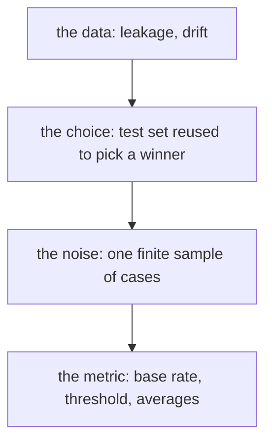

# Evaluation pitfalls: when a good score is wrong

## The idea

A model's score is a measurement, and it answers a narrower question than the one people ask of it. People ask "how well will this model do when we use it?" The score answers "how well did it do on these particular examples, counted this particular way?" Every gap between the two questions is a way to be fooled. They fall into four groups:

| Group | What goes wrong | Defence |
|-------|-----------------|---------|
| **The data** | The test examples do not look like the cases the model will meet: information leaked across the split, or the world changed | Split the way the model will be used; test on recent data; watch the inputs after release |
| **The choice** | The test set was used to choose, so the winner's score is too good | Choose on validation data or by cross-validation; touch the test set once; nest the choice |
| **The noise** | A finite test set gives a number that would move with another sample | Report an interval; compare models on the same cases, paired |
| **The metric** | The number does not match the decision: the wrong base rate, the wrong threshold, an average that hides a group | Measure at the base rate and threshold of use; report per group; read the confusion matrix |

The first two were met in earlier guides: [leakage](../data-splits-and-leakage/guide.md), and the **winner's curse** of [choosing among many](../cross-validation/guide.md): the best of several noisy scores is too good. This guide adds the other two and gathers all four into checks to run before trusting a number.

**Distribution shift** is the general name for the world changing between training and use: new kinds of customers, a new sensor, a season, a competitor, or the model itself changing what people do. A test set drawn from last year cannot see it; only data from the period of use can.



<!-- text-of-mermaid sha256:c6fde6b43df9786edd7f45c59afce526f5e3798227f83b9d1182b5c8ecb814fe -->
```text
┌────────────────────────────────────────────┐
│          the data: leakage, drift          │
└──────────────────────┬─────────────────────┘
                       ▼
┌────────────────────────────────────────────┐
│the choice: test set reused to pick a winner│
└──────────────────────┬─────────────────────┘
                       ▼
┌────────────────────────────────────────────┐
│   the noise: one finite sample of cases    │
└──────────────────────┬─────────────────────┘
                       ▼
┌────────────────────────────────────────────┐
│ the metric: base rate, threshold, averages │
└────────────────────────────────────────────┘
```

The drawing follows a number from where its examples come from to the decision it supports. A check at each step catches a different mistake.

## A worked example

### The same classifier at four base rates

A classifier finds 90% of the positives and flags 5% of the negatives. Those two rates are properties of the classifier. The **base rate**, the share of positives among the cases, is a property of the data, and it changes between a balanced test set and a stream where positives are rare. The program counts what the same classifier does on 100,000 cases at four base rates.

```python examples/base_rates.py
"""The same classifier at four base rates: its recall and false positive rate stay put, its
precision and accuracy do not.

The classifier finds 90% of the positives and flags 5% of the negatives, on 100,000 cases.
"""

RECALL, FALSE_POSITIVE_RATE, CASES = 0.90, 0.05, 100_000

print("positives  flagged  true positives  precision  accuracy")
for share in [0.5, 0.1, 0.01, 0.001]:
    positives = round(CASES * share)
    negatives = CASES - positives
    tp = round(RECALL * positives)
    fp = round(FALSE_POSITIVE_RATE * negatives)
    accuracy = (tp + negatives - fp) / CASES
    print(f"{share:9.1%}  {tp + fp:7}  {tp:14}  {tp / (tp + fp):9.3f}  {accuracy:8.3f}")
```

It prints:

```output examples/base_rates.py
positives  flagged  true positives  precision  accuracy
    50.0%    47500           45000      0.947     0.925
    10.0%    13500            9000      0.667     0.945
     1.0%     5850             900      0.154     0.950
     0.1%     5085              90      0.018     0.950
```

On a balanced test set, 95% of what the classifier flags is positive. On a stream with one positive per thousand, 98% of what it flags is a false alarm: 5,085 flags to find 90 positives. Nothing about the classifier changed, and its ROC point, the recall and false positive rate, is the same in every row; accuracy even rises, because it is dominated by the easy negatives. A model tested on balanced data and deployed on rare events will drown its users in false alarms, and only a precision measured at the base rate of use would have said so.

### Is B really better than A?

Two models answer the same 300 test cases. B's accuracy is higher. The program counts the cases where they disagree and then runs a **paired bootstrap**: it draws 300 cases at random from the 300, with replacement, so some cases come twice and some not at all, computes the difference in accuracy on that sample, and repeats 2,000 times. Both models are always scored on the same drawn cases, which is the "paired" part. The spread of the 2,000 differences shows how much the difference could move with another test set of the same size.

```python examples/paired_bootstrap.py
"""Is model B really better than model A? A paired bootstrap over the test cases.

Both models answered the same 300 test cases, and each case is right or wrong for each model. The
models tend to fail on the same hard cases. Resampling the cases with replacement, many times,
shows how much the difference in accuracy could move with another test set of the same size.
"""

import random

rng = random.Random(1)
N = 300

a_right, b_right = [], []
for _ in range(N):
    hardness = rng.random()
    a_right.append(hardness < 0.80)
    shared = rng.random() < 0.7  # most of the time B finds a case as hard as A does
    b_right.append((hardness if shared else rng.random()) < 0.83)

a, b = sum(a_right) / N, sum(b_right) / N
only_a = sum(x and not y for x, y in zip(a_right, b_right))
only_b = sum(y and not x for x, y in zip(a_right, b_right))
print(f"accuracy: A {a:.3f}, B {b:.3f}, difference {b - a:+.3f}")
print(f"cases only A got right: {only_a}, only B: {only_b}, the other {N - only_a - only_b} agree")

differences = []
for _ in range(2000):
    picks = [int(rng.random() * N) for _ in range(N)]  # the same cases for both models
    differences.append(sum(b_right[i] - a_right[i] for i in picks) / N)
differences.sort()
low, high = differences[49], differences[-50]  # the 50th from each end of 2,000
print(f"95% bootstrap interval of the difference: {low:+.3f} to {high:+.3f}")
print(f"resamples where A did at least as well: {sum(d <= 0 for d in differences) / 2000:.1%}")
```

It prints:

```output examples/paired_bootstrap.py
accuracy: A 0.820, B 0.847, difference +0.027
cases only A got right: 14, only B: 22, the other 264 agree
95% bootstrap interval of the difference: -0.013 to +0.067
resamples where A did at least as well: 10.4%
```

B is 2.7 points ahead, but the whole difference comes from 36 cases where the models disagree, 22 to 14; the other 264 say nothing about which is better. The interval runs from 1.3 points worse to 6.7 points better, and in about one resample in ten A does at least as well. The data was generated so that B really is better, by 3 points, and still 300 cases cannot show it with confidence. A report that says "B: 84.7%, A: 82.0%" invites a decision the data does not support; one that adds the interval says how many more cases a clear answer would need.

Pairing matters. Each model's accuracy alone has an interval about as wide as the difference's, because both move with the luck of which cases are hard. Comparing the two intervals side by side would hide that they move together: the paired difference cancels the shared luck and is the sharper test.

## When to use it

Before trusting a score, ask:

- **Were the test examples set aside before any choice was made,** split the way the model will be used, by group or by time where that matters, with every learned step fitted on the training data only?
- **How many times has this test set been used to choose?** If more than once, the winner's score is optimistic; get a fresh set or measure the whole procedure by nested cross-validation.
- **How large is the difference, against its interval?** Report an interval for every headline number, and compare models paired, on the same cases.
- **Is the base rate of the test set the base rate of use?** If not, recompute precision, and any cost, at the real one.
- **Was the threshold chosen on validation data, by cost?** A threshold tuned on the test set flatters the test score like any other choice.
- **Does every group that matters do well,** or only the average? Report the important groups separately, with their sizes.
- **Is the test data recent?** A model that will run next quarter should be tested on the most recent data available, and watched after release.

## Common traps

- **Iterating on the test set.** Each look that changes the model, a feature added, a threshold moved, a model swapped, spends some of the test set's honesty. After enough looks it is a validation set.
- **A difference without an interval.** Half a point of accuracy on 1,000 cases is five answers; another test set could reverse it.
- **Unpaired comparisons.** Two models scored on different samples, or two intervals compared side by side, mix the luck of the samples into the difference.
- **Balanced test sets for rare events.** Precision, accuracy and F1 change with the base rate, as the example shows; the ROC curve does not, so it says nothing about how many false alarms users will see.
- **The average that hides a group.** A model can improve on average while getting worse for one region, one language or one kind of customer; and a calibration check can pass overall while every group is off in opposite directions.
- **Small groups read as large.** A group of twenty cases can show a large error by chance; report its size and its interval with it.
- **A metric that is not the goal.** Accuracy when the costs of the two errors differ, AUC when the model will run at one threshold, a validation loss when users see rankings.
- **Last year's test set for next year's model.** Behaviour drifts, and a test set frozen in the past measures the past.

## Complexity

For `n` test cases:

| Check | Cost |
|-------|------|
| A metric with its confusion matrix | O(n) |
| Paired bootstrap with `B` resamples | O(B n) time, O(B) to keep and sort the differences, plus O(B log B) to sort |
| Metrics per group, for `g` groups | O(n) with a hash map from group to counts, O(g) space |
| Recomputing precision at another base rate | O(1) from the recall and the false positive rate |
| Nested cross-validation | Each outer fold repeats the whole inner choice; see [cross-validation](../cross-validation/guide.md) |

The bootstrap in the example makes 600,000 draws, a fraction of a second; a model's predictions are computed once and reused by every resample, since only the choice of cases changes.

## Expert notes

- **Reused test sets.** Goodfellow, Bengio and Courville (*Deep Learning*, §5.3) note that when a field uses the same test set for years, every attempt to beat the best result adds up to an optimistic evaluation, and benchmarks go stale. Recht, Roelofs, Schmidt and Shankar (2019) rebuilt the test sets of two long-used image benchmarks by following the original collection process and found accuracy drops of 3% to 15% on one and 11% to 14% on the other. The models kept almost exactly their order, and gains on the old test sets became larger gains on the new ones, so the authors attribute the drops not to adaptivity but to the models failing on slightly harder images, a distribution shift that remained although the original process was followed closely.
- **Adaptive data analysis.** Dwork, Feldman, Hardt, Pitassi, Reingold and Roth (2015) point out that statistical theory assumes the questions are fixed before the data is seen, while in practice each analysis is chosen after looking at the results of the previous ones. They show that by deliberately adding noise to each answer, with techniques from privacy preservation, `n` samples can accurately estimate a number of adaptively chosen quantities exponential in `n`, against a number linear in `n` for plain estimates.
- **The bootstrap.** *The Elements of Statistical Learning* (§7.11) describes the bootstrap, due to Efron (1979), as drawing datasets with replacement from the data, each the size of the original, many times, and studying how a quantity computed from them varies. Its example of a 95% band (§8.2.1) takes, out of 200 bootstrap samples, the fifth largest and fifth smallest values, the same percentile rule as the example's 50th from each end of 2,000.
- **Selection bias, measured.** Cawley and Talbot (2010) found that the performance lost to overfitting a model selection criterion is often as large as the differences between learning algorithms, so comparisons that tune and evaluate on the same data can rank algorithms wrongly.
- **Reporting.** Kapoor and Narayanan propose **model info sheets** for scientific claims based on machine learning: for each type of leakage, the author states how the training and test data were kept apart during preprocessing, feature selection and evaluation, whether there are duplicates, why each feature is legitimate, and why the test set matches the claim. Their reproduction of civil war prediction found that every paper claiming that complex models beat logistic regression failed to reproduce because of leakage.
- **Base rates in the curves.** Fawcett (2006, §4.2) shows why ROC curves do not change with the class balance while accuracy, precision and F scores do, and Saito and Rehmsmeier (2015) that the baseline of a precision-recall plot is the share of positives, so its area changes with the balance too: an area under the precision-recall curve is only comparable between test sets with the same base rate.

## Practice

- `cstudy start classification-metrics`: every class's counts, rates and AUC, with macro and micro averages that tell different stories; its follow-ups ask on which data to choose a threshold and how uncertain a rare class's recall is.
- `cstudy start calibration-metrics`: calibration overall and per slice, where an overall number can look perfect while every slice is off.
- `cstudy start gradient-descent-models`: its level 4 measures what a scaler fitted on all the examples, and a feature chosen with the validation labels in view, do to the validation error.

## Further reading

- [Recht, Roelofs, Schmidt and Shankar, *Do ImageNet Classifiers Generalize to ImageNet?* (arXiv 1902.10811)](https://arxiv.org/abs/1902.10811): new test sets for two long-used benchmarks.
- [Dwork, Feldman, Hardt, Pitassi, Reingold and Roth, *Preserving Statistical Validity in Adaptive Data Analysis* (arXiv 1411.2664)](https://arxiv.org/abs/1411.2664): estimates that stay valid when each question depends on earlier answers.
- [Hastie, Tibshirani and Friedman, *The Elements of Statistical Learning*, second edition](https://hastie.su.domains/ElemStatLearn/): §7.11 and §8.2.1, the bootstrap.
- [Cawley and Talbot, *On Over-fitting in Model Selection and Subsequent Selection Bias in Performance Evaluation*, JMLR 11, 2010](https://www.jmlr.org/papers/v11/cawley10a.html): the size of selection bias.
- [Kapoor and Narayanan, *Leakage and the Reproducibility Crisis in ML-based Science* (arXiv 2207.07048)](https://arxiv.org/abs/2207.07048): model info sheets.
- [Fawcett, *An introduction to ROC analysis*, Pattern Recognition Letters 27(8), 2006](https://doi.org/10.1016/j.patrec.2005.10.010): class skew and ROC curves.
