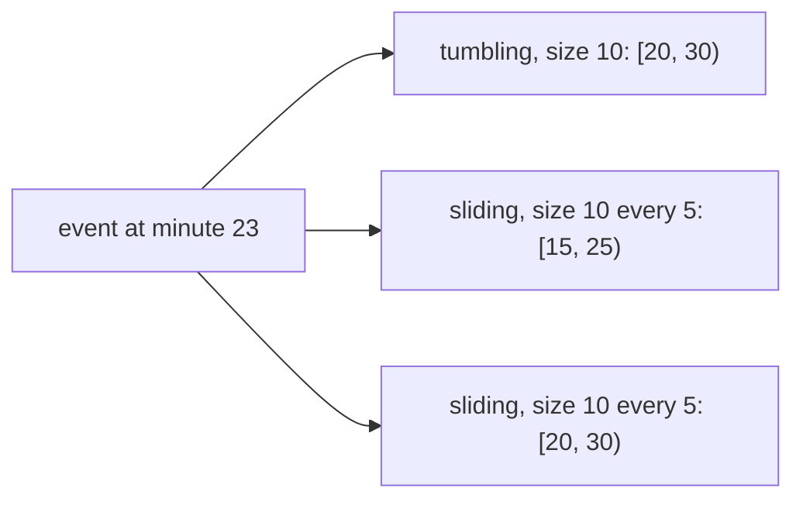
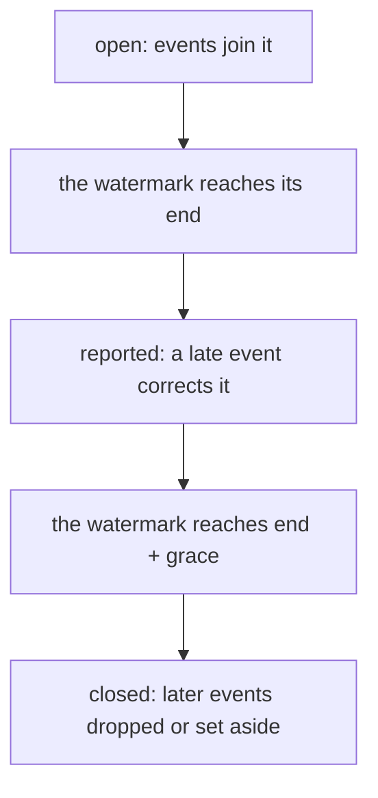

# Event time, windows and watermarks

## The idea

Every record in a stream has two times.

- Its **event time** is when the thing it describes happened: when the reading was taken, the page viewed, the payment made. It is written into the record by whatever produced it, and it never changes.
- Its **processing time** is when the pipeline sees the record. It depends on networks, queues, retries and devices that go offline, and it is different at every step the record passes through.

The gap between the two is called **skew**, and it is never constant. Most questions are about event time: "how many views per minute", "the highest temperature per hour" mean the minutes and hours in which things happened. Grouping by processing time is easy, since it only needs a clock, but it puts each record where it happened to arrive, which is wrong whenever the skew changes.

A stream never ends, so a question about it must be cut into finite pieces of time. A **window** is such a piece, written `[start, end)`: it holds the event times `t` with `start <= t < end`, so that two windows that touch share no moment. Three shapes are common:

| Window | Defined by | Each event falls in |
|--------|-----------|---------------------|
| **Tumbling** (also called fixed) | A size: `[0, 10)`, `[10, 20)`, ... | Exactly one window |
| **Sliding** (the Dataflow paper's word; some engines, and the practice problem, call them hopping) | A size and a period: windows of 10 minutes starting every 5 | `size / period` windows when the period divides the size; none, if the period is longer than the size and the event falls in a gap |
| **Session** | A gap of inactivity, per key | One session: the burst of that key's activity it belongs to |



<!-- text-of-mermaid sha256:5d3016ab03184f80ed3156b170097919039e6beacd408bb614d5a780dcf7d1ba -->
```text
┌──────────────────┐    ┌──────────────────────────────────┐
│event at minute 23├───►│   tumbling, size 10: [20, 30)    │
└─────────┬────────┘    └──────────────────────────────────┘
          │
          │             ┌──────────────────────────────────┐
          ├────────────►│sliding, size 10 every 5: [15, 25)│
          │             └──────────────────────────────────┘
          │
          │             ┌──────────────────────────────────┐
          └────────────►│sliding, size 10 every 5: [20, 30)│
                        └──────────────────────────────────┘
```

The drawing places one event. A tumbling window starts at a multiple of its size, so minute 23 belongs to `[20, 30)`. Sliding windows of 10 minutes that start every 5 overlap, and two of them contain minute 23. A tumbling window is the sliding window whose period equals its size.

A **session** is built differently: give each event a window that reaches one gap past it, and merge windows of the same key that overlap. The Dataflow paper uses a 30-minute gap: events of one user at 13:02 and 13:20 have the windows `[13:02, 13:32)` and `[13:20, 13:50)`, which overlap and merge into `[13:02, 13:50)`; an event at 13:57 starts a new session, `[13:57, 14:27)`. Sessions are the only shape of the three whose boundaries depend on the data itself.

Windows say *where* in event time records belong. They do not say *when* a window is complete, since a record for it may still be on its way. A **watermark** answers that. It is a time `W` that moves forward as the stream is read, and that says: events older than `W` are not expected any more. When `W` reaches the end of a window, the window is treated as complete and its result is reported. An event that arrives with a time behind the watermark, for a window already reported, is **late**.

A perfect watermark would need to know about every record still in flight, including those on a phone in the mountains with no signal. Real watermarks are therefore **heuristic**: a simple one trails the latest event time seen by a fixed bound, on the bet that nothing arrives more than that bound out of order.

## A worked example

### Two clocks

A temperature sensor reports every few minutes. It went offline from minute 6 to minute 14 and uploaded the three readings it had buffered at minute 15. One of them, at minute 7, is a spike of 35 degrees. Here is the highest reading per 10 minutes, computed once by event time and once by processing time:

```python examples/two_clocks.py
"""The highest temperature per 10 minutes, grouped by event time and by processing time.

A sensor was offline from minute 6 to minute 14 and uploaded what it had buffered at minute 15.
Grouping by the minute a reading happened (event time) keeps the spike at minute 7 where it
belongs; grouping by the minute it arrived (processing time) moves it into the next window.
"""

SIZE = 10
READINGS = [  # (minute it happened, minute it arrived, degrees Celsius)
    (1, 1, 20),
    (4, 4, 21),
    (7, 15, 35),
    (9, 15, 22),
    (12, 15, 23),
    (16, 16, 24),
    (18, 18, 25),
]


def window_of(minute: int) -> tuple[int, int]:
    """The tumbling window [start, end) that holds a minute."""
    start = minute - minute % SIZE
    return start, start + SIZE


def highest_by(clock: int) -> dict[tuple[int, int], int]:
    highest: dict[tuple[int, int], int] = {}
    for reading in READINGS:
        window = window_of(reading[clock])
        highest[window] = max(highest.get(window, reading[2]), reading[2])
    return dict(sorted(highest.items()))


for name, clock in (("event time", 0), ("processing time", 1)):
    windows = ", ".join(f"[{s}, {e}) max {c}" for (s, e), c in highest_by(clock).items())
    print(f"{name:>15}: {windows}")
```

It prints:

```output examples/two_clocks.py
     event time: [0, 10) max 35, [10, 20) max 25
processing time: [0, 10) max 21, [10, 20) max 35
```

By event time, the spike is in the first ten minutes, where it happened. By processing time, the first ten minutes look calm and the spike lands in the second window, among readings taken up to eleven minutes after it. Anyone asking "when did it overheat?" would be told the wrong time.

### Two watermarks

Event time is right, but it raises the question the processing-time version never had: when is the window `[0, 10)` finished? The next program reads one stream of readings, in the order they arrive, and reports the highest value per 10-minute window. Its watermark is the latest event time seen, minus a bound. It runs twice, with a bound of 0 and with a bound of 5; a reading whose window has already been reported is dropped.

```python examples/watermarks.py
"""One stream, two watermarks: when each 10-minute window is reported, and what arrives too late.

The watermark trails the latest event time seen by a fixed bound. A window is reported once the
watermark reaches its end; a reading whose window has already been reported is dropped. A small
bound reports sooner and drops more; a larger one waits longer and drops less.
"""

SIZE = 10
READINGS = [  # (event time, value), in the order they arrive
    (2, 18),
    (5, 22),
    (11, 19),
    (7, 31),
    (14, 20),
    (21, 17),
    (9, 40),
    (25, 16),
    (32, 15),
]


def run(bound: int) -> None:
    watermark = 0
    highest: dict[int, int] = {}  # window start -> highest value so far, for windows not reported
    dropped = []
    print(f"bound {bound}:")
    for time, value in READINGS:
        start = time - time % SIZE
        if start + SIZE <= watermark:  # its window was already reported
            dropped.append((time, value))
            continue
        highest[start] = max(highest.get(start, value), value)
        watermark = max(watermark, time - bound)
        for done in sorted(s for s in highest if s + SIZE <= watermark):
            print(f"  after {time:>2}, watermark {watermark:>2}: "
                  f"[{done}, {done + SIZE}) max {highest.pop(done)}")
    print(f"  dropped {dropped}, still open {sorted(highest)}")


run(0)
run(5)
```

It prints:

```output examples/watermarks.py
bound 0:
  after 11, watermark 11: [0, 10) max 22
  after 21, watermark 21: [10, 20) max 20
  after 32, watermark 32: [20, 30) max 17
  dropped [(7, 31), (9, 40)], still open [30]
bound 5:
  after 21, watermark 16: [0, 10) max 31
  after 25, watermark 20: [10, 20) max 20
  dropped [(9, 40)], still open [20, 30]
```

With a bound of 0, the reading at minute 11 moves the watermark to 11, past the end of `[0, 10)`, which is reported at once with a maximum of 22. Then the reading of 31 at minute 7 arrives: it is late, and dropped, so the reported maximum is wrong. With a bound of 5, the watermark after minute 11 is only 6, the reading at minute 7 still joins its window, and `[0, 10)` is reported later, after minute 21, with the right maximum of 31. The reading of 40 at minute 9 arrives so late that both watermarks drop it.

That is the whole trade-off of a heuristic watermark, in the words of the Dataflow paper: it can be **too fast**, reporting before all data has arrived, or **too slow**, holding results back. A larger bound is slower and more often right; no bound is right for every record.

### The life of a window

Late data can be handled in a few ways, alone or together. It can be dropped, and counted, as one pipeline in the MillWheel paper did. Each window can be kept open for a while after it is first reported, a **grace period**, with a corrected result reported when late data arrives. Other pipelines in the MillWheel paper corrected their aggregates when late records came; the paper does not say for how long. Or late data can go to a separate output, for someone to look at.



<!-- text-of-mermaid sha256:47669d546249fb85c0227baedfa64b6fe3864e0f2a94dba6f43585ae589cf2c2 -->
```text
┌─────────────────────────────────────────┐
│           open: events join it          │
└────────────────────┬────────────────────┘
                     ▼
┌─────────────────────────────────────────┐
│      the watermark reaches its end      │
└────────────────────┬────────────────────┘
                     ▼
┌─────────────────────────────────────────┐
│    reported: a late event corrects it   │
└────────────────────┬────────────────────┘
                     ▼
┌─────────────────────────────────────────┐
│    the watermark reaches end + grace    │
└────────────────────┬────────────────────┘
                     ▼
┌─────────────────────────────────────────┐
│closed: later events dropped or set aside│
└─────────────────────────────────────────┘
```

The drawing follows one window. It is **open** while events can join it. When the watermark reaches its end it is **reported**, and during the grace period a late event changes it and causes a corrected report. Once the watermark passes the end plus the grace period, nothing changes it any more, and its state can be thrown away: the grace period bounds how much state the processor keeps.

When a window is reported more than once, the reader of its results must know how the reports relate. The Dataflow paper names three modes:

| Mode | A new report for a window | Fits a reader that |
|------|--------------------------|--------------------|
| **Discarding** | Covers only the data since the last report | Adds every report it receives |
| **Accumulating** | Covers all the window's data so far | Keeps only the latest report per window |
| **Accumulating and retracting** | Comes after a retraction of the previous report, then the new full result | Adds reports, or groups them again downstream |

A **retraction** tells the reader to undo the previous result. For a count or a sum it can be the previous result with its sign flipped, so that a reader that adds everything up removes the old result before adding the new one.

## When to use it

- **Event time** whenever the question is about when things happened, which is almost always: metrics per minute, billing per day, behaviour per session. Use processing time only for questions about the pipeline itself, such as how much it handled per second.
- **Tumbling windows** for reports by period: per minute, per hour, per day.
- **Sliding windows** for moving measures that should update more often than their length: "the error rate over the last 10 minutes, every minute".
- **Session windows** for activity with natural pauses: visits to a site, viewing sessions, a user's burst of actions.
- **A watermark bound** chosen from what you know of the sources: how far out of order they arrive, and how long a report may wait. Watch how much is dropped, and tune.
- **A grace period** when late corrections are worth the state they cost, and the readers can handle corrected results.

## Common traps

- **Grouping by arrival time.** It is the default when the records carry no event time, or when it is ignored, and it is right only if nothing is ever delayed.
- **Closed windows.** A window that includes its end puts an event at minute 10 into both `[0, 10]` and `[10, 20]`. Use half-open windows and compare with `<` at the end.
- **Dropping late data silently.** If late records are dropped, count them and keep the count visible: a sudden rise means a source or the bound changed.
- **One slow source holding everything back.** A watermark is a single progress measure; the Dataflow paper notes that one slow record can hold it back for the whole pipeline. A source that goes quiet can stop every window from being reported.
- **Trusting device clocks.** Event time is written by the device that produced the event, so a device with a wrong clock puts its events into the wrong windows. Validate event times against a plausible range.
- **Adding up accumulating results.** A reader that sums every report of an accumulating stream counts the early part of each window again with every correction. The reader and the mode must match.
- **Sessions that never close.** A key that is active without ever pausing for a whole gap keeps one session growing. Cap a session's length, or know that it is unbounded.

## Complexity

For `n` events, a sliding window of size `s` and period `p`, and `w` windows open at a time:

| Operation | Time | State |
|-----------|------|-------|
| Assign an event to its tumbling window | O(1) | |
| Assign an event to its sliding windows | O(s / p) windows | |
| Update a window's result, for a result that combines one value at a time (count, sum, maximum) | O(1) on average, with a hash map from window to result | O(1) per window, not per event |
| Report windows when the watermark moves | O(w) by scanning, or O(log w) each with the windows kept in order of their end | |
| Keep windows for corrections | | Every window whose end plus grace is ahead of the watermark |
| Sessions | O(log k) per event to find the neighbours among a key's `k` sessions kept in order, plus merging | One entry per open session |

Results like the median or a distinct count do not combine one value at a time cheaply; they keep more per window, or an approximate summary.

## Expert notes

- **The Dataflow model.** Akidau and colleagues separate four questions: what is computed, where in event time (windowing), when in processing time results are emitted (triggering), and how later results relate to earlier ones (the three modes above). A **trigger** fires a window's result, called a **pane**, on a signal: the watermark passing the window's end, a period of processing time, a count of records, or combinations of these. The paper calls sessions the main contribution of its windowing model over existing ones.
- **Aligned and unaligned windows.** Tumbling and sliding windows are aligned: the same windows apply to every key. Sessions are unaligned, defined per key. The paper notes that fixed windows are sometimes shifted by a random phase per key, to spread the work of completing windows evenly over time.
- **Low watermarks.** The MillWheel paper (2013) defines a computation's low watermark recursively, as the minimum of the oldest unfinished work in that computation and the low watermarks of the computations that feed it. The sources seed the values; since what they measure of pending work outside the system is often an estimate, computations should expect a small rate of late records. One pipeline in the paper dropped them and tracked how many, around 0.001%, while others corrected their aggregates; the system keeps each watermark monotonic even in the face of late data.
- **Percentile watermarks.** The Dataflow paper mentions triggers on percentile watermarks, for when processing a minimum share of the input quickly matters more than processing every last record.
- **Why retractions exist.** The paper explains that when windowed results are grouped again downstream, for example by a property of each session, a corrected result can land on a different key than the result it replaces; without a retraction, the old result would stay counted there.
- **Heuristics that work.** The paper reports that for structured sources that expose what they have not delivered yet, such as log files, heuristic watermarks are remarkably accurate, and that the hard cases are sources such as a phone taken somewhere without a connection, which may upload its data whenever it comes back.

## Practice

- `cstudy start stream-windows`: tumbling, hopping and session windows over the events received so far; then the same events as a live stream, where a watermark decides when each window is reported and late events either correct a reported result or are set aside.

## Further reading

- [Akidau and others, *The Dataflow Model: A Practical Approach to Balancing Correctness, Latency, and Cost in Massive-Scale, Unbounded, Out-of-Order Data Processing* (VLDB 2015)](https://www.vldb.org/pvldb/vol8/p1792-Akidau.pdf): event time and processing time, fixed, sliding and session windows, watermarks, triggers, and the discarding, accumulating, and accumulating and retracting modes.
- [Akidau and others, *MillWheel: Fault-Tolerant Stream Processing at Internet Scale* (VLDB 2013)](https://www.vldb.org/pvldb/vol6/p1033-akidau.pdf): low watermarks, their recursive definition, and late records.
