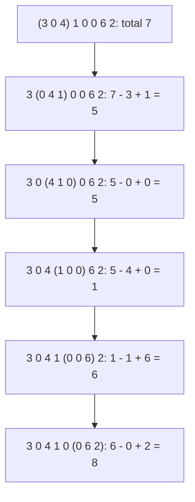

# Fixed-size sliding windows

## The idea

A **window** is a stretch of consecutive positions. A window of size `k` that starts at position `i` covers positions `i` to `i + k - 1`, and an array of `n` values has `n - k + 1` windows of size `k` when `k <= n`. Many questions are about every one of them: the rainfall of every three days in a row, the number of different visitors in every week, whether some block of `k` letters has a property.

Computing each window from scratch takes `k` steps, so all of them take O((n - k + 1) · k). That is about `n² / 4` when `k` is near `n / 2`.

Neighboring windows share almost everything. When the window moves one place to the right, `k - 1` of its values stay, **one value enters** on the right and **one value leaves** on the left. If the window's summary can take in one value and give up another in O(1), each move costs O(1), and all the windows together cost O(n). The window's two edges are two pointers moving in the same direction, always `k` apart.

Rainfall over eight days, `[3, 0, 4, 1, 0, 0, 6, 2]`, totaled over every 3 days. The first window is added up once; after that, each total is the previous one minus the day that leaves plus the day that enters:



<!-- text-of-mermaid sha256:523cebb8a97c08b9bb89aded36dccf5ffbf76bf1e555b805df51d28f9ebb7791 -->
```text
┌────────────────────────────────┐
│   (3 0 4) 1 0 0 6 2: total 7   │
└────────────────┬───────────────┘
                 ▼
┌────────────────────────────────┐
│3 (0 4 1) 0 0 6 2: 7 - 3 + 1 = 5│
└────────────────┬───────────────┘
                 ▼
┌────────────────────────────────┐
│3 0 (4 1 0) 0 6 2: 5 - 0 + 0 = 5│
└────────────────┬───────────────┘
                 ▼
┌────────────────────────────────┐
│3 0 4 (1 0 0) 6 2: 5 - 4 + 0 = 1│
└────────────────┬───────────────┘
                 ▼
┌────────────────────────────────┐
│3 0 4 1 (0 0 6) 2: 1 - 1 + 6 = 6│
└────────────────┬───────────────┘
                 ▼
┌────────────────────────────────┐
│3 0 4 1 0 (0 6 2): 6 - 0 + 2 = 8│
└────────────────────────────────┘
```

The values in parentheses are the window. The first window is added up in full; each of the five others costs one subtraction and one addition, whatever the window's size.

A summary can slide when the effect of one value can be **undone**:

| Summary | A value enters | A value leaves |
|---------|----------------|----------------|
| Sum | Add it | Subtract it |
| How many values have a property | Add 1 if it has it | Subtract 1 if it has it |
| A count per value | Add 1 to its count | Subtract 1; at 0, remove the entry |
| XOR of the values | XOR it in | XOR it again, which undoes it |
| Largest value | Compare it | Cannot be undone: the summary does not say which value is next largest |

## A worked example

How many different values does each window of 4 hold, in `[4, 4, 1, 3, 4, 2, 2, 2, 5]`? Keep a map from each value in the window to how many times it occurs there. The number of different values is the number of entries. When a value enters, add 1 to its count. When it leaves, subtract 1, and remove the entry when the count reaches 0, so that the number of entries stays right.

The program adds the entering value, records the window once it is full, then removes the value at the window's left edge, ready for the next move:

| Right edge | Enters | Window | Counts | Different | Then leaves |
|------------|--------|--------|--------|-----------|-------------|
| 3 | 3, after 4, 4, 1 | `4 4 1 3` | 4: 2, 1: 1, 3: 1 | 3 | 4, count down to 1 |
| 4 | 4 | `4 1 3 4` | 4: 2, 1: 1, 3: 1 | 3 | 4, count down to 1 |
| 5 | 2 | `1 3 4 2` | 4: 1, 1: 1, 3: 1, 2: 1 | 4 | 1, entry removed |
| 6 | 2 | `3 4 2 2` | 4: 1, 3: 1, 2: 2 | 3 | 3, entry removed |
| 7 | 2 | `4 2 2 2` | 4: 1, 2: 3 | 2 | 4, entry removed |
| 8 | 5 | `2 2 2 5` | 2: 3, 5: 1 | 2 | 2, the last window is done |

```python examples/fixed_windows.py
"""Slide a window of k values: one value enters, one leaves, and the summary is updated."""

import math
from collections import deque
from itertools import islice


def rolling_sums(values: list[int], k: int) -> list[int]:
    """The sum of every window of k consecutive values."""
    total = sum(values[:k])  # the first window, built once
    sums = [total]
    for right in range(k, len(values)):
        total += values[right] - values[right - k]  # one value enters, one leaves
        sums.append(total)
    return sums


rain = [3, 0, 4, 1, 0, 0, 6, 2]
print("3-day rainfall totals:", rolling_sums(rain, 3))
print("recomputed each time: ", [sum(rain[i:i + 3]) for i in range(len(rain) - 2)])


def distinct_per_window(values: list[int], k: int) -> list[int]:
    """How many different values each window of k holds, with a count per value."""
    counts: dict[int, int] = {}
    result = []
    for right, entering in enumerate(values):
        counts[entering] = counts.get(entering, 0) + 1
        left = right - k + 1  # where the window that ends at `right` starts
        if left < 0:
            continue  # the first window is not full yet
        print(f"  window {left}..{right} {values[left:right + 1]}: {len(counts)} distinct")
        result.append(len(counts))
        leaving = values[left]
        counts[leaving] -= 1
        if counts[leaving] == 0:
            del counts[leaving]  # a zero count left behind would still be counted by len()
    return result


visits = [4, 4, 1, 3, 4, 2, 2, 2, 5]
print("distinct values in each window of 4 of", visits)
sliding = distinct_per_window(visits, 4)
print("sliding:", sliding, "| recomputed:", [len(set(visits[i:i + 4])) for i in range(6)])


def sliding_window(iterable, n):  # the recipe of the itertools documentation
    iterator = iter(iterable)
    window = deque(islice(iterator, n - 1), maxlen=n)
    for x in iterator:
        window.append(x)  # a full deque drops its oldest value by itself
        yield tuple(window)


print("windows of 3 from the recipe:", [sum(window) for window in sliding_window(rain, 3)])

floats = [1e16, 1.0, 1.0]
rolling = floats[0] + floats[1]  # the first window of 2; the 1.0 is rounded away
rolling -= floats[0]  # slide: 1e16 leaves...
rolling += floats[2]  # ...and 1.0 enters
print("rolling float sum of [1.0, 1.0]:", rolling, "| math.fsum:", math.fsum(floats[1:]))
```

It prints:

```output examples/fixed_windows.py
3-day rainfall totals: [7, 5, 5, 1, 6, 8]
recomputed each time:  [7, 5, 5, 1, 6, 8]
distinct values in each window of 4 of [4, 4, 1, 3, 4, 2, 2, 2, 5]
  window 0..3 [4, 4, 1, 3]: 3 distinct
  window 1..4 [4, 1, 3, 4]: 3 distinct
  window 2..5 [1, 3, 4, 2]: 4 distinct
  window 3..6 [3, 4, 2, 2]: 3 distinct
  window 4..7 [4, 2, 2, 2]: 2 distinct
  window 5..8 [2, 2, 2, 5]: 2 distinct
sliding: [3, 3, 4, 3, 2, 2] | recomputed: [3, 3, 4, 3, 2, 2]
windows of 3 from the recipe: [7, 5, 5, 1, 6, 8]
rolling float sum of [1.0, 1.0]: 1.0 | math.fsum: 2.0
```

- The sliding totals match the totals recomputed from slices, which cost `k` steps per window.
- The different-value counts match `len(set(...))` of every window. Without the `del`, a value whose count dropped to 0 would still be an entry, and the window `4 2 2 2` would report 4 different values instead of 2.
- The recipe from the `itertools` documentation builds every window as a tuple from a `deque` with `maxlen`, which drops its oldest value by itself. Summing each tuple recomputes the window, though: the recipe gives you the windows, not an O(1) update.
- With floating-point values, adding and later subtracting a large value loses the small ones added in between. The rolling total says the window `[1.0, 1.0]` holds 1.0.

## When to use it

- The question names a **fixed length**: every `k` days, every block of `k` characters, windows of a given size.
- The summary of a window can **take in and give up** one value cheaply: sums, counts, counts per value, XOR.

When the windows have no fixed length but must obey a rule, use [variable-size windows](../variable-size-windows/guide.md). When you need the sums of many stretches of different lengths in data that does not change, [prefix sums](../prefix-sums-with-hash-maps/guide.md) answer each in O(1) after one O(n) pass. When the summary cannot give up a value, such as the largest value, you need a structure that can forget the oldest value efficiently: `sliding-window-maximum` practises one.

## Common traps

- **Off by one at the edges.** There are `n - k + 1` windows, and none when `k > n`. The window that ends at position `r` starts at `r - k + 1`, and the first full window ends at `k - 1`. Recording a result before the first window is full reports a window that is too short.
- **Counts of zero left in the map.** A value whose count dropped to 0 is no longer in the window, but its entry still counts in `len()`. Python's `Counter` behaves the same: setting a count to 0 does not remove the element; `del` does.
- **Recomputing through slices.** `sum(values[i:i + k])` looks like one step, but the slice copies `k` values into a new list and the sum adds them up: O(k) per window, O(n · k) in all.
- **Floating-point drift.** Subtracting a value does not exactly undo adding it once rounding has happened, as the example shows, and the error grows over a long run. Count in integers when you can, such as cents or tenths of a millimeter. Otherwise recompute the window's sum now and then, or for each window with `math.fsum` when exactness matters, at O(k) per window.

## Complexity

| Approach | Time | Extra space |
|----------|------|-------------|
| Recompute every window | O((n - k + 1) · k) | O(1) for a sum |
| Slide, with a sum or a count | O(n) | O(1) |
| Slide, with a count per value in a hash map | O(n) on average | O(d), for the `d <= k` different values in the window |

Each position enters the window once and leaves it once, so there are at most `2n` updates, each O(1) for a sum, and O(1) on average for a hash map under the usual assumption of a well-spread hash.

## Expert notes

- **Which summaries slide.** The summary must let you remove one value's contribution without seeing the others. Sums, counts and XOR do; the largest and the smallest value do not, and neither does the median. Those need a structure that keeps the window's values, or the useful part of them, in an order that survives removals.
- **Prefix sums are the static alternative.** With `prefix[i]`, the sum of the first `i` values, the sum of the window from `l` to `r` is `prefix[r + 1] - prefix[l]`. One pass builds the table, and then any window, of any size, costs one subtraction.
- **Rolling hashes.** A polynomial hash of a window of characters, `h = c[0]·B^(k-1) + c[1]·B^(k-2) + ... + c[k-1]` modulo some `M`, slides too: subtract `c[0]·B^(k-1)`, multiply by `B`, add the entering character, all modulo `M`. Checking every window of a text against a pattern's hash then costs O(1) per window. Different windows can share a hash, so a match of hashes is confirmed by comparing the characters.
- **Windows that jump.** Windows can move `s > 1` positions at a time and overlap by `k - s` values, as when long text is cut into overlapping chunks. The work per move is then `s` values in and `s` out, and the edge cases move to the end: where the last window starts, and what happens to a final stretch shorter than `k`.
- **Python's tools.** A `deque` created with `maxlen=k` keeps the last `k` values: once full, appending a value discards one from the other end. `itertools.pairwise`, added in 3.10, yields the overlapping windows of 2. `itertools.batched`, added in 3.12, yields consecutive tuples of `n` values, the last possibly shorter: blocks, not sliding windows.

## Practice

- `cstudy start max-average-fixed-window`: the best average over any run of exactly `k` days of takings.
- `cstudy start permutation-in-string`: a window whose size comes from another string, compared with that string's letter counts.
- `cstudy start chunking-with-overlap`: windows of words that overlap and jump forward, with a practical rule for where each one ends.
- `cstudy start sliding-window-maximum`: a summary that cannot be undone, and the structure that makes it slide anyway.

## Further reading

- [Python `collections.deque`](https://docs.python.org/3/library/collections.html#collections.deque): `maxlen`, and how a full deque discards from the opposite end.
- [Python `collections.Counter`](https://docs.python.org/3/library/collections.html#collections.Counter): a zero count for missing items, and why a count set to zero must be deleted.
- [Python `itertools.pairwise`](https://docs.python.org/3/library/itertools.html#itertools.pairwise), [`itertools.batched`](https://docs.python.org/3/library/itertools.html#itertools.batched) and the [itertools recipes](https://docs.python.org/3/library/itertools.html#itertools-recipes), which include `sliding_window`.
- [Python `math.fsum`](https://docs.python.org/3/library/math.html#math.fsum): an accurate floating-point sum that tracks partial sums.
- [Python tutorial, lists](https://docs.python.org/3/tutorial/introduction.html#lists): every slice operation returns a new list.
